#+TITLE: 代码本色: 使用 JavaScript 模拟自然系统
#+SUBTITLE: The Nature of Code: Simulating Natural Systems with JavaScript
#+AUTHOR: Daniel Shiffman
#+LANGUAGE: zh-CN
#+OPTIONS: toc:3 num:nil ^:nil
#+STARTUP: content indent
#+PROPERTY: header-args :eval never-export
#+PROPERTY: header-args:javascript :eval never-export
#+PROPERTY: header-args:js :eval never-export
#+PROPERTY: header-args:html :eval never-export
#+EXPORT_FILE_NAME: The_Nature_of_Code_zh_CN_complete

* 版本说明
:PROPERTIES:
:CUSTOM_ID: edition-note
:PDF_PAGE_RANGE: 1-643
:END:

- 原书: /The Nature of Code: Simulating Natural Systems with JavaScript/
- 作者: Daniel Shiffman
- 出版社: No Starch Press
- 原书年份: 2024
- 合并范围: PDF 第 1-643 页, 包含封面、版权、献词、作者简介、目录、致谢、引言、第 0-11 章、附录、图片来源、索引和封底.
- 文件来源: 由 Batch 01-14 按 PDF 页码顺序合并, 统一使用一个 =images/= 目录.
- 处理规则: 正文翻译为简体中文; JavaScript、p5.js、ml5.js、Matter.js 等标识符、函数名、字符串和 URL 保持原样; 代码使用 Org 源码块; 数学表达式使用 Org/LaTeX 语法; 原书图片按正文位置以相对路径插入.
- 图片总数: 385 张.
- 用途说明: 本文件是对用户提供 PDF 的个人学习用途格式转换与翻译. 原书版权和许可声明保持有效.

* 封面
:PROPERTIES:
:CUSTOM_ID: cover
:PDF_PAGE: 1
:END:

#+CAPTION: 原书封面, PDF 第 1 页.
[[file:images/cover-page-001.png]]

#+begin_quote
代码本色

使用 JavaScript 模拟自然系统

Daniel Shiffman
#+end_quote

* 书名页
:PROPERTIES:
:CUSTOM_ID: title-page
:PDF_PAGE: 5
:END:

#+begin_center
*代码本色*

*使用 JavaScript 模拟自然系统*

Daniel Shiffman

No Starch Press, San Francisco
#+end_center

* 版权与许可
:PROPERTIES:
:CUSTOM_ID: copyright
:PDF_PAGE: 6
:END:

/代码本色/ Copyright © 2024 Daniel Shiffman.

本作品采用 Creative Commons Attribution-NonCommercial-ShareAlike 4.0 International, 即 CC BY-NC-SA 4.0, 许可. 许可文本可在 [[https://creativecommons.org/licenses/by-nc-sa/4.0/][Creative Commons 网站]]查看, 也可以写信至 Creative Commons, PO Box 1866, Mountain View, CA 94042, USA 索取.

保留部分权利.

引用本作品时, 必须按如下方式标明作者: "Daniel Shiffman, published by No Starch Press® Inc." 同时提供许可链接, 并说明是否进行了修改. 不得将材料用于商业目的. 若对材料进行改编或在其基础上创作, 则必须以与原作相同的许可发布贡献内容.

本许可不涵盖翻译作品. 所有翻译权由出版社保留. 如需获得翻译许可, 请联系 rights@nostarch.com.

作者已主张其精神权利.

初版第一次印刷.

印次序列: 28 27 26 25 24 1 2 3 4 5

- ISBN-13: 978-1-7185-0370-0, 纸质版.
- ISBN-13: 978-1-7185-0371-7, 电子版.

出版方: No Starch Press®, Inc.

- 地址: 245 8th Street, San Francisco, CA 94103
- 电话: +1.415.863.9900
- 网站: [[https://www.nostarch.com][www.nostarch.com]]
- 邮箱: info@nostarch.com

制作团队:

- 出版人: William Pollock
- 执行编辑: Jill Franklin
- 制作经理: Sabrina Plomitallo-González
- 制作编辑: Jennifer Kepler
- 发展编辑: Nathan Heidelberger
- 插画: Zannah Marsh
- 封面设计: Tuan Huang
- 内页设计: Tuan Huang, Jason Gao
- 技术审校: Jasper Palfree
- 文字编辑: Sharon Wilkey
- 校对: Audrey Doyle
- 索引: BIM Creatives, LLC

美国国会图书馆控制号: 2023053620.

超出本许可范围的授权事项或客户服务问题, 请联系 info@nostarch.com. 有关经销、批量销售或企业销售, 请联系 sales@nostarch.com. 举报盗版或伪造版本, 请联系 counterfeit@nostarch.com.

No Starch Press 及其标志是 No Starch Press, Inc. 的注册商标. 本书提及的其他产品名和公司名可能是其各自所有者的商标. 为避免每次出现名称时都添加商标符号, 本书仅以编辑性方式使用这些名称, 其目的在于说明并维护商标所有者的利益, 不构成侵权意图.

本书信息按 "现状" 提供, 不附带任何保证. 尽管编写过程中已采取合理的审慎措施, 作者和 No Starch Press, Inc. 均不对任何个人或实体因直接或间接使用本书信息而产生或声称产生的损失与损害承担责任.

* 献词
:PROPERTIES:
:CUSTOM_ID: dedication
:PDF_PAGE: 7
:END:

#+begin_center
献给我的祖母 Bella Manel Greenfield

1915 年 10 月 13 日 - 2010 年 4 月 3 日
#+end_center

#+CAPTION: Bella Manel Greenfield, PDF 第 7 页精确提取.
[[file:images/dedication-bella-manel-page-007.png]]

Bella Manel 出生于纽约市. 她是数学领域的先驱女性, 1939 年在 Richard Courant 指导下获得纽约大学博士学位. 她曾在 Ramo-Wooldridge 工作, 也曾在 RAND Corporation 与 Richard Bellman 共事. 此后, 她先后在加利福尼亚州 Belmont 的 College of Notre Dame, 现 Notre Dame de Namur University, 以及 University of California, Los Angeles 教授数学. 1995 年, 纽约大学 Courant Institute 设立 Bella Manel Prize, 用于表彰女性或少数族裔研究生的杰出工作.

* 关于作者
:PROPERTIES:
:CUSTOM_ID: about-author
:PDF_PAGE: 9
:END:

Daniel Shiffman 致力于用有趣、亲切且易于理解的方式, 与全世界分享创意编程. 在他的 YouTube 频道 The Coding Train 中, 他发布大量视频教程, 内容从 JavaScript, 配合 p5.js, 和 Java, 配合 Processing, 等编程语言基础, 一直延伸到物理模拟、机器学习和数据可视化算法.

在其余时间里, 他在 New York University Tisch School of the Arts 的 ITP/IMA 担任艺术副教授, 同时照料他的三只鸡 Poncho、Louise 和 Bilbo. 他还是 /Learning Processing: A Beginner's Guide to Programming Images, Animation, and Interaction/ 一书的作者.

* 关于技术审校者
:PROPERTIES:
:CUSTOM_ID: about-reviewer
:PDF_PAGE: 9
:END:

Jasper Palfree 是 MinuteLabs.io 背后那位咖啡因充足的程序员. MinuteLabs.io 汇集了一系列教育型交互式 Web 应用, 为 MinuteEarth 和 MinutePhysics 的 YouTube 频道提供配套内容. 他还会不时为 MinuteEarth 撰稿并担任旁白.

他拥有物理学硕士学位, 并有十余年使用 JavaScript 开发物理库、仿真程序和应用的经验. 目前, 他在 University of Colorado Boulder 担任高级研究助理. 当他没有在二进制世界中实施物理定律时, 他会骑自行车、制作音乐, 或教授摇摆舞.

* 简要目录
:PROPERTIES:
:CUSTOM_ID: brief-contents
:PDF_PAGE: 11
:END:

- 致谢, xxi
- 引言, xxvii
- 第 0 章: 随机性, 1
- 第 1 章: 向量, 33
- 第 2 章: 力, 71
- 第 3 章: 振荡, 117
- 第 4 章: 粒子系统, 167
- 第 5 章: 自治智能体, 213
- 第 6 章: 物理库, 287
- 第 7 章: 细胞自动机, 359
- 第 8 章: 分形, 397
- 第 9 章: 进化计算, 437
- 第 10 章: 神经网络, 497
- 第 11 章: 神经进化, 543
- 附录: 生物设计, 585
- 图片来源, 589
- 索引, 591

* 详细目录
:PROPERTIES:
:CUSTOM_ID: detailed-contents
:PDF_PAGE_RANGE: 13-21
:END:

** 致谢, xxi

** 引言, xxvii

- 本书是什么, xxvii
- 关于 p5.js 的几句话, xxviii
- 你需要掌握哪些知识, xxviii
- 你正在用什么方式阅读本书, xxix
- 与 The Coding Train 的联系, xxx
- 其他资源, xxx
- 本书的 "故事", xxx
  - 第一部分: 无生命物体, xxxi
  - 第二部分: 它活了, xxxii
  - 第三部分: 智能, xxxii
- 将本书用作课程大纲, xxxiii
- 如何阅读代码, xxxiii
  - 完整示例, xxxiv
  - 完整代码片段, xxxv
  - 无上下文代码, xxxv
  - 被截断的代码, xxxvi
- 练习, xxxvii
- 解答, xxxvii
- 生态系统项目, xxxvii
- 获取帮助和提交反馈, xxxviii

** 第 0 章: 随机性, 1

- 随机游走, 2
  - 随机游走者类, 3
  - 示例 0.1: 传统随机游走, 6
  - 示例 0.2: 随机数分布, 8
- 概率与非均匀分布, 9
  - 示例 0.3: 倾向向右移动的游走者, 12
- 随机数的正态分布, 13
  - 示例 0.4: 高斯分布, 15
- 随机数的自定义分布, 16
  - 示例 0.5: 接受-拒绝分布, 18
- 使用 Perlin 噪声获得更平滑的方法, 19
  - 噪声范围, 22
  - 示例 0.6: Perlin 噪声游走者, 24
  - 二维噪声, 25
- 生态系统项目, 31

** 第 1 章: 向量, 33

- 向量的意义, 34
  - 示例 1.1: 不使用向量的弹跳球, 35
- p5.js 中的向量, 37
- 向量加法, 40
  - 示例 1.2: 使用向量的弹跳球, 43
- 更多向量数学, 45
  - 向量减法, 46
  - 示例 1.3: 向量减法, 47
  - 向量乘法和除法, 48
  - 示例 1.4: 向量乘法, 49
  - 向量的模, 51
  - 示例 1.5: 向量的模, 52
  - 向量归一化, 53
  - 示例 1.6: 向量归一化, 54
- 使用向量表示运动, 55
  - 示例 1.7: 运动 101, 速度, 57
- 加速度, 59
  - 算法 1: 恒定加速度, 60
  - 示例 1.8: 运动 101, 速度与恒定加速度, 61
  - 算法 2: 随机加速度, 62
  - 示例 1.9: 运动 101, 速度与随机加速度, 63
  - 静态方法与非静态方法, 64
  - 算法 3: 交互式运动, 66
  - 示例 1.10: 朝鼠标加速, 68
- 生态系统项目, 69

** 第 2 章: 力, 71

- 力与牛顿运动定律, 72
  - 牛顿第一定律, 72
  - 牛顿第三定律, 73
  - 牛顿第二定律, 75
- 力的累积, 77
- 将质量纳入计算, 79
- 创建力, 82
  - 示例 2.1: 力, 83
  - 示例 2.2: 作用于两个物体的力, 86
  - 示例 2.3: 按质量缩放的重力, 88
- 建模一个力, 88
  - 摩擦力, 90
  - 示例 2.4: 加入摩擦力, 93
  - 空气阻力和流体阻力, 94
  - 示例 2.5: 流体阻力, 99
  - 引力, 101
  - 示例 2.6: 吸引, 107
  - 示例 2.7: 吸引多个运动体, 109
- n 体问题, 110
  - 示例 2.8: 二体吸引, 112
  - 示例 2.9: n 个物体, 114
- 生态系统项目, 116

** 第 3 章: 振荡, 117

- 角度, 118
- 角运动, 120
  - 示例 3.1: 使用 rotate() 的角运动, 121
  - 示例 3.2: 带有任意角运动的力, 124
- 三角函数, 125
- 指向运动方向, 126
  - 示例 3.3: 指向运动方向, 129
- 极坐标与笛卡尔坐标, 130
  - 示例 3.4: 极坐标转换为笛卡尔坐标, 132
- 振荡的性质, 134
  - 示例 3.5: 简谐运动 I, 137
- 使用角速度实现振荡, 138
  - 示例 3.6: 简谐运动 II, 139
  - 示例 3.7: 振荡器对象, 141
- 波, 142
  - 示例 3.8: 静态波, 143
  - 示例 3.9: 波, 145
- 弹簧力, 147
  - 示例 3.10: 弹簧连接, 152
- 单摆, 154
  - 示例 3.11: 摆动的单摆, 161
- 生态系统项目, 165

** 第 4 章: 粒子系统, 167

- 粒子系统为何重要, 168
- 单个粒子, 169
  - 示例 4.1: 单个粒子, 172
- 粒子数组, 174
  - 示例 4.2: 粒子数组, 178
- 粒子发射器, 179
  - 示例 4.3: 单个粒子发射器, 181
- 发射器系统, 182
  - 示例 4.4: 系统的系统, 184
- 继承与多态, 185
  - 继承基础, 187
  - 多态基础, 192
  - 使用继承和多态的粒子, 193
  - 示例 4.5: 使用继承和多态的粒子系统, 196
- 带有力的粒子系统, 197
  - 示例 4.6: 带有力的粒子系统, 199
- 带有排斥体的粒子系统, 200
  - 示例 4.7: 带有排斥体的粒子系统, 203
- 图像纹理与加法混合, 205
  - 示例 4.8: 图像纹理粒子系统, 207
  - 示例 4.9: 加法混合, 209
- 生态系统项目, 211

** 第 5 章: 自治智能体, 213

- 来自内部的力, 214
- 载具与转向, 215
  - 转向力, 217
  - 示例 5.1: 寻找目标, 222
  - 到达行为, 224
  - 示例 5.2: 到达目标, 227
  - 自定义行为, 229
  - 示例 5.3: "留在墙内" 转向行为, 232
- 流场, 233
  - 示例 5.4: 跟随流场, 239
- 路径跟随, 240
  - 点积, 240
  - 简单路径跟随, 243
  - 示例 5.5: 创建路径对象, 245
  - 示例 5.6: 简单路径跟随, 251
  - 多线段路径跟随, 252
  - 示例 5.7: 多线段构成的路径, 254
  - 示例 5.8: 路径跟随, 256
- 复杂系统, 257
  - 实现群体行为, 或者说不要彼此相撞, 259
  - 示例 5.9: 分离, 264
  - 组合行为, 265
  - 示例 5.10: 组合转向行为, 寻找与分离, 267
  - 群集, 268
  - 示例 5.11: 群集, 273
- 算法效率, 或者说为什么我的草图运行这么慢, 274
  - 空间细分, 275
  - 示例 5.12: 分箱网格空间细分, 278
  - 示例 5.13: 四叉树, 279
  - 更多优化技巧, 279
  - 示例 5.14: Sin/Cos 查找表, 282
- 生态系统项目, 285

** 第 6 章: 物理库, 287

- 为什么使用物理库, 289
- 导入 Matter.js 库, 291
- Matter.js 概览, 293
  - Engine, 296
  - Bodies, 297
  - Render, 299
  - 示例 6.1: Matter.js 默认 Render 与 Runner, 301
- Matter.js 与 p5.js, 302
  - 示例 6.2: 一个温暖舒适但需要一点 Matter.js 的 p5.js 草图, 303
  - 第 1 步: 将 Matter.js 添加到 p5.js 草图, 304
  - 第 2 步: 将每个 Box 对象与 Matter.js Body 关联, 305
  - 第 3 步: 绘制 Body, 305
- 静态 Matter.js Body, 307
  - 示例 6.3: 下落方块撞击边界, 308
- 多边形和形状组, 309
  - 示例 6.4: 多边形, 309
  - 示例 6.5: 一个 Body 上的多个形状, 313
- Matter.js 约束, 315
  - 距离约束, 316
  - 示例 6.6: Matter.js 单摆, 317
  - 转动约束, 319
  - 示例 6.7: 旋转风车, 320
  - 鼠标约束, 322
  - 示例 6.8: MouseConstraint 演示, 324
- 添加更多力, 324
  - 示例 6.9: 使用 Matter.js 实现吸引, 325
- 碰撞事件, 327
  - 示例 6.10: 碰撞事件, 330
- 简短插曲: 积分方法, 331
- 使用 Toxiclibs.js 的 Verlet 物理, 333
  - 向量, 335
  - 物理世界, 336
  - 粒子, 337
  - 弹簧, 339
  - 示例 6.11: 使用 Toxiclibs.js 的简单弹簧, 340
- 软体模拟, 342
  - 一根绳子, 343
  - 示例 6.12: 柔性摆动单摆, 345
  - 软体角色, 346
  - 示例 6.13: 软体角色, 349
  - 力导向图, 351
  - 示例 6.14: 集群, 353
- 吸引与排斥行为, 355
  - 示例 6.15: 吸引和排斥行为, 357
- 生态系统项目, 358

** 第 7 章: 细胞自动机, 359

- 什么是细胞自动机, 360
- 初等细胞自动机, 362
  - 定义规则集, 367
  - 编写初等细胞自动机, 369
  - 绘制初等细胞自动机, 375
  - 示例 7.1: Wolfram 初等细胞自动机, 377
- Wolfram 分类, 379
  - 第 1 类: 均一, 379
  - 第 2 类: 重复, 380
  - 第 3 类: 随机, 380
  - 第 4 类: 复杂, 380
- 生命游戏, 381
  - 游戏规则, 382
  - 实现, 385
  - 示例 7.2: 生命游戏, 389
- 面向对象的细胞, 390
  - 示例 7.3: 面向对象的生命游戏, 391
- 传统细胞自动机的变体, 392
  - 非矩形网格, 393
  - 概率式, 394
  - 连续式, 394
  - 图像处理, 394
  - 历史型, 395
  - 移动细胞, 395
  - 嵌套, 395
- 生态系统项目, 396

** 第 8 章: 分形, 397

- 什么是分形, 398
- 递归, 401
  - 实现递归函数, 402
  - 示例 8.1: 递归圆一次, 405
  - 示例 8.2: 递归圆两次, 406
  - 示例 8.3: 递归圆四次, 407
  - 使用递归绘制 Cantor 集, 407
  - 示例 8.4: Cantor 集, 410
- Koch 曲线, 411
  - 示例 8.5: Koch 曲线, 417
- 树, 419
  - 确定性版本, 419
  - 示例 8.6: 递归树, 424
  - 随机版本, 425
  - 示例 8.7: 随机树, 426
- L-system, 427
  - 示例 8.8: 简单 L-system 字符串生成, 429
  - 示例 8.9: L-system, 433
- 生态系统项目, 435

** 第 9 章: 进化计算, 437

- 遗传算法: 灵感来自真实事件, 438
- 为什么使用遗传算法, 440
- 遗传算法如何工作, 442
  - 第 1 步: 创建种群, 443
  - 第 2 步: 选择, 444
  - 第 3 步: 繁殖, 447
  - 第 4 步: 重复, 450
- 编写遗传算法, 450
  - 第 1 步: 初始化, 450
  - 第 2 步: 选择, 452
  - 第 3 步: 繁殖, 交叉与变异, 457
  - 组合全部步骤, 459
  - 示例 9.1: 用遗传算法进化 Shakespeare 文本, 459
- 定制遗传算法, 463
  - 关键点 1: 全局变量, 463
  - 关键点 2: 适应度函数, 464
  - 关键点 3: 基因型与表现型, 467
- 进化力: 智能火箭, 469
  - 开发火箭, 470
  - 管理种群, 475
  - 示例 9.2: 智能火箭, 477
  - 继续改进, 478
  - 示例 9.3: 更聪明的火箭, 482
- 交互式选择, 482
  - 示例 9.4: 交互式选择, 485
- 生态系统模拟, 487
  - 基因型与表现型, 490
  - 选择与繁殖, 491
  - 示例 9.5: 进化中的生态系统, 493
- 生态系统项目, 495

** 第 10 章: 神经网络, 497

- 人工神经网络简介, 499
  - 神经网络如何工作, 500
  - 机器学习库, 502
- 感知机, 502
  - 感知机步骤, 503
  - 组合全部步骤, 504
  - 使用感知机进行简单模式识别, 505
  - 感知机代码, 508
  - 示例 10.1: 感知机, 515
- 让神经网络真正成为 "网络", 517
- 使用 ml5.js 进行机器学习, 521
  - 机器学习生命周期, 521
  - 分类与回归, 522
  - 网络设计, 524
  - ml5.js 语法, 528
- 构建手势分类器, 529
  - 收集和准备数据, 530
  - 选择模型, 531
  - 训练模型, 532
  - 评估模型, 534
  - 调整参数, 537
  - 部署模型, 537
  - 示例 10.2: 手势分类器, 539
- 生态系统项目, 542

** 第 11 章: 神经进化, 543

- 强化学习, 545
- 进化神经网络很 NEAT, 549
- 编写 Flappy Bird, 550
  - 示例 11.1: Flappy Bird 克隆, 553
- 神经进化版 Flappy Bird, 554
  - 鸟的大脑, 555
  - 变体: 一群快乐的小鸟, 557
  - 选择: Flappy Bird 适应度, 559
  - 遗传: 幼鸟, 561
  - 示例 11.2: 使用神经进化的 Flappy Bird, 564
- 以神经进化方式转向, 565
  - 示例 11.3: 使用神经进化的智能火箭, 567
  - 响应变化, 567
  - 加速时间, 570
  - 示例 11.4: 动态神经进化转向, 572
- 神经进化生态系统, 573
  - 感知环境, 573
  - 示例 11.5: 带传感器的 Bloop, 577
  - 从传感器学习, 578
  - 示例 11.6: 神经进化生态系统, 581
- 生态系统项目, 582
- 结束, 583

** 附录: 生物设计, 585

** 图片来源, 589

** 索引, 591

* 致谢
:PROPERTIES:
:CUSTOM_ID: acknowledgments
:PDF_PAGE_RANGE: 23-27
:END:

#+begin_quote
我们周围的世界以复杂而奇妙的方式运动. 在生命的早期阶段, 我们通过感知与互动来认识环境. 我们期待周围物理世界的行为与感知记忆保持一致. 例如, 石头被松手后会因重力下落; 一阵风吹过时, 较轻的物体会被抛得更远. 本课程关注如何理解、模拟物理世界中的运动元素, 并将它们融入我们创造的数字世界. 我们希望借用用户的感知记忆, 创造更直观、更丰富、更令人满足的体验.

- James Tu, /Dynamic Bodies/ 课程说明, 2003 年春季, ITP
#+end_quote

2003 年, 我还是 New York University Tisch School of the Arts 的 Interactive Telecommunications Program, ITP, 研究生, 选修了一门名为 /Dynamic Bodies/ 的课程. 课程由交互设计师、ITP 兼职教授 James Tu 讲授. 当时, 我的工作集中在一系列实时生成非照片写实图像的软件实验上. 这些应用从实时视频源捕获图像, 再让各种元素按照不同规则在屏幕上移动, 用这些元素 "绘制" 颜色. Tu 的课程涵盖向量、力、振荡、粒子系统、递归、转向和弹簧, 与我的工作完美契合.

我已经在自己的项目中非正式地使用过这些概念, 但从未认真研究算法背后的科学, 也没有学习如何通过面向对象技术将实现形式化. 同一学期, 我还选修了 Philip Galanter 的 /Foundations of Generative Art Systems/. 这门课聚焦生成艺术的理论与实践, 内容包括混沌、细胞自动机、遗传算法、神经网络和分形. Tu 和 Galanter 的课程共同为我打开了仿真算法的世界. 这些技术支撑了我此后数年的创作与教学, 也成为本书的基础和灵感来源.

不过, 这个故事还缺少一块拼图.

Galanter 的课程主要讨论理论, Tu 的课程则使用 Macromedia Director 和 Lingo 编程语言. 那个学期, 我通过把许多算法移植到 C++ 来学习它们. 当时我使用 C++ 还相当笨拙, 而 openFrameworks 和 Cinder 之类的 C++ 创意编程环境尚未出现. 学期临近结束时, 我发现了一个叫 Processing 的东西, 见 [[https://www.processing.org][processing.org]]. 当时 Processing 仍处于 alpha 阶段, 版本号是 0055. 因为我有一点 Java 经验, 便产生了一个问题: 这个开源、对艺术家友好的编程语言与环境, 会不会正适合用来开发一套关于编程与仿真的教程和示例? 在 ITP 和 Processing 社区的支持下, 我开始了一段如今已接近 20 年的编程教学旅程.

首先, 我要感谢 Red Burns. 她领导 ITP 走过了最初 30 年, 并于 2013 年去世. 在十多年时间里, Red 一直支持并鼓励我的工作. Tisch School of the Arts 新兴媒体副院长 Dan O'Sullivan 是我的导师. 最初正是他建议我尝试开设 Processing 课程, 这也给了我整理编程教程的理由. Shawn Van Every 目前担任系主任. 在我全职教学的第一年, 他是我的办公室同事, 多年来一直为我提供大量帮助和灵感. 我也感谢 ITP 教授 Luisa Pereira 的支持和鼓励. 她正在创作的 /Code of Music/ 深深启发了我. 她对交互式教育材料的创新方法, 促使我重新思考并重新定义自己的写作和出版流程.

ITP 充满活力且具有滋养性的环境, 由许多杰出的人共同塑造. 无论是本书构思早期的同事, 还是后来带来新鲜灵感的新面孔, 我都由衷感谢 ITP/IMA 的全职教师: Ali Santana、Allison Parrish、Blair Simmons、Clay Shirky、Craig Protzel、Danny Rozin、David Rios、Gabe Barcia-Colombo、Katherine Dillon、Marianne Petit、Marina Zurkow、Matt Romein、Mimi Yin、Nancy Hechinger、Pedro Galvao Cesar de Oliveira、Sarah Rothberg、Sharon De La Cruz、Tom Igoe 和 Yeseul Song.

ITP 以及 NYU Interactive Media Arts, IMA, 那些敬业而不知疲倦的工作人员, 对维持整个生态系统的运转、让一切真正发生, 起着至关重要的作用. 感谢多年来与我合作的 Adrian Mandeville、Brian Kim、Daniel Tsadok、Dante Delgiacco、Edward Gordon、Emma Asumeng、George Agudow、John Duane、Lenin Compres、Luke Bunn、Marlon Evans、Matt Berger、Megan Demarest、Midori Yasuda、Phil Caridi、Rob Ryan、Scott Broussard 和 Shirley Lin.

还要特别感谢 ITP 兼职教师 Ellen Nickles 和 Nuntinee Tansrisakul. 在全球疫情最严重的 2021 年, 她们与我共同讲授了 Nature of Code 课程的在线异步版本. 她们的贡献以及那个学期产生的想法, 极大丰富了课程材料.

ITP 和 IMA 的学生人数太多, 无法在这里逐一列出. 在整个过程中, 他们一直是极其宝贵的反馈来源. 本书许多材料来自我的同名课程, 这门课我已经教授了 17 次. 我保存着一摞摞写满页边批注的书稿打印件, 还有一个庞大的学生邮件档案, 其中包含纠错、评论和慷慨的鼓励.

我想特别提到几位作为研究生助理参与 Nature of Code 材料工作的学生. Briana Jones 和 Chaski No 通过 ITP/IMA Equitable Syllabus 项目提供了非凡的研究支持, 扩展了本书的概念与参考资料. Gracy Whelihan 是第一期本科版 Nature of Code 课程的研究生助教, 她提供了宝贵支持和反馈, 并总能提醒我随机数的神奇之处.

Jason Gao 和 Stuti Mohgaonkar 参与了本书材料的构建系统, 发明了新的写作与编辑工作流. Elias Jarzombek 也值得特别感谢. 他从 /Code of Music/ 项目中积累的经验, 为本书提供了建议和技术支持.

毕业后, Jason Gao 继续设计并开发本书的构建系统和网站, 见 [[https://natureofcode.com][natureofcode.com]]. 如果你现在访问那里, 会看到他多种才能结出的成果: 完整版图书与 p5.js Web Editor 无缝集成. 最终实现远远超出了我最初的设想.

本书内页与网站由 Tuan Huang 精心设计. 2023 年春季, Tuan 在选修 Nature of Code 课程期间开始构思版式. 毕业后, 她继续打磨设计, 在本书众多元素之间建立统一的视觉语言. 她极简而优雅的美学显著提升了本书的视觉吸引力和可访问性. 还要特别感谢 OpenMoji 项目, 见 [[https://openmoji.org][openmoji.org]]. 这是一个采用 CC BY-SA 4.0 许可的开源 emoji 和图标项目, 为本书不同元素提供了令人愉悦且内容丰富的图标集合.

我也深深受惠于充满活力、彼此支持的创意编程社区和 Processing Foundation. 如果没有 2001 年创建 Processing 并共同创立 Processing Foundation 的 Casey Reas 和 Ben Fry, 我不会写出这本书. 他们投入了 20 多年时间建设和维护软件及其社区. 我所知的一半知识, 都来自阅读 Processing 源代码和文档. Processing 语言、网站与 IDE 的优雅简洁, 是我全部工作和教学最初的灵感来源.

p5.js 的创造者 Lauren Lee McCarthy 播下了那颗让本书转向 JavaScript 成为可能的种子. 她始终不知疲倦地推动开源领域的包容性与可访问性, 她建设社区的方式对我影响深远. Cassie Tarakajian 发明了 p5.js Web Editor. 这是一次英雄般的工程, 让本书所有示例代码得以被收集和组织.

我衷心感谢 Processing Foundation 现任和前任董事会成员, 除 Casey、Ben 和 Lauren 外, 还包括 Dorothy Santos、Johanna Hedva、Kate Hollenbach 和 Xin Xin. 还要特别感谢基金会的项目负责人、员工和校友. 每个人都在塑造和推动社区及其项目的过程中发挥了关键作用: Andres Colubri、Charles Reinhardt、evelyn masso、Jesse C. Thompson、Jonathan Feinberg、Moira Turner、Qianqian Ye、Rachel Lim、Raphaël de Courville、Saber Khan、Suhyun (Sonia) Choi、Toni Pizza、Tsige Tafesse 和 Xiaowei R. Wang.

在第 10 章中, 我将介绍 ml5.js 项目. 它是 p5.js 的配套库, 目标是以友好、易接近的方式把机器学习能力带给创意程序员. 感谢 ITP/IMA 中参与开发的众多研究人员与学生: Apoorva Avadhana、Ashley Lewis、Bomani McClendon、Christina Dacanay、Cristóbal Valenzuela、Lydia Jessup、Miaoye Que、Micaelle Lages、Michael Weinberg、Orpheas Kofinakos、Ozi Chukwukeme、Sam Krystal、Yining Shi 和 Ziyuan (Peter) Lin. 感谢 NYU Shanghai 的 J.H. Moon 教授、Gottfried Haider 教授和 Quinn Fangqing He. 他们也支持了该库的开发, 并慷慨阅读了神经网络章节的早期草稿. Linda Paiste 通过志愿工作帮助改进代码库, 同样值得感谢. 最后, 我要特别感谢 Joey K. Lee. 他在开发 ml5.js 的同时, 为 Nature of Code 本身提供了宝贵的鼓励和反馈.

我还要感谢 AI 研究者 David Ha. 他关于神经进化的研究, 参见本书网站的 "Additional Resources", 激励我用 ml5.js 实现相关技术示例, 并为本书新增一个章节.

过去 10 年中, 我大部分时间都在为 YouTube 频道 The Coding Train 制作视频教程. 我非常感谢许多人给予的大力支持与合作, 让列车的引擎持续运转并尽量保持在轨道上, 即使我总是很努力地想要偏离轨道. 他们包括 Chloe Desaulles、Cy X、David Snyder、Dusk Virkus、Elizabeth Perez、Jason Heglund、Katie Chan、Kline Gareth、Kobe Liesenborgs 和 Mathieu Blanchette. 还要特别感谢 Melissa Rodriguez. 她帮助研究并取得了每章开头图片的使用许可.

也感谢 Nebula 流媒体平台及其 CEO Dave Wiskus 的坚定支持, 以及 Nebula 创作者 Grady Hillhouse. 正是他建议我与 No Starch Press 合作, 真正把这玩意儿印出来. 如果没有 YouTube 平台本身, 我也无法触达如此广泛的受众. 特别感谢我卓越的 YouTube 合作伙伴经理 Dean Kowalski, 以及帮助领导 YouTube North America Skilling 的 Doreen Tran.

我拥有许多体贴、聪明、慷慨而友善的观众. 特别感谢 Dipam Sen、Francis Turmel、Kathy McGuiness 和 Simon Tiger. 他们提供了建议、反馈、纠错、技术支持以及更多帮助. 因为他们, 本书变得更好.

我还要感谢十多年前参与 2012 版工作的许多人: David Wilson, 负责封面和设计; Rune Madsen 与 Steve Klise, 负责构建系统和网站; Shannon Fry, 负责编辑; Evan Emolo、Miguel Bermudez, 以及所有帮助资助该项目的 Kickstarter 支持者.

还要特别提到 Zannah Marsh. 她曾不知疲倦地为 2012 版创作 100 多幅插画, 又以近乎奇迹的方式同意为新版全部重做. 我尤其感谢她的耐心, 以及当我对某些插图反复改变主意时, 她仍愿意顺势调整. 还有那些猫. 每次看到它们敲键盘, 我都会笑得合不拢嘴.

现在说到我们真正聚在这里的原因. 如果没有 No Starch Press, 我几乎可以肯定你不会读到这些文字. 当然, 你也许会在网站上浏览更新后的教程, 但真正推动我跨过最后一道坎的, 是团队的合作、支持, 以及体贴而友善的截止日期安排.

我要感谢编辑 Nathan Heidelberger. 本书之所以能够讲得通, 基本都归功于他, 更不用说那些确实很好笑的笑话了. 至于糟糕的双关语, 责任完全在我. 感谢技术编辑 Jasper Palfree. 他耐心地向我解释线性运动与转动之间的差异, 解释了多少遍才让我真正理解就解释多少遍, 同时还澄清了无数其他科学与代码概念. 特别感谢文字编辑 Sharon Wilkey. 她对细节的细致关注打磨了每个句子, 完成了恰到好处的最后修饰. 还要感谢 Audrey Doyle 敏锐的校对眼光.

感谢 No Starch 创始人 Bill Pollock. 他教会了我在 Trader Joe's 购物所需的一切. 感谢执行编辑 Jill Franklin 的友善和耐心支持. 感谢由高级制作编辑 Jennifer Kepler 与制作经理 Sabrina Plomitallo-González 领导的制作团队, 他们包容了我不同寻常的 Notion -> GitHub -> PDF 工作流.

最后, 衷心感谢我的妻子 Aliki Caloyeras. 她总是对的. 真的, 这如今已经像一种超能力. 我爱你. 也感谢我的孩子们. Elias 慷慨地允许我保留一丝尊严, 没有在篮球和电子游戏中把我彻底碾碎. Olympia 则在我们玩双陆棋和纸牌并一起大笑时, 提醒我 "I'm feeling 22". 我还要感谢父亲 Bernard Shiffman. 他慷慨提供数学专业知识并一路给予反馈. 同样感谢母亲 Doris Yaffe Shiffman 和兄弟 Jonathan Shiffman. 他们始终用一个问题给予巨大支持: "书写得怎么样了?"

* 引言
:PROPERTIES:
:CUSTOM_ID: introduction
:PDF_PAGE_RANGE: 29-40
:END:

十多年前, 我自行出版了 /The Nature of Code/. 它既是在线资源, 也是纸质书, 使用创意编程框架 Processing, 探索如何在软件中呈现自然界不可预测的进化属性和涌现属性. 要说此后技术与创意媒体世界 "发生了不少变化", 恐怕是本世纪最轻描淡写的说法. 因此, 我又回来了, 带来这本以 JavaScript 和 p5.js 库为基础、重新启动的新版.

这一次, 书中加入了一些新的编程技巧, 但自然还是原来的自然. 鸟仍然拍打翅膀, 苹果仍然会砸到我们的脑袋上.

** 本书是什么
:PROPERTIES:
:CUSTOM_ID: what-is-this-book
:PDF_PAGE: 29
:END:

自 2004 年起, 我一直在 ITP/IMA, New York University Tisch School of the Arts, 讲授一门名为 /Introduction to Computational Media/ 的课程. 这门课的源头可以追溯到 1987 年 Mike Mills 和 John Henry Thompson, Lingo 编程语言的发明者, 的工作.

学生在课程中学习编程基础, 包括变量、条件、循环、对象和数组, 同时接触交互媒体项目所需的概念, 包括像素、数据、声音、网络、3D 等. 2008 年, 我把这门课的材料整理为入门书 /Learning Processing/. 2015 年, 我又制作了一系列沿着相同学习路径展开的视频教程, 但使用 JavaScript 和 p5.js.

当学生掌握基础知识并见识过多种应用后, 下一步通常是深入某个具体领域. 也许他们想专注计算机视觉、数据可视化或生成诗歌. 我自 2008 年开始在 ITP/IMA 讲授的 Nature of Code 课程, 是另一条可能的进阶路径. 课程从入门材料结束的地方继续, 展示一个以算法和仿真为核心的编程技术世界. 你正在阅读的这本书, 正是由那门课程演化而来.

本书目标很简单: 观察物理世界中自然发生的现象, 再研究如何编写代码模拟它们.

那么, 本书到底是什么? 它是科学书吗? 答案是响亮的 "不是". 我的确会讨论来自物理学或生物学的主题, 但不会以特别严格的学术方式调查这些主题. 更准确地说, 本书是 "灵感来自真实事件". 我会从科学和数学中取出构建自然软件解释所需的部分, 并在我认为合适时偏离路线或跳过细节.

它是艺术书或设计书吗? 我仍然会说不是. 无论方法多么非正式, 我的重点仍是算法及其相关编程技术. 最终演示当然是视觉化的, 以动画 p5.js 草图呈现, 但它们只是算法和编程技术本身的直接可视化, 通常只用基本形状和灰度颜色绘制.

不过, 亲爱的读者, 我希望你可以用自己的创造力和视觉想法, 把这些示例变成新颖、引人入胜的作品. 如果你把每个草图都变成彩虹色, 我也不会抱怨.

归根结底, 如果一定要给本书一个定义, 它就是一本老派的编程教材. 某个科学主题, 如牛顿物理学、细胞生长或进化, 可能成为一章的种子; 最终结果也可能启发艺术项目. 但内容本身始终会落到代码实现上, 并特别关注面向对象编程.

** 关于 p5.js 的几句话
:PROPERTIES:
:CUSTOM_ID: a-word-about-p5js
:PDF_PAGE: 30
:END:

p5.js 库是面向现代 Web 对 Processing 创意编程环境的一次重新想象. 我选择在本书中使用它有很多原因.

首先, 我对这个环境非常熟悉. 基于 Java 的原始 Processing 是我的初恋, 当我想试验新想法时, 它至今仍是首选. 不过, 现在我在许多编程课程中使用 p5.js. 它免费、开源, 非常适合初学者. 又因为它是 JavaScript, 所有内容都能直接在 Web 浏览器中运行, 无需安装.

对我而言, Processing 和 p5.js 首先是一个由人组成的社区, 然后才是编程库或框架. 这些人慷慨投入了不计其数的时间, 制作并分享软件. 我为这个社区写下本书, 也为任何喜欢探索好奇心、通过代码玩耍的人写下本书.

话虽如此, 本书内容并不严格绑定 p5.js, 甚至也不绑定 Processing. 本书完全可以使用 "原生" JavaScript、Java, 或任何其他开源创意编程环境来编写, 例如 openFrameworks、Cinder 等. 我希望在完成本书后, 能发布运行于其他环境的示例版本. 如有人愿意帮助移植示例, 请发邮件至 daniel@natureofcode.com. 来吧, 你知道自己很想把 /The Nature of Code/ 移植到 PHP.

本书所有示例都在 p5.js 1.9.0 上通过测试, 但大多数也应能在更早版本上运行. 我会持续让它们兼容最新版本. 最新代码始终可以在本书网站 [[https://natureofcode.com][natureofcode.com]] 和对应的 GitHub 仓库 [[https://github.com/nature-of-code][github.com/nature-of-code]] 找到.

** 你需要掌握哪些知识
:PROPERTIES:
:CUSTOM_ID: prerequisites
:PDF_PAGE_RANGE: 30-31
:END:

理解本书材料的先修要求可以概括为: "使用 p5.js、Processing 或其他创意编程环境学习过一个学期的编程". 不过, 即便你使用另一种语言或开发环境学习过编程, 也完全可以阅读本书.

如果你从未写过代码, 仍然可以为了概念与灵感阅读本书, 但代码部分可能会比较吃力, 因为我默认读者已经理解变量、条件、循环、函数、对象和数组等基础概念. 如果这些概念对你还是新的, 我的 "Code! Programming with p5.js" 视频课程, [[https://thecodingtrain.com/p5js][thecodingtrain.com/p5js]], 和 "Learning Processing" 视频课程, [[https://thecodingtrain.com/processing][thecodingtrain.com/processing]], 会提供所需的基础知识.

如果你是经验丰富的程序员, 但没用过 p5.js, 通常只要查看 p5.js 文档, [[https://p5js.org][p5js.org]], 浏览示例, 并阅读该库的 "Get Started" 页面, [[https://p5js.org/get-started][p5js.org/get-started]], 就能很快上手.

还必须指出, 面向对象编程经验相当重要. 第 0 章会回顾一些基础, 但如果类和对象对你仍然陌生, 建议观看 The Coding Train 上的 p5.js 与 Processing 面向对象视频教程, [[https://thecodingtrain.com/oop][thecodingtrain.com/oop]].

** 你正在用什么方式阅读本书
:PROPERTIES:
:CUSTOM_ID: reading-format
:PDF_PAGE_RANGE: 31-32
:END:

你正在 Kindle 上阅读吗? 是纸质印刷版? 笔记本电脑中的 PDF? 平板电脑上显示的动画 HTML5 版本? 还是被绑在椅子上, 通过一组电极、导管和卡匣直接把内容吸收到大脑里?

我一直梦想只用一种格式写书, 本书采用一组 Notion 文档, 然后按下一个魔法按钮, =npm run build=, 就能生成你想要的任何格式: PDF、HTML5、纸质书、Kindle 等. 这一目标很大程度上得益于 Magic Book 项目, [[https://github.com/magicbookproject][github.com/magicbookproject]]. 它是由 Rune Madsen 和 Steve Klise 最初在 ITP 开发的开源自助出版框架. 一切都使用 CSS 设计和排版, 不需要手工进行排版布局.

现实中的制作过程并没有这么干净利落, 具体发生了什么是一个很长的故事. 如想了解更多, 请阅读本书的致谢, 然后去聘请我感谢的那些人帮助你出版一本书. 我也会在相关 GitHub 仓库, [[https://github.com/nature-of-code][github.com/nature-of-code]], 中提供更多细节.

关键点是, 无论你使用哪种格式阅读, 材料内容都完全相同. 唯一差别在于你如何体验代码示例. 后文 "如何阅读代码" 会进一步解释.

** 与 The Coding Train 的联系
:PROPERTIES:
:CUSTOM_ID: coding-train-connection
:PDF_PAGE: 32
:END:

就我个人而言, 我仍然喜爱这样一种东西: 把处理过的纤维素浆料装订成册, 配上坚韧的书脊, 再通过颜料转移颗粒精心部署有色化合物, 以传递文字和思想. 不过, 自 2012 年我一时冲动, 在 ITP 办公室录制第一节编程视频课以来, 我也发现, 通过运动画面传递思想与课程, 具有巨大的价值和乐趣.

也就是说, 我有一个名为 The Coding Train 的 YouTube 频道, [[https://www.youtube.com/thecodingtrain][youtube.com/thecodingtrain]]. 前面讨论如何学习本书先修材料时, 我已经提到它. 如果你继续阅读, 会看到我不断引用相关视频. 我可能会提到某个相关算法的视频, 或某个代码示例的替代技术, 也可能建议一组关于旁支概念的视频, 为正在讨论的主题提供额外背景.

如果你偏爱视频学习, 我还在制作一套与本书完全同步的配套视频教程. 十年前, 我曾用 Processing 制作过大量视频. 最近, 我开始发布使用 p5.js 更新后的系列. 写下这些文字时, 我大约进行到第 5 章的一半.

** 其他资源
:PROPERTIES:
:CUSTOM_ID: additional-resources
:PDF_PAGE: 32
:END:

关于仿真和生成算法, 还有大量杰出的教育材料并非由我写作或录制. 当你尝试学习新内容时, 我总是建议探索不同的视角和声音. 我写的内容可能无法让你豁然开朗. 即使听我在视频里重复同样的信息, 无论我在镜头前做多少夸张表情, 也未必有帮助.

有时候, 最好的方法是找一个更容易产生共鸣的人, 让他用不同措辞、不同风格写下、说出或演示相同概念. 因此, 本书网站上会提供 "Additional Resources" 部分. 如你制作了自己的材料, 或有值得收录的建议, 请联系我.

现在先推荐两个资源. 第一个是 Gary William Flake 的 /The Computational Beauty of Nature/, MIT Press, 1998. 我最初就是从这本书学到许多本书所用思想. 第二个是 Taru Muhonen 和 Raphaël de Courville 组织得极其出色的在线资源 /That Creative Code Page/, [[https://thatcreativecode.page][thatcreativecode.page]].

** 本书的 "故事"
:PROPERTIES:
:CUSTOM_ID: story-of-the-book
:PDF_PAGE_RANGE: 32-34
:END:

快速浏览目录, 你会发现全书有 12 章, 编号从 0 到 11. 每章讨论一个不同主题. 从某种意义上说, 本书就是对 12 个概念及相关代码示例的概览.

不过, 在组织材料时, 我始终想象着一条线性叙事. 在你开始阅读前, 我想先带你走一遍这段故事.

*** 第一部分: 无生命物体
:PROPERTIES:
:CUSTOM_ID: part-1-inanimate
:PDF_PAGE_RANGE: 33-34
:END:

一个足球躺在草地上. 一脚踢出, 它飞到空中. 重力把它向下拉. 一阵强风让它多悬浮了一会儿, 最终它落下, 又从一名起跳球员的头顶反弹.

足球不是生命体. 它不会决定自己如何在世界中移动. 它只是一个无生命物体, 等待环境中的力推拉它.

怎样在数字画布中建模一个移动的足球? 如果你曾编写过一个圆在屏幕上移动的程序, 可能写过下面这行代码:

#+begin_src javascript :eval never-export
x = x + 1;
#+end_src

你在位置 =x= 绘制一个形状. 每一帧动画中, 增加 =x= 的值, 重绘形状, 瞧, 运动的错觉出现了. 也许你又向前走了一两步, 加入了 =y= 位置, 以及沿 x 轴和 y 轴的速度变量:

#+begin_src javascript :eval never-export
x = x + xspeed;
y = y + yspeed;
#+end_src

第一部分会把这个想法继续推进. 首先, 第 0 章会探索如何使用不同风味的随机性驱动物体运动. 然后, 第 1 章会把 =xspeed= 和 =yspeed= 组合起来, 展示它们如何构成向量. 这并不会立刻增加新功能, 但会为全书其余部分的运动编程奠定坚实基础.

当你理解了一点向量知识, 很快会发现力, 第 2 章, 本身也是向量. 踢足球就是施加一个力. 力会让物体发生什么? 根据 Isaac Newton 的理论, 力等于质量乘以加速度, 因此力会让物体加速. 建模力之后, 你就能创建动态运动系统, 让物体依据多种规则移动.

刚才受到力的足球也可能在旋转. 如果物体根据线性加速度移动, 它也能根据角加速度旋转, 第 3 章. 理解角度和三角函数基础后, 你不仅可以模拟旋转物体, 还可以掌握振荡运动背后的原理, 例如单摆摆动或弹簧反弹.

当你解决了单个无生命物体的基本运动与力之后, 第 4 章会展示如何创建成千上万个这样的物体, 并把它们作为一个名为粒子系统的整体来管理. 粒子系统也提供了一个很好的借口, 让我们继续研究面向对象编程的其他特性, 尤其是继承与多态.

*** 第二部分: 它活了
:PROPERTIES:
:CUSTOM_ID: part-2-alive
:PDF_PAGE: 34
:END:

建模生命意味着什么? 这并不是一个容易回答的问题. 我会先构建能够感知环境的对象.

请想一想. 从桌上掉落的方块依据力运动, 在水中游动的海豚也是如此. 但两者有一个关键区别: 方块无法决定从桌上跃下, 海豚却能决定跃出水面. 海豚有梦想和欲望, 它会感到饥饿和恐惧, 这些感觉会影响它的运动.

通过研究自治智能体背后的建模技术, 第 5 章, 你会学会为无生命物体注入生命, 让它们根据自己对环境的理解, 对运动作出决定.

第 1 到第 5 章的所有示例都会 "从零开始" 编写, 也就是直接使用 p5.js 实现驱动物体运动的算法. 不过, 我当然不是第一个思考如何在动画中模拟物理和生命的程序员. 因此, 下一步会研究如何使用物理库, 第 6 章, 来建模更复杂的行为. 本书会介绍 Matter.js 和 Toxiclibs.js 两个库的功能.

第 5 章末尾还会研究呈现复杂性属性的群体行为. 复杂系统通常被定义为 "大于各部分之和的系统". 系统中的个体元素可能极其简单, 很容易理解, 但整个系统的行为却可能非常复杂、智能而难以预测.

追逐复杂性会让我们不再只考虑运动建模, 而进入基于规则的系统领域. 使用细胞自动机, 第 7 章, 即生活在网格中的细胞系统, 可以模拟什么? 使用分形, 第 8 章, 即自然界的几何学, 又能生成什么模式?

*** 第三部分: 智能
:PROPERTIES:
:CUSTOM_ID: part-3-intelligence
:PDF_PAGE: 34
:END:

你让物体动了起来. 接着, 你赋予它们希望、梦想、恐惧和生活规则. 本书最后一步, 是把智能决策加入你的创作.

你能否把生物进化过程应用到计算系统, 第 9 章, 以进化自治智能体的行为? 受到人脑启发, 你能否编写人工神经网络, 第 10 章? 智能体如何作出决定、从错误中学习, 并适应环境, 第 11 章?

** 将本书用作课程大纲
:PROPERTIES:
:CUSTOM_ID: syllabus
:PDF_PAGE: 35
:END:

虽然本书内容用于一个学期会非常紧凑而密集, 我仍把它设计为适合 14 周课程. 一些章节更适合拆成多周, 另一些则可以合并在一周内探索. 下面是一种可能的课程安排:

| 周次 | 内容 |
|------+------|
| 第 1 周 | 随机性与向量, 第 0-1 章 |
| 第 2 周 | 力, 第 2 章 |
| 第 3 周 | 振荡, 第 3 章 |
| 第 4 周 | 粒子系统, 第 4 章 |
| 第 5 周 | 自治智能体, 第 5 章 |
| 第 6 周 | 物理库, 第 6 章 |
| 第 7 周 | 关于运动的期中项目 |
| 第 8 周 | 复杂系统: 二维细胞自动机与分形, 第 7-8 章 |
| 第 9 周 | 遗传算法, 第 9 章 |
| 第 10 周 | 神经网络与神经进化, 第 10-11 章 |
| 第 11 周 | 期末项目讨论 |
| 第 12-13 周 | 期末项目工作坊 |
| 第 14 周 | 期末项目展示 |

如果你考虑把本书用于课程或工作坊, 欢迎联系我. 我希望最终完成配套视频系列, 并提供有用的幻灯片作为补充教学材料. 如果你制作了自己的材料, 我很愿意听你分享.

** 如何阅读代码
:PROPERTIES:
:CUSTOM_ID: how-to-read-code
:PDF_PAGE_RANGE: 35-39
:END:

代码是本书的主要媒介, 它穿行于叙事之中, 被不断拆解和检查. 有时, 它以完整、独立的示例出现; 有时只出现一两行; 也经常在整个小节中拆成许多短片段, 解释穿插在片段之间.

无论采用什么形式, 代码始终使用等宽字体. 下面是一份快速指南, 帮助你理解本书中不同类型的代码.

*** 完整示例
:PROPERTIES:
:CUSTOM_ID: full-examples
:PDF_PAGE_RANGE: 36-37
:END:

每章都包含使用 p5.js 库编写、可以完整运行的代码示例. 它们大致如下:

#+CAPTION: "完整示例" 中的运行结果, PDF 第 36 页精确提取.
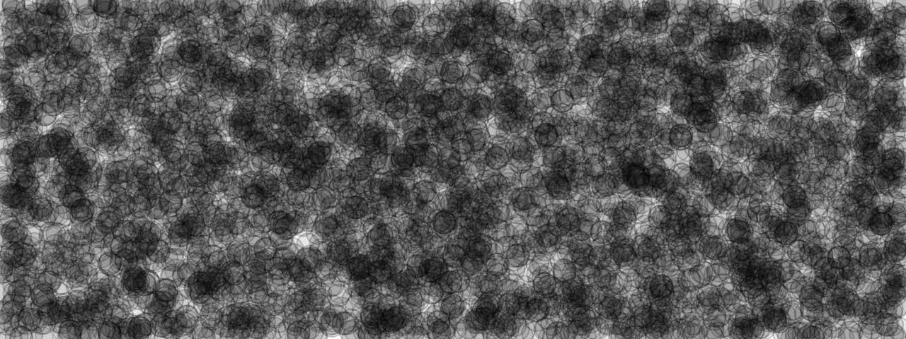

#+begin_src javascript :eval never-export
function setup() {
  // 该画布尺寸是为了适应书籍版式, 对示例本身并不关键.
  createCanvas(640, 240);
  background(255);
}

function draw() {
  fill(0, 25);
  stroke(0, 50);

  // 每次进入 draw() 时绘制一个随机圆.
  circle(random(width), random(height), 16);
}
#+end_src

示例在每章内部按顺序编号, 便于你找到对应的在线代码. 在纸质版中, 示例标题下方会显示截图. 在线版则会直接在页面中嵌入运行中的草图.

对于动画示例, 几乎所有示例都是动画, 截图通常会显示运动 "轨迹". 这种效果通过在 =background(255, 10)= 中为背景加入透明度产生, 但配套代码通常不会包含这一增强效果.

示例下方会列出代码, 但并不总是完整代码. 许多示例很长, 跨越多个文件. 我会尽量只显示突出示例主要部分的片段, 或展示本节中新引入、此前尚未讨论的组件.

代码完整版本可在本书网站找到. 在那里, 你可以通过 p5.js Web Editor, [[https://editor.p5js.org][editor.p5js.org]], 与代码交互、修改并进行实验. 本书 GitHub 仓库也包含全部内容:

- 本书网站 [[https://natureofcode.com][natureofcode.com]] 包含完整正文、补充阅读和参考资料, 以及所有代码示例.
- GitHub 仓库 [[https://github.com/nature-of-code][github.com/nature-of-code]] 包含网站原始源代码、图书构建流程和全部代码示例.
- 还可以在 p5.js Web Editor 中查看草图列表, [[https://editor.p5js.org/natureofcode/sketches][editor.p5js.org/natureofcode/sketches]].

注意示例中使用了注释来解释代码正在发生什么. 在书中, 这些注释悬浮于代码旁边, 具体外观取决于阅读格式. 背景阴影会把注释与对应代码行归为一组. 在本 Org 版本中, 这些说明转换为普通 JavaScript 注释, 并尽量放在相关语句附近.

*** 完整代码片段
:PROPERTIES:
:CUSTOM_ID: complete-snippets
:PDF_PAGE: 37
:END:

虽然不常见, 正文中偶尔会混入 "完整" 代码段. 有时, 例如前面的示例, 我可能真的列出完整 p5.js 草图的全部代码. 不过在大多数情况下, 所谓 "完整片段" 指一个完整函数或类, 即包含起始和结束花括号以及两者之间所有内容的完整代码块, 例如:

#+begin_src javascript :eval never-export
function draw() {
  background(255);
  for (let x = 0; x < width; x += spacing) {
    fill(255);
    circle(x, height / 2, spacing);
  }
}
#+end_src

这个片段展示了示例的整个 =draw()= 函数, 但它仍不是完整草图. 它假定存在名为 =spacing= 的全局变量, 以及一个会调用 =createCanvas()= 的 =setup()= 函数.

*** 无上下文代码
:PROPERTIES:
:CUSTOM_ID: context-free-code
:PDF_PAGE_RANGE: 37-38
:END:

有时, 页面上会悬着几行代码, 没有外层函数或其他上下文. 这些片段用于说明某个观点, 并不一定能直接运行. 它们可能表示一个概念、算法的极小部分, 或某种编程技巧.

#+begin_src javascript :eval never-export
fill(240, 99, 164); // 使圆呈现粉色的 RGB 值.
#+end_src

注意, 这段无上下文代码的缩进与前一个 "完整" 片段中的 =fill(255)= 一致. 当代码已经被确立为前面某个结构的一部分时, 我会使用这种方式. 当然, 实际情况不一定总是如此干净、完美, 但我会尽力.

*** 被截断的代码
:PROPERTIES:
:CUSTOM_ID: snipped-code
:PDF_PAGE_RANGE: 38-39
:END:

#+CAPTION: 原书用于表示代码被截断或延续的剪刀图标, PDF 第 38 页精确提取.

看到剪刀时请提高注意. 这个设计元素表示代码片段承接前文, 或会在解释文字之后继续. 有时它并不是真的继续, 而只是因为其余代码与当前讨论无关而被省略. 剪刀的意思是: "嘿, 这段代码的上方或下方可能还有内容, 或者至少它属于一个更大的整体."

下面是一个带正文说明的例子. 构建 p5.js 草图的第一步是创建画布:

#+begin_src javascript :eval never-export
function setup() {
  createCanvas(640, 240);
#+end_src

然后绘制背景:

#+begin_src javascript :eval never-export
  background(255);
#+end_src

我还喜欢在画布中心放一个圆:

#+begin_src javascript :eval never-export
  circle(width / 2, height / 2, 200);
}
#+end_src

在 =draw()= 中, 我可能想开始把方块随机放到背景和固定圆形上方. 其余代码可以是任何你想要的内容:

#+begin_src javascript :eval never-export
function draw() {
  rectMode(CENTER);
  square(random(width), random(height), 20);
#+end_src

我会尽量保持缩进一致, 帮助建立上下文. 剪刀图标则用来指出代码在哪里继续或被截断.

使用截断代码有一个特殊副作用. 你经常会看到一个片段中出现左花括号, 直到几个片段之后才出现对应的右花括号, 有时甚至根本不会出现. 如果你习惯阅读 JavaScript, 这开始时可能会引发轻度恐慌, 但希望你很快适应.

*** 练习
:PROPERTIES:
:CUSTOM_ID: exercises
:PDF_PAGE: 39
:END:

每章都包含编号练习, 它们是你的游乐场. 你可以在这里应用、实验并超越章节中提供的概念与代码. 一个练习可能如下所示:

#+begin_quote
练习 #.#

尝试修改示例 #.#, 让每个圆具有随机大小:
#+end_quote

#+begin_src javascript :eval never-export
function draw() {
  fill(0, 25);
  stroke(0, 50);
  circle(random(width), random(height), /* 在这里填写随机大小 */);
}
#+end_src

为了让你保持警觉, 练习采用多种形式. 有些提出技术挑战, 要求你写出某种算法的变体, 或解决一个高度具体的问题. 有些则是开放式探究, 鼓励你顺着自己的想法玩耍和实验. 另一些包含留有空白的代码片段, 邀请你直接填入答案. 在做练习时, 不必犹豫, 可以直接在书上写字、涂画或打草稿.

*** 解答
:PROPERTIES:
:CUSTOM_ID: solutions
:PDF_PAGE: 39
:END:

练习解答会发布在本书网站. 或者更准确地说, 我希望最终能把所有练习的解答都放到网站上. 写下这些文字时, 只有少量解答可用, 但希望当你读到这里时, 已经多了许多. 如愿意为某道练习贡献解答, 欢迎通过本书 GitHub 仓库提交.

*** 生态系统项目
:PROPERTIES:
:CUSTOM_ID: ecosystem-project-intro
:PDF_PAGE_RANGE: 39-40
:END:

尽管我很想假装只要蜷缩在舒适的椅子里读一些文字, 就能学会一切, 但要学习编程, 你终究必须真正编程. 每章散布的练习是一个起点. 此外, 在一章章学习的过程中, 始终记住一个或两个较大的项目想法, 并逐步发展它们, 也会很有帮助.

事实上, 在 ITP 讲授 Nature of Code 时, 我经常发现学生喜欢在整个学期中逐周构建同一个项目.

每章末尾都会提供一组围绕同一项目的提示, 这些练习会随着主题推进逐步叠加. 项目情境如下:

你受一家科学博物馆委托, 为新展览 "数字生态系统" 开发软件. 这是一个由程序化动画生物组成的世界, 它们生活在计算机仿真中, 供进入博物馆的观众欣赏.

这并不是说该概念特别新颖或富有创意. 相反, 我会把这个示例性的生态系统项目作为本书内容的直接表现, 展示不同元素如何组合到同一个程序里. 我鼓励你发展自己的想法, 也许它会更加抽象, 更加非传统.

*** 获取帮助和提交反馈
:PROPERTIES:
:CUSTOM_ID: help-and-feedback
:PDF_PAGE: 40
:END:

编程可能艰难而令人沮丧, 本书中的想法也并不总是直截了当. 你不必独自前行. 此刻很可能也有其他读者愿意共同组织学习小组或读书会, 大家可以见面、聊天, 分享困难与成功.

如果你找不到本地社区一起完成这趟旅程, 也可以加入在线社区. 我建议的两个地方是 Processing 官方论坛, [[https://discourse.processing.org][discourse.processing.org]], 和 The Coding Train Discord 服务器, [[https://thecodingtrain.com/discord][thecodingtrain.com/discord]].

我把本书在线版视为一份持续生长的文档, 欢迎反馈. 所有与图书有关的内容, 请访问 Nature of Code 网站, [[https://natureofcode.com][natureofcode.com]]. 本书原始文本和全部插图位于 GitHub, [[https://github.com/nature-of-code][github.com/nature-of-code]]. 请通过 GitHub Issues 提交反馈与纠错, [[https://github.com/nature-of-code/noc-book-2/issues][github.com/nature-of-code/noc-book-2/issues]].

更重要的是, 我想看到你创造的作品. 你可以提交到 The Coding Train 网站的 passenger showcase, [[https://thecodingtrain.com/showcase][thecodingtrain.com/showcase]], 或分享到前面提到的 Discord 频道. YouTube 评论区的一句问候始终受欢迎, 尽管说实话, 有时最好不要阅读 YouTube 评论. 你也可以在未来任何社交媒体平台上 @ 我, 最好是其中最友好、最不有毒的那个.

我想欣赏所有在你的生态系统中游动的 Bloop. 无论它们是胜利地跃过创造力的浪潮, 还是只在学习的小池塘里溅起微小水花, 让我们一起享受它们在代码自然中扩散出的涟漪.

* 第 0 章: 随机性
:PROPERTIES:
:CUSTOM_ID: chapter-00-randomness
:PDF_PAGE_RANGE: 41-71
:END:

#+begin_quote
随机数的生成太重要了, 不能交给偶然.

-- Robert R. Coveyou
#+end_quote

#+CAPTION: RAND Corporation 的 /A Million Random Digits with 100,000 Normal Deviates/ 中的随机数表, PDF 第 41 页精确提取.
[[file:images/chapter00-random-number-tables-page-041.png]]

1947 年, RAND Corporation 出版了一本颇为奇特的书, 书名是 /A Million Random Digits with 100,000 Normal Deviates/. 这既不是文学作品, 也不是关于随机性的哲学论述. 它是一张庞大的随机数表, 数字来自对轮盘赌装置的电子模拟.

从 20 世纪 20 年代中期到 50 年代, 人们曾出版过一系列随机数表, 这本书是其中最后一批成果之一. 随着高速计算机的发展, 直接生成伪随机数逐渐比查阅印刷表格更快, 纸面随机数表的时代也就此结束.

现在, 故事从这里开始. 如果你已经有一段时间没有编写 JavaScript, 或者很久没有碰数学, 本章会帮助你的思维重新适应计算式思考. 为了开启这趟 "用代码模拟自然" 的旅程, 我会介绍一些构建仿真的基础工具: 随机数、随机分布和噪声. 可以把本章看作组成全书数组的第一个, 更准确地说是第零个, 元素. 它既是一次复习, 也是通向后续可能性的入口.

#+CAPTION: 本章开篇插图, PDF 第 42 页精确提取.
[[file:images/chapter00-opening-illustration-page-042.png]]

第 1 章会讨论向量, 它将成为全书模拟运动的基本构件. 但在迈出那一步之前, 先思考一个更基础的问题: 一个东西在数字画布上四处移动, 究竟意味着什么? 我会从最著名也最简单的运动仿真之一开始: 随机游走.

** 随机游走
:PROPERTIES:
:CUSTOM_ID: random-walks
:PDF_PAGE_RANGE: 42-43
:END:

想象你正站在平衡木中央. 每隔 10 秒抛一次硬币. 正面, 向前走一步; 反面, 向后走一步. 这就是 *随机游走*, 即由一连串随机步伐定义的路径.

小心地从平衡木走到地面, 就可以把一维随机游走, 只能前后移动, 扩展到二维随机游走, 可以前、后、左、右移动. 现在有四种可能, 因而每次可以连续抛两次同一枚硬币来决定下一步.

| 第一次抛掷 | 第二次抛掷 | 结果       |
|------------+------------+------------|
| 正面       | 正面       | 向前一步   |
| 正面       | 反面       | 向右一步   |
| 反面       | 正面       | 向左一步   |
| 反面       | 反面       | 向后一步   |

这个算法看起来并不高深, 但随机游走可以模拟现实世界中的许多现象, 包括气体分子的运动、动物寻找食物的过程, 以及赌徒在赌场里度过一天时的行为. 对本书而言, 随机游走是理想的起点, 原因有三:

1. 我想复习本书的核心编程概念之一: 面向对象编程, Object-Oriented Programming, OOP. 接下来创建的随机游走者会成为一个模板, 展示如何用面向对象设计构造在计算机图形画布上移动的事物.
2. 随机游走会引出本书反复追问的两个问题: "如何定义支配对象行为的规则?" 以及 "如何用代码实现这些规则?"
3. 本书的项目会经常用到随机性、概率和 Perlin 噪声的基础知识. 随机游走正好可以演示后面会派上用场的关键概念.

我会先通过编写 =Walker= 类来快速复习 OOP, 再用它创建能够随机游走的 =Walker= 对象. 这里只做简要回顾. 如果你从未接触过 OOP, 建议暂停阅读, 先学习 The Coding Train 网站上 "Code! Programming with p5.js" 视频课程的 "Objects" 部分: [[https://thecodingtrain.com/objects][thecodingtrain.com/objects]].

*** 随机游走者类
:PROPERTIES:
:CUSTOM_ID: random-walker-class
:PDF_PAGE_RANGE: 43-46
:END:

JavaScript 中的对象是同时拥有数据和功能的实体. 在这里, 一个 =Walker= 对象应保存自己在画布上的位置, 同时具有绘制自身、迈出一步等功能.

类是构造实际对象实例的模板. 可以把类想成饼干模具, 把对象想成模具压出来的饼干. 要创建一个 =Walker= 对象, 首先要定义 =Walker= 类, 也就是明确 "成为一个游走者" 意味着什么.

游走者只需要两项数据: x 坐标和 y 坐标. 我会在类的构造函数 =constructor()= 中把它们初始化为画布中心, 作为对象的起点. 可以把构造函数理解为对象自己的 =setup()= 函数. 它负责定义对象的初始属性, 就像 =setup()= 负责初始化整个草图一样.

#+begin_src javascript :eval never-export
class Walker {
  constructor() {
    // 对象拥有构造函数, 并在这里完成初始化.
    this.x = width / 2;
    this.y = height / 2;
  }
}
#+end_src

这里使用关键字 =this=, 把属性附着到刚创建的对象本身, 即 =this.x= 和 =this.y=.

除了数据, 类还可以定义功能. 本例中的 =Walker= 对象有两个函数. 在 OOP 语境中, 这些函数称为 *方法*. 方法本质上仍是函数, 区别在于它们定义在类内部, 因而与对象或类相关联; 独立函数则不属于某个类. =function= 关键字是一个线索: 定义独立函数时会看到它, 但定义类方法时不会出现. 本书会尽量一致地区分 "函数" 与 "方法", 不过程序员在日常交流中经常混用这两个词.

第一个方法 =show()= 包含把对象绘制成黑点的代码. 引用对象属性时, 仍然不要忘记 =this.=.

#+begin_src javascript :eval never-export
show() {
  stroke(0);
  point(this.x, this.y);
}
#+end_src

第二个方法 =step()= 指示 =Walker= 迈出一步. 这里开始变得有趣. 之前是在地面上随机选择方向, 现在用 p5.js 画布来表示那块地面. 共有四种可能的步伐:

- 向右: =x++=
- 向左: =x--=
- 向前, 即画布上方: =y--=
- 向后, 即画布下方: =y++=

但代码如何在四个选项中作出选择?

前面使用了两次抛硬币. 在 p5.js 中, 当你想从一组选项中随机选择时, 可以直接调用 =random()= 生成随机数. 它会在指定范围中选择一个随机浮点数. 这里传入 4, 表示从 0 到 4 的范围:

#+begin_src javascript :eval never-export
let choice = floor(random(4));
#+end_src

变量 =choice= 被赋予一个随机整数. =floor()= 会去掉随机浮点数的小数部分. 严格来说, =random(4)= 的取值范围是 0, 含 0, 到 4, 不含 4. 因而它不可能真正返回 4.0. 最大值只能无限接近 4, 例如 3.999999999, 随后 =floor()= 会把它截断为 3. 因此, =choice= 实际上只可能是 0、1、2 或 3.

**** 编码约定
:PROPERTIES:
:CUSTOM_ID: coding-conventions
:PDF_PAGE: 45
:END:

JavaScript 可以用 =let= 或 =const= 声明变量. 一种常见做法是先使用 =const=, 只有变量确实需要重新赋值时才改为 =let=. 在当前示例中, =choice= 在每次 =step()= 调用的生命周期内不会重新赋值, 因此使用 =const= 其实更合适.

不过, 为了遵循 p5.js 示例的一贯风格, 也为了避免初学阶段被额外差异分散注意力, 本书会统一用 =let= 声明变量. =const= 和 =let= 的区别当然很重要, 鼓励你进一步研究, 并为自己的草图选择合适的变量声明方式. 相关讨论可参见 p5.js GitHub 仓库的 issue #3877: [[https://github.com/processing/p5.js/issues/3877][github.com/processing/p5.js/issues/3877]].

本书还会使用 JavaScript 的严格相等运算符 ~===~, 以及严格不等运算符 ~!==~. 它们同时比较值和类型. 例如, =3 === '3'= 的结果为 =false=, 因为两者类型不同, 一个是数字, 一个是字符串. 相比之下, 宽松相等运算符在 =3 == '3'= 中会先转换类型, 因而得到 =true=. 宽松比较很多时候也能工作, 但有时会产生意外结果, 因此 ~===~ 通常更安全.

根据选中的随机数, 游走者向左、右、上或下迈步. 下面是补全 =Walker= 类的完整 =step()= 方法:

#+begin_src javascript :eval never-export
step() {
  let choice = floor(random(4)); // 0、1、2 或 3.

  if (choice === 0) {
    this.x++;
  } else if (choice === 1) {
    this.x--;
  } else if (choice === 2) {
    this.y++;
  } else {
    this.y--;
  }
}
#+end_src

类写好后, 需要在草图中创建一个真正的 =Walker= 对象. 假设只模拟一个随机游走, 先声明一个全局变量:

#+begin_src javascript :eval never-export
let walker;
#+end_src

然后在 =setup()= 中使用 =new= 运算符和类名创建对象:

#+begin_src javascript :eval never-export
function setup() {
  createCanvas(640, 240);
  walker = new Walker();
  background(255);
}
#+end_src

最后, 在 =draw()= 的每次循环中让游走者迈步并绘制一个点.

*** 示例 0.1: 传统随机游走
:PROPERTIES:
:CUSTOM_ID: example-0-1
:PDF_PAGE: 46
:END:

#+CAPTION: 示例 0.1 的运行结果, PDF 第 46 页精确提取.
[[file:images/example-0-1-traditional-random-walk-page-046.png]]

#+begin_src javascript :eval never-export
let walker;

function setup() {
  createCanvas(640, 240);
  walker = new Walker();
  background(255);
}

function draw() {
  walker.step();
  walker.show();
}

class Walker {
  constructor() {
    this.x = width / 2;
    this.y = height / 2;
  }

  show() {
    stroke(0);
    point(this.x, this.y);
  }

  step() {
    let choice = floor(random(4));

    if (choice === 0) {
      this.x++;
    } else if (choice === 1) {
      this.x--;
    } else if (choice === 2) {
      this.y++;
    } else {
      this.y--;
    }
  }
}
#+end_src

背景只在 =setup()= 中绘制一次, 而不是在每次 =draw()= 循环中清空, 因此画布会保留随机游走的轨迹.

这个随机游走者还可以有若干变化. 当前 =Walker= 的步伐只限于上、下、左、右四种. 但画布中任意像素最多有八个相邻像素, 包括四个对角方向. 如果把停留在原地也算作一种选项, 一共会有九种可能.

#+CAPTION: 图 0.1, 不包含和包含对角线时, 随机游走者可采用的步伐, PDF 第 47 页精确提取.
[[file:images/figure-0-1-random-walker-neighbors-page-047.png]]

要让游走者可以移动到任意相邻像素, 或原地不动, 可以从 0 到 8 中选择一个数字. 另一个写法是在 x 轴和 y 轴上分别从 -1、0、1 三种步长中选择:

#+begin_src javascript :eval never-export
step() {
  let xstep = floor(random(3)) - 1;
  let ystep = floor(random(3)) - 1;

  this.x += xstep;
  this.y += ystep;
}
#+end_src

还可以进一步去掉 =floor()=, 直接使用 =random()= 产生的浮点数, 让每个轴的步长在 -1 到 1 的连续范围内变化:

#+begin_src javascript :eval never-export
step() {
  let xstep = random(-1, 1);
  let ystep = random(-1, 1);

  this.x += xstep;
  this.y += ystep;
}
#+end_src

这些传统随机游走变体有一个共同点: 在任意时刻, 朝某个方向迈步的概率与朝其他方向迈步的概率相等. 四种步伐时, 每种的概率为 $1/4$, 即 25%. 九种步伐时, 每种概率为 $1/9$, 约 11.1%.

这正是 =random()= 的默认行为. p5.js 的随机数生成器会产生 *均匀分布*. 可以统计每个随机数被选中的次数, 再把结果画成图形来验证这种分布.

*** 示例 0.2: 随机数分布
:PROPERTIES:
:CUSTOM_ID: example-0-2
:PDF_PAGE_RANGE: 48-49
:END:

#+CAPTION: 示例 0.2 的随机数频数直方图, PDF 第 48 页精确提取.
[[file:images/example-0-2-random-number-distribution-page-048.png]]

#+begin_src javascript :eval never-export
let randomCounts = []; // 记录每个随机数被选中的次数.
let total = 20;        // 计数槽总数.

function setup() {
  createCanvas(640, 240);
  for (let i = 0; i < total; i++) {
    randomCounts[i] = 0;
  }
}

function draw() {
  background(255);

  let index = floor(random(randomCounts.length));
  randomCounts[index]++;

  stroke(0);
  fill(127);
  let w = width / randomCounts.length;

  for (let x = 0; x < randomCounts.length; x++) {
    rect(x * w, height - randomCounts[x], w - 1, randomCounts[x]);
  }
}
#+end_src

图中每根柱子的高度略有差异. 当前样本量, 即已经抽取的随机数数量, 仍然较小, 某些数字偶尔会比其他数字更频繁地出现. 随着时间推移, 如果随机数生成器足够好, 这种分布会逐渐趋于均匀.

**** 伪随机数
:PROPERTIES:
:CUSTOM_ID: pseudorandom-numbers
:PDF_PAGE: 49
:END:

=random()= 返回的数字并非真正随机, 而是 *伪随机*. 它们来自一个模拟随机性的数学函数. 如果运行足够长时间, 函数最终会重复某种模式, 因而不再显得随机. 不过这个周期通常极长, 对本书的示例而言, =random()= 已经足够随机.

**** 练习 0.1
:PROPERTIES:
:CUSTOM_ID: exercise-0-1
:PDF_PAGE: 49
:END:

创建一个更倾向于向下和向右移动的随机游走者. 下一节会给出解法.

** 概率与非均匀分布
:PROPERTIES:
:CUSTOM_ID: probability-and-nonuniform-distributions
:PDF_PAGE_RANGE: 49-53
:END:

均匀随机并不总是设计问题中最周到的答案, 尤其当目标是构造有机、自然的仿真时. 只要使用一些技巧, =random()= 也可以产生 *非均匀分布*, 让某些结果比另一些结果更容易出现. 这类分布常常更有趣, 也更接近自然.

回想刚开始学习 p5.js 时, 你也许想在屏幕上画许多圆, 然后决定: "把位置、大小和颜色都设成随机值吧." 在学习计算机图形基础时, 用随机性为系统播种完全合理. 但本书要构造的是受自然启发的系统, 单纯的均匀随机并不总够用. 有时需要在概率天平上轻轻按下一根手指.

自定义非均匀分布会贯穿全书. 例如第 9 章的遗传算法需要完成 "选择": 哪些种群成员可以把 DNA 传给下一代? 这类似达尔文的适者生存. 假设有一群正在进化的猴子, 每只猴子繁殖的机会不应相同. 为模拟自然选择, 不能只随便挑两只猴子当父母. 更 "适应" 的个体应该更容易被选中. 可以把它称为 "适者的概率".

先暂停一下, 回顾概率的基本原则. *单事件概率* 描述某个给定事件发生的可能性. 在概率论中, *结果*, outcome, 指随机过程所有可能的输出; *事件*, event, 指当前关心的某个具体结果或结果组合.

如果所有结果等可能, 某事件的概率等于符合该事件的结果数除以所有可能结果数. 抛硬币只有正面和反面两种结果. 符合 "正面" 的结果只有一个, 因而:

\[
P(\text{正面}) = \frac{1}{2} = 50\%.
\]

一副 52 张的扑克牌中抽到 A 的概率为:

\[
P(\text{A}) = \frac{4}{52} \approx 0.077 \approx 8\%.
\]

抽到方块的概率为:

\[
P(\text{方块}) = \frac{13}{52} = 0.25 = 25\%.
\]

连续多个事件同时发生的概率, 可以通过相乘每个事件的概率来计算. 例如, 连续三次抛出正面的概率为:

\[
\frac{1}{2} \times \frac{1}{2} \times \frac{1}{2}
= \frac{1}{8} = 0.125 = 12.5\%.
\]

这意味着平均每 8 组试验会出现一次连续三个正面. 如果把 "连续抛三次" 重复 500 组, 预计大约有 $500/8 \approx 63$ 组得到三个连续正面.

*** 练习 0.2
:PROPERTIES:
:CUSTOM_ID: exercise-0-2
:PDF_PAGE: 50
:END:

从一副 52 张的牌中连续抽到两张 A 的概率是多少?

1. 第一次抽牌后把牌放回并重新洗牌.
2. 第一次抽牌后不放回.

=random()= 可以通过两种常见方式把概率概念应用到非均匀分布中.

第一种技巧是用数组保存候选值, 并重复保存需要增加权重的值. 再从数组中随机抽取元素:

#+begin_src javascript :eval never-export
let stuff = [1, 1, 2, 3, 3];
let value = random(stuff);
print(value);
#+end_src

这个数组有五个元素, 其中 1 出现两次. 因而打印 1 的概率为 $2/5 = 40\%$. 打印 2 的概率为 20%, 打印 3 的概率为 40%.

第二种技巧是从 0 到 1 中抽取一个随机浮点数, 只有当它落入某个区间时才触发事件. 例如:

#+begin_src javascript :eval never-export
let probability = 0.1; // 10% 的概率.
let r = random(1);     // 0 到 1 的随机浮点数.

if (r < probability) {
  print("Sing!");
}
#+end_src

0 到 1 之间有十分之一的数小于 0.1, 因而这段代码平均只有 10% 的时间会唱歌.

同样的方法可以为多个结果设置不相等的权重. 假设唱歌的概率为 60%, 跳舞为 10%, 睡觉为 30%. 从 0 到 1 选取一个随机数, 再判断它落在哪个区间:

- 0.0 到 0.6, 60%: 唱歌.
- 0.6 到 0.7, 10%: 跳舞.
- 0.7 到 1.0, 30%: 睡觉.

#+begin_src javascript :eval never-export
let num = random(1);

if (num < 0.6) {
  print("Sing!");
} else if (num < 0.7) {
  print("Dance!");
} else {
  print("Sleep!");
}
#+end_src

现在把这种方法应用到随机游走者, 使它更倾向于向某个方向移动. 假设概率如下:

- 向上: 20%.
- 向下: 20%.
- 向左: 20%.
- 向右: 40%.

*** 示例 0.3: 倾向向右移动的游走者
:PROPERTIES:
:CUSTOM_ID: example-0-3
:PDF_PAGE: 52
:END:

#+CAPTION: 示例 0.3 的运行结果, PDF 第 52 页精确提取.
[[file:images/example-0-3-right-biased-walker-page-052.png]]

#+begin_src javascript :eval never-export
step() {
  let r = random(1);

  if (r < 0.4) {
    this.x++;       // 40% 的概率向右.
  } else if (r < 0.6) {
    this.x--;
  } else if (r < 0.8) {
    this.y++;
  } else {
    this.y--;
  }
}
#+end_src

这种技巧还经常用于控制偶发事件. 假设一个草图原本每隔 100 帧创建一个新的随机游走者. 也可以改为每帧有 1% 的概率创建一个新游走者. 两者的长期平均结果相同, 即每 100 帧出现一次, 但后者加入了偶然性, 看起来更动态、更难预测.

*** 练习 0.3
:PROPERTIES:
:CUSTOM_ID: exercise-0-3
:PDF_PAGE: 53
:END:

创建一个概率会动态变化的随机游走者. 例如, 能否让它有 50% 的概率朝鼠标方向移动? p5.js 可以通过 =mouseX= 和 =mouseY= 获取当前鼠标位置.

** 随机数的正态分布
:PROPERTIES:
:CUSTOM_ID: normal-distribution
:PDF_PAGE_RANGE: 53-56
:END:

产生非均匀随机数的另一种方法是使用 *正态分布*. 正态分布中的数值会聚集在某个平均值附近.

再次考虑那群模拟猴子. 假设草图创建 1000 个 =Monkey= 对象, 每只猴子的高度在 200 到 300 像素之间随机选择:

#+begin_src javascript :eval never-export
let h = random(200, 300);
#+end_src

这是合理的猴子身高算法吗? 想象纽约拥挤的人行道. 随便选一个人, 他的身高看起来似乎是随机的, 但并不是 =random()= 默认产生的那种随机. 人类身高不是均匀分布. 接近平均身高的人远多于极高或极矮的人. 因此, 接近均值的高度应更常见, 极端高度应更稀少.

这正是 *正态分布* 的行为. 正态分布也称 *高斯分布*, 以数学家 Carl Friedrich Gauss 命名. 它的图形通常称作 *钟形曲线*. 曲线由一个数学函数定义, 某个值出现的概率由均值, 常写作希腊字母 $\mu$, 和标准差, 常写作 $\sigma$, 决定.

对于 200 到 300 的高度范围, 均值直观上是 250. 但标准差为 3 和标准差为 15 分别意味着什么? 图 0.2 给出了线索.

#+CAPTION: 图 0.2, 正态分布的两个钟形曲线. 左侧标准差较小, 右侧标准差较大. PDF 第 54 页精确提取并合并.
[[file:images/figure-0-2-normal-distributions-page-054.png]]

左侧分布的标准差很小, 大多数值堆积在均值附近, 它们很少偏离均值. 右侧标准差较大, 数值在均值两侧分布得更开.

对正态分布总体而言:

- 约 68% 的成员位于均值上下 1 个标准差内.
- 约 95% 位于均值上下 2 个标准差内.
- 约 99.7% 位于均值上下 3 个标准差内.

如果猴子身高均值为 250 像素, 标准差为 5 像素, 只有约 0.3% 的猴子低于 235 像素, 或高于 265 像素. 与此同时, 约 68% 的猴子身高会落在 245 到 255 像素之间.

在 p5.js 中使用正态分布不需要手工完成这些计算. =randomGaussian()= 会处理数学过程, 返回正态分布的随机数:

#+begin_src javascript :eval never-export
function draw() {
  let num = randomGaussian();
}
#+end_src

*** 均值和标准差的计算
:PROPERTIES:
:CUSTOM_ID: calculating-mean-and-standard-deviation
:PDF_PAGE_RANGE: 54-55
:END:

假设 10 名学生的考试成绩, 满分 100, 为:

#+begin_example
85, 82, 88, 86, 85, 93, 98, 40, 73, 83
#+end_example

均值为 81.3.

标准差是 "围绕均值的偏差平方的平均值" 的平方根. 计算步骤如下:

1. 用每个人的成绩减去均值, 得到偏差.
2. 将偏差平方, 得到平方偏差.
3. 对所有平方偏差求平均, 得到方差.
4. 对方差开平方, 得到标准差.

| 成绩 | 与均值的差             | 平方偏差                 |
|------+------------------------+--------------------------|
| 85   | $85 - 81.3 = 3.7$     | $(3.7)^2 = 13.69$        |
| 40   | $40 - 81.3 = -41.3$   | $(-41.3)^2 = 1705.69$    |
| ...  | ...                    | ...                      |
|      | 平均方差               | 228.21                   |

因此:

\[
\sigma = \sqrt{228.21} \approx 15.13.
\]

接下来考虑一个具体目标: 使用正态分布指定图形的 x 坐标.

=randomGaussian()= 默认返回均值为 0、标准差为 1 的正负随机数, 这称为 *标准正态分布*. 实际项目往往需要不同参数. 假设画布宽 640 像素, 希望图形的 x 坐标服从均值 320, 即画布水平中心, 标准差 60 像素的正态分布. 可以向 =randomGaussian()= 传入两个参数, 先均值, 后标准差.

*** 示例 0.4: 高斯分布
:PROPERTIES:
:CUSTOM_ID: example-0-4
:PDF_PAGE_RANGE: 55-56
:END:

#+CAPTION: 示例 0.4, 均值 320、标准差 60 的高斯分布, PDF 第 55 页精确提取.
[[file:images/example-0-4-gaussian-distribution-page-055.png]]

#+begin_src javascript :eval never-export
function draw() {
  let x = randomGaussian(320, 60);

  noStroke();
  fill(0, 10);
  circle(x, 120, 16);
}
#+end_src

这里通过参数定制了 =randomGaussian()=. 实现同样变换的数学过程很简单: 把标准正态分布值乘以标准差, 再加上均值. 因此下面两种写法等价:

#+begin_src javascript :eval never-export
let x = randomGaussian(320, 60);
let x = 60 * randomGaussian() + 320;
#+end_src

多个半透明圆叠在一起后, 分布会逐渐显现. 中心区域最暗, 因为大多数值聚集在那里. 偶尔也会有圆出现在离中心更远的位置.

*** 练习 0.4
:PROPERTIES:
:CUSTOM_ID: exercise-0-4
:PDF_PAGE: 56
:END:

模拟油漆飞溅, 用许多彩色小点组成图案. 大部分油漆聚集在中心附近, 但也有一些点飞向边缘. 能否用正态分布生成点的位置? 能否同样用正态分布生成色板? 尝试加入滑块, 动态调节标准差.

*** 练习 0.5
:PROPERTIES:
:CUSTOM_ID: exercise-0-5
:PDF_PAGE: 56
:END:

*高斯随机游走* 的步长, 即对象每次沿某个方向移动的距离, 服从正态分布. 请实现这种 =Walker= 变体.

** 随机数的自定义分布
:PROPERTIES:
:CUSTOM_ID: custom-random-distribution
:PDF_PAGE_RANGE: 56-59
:END:

总有一天, 均匀分布和高斯分布都不能满足需求. 想象你是一名寻找食物的随机游走者. 由于不知道食物在哪里, 随机搜索似乎合理. 但存在一个问题: 随机游走者会多次回到已经访问的位置, 这种现象称为 *过采样*, oversampling. 它会让觅食效率很低, 甚至一无所获.

一种策略是偶尔迈出非常大的一步. 游走者可以在局部随机搜索, 同时周期性跳到很远的位置, 从而减少过采样. 这种随机游走变体称为 *Lévy flight*, Lévy 飞行. 它需要自定义概率: 步长越大, 被选中的概率越低; 步长越小, 被选中的概率越高.

之前介绍过两种自定义分布方法: 在数组中重复某些值, 或判断 =random()= 的结果. 一个并不严格的 Lévy 飞行实现可以规定 1% 的概率迈出大步:

#+begin_src javascript :eval never-export
let r = random(1);

if (r < 0.01) {
  xstep = random(-100, 100);
  ystep = random(-100, 100);
} else {
  xstep = random(-1, 1);
  ystep = random(-1, 1);
}
#+end_src

但这把分布缩减成两个固定选项: 99% 的时间迈小步, 1% 的时间迈大步. 如果想定义更普遍的规则, 例如数值越大越容易被选中, 应该怎么办? 比如 0.8791 比 0.8532 稍微更容易被选中. 如果 $x$ 是候选随机数, 它被选中的概率可以映射为 $y=x$.

#+CAPTION: 图 0.3, $y=x$ 的概率曲线. y 表示值 x 被选中的概率, PDF 第 57 页精确提取.
[[file:images/figure-0-3-custom-probability-curve-page-057.png]]

既然可以按图 0.3 的曲线生成分布, 理论上也可以按任何能够用公式定义的曲线生成随机分布.

一种实现自定义分布的方法是抽取两个随机数. 第一个是候选值, 第二个是 *资格随机值*. 程序用第二个值决定接受第一个值, 还是丢弃它并重新抽取. 容易通过资格检验的数字会更常出现, 难以通过的数字则很少出现.

只考虑 0 到 1 的随机值, 过程如下:

1. 抽取随机数 =r1=.
2. 计算 =r1= 通过资格检验的概率 =p=. 这里令 =p = r1=.
3. 再抽取随机数 =r2=.
4. 如果 =r2 < p=, 接受 =r1=.
5. 如果条件不成立, 回到第 1 步.

候选值越大, 它通过检验的概率越高. 若 =r1= 为 0.1, 通过概率为 10%; 若 =r1= 为 0.83, 通过概率为 83%.

这个过程称为 *接受-拒绝算法*, accept-reject algorithm, 它属于 Monte Carlo 方法的一种, 名称来自 Monte Carlo Casino.

*** 示例 0.5: 接受-拒绝分布
:PROPERTIES:
:CUSTOM_ID: example-0-5
:PDF_PAGE_RANGE: 58-59
:END:

#+CAPTION: 示例 0.5, 接受-拒绝算法产生的非均匀分布, PDF 第 58 页精确提取.
[[file:images/example-0-5-accept-reject-distribution-page-058.png]]

#+begin_src javascript :eval never-export
function acceptreject() {
  while (true) {
    let r1 = random(1);   // 候选随机值.
    let probability = r1;
    let r2 = random(1);   // 资格随机值.

    if (r2 < probability) {
      return r1;
    }
  }
}
#+end_src

接受-拒绝算法确实能生成自定义随机分布, 但效率不高. 当大量候选值被拒绝, 尤其当资格概率很低时, 会浪费许多计算. 第 9 章讨论遗传算法时, 会采用另一种更优的方法.

*** 练习 0.6
:PROPERTIES:
:CUSTOM_ID: exercise-0-6
:PDF_PAGE: 59
:END:

使用自定义概率分布改变随机游走者的步长. 可以让资格概率影响步长范围. 能否把概率映射为二次函数, 令一个值被选中的概率等于它的平方?

#+begin_src javascript :eval never-export
let step = 10;
let stepx = random(-step, step);
let stepy = random(-step, step);

this.x += stepx;
this.y += stepy;
#+end_src

上面的代码仍使用均匀分布的随机步长. 请修改它. 第 1 章会展示如何借助向量更高效地改变步长.

** 使用 Perlin 噪声获得更平滑的结果
:PROPERTIES:
:CUSTOM_ID: perlin-noise
:PDF_PAGE_RANGE: 59-65
:END:

优秀的随机数生成器会产生彼此没有关系、看不出模式的数字. 但在模拟有机、逼真的行为时, 少量随机性很有用, 纯粹的均匀随机却不一定自然.

*Perlin 噪声* 由 Ken Perlin 发明. 它生成一串自然有序的伪随机数, 序列中相邻数字的值非常接近. 因而随机值之间会平滑过渡, 外观比纯噪声更有机. Perlin 噪声特别适合生成云、地形、木纹、大理石等具有自然品质的效果.

图 0.4 对比了 Perlin 噪声和均匀随机. 左图是随时间变化的 Perlin 噪声, 曲线平滑; 右图是纯随机数, 曲线非常锯齿化.

#+CAPTION: 图 0.4, Perlin 噪声随时间的变化, 左, 与均匀随机噪声, 右. PDF 第 60 页精确提取并合并.
[[file:images/figure-0-4-perlin-vs-random-page-060.png]]

Ken Perlin 在 20 世纪 80 年代初参与电影 /Tron/ 制作时开发了原始 Perlin 噪声算法, 并因这项技术获得 Academy Award 的技术成就奖. 该算法最初用于为计算机生成特效创建程序化纹理. "程序化" 表示视觉元素由算法生成, 而不是由艺术家逐一手工设计.

此后, 不同作者提出了许多噪声变体, 包括 value noise、Worley noise, 以及 Perlin 在 2001 年开发的 simplex noise. 关于历史, 可参见 Ken Perlin 的网站: [[https://mrl.nyu.edu/~perlin/doc/oscar.html][mrl.nyu.edu/~perlin/doc/oscar.html]]. 关于变体, 可参见 The Coding Train 的 "What Is OpenSimplex Noise?" 视频: [[https://thecodingtrain.com/opensimplexnoise][thecodingtrain.com/opensimplexnoise]].

p5.js 通过 =noise()= 实现经典的 1983 Perlin 噪声算法. 它可以接受一个、两个或三个参数, 分别在一维、二维或三维噪声空间中计算. 先从一维噪声开始.

假设要在随机 x 位置绘制一个圆, 通常会写:

#+begin_src javascript :eval never-export
let x = random(0, width);
circle(x, 180, 16);
#+end_src

也许你会想直接把 =random()= 换成 =noise()=:

#+begin_src javascript :eval never-export
// 诱人的写法, 但不正确.
let x = noise(0, width);
circle(x, 180, 16);
#+end_src

概念上, 目标确实是用 Perlin 噪声计算一个从 0 到画布宽度的 x 值, 但 =noise()= 的参数含义不同. =random()= 的参数表示输出范围的最小值和最大值; =noise()= 的输出范围固定为 0 到 1. 后面可以用 =map()= 把它映射到所需范围. 在此之前, 先理解 =noise()= 的输入参数.

一维 Perlin 噪声可以想成随 "时间" 排列的线性数值序列:

| 时间 | 噪声值 |
|------+--------|
| 0    | 0.365  |
| 1    | 0.363  |
| 2    | 0.363  |
| 3    | 0.364  |
| 4    | 0.366  |

要取得某个噪声值, 需要选择一个 "时间点" 并传给 =noise()=. 例如:

#+begin_src javascript :eval never-export
let n = noise(3);
#+end_src

按照上表, =noise(3)= 返回 0.364. 下一步是用变量表示时间, 在 =draw()= 中连续读取噪声:

#+begin_src javascript :eval never-export
let t = 3;

function draw() {
  let n = noise(t);
  print(n);
}
#+end_src

这还不够. 代码会反复输出同一个值, 因为每次都在同一个时间点 3 查询噪声. 必须让 =t= 递增:

#+begin_src javascript :eval never-export
let t = 0;

function draw() {
  let n = noise(t);
  print(n);
  t += 0.01;
}
#+end_src

这里让 =t= 每次增加 0.01. 不同增量会改变噪声的平滑程度. 在噪声空间中跳得越远, 返回值越不平滑, 看起来也越接近普通随机数.

#+CAPTION: 图 0.5, 在 Perlin 噪声空间中进行短跳和长跳, PDF 第 62 页精确提取.
[[file:images/figure-0-5-perlin-noise-jumps-page-062.png]]

后面的 Perlin 噪声示例中, 可以留意不同的 =t= 增量如何改变动画.

*** 噪声范围
:PROPERTIES:
:CUSTOM_ID: noise-ranges
:PDF_PAGE_RANGE: 62-64
:END:

=noise()= 返回 0 到 1 的值, 需要把它映射到实际用途的范围. p5.js 的 =map()= 最适合完成这一工作. 它接受五个参数:

1. 要映射的值.
2. 当前范围的最小值.
3. 当前范围的最大值.
4. 目标范围的最小值.
5. 目标范围的最大值.

#+CAPTION: 图 0.6, 把一个值从当前范围映射到新范围, PDF 第 63 页精确提取.
[[file:images/figure-0-6-map-range-page-063.png]]

假设噪声范围是 0 到 1, 目标是让圆的 x 坐标覆盖 0 到画布宽度:

#+begin_src javascript :eval never-export
let t = 0;

function draw() {
  let n = noise(t);
  let x = map(n, 0, 1, 0, width);

  ellipse(x, 180, 16, 16);
  t += 0.01;
}
#+end_src

同样的逻辑可以用于随机游走者. 分别用 Perlin 噪声设置 x 和 y, 会得到更平滑、更有机的游走轨迹.

*** 示例 0.6: Perlin 噪声游走者
:PROPERTIES:
:CUSTOM_ID: example-0-6
:PDF_PAGE: 64
:END:

#+CAPTION: 示例 0.6, Perlin 噪声游走者的运动轨迹, PDF 第 64 页精确提取.
[[file:images/example-0-6-perlin-noise-walker-page-064.png]]

#+begin_src javascript :eval never-export
class Walker {
  constructor() {
    this.tx = 0;
    this.ty = 10000;
  }

  step() {
    this.x = map(noise(this.tx), 0, 1, 0, width);
    this.y = map(noise(this.ty), 0, 1, 0, height);

    this.tx += 0.01;
    this.ty += 0.01;
  }
}
#+end_src

这个示例引入了一对新变量: =tx= 和 =ty=. 需要分别跟踪 x 坐标和 y 坐标的噪声位置. 但为什么 =tx= 从 0 开始, =ty= 却从 10000 开始?

这两个数本身是任意选择的, 但让它们相隔很远是有意的. 噪声函数是确定性的: 对同一个输入位置 =t=, 它总会返回相同结果. 如果 x 和 y 在同一个 =t= 上读取噪声, 那么 x 和 y 会始终相等, 游走者只能沿对角线移动.

因此, x 从噪声空间的 0 位置开始, y 从 10000 位置开始, 两者看起来就像彼此独立.

#+CAPTION: 图 0.7, 在一维噪声轴上使用不同偏移量生成 x 和 y, PDF 第 65 页精确提取.
[[file:images/figure-0-7-noise-offsets-page-065.png]]

严格来说, 这里并没有真正的时间. "时间" 只是理解噪声函数的一种比喻. 实际上面对的是一维 *空间*: 噪声值沿一条线排列, 程序从特定 x 位置取值. 因此很多示例会把变量命名为 =xoff=, 表示噪声图上的 x 偏移量, 而不是用 =t= 表示时间.

*** 练习 0.7
:PROPERTIES:
:CUSTOM_ID: exercise-0-7
:PDF_PAGE: 65
:END:

在 Perlin 噪声游走者中, =noise()= 的结果被直接映射为游走者的位置. 创建另一个随机游走者, 不要把噪声映射到位置, 而要把它映射到每次移动的步长.

** 二维噪声
:PROPERTIES:
:CUSTOM_ID: two-dimensional-noise
:PDF_PAGE_RANGE: 65-70
:END:

理解一维噪声后, 再考虑噪声值如何存在于二维空间.

一维噪声是一串数值, 每个值都与相邻值相似. 可以想象一张方格纸或电子表格, 把一维噪声从左到右写在一行中. 因为值只生活在一维, 每个值只有两个直接邻居: 左边一个, 右边一个.

二维噪声的概念完全相同, 区别在于数值不只沿一行排列, 而是填满整个网格. 一个值会与上、下、左、右和四个对角方向的邻居都相似.

#+CAPTION: 图 0.8, 一维和二维 Perlin 噪声中的相邻值. 网格深浅表示噪声值, PDF 第 66 页精确提取.
[[file:images/figure-0-8-1d-vs-2d-noise-neighbors-page-066.png]]

如果把方格纸中的每个噪声值映射为颜色亮度, 就会得到类似云层的图案. 白色旁边是浅灰, 再到灰色、深灰、黑色, 然后又逐渐变亮.

#+CAPTION: 图 0.9, p5.js 草图对二维噪声的可视化. 每个像素用灰度表示一个噪声值, PDF 第 66 页精确提取.
[[file:images/figure-0-9-2d-noise-page-066.png]]

这正是噪声算法最初被发明的用途. 调整参数并加入颜色后, 图像可以像大理石、木材或其他有机纹理.

*** 噪声细节
:PROPERTIES:
:CUSTOM_ID: noise-detail
:PDF_PAGE: 67
:END:

p5.js 的 =noise()= 参考文档说明, 噪声由多个 *octave*, 倍频程, 共同计算. 调用 =noiseDetail()= 可以改变倍频程数量以及它们之间的相对权重, 从而改变噪声的质感.

- =noise()= 文档: [[https://p5js.org/reference/#/p5/noise][p5js.org/reference/#/p5/noise]]
- =noiseDetail()= 文档: [[https://p5js.org/reference/#/p5/noiseDetail][p5js.org/reference/#/p5/noiseDetail]]

如果要用 =random()= 随机给画布的每个像素着色, 需要嵌套循环遍历每行和每列, 为每个像素选择随机亮度. p5.js 的 =pixels= 数组为每个像素保存四个槽位: red、green、blue 和 alpha.

#+begin_src javascript :eval never-export
loadPixels();

for (let x = 0; x < width; x++) {
  for (let y = 0; y < height; y++) {
    let index = (x + y * width) * 4;
    let bright = random(255);

    pixels[index] = bright;
    pixels[index + 1] = bright;
    pixels[index + 2] = bright;
    pixels[index + 3] = 255;
  }
}

updatePixels();
#+end_src

要用 =noise()= 平滑地着色, 概念上只需把 =random()= 换成二维噪声:

#+begin_src javascript :eval never-export
let bright = map(noise(x, y), 0, 1, 0, 255);
#+end_src

这段代码会为二维空间中的每个 $(x,y)$ 位置计算噪声值. 但它不会产生理想的平滑云层, 因为相邻像素在噪声空间中每次跨越 1, 跳幅太大. 一维噪声示例中每帧只让时间增加 0.01, 而不是 1.

一种合适的解决方法是把画布像素坐标和噪声输入坐标分开. 当画布 x 每次增加 1 像素时, 让 =xoff= 只增加 0.01; 当 y 每次增加 1 像素时, 让 =yoff= 只增加 0.01.

#+begin_src javascript :eval never-export
let xoff = 0.0;

for (let x = 0; x < width; x++) {
  let yoff = 0.0;

  for (let y = 0; y < height; y++) {
    let bright = map(noise(xoff, yoff), 0, 1, 0, 255);
    let index = (x + y * width) * 4;

    pixels[index] = bright;
    pixels[index + 1] = bright;
    pixels[index + 2] = bright;
    pixels[index + 3] = 255;

    yoff += 0.01;
  }

  xoff += 0.01;
}
#+end_src

这里容易产生一种看似矛盾的感觉. 前面用两个独立的一维噪声值设置游走者的二维位置, =this.x= 和 =this.y=. 随后又用二维噪声设置一个标量, 像素亮度 =bright=.

关键区别是:

- 对游走者而言, 需要两个彼此独立的一维噪声序列. =this.tx= 和 =this.ty= 从同一个一维噪声空间的不同区域取值. 恰好这两个标量最终被用于二维位置.
- 对像素而言, 需要二维噪声空间中一个给定点的单一值. =xoff= 和 =yoff= 共同确定一个二维坐标, 返回一个亮度值.

换言之, 游走者同时沿两条独立的一维噪声路径前进; 像素则读取二维空间中的一个值.

*** 练习 0.8
:PROPERTIES:
:CUSTOM_ID: exercise-0-8
:PDF_PAGE: 68
:END:

尝试改变颜色、=noiseDetail()= 参数, 以及 =xoff= 和 =yoff= 的增量, 生成不同视觉效果.

*** 练习 0.9
:PROPERTIES:
:CUSTOM_ID: exercise-0-9
:PDF_PAGE: 68
:END:

为 =noise()= 增加第三个参数, 并在每次 =draw()= 循环中递增它, 让二维噪声动起来.

*** 练习 0.10
:PROPERTIES:
:CUSTOM_ID: exercise-0-10
:PDF_PAGE: 69
:END:

使用噪声值作为地形高度.

#+CAPTION: 练习 0.10 的噪声地形示例, PDF 第 69 页精确提取.
[[file:images/exercise-0-10-noise-landscape-page-069.png]]

本节展示了若干传统的 Perlin 噪声用途. 一维噪声的平滑值可以控制对象位置, 产生漫游效果. 二维噪声可以在像素平面上生成云状图案.

但一定要记住, Perlin 噪声值终究只是 *数值*. 它们并不天然绑定到像素位置或颜色. 本书中任何变量都可以受 Perlin 噪声控制. 风力强度可以使用噪声, 分形树的枝条夹角可以使用噪声, 流场中对象的速度和方向也可以使用噪声.

#+CAPTION: 图 0.10a, 使用 Perlin 噪声控制结构的树, PDF 第 69 页精确提取.
[[file:images/figure-0-10-perlin-tree-page-069.png]]

#+CAPTION: 图 0.10b, 使用 Perlin 噪声生成的流场, PDF 第 69 页精确提取.
[[file:images/figure-0-10-perlin-flow-field-page-069.png]]

不过, 正如随机性可能被滥用, Perlin 噪声也很容易变成万能答案:

- 对象应该怎样移动? Perlin 噪声.
- 应该是什么颜色? Perlin 噪声.
- 应该以多快速度生长? Perlin 噪声.

如果你发现自己对每个问题都这样回答, 请继续读下去. 本书的目标是提供更广阔的规则设计工具箱. 规则由你定义, 掌握的可能性越多, 越能做出经过思考和充分知情的选择. 随机性与 Perlin 噪声只是即将探索的创造宇宙中的第一批星辰.

正如引言所说, 阅读本书的一种方式是在各章之间持续发展同一个项目, 每学一个主题就加入新的元素. 一个可行项目是模拟生态系统: 想象一群计算生物生活在数字池塘中及其周围, 按照不同规则相互作用.

每章末尾都会出现同一项目的后续提示, 逐步使用本章概念扩展生态系统. 当然, 你也可以发明自己的项目.

** 生态系统项目
:PROPERTIES:
:CUSTOM_ID: ecosystem-project-chapter-00
:PDF_PAGE: 71
:END:

第一步, 为某种生物制定一组模拟现实行为的规则. 可以从随机游走或其他噪声驱动的运动出发.

能否模拟一只紧张而抖动、飞行轨迹难以预测的小虫? 或者模拟一片被时强时弱的风吹动、漂浮在空中的叶子? 先研究仅靠行为能表达多少 "性格", 然后再考虑视觉外观.

#+CAPTION: 第 0 章生态系统项目插图, PDF 第 71 页精确提取.
[[file:images/ecosystem-project-chapter00-page-071.png]]

这幅插图可以帮助你根据本书主题构思生态系统. 在后续章节中, 随着新概念和技术加入, 插图也会逐步演化.

本书的重点是演示算法和行为, 因而示例通常只使用圆之类的单一基本图形. 但你完全可以把创造力带入画布, 挑战自己设计更丰富的视觉元素. 如果把设计转换成代码对你仍很陌生, 本书插画师 Zannah Marsh 在附录中提供了一份实用的代码绘图指南.

* 第 1 章: 向量
:PROPERTIES:
:CUSTOM_ID: chapter-01-vectors
:PDF_PAGE_RANGE: 73-109
:END:

#+begin_quote
我正在犯下同时具有方向和大小的罪行.

-- Vector, /Despicable Me/
#+end_quote

#+CAPTION: 马绍尔群岛棒图, 现藏于 Berkeley Art Museum, 摄影 Jim Heaphy. PDF 第 73 页精确提取.
#+ATTR_ORG: :width 700
[[file:images/chapter01-marshall-islands-stick-chart-page-073.png]]

棒图是马绍尔群岛原住民制作的一种航海工具. 马绍尔群岛位于太平洋中部. 这种古老工具由椰子叶中脉仔细捆扎而成, 贝壳标记代表该地区岛屿的位置. 椰叶骨架与贝壳的布局共同构成一种地理导航图, 以抽象方式表示海浪的传播模式及其方向流动.

本书的核心任务, 是观察周围世界, 并设法用代码模拟它. 在本书第一部分, 我会从基础物理入手: 苹果怎样从树上落下, 单摆怎样在空气中摆动, 地球怎样围绕太阳公转, 等等. 本书前五章中的几乎所有内容, 都离不开编写运动程序时最基本的构件: *向量*. 因而, 故事从这里开始.

"vector" 这个词有许多含义. 它是一支 20 世纪 80 年代初在 California 州 Sacramento 成立的新浪潮摇滚乐队的名字, 也是 Kellogg's Canada 生产的一种早餐麦片的名字. 在流行病学中, vector 是把感染从一个宿主传播给另一个宿主的生物媒介. 在 C++ 中, =std::vector= 是一种可动态调整大小的数组数据结构实现.

这些含义都值得探索, 但不是本章重点. 本章讨论的是 *欧几里得向量*, Euclidean vector, 也称为 *几何向量*. 在本书中看到 "向量" 一词时, 可以默认它指欧几里得向量, 即同时具有 *大小* 和 *方向* 的实体.

向量通常画成箭头. 箭头指向表示方向, 箭头长度表示大小.

#+CAPTION: 图 1.1, 从点 A 指向点 B 的向量. PDF 第 74 页精确提取.
#+ATTR_ORG: :width 420
[[file:images/figure-1-1-vector-arrow-page-074.png]]

图 1.1 中的向量从点 A 指向点 B. 它可以理解为一条从 A 前往 B 的移动指令.

** 为什么要使用向量
:PROPERTIES:
:CUSTOM_ID: the-point-of-vectors
:PDF_PAGE_RANGE: 74-76
:END:

在深入向量细节之前, 先构造一个 p5.js 示例, 看看为什么值得关心向量. 如果你看过初级 p5.js 教程、读过入门教材, 或上过创意编程课程, 很可能已经写过一个小球碰壁反弹的草图.

*** 示例 1.1: 不使用向量的反弹小球
:PROPERTIES:
:CUSTOM_ID: example-1-1
:PDF_PAGE: 75
:END:

#+CAPTION: 示例 1.1 的运行结果, PDF 第 75 页精确提取.
#+ATTR_ORG: :width 700
[[file:images/example-1-1-bouncing-ball-no-vectors-page-075.png]]

#+begin_src javascript :eval never-export
let x = 100;
let y = 100;
let xspeed = 2.5;
let yspeed = 2;

function setup() {
  createCanvas(640, 240);
}

function draw() {
  background(255);

  // 根据速度移动小球.
  x = x + xspeed;
  y = y + yspeed;

  // 检查是否碰到边界并反弹.
  if (x > width || x < 0) {
    xspeed = xspeed * -1;
  }
  if (y > height || y < 0) {
    yspeed = yspeed * -1;
  }

  // 在位置 (x, y) 绘制小球.
  stroke(0);
  fill(127);
  circle(x, y, 48);
}
#+end_src

这个示例建立了一个平坦的二维世界, 也就是空白画布, 其中有一个圆形 "小球" 四处移动. 小球具有位置和速度等属性, 代码使用多个变量表示这些属性:

| 属性 | 变量名 |
|------+--------|
| 位置 | =x= 和 =y= |
| 速度 | =xspeed= 和 =yspeed= |

在更复杂的草图中, 还可能需要更多变量来描述小球及其环境:

| 属性 | 变量名 |
|------+--------|
| 加速度 | =xacceleration= 和 =yacceleration= |
| 目标位置 | =xtarget= 和 =ytarget= |
| 风 | =xwind= 和 =ywind= |
| 摩擦力 | =xfriction= 和 =yfriction= |

每个概念, 如风、位置、加速度, 都需要两个变量. 这还只是二维世界. 在三维世界中, 每种属性都需要三个变量: 位置使用 =x=、=y=、=z=, 速度使用 =xspeed=、=yspeed=、=zspeed=, 以此类推.

如果代码能够更简洁一些会怎样? 与其这样开始:

#+begin_src javascript :eval never-export
let x;
let y;
let xspeed;
let yspeed;
#+end_src

不如写成:

#+begin_src javascript :eval never-export
let position;
let speed;
#+end_src

把小球的属性视为向量, 而不是一组松散的独立数值, 就能够实现这种组织方式.

第一次使用向量, 并不会立刻增加新功能, 也不会神奇地把 p5.js 草图变成完整物理仿真. 不过, 向量可以更好地组织代码, 并提供一组用于常见数学运算的方法. 在后续运动编程中, 这些运算会被反复使用.

本章会长时间停留在二维空间. 这些示例通常可以轻松扩展到三维, 而且后面使用的 =p5.Vector= 类也支持三维. 但为了学习基本原理, 现在加入第三个维度只会徒增干扰.

** p5.js 中的向量
:PROPERTIES:
:CUSTOM_ID: vectors-in-p5js
:PDF_PAGE_RANGE: 77-80
:END:

可以把向量理解为两个点之间的差, 或者理解为从一个点走到另一个点的指令. 图 1.2 展示了几个向量及其可能的解释.

#+CAPTION: 图 1.2, 三个向量以及对应的东、西、南、北移动指令. PDF 第 77 页精确提取.
#+ATTR_ORG: :width 700
[[file:images/figure-1-2-vector-walking-instructions-page-077.png]]

| 向量 | 移动指令 |
|------+----------|
| $(-15, 3)$ | 向西走 15 步, 然后向北走 3 步. |
| $(3, 4)$ | 向东走 3 步, 然后向北走 4 步. |
| $(2, -1)$ | 向东走 2 步, 然后向南走 1 步. |

你在编写运动代码时, 很可能已经用过这种思维. 动画的每一帧, 也就是 p5.js 中 =draw()= 循环的一次执行, 都会指示对象在水平方向移动若干像素, 在垂直方向移动若干像素. 这条指令本质上就是向量: 它既有大小, 表示移动多远, 也有方向, 表示向哪里移动.

#+CAPTION: 图 1.3, 表示从当前位置到新位置所需水平和垂直步数的向量. PDF 第 78 页精确提取.
#+ATTR_ORG: :width 700
[[file:images/figure-1-3-position-to-new-position-vector-page-078.png]]

这个向量定义了对象的 *速度*, velocity, 即对象位置相对于时间的变化率. 换句话说, 速度向量决定了动画每一帧中对象的新位置. 基本运动算法可以表述为:

#+begin_quote
新位置等于把速度应用到当前位置之后的结果.
#+end_quote

如果速度是向量, 那么位置也是向量吗? 严格来说, 位置描述的是空间中的一个点, 而不是从一个点到另一个点的移动, 因而可以争论它不属于向量. 不过, 也可以把位置理解为从原点 $(0,0)$ 到当前位置的路径. 这样看时, 位置也可以作为向量处理.

#+CAPTION: 图 1.4, 计算机图形画布中的位置向量与速度向量. PDF 第 78 页精确提取.
#+ATTR_ORG: :width 700
[[file:images/figure-1-4-position-and-velocity-vectors-page-078.png]]

图 1.4 中的原点 $(0,0)$ 位于画布左上角. x 轴正方向向右, y 轴正方向向下.

回到反弹小球示例, 原先有以下变量:

| 属性 | 变量名 |
|------+--------|
| 位置 | =x=、=y= |
| 速度 | =xspeed=、=yspeed= |

现在把位置和速度都作为向量, 每个向量都是一个含有 =x= 和 =y= 属性的对象. 如果自己编写 =Vector= 类, 可以从下面的结构开始:

#+begin_src javascript :eval never-export
class Vector {
  constructor(x, y) {
    this.x = x;
    this.y = y;
  }
}
#+end_src

这个类仍然保存和之前相同的数据, 每个向量保存两个浮点数, 一个 x 值和一个 y 值. 从本质上说, =Vector= 对象只是一种方便的封装方式, 用一个名称保存两个值. 三维示例中还可以保存第三个值.

p5.js 已经内置了 =p5.Vector= 类, 因而无需自己实现. 原来的写法:

#+begin_src javascript :eval never-export
let x = 100;
let y = 100;
let xspeed = 1;
let yspeed = 3.3;
#+end_src

可以改为:

#+begin_src javascript :eval never-export
let position = createVector(100, 100);
let velocity = createVector(1, 3.3);
#+end_src

这里没有直接调用 =new p5.Vector(x, y)=, 而是使用 p5.js 提供的辅助函数 =createVector(x, y)=. 该函数负责处理创建向量时的一些内部细节. 除少数特殊情况外, 应始终使用 =createVector()= 创建 =p5.Vector= 对象.

还要注意, =createVector()= 等 p5.js 函数不能在 =setup()= 或 =draw()= 之外过早执行, 因为那时库可能尚未加载. 示例 1.2 会展示如何处理这一点.

现在已经有两个向量对象, =position= 和 =velocity=. 接下来要实现基于向量的运动算法:

\[
\text{position} = \text{position} + \text{velocity}
\]

在示例 1.1 中, 没有使用向量时写成:

#+begin_src javascript :eval never-export
x = x + xspeed;
y = y + yspeed;
#+end_src

理想情况下, 希望把它改写为:

#+begin_src javascript :eval never-export
position = position + velocity;
#+end_src

不过 JavaScript 的加法运算符 =+= 主要用于原始值, 如整数和浮点数. JavaScript 并不知道怎样把两个 =p5.Vector= 对象相加, 就像它不知道怎样把两个 =p5.Font= 或 =p5.Image= 对象相加一样. 幸运的是, =p5.Vector= 类提供了常用数学运算的方法.

** 向量加法
:PROPERTIES:
:CUSTOM_ID: vector-addition
:PDF_PAGE_RANGE: 80-84
:END:

在继续使用 =p5.Vector= 和 =add()= 方法之前, 先用数学和物理教材中常见的记号理解向量加法. 向量通常用粗体或顶部带箭头的字母表示. 为了区分具有大小和方向的向量与只有单个数值的标量, 本书使用箭头记号:

- 向量: $\vec{v}$
- 标量: $x$

假设有图 1.5 中的两个向量.

#+CAPTION: 图 1.5, 向量 $\vec{u}=(5,2)$ 与 $\vec{v}=(3,4)$. PDF 第 81 页精确提取.
#+ATTR_ORG: :width 700
[[file:images/figure-1-5-two-vectors-page-081.png]]

每个向量都有 x 分量和 y 分量. 两个向量相加时, 分别把 x 分量和 y 分量相加, 得到一个新向量.

#+CAPTION: 图 1.6, 分别相加 x 分量和 y 分量得到向量和. PDF 第 81 页精确提取.
#+ATTR_ORG: :width 700
[[file:images/figure-1-6-vector-addition-page-081.png]]

令 $\vec{w}=\vec{u}+\vec{v}$, 则:

\[
\begin{aligned}
w_x &= u_x + v_x \\
w_y &= u_y + v_y
\end{aligned}
\]

代入图 1.6 中的数值:

\[
\begin{aligned}
w_x &= 5 + 3 = 8 \\
w_y &= 2 + 4 = 6
\end{aligned}
\]

因此:

\[
\vec{w}=(8,6)
\]

*** 向量加法的性质
:PROPERTIES:
:CUSTOM_ID: addition-properties-with-vectors
:PDF_PAGE: 82
:END:

向量加法遵循和实数加法相同的代数规则.

交换律:

\[
\vec{u}+\vec{v}=\vec{v}+\vec{u}
\]

结合律:

\[
\vec{u}+(\vec{v}+\vec{w})=(\vec{u}+\vec{v})+\vec{w}
\]

这些术语和符号背后的含义很简单: 无论按什么顺序相加, 结果相同. 用普通标量替换向量时更容易看出:

\[
3+2=2+3
\]

\[
(3+2)+1=3+(2+1)
\]

如果自己实现 =Vector= 类, 可以加入 =add()= 方法, 接收另一个 =Vector= 对象作为参数:

#+begin_src javascript :eval never-export
class Vector {
  constructor(x, y) {
    this.x = x;
    this.y = y;
  }

  add(v) {
    this.x = this.x + v.x;
    this.y = this.y + v.y;
  }
}
#+end_src

该方法分别读取两个向量的 x、y 分量并相加. 内置 =p5.Vector= 类的 =add()= 方法本质上也是这样实现的.

因此, "位置 + 速度" 的算法应写成:

#+begin_src javascript :eval never-export
// 这行不能工作.
position = position + velocity;

// 把 velocity 向量加到 position 向量上.
position.add(velocity);
#+end_src

*** 示例 1.2: 使用向量的反弹小球
:PROPERTIES:
:CUSTOM_ID: example-1-2
:PDF_PAGE: 83
:END:

#+CAPTION: 示例 1.2 的运行结果, PDF 第 83 页精确提取.
#+ATTR_ORG: :width 700
[[file:images/example-1-2-bouncing-ball-with-vectors-page-083.png]]

#+begin_src javascript :eval never-export
let position;
let velocity;

function setup() {
  createCanvas(640, 240);

  // createVector() 必须在 setup() 内调用.
  position = createVector(100, 100);
  velocity = createVector(2.5, 2);
}

function draw() {
  background(255);

  position.add(velocity);

  if (position.x > width || position.x < 0) {
    velocity.x = velocity.x * -1;
  }
  if (position.y > height || position.y < 0) {
    velocity.y = velocity.y * -1;
  }

  stroke(0);
  fill(127);
  circle(position.x, position.y, 48);
}
#+end_src

这一阶段可能会令人失望. 改写后的代码看起来甚至比原版更复杂. 这是合理的批评, 因为向量编程的力量还没有真正显现. 只观察一个反弹小球, 而且只使用向量加法, 仅仅是第一步. 当后面进入多个对象与多种力共同作用的复杂世界时, 向量的优势会逐渐清晰.

虽然使用 =p5.Vector= 把位置的 x、y 和速度的 x、y 封装到一个变量中, 仍然经常需要单独访问各分量.

例如, =circle()= 不接受 =p5.Vector= 对象作为位置参数. 它需要两个标量坐标:

#+begin_src javascript :eval never-export
// 不能工作.
circle(position, 48);

// 使用点语法读取向量分量.
circle(position.x, position.y, 48);
#+end_src

检查是否碰到画布边缘时也一样:

#+begin_src javascript :eval never-export
if (position.x > width || position.x < 0) {
  velocity.x = velocity.x * -1;
}
#+end_src

什么时候直接访问对象属性, 什么时候把对象作为整体使用, 什么时候调用对象方法, 一开始未必显而易见. 本章和后续章节会通过大量示例帮助你区分这些场景.

*** 练习 1.1
:PROPERTIES:
:CUSTOM_ID: exercise-1-1
:PDF_PAGE: 84
:END:

选择第 0 章中的一个随机游走示例, 把它改写为使用向量的版本.

*** 练习 1.2
:PROPERTIES:
:CUSTOM_ID: exercise-1-2
:PDF_PAGE: 84
:END:

找到一个你以前用独立 x、y 变量写过的 p5.js 草图, 改用向量实现.

*** 练习 1.3
:PROPERTIES:
:CUSTOM_ID: exercise-1-3
:PDF_PAGE: 84
:END:

把示例 1.2 扩展到三维. 能否让一个球体在盒子中四处反弹?

** 更多向量数学
:PROPERTIES:
:CUSTOM_ID: more-vector-math
:PDF_PAGE_RANGE: 85-95
:END:

加法只是第一步. 向量还有许多常用数学运算. 下表列出 =p5.Vector= 类提供的主要方法. 这些不是独立函数, 而是 =p5.Vector= 类的方法. 表中的 "当前向量" 指调用该方法的具体向量对象.

| 方法 | 任务 |
|------+------|
| =add()= | 把另一个向量加到当前向量上. |
| =sub()= | 从当前向量减去另一个向量. |
| =mult()= | 通过乘法缩放当前向量. |
| =div()= | 通过除法缩放当前向量. |
| =mag()= | 返回当前向量的大小. |
| =setMag()= | 设置当前向量的大小. |
| =normalize()= | 把当前向量归一化为长度 1 的单位向量. |
| =limit()= | 限制当前向量的最大大小. |
| =heading()= | 返回二维向量的朝向角. |
| =rotate()= | 按给定角度旋转二维向量. |
| =lerp()= | 线性插值到另一个向量. |
| =dist()= | 把两个向量视为点, 返回它们之间的欧几里得距离. |
| =angleBetween()= | 计算两个向量之间的夹角. |
| =dot()= | 返回两个向量的点积. |
| =cross()= | 返回两个向量的叉积, 主要用于三维. |
| =random2D()= | 返回一个随机二维单位向量. |
| =random3D()= | 返回一个随机三维单位向量. |

下面先介绍几个关键方法. 随着后续示例越来越复杂, 还会继续补充细节.

*** 向量减法
:PROPERTIES:
:CUSTOM_ID: vector-subtraction
:PDF_PAGE_RANGE: 86-88
:END:

理解了加法之后, 减法并不困难, 只需要把加号换成减号. 不过, 在正式讨论减法之前, 先考虑一个向量 $\vec{v}$ 变成 $-\vec{v}$ 意味着什么.

标量 3 的相反数是 -3. 向量也类似: 每个分量的符号都反转. 如果 $\vec{v}=(x,y)$, 那么:

\[
-\vec{v}=(-x,-y)
\]

视觉上, 新向量与原向量长度相同, 方向相反.

#+CAPTION: 图 1.7, $\vec{v}$ 与 $-\vec{v}$ 的关系. PDF 第 86 页精确提取.
#+ATTR_ORG: :width 420
[[file:images/figure-1-7-negative-vector-page-086.png]]

减法可以视为加上第二个向量的相反向量:

\[
\vec{u}-\vec{v}=\vec{u}+(-\vec{v})
\]

向量加法通常采用 "首尾相接" 的几何方式, 把一个向量的尾端放到另一个向量的尖端. 向量减法则先反转第二个向量的方向, 再把它放到第一个向量末端.

#+CAPTION: 图 1.8, 通过反转第二个向量并首尾相接完成向量减法. PDF 第 86 页精确提取.
#+ATTR_ORG: :width 700
[[file:images/figure-1-8-vector-subtraction-page-086.png]]

令 $\vec{w}=\vec{u}-\vec{v}$, 则:

\[
\begin{aligned}
w_x &= u_x-v_x \\
w_y &= u_y-v_y
\end{aligned}
\]

在 =p5.Vector= 中, 可以把 =sub()= 的核心逻辑理解为:

#+begin_src javascript :eval never-export
sub(v) {
  this.x = this.x - v.x;
  this.y = this.y - v.y;
}
#+end_src

下面的示例通过计算两个点之间的差演示向量减法. 两个点分别是鼠标位置和画布中心, 它们都被当作向量处理.

**** 示例 1.3: 向量减法
:PROPERTIES:
:CUSTOM_ID: example-1-3
:PDF_PAGE: 87
:END:

#+CAPTION: 示例 1.3 的运行结果, PDF 第 87 页精确提取.
#+ATTR_ORG: :width 700
[[file:images/example-1-3-vector-subtraction-page-087.png]]

#+begin_src javascript :eval never-export
function setup() {
  createCanvas(640, 240);
}

function draw() {
  background(255);

  // 一个向量表示鼠标位置, 另一个表示画布中心.
  let mouse = createVector(mouseX, mouseY);
  let center = createVector(width / 2, height / 2);

  // 绘制原始两个位置向量.
  stroke(200);
  strokeWeight(4);
  line(0, 0, mouse.x, mouse.y);
  line(0, 0, center.x, center.y);

  // 向量减法.
  mouse.sub(center);

  // 移动原点, 再绘制减法结果.
  stroke(0);
  translate(width / 2, height / 2);
  line(0, 0, mouse.x, mouse.y);
}
#+end_src

注意这里使用 =translate()= 把结果向量绘制为从画布中心指向鼠标的线. 向量减法本身可以理解为一种原点平移. 从鼠标位置向量减去中心位置向量, 等价于把结果向量的起点移到画布中心. 因此绘图时也需要用 =translate()= 移动画布坐标原点. 如果不这样做, 结果线会从左上角开始, 视觉关系就不够清楚.

*** 向量乘法与除法
:PROPERTIES:
:CUSTOM_ID: vector-multiplication-and-division
:PDF_PAGE_RANGE: 88-90
:END:

向量乘法需要换一种思路. 通常所说的 "向量乘法" 在这里指 *缩放向量*. 如果希望向量变为原来的 2 倍或 $1/3$, 同时保持方向不变, 可以说 "把向量乘以 2" 或 "把向量乘以 $1/3$". 与加减法不同, 这里是用一个标量, 单个数值, 去乘向量, 而不是让两个向量相乘.

#+CAPTION: 图 1.9, 用乘法把向量放大 3 倍. PDF 第 88 页精确提取.
#+ATTR_ORG: :width 420
[[file:images/figure-1-9-vector-multiplication-page-088.png]]

要缩放向量, 分别把 x、y 分量乘以标量. 令:

\[
\vec{w}=\vec{u}\times n
\]

则:

\[
\begin{aligned}
w_x &= u_x\times n \\
w_y &= u_y\times n
\end{aligned}
\]

例如, $\vec{u}=(-3,7)$, $n=3$:

\[
\begin{aligned}
w_x &= -3\times3=-9 \\
w_y &= 7\times3=21
\end{aligned}
\]

所以:

\[
\vec{w}=(-9,21)
\]

=p5.Vector= 的 =mult()= 方法核心逻辑如下:

#+begin_src javascript :eval never-export
mult(n) {
  this.x = this.x * n;
  this.y = this.y * n;
}
#+end_src

实际使用:

#+begin_src javascript :eval never-export
let u = createVector(-3, 7);
u.mult(3);
// u 现在等于 (-9, 21), 大小是原来的 3 倍.
#+end_src

**** 示例 1.4: 向量乘法
:PROPERTIES:
:CUSTOM_ID: example-1-4
:PDF_PAGE: 89
:END:

示例 1.4 先绘制从画布中心指向鼠标的向量, 然后把它乘以 0.5, 绘制缩放后的向量.

#+CAPTION: 示例 1.4 的运行结果, PDF 第 89 页精确提取.
#+ATTR_ORG: :width 700
[[file:images/example-1-4-multiplying-vector-page-089.png]]

#+begin_src javascript :eval never-export
function setup() {
  createCanvas(640, 240);
}

function draw() {
  background(255);

  let mouse = createVector(mouseX, mouseY);
  let center = createVector(width / 2, height / 2);
  mouse.sub(center);

  translate(width / 2, height / 2);

  strokeWeight(2);
  stroke(200);
  line(0, 0, mouse.x, mouse.y);

  // 向量缩小为原来的一半.
  mouse.mult(0.5);

  stroke(0);
  strokeWeight(4);
  line(0, 0, mouse.x, mouse.y);
}
#+end_src

结果向量长度是原来的二分之一. 除了乘以 0.5, 也可以除以 2 得到相同效果.

#+CAPTION: 图 1.10, 用除法缩放向量. PDF 第 90 页精确提取.
#+ATTR_ORG: :width 700
[[file:images/figure-1-10-vector-division-page-090.png]]

向量除法和乘法类似, 只需把乘号换成除号. =p5.Vector= 的 =div()= 可以理解为:

#+begin_src javascript :eval never-export
div(n) {
  this.x = this.x / n;
  this.y = this.y / n;
}
#+end_src

使用方式:

#+begin_src javascript :eval never-export
let u = createVector(8, -4);
u.div(2);
// u 现在等于 (4, -2), 长度减半.
#+end_src

**** 向量乘法的代数性质
:PROPERTIES:
:CUSTOM_ID: multiplication-properties-with-vectors
:PDF_PAGE: 90
:END:

和加法一样, 标量乘向量也遵循基本代数规则.

结合律:

\[
(n\times m)\times\vec{v}=n\times(m\times\vec{v})
\]

两个标量与一个向量的分配律:

\[
(n+m)\times\vec{v}=(n\times\vec{v})+(m\times\vec{v})
\]

两个向量与一个标量的分配律:

\[
(\vec{u}+\vec{v})\times n=(\vec{u}\times n)+(\vec{v}\times n)
\]

*** 向量的大小
:PROPERTIES:
:CUSTOM_ID: vector-magnitude
:PDF_PAGE_RANGE: 91-92
:END:

前面的乘法和除法会改变向量长度, 但不会改变方向. 那么, 已知向量的 x、y 分量, 怎样计算箭头本身的长度? 向量的长度又称为 *大小*, magnitude.

#+CAPTION: 图 1.11, 向量 $\vec{v}$ 的长度或大小通常写作 $\lVert\vec{v}\rVert$. PDF 第 91 页精确提取.
#+ATTR_ORG: :width 420
[[file:images/figure-1-11-vector-magnitude-page-091.png]]

向量箭头和两个分量构成一个直角三角形. x、y 分量是两条直角边, 箭头是斜边. 因而可以使用勾股定理:

\[
a^2+b^2=c^2
\]

#+CAPTION: 图 1.12, 使用勾股定理根据分量计算向量长度. PDF 第 91 页精确提取.
#+ATTR_ORG: :width 420
[[file:images/figure-1-12-pythagorean-theorem-page-091.png]]

向量 $\vec{v}$ 的大小为:

\[
\lVert\vec{v}\rVert=\sqrt{v_x^2+v_y^2}
\]

=p5.Vector= 的 =mag()= 方法采用同样公式:

#+begin_src javascript :eval never-export
mag() {
  return sqrt(this.x * this.x + this.y * this.y);
}
#+end_src

下面的草图计算鼠标与画布中心之间向量的大小, 并把这个大小显示为画布顶部矩形的宽度.

**** 示例 1.5: 向量大小
:PROPERTIES:
:CUSTOM_ID: example-1-5
:PDF_PAGE: 92
:END:

#+CAPTION: 示例 1.5 的运行结果, PDF 第 92 页精确提取.
#+ATTR_ORG: :width 700
[[file:images/example-1-5-vector-magnitude-page-092.png]]

#+begin_src javascript :eval never-export
function setup() {
  createCanvas(640, 240);
}

function draw() {
  background(255);

  let mouse = createVector(mouseX, mouseY);
  let center = createVector(width / 2, height / 2);
  mouse.sub(center);

  // mag() 返回向量长度.
  let m = mouse.mag();

  fill(0);
  rect(0, 0, m, 10);

  translate(width / 2, height / 2);
  line(0, 0, mouse.x, mouse.y);
}
#+end_src

即使向量分量是负数, 向量的大小也始终为非负数.

*** 向量归一化
:PROPERTIES:
:CUSTOM_ID: normalizing-vectors
:PDF_PAGE_RANGE: 93-95
:END:

计算向量大小只是开端. 它首先带来的重要操作是 *归一化*, normalization. 对向量而言, 约定的标准长度是 1. 把任意长度的向量改为长度 1, 同时保持方向不变, 就叫归一化. 得到的向量称为 *单位向量*.

#+CAPTION: 图 1.13, 归一化后方向不变, 长度变为 1. PDF 第 93 页精确提取.
#+ATTR_ORG: :width 420
[[file:images/figure-1-13-normalized-vector-page-093.png]]

单位向量只描述方向, 不强调原始长度. 从第 2 章开始处理力时, 这一点会非常有用.

对于任意向量 $\vec{u}$, 其单位向量 $\hat{u}$ 为:

\[
\hat{u}=\frac{\vec{u}}{\lVert\vec{u}\rVert}
\]

也就是说, 把每个分量除以向量大小. 例如, 向量 $(4,3)$ 的大小是 5. 归一化后, 斜边从 5 缩小到 1, 两条直角边也分别除以 5, 变为 $4/5$ 和 $3/5$.

#+CAPTION: 图 1.14, 通过把各分量除以向量大小完成归一化. PDF 第 93 页精确提取.
#+ATTR_ORG: :width 420
[[file:images/figure-1-14-normalization-components-page-093.png]]

=p5.Vector= 的 =normalize()= 方法可以理解为:

#+begin_src javascript :eval never-export
normalize() {
  let m = this.mag();
  this.div(m);
}
#+end_src

不过还要处理大小为 0 的情况, 因为不能除以 0:

#+begin_src javascript :eval never-export
normalize() {
  let m = this.mag();
  if (m > 0) {
    this.div(m);
  }
}
#+end_src

下面的草图把鼠标与画布中心之间的向量设为固定长度, 无论鼠标实际距离中心多远, 黑色向量都保持 50 像素.

**** 示例 1.6: 向量归一化
:PROPERTIES:
:CUSTOM_ID: example-1-6
:PDF_PAGE: 94
:END:

#+CAPTION: 示例 1.6 的运行结果, PDF 第 94 页精确提取.
#+ATTR_ORG: :width 700
[[file:images/example-1-6-normalizing-vector-page-094.png]]

#+begin_src javascript :eval never-export
function setup() {
  createCanvas(640, 240);
}

function draw() {
  background(255);

  let mouse = createVector(mouseX, mouseY);
  let center = createVector(width / 2, height / 2);
  mouse.sub(center);

  translate(width / 2, height / 2);

  // 绘制原始向量.
  stroke(200);
  line(0, 0, mouse.x, mouse.y);

  // 归一化后再缩放到长度 50.
  mouse.normalize();
  mouse.mult(50);

  stroke(0);
  strokeWeight(8);
  line(0, 0, mouse.x, mouse.y);
}
#+end_src

这里先把向量归一化到长度 1, 再乘以 50. 归一化经常只是创建特定长度向量的第一步, 目标长度不一定非要是 1. 后面会反复使用这种模式.

此时你可能会问: 这些向量数学究竟怎样帮助编程? 还需要一点耐心. 学习新数据结构时经常会有这种感觉. 例如, 刚接触数组时, 用数组保存几个值似乎比定义几个独立变量更麻烦. 但当对象数量变成 100、1,000 或 10,000 时, 独立变量的做法很快就会崩溃.

向量也是如此. 现在看似额外的工作, 后面会得到丰厚回报. 下一章就会开始显现. 在此之前, 继续集中理解向量本身, 以及向量如何改变思考运动的方式.

** 使用向量描述运动
:PROPERTIES:
:CUSTOM_ID: motion-with-vectors
:PDF_PAGE_RANGE: 95-99
:END:

使用向量编写运动意味着什么? 示例 1.2 的反弹小球已经展示了基本思路. 屏幕上的圆具有位置, 即任意时刻所在的位置, 也具有速度, 即从一个时刻移动到下一个时刻的指令. 每一帧把速度加到位置上:

#+begin_src javascript :eval never-export
position.add(velocity);
#+end_src

然后在新位置绘制对象:

#+begin_src javascript :eval never-export
circle(position.x, position.y, 48);
#+end_src

这两步就是最基本的 "运动 101":

1. 把速度加到位置上.
2. 在位置处绘制对象.

反弹小球示例把代码全部放在 =setup()= 和 =draw()= 中. 接下来要把对象运动的全部逻辑封装到一个类里, 形成能够反复复用的移动对象基础结构.

首先创建通用的 =Mover= 类, 用它描述画布中移动的图形. 需要回答两个问题:

1. 一个移动者拥有哪些数据?
2. 一个移动者拥有哪些功能?

"运动 101" 算法给出了答案. 一个 =Mover= 对象至少需要两个 =p5.Vector= 数据: =position= 和 =velocity=. 在构造函数中, 先任意给它们一个随机位置和随机速度:

#+begin_src javascript :eval never-export
class Mover {
  constructor() {
    this.position = createVector(random(width), random(height));
    this.velocity = createVector(random(-2, 2), random(-2, 2));
  }
}
#+end_src

功能也与之对应. =Mover= 需要移动, 也需要被看见. 可以实现 =update()= 和 =show()= 两个方法. =update()= 包含运动逻辑, =show()= 负责绘制:

#+begin_src javascript :eval never-export
update() {
  // 移动者根据速度改变位置.
  this.position.add(this.velocity);
}

show() {
  stroke(0);
  fill(175);
  circle(this.position.x, this.position.y, 48);
}
#+end_src

还需要决定对象到达画布边缘时怎么办. 这里选择从另一侧重新出现:

#+begin_src javascript :eval never-export
checkEdges() {
  if (this.position.x > width) {
    this.position.x = 0;
  } else if (this.position.x < 0) {
    this.position.x = width;
  }

  if (this.position.y > height) {
    this.position.y = 0;
  } else if (this.position.y < 0) {
    this.position.y = height;
  }
}
#+end_src

类只是创建对象的模板, 本身还不是对象. 先声明一个变量:

#+begin_src javascript :eval never-export
let mover;
#+end_src

然后在 =setup()= 中调用类构造函数:

#+begin_src javascript :eval never-export
mover = new Mover();
#+end_src

最后在 =draw()= 中调用相应方法:

#+begin_src javascript :eval never-export
mover.update();
mover.checkEdges();
mover.show();
#+end_src

*** 示例 1.7: 运动 101, 速度
:PROPERTIES:
:CUSTOM_ID: example-1-7
:PDF_PAGE_RANGE: 97-98
:END:

#+CAPTION: 示例 1.7 的运行结果, PDF 第 97 页精确提取.
#+ATTR_ORG: :width 700
[[file:images/example-1-7-motion-101-velocity-page-097.png]]

#+begin_src javascript :eval never-export
let mover;

function setup() {
  createCanvas(640, 240);
  mover = new Mover();
}

function draw() {
  background(255);

  mover.update();
  mover.checkEdges();
  mover.show();
}

class Mover {
  constructor() {
    this.position = createVector(random(width), random(height));
    this.velocity = createVector(random(-2, 2), random(-2, 2));
  }

  update() {
    // 运动 101: 位置随速度改变.
    this.position.add(this.velocity);
  }

  show() {
    stroke(0);
    strokeWeight(2);
    fill(127);
    circle(this.position.x, this.position.y, 48);
  }

  checkEdges() {
    if (this.position.x > width) {
      this.position.x = 0;
    } else if (this.position.x < 0) {
      this.position.x = width;
    }

    if (this.position.y > height) {
      this.position.y = 0;
    } else if (this.position.y < 0) {
      this.position.y = height;
    }
  }
}
#+end_src

如果 OOP 对你还比较陌生, 这里可能有一点奇怪. 本章前面讨论了 =p5.Vector= 类, 它是创建 =position= 与 =velocity= 对象的模板. 现在这些对象又被放进另一个对象, =Mover=, 中.

这其实非常正常. 对象用于保存数据和功能, 而这些数据既可以是数字, 也可以是其他对象或数组. 本书后面会反复出现这种结构. 第 4 章会创建粒子系统类, 一个 =ParticleSystem= 对象包含许多 =Particle= 对象, 每个 =Particle= 又包含若干 =p5.Vector= 对象.

当前 =Mover= 构造函数没有参数, 初始位置和速度直接在构造函数中随机生成. 这样便于保持示例简单. 第 2 章会讨论给构造函数增加参数的好处.

到这里, 应当已经掌握两个概念:

1. 向量是什么.
2. 怎样在对象内部使用向量保存位置和运动信息.

这是很好的第一步. 不过, 示例 1.7 仍然相当乏味. 圆不会加速、不会减速, 也不会转弯. 为了模拟自然界中更丰富的运动, 还需要给类增加一个向量: *加速度*.

** 加速度
:PROPERTIES:
:CUSTOM_ID: acceleration
:PDF_PAGE_RANGE: 99-109
:END:

加速度是速度的变化率. 这并不是一个全新概念. 前面把速度定义为位置的变化率, 因此现在形成一条逐级传递的关系:

#+begin_quote
加速度影响速度, 速度影响位置.
#+end_quote

代码表示为:

#+begin_src javascript :eval never-export
velocity.add(acceleration);
position.add(velocity);
#+end_src

在第 2 章中, 这条链会变得更加关键. 摩擦力等力会影响加速度, 加速度影响速度, 速度再影响位置.

从现在开始, 可以给自己设定一个练习规则: 除了初始化之外, 尽量不要直接修改速度和位置. 运动编程的目标变成设计一个算法来计算加速度, 然后让逐级传递关系自动完成其余工作. 实际上, 后面会有很多合理理由打破这条规则, 但它作为理解加速度运动算法的起点非常有效.

下一步就是设计加速度的计算方式. 下面是几种可能算法:

- 恒定加速度.
- 随机加速度.
- 指向鼠标的加速度.

本章剩余部分会逐一实现它们.

*** 算法 1: 恒定加速度
:PROPERTIES:
:CUSTOM_ID: algorithm-1-constant-acceleration
:PDF_PAGE_RANGE: 100-102
:END:

恒定加速度并不特别有趣, 但它最简单, 因而适合用来把加速度加入代码. 第一步是在 =Mover= 类中增加变量:

#+begin_src javascript :eval never-export
class Mover {
  constructor() {
    this.position = createVector(width / 2, height / 2);
    this.velocity = createVector(0, 0);
    this.acceleration = createVector(0, 0);
  }
}
#+end_src

接着在 =update()= 中加入加速度:

#+begin_src javascript :eval never-export
update() {
  this.velocity.add(this.acceleration);
  this.position.add(this.velocity);
}
#+end_src

现在初始速度是 0, 对象一开始保持静止. 要让它运动, 不直接修改速度, 而是设置一个恒定加速度:

#+begin_src javascript :eval never-export
this.acceleration = createVector(-0.001, 0.01);
#+end_src

这表示动画每一帧中, x 方向速度增加 -0.001 像素, y 方向速度增加 0.01 像素. 数值看起来很小, 这是有意的. 加速度会随时间累积到速度中, 每秒累积大约 30 次或更多, 具体取决于帧率. 如果加速度过大, 速度很快就会失控.

还可以使用 =p5.Vector= 的 =limit()= 方法限制向量大小:

#+begin_src javascript :eval never-export
this.velocity.limit(10);
#+end_src

它的含义是: 如果速度大小小于 10, 保持不变; 如果超过 10, 把大小缩减到 10.

**** 练习 1.4
:PROPERTIES:
:CUSTOM_ID: exercise-1-4
:PDF_PAGE: 101
:END:

为 =p5.Vector= 类编写 =limit()= 方法:

#+begin_src javascript :eval never-export
limit(max) {
  if (/* 当前大小超过 max */) {
    /* 把向量归一化 */
    /* 再把大小设置为 max */
  }
}
#+end_src

下面汇总加入 =acceleration= 和 =limit()= 后的 =Mover= 类变化.

**** 示例 1.8: 运动 101, 速度与恒定加速度
:PROPERTIES:
:CUSTOM_ID: example-1-8
:PDF_PAGE_RANGE: 101-102
:END:

#+CAPTION: 示例 1.8 的运行结果, PDF 第 101 页精确提取.
#+ATTR_ORG: :width 700
[[file:images/example-1-8-constant-acceleration-page-101.png]]

#+begin_src javascript :eval never-export
class Mover {
  constructor() {
    this.position = createVector(width / 2, height / 2);
    this.velocity = createVector(0, 0);

    // 加速度是运动变化的关键.
    this.acceleration = createVector(-0.001, 0.01);

    // 限制速度向量的最大大小.
    this.topSpeed = 10;
  }

  update() {
    // 速度随加速度改变.
    this.velocity.add(this.acceleration);
    this.velocity.limit(this.topSpeed);

    // 位置随速度改变.
    this.position.add(this.velocity);
  }

  show() {
    // 与之前相同.
  }

  checkEdges() {
    // 与之前相同.
  }
}
#+end_src

最终效果是对象向左下方落去, 逐渐加速, 直到达到最大速度.

**** 练习 1.5
:PROPERTIES:
:CUSTOM_ID: exercise-1-5
:PDF_PAGE: 102
:END:

模拟一个类似车辆的对象. 按上方向键时加速, 按下方向键时制动.

*** 算法 2: 随机加速度
:PROPERTIES:
:CUSTOM_ID: algorithm-2-random-acceleration
:PDF_PAGE_RANGE: 102-104
:END:

第二种算法使用随机加速度. 不在构造函数中固定初始化加速度, 而是在 =update()= 方法中为每一帧随机设置新值:

#+begin_src javascript :eval never-export
update() {
  // random2D() 返回指向随机方向的单位向量.
  this.acceleration = p5.Vector.random2D();

  this.velocity.add(this.acceleration);
  this.velocity.limit(this.topSpeed);
  this.position.add(this.velocity);
}
#+end_src

=random2D()= 生成归一化向量, 方向随机, 但大小始终是 1. 可以把随机向量乘以常量来改变强度:

#+begin_src javascript :eval never-export
this.acceleration = p5.Vector.random2D();
this.acceleration.mult(0.5);
#+end_src

为了获得更丰富的变化, 还可以使用随机大小. 在示例 1.9 中, 加速度方向随机, 大小也在 0 到 2 之间随机变化.

**** 示例 1.9: 运动 101, 速度与随机加速度
:PROPERTIES:
:CUSTOM_ID: example-1-9
:PDF_PAGE: 103
:END:

#+CAPTION: 示例 1.9 的运行结果, PDF 第 103 页精确提取.
#+ATTR_ORG: :width 700
[[file:images/example-1-9-random-acceleration-page-103.png]]

#+begin_src javascript :eval never-export
this.acceleration = p5.Vector.random2D();
this.acceleration.mult(random(2));
#+end_src

必须理解, 加速度不只是 "变快" 或 "变慢". 它指速度的任何变化, 包括大小变化和方向变化. 加速度可以用来转向. 后续章节构造能够决定如何移动的对象时, 会反复使用这一点.

这个示例也可以看作另一种随机游走. 不过, 它和第 0 章传统随机游走之间有一个关键区别: 被随机化的量不同.

传统随机游走直接随机修改速度, 因而每一步与上一步完全独立. 示例 1.9 随机化的是加速度, 即速度的变化率, 而不是速度本身. 对象运动依赖于之前的状态: 速度依据随机加速度逐步改变. 因而运动具有连续性和流动性, 不再像原始随机游走那样生硬. 这个差别看似细微, 却会从根本上改变对象在画布中的运动方式.

**** 练习 1.6
:PROPERTIES:
:CUSTOM_ID: exercise-1-6
:PDF_PAGE: 104
:END:

参考练习 0.6, 使用 Perlin 噪声计算加速度.

*** 静态方法与非静态方法
:PROPERTIES:
:CUSTOM_ID: static-vs-nonstatic-methods
:PDF_PAGE_RANGE: 104-106
:END:

前一个示例中有一个不太熟悉的写法. 创建随机单位向量时, =random2D()= 通过类名调用:

#+begin_src javascript :eval never-export
p5.Vector.random2D();
#+end_src

而不是通过某个具体对象实例调用. 原因是 =random2D()= 是 *静态方法*, static method. 它属于整个类, 而不属于某个单独对象实例.

自己编写 =Walker= 或 =Mover= 之类的类时, 很少必须使用静态方法, 因此你可能此前没有接触过. 不过, 在 =p5.Vector= 等预先实现的类中, 静态方法常常很重要. 第三种加速度算法, 朝鼠标加速, 还需要进一步使用这一概念.

暂时放下向量, 看普通数字的加法:

#+begin_src javascript :eval never-export
let x = 0;
let y = 5;
x = x + y;
#+end_src

=x= 初始为 0, 把 =y= 加到它上面后, =x= 变成 5. 向量也可以这样通过实例方法相加:

#+begin_src javascript :eval never-export
let v = createVector(0, 0);
let u = createVector(4, 5);
v.add(u);
#+end_src

=v= 原来是 $(0,0)$, 调用 =add()= 后变成 $(4,5)$.

再看另一个数字示例:

#+begin_src javascript :eval never-export
let x = 0;
let y = 5;
let z = x + y;
#+end_src

这里把结果保存到新变量 =z= 中, =x= 和 =y= 都没有改变. 如果直接仿照这种写法处理向量, 可能会写成:

#+begin_src javascript :eval never-export
let v = createVector(0, 0);
let u = createVector(4, 5);
let w = v.add(u); // 不要被迷惑, 这种写法不符合这里的目标.
#+end_src

为什么不对? 回顾 =add()= 的实例方法实现:

#+begin_src javascript :eval never-export
add(v) {
  this.x = this.x + v.x;
  this.y = this.y + v.y;
}
#+end_src

它存在两个关键特征:

1. 它直接修改调用该方法的向量.
2. 它不是为创建一个保持输入不变的新结果向量而设计的.

如果希望把两个向量相加并返回新向量, 同时保持原向量不变, 可以使用 =add()= 的静态版本. 如果自己实现, 大致可以写成:

#+begin_src javascript :eval never-export
static add(v1, v2) {
  let v3 = createVector(v1.x + v2.x, v1.y + v2.y);
  return v3;
}
#+end_src

静态方法通过类名调用, 而不是通过对象实例调用:

#+begin_src javascript :eval never-export
let v = createVector(0, 0);
let u = createVector(4, 5);
let w = p5.Vector.add(v, u);
#+end_src

此时 =w= 是新向量, 而 =v= 与 =u= 保持原值.

=p5.Vector= 为 =add()=、=sub()=、=mult()= 和 =div()= 都提供静态版本. 它们允许执行通用向量运算, 而不在过程中修改输入向量.

**** 练习 1.7
:PROPERTIES:
:CUSTOM_ID: exercise-1-7
:PDF_PAGE: 106
:END:

把下面伪代码转换为 JavaScript, 在适当位置使用静态或非静态方法:

- 向量 $\vec{v}$ 等于 $(1,5)$.
- 向量 $\vec{u}$ 等于 $\vec{v}$ 乘以 2.
- 向量 $\vec{w}$ 等于 $\vec{v}$ 减去 $\vec{u}$.
- 把向量 $\vec{w}$ 除以 3.

#+begin_src javascript :eval never-export
let v = /* ... */;
let u = /* ... */;
let w = /* ... */;
/* ... */;
#+end_src

*** 算法 3: 交互式运动
:PROPERTIES:
:CUSTOM_ID: algorithm-3-interactive-motion
:PDF_PAGE_RANGE: 106-108
:END:

最后实现一个更复杂、也更实用的算法: 对象朝鼠标加速.

每当需要根据规则或公式计算向量时, 都必须确定两个属性:

1. 方向.
2. 大小.

先考虑方向. 加速度向量应当从对象当前位置指向鼠标位置.

#+CAPTION: 图 1.15, 从对象指向鼠标位置的目标向量. PDF 第 106 页精确提取.
#+ATTR_ORG: :width 420
[[file:images/figure-1-15-vector-to-mouse-page-106.png]]

假设对象位置是 $(x,y)$, 鼠标位置是 $(mouseX,mouseY)$. 图 1.16 中的加速度方向向量 $(dx,dy)$ 可以通过坐标差得到:

\[
\begin{aligned}
dx &= mouseX-x \\
dy &= mouseY-y
\end{aligned}
\]

#+CAPTION: 图 1.16, 通过鼠标位置向量减去对象位置向量计算初始加速度向量. PDF 第 107 页精确提取.
#+ATTR_ORG: :width 420
[[file:images/figure-1-16-acceleration-vector-page-107.png]]

如果代码位于 =Mover= 类中, 可以访问 =this.position=, 则写成:

#+begin_src javascript :eval never-export
let mouse = createVector(mouseX, mouseY);
let direction = p5.Vector.sub(mouse, this.position);
#+end_src

这里使用静态 =sub()=, 因为需要创建新向量 =direction=, 同时不修改 =mouse= 或 =this.position=.

如果直接使用这个向量作为加速度, 对象的运动会过于剧烈. =direction= 的大小等于对象到鼠标的距离. 需要决定对象朝鼠标加速的强度, 也就是调整向量大小.

设置任意目标大小时, 一个常用步骤是先把向量归一化, 再进行缩放:

#+begin_src javascript :eval never-export
let anything = /* 任意目标大小 */;
direction.normalize();
direction.mult(anything);
#+end_src

因此, 让对象朝鼠标加速的完整步骤是:

1. 计算从对象位置指向目标位置的向量.
2. 归一化该向量, 把长度缩减到 1.
3. 把向量缩放到合适大小.
4. 把这个向量赋给加速度.

归一化后再缩放是如此常见, 以至于 =p5.Vector= 提供了一个一步完成二者的方法: =setMag()=.

#+begin_src javascript :eval never-export
let anything = /* 任意目标大小 */;
direction.setMag(anything);
#+end_src

为了强调数学过程, 下一个示例仍然显式使用 =normalize()= 和 =mult()=. 后续示例通常会直接使用 =setMag()=.

**** 示例 1.10: 朝鼠标加速
:PROPERTIES:
:CUSTOM_ID: example-1-10
:PDF_PAGE: 108
:END:

#+CAPTION: 示例 1.10 的运行结果, PDF 第 108 页精确提取.
#+ATTR_ORG: :width 700
[[file:images/example-1-10-accelerating-toward-mouse-page-108.png]]

#+begin_src javascript :eval never-export
update() {
  let mouse = createVector(mouseX, mouseY);

  // 第 1 步: 计算方向.
  let dir = p5.Vector.sub(mouse, this.position);

  // 第 2 步: 归一化.
  dir.normalize();

  // 第 3 步: 缩放.
  dir.mult(0.2);

  // 第 4 步: 设置加速度.
  this.acceleration = dir;

  this.velocity.add(this.acceleration);
  this.velocity.limit(this.topSpeed);
  this.position.add(this.velocity);
}
#+end_src

为什么圆到达目标后不会停下来? 因为移动对象并不知道 "应当在目标处停止". 它只知道目标位置, 并始终以固定强度朝目标加速, 无论距离多远. 因而它必然越过目标, 然后转向再次加速, 再次越过, 周而复始.

后续章节会介绍怎样让对象在接近目标时减速, 从而平滑地抵达目标.

**** 练习 1.8
:PROPERTIES:
:CUSTOM_ID: exercise-1-8
:PDF_PAGE: 109
:END:

示例 1.10 与引力概念已经非常接近, 对象被鼠标位置吸引. 但示例中的吸引强度保持恒定, 而真实引力的大小与距离有关, 越接近吸引点, 加速度通常越强.

第 2 章会详细讨论引力. 在此之前, 尝试修改示例 1.10, 让加速度大小随距离变化. 可以设计成越近越强, 也可以反过来设计成越远越强, 观察不同规则产生的运动.

** 生态系统项目
:PROPERTIES:
:CUSTOM_ID: ecosystem-project-chapter-01
:PDF_PAGE: 109
:END:

把向量加入生态系统, 进一步发展和改进其中各元素的运动. 尝试只通过操纵对象的加速度向量来控制运动方向.

怎样计算加速度才能模拟某些行为? 例如:

- 紧张苍蝇杂乱无章的嗡嗡飞行.
- 兔子轻柔而有节奏的跳跃.
- 蛇蜿蜒前进的身体轨迹.

思考加速度在自然界中的作用. 鸟起飞时怎样加速? 鱼游动时怎样突然改变方向? 仍然可以追问: 仅靠行为, 能表达多少生物的性格? 在基本图形之外加入更多视觉设计后, 会增加什么, 又会失去什么?

#+CAPTION: 第 1 章生态系统项目插图, PDF 第 109 页精确提取.
#+ATTR_ORG: :width 700
[[file:images/ecosystem-project-chapter01-page-109.png]]

* 第 2 章: 力
:PROPERTIES:
:CUSTOM_ID: chapter-02-forces
:PDF_PAGE_RANGE: 111-156
:END:

#+begin_quote
不要低估原力.

-- Darth Vader
#+end_quote

#+CAPTION: Alexander Calder 在 MIT Charles Hayden Memorial Library 新画廊中的装置作品, 1950 年, 摄影 Ezra Stoller. PDF 第 111 页精确提取.
#+ATTR_ORG: :width 700
[[file:images/chapter02-calder-installation-page-111.png]]

Alexander Calder 是 20 世纪美国艺术家, 以在形式与运动之间取得平衡的动态雕塑而闻名. 他的 "星座" 系列由相互连接的形状和金属丝组成, 展示了张力、平衡, 以及无处不在的引力牵引.

第 1 章最后一个示例中, 我演示了如何依据一个从画布上的圆指向鼠标位置的向量, 动态计算加速度. 最终的运动看起来像圆与鼠标之间存在磁性吸引, 仿佛有一种力把圆拉向鼠标. 本章将详细讨论 *力* 的概念及其与加速度的关系. 到本章结束时, 目标是构建一个简单的物理引擎, 并理解对象如何在画布中运动, 又如何响应环境中的各种力.

物理引擎是模拟对象在物理环境中行为的计算机程序或代码库. 在 p5.js 草图中, 对象是二维形状, 环境是矩形画布. 物理引擎可以追求高度精确, 这通常需要高性能计算, 也可以追求实时性, 使用简单而快速的算法. 本章重点构建一个基础物理引擎, 强调运行速度和易于理解.

** 力与牛顿运动定律
:PROPERTIES:
:CUSTOM_ID: forces-and-newtons-laws
:PDF_PAGE_RANGE: 112-116
:END:

先从概念上看看现实世界中的 "力" 是什么. 和 "向量" 一样, "力" 也有许多日常含义. 它可以表示强大的物理作用, 例如 "他们用很大的力推动巨石"; 也可以表示强大的影响力, 例如 "他们是一股不可忽视的力量". 本章关心的是更正式的定义, 它来自 Isaac Newton 的三条运动定律:

#+begin_quote
力是一个向量, 它使具有质量的对象产生加速度.
#+end_quote

定义的第一部分应该已经很熟悉: 力是向量. 上一章已经介绍了向量以及如何在代码中使用它. 下面从这个基础出发, 说明牛顿三定律如何与向量联系起来, 并逐步展开力定义的其余部分.

*** 牛顿第一定律
:PROPERTIES:
:CUSTOM_ID: newtons-first-law
:PDF_PAGE_RANGE: 112-113
:END:

牛顿第一定律常写成:

#+begin_quote
静止的对象保持静止, 运动的对象保持运动.
#+end_quote

这句话漏掉了一个与力有关的重要条件. 更完整的表述是:

#+begin_quote
静止的对象保持静止; 运动的对象以恒定速度和方向继续运动, 除非受到不平衡力的作用.
#+end_quote

牛顿提出这一理论时, 当时占主导地位的运动理论由 Aristotle 提出, 已经存在近两千年. 旧理论认为, 一个对象若要持续运动, 必须一直有某种力推动或拉动它. 一旦不再受推或拉, 对象就会减速并停下. 日常观察似乎支持这一观点: 抛出一个球, 它会落地并最终停止, 看上去像是因为抛球的力已经不再作用.

但旧理论并不正确. 牛顿指出, 在没有力的情况下, 维持对象运动并不需要额外的力. 球在地球大气中被抛出后速度发生变化, 是因为空气阻力和重力等不可见的力在起作用. 只有在完全没有外力, 或所有外力彼此抵消, 净力等于零时, 对象的速度才会保持不变. 这种状态通常称为 *平衡*, equilibrium. 下落物体在空气阻力与重力相等时会达到终端速度, 此时速度保持恒定.

#+CAPTION: 图 2.1, 玩具老鼠没有移动, 因为所有力相互抵消, 净力为零. PDF 第 113 页精确提取.
#+ATTR_ORG: :width 600
[[file:images/figure-2-1-equilibrium-toy-mice-page-113.png]]

在 p5.js 画布中, 牛顿第一定律可以重新表述为:

#+begin_quote
如果对象处于平衡状态, 它的速度向量将保持恒定.
#+end_quote

换句话说, 在 =Mover= 类中, 除非存在非零净力, 否则 =update()= 不应对速度向量执行任何改变.

*** 牛顿第三定律
:PROPERTIES:
:CUSTOM_ID: newtons-third-law
:PDF_PAGE_RANGE: 113-115
:END:

先暂时跳过牛顿第二定律, 转向第三定律. 它通常写成:

#+begin_quote
每一个作用力, 都有一个大小相等、方向相反的反作用力.
#+end_quote

这种表述经常引起误解, 因为它听起来像一个力先发生, 然后导致另一个力. 如果你推某个人, 对方可能决定把你推回来, 但这并不是第三定律所指的作用与反作用.

假设你推一面墙. 墙并不会主动决定反推你, 但它仍会提供大小相等、方向相反的阻力. 这里没有所谓的 "原始力". 一次推动本身就同时包含两个力, 它们组成 *作用力/反作用力对*. 因此, 更清楚的表述是:

#+begin_quote
力总是成对出现. 一对力大小相等, 方向相反.
#+end_quote

这仍可能让人误以为两个力总会抵消. 实际上并非如此, 因为它们作用于不同对象. 两个力相等, 并不意味着两个对象的运动相同, 更不意味着对象会停止.

考虑推动一辆静止卡车. 卡车的质量远大于你, 但一辆静止卡车不会像正在运动的卡车那样把你撞飞. 你的手对卡车施加的力, 与卡车对你的手施加的力大小相等、方向相反. 结果还取决于其他因素. 如果卡车较小且停在结冰路面上, 你可能推动它. 如果卡车很大、停在泥土路面上, 你拼命推动, 甚至助跑冲过去, 最可能受伤的是你的手.

如果你穿着轮滑鞋推动卡车, 情况会怎样?

#+CAPTION: 图 2.2, 穿着轮滑鞋推动重型卡车, 演示牛顿第三定律. PDF 第 114 页精确提取.
#+ATTR_ORG: :width 700
[[file:images/figure-2-2-newton-third-law-truck-page-114.png]]

你会向远离卡车的方向加速并沿路面滑走, 卡车则基本停在原处. 为什么移动的是你而不是卡车? 首先, 卡车质量更大. 此外还有其他力, 特别是卡车轮胎和轮滑鞋与路面之间的摩擦力.

在 p5.js 中, 牛顿第三定律可以这样表达:

#+begin_quote
如果计算出一个名为 =f= 的 =p5.Vector=, 表示对象 A 对对象 B 的力, 还必须向对象 A 施加对象 B 的反向力. 这个反向力可以用 =p5.Vector.mult(f, -1)= 计算.
#+end_quote

编写创意模拟时, 并不总需要严格遵守牛顿第三定律. 在物体之间相互吸引的示例中, 例如示例 2.8, 会模拟大小相等、方向相反的力. 但在 "环境里有风" 这样的场景中, 通常不会继续模拟物体对空气的反作用力, 甚至不会显式建模空气. 本书从自然世界的物理学中获取灵感, 目的是创造性与交互性, 并不追求每个细节都达到工程级精度.

*** 牛顿第二定律
:PROPERTIES:
:CUSTOM_ID: newtons-second-law
:PDF_PAGE_RANGE: 115-117
:END:

对 p5.js 程序员而言, 本章最重要的是牛顿第二定律:

#+begin_quote
力等于质量乘以加速度.
#+end_quote

用公式表示为:

\[
\vec{F} = M\vec{A}
\]

也可以改写为:

\[
\vec{A} = \frac{\vec{F}}{M}
\]

加速度与力成正比, 与质量成反比. 被推得越用力, 速度变化越快. 另一方面, 质量越大, 同样的力产生的加速度越小.

**** 质量与重量

*质量*, mass, 表示对象所含物质的多少, 通常以千克为单位. 一个在地球上质量为 1 千克的物体, 到月球上质量仍然是 1 千克.

*重量*, weight, 虽然日常语言中常与质量混用, 但严格说是重力作用于对象所产生的力. 根据牛顿第二定律:

\[
w = m g
\]

重量的单位是牛顿. 因为重量取决于当地重力, 一个对象在月球上的重量约为它在地球上的六分之一.

与质量相关的另一个概念是 *密度*, 即单位体积内的质量, 例如克每立方厘米.

在 p5.js 的像素世界中, "质量" 究竟是什么? 先做一个最简单的假设: 所有对象的质量都等于 1. 任何数除以 1 都等于自身, 因而:

\[
\vec{A} = \vec{F}
\]

这样便暂时从方程中移除了质量, 使加速度直接等于力. 第 1 章指出, 位置根据速度变化, 速度根据加速度变化. 现在可以看到, 力才是这条链的真正起点.

先从一个具有位置、速度和加速度的 =Mover= 类开始:

#+begin_src javascript :eval never-export
class Mover {
  constructor() {
    this.position = createVector();
    this.velocity = createVector();
    this.acceleration = createVector();
  }
}
#+end_src

希望能够这样向对象施加力:

#+begin_src javascript :eval never-export
mover.applyForce(wind);
mover.applyForce(gravity);
#+end_src

这里的 =wind= 和 =gravity= 都是 =p5.Vector= 对象. 在忽略质量的世界中, 最直观的 =applyForce()= 写法是:

#+begin_src javascript :eval never-export
applyForce(force) {
  this.acceleration = force;
}
#+end_src

这看起来是对 $\vec{A}=\vec{F}$ 的直接翻译, 但存在严重问题. 考虑:

#+begin_src javascript :eval never-export
mover.applyForce(wind);
mover.applyForce(gravity);
mover.update();
#+end_src

第一次调用把加速度设为 =wind=. 第二次调用又把加速度覆盖为 =gravity=. 随后 =update()= 执行:

#+begin_src javascript :eval never-export
this.velocity.add(this.acceleration);
#+end_src

此时加速度中只剩重力, 风力完全丢失. 每次调用 =applyForce()= 都会覆盖前一个力. 要处理多个力, 必须累加它们.

** 力的累加
:PROPERTIES:
:CUSTOM_ID: force-accumulation
:PDF_PAGE_RANGE: 117-119
:END:

更准确的牛顿第二定律应表述为:

#+begin_quote
净力等于质量乘以加速度.
#+end_quote

也就是说:

\[
\vec{A} = \frac{\sum_i \vec{F_i}}{M}
\]

任意时刻可能有 1 个、2 个、12 个, 甚至数百个力同时作用于一个对象. 只要把它们全部相加, 力的数量并不重要. 总和就是净力. 如果所有力相加为零, 对象处于平衡状态, 没有加速度.

因此, =applyForce()= 应改为累加:

#+begin_src javascript :eval never-export
applyForce(force) {
  this.acceleration.add(force);
}
#+end_src

不过还缺少一个关键步骤. 加速度表示当前帧中所有力的结果, 每一帧都应重新计算. 假设按住鼠标时产生一阵风:

#+begin_src javascript :eval never-export
if (mouseIsPressed) {
  let wind = createVector(0.5, 0);
  mover.applyForce(wind);
}
#+end_src

松开鼠标后, 风应该停止. 根据牛顿第一定律, 对象会以已有速度继续运动. 如果不清空加速度, 前一帧的风力仍会保留, 而且下一帧还会继续叠加. 在基于时间步的物理模拟中, 加速度没有记忆; 它只取决于当前时刻存在的力. 位置则不同, 对象必须记住上一帧的位置才能继续移动.

一种做法是在 =update()= 末尾把加速度乘以 0:

#+begin_src javascript :eval never-export
update() {
  this.velocity.add(this.acceleration);
  this.position.add(this.velocity);
  this.acceleration.mult(0);
}
#+end_src

这已经接近一个可工作的物理引擎. 还需注意 *时间步*, 即模拟更新的时间间隔. 时间步大小会影响精度和行为, 因而许多物理引擎把它作为变量, 常写作 $dt$, 即 delta time. 为了集中讨论核心原理, 本章假定 =draw()= 的每次循环就是一个单位时间步. 第 6 章讨论第三方物理库时, 会重新审视不同时间步带来的影响.

*** 练习 2.1

使用力模拟一个充满氦气的气球, 让它向上漂浮并在窗口顶部反弹. 能否加入随时间变化的风力, 例如由 Perlin 噪声控制?

** 将质量纳入计算
:PROPERTIES:
:CUSTOM_ID: factoring-in-mass
:PDF_PAGE_RANGE: 119-122
:END:

牛顿第二定律真正的形式是 $\vec{F}=M\vec{A}$, 而不是 $\vec{F}=\vec{A}$. 要把质量加入模拟, 第一步是在 =Mover= 类中增加 =this.mass=:

#+begin_src javascript :eval never-export
class Mover {
  constructor() {
    this.position = createVector();
    this.velocity = createVector();
    this.acceleration = createVector();
    this.mass = 10;
  }
}
#+end_src

**** 测量单位

现实世界中的量带有单位: 两个对象相距 3 米, 棒球以每小时 90 英里运动, 保龄球的质量为 6 千克. 有时确实需要采用真实单位. 但本章使用像素和动画帧: "两个圆相距 100 像素", "这个圆每帧移动 2 像素".

p5.js 没有天然的质量单位. 一个像素中有多少质量? 你甚至可以为自己的世界发明单位, 例如 "10 pixeloids" 或 "10 yurkles".

为了演示, 这里把质量和显示尺寸联系起来: 圆越大, 质量越大. 这并不符合真实物理. 一个小金属球可能比大气球质量更大, 因为密度不同. 即使两个圆具有相同密度, 质量也应和圆面积 $\pi r^2$ 成正比, 而不应直接和直径成正比. 练习 2.11 会处理这一点.

质量是标量, 不是向量. 先把对象质量设为 10:

#+begin_src javascript :eval never-export
constructor() {
  this.position = createVector(random(width), random(height));
  this.velocity = createVector(0, 0);
  this.acceleration = createVector(0, 0);
  this.mass = 10;
}
#+end_src

根据牛顿第二定律, 应先用力除以质量, 再累加到加速度:

#+begin_src javascript :eval never-export
applyForce(force) {
  force.div(this.mass);
  this.acceleration.add(force);
}
#+end_src

这段代码看似合理, 却会修改传入的原始力向量. 考虑两个 =Mover= 对象都受到同一个风力:

#+begin_src javascript :eval never-export
let moverA = new Mover();
let moverB = new Mover();

let wind = createVector(1, 0);

moverA.applyForce(wind);
moverB.applyForce(wind);
#+end_src

=moverA= 收到 $(1,0)$, 除以质量 10 后变成 $(0.1,0)$, 并加入自身加速度. 当轮到 =moverB= 时, =wind= 已经不是 $(1,0)$, 而是被前一次调用永久修改成了 $(0.1,0)$.

原因是 JavaScript 向函数传递对象时, 传递的是对象引用, 不是独立副本. 因此, 必须先复制向量, 再除以质量. =p5.Vector.copy()= 正好用于此事:

#+begin_src javascript :eval never-export
applyForce(force) {
  let f = force.copy();
  f.div(this.mass);
  this.acceleration.add(f);
}
#+end_src

也可以使用静态方法, 在不修改原向量的情况下直接获得结果:

#+begin_src javascript :eval never-export
applyForce(force) {
  let f = p5.Vector.div(force, this.mass);
  this.acceleration.add(f);
}
#+end_src

至此已经完成两个核心步骤: 定义力是向量, 并通过 "除以质量, 再累加到加速度" 把力施加给对象. 接下来还要回答: 力从哪里来? 如何计算一个力?

*** 练习 2.2

使用 =p5.Vector.div()= 的静态版本改写 =applyForce()=, 不调用 =copy()=, 并确保输入向量不被修改.

** 创建力
:PROPERTIES:
:CUSTOM_ID: creating-forces
:PDF_PAGE_RANGE: 122-128
:END:

在 p5.js 世界中, 创建力有两条主要路径:

1. *虚构一个力*. 你是这个世界的程序员和创造者, 完全可以自行决定一个力的方向和强度.
2. *建模一个力*. 现实世界中的力通常有物理公式. 可以理解这些公式, 再翻译为 JavaScript 代码.

先从第一种方式开始. 最简单的办法就是选择两个数字. 例如, 一个向右、强度较小的风力:

#+begin_src javascript :eval never-export
let wind = createVector(0.01, 0);
mover.applyForce(wind);
#+end_src

创建一个 =p5.Vector=, 再把它传给 =Mover.applyForce()=. 下面再加入始终向下的重力, 并让风力只在按下鼠标时出现.

*** 示例 2.1: 力
:PROPERTIES:
:CUSTOM_ID: example-2-1
:PDF_PAGE: 123
:END:

#+CAPTION: 示例 2.1 的运行结果. 按下鼠标时施加风力. PDF 第 123 页精确提取.
#+ATTR_ORG: :width 700
[[file:images/example-2-1-forces-page-123.png]]

#+begin_src javascript :eval never-export
let gravity = createVector(0, 0.1);
mover.applyForce(gravity);

if (mouseIsPressed) {
  let wind = createVector(0.1, 0);
  mover.applyForce(wind);
}
#+end_src

现在有两个方向和大小不同的力同时作用于 =mover=. 一个带有环境力的世界开始成形.

下面加入第二个质量不同的对象. 先回顾 =Mover= 类. 它与第 1 章的版本基本相同, 新增了 =mass= 和 =applyForce()=:

#+begin_src javascript :eval never-export
class Mover {
  constructor() {
    this.mass = 1;
    this.position = createVector(width / 2, 30);
    this.velocity = createVector(0, 0);
    this.acceleration = createVector(0, 0);
  }

  applyForce(force) {
    let f = p5.Vector.div(force, this.mass);
    this.acceleration.add(f);
  }

  update() {
    this.velocity.add(this.acceleration);
    this.position.add(this.velocity);
    this.acceleration.mult(0);
  }

  show() {
    stroke(0);
    fill(175);
    circle(this.position.x, this.position.y, this.mass * 16);
  }

  checkEdges() {
    if (this.position.x > width) {
      this.position.x = width;
      this.velocity.x *= -1;
    } else if (this.position.x < 0) {
      this.velocity.x *= -1;
      this.position.x = 0;
    }

    if (this.position.y > height) {
      this.velocity.y *= -1;
      this.position.y = height;
    }
  }
}
#+end_src

这个类可以创建多个对象:

#+begin_src javascript :eval never-export
let moverA = new Mover();
let moverB = new Mover();
#+end_src

但此时所有对象的质量都是 1, 初始位置也完全相同. 使用构造函数参数可以创建不同质量、不同初始位置的对象:

#+begin_src javascript :eval never-export
class Mover {
  constructor(x, y, mass) {
    this.mass = mass;
    this.position = createVector(x, y);
    this.velocity = createVector(0, 0);
    this.acceleration = createVector(0, 0);
  }

  // 其他方法保持不变.
}
#+end_src

于是可以这样初始化:

#+begin_src javascript :eval never-export
let moverA = new Mover(100, 30, 10);
let moverB = new Mover(400, 30, 2);
#+end_src

第一个对象质量大, 位于画布左侧; 第二个对象质量小, 位于右侧. 初始值还可以来自随机数、Perlin 噪声、网格布局或其他规则.

*** 示例 2.2: 作用于两个对象的力
:PROPERTIES:
:CUSTOM_ID: example-2-2
:PDF_PAGE: 126
:END:

#+CAPTION: 示例 2.2 的运行结果. 两个不同质量的对象受到相同重力和风力. PDF 第 126 页精确提取.
#+ATTR_ORG: :width 700
[[file:images/example-2-2-forces-two-objects-page-126.png]]

#+begin_src javascript :eval never-export
function draw() {
  background(255);

  // 虚构一个重力并施加给两个对象.
  let gravity = createVector(0, 0.1);
  moverA.applyForce(gravity);
  moverB.applyForce(gravity);

  // 按下鼠标时施加风力.
  if (mouseIsPressed) {
    let wind = createVector(0.1, 0);
    moverA.applyForce(wind);
    moverB.applyForce(wind);
  }

  moverA.checkEdges();
  moverA.update();
  moverA.show();

  moverB.checkEdges();
  moverB.update();
  moverB.show();
}
#+end_src

当前代码中的每个操作都写了两遍, 一次针对 =moverA=, 一次针对 =moverB=. 对象数量增加时, 更合理的做法是使用数组和循环. 本章后面会展示这种方式, 第 4 章则会系统讨论对象数组和粒子系统.

*** 练习 2.3

不要让对象直接撞墙反弹. 创建一个不可见的边界力, 在对象接近窗口边缘时把它推回. 能否让力的大小取决于对象离边缘的距离, 越靠近边缘, 推力越强?

*** 练习 2.4

修正碰撞边界的判断, 让圆的外缘碰到画布边缘时改变方向, 而不是等圆心越过边缘后才反弹.

*** 练习 2.5

创建一个可变风力, 并使其具有交互性. 例如, 把鼠标位置想象成风扇的位置, 风扇朝向圆形对象吹风.

运行示例 2.2 时会发现, 小圆对相同外力的反应比大圆剧烈. 因为:

\[
\vec{A} = \frac{\vec{F}}{M}
\]

质量在分母中, 质量越大, 加速度越小. 这对风力很合理: 大质量对象更难被风推动. 但地球重力是否也应该让小物体比大物体下落得更快?

传说 Galileo 在 1589 年从 Pisa 斜塔顶端同时释放不同质量的球, 发现它们以相同加速度下落并同时到达地面. 原因是, 重力本身随对象质量增大, 而在根据 $\vec{A}=\vec{F}/M$ 计算加速度时, 这个质量因子又被约掉. 因此, 不同质量对象的重力加速度相同.

要让草图更接近这一点, 可以先把重力向量按对象质量缩放, 再施加给对象.

*** 示例 2.3: 按质量缩放重力
:PROPERTIES:
:CUSTOM_ID: example-2-3
:PDF_PAGE: 128
:END:

#+CAPTION: 示例 2.3 的运行结果. 重力按对象质量缩放后, 两个对象以相同加速度下落. PDF 第 128 页精确提取.
#+ATTR_ORG: :width 700
[[file:images/example-2-3-gravity-scaled-by-mass-page-128.png]]

#+begin_src javascript :eval never-export
let gravity = createVector(0, 0.1);

let gravityA = p5.Vector.mult(gravity, moverA.mass);
moverA.applyForce(gravityA);

let gravityB = p5.Vector.mult(gravity, moverB.mass);
moverB.applyForce(gravityB);
#+end_src

两个对象现在以相同速率下落. 这里仍然把重力基础值任意设为 0.1, 但按质量缩放使它更接近地球重力的行为. 风力则不随质量缩放, 因而按下鼠标时, 小圆仍会更快向右加速.

** 对力进行建模
:PROPERTIES:
:CUSTOM_ID: modeling-a-force
:PDF_PAGE_RANGE: 128-155
:END:

虚构力已经能走很远. 刚才甚至用任意数字构造了一个相当像地球重力的效果. p5.js 世界本质上是一支像素乐团, 程序员是指挥, 你认为什么应该成为力, 它就可以成为力. 不过, 当你开始追问 "现实中究竟怎样工作" 时, 就需要从虚构力转向建模力.

**** 如何阅读公式

接下来会用到摩擦力公式. 数学和物理公式常包含许多符号, 也经常使用希腊字母. 例如正态分布的概率密度函数可以写成:

\[
\frac{1}{\sigma\sqrt{2\pi}}
\exp\left(-\frac{(x-\mu)^2}{2\sigma^2}\right)
\]

摩擦力公式则写成:

\[
\vec{f} = -\mu N\hat{v}
\]

阅读公式时可以抓住三个要点:

1. *计算右侧, 赋给左侧*. 和代码赋值一样, 左侧是想求出的量, 右侧说明计算方法.
2. *区分向量和标量*. 箭头或帽子符号通常表示向量. 这里 $\vec{f}$ 是摩擦力向量, $\hat{v}$ 是速度方向的单位向量. $\mu$ 和 $N$ 是标量.
3. *相邻符号通常表示乘法*. 上式可读作 $-1\times\mu\times N\times\hat{v}$.

打开任何高中物理教材, 都能看到重力、电磁力、摩擦力、张力、弹力等公式. 本章选择摩擦力、阻力和万有引力作为案例, 不是说所有模拟都必须包含它们, 而是为了展示一套通用工作流:

1. 理解力背后的概念.
2. 把公式拆成两部分:
   - 怎样计算方向?
   - 怎样计算大小?
3. 把公式翻译成 p5.js 代码, 计算出一个向量并交给 =Mover.applyForce()=.

掌握这套方法后, 即使凌晨 3 点搜索 "原子核弱相互作用" 之类的主题, 也能把找到的公式改造成适合 p5.js 的模型.

*** 摩擦力
:PROPERTIES:
:CUSTOM_ID: friction
:PDF_PAGE_RANGE: 130-134
:END:

两个表面接触时会产生摩擦. 摩擦力属于 *耗散力*, 它把对象的动能转换成其他形式, 通常是热能, 因而看起来像能量被损失了.

例如汽车刹车时, 制动系统利用摩擦降低轮胎转速, 把运动能量转化为热量. 完整模型应区分静摩擦和动摩擦, 这里为了简化, 只讨论运动对象与表面之间的动摩擦.

#+CAPTION: 图 2.3, 雪橇沿斜坡滑动时, 摩擦力方向与速度相反. PDF 第 131 页精确提取.
#+ATTR_ORG: :width 700
[[file:images/figure-2-3-friction-page-131.png]]

摩擦力公式为:

\[
\vec{f} = -\mu N\hat{v}
\]

先看方向. $-\hat{v}$ 表示速度单位向量的反方向. 在 p5.js 中:

#+begin_src javascript :eval never-export
let friction = this.velocity.copy();
friction.normalize();
friction.mult(-1);
#+end_src

这里必须复制速度向量, 否则会直接反转对象本身的速度. 还必须归一化, 因为摩擦力大小并不直接等于速度大小. 先得到长度为 1 的方向向量, 再按公式缩放.

公式中的 $\mu$ 是 *摩擦系数*. 它描述特定表面的摩擦强度. 数值越大, 摩擦越强. 冰面的摩擦系数远小于砂纸. 在虚构的 p5.js 世界中, 可以任意选择一个系数:

#+begin_src javascript :eval never-export
let c = 0.01;
#+end_src

$N$ 是 *法向力*, 即表面沿垂直于接触面的方向施加给对象的力. 汽车因重力向下压路面, 路面根据牛顿第三定律向上推汽车. 重力越大, 法向力通常也越大.

斜坡上的法向力方向并不与重力简单相反, 精确计算需要角度和三角学. 为了得到 "足够好" 的模拟, 暂时假设法向力大小恒为 1:

#+begin_src javascript :eval never-export
let normal = 1;
#+end_src

把方向和大小组合起来:

#+begin_src javascript :eval never-export
let c = 0.1;
let normal = 1;
let frictionMag = c * normal;

let friction = mover.velocity.copy();
friction.mult(-1);
friction.normalize();
friction.mult(frictionMag);
#+end_src

现在已经有摩擦力向量, 还需要决定何时施加. 这里规定圆接触画布底部时才产生摩擦, 并在 =Mover= 中增加:

#+begin_src javascript :eval never-export
contactEdge() {
  return this.position.y > height - this.radius - 1;
}
#+end_src

这里还涉及碰撞的能量损失. 让速度分量直接乘以 $-1$ 会产生理想弹性碰撞, 每次反弹都不损失动能. 现实中的球会越弹越低. 可在每次反弹时损失一部分速度:

#+begin_src javascript :eval never-export
bounceEdges() {
  let bounce = -0.9;

  if (this.position.y > height - this.radius) {
    this.position.y = height - this.radius;
    this.velocity.y *= bounce;
  }
}
#+end_src

=-0.9= 同时反转方向并保留原速度的 90%, 因而每次碰撞损失 10% 的 y 方向速度.

*** 示例 2.4: 加入摩擦力
:PROPERTIES:
:CUSTOM_ID: example-2-4
:PDF_PAGE_RANGE: 133-134
:END:

#+CAPTION: 示例 2.4 的运行结果. 圆受到重力、鼠标触发的风力, 以及接触底边时的摩擦力. PDF 第 133 页精确提取.
#+ATTR_ORG: :width 700
[[file:images/example-2-4-including-friction-page-133.png]]

#+begin_src javascript :eval never-export
function draw() {
  background(255);

  let gravity = createVector(0, 1);
  mover.applyForce(gravity);

  if (mouseIsPressed) {
    let wind = createVector(0.5, 0);
    mover.applyForce(wind);
  }

  if (mover.contactEdge()) {
    let c = 0.1;
    let friction = mover.velocity.copy();
    friction.mult(-1);
    friction.setMag(c);
    mover.applyForce(friction);
  }

  mover.bounceEdges();
  mover.update();
  mover.show();
}
#+end_src

运行后, 圆最终会停下. 改变摩擦系数, 或改变 =bounceEdges()= 中每次碰撞损失的速度比例, 可以控制它停止得更快还是更慢.

*** 练习 2.6

向示例 2.4 加入第二个对象. 两个对象质量不同应如何处理? 如果每个对象与底面的摩擦系数也不同呢? 把摩擦力计算封装为 =Mover= 方法是否更合理?

*** 练习 2.7

不要使用风力. 增加鼠标交互, 允许用户像投掷实物一样把圆抛出去.

*** 空气阻力与流体阻力
:PROPERTIES:
:CUSTOM_ID: air-and-fluid-resistance
:PDF_PAGE_RANGE: 134-140
:END:

对象穿过液体或气体时也会受到摩擦. 这种力有许多名称: 黏性力、阻力、空气阻力、流体阻力. 它们的共同效果是让对象减速, 但计算方式与接触表面的摩擦有所不同.

完整阻力公式为:

\[
\vec{F_d} = -\frac{1}{2}\rho v^2 A C_d\hat{v}
\]

#+CAPTION: 图 2.4, 空气或流体阻力与速度和迎风面积有关, 方向与速度相反. PDF 第 135 页精确提取.
#+ATTR_ORG: :width 700
[[file:images/figure-2-4-drag-force-page-135.png]]

各项含义如下:

- $\vec{F_d}$ 是需要计算并交给 =applyForce()= 的阻力向量.
- $-1/2$ 是常量. 负号说明力与速度方向相反.
- $\rho$ 是流体密度. 本示例暂时把它当作 1.
- $v$ 是对象速度的大小, 即 =velocity.mag()=. $v^2$ 表示速度平方.
- $A$ 是对象迎向流体的正面面积. 平放的纸张比尖端向下的铅笔受到更大空气阻力.
- $C_d$ 是阻力系数, 用于调节介质和形状产生的相对阻力.
- $\hat{v}$ 是速度单位向量. 乘以负号后得到相反方向.

本章忽略流体密度和迎风面积等独立因素, 把所有比例常量合并到一个系数 $c$ 中, 得到简化模型:

#+CAPTION: 图 2.5, 简化阻力公式: 大小等于速度平方乘以阻力系数, 方向与速度相反. PDF 第 136 页精确提取.
#+ATTR_ORG: :width 700
[[file:images/figure-2-5-simplified-drag-formula-page-136.png]]

对应代码:

#+begin_src javascript :eval never-export
let c = 0.1;
let speed = this.velocity.mag();
let dragMagnitude = c * speed * speed;

let drag = this.velocity.copy();
drag.mult(-1);
drag.setMag(dragMagnitude);
#+end_src

为了决定何时施加阻力, 向环境中加入一个 =Liquid= 对象. 液体显示为矩形, 具有位置、宽、高和阻力系数. 对象进入该区域时才受到阻力:

#+begin_src javascript :eval never-export
class Liquid {
  constructor(x, y, w, h, c) {
    this.x = x;
    this.y = y;
    this.w = w;
    this.h = h;
    this.c = c;
  }

  show() {
    noStroke();
    fill(175);
    rect(this.x, this.y, this.w, this.h);
  }
}
#+end_src

在画布下半部分创建液体:

#+begin_src javascript :eval never-export
let liquid;

function setup() {
  createCanvas(640, 240);
  liquid = new Liquid(0, height / 2, width, height / 2, 0.1);
}
#+end_src

对象间的交互可表述为:

#+begin_src javascript :eval never-export
if (liquid.contains(mover)) {
  let dragForce = liquid.calculateDrag(mover);
  mover.applyForce(dragForce);
}
#+end_src

=Liquid.contains()= 判断移动对象是否位于矩形区域中:

#+begin_src javascript :eval never-export
contains(mover) {
  let pos = mover.position;
  return (
    pos.x > this.x &&
    pos.x < this.x + this.w &&
    pos.y > this.y &&
    pos.y < this.y + this.h
  );
}
#+end_src

=calculateDrag()= 依据速度平方计算阻力:

#+begin_src javascript :eval never-export
calculateDrag(mover) {
  let speed = mover.velocity.mag();
  let dragMagnitude = this.c * speed * speed;

  let dragForce = mover.velocity.copy();
  dragForce.mult(-1);
  dragForce.setMag(dragMagnitude);

  return dragForce;
}
#+end_src

注意, 原书示例 2.5 的主循环中调用的是 =liquid.drag(movers[i])=. 为保持命名一致, 可以把上述方法命名为 =drag()=, 或在主循环中调用 =calculateDrag()=. 下面采用 =calculateDrag()=, 这样方法名与前文一致.

*** 示例 2.5: 流体阻力
:PROPERTIES:
:CUSTOM_ID: example-2-5
:PDF_PAGE_RANGE: 139-140
:END:

#+CAPTION: 示例 2.5 的运行结果. 多个不同质量的对象落入液体区域并受到阻力. PDF 第 139 页精确提取.
#+ATTR_ORG: :width 700
[[file:images/example-2-5-fluid-resistance-page-139.png]]

#+begin_src javascript :eval never-export
let movers = [];
let liquid;

function setup() {
  createCanvas(640, 240);

  for (let i = 0; i < 9; i++) {
    let mass = random(0.1, 5);
    movers[i] = new Mover(40 + i * 70, 0, mass);
  }

  liquid = new Liquid(0, height / 2, width, height / 2, 0.1);
}

function draw() {
  background(255);
  liquid.show();

  for (let i = 0; i < movers.length; i++) {
    if (liquid.contains(movers[i])) {
      let dragForce = liquid.calculateDrag(movers[i]);
      movers[i].applyForce(dragForce);
    }

    let gravity = createVector(0, 0.1 * movers[i].mass);
    movers[i].applyForce(gravity);

    movers[i].update();
    movers[i].show();
    movers[i].checkEdges();
  }
}

function mousePressed() {
  // 重新初始化草图中的移动对象.
  for (let i = 0; i < movers.length; i++) {
    let mass = random(0.1, 5);
    movers[i] = new Mover(40 + i * 70, 0, mass);
  }
}
#+end_src

灰色下半区代表液体. 对象只在进入该区域后明显减速. 小质量对象减速得比大质量对象更显著, 因为同样的阻力除以较小质量会产生更大的负加速度.

*** 练习 2.8

如果把阻力系数设得太高, 圆可能会像撞到液面一样反向弹出. 这是大时间步造成的数值误差. 阻力应让对象停下, 而不应让它反向. 怎样使用向量的 =limit()= 方法限制阻力, 避免阻力大小超过当前速度? 还可以让对象从不同高度下落, 观察入水速度如何影响阻力.

*** 练习 2.9

原始阻力公式包含迎风面积. 创建若干盒子落入水中的模拟, 让阻力取决于盒子撞击水面的那条边的长度.

*** 练习 2.10

阻力不一定完全与速度反向. 升力诱导阻力可以具有垂直于速度的分量, 使带倾角机翼的飞机上升. 尝试模拟升力.

*** 万有引力
:PROPERTIES:
:CUSTOM_ID: gravitational-attraction
:PDF_PAGE_RANGE: 141-150
:END:

最著名的力大概就是万有引力. 站在地球上的人通常把重力理解为 "东西向下掉", 例如苹果砸到 Newton 头上. 但那只是我们在地球附近体验到的重力.

地球吸引苹果, 苹果也同样吸引地球, 这正是牛顿第三定律. 只是地球的质量巨大, 它的运动变化小到难以察觉. 实际上, 每个有质量的对象都对其他有质量的对象施加引力.

#+CAPTION: 图 2.6, 两个物体之间的引力与两者质量乘积成正比, 与距离平方成反比. PDF 第 141 页精确提取.
#+ATTR_ORG: :width 420
[[file:images/figure-2-6-gravitational-attraction-page-141.png]]

万有引力公式为:

\[
\vec{F_g} = G\frac{m_1m_2}{r^2}\hat{r}
\]

其中:

- $\vec{F_g}$ 是要计算并传给 =applyForce()= 的引力向量.
- $G$ 是万有引力常数. 现实世界中约为 $6.67428\times10^{-11}\ \mathrm{m^3\,kg^{-1}\,s^{-2}}$. 对像素世界而言, 通常把它当作控制全局强度的缩放参数, 甚至直接设为 1.
- $m_1$ 和 $m_2$ 是两个对象的质量. 保留质量可以让大对象产生更强吸引.
- $\hat{r}$ 是从一个对象指向另一个对象的单位向量.
- $r^2$ 是对象间距离的平方.

分子中的 $G$、$m_1$、$m_2$ 越大, 力越强. 分母中的距离越大, 力越弱. 引力大小与距离平方成反比.

为了翻译成 p5.js 代码, 假定有两个对象, 它们的位置分别为 =position1=、=position2=, 质量分别为 =mass1=、=mass2=, =G= 表示全局引力常数.

首先求方向. 第 1 章中, 从对象指向鼠标的向量通过位置相减得到:

#+CAPTION: 图 2.7, 从对象位置指向鼠标位置的加速度向量. PDF 第 142 页精确提取.
#+ATTR_ORG: :width 420
[[file:images/figure-2-7-acceleration-toward-mouse-page-142.png]]

#+begin_src javascript :eval never-export
let direction = p5.Vector.sub(mouse, position);
#+end_src

同样的方法可用于引力方向:

#+begin_src javascript :eval never-export
let direction = p5.Vector.sub(position1, position2);
direction.normalize();
#+end_src

然后计算力的大小并缩放方向向量:

#+begin_src javascript :eval never-export
let magnitude = (G * mass1 * mass2) / (distance * distance);
direction.mult(magnitude);
#+end_src

还缺少距离. 位置相减得到的向量本身跨越了两个位置, 因而它的大小就是距离.

#+CAPTION: 图 2.8, 从一个位置指向另一个位置的向量等于两个位置向量之差. PDF 第 143 页精确提取.
#+ATTR_ORG: :width 420
[[file:images/figure-2-8-position-difference-vector-page-143.png]]

可以在归一化之前读取大小, 并使用 =setMag()= 同时完成归一化和缩放:

#+begin_src javascript :eval never-export
let force = p5.Vector.sub(position2, position1);
let distance = force.mag();
let magnitude = (G * mass1 * mass2) / (distance * distance);
force.setMag(magnitude);
#+end_src

这里把变量从 =direction= 改名为 =force=, 因为计算结束后它已经是最终要施加的力向量.

下面在草图中放置一个 =Mover= 和一个固定位置的 =Attractor=. 移动对象受到吸引对象的引力.

#+CAPTION: 图 2.9, 一个移动对象和一个吸引对象. 移动对象受到指向吸引对象的引力. PDF 第 144 页精确提取.
#+ATTR_ORG: :width 700
[[file:images/figure-2-9-mover-attractor-page-144.png]]

先定义基础 =Attractor= 类:

#+begin_src javascript :eval never-export
class Attractor {
  constructor() {
    this.position = createVector(width / 2, height / 2);
    this.mass = 20;
  }

  show() {
    stroke(0);
    fill(175, 200);
    circle(this.position.x, this.position.y, this.mass * 2);
  }
}
#+end_src

在主草图中创建两个对象:

#+begin_src javascript :eval never-export
let mover;
let attractor;

function setup() {
  createCanvas(640, 360);
  mover = new Mover(300, 100, 5);
  attractor = new Attractor();
}

function draw() {
  background(255);
  attractor.show();
  mover.update();
  mover.show();
}
#+end_src

接下来需要让两个对象通信. 可以有多种设计:

| 方案 | 调用形式 |
|------+----------|
| 独立全局函数接收两个对象 | =attraction(attractor, mover)= |
| =Attractor= 的方法接收 =Mover= | =attractor.attract(mover)= |
| =Mover= 的方法接收 =Attractor= | =mover.attractedTo(attractor)= |
| =Attractor= 返回力向量, 再由 =Mover= 施加 | =let force = attractor.attract(mover); mover.applyForce(force);= |

最后一种方案最适合继续复用 =applyForce()=. 主循环写成:

#+begin_src javascript :eval never-export
function draw() {
  background(255);

  let force = attractor.attract(mover);
  mover.applyForce(force);
  mover.update();

  attractor.show();
  mover.show();
}
#+end_src

=Attractor.attract()= 接收一个移动对象并返回力向量:

#+begin_src javascript :eval never-export
attract(mover) {
  let force = p5.Vector.sub(this.position, mover.position);
  let distance = force.mag();
  let strength = (this.mass * mover.mass) / (distance * distance);
  force.setMag(strength);
  return force;
}
#+end_src

公式中存在除法, 因而必须考虑极端距离. 如果距离是 0, 会发生除零. 如果距离很小, 例如 0.0001, 力会大得惊人, 让对象瞬间飞出画布. 如果距离很大, 距离平方会让力弱到几乎不可见.

在创意模拟中, 可以把用于计算力的距离限制在合理范围内:

#+begin_src javascript :eval never-export
distance = constrain(distance, 5, 25);
#+end_src

这不代表对象的真实位置被改变, 只是在引力公式中把距离限制在 5 到 25 之间, 避免吸引力过强或过弱. 具体范围应根据想要的行为选择.

*** 示例 2.6: 吸引
:PROPERTIES:
:CUSTOM_ID: example-2-6
:PDF_PAGE_RANGE: 147-148
:END:

#+CAPTION: 示例 2.6 的运行结果. 一个移动对象围绕固定吸引对象运动. PDF 第 147 页精确提取.
#+ATTR_ORG: :width 700
[[file:images/example-2-6-attraction-page-147.png]]

#+begin_src javascript :eval never-export
let mover;
let attractor;
let G = 1.0;

function setup() {
  createCanvas(640, 240);
  mover = new Mover(300, 50, 2);
  attractor = new Attractor();
}

function draw() {
  background(255);

  let force = attractor.attract(mover);
  mover.applyForce(force);
  mover.update();

  attractor.show();
  mover.show();
}

class Attractor {
  constructor() {
    this.position = createVector(width / 2, height / 2);
    this.mass = 20;
  }

  attract(mover) {
    let force = p5.Vector.sub(this.position, mover.position);
    let distance = force.mag();
    distance = constrain(distance, 5, 25);

    let strength =
      (G * this.mass * mover.mass) / (distance * distance);

    force.setMag(strength);
    return force;
  }

  show() {
    stroke(0);
    fill(175, 200);
    circle(this.position.x, this.position.y, this.mass * 2);
  }
}
#+end_src

示例中圆的直径直接按质量缩放, 这不准确. 圆面积为 $\pi r^2$. 若密度相同, 要让面积与质量成正比, 圆的半径或直径应与质量的平方根成正比.

*** 练习 2.11

修改示例 2.6, 让 =Attractor= 和 =Mover= 的质量映射到圆面积. 可以从下面的表达式开始:

#+begin_src javascript :eval never-export
circle(
  this.position.x,
  this.position.y,
  sqrt(this.mass) * 2
);
#+end_src

一个吸引对象还可以作用于多个移动对象, 只需把移动对象放入数组.

*** 示例 2.7: 吸引多个移动对象
:PROPERTIES:
:CUSTOM_ID: example-2-7
:PDF_PAGE_RANGE: 149-150
:END:

#+CAPTION: 示例 2.7 的运行结果. 一个吸引对象对多个不同质量的移动对象施加引力. PDF 第 149 页精确提取.
#+ATTR_ORG: :width 700
[[file:images/example-2-7-attraction-many-movers-page-149.png]]

#+begin_src javascript :eval never-export
let movers = [];
let attractor;

function setup() {
  createCanvas(640, 360);

  for (let i = 0; i < 10; i++) {
    movers[i] = new Mover(
      random(width),
      random(height),
      random(0.5, 3)
    );
  }

  attractor = new Attractor();
}

function draw() {
  background(255);
  attractor.show();

  for (let i = 0; i < movers.length; i++) {
    let force = attractor.attract(movers[i]);
    movers[i].applyForce(force);
    movers[i].update();
    movers[i].show();
  }
}
#+end_src

这只是对象数组能力的一小部分. 第 4 章讨论粒子系统时, 会进一步研究在画布中动态添加和删除对象.

*** 练习 2.12

示例 2.7 有一组 =Mover= 和一个 =Attractor=. 创建同时包含多个移动对象和多个吸引对象的系统. 如果吸引对象不可见, 能否利用对象围绕它们运动时留下的轨迹生成图案?

*** 练习 2.13

本章并不是说每个优秀的 p5.js 模拟都必须使用万有引力. 更重要的是学习设计自己的运动规则. 例如, 可以让吸引力在对象靠近时变弱、远离时变强. 也可以让吸引对象吸引远处对象, 但排斥过近对象.

*** n 体问题
:PROPERTIES:
:CUSTOM_ID: n-body-problem
:PDF_PAGE_RANGE: 150-155
:END:

前面的情形依次是: 一个对象吸引一个对象, 一个对象吸引多个对象. 下一步自然是: 多个对象彼此吸引.

把 =Mover= 和 =Attractor= 分成两个类对理解很有帮助, 但从牛顿第三定律看, 这种区分并不完整. 如果吸引对象拉动移动对象, 移动对象也会反过来拉动吸引对象. 因此, 更合适的模型是使用单一的 =Body= 类, 每个物体都能吸引其他物体.

这类问题称为 *n 体问题*, 即求解一组通过引力相互作用的物体怎样运动. 两体问题具有可以精确求解的数学形式. 加入第三个物体后, 系统进入三体问题, 一般情况下不再存在简单的封闭形式解, 运动会迅速变得复杂.

#+CAPTION: 图 2.10, 两体问题的可预测轨迹与三体问题的复杂轨迹示例. PDF 第 151 页精确提取.
#+ATTR_ORG: :width 700
[[file:images/figure-2-10-two-body-three-body-paths-page-151.png]]

虽然本章的逐帧数值模拟不如精确轨道方程严谨, 但可以同时模拟两体和多体系统. 先把 =Attractor.attract()= 移入新的 =Body= 类:

#+begin_src javascript :eval never-export
class Body {
  // 构造函数、applyForce()、update()、show() 等与前面类似.

  attract(body) {
    let force = p5.Vector.sub(this.position, body.position);
    let d = constrain(force.mag(), 5, 25);
    let strength = (G * this.mass * body.mass) / (d * d);
    force.setMag(strength);
    body.applyForce(force);
  }
}
#+end_src

创建两个物体并让它们互相吸引:

#+begin_src javascript :eval never-export
let bodyA;
let bodyB;

function setup() {
  createCanvas(640, 240);
  bodyA = new Body(320, 40);
  bodyB = new Body(320, 200);
}

function draw() {
  background(255);

  bodyA.attract(bodyB);
  bodyB.attract(bodyA);

  bodyA.update();
  bodyA.show();
  bodyB.update();
  bodyB.show();
}
#+end_src

n 体系统的轨迹高度依赖初始条件. 给两个物体设置方向相反的水平初速度, 可以得到圆形或近似圆形轨道.

*** 示例 2.8: 两体吸引
:PROPERTIES:
:CUSTOM_ID: example-2-8
:PDF_PAGE: 152
:END:

#+CAPTION: 示例 2.8 的运行结果. 两个物体具有相反初速度并互相吸引. PDF 第 152 页精确提取.
#+ATTR_ORG: :width 700
[[file:images/example-2-8-two-body-attraction-page-152.png]]

#+begin_src javascript :eval never-export
function setup() {
  createCanvas(640, 240);

  bodyA = new Body(320, 40);
  bodyB = new Body(320, 200);

  bodyA.velocity = createVector(1, 0);
  bodyB.velocity = createVector(-1, 0);
}
#+end_src

更好的设计是把初始速度作为构造函数参数, 这里直接赋值只是为了快速试验不同位置和速度组合.

*** 练习 2.14

James Montaldi 和 Katrina Steckles 的论文 /Classification of Symmetry Groups for Planar n-Body Choreographies/ 研究了 n 体编舞解, 即多个物体以固定时间间隔沿同一周期轨迹运动:

- https://doi.org/10.1017/fms.2013.5
- https://dangries.com/rectangleworld/demos/nBody

向示例 2.8 加入第三个或更多物体, 尝试不同初始位置和速度. 能构造出怎样的轨道编舞?

接下来用数组保存多个物体:

#+begin_src javascript :eval never-export
let bodies = [];

function setup() {
  createCanvas(640, 240);

  for (let i = 0; i < 10; i++) {
    bodies[i] = new Body(random(width), random(height));
  }
}

function draw() {
  background(255);

  for (let i = 0; i < bodies.length; i++) {
    bodies[i].update();
    bodies[i].show();
  }
}
#+end_src

要让每个物体吸引其他所有物体, 需要嵌套循环. 对每个 =i=, 遍历每个 =j=:

#+begin_src javascript :eval never-export
for (let i = 0; i < bodies.length; i++) {
  for (let j = 0; j < bodies.length; j++) {
    let force = bodies[j].attract(bodies[i]);
    bodies[i].applyForce(force);
  }

  bodies[i].update();
  bodies[i].show();
}
#+end_src

但这里会让物体吸引自己. 当 =i === j= 时必须跳过计算.

*** 示例 2.9: n 个物体
:PROPERTIES:
:CUSTOM_ID: example-2-9
:PDF_PAGE_RANGE: 154-155
:END:

#+CAPTION: 示例 2.9 的运行结果. 多个物体相互施加引力. PDF 第 154 页精确提取.
#+ATTR_ORG: :width 700
[[file:images/example-2-9-n-bodies-page-154.png]]

下面使用一种更清晰的接口: =attract()= 返回力向量, 再由目标物体调用 =applyForce()=.

#+begin_src javascript :eval never-export
let bodies = [];

function setup() {
  createCanvas(640, 240);

  for (let i = 0; i < 10; i++) {
    bodies[i] = new Body(
      random(width),
      random(height),
      random(0.1, 2)
    );
  }
}

function draw() {
  background(255);

  for (let i = 0; i < bodies.length; i++) {
    for (let j = 0; j < bodies.length; j++) {
      if (i !== j) {
        let force = bodies[j].attract(bodies[i]);
        bodies[i].applyForce(force);
      }
    }

    bodies[i].update();
    bodies[i].show();
  }
}
#+end_src

对应的 =Body.attract()= 返回力, 不直接修改目标对象:

#+begin_src javascript :eval never-export
attract(body) {
  let force = p5.Vector.sub(this.position, body.position);
  let d = constrain(force.mag(), 5, 25);
  let strength = (G * this.mass * body.mass) / (d * d);
  force.setMag(strength);
  return force;
}
#+end_src

双重循环使计算量与物体数量的平方成正比, 即 $O(n^2)$. 物体数量增大时, 模拟会显著变慢. 第 5 章会讨论空间划分、四叉树和 Barnes-Hut 算法, 它们可以降低多体引力模拟的计算成本.

*** 练习 2.15

把示例 2.9 的吸引力改成排斥力. 能否让所有 =Body= 同时被鼠标吸引, 但彼此排斥? 需要平衡不同力的相对强度, 并合理利用距离.

*** 练习 2.16

尝试把 n 体系统排列成围绕画布中心旋转的螺旋星系. 可能需要在中心加入一个质量很大的物体维持整体结构. Coding Train 的 "Mutual Attraction" 视频给出了一个方案:

https://thecodingtrain.com/nbody

#+CAPTION: 练习 2.16, n 体系统形成螺旋星系状轨迹. PDF 第 155 页精确提取.
#+ATTR_ORG: :width 650
[[file:images/exercise-2-16-spiral-galaxy-page-155.png]]

** 生态系统项目
:PROPERTIES:
:CUSTOM_ID: ecosystem-project-chapter-02
:PDF_PAGE: 156
:END:

把力加入你的生态系统. 水、泥浆、河流的水流等环境条件, 会怎样改变角色在生态系统中的运动方式?

还可以在环境中加入食物、捕食者等元素, 让生物与它们交互. 生物会被某些东西吸引, 又会被另一些东西排斥吗? 能否进一步抽象, 根据生物的欲望、恐惧或目标设计力?

#+CAPTION: 第 2 章生态系统项目插图. 环境介质、食物和其他生物通过力改变角色行为. PDF 第 156 页精确提取.
#+ATTR_ORG: :width 700
[[file:images/ecosystem-project-chapter02-page-156.png]]

* 第 3 章: 振荡
:PROPERTIES:
:CUSTOM_ID: chapter-03-oscillation
:PDF_PAGE_RANGE: 157-205
:END:

#+begin_quote
三角学正合时代的正弦.

-- Anonymous
#+end_quote

#+CAPTION: Bridget Riley 的 /Gala/, 1974 年, 丙烯颜料画布, 159.7 × 159.7 cm. PDF 第 157 页精确提取.
#+ATTR_ORG: :width 700
[[file:images/chapter03-gala-bridget-riley-page-157.png]]

Bridget Riley 是一位著名的英国艺术家, 也是 20 世纪 60 年代欧普艺术运动的重要推动者. 她的作品通过几何图案挑战观看者的视觉感知, 并制造运动或振动的感觉. 1974 年的作品 /Gala/ 由一系列在画布上起伏的曲线构成, 让人联想到正弦波的自然节律.

在第 1 章和第 2 章中, 我仔细建立了一套面向对象结构, 用于在 p5.js 画布中为形状制作动画. 位置、速度和加速度由向量表示, 加速度又由环境中的力驱动. 接下来原本可以直接进入粒子系统、转向力、群体行为等主题, 但那样会跳过自然运动中的一个基本现象: *振荡*, oscillation, 即对象围绕某个中心点或中心位置进行的往复运动.

为了模拟振荡, 需要理解一点三角学, 也就是研究三角形的数学. 三角学会为 p5.js 草图提供一套生成图案和创造运动行为的新工具. 你将使用角速度和角加速度, 让对象在移动时旋转; 使用正弦和余弦函数, 建立平滑的缓入、缓出波动; 还会计算涉及角度的更复杂作用力, 例如摆的摆动, 或箱子沿斜面滑动.

本章从 p5.js 中角度的基本用法开始, 随后讨论三角学的多个方面, 最后把它们与第 2 章中的力联系起来. 这些内容将为本书后面需要三角学的更复杂示例铺路.

** 角度
:PROPERTIES:
:CUSTOM_ID: angles
:PDF_PAGE_RANGE: 158-160
:END:

在继续之前, 先确认角度如何进入 p5.js 的创意编程. 使用过 p5.js 的读者, 很可能已经在调用 =rotate()= 旋转对象时遇到角度问题. 日常最熟悉的角度单位通常是度, degree.

#+CAPTION: 图 3.1, 以度为单位测量的角度. PDF 第 158 页精确提取.
#+ATTR_ORG: :width 650
[[file:images/figure-3-1-angles-degrees-page-158.png]]

完整一周是 $360^\circ$, $90^\circ$ 是它的四分之一, 也就是由两条垂直线形成的直角.

角度在计算机图形学中经常用于指定形状的旋转. 图 3.2 中的正方形绕中心旋转了 $45^\circ$.

#+CAPTION: 图 3.2, 绕中心旋转 45 度的正方形. PDF 第 159 页精确提取.
#+ATTR_ORG: :width 350
[[file:images/figure-3-2-square-rotated-45-degrees-page-159.png]]

问题在于, p5.js 默认不使用度, 而使用 *弧度*, radian. 弧度由圆弧长度与圆半径的比值定义. 当圆弧长度等于半径时, 对应的圆心角就是 1 弧度.

#+CAPTION: 图 3.3, 角度为 1 弧度时, 圆弧长度等于圆半径. PDF 第 159 页精确提取.
#+ATTR_ORG: :width 350
[[file:images/figure-3-3-one-radian-page-159.png]]

完整一周 $360^\circ$ 等于 $2\pi$ 弧度, $180^\circ$ 等于 $\pi$ 弧度, $90^\circ$ 等于 $\pi/2$ 弧度. 从度转换为弧度的公式是:

\[
\mathrm{radians}=\frac{2\pi\times\mathrm{degrees}}{360}
\]

如果更习惯用度思考, 可以调用 =angleMode(DEGREES)=, 也可以使用 =radians()= 把度转换为弧度. p5.js 还提供 =PI=、=TWO_PI= 和 =HALF_PI=, 分别对应 $180^\circ$、$360^\circ$ 和 $90^\circ$. 下面两种写法都会把形状旋转 $60^\circ$:

#+begin_src javascript :eval never-export
let angle = 60;
rotate(radians(angle));

angleMode(DEGREES);
rotate(angle);
#+end_src

*** 什么是 $\pi$?

数学常数 pi, 即希腊字母 $\pi$, 定义为圆周长与直径之比. 其近似值为 3.14159, 在 p5.js 中可以通过内置变量 =PI= 使用.

虽然度很直观, 本书仍主要采用弧度, 因为它是许多编程语言和图形环境中的标准角度单位. 如果你尚不熟悉弧度, 这是一个练习它的好机会. 如果还不熟悉 p5.js 的旋转实现, 可以观看 Coding Train 的变换系列: https://thecodingtrain.com/transformations.

*** 练习 3.1

使用 =translate()= 和 =rotate()=, 让一个类似指挥棒的对象绕自身中心旋转.

#+CAPTION: 练习 3.1 的旋转指挥棒效果. PDF 第 160 页精确提取.
#+ATTR_ORG: :width 650
[[file:images/exercise-3-1-rotating-baton-page-160.png]]

** 角运动
:PROPERTIES:
:CUSTOM_ID: angular-motion
:PDF_PAGE_RANGE: 160-165
:END:

旋转也可以称为 *角运动*, angular motion, 即围绕某个角度发生的运动. 线性运动用速度描述, 速度是位置随时间的变化率. 同样, 角运动可以用 *角速度*, angular velocity, 描述, 它是对象角度随时间的变化率. *角加速度*, angular acceleration, 则表示角速度随时间的变化.

理解角运动所需的数学, 与前两章中的线性运动完全相同:

\[
\vec{v}\leftarrow\vec{v}+\vec{a}
\]

\[
\vec{p}\leftarrow\vec{p}+\vec{v}
\]

把相同逻辑应用到旋转对象:

\[
\omega\leftarrow\omega+\alpha
\]

\[
\theta\leftarrow\theta+\omega
\]

这里 $\theta$ 是角度, $\omega$ 是角速度, $\alpha$ 是角加速度. 与线性运动相比, 这些公式反而更简单, 因为二维空间中的角度是标量, 而不是向量. 二维只有一个旋转轴; 在三维空间中, 旋转会更加复杂. 在严格的物理模拟中, 这些公式还应乘以时间步长 $\Delta t$, 但本书暂时假设每次 =draw()= 循环就是一个单位时间步长.

如果只想让指挥棒以固定速度旋转, 可以写成:

#+begin_src javascript :eval never-export
translate(width / 2, height / 2);
rotate(angle);
line(-60, 0, 60, 0);
circle(60, 0, 16);
circle(-60, 0, 16);

angle = angle + 0.1;
#+end_src

加入角速度和角加速度后, 得到下面的示例.

*** 示例 3.1: 使用 =rotate()= 实现角运动

#+CAPTION: 示例 3.1, 具有角加速度的旋转指挥棒. PDF 第 161 页精确提取.
#+ATTR_ORG: :width 700
[[file:images/example-3-1-angular-motion-page-161.png]]

#+begin_src javascript :eval never-export
let angle = 0;                 // 角位置
let angleVelocity = 0;         // 角速度
let angleAcceleration = 0.0001; // 角加速度

function setup() {
  createCanvas(640, 240);
}

function draw() {
  background(255);
  translate(width / 2, height / 2);
  rotate(angle);

  stroke(0);
  fill(127);
  line(-60, 0, 60, 0);
  circle(60, 0, 16);
  circle(-60, 0, 16);

  angleVelocity += angleAcceleration;
  angle += angleVelocity;
}
#+end_src

这里没有直接以固定值递增 =angle=. 每一帧先把 =angleAcceleration= 加到 =angleVelocity=, 再把 =angleVelocity= 加到 =angle=. 因此指挥棒从静止开始, 随后越转越快.

*** 练习 3.2

为旋转指挥棒增加交互. 如何通过鼠标控制角加速度? 能否加入阻力, 让角速度逐渐减小, 最终停下来?

下一步是把角运动加入 =Mover= 类. 先在构造函数中增加三个属性:

#+begin_src javascript :eval never-export
class Mover {
  constructor() {
    this.position = createVector();
    this.velocity = createVector();
    this.acceleration = createVector();
    this.mass = 1.0;

    this.angle = 0;
    this.angleVelocity = 0;
    this.angleAcceleration = 0;
  }
}
#+end_src

在 =update()= 中同时更新线性运动和角运动:

#+begin_src javascript :eval never-export
update() {
  this.velocity.add(this.acceleration);
  this.position.add(this.velocity);

  this.angleVelocity += this.angleAcceleration;
  this.angle += this.angleVelocity;

  this.acceleration.mult(0);
}
#+end_src

绘制时, 使用 =push()= 和 =pop()= 隔离变换状态, 把原点移动到对象位置, 再旋转形状:

#+begin_src javascript :eval never-export
show() {
  stroke(0);
  fill(175, 200);

  push();
  translate(this.position.x, this.position.y);
  rotate(this.angle);
  circle(0, 0, this.radius * 2);
  line(0, 0, this.radius, 0);
  pop();
}
#+end_src

如果 =angleAcceleration= 始终为 0, 对象不会旋转. 可以在构造函数中硬编码一个值:

#+begin_src javascript :eval never-export
this.angleAcceleration = 0.01;
#+end_src

更有趣的方法是根据环境中的线性加速度动态计算角加速度. 完整计算转矩和转动惯量会把讨论带入很深的物理分支, 因此先使用一个快速而富有表现力的近似:

#+begin_src javascript :eval never-export
this.angleAcceleration = this.acceleration.x;
#+end_src

这样, 对象向右加速时顺时针加速旋转, 向左加速时逆时针旋转. 但线性加速度的数值可能太大, 导致旋转失控, 甚至产生车轮倒转错觉. 可以缩小输入并限制角速度.

*** 示例 3.2: 力与近似角运动

#+CAPTION: 示例 3.2, 根据线性加速度的 x 分量驱动角运动. PDF 第 164 页精确提取.
#+ATTR_ORG: :width 700
[[file:images/example-3-2-angular-motion-forces-page-164.png]]

#+begin_src javascript :eval never-export
update() {
  this.velocity.add(this.acceleration);
  this.position.add(this.velocity);

  this.angleAcceleration = this.acceleration.x / 10.0;
  this.angleVelocity += this.angleAcceleration;
  this.angleVelocity = constrain(this.angleVelocity, -0.1, 0.1);
  this.angle += this.angleVelocity;

  this.acceleration.mult(0);
}
#+end_src

这里采用了两层控制. 首先将 =acceleration.x= 除以 10, 然后把 =angleVelocity= 限制在 $[-0.1,0.1]$ 范围内.

*** 练习 3.3

1. 创建一个从大炮中发射对象的模拟. 发射瞬间只施加一次冲击力, 重力则始终存在.
2. 为对象增加旋转, 模拟炮弹出膛后的自旋. 尝试让效果尽可能真实.

** 三角函数
:PROPERTIES:
:CUSTOM_ID: trigonometric-functions
:PDF_PAGE_RANGE: 165-166
:END:

现在可以揭开三角学的一条实用口诀: *SOH-CAH-TOA*. 它帮助记忆正弦、余弦和正切与直角三角形三条边之间的关系.

#+CAPTION: 图 3.4, 直角三角形中的邻边、对边和斜边. PDF 第 166 页精确提取.
#+ATTR_ORG: :width 650
[[file:images/figure-3-4-right-triangle-sohcahtoa-page-166.png]]

选择直角三角形中的一个锐角. 与该角相邻且不是斜边的边称为 *邻边*, 不接触该角的直角边称为 *对边*, 与直角相对的最长边称为 *斜边*.

- SOH: $\sin(\theta)=\dfrac{\mathrm{opposite}}{\mathrm{hypotenuse}}$
- CAH: $\cos(\theta)=\dfrac{\mathrm{adjacent}}{\mathrm{hypotenuse}}$
- TOA: $\tan(\theta)=\dfrac{\mathrm{opposite}}{\mathrm{adjacent}}$

不必死记图形, 但应该熟悉这些关系. 尝试自己重画一次. 随后换一种方式观察它: 一个向量天然构成了直角三角形.

#+CAPTION: 图 3.5, 向量 v 的 x、y 分量与角度. PDF 第 166 页精确提取.
#+ATTR_ORG: :width 360
[[file:images/figure-3-5-vector-angle-components-page-166.png]]

向量箭头是斜边, x 和 y 分量是两条直角边. 角度是描述向量方向的另一种方式. 因而, 三角函数建立了向量分量与 "方向 + 大小" 之间的联系. 下面先用正切函数解决一个具体问题.

** 指向运动方向
:PROPERTIES:
:CUSTOM_ID: pointing-in-direction-of-movement
:PDF_PAGE_RANGE: 166-170
:END:

回想示例 1.10, 一个 =Mover= 对象朝鼠标加速.

#+CAPTION: 图 3.6, 朝鼠标位置加速的移动对象. PDF 第 167 页精确提取.
#+ATTR_ORG: :width 700
[[file:images/figure-3-6-mover-toward-mouse-page-167.png]]

此前大多数对象都画成圆. 圆非常方便, 因为旋转之后看起来完全一样, 可以回避方向问题. 但当对象变成蚂蚁、汽车或飞船时, 它就应该朝向自己的运动方向.

"指向运动方向" 实际上就是 "根据速度向量旋转". 速度是带有 x、y 分量的向量, 而 =rotate()= 需要一个角度. 速度向量与角度之间的关系如图 3.7.

#+CAPTION: 图 3.7, 速度向量角度的正切等于 y 分量除以 x 分量. PDF 第 167 页精确提取.
#+ATTR_ORG: :width 650
[[file:images/figure-3-7-velocity-tangent-page-167.png]]

根据 TOA:

\[
\tan(\theta)=\frac{v_y}{v_x}
\]

已知 $v_x$ 和 $v_y$, 需要反求 $\theta$. 这就要使用正切的反函数, *反正切*, arctangent, 简写为 arctan 或 atan:

\[
\theta=\arctan\left(\frac{v_y}{v_x}\right)
\]

在 p5.js 中对应 =atan()=. 可以在 =show()= 中这样使用:

#+begin_src javascript :eval never-export
show() {
  let angle = atan(this.velocity.y / this.velocity.x);

  stroke(0);
  fill(175);
  push();
  rectMode(CENTER);
  translate(this.position.x, this.position.y);
  rotate(angle);
  rect(0, 0, 30, 10);
  pop();
}
#+end_src

这段代码几乎正确, 但还存在象限问题. 图 3.8 中的两个向量方向相反, 却拥有相同的比值:

#+CAPTION: 图 3.8, 分量为 (4,-3) 和 (-4,3) 的两个向量方向相反. PDF 第 169 页精确提取.
#+ATTR_ORG: :width 360
[[file:images/figure-3-8-opposite-vectors-page-169.png]]

\[
\arctan(3/-4)=\arctan(-3/4)\approx-0.643501\ \mathrm{rad}
\]

单参数 =atan()= 只看到比值, 无法区分相反象限. 可以手写条件判断, 但 p5.js 提供了 =atan2(y,x)=, 它会同时考虑 x 和 y 的符号.

*** 示例 3.3: 指向运动方向

#+CAPTION: 示例 3.3, 让矩形朝向速度向量的方向. PDF 第 169 页精确提取.
#+ATTR_ORG: :width 700
[[file:images/example-3-3-pointing-direction-motion-page-169.png]]

#+begin_src javascript :eval never-export
show() {
  let angle = atan2(this.velocity.y, this.velocity.x);

  push();
  rectMode(CENTER);
  translate(this.position.x, this.position.y);
  rotate(angle);
  rect(0, 0, 30, 10);
  pop();
}
#+end_src

=p5.Vector= 还提供 =heading()=, 内部已经调用 =atan2()=, 直接返回二维向量的方向角:

#+begin_src javascript :eval never-export
let angle = this.velocity.heading();
#+end_src

因此实际代码通常不必亲自调用三角函数, 但理解背后的计算仍然很重要.

*** 练习 3.4

创建一个可用方向键驾驶的车辆. 左箭头让车辆向左加速, 右箭头让车辆向右加速. 车辆应始终指向当前运动方向.

** 极坐标与笛卡尔坐标
:PROPERTIES:
:CUSTOM_ID: polar-vs-cartesian
:PDF_PAGE_RANGE: 170-174
:END:

在 p5.js 中绘制形状时, 通常要提供像素位置 $(x,y)$, 这称为 *笛卡尔坐标*, Cartesian coordinates.

另一种常用系统是 *极坐标*, polar coordinates. 它用到原点的距离 $r$ 和绕原点的旋转角度 $\theta$ 描述位置. 从向量角度看, 笛卡尔坐标给出向量的 x、y 分量, 极坐标给出向量的大小和方向.

旋转或圆周运动常常更适合用极坐标思考, 但 p5.js 的绘图函数最终仍需要笛卡尔坐标. 三角学正好负责两者之间的转换.

#+CAPTION: 图 3.9, 极坐标 (r,theta) 与笛卡尔坐标 (x,y) 的关系. PDF 第 171 页精确提取.
#+ATTR_ORG: :width 650
[[file:images/figure-3-9-polar-cartesian-coordinates-page-171.png]]

给定半径 $r$ 和角度 $\theta$:

\[
x=r\cos(\theta)
\]

\[
y=r\sin(\theta)
\]

例如, 半径为 75 像素、角度为 $\pi/4$:

#+begin_src javascript :eval never-export
let r = 75;
let theta = PI / 4;
let x = r * cos(theta);
let y = r * sin(theta);
#+end_src

利用这一转换, 让形状沿圆周运动只需持续递增角度.

*** 示例 3.4: 从极坐标转换为笛卡尔坐标

#+CAPTION: 示例 3.4, 通过极坐标控制圆周运动. PDF 第 172 页精确提取.
#+ATTR_ORG: :width 700
[[file:images/example-3-4-polar-to-cartesian-page-172.png]]

#+begin_src javascript :eval never-export
let r;
let theta;

function setup() {
  createCanvas(640, 240);
  r = height * 0.45;
  theta = 0;
}

function draw() {
  background(255);
  translate(width / 2, height / 2);

  let x = r * cos(theta);
  let y = r * sin(theta);

  fill(127);
  stroke(0);
  line(0, 0, x, y);
  circle(x, y, 48);

  theta += 0.02;
}
#+end_src

=p5.Vector= 的静态方法 =fromAngle()= 可以直接创建指向给定角度的单位向量:

#+begin_src javascript :eval never-export
let position = p5.Vector.fromAngle(theta);
position.mult(r);
circle(position.x, position.y, 48);
#+end_src

这里 =fromAngle(theta)= 负责方向, =mult(r)= 负责半径, 共同完成极坐标到笛卡尔坐标的转换.

*** 练习 3.5

以示例 3.4 为基础绘制螺旋线. 从中心开始逐渐向外移动. 只需修改一行并增加一行代码.

#+CAPTION: 练习 3.5, 从中心向外扩展的螺旋路径. PDF 第 173 页精确提取.
#+ATTR_ORG: :width 650
[[file:images/exercise-3-5-spiral-path-page-173.png]]

*** 练习 3.6

模拟游戏 /Asteroids/ 中的飞船. 飞船用三角形表示, 漂浮在二维空间. 左箭头让它逆时针旋转, 右箭头让它顺时针旋转, Z 键沿飞船朝向施加推力.

#+CAPTION: 练习 3.6, /Asteroids/ 式飞船运动. PDF 第 174 页精确提取.
#+ATTR_ORG: :width 650
[[file:images/exercise-3-6-asteroids-spaceship-page-174.png]]

** 振荡的属性
:PROPERTIES:
:CUSTOM_ID: properties-of-oscillation
:PDF_PAGE_RANGE: 174-178
:END:

观察正弦函数 $y=\sin(x)$ 的图像.

#+CAPTION: 图 3.10, y=sin(x) 的图像. PDF 第 174 页精确提取.
#+ATTR_ORG: :width 650
[[file:images/figure-3-10-sine-wave-page-174.png]]

正弦函数的输出在 $-1$ 与 $1$ 之间平滑变化, 形成 *正弦波*. 这种在两个极值之间周期性往复的行为就是振荡. 拨动吉他弦、摆动钟摆、踩弹簧高跷, 都可以用正弦函数描述.

在 p5.js 中, 可以把正弦函数的输出赋给对象位置, 例如让圆在画布左右两侧之间往复移动.

#+CAPTION: 图 3.11, 水平方向振荡的圆. PDF 第 175 页精确提取.
#+ATTR_ORG: :width 700
[[file:images/figure-3-11-oscillating-circle-page-175.png]]

围绕中心点作规则往复运动称为 *简谐运动*, simple harmonic motion. 描述它需要两个主要参数:

- *振幅*, amplitude: 从运动中心到任一极端位置的距离.
- *周期*, period: 完成一次完整循环所需的时间.

标准正弦函数在 y 轴上的范围是 $[-1,1]$, 所以振幅为 1. 它每经过 $2\pi$ 重复一次, 所以周期为 $2\pi$.

在 p5.js 中, 振幅通常以像素表示. 例如画布中心左右各 100 像素, 振幅就是 100:

#+begin_src javascript :eval never-export
let amplitude = 100;
#+end_src

周期可以用帧数表示. 例如每 120 帧完成一次振荡:

#+begin_src javascript :eval never-export
let period = 120;
#+end_src

于是位置可以写成:

#+begin_src javascript :eval never-export
let x = amplitude * sin(TWO_PI * frameCount / period);
#+end_src

=sin()= 的输出在 $[-1,1]$ 之间, 乘以 =amplitude= 后落入 $[-a,a]$. 而

#+begin_example
TWO_PI * frameCount / period
#+end_example

把帧计数映射到正弦函数的相位. 当 =frameCount= 分别为 0、60、120、240 时, 输入角度依次是 $0$、$\pi$、$2\pi$、$4\pi$.

*** 示例 3.5: 简谐运动 I

#+CAPTION: 示例 3.5, 使用明确的振幅与周期实现简谐运动. 图像与图 3.11 相同, PDF 第 177 页引用同一原图.
#+ATTR_ORG: :width 700
[[file:images/figure-3-11-oscillating-circle-page-175.png]]

#+begin_src javascript :eval never-export
function setup() {
  createCanvas(640, 240);
}

function draw() {
  background(255);

  let period = 120;
  let amplitude = 200;
  let x = amplitude * sin(TWO_PI * frameCount / period);

  stroke(0);
  fill(127);
  translate(width / 2, height / 2);
  line(0, 0, x, 0);
  circle(x, 0, 48);
}
#+end_src

另一个相关概念是 *频率*, frequency, 即单位时间内完成的周期数. 频率是周期的倒数. 周期为 120 帧时, 每一帧完成 $1/120$ 个周期, 因而频率为 $1/120$ 周期/帧.

*** 练习 3.7

使用正弦函数模拟一个悬挂在窗口顶部弹簧上的重物, 并用 =map()= 计算重物的垂直位置. 本章后面的 "弹簧力" 将使用胡克定律从物理力的角度重新实现同一效果.

** 使用角速度实现振荡
:PROPERTIES:
:CUSTOM_ID: oscillation-with-angular-velocity
:PDF_PAGE_RANGE: 178-182
:END:

如果并不需要精确规定周期, 简谐运动还可以写得更简单. 原公式是:

#+begin_src javascript :eval never-export
let x = amplitude * sin(TWO_PI * frameCount / period);
#+end_src

真正关键的只是让 =sin()= 接收一个缓慢递增的数值:

#+begin_src javascript :eval never-export
let x = amplitude * sin(someValueThatIncrementsSlowly);
#+end_src

这与第 0 章使用 Perlin 噪声的方式相似. 当时不断递增 =t= 或 =xoff=, 从 =noise()= 中取出平滑变化的值. 现在则递增一个传给 =sin()= 的角度. 区别在于, =sin()= 产生的是平滑且严格重复的波形.

#+begin_src javascript :eval never-export
let angle = 0;
let angleVelocity = 0.05;

function draw() {
  angle += angleVelocity;
  let x = amplitude * sin(angle);
}
#+end_src

这里 =angle= 是持续缓慢变化的相位, =angleVelocity= 决定其每帧递增量.

*** 示例 3.6: 简谐运动 II

#+CAPTION: 示例 3.6, 通过角速度递增相位实现简谐运动. PDF 第 179 页精确提取.
#+ATTR_ORG: :width 700
[[file:images/example-3-6-simple-harmonic-motion-ii-page-179.png]]

#+begin_src javascript :eval never-export
let angle = 0;
let angleVelocity = 0.05;

function setup() {
  createCanvas(640, 240);
}

function draw() {
  background(255);

  let amplitude = 200;
  let x = amplitude * sin(angle);
  angle += angleVelocity;

  translate(width / 2, height / 2);
  stroke(0);
  fill(127);
  line(0, 0, x, 0);
  circle(x, 0, 48);
}
#+end_src

虽然代码不再显式使用 =period=, 周期仍然存在. 角速度越大, 振荡越快, 周期越短. 相位增长 $2\pi$ 所需的帧数就是周期:

\[
\mathrm{period}=\frac{2\pi}{\mathrm{angular\ velocity}}
\]

接下来创建 =Oscillator= 类, 让对象在 x 轴和 y 轴上独立振荡. 每个方向都需要角度、角速度和振幅. =p5.Vector= 可以方便地把每一对数值放在一起. 这里向量的 x、y 属性不再表示空间坐标, 只是两个独立振荡器的参数容器.

*** 示例 3.7: 振荡器对象

#+CAPTION: 示例 3.7, 在 x、y 两个方向独立振荡的一组对象. PDF 第 181 页精确提取.
#+ATTR_ORG: :width 700
[[file:images/example-3-7-oscillator-objects-page-181.png]]

#+begin_src javascript :eval never-export
class Oscillator {
  constructor() {
    this.angle = createVector();
    this.angleVelocity = createVector(
      random(-0.05, 0.05),
      random(-0.05, 0.05)
    );
    this.amplitude = createVector(
      random(20, width / 2),
      random(20, height / 2)
    );
  }

  update() {
    this.angle.add(this.angleVelocity);
  }

  show() {
    let x = sin(this.angle.x) * this.amplitude.x;
    let y = sin(this.angle.y) * this.amplitude.y;

    push();
    translate(width / 2, height / 2);
    stroke(0);
    fill(127);
    line(0, 0, x, y);
    circle(x, y, 32);
    pop();
  }
}
#+end_src

单独观察任意一个振荡器, 它会在水平方向规则往返, 同时在垂直方向以另一种节奏上下运动. 随机初始化的角速度和振幅使每个对象拥有不同的轨迹.

这里 =this.angle=、=this.angleVelocity= 和 =this.amplitude= 的 x、y 属性只是存放两个振荡过程的对应参数. 真正的空间位置在 =show()= 中才由正弦计算出来.

*** 练习 3.8

不要使用随机速度和随机振幅, 尝试初始化一组有规律的参数, 生成规则图案. 能否让这些振荡器看起来像昆虫的腿?

*** 练习 3.9

在 =Oscillator= 中加入角加速度.

** 波
:PROPERTIES:
:CUSTOM_ID: waves
:PDF_PAGE_RANGE: 182-187
:END:

想象一个圆按照正弦函数上下振荡. 它相当于正弦波 x 轴上的一个采样点. 使用一点循环技巧, 可以把许多相邻的振荡圆排在一起, 显示整条波.

#+CAPTION: 图 3.12, 使用一系列上下振荡的圆显示正弦波. PDF 第 182 页精确提取.
#+ATTR_ORG: :width 700
[[file:images/figure-3-12-animated-sine-wave-page-182.png]]

这种波状结构可以用来设计生物的身体或肢体, 也可以模拟水面等柔软表面.

绘制完整波形时, 振幅仍表示波的高度. 但周期的空间含义通常称为 *波长*, wavelength, 即波完成一个完整循环所跨越的距离. 可以精确计算波长, 也可以像前面处理角速度那样, 每移动一个采样点就让角度增加一个固定量.

先定义相位、相位增量和振幅:

#+begin_src javascript :eval never-export
let angle = 0;
let deltaAngle = 0.2;
let amplitude = 100;
#+end_src

随后沿 x 轴遍历采样点. 对每个 x:

1. 用正弦和振幅计算 y.
2. 在 $(x,y)$ 位置画圆.
3. 将角度增加 =deltaAngle=.

*** 示例 3.8: 静态波

#+CAPTION: 示例 3.8, 由一系列圆组成的静态正弦波. PDF 第 183 页精确提取.
#+ATTR_ORG: :width 700
[[file:images/example-3-8-static-wave-page-183.png]]

#+begin_src javascript :eval never-export
let angle = 0;
let deltaAngle = 0.2;
let amplitude = 100;

function setup() {
  createCanvas(640, 240);
  background(255);
  stroke(0);
  fill(127, 127);

  for (let x = 0; x <= width; x += 24) {
    let y = amplitude * sin(angle);
    circle(x, y + height / 2, 48);
    angle += deltaAngle;
  }
}
#+end_src

=deltaAngle= 越大, 相邻采样点之间的相位变化越大, 波长越短. 当波长很短而采样点又较稀疏时, 离散的圆会让波形变得难以辨认.

#+CAPTION: 图 3.13, deltaAngle 分别为 0.05、0.2 和 0.6 时的三条波. PDF 第 184 页中的三个内嵌图像精确提取并按原顺序合并.
#+ATTR_ORG: :width 700
[[file:images/figure-3-13-waves-varying-delta-angle-page-184.png]]

示例 3.8 全部放在 =setup()= 中, 因而结果是静态的. 直接把循环移到 =draw()= 并让 =angle= 持续累加会产生跳变, 因为上一帧波形右端的相位通常不等于下一帧左端应有的起始相位.

解决方法是增加一个专门表示每帧起始相位的变量 =startAngle=. 每次 =draw()= 开始时, 局部 =angle= 从 =startAngle= 出发; 完成整条波的绘制后, 再缓慢递增 =startAngle=.

*** 示例 3.9: 波动的波

#+CAPTION: 示例 3.9, 通过移动起始相位让整条波连续传播. 图像与图 3.12 使用同一原图, PDF 第 185 页引用.
#+ATTR_ORG: :width 700
[[file:images/figure-3-12-animated-sine-wave-page-182.png]]

#+begin_src javascript :eval never-export
let startAngle = 0;
let deltaAngle = 0.2;

function setup() {
  createCanvas(640, 240);
}

function draw() {
  background(255);

  let angle = startAngle;

  for (let x = 0; x <= width; x += 24) {
    let y = map(sin(angle), -1, 1, 0, height);
    stroke(0);
    fill(127, 127);
    circle(x, y, 48);
    angle += deltaAngle;
  }

  startAngle += 0.02;
}
#+end_src

这里将起始相位的增量写死为 0.02. 也可以复用 =deltaAngle=, 让空间变化与时间变化绑定; 或另建 =startAngleVelocity=, 独立控制波的传播速度. 由于起始角随时间变化, 使用 velocity 一词是合理的.

*** 练习 3.10

在示例 3.9 中, 使用 Perlin 噪声代替正弦或余弦来设置 y 值.

*** 练习 3.11

把生成波的代码封装到 =Wave= 类中, 创建两条具有不同振幅和周期的波. 不要局限于圆和线, 可以尝试 =beginShape()=、=vertex()=、=endShape()= 连接采样点.

#+CAPTION: 练习 3.11, 两条具有不同参数的波. PDF 第 186 页精确提取.
#+ATTR_ORG: :width 650
[[file:images/exercise-3-11-two-waves-page-186.png]]

*** 练习 3.12

把多条波叠加起来生成更复杂的波形. 分别计算各条波在同一 x 位置的高度, 再把这些 y 值相加, 得到同时包含各个分量特征的新波.

#+CAPTION: 练习 3.12, 多条波叠加形成的复合波. PDF 第 186 页精确提取.
#+ATTR_ORG: :width 650
[[file:images/exercise-3-12-combined-waves-page-186.png]]

** 弹簧力
:PROPERTIES:
:CUSTOM_ID: spring-forces
:PDF_PAGE_RANGE: 187-194
:END:

三角形和波的数学很优美, 但也许你已经开始想念牛顿运动定律和向量. 本书的核心毕竟是模拟运动物体的物理行为.

前面用正弦波快速模拟了挂在弹簧上的重物. 这种一行代码的近似无法让重物同时响应风、重力等其他环境力. 为此, 必须把弹簧本身的作用力建模为向量.

这里把弹簧视为一个可移动的 *重物*, bob, 与一个固定 *锚点*, anchor, 之间的连接.

#+CAPTION: 图 3.14, 带有锚点和重物的弹簧. PDF 第 187 页精确提取.
#+ATTR_ORG: :width 350
[[file:images/figure-3-14-spring-anchor-bob-page-187.png]]

弹簧力可以根据 *胡克定律*, Hooke's law, 计算. 英国物理学家 Robert Hooke 在 1660 年提出它. 原始拉丁文是 "Ut tensio, sic vis", 即 "伸长多少, 力就有多大". 更现代的表达是:

#+begin_quote
弹簧力与弹簧的伸长量成正比.
#+end_quote

伸长量表示弹簧相对平衡长度被拉长或压缩了多少, 即当前长度与静止长度之差.

#+CAPTION: 图 3.15, 弹簧伸长量 x 是当前长度与静止长度之差. PDF 第 187 页精确提取.
#+ATTR_ORG: :width 350
[[file:images/figure-3-15-spring-rest-current-length-page-187.png]]

胡克定律写成:

\[
\vec{F}_{spring}=-kx
\]

其中 $k$ 是 *弹簧常数*, 用于缩放力的大小, 决定弹簧柔软还是刚硬. $x$ 是伸长量:

\[
x=\mathrm{currentLength}-\mathrm{restLength}
\]

力是向量, 所以要同时计算方向和大小. 假设已有锚点、重物位置和静止长度:

#+begin_src javascript :eval never-export
let anchor = createVector(0, 0);
let bob = createVector(0, 120);
let restLength = 100;
#+end_src

选择一个弹簧常数:

#+begin_src javascript :eval never-export
let k = 0.1;
#+end_src

从锚点指向重物的向量长度, 就是弹簧当前长度:

#+begin_src javascript :eval never-export
let dir = p5.Vector.sub(bob, anchor);
let currentLength = dir.mag();
let x = currentLength - restLength;
#+end_src

这个向量同时给出了弹簧位移的方向. 当弹簧被拉长时, 弹簧力应把重物拉回锚点; 当弹簧被压缩时, 弹簧力应把重物推离锚点. 胡克定律中的负号负责翻转方向.

#+CAPTION: 图 3.16, 弹簧力与位移方向相反. PDF 第 189 页精确提取.
#+ATTR_ORG: :width 650
[[file:images/figure-3-16-spring-force-opposite-displacement-page-189.png]]

把方向与大小合在一起:

#+begin_src javascript :eval never-export
let k = 0.1;
let force = p5.Vector.sub(bob, anchor);
let currentLength = force.mag();
let x = currentLength - restLength;
force.setMag(-1 * k * x);
#+end_src

现在已经有了计算弹簧力的算法, 还需要决定面向对象结构. 没有唯一正确答案, 选择取决于目标与代码风格.

可以沿用 =Mover= 框架, 把 =Bob= 看作可移动对象. 它拥有位置、速度和加速度, 也可以通过 =applyForce()= 接收重力. 还需要把弹簧力施加到它上面:

#+begin_src javascript :eval never-export
let bob;

function setup() {
  bob = new Bob();
}

function draw() {
  let gravity = createVector(0, 1);
  bob.applyForce(gravity);

  let springForce = /* 计算弹簧力 */;
  bob.applyForce(springForce);

  bob.update();
  bob.show();
}
#+end_src

如果将来有多个重物和多条弹簧, 把所有弹簧计算都塞在 =draw()= 中会变得混乱. 因此再创建 =Spring= 类. =Bob= 负责重物运动, =Spring= 保存锚点、静止长度, 并计算作用于重物的弹簧力.

#+CAPTION: 图 3.17, Spring 类保存锚点与静止长度, Bob 类保存位置、速度和加速度. PDF 第 190 页精确提取.
#+ATTR_ORG: :width 650
[[file:images/figure-3-17-spring-class-anchor-bob-page-190.png]]

主程序可以写成:

#+begin_src javascript :eval never-export
let bob;
let spring;

function setup() {
  bob = new Bob();
  spring = new Spring();
}

function draw() {
  let gravity = createVector(0, 1);
  bob.applyForce(gravity);

  spring.connect(bob);

  bob.update();
  bob.show();
  spring.show();
}
#+end_src

第 2 章的引力示例曾写成:

#+begin_src javascript :eval never-export
let force = attractor.attract(mover);
mover.applyForce(force);
#+end_src

弹簧也可以采用相同形式:

#+begin_src javascript :eval never-export
let force = spring.connect(bob);
bob.applyForce(force);
#+end_src

但这里让 =spring.connect(bob)= 在内部直接调用 =bob.applyForce(force)=:

#+begin_src javascript :eval never-export
connect(bob) {
  let force = /* 计算 */;
  bob.applyForce(force);
}
#+end_src

这样 =connect()= 不必返回向量. 两种设计都合理. 前面为了讲清力的累加, 把所有力显式放在 =draw()= 中更直观; 现在熟悉之后, 可以把细节封装进对象.

*** 示例 3.10: 简单弹簧连接

#+CAPTION: 示例 3.10, 重物通过弹簧与固定锚点连接. PDF 第 192 页精确提取.
#+ATTR_ORG: :width 700
[[file:images/example-3-10-simple-spring-connection-page-192.png]]

#+begin_src javascript :eval never-export
class Spring {
  constructor(x, y, length) {
    this.anchor = createVector(x, y);
    this.restLength = length;
    this.k = 0.2;
  }

  connect(bob) {
    let force = p5.Vector.sub(bob.position, this.anchor);
    let currentLength = force.mag();
    let stretch = currentLength - this.restLength;

    force.setMag(-1 * this.k * stretch);
    bob.applyForce(force);
  }

  show() {
    fill(127);
    circle(this.anchor.x, this.anchor.y, 10);
  }

  showLine(bob) {
    stroke(0);
    line(
      bob.position.x,
      bob.position.y,
      this.anchor.x,
      this.anchor.y
    );
  }
}
#+end_src

书籍网站上的完整版本还包含两项功能: =Bob= 支持鼠标拖动; =Spring= 可以把连接长度限制在最小值和最大值之间.

*** 练习 3.13

在查看在线答案之前, 补全下面的 =constrainLength()= 方法. 它应在连接过短或过长时, 把重物位置拉回允许范围, 并清零速度.

#+begin_src javascript :eval never-export
constrainLength(bob, minlen, maxlen) {
  let direction = p5.Vector.sub(/* bob.position */, /* this.anchor */);
  let length = direction.mag();

  if (length < minlen) {
    direction.setMag(/* minlen */);
    bob.position = p5.Vector.add(/* this.anchor */, /* direction */);
    bob.velocity.mult(0);
  } else if (length > maxlen) {
    direction.setMag(/* maxlen */);
    bob.position = p5.Vector.add(/* this.anchor */, /* direction */);
    bob.velocity.mult(0);
  }
}
#+end_src

*** 练习 3.14

创建由多个重物和多条弹簧组成的系统. 能否让一个重物直接连接另一个重物, 而不是连接固定锚点?

** 摆
:PROPERTIES:
:CUSTOM_ID: pendulum
:PDF_PAGE_RANGE: 194-204
:END:

示例 3.10 的弹簧代码没有使用正弦或余弦. 但三角学并没有跑题. 把弹簧替换为完全刚性的连接, 它既不能压缩也不能伸长, 就得到一个理想化的 *摆*, pendulum.

摆由一根摆臂把重物悬挂在固定支点上. 静止时, 摆臂竖直向下. 将重物抬起一个角度后释放, 它会沿圆弧来回摆动.

#+CAPTION: 图 3.18, 由支点、摆臂和重物组成的摆. PDF 第 194 页精确提取.
#+ATTR_ORG: :width 350
[[file:images/figure-3-18-pendulum-pivot-arm-bob-page-194.png]]

现实摆存在于三维空间, 这里仅研究二维 p5.js 画布. 摆动过程中主要涉及重力和张力. 如果没有摆臂, 重物会直接在重力作用下下落. 固定长度的摆臂产生张力, 阻止它离开圆弧轨道.

与弹簧示例不同, 这里不直接使用线性加速度和线性速度, 而用角加速度和角速度描述摆臂相对静止方向的角度 $\theta$. 为保持示例清晰, 暂时忽略能量守恒、动量、向心力等重要因素. 目标不是建立完整的摆物理模型, 而是练习三角学、力与角度之间的关系.

#+CAPTION: 图 3.19, 摆臂相对静止位置的角度 theta, 以及重力与张力. PDF 第 195 页精确提取.
#+ATTR_ORG: :width 350
[[file:images/figure-3-19-pendulum-forces-page-195.png]]

为了求角加速度, 仍从牛顿第二定律出发, 但要加入三角分解. 想象把头倾斜, 让摆臂成为新的 y 轴. 重力方向相对于这个坐标系倾斜. 将重力向量分解为沿摆臂方向和垂直摆臂方向的两个分量.

#+CAPTION: 图 3.20, 左侧把摆臂视为 y 轴; 右侧把重力 Fg 分解为 Fgx 与 Fgy. PDF 第 196 页精确提取.
#+ATTR_ORG: :width 650
[[file:images/figure-3-20-pendulum-rotated-force-components-page-196.png]]

$F_{gy}$ 与张力 $T$ 方向相反, 张力负责保持重物不从摆臂末端脱落. $F_{gx}$ 垂直于摆臂, 正是推动摆旋转的净力. 由于它属于一个直角三角形, 可以用正弦计算.

直角三角形顶部角度与摆臂偏离静止位置的角度 $\theta$ 相同:

\[
\sin(\theta)=\frac{F_{gx}}{F_g}
\]

因此:

\[
F_{gx}=F_g\sin(\theta)
\]

把它重新命名为摆的切向力 $F_p$:

\[
F_p=F_g\sin(\theta)
\]

#+CAPTION: 图 3.21, Fgx 重命名为 Fp, 即沿运动方向的净力. PDF 第 197 页精确提取.
#+ATTR_ORG: :width 650
[[file:images/figure-3-21-pendulum-net-force-page-197.png]]

目标是求角加速度, 然后更新角速度和角度:

\[
\omega\leftarrow\omega+\alpha
\]

\[
\theta\leftarrow\theta+\omega
\]

牛顿第二定律 $F=MA$ 告诉我们加速度等于力除以质量. 因而在暂时忽略摆臂长度时:

\[
\alpha=\mathrm{gravity}\times\sin(\theta)
\]

这里 =gravity= 是适用于像素世界的任意缩放常数, 而不是现实中的 $9.8\ \mathrm{m/s^2}$.

还缺少摆臂长度的影响. 摆臂可以被理想化为不弯曲、质量忽略不计的刚性杆, 重物质量集中在末端一个点上. 旋转系统对应的牛顿第二定律是:

\[
\tau=I\alpha
\]

其中 $\tau$ 是转矩, $I$ 是转动惯量. 对这个理想摆, 转矩与 $Mr$ 成正比, 转动惯量与 $Mr^2$ 成正比. 因此:

\[
\alpha=\frac{\tau}{I}\propto\frac{Mr}{Mr^2}=\frac{1}{r}
\]

质量约掉了. 与伽利略自由落体实验类似, 摆的角加速度不依赖重物质量, 只受摆臂长度影响. 最终公式是:

\[
\alpha=-\frac{g\sin(\theta)}{r}
\]

负号表示恢复方向始终指向静止位置.

这个推导的意义不只是记住摆公式. 本书真正关心的是如何把自然现象拆解为可编程的运动规则. 摆只是一个案例. 掌握这种方法后, 可以设计完全不同的 p5.js 世界.

=Pendulum= 类需要至少保存:

- 摆臂长度.
- 角度.
- 角速度.
- 角加速度.

#+begin_src javascript :eval never-export
class Pendulum {
  constructor() {
    this.r = /* 摆臂长度 */;
    this.angle = /* 当前角度 */;
    this.angleVelocity = /* 角速度 */;
    this.angleAcceleration = /* 角加速度 */;
  }
}
#+end_src

更新公式:

#+begin_src javascript :eval never-export
update() {
  let gravity = 0.4;
  this.angleAcceleration = -1 * gravity * sin(this.angle) / this.r;
  this.angleVelocity += this.angleAcceleration;
  this.angle += this.angleVelocity;
}
#+end_src

当摆在静止位置右侧时, 角度和正弦值为正, 但重力应把它拉回左侧, 所以角加速度必须为负. 当摆在左侧时, 角度与正弦为负, 恢复力应为正. 两种情况都由负号统一处理.

接下来要把摆画出来. 需要支点 =pivot= 和重物位置 =bob= 的笛卡尔坐标. 这又回到极坐标转换.

#+CAPTION: 图 3.22, 重物相对支点的极坐标与笛卡尔坐标. PDF 第 200 页精确提取.
#+ATTR_ORG: :width 650
[[file:images/figure-3-22-bob-polar-cartesian-page-200.png]]

在构造函数中设置支点和摆臂长度:

#+begin_src javascript :eval never-export
this.pivot = createVector(100, 10);
this.r = 125;
#+end_src

$r$ 和 $\theta$ 构成重物相对支点的极坐标. 由于这里的角度是从竖直向下的 y 轴量起, x、y 的正弦余弦与前面的标准图形对调:

#+begin_src javascript :eval never-export
this.bob = createVector(
  this.r * sin(this.angle),
  this.r * cos(this.angle)
);
#+end_src

该向量假设支点位于 $(0,0)$. 加上真实支点位置即可得到画布坐标:

#+begin_src javascript :eval never-export
this.bob.add(this.pivot);
#+end_src

绘制摆臂和重物:

#+begin_src javascript :eval never-export
stroke(0);
fill(127);
line(this.pivot.x, this.pivot.y, this.bob.x, this.bob.y);
circle(this.bob.x, this.bob.y, 16);
#+end_src

真实摆还会受到支点摩擦和空气阻力. 如果不处理, 代码中的摆会永远摆动. 可以用一个简化的阻尼技巧, 每帧把角速度减少 1%:

#+begin_src javascript :eval never-export
this.angleVelocity *= 0.99;
#+end_src

这不是严格建模阻力, 但能得到相似的衰减效果.

*** 示例 3.11: 摆动的摆

#+CAPTION: 示例 3.11, 从 45 度初始角释放的摆. PDF 第 201 页精确提取.
#+ATTR_ORG: :width 700
[[file:images/example-3-11-swinging-pendulum-page-201.png]]

#+begin_src javascript :eval never-export
let pendulum;

function setup() {
  createCanvas(640, 240);
  pendulum = new Pendulum(width / 2, 0, 175);
}

function draw() {
  background(255);
  pendulum.update();
  pendulum.show();
}

class Pendulum {
  constructor(x, y, r) {
    this.pivot = createVector(x, y); // 支点位置
    this.bob = createVector();       // 重物位置
    this.r = r;                      // 摆臂长度
    this.angle = PI / 4;             // 摆臂角度
    this.angleVelocity = 0;          // 角速度
    this.angleAcceleration = 0;      // 角加速度
    this.damping = 0.99;             // 阻尼
    this.ballr = 24;                 // 重物半径
  }

  update() {
    let gravity = 0.4;

    this.angleAcceleration =
      (-1 * gravity / this.r) * sin(this.angle);

    this.angleVelocity += this.angleAcceleration;
    this.angle += this.angleVelocity;
    this.angleVelocity *= this.damping;
  }

  show() {
    this.bob.set(
      this.r * sin(this.angle),
      this.r * cos(this.angle)
    );
    this.bob.add(this.pivot);

    stroke(0);
    line(this.pivot.x, this.pivot.y, this.bob.x, this.bob.y);

    fill(127);
    circle(this.bob.x, this.bob.y, this.ballr * 2);
  }
}
#+end_src

书籍网站上的版本还允许用户用鼠标抓住摆并甩动它.

*** 练习 3.15

把多个摆串联起来, 让一个摆的重物成为下一个摆的支点. 这种简单串联可能产生有趣结果, 但在物理上并不准确. 真正的双摆需要更复杂的方程. 可参考 Wolfram Research 的双摆文章 https://scienceworld.wolfram.com/physics/DoublePendulum.html, 或 Coding Train 视频 https://thecodingtrain.com/doublependulum.

#+CAPTION: 练习 3.15, 多摆连接产生的复杂轨迹. PDF 第 203 页精确提取.
#+ATTR_ORG: :width 650
[[file:images/exercise-3-15-pendulum-art-page-203.png]]

*** 练习 3.16

利用三角学计算图中法向力的大小. 法向力垂直于雪橇所在斜面. 可以把重力大小视为已知常量, 并寻找由重力分量构成的直角三角形. 法向力与重力在垂直斜面方向的分量大小相等、方向相反.

#+CAPTION: 练习 3.16, 斜面上的重力、摩擦力与法向力. PDF 第 204 页精确提取.
#+ATTR_ORG: :width 650
[[file:images/exercise-3-16-inclined-plane-page-204.png]]

*** 练习 3.17

创建一个带摩擦力的箱子沿斜面下滑模拟. 注意, 摩擦力大小与法向力成正比, 可结合前一练习的结果.

** 生态系统项目
:PROPERTIES:
:CUSTOM_ID: ecosystem-project-chapter-03
:PDF_PAGE_RANGE: 205-205
:END:

选择生态系统中的一种生物, 把振荡加入它的运动. 可以参考示例 3.7 的 =Oscillator= 类, 但那个对象只围绕窗口中心这个固定点振荡. 尝试让它围绕一个正在移动的点振荡.

换句话说, 先让生物根据位置、速度和加速度在画布中移动, 再让生物本身不是静态形状, 而是一个振荡体. 可以把振荡速度与移动速度关联起来. 想象蝴蝶扇动翅膀, 或昆虫腿的周期运动. 能否让内部机械运动, 也就是振荡, 看起来真正驱动了生物的位移?

书籍网站还提供了一个把第 2 章引力与本章振荡结合起来的附加示例.

#+CAPTION: 第 3 章生态系统项目, 把振荡加入生物的内部结构与移动方式. PDF 第 205 页精确提取.
#+ATTR_ORG: :width 650
[[file:images/ecosystem-project-chapter03-page-205.png]]

* 第 4 章: 粒子系统
:PROPERTIES:
:CUSTOM_ID: chapter-04-particle-systems
:PDF_PAGE_RANGE: 207-251
:END:

#+begin_quote
这很明智. 不过, 如果我要诉诸逻辑, 那么逻辑显然表明, 多数人的需要高于少数人的需要.

-- Spock
#+end_quote

#+CAPTION: 正电子, Carl D. Anderson 摄. PDF 第 207 页精确提取.
#+ATTR_ORG: :width 700
[[file:images/chapter04-positron-page-207.jpg]]

这张 20 世纪早期的云室照片, 让人得以窥见亚原子粒子的世界, 并记录了人类第一次观察到的正电子. 云室是一种装置, 它能让带电粒子穿过过饱和蒸气时留下的轨迹显现出来.

1982 年, Lucasfilm 研究员 William T. Reeves 正在参与电影 /Star Trek II: The Wrath of Khan/ 的制作. 影片的大部分情节都围绕 Genesis Device 展开. 这是一种鱼雷, 发射到贫瘠, 毫无生命的行星后, 能够重新组织物质, 创造适合殖民的宜居世界. 在相关镜头中, 当行星被 "地球化" 时, 一道火墙在其表面翻涌扩散. *粒子系统*, particle system, 这个在计算机图形学中极其常见且实用的术语, 正是在制作这一特效时被创造出来的. Reeves 的描述如下:

#+begin_quote
粒子系统是由大量极小粒子组成的集合, 这些粒子共同表示一个边界模糊的对象. 随着时间推移, 粒子被生成到系统中, 在系统中运动和变化, 最后从系统中消亡.
#+end_quote

自 20 世纪 80 年代初以来, 粒子系统已经被广泛用于电子游戏, 动画, 数字艺术作品和装置中, 以模拟各种不规则的自然现象, 例如火焰, 烟雾, 瀑布, 雾, 草, 气泡等.

本章将研究粒子系统的编码策略, 以及如何管理与之相关的数据. 应当如何组织代码? 与单个粒子有关的信息应该存放在哪里, 与整个系统有关的信息又应该存放在哪里? 本章示例将以简单的点表示粒子, 并只应用最基本的行为. 但这些特征不应该限制你的想象力. 粒子系统经常闪闪发光, 向前喷射或在重力作用下坠落, 并不意味着你的系统也必须如此. 以本章框架为基础, 再加入更有创意的绘制方式和行为计算方法, 就可以产生多种多样的效果.

换句话说, 本章的重点是如何跟踪一个由大量元素组成的系统. 至于这些元素做什么, 长什么样, 完全由你决定.

** 为什么粒子系统很重要
:PROPERTIES:
:CUSTOM_ID: why-particle-systems-matter
:PDF_PAGE_RANGE: 208-209
:END:

粒子系统是由相互独立的对象构成的集合, 这些对象通常表现为点或其他简单形状. 但这为什么重要? 模拟前面列出的某些现象, 例如瀑布, 当然既有吸引力也可能非常实用. 更广泛地说, 当你开始开发更复杂的模拟时, 很可能会不断遇到由许多事物组成的系统, 例如弹跳的球, 成群飞行的鸟, 不断进化的生态系统, 以及各种需要使用复数形式描述的东西. 本章讨论的粒子系统策略会在所有这些场景中派上用场.

事实上, 从本章开始, 后面的几乎每一章都会包含由对象列表构成的草图. 从本质上说, 这就是粒子系统. 在前面几章的示例中, 我已经初步使用过数组, 但现在到了让数组驶向此前从未到达之处的时候了, 至少在本书中如此.

首先, 我希望系统能够容纳数量灵活的元素. 有些示例可能没有任何元素, 有时只有一个, 有时有十个, 有时则有一万个. 其次, 我希望采用一种更成熟的面向对象方法. 除了编写描述单个粒子的类, 还要编写描述整个粒子集合的类, 也就是粒子系统本身. 最终目标是让主草图可以写成这样:

#+begin_src javascript :eval never-export
let system; // 这个主程序是不是既简单又漂亮?

function setup() {
  createCanvas(640, 360);
  system = new ParticleSystem();
}

function draw() {
  background(255);
  system.run();
}
#+end_src

这段代码没有直接引用任何单个粒子, 但结果却会充满在画布上四处飞行的粒子. 原因在于, 所有细节都隐藏在 =ParticleSystem= 类内部, 该类保存了许多 =Particle= 类实例的引用. 习惯这种使用多个类编写草图的方式, 尤其是让某些类保存其他类实例的列表, 会在后面的章节中持续发挥作用.

粒子系统还提供了学习另外两种 OOP 技术的机会: *继承*, inheritance, 和 *多态*, polymorphism. 在此前的示例中, 一个数组总是只保存同一种对象, 例如 mover 数组或 oscillator 数组. 借助继承和多态, 可以方便地在同一个列表中保存不同类型的对象. 因此, 一个粒子系统不必只包含一种粒子.

** 单个粒子
:PROPERTIES:
:CUSTOM_ID: a-single-particle
:PDF_PAGE_RANGE: 209-213
:END:

在开始编写粒子系统之前, 需要先写一个类来描述单个粒子. 好消息是, 这项工作其实已经做过了. 第 2 章中的 =Mover= 类就是完美模板. 粒子是在画布中独立运动的物体, 因此和 mover 一样, 它拥有 =position=, =velocity= 和 =acceleration= 变量, 通过构造函数初始化这些变量, 并通过 =show()= 绘制自身, 通过 =update()= 更新位置.

#+begin_src javascript :eval never-export
class Particle {
  constructor(x, y) {
    // Particle 对象只是 mover 的另一个名字.
    // 它具有位置, 速度和加速度.
    this.position = createVector(x, y);
    this.acceleration = createVector();
    this.velocity = createVector();
  }

  update() {
    this.velocity.add(this.acceleration);
    this.position.add(this.velocity);
    this.acceleration.mult(0);
  }

  show() {
    stroke(0);
    fill(175);
    circle(this.position.x, this.position.y, 8);
  }
}
#+end_src

这已经是粒子能够达到的最简形式之一. 从这里出发, 可以把它扩展到很多方向. 可以加入 =applyForce()= 方法来影响粒子的行为, 后面的示例会这样做. 还可以增加描述颜色和形状的变量, 或者加载 =p5.Image=, 以更有趣的方式绘制粒子. 不过现在只增加一个细节: *生命周期*, life span.

某些粒子系统包含一个作为粒子来源的 *发射器*, emitter. 发射器控制粒子的初始设置, 包括位置, 速度等. 它可能一次发射一批粒子, 也可能连续发射粒子流, 或采用其他变化形式. 这里的新问题是, 从发射器诞生的粒子不能永远存活. 否则, 随着粒子数量不断累积, p5.js 草图最终会因为数量过于庞大而停滞. 在新粒子诞生的同时, 老粒子必须被移除. 这样既能制造无限粒子流的错觉, 又不会损害草图性能.

判断粒子何时应该被移除有很多方法. 例如, 粒子可以在接触另一个对象时 "死亡", 或者在离开画布边界时死亡. 这里为粒子增加一个 =lifespan= 变量, 让它像计时器一样工作. 它从 255 开始, 随着草图运行逐渐倒数到 0. 到达 0 后, 粒子就被视为死亡.

#+begin_src javascript :eval never-export
class Particle {
  constructor(x, y) {
    this.position = createVector(x, y);
    this.acceleration = createVector();
    this.velocity = createVector();
    // 记录粒子已经 "存活" 多久.
    // 从 255 开始并逐渐倒数到 0.
    this.lifespan = 255;
  }

  update() {
    this.velocity.add(this.acceleration);
    this.position.add(this.velocity);
    this.lifespan -= 2.0; // 生命周期递减.
  }

  show() {
    // 生命周期范围也是 255 到 0, 因而可直接用作 alpha.
    stroke(0, this.lifespan);
    fill(175, this.lifespan);
    circle(this.position.x, this.position.y, 8);
  }
}
#+end_src

由于 =lifespan= 的取值范围为 255 到 0, 它可以方便地同时作为表示粒子的圆的 alpha 透明度. 这样, 当粒子死亡时, 它在视觉上也会真正淡出消失.

加入 =lifespan= 属性后, 还需要一个可供查询的方法, 以 true 或 false 回答粒子是生是死. 当后面编写单独的类管理粒子列表时, 这个方法会非常有用. 实现很简单, 只要检查 =lifespan= 是否小于 0. 若小于 0, 返回 =true=, 否则返回 =false=:

#+begin_src javascript :eval never-export
isDead() {
  if (this.lifespan < 0.0) {
    return true;
  } else {
    return false;
  }
}
#+end_src

还可以更简洁地直接返回布尔表达式的结果:

#+begin_src javascript :eval never-export
isDead() {
  return (this.lifespan < 0.0);
}
#+end_src

在进入同时创建大量粒子的下一步之前, 值得先确认单个粒子是否正常工作. 为此, 先创建一个每次只包含一个 =Particle= 对象的草图. 完整代码还加入了几个小改动, 包括为粒子提供随机初速度, 以及加入 =applyForce()= 以模拟重力.

*** 示例 4.1: 单个粒子

#+CAPTION: 示例 4.1, 单个粒子. PDF 第 212 页精确提取.
#+ATTR_ORG: :width 700
[[file:images/example-4-1-single-particle-page-212.png]]

#+begin_src javascript :eval never-export
let particle;

function setup() {
  createCanvas(640, 360);
  particle = new Particle(width / 2, 20);
}

function draw() {
  background(255);
  particle.update();
  particle.show();

  let gravity = createVector(0, 0.1);
  particle.applyForce(gravity);

  if (particle.isDead()) {
    particle = new Particle(width / 2, 20);
    console.log("Particle dead!");
  }
}

class Particle {
  constructor(x, y) {
    this.position = createVector(x, y);
    // 为了演示, 粒子具有随机初速度.
    this.velocity = createVector(random(-1, 1), random(-2, 0));
    this.acceleration = createVector(0, 0);
    this.lifespan = 255.0;
  }

  update() {
    this.velocity.add(this.acceleration);
    this.position.add(this.velocity);
    this.lifespan -= 2.0;
    this.acceleration.mult(0);
  }

  show() {
    stroke(0, this.lifespan);
    fill(0, this.lifespan);
    circle(this.position.x, this.position.y, 8);
  }

  applyForce(force) {
    // 沿用前面章节中的物理模型.
    this.acceleration.add(force);
  }

  isDead() {
    return (this.lifespan < 0.0);
  }
}
#+end_src

为了保持简单并便于测试, 这个示例每次只创建一个粒子. 每当粒子的生命周期结束, =particle= 变量就会被新的 =Particle= 实例覆盖. 这等效于替换之前的 =Particle= 对象. 需要理解的是, 旧的 =Particle= 对象并不是被显式删除了, 而是不再能从代码中访问或使用. 草图实际上忘记了旧粒子, 然后用新创建的粒子重新开始.

*** 练习 4.1

在 =Particle= 类中创建一个 =run()= 方法, 由它统一处理 =update()=, =show()= 和 =applyForce()=. 这种方式有哪些优点和缺点?

*** 练习 4.2

为粒子加入角速度, 也就是旋转. 再设计一种非圆形粒子, 让旋转能够被看见.

** 粒子数组
:PROPERTIES:
:CUSTOM_ID: an-array-of-particles
:PDF_PAGE_RANGE: 214-219
:END:

现在已经有一个描述单个粒子的类, 下一步的大问题是: 在无法预先知道任意时刻会有多少粒子的情况下, 如何跟踪大量粒子? 答案是 JavaScript 数组, 一种能够保存任意长度值列表的数据结构. 在 JavaScript 中, 数组实际上是由 =Array= 类创建的对象, 因而自带许多内置方法. 这些方法提供了维护 =Particle= 对象列表所需的全部功能, 包括添加粒子, 移除粒子以及以其他方式操作粒子. 如果需要复习数组, 可以参阅 MDN Web Docs 的 JavaScript 数组文档: https://developer.mozilla.org/en-US/docs/Web/JavaScript/Reference/Global_Objects/Array.

在引入数组时, 先采用练习 4.1 的一种解法, 假设 =Particle.run()= 负责管理单个粒子的全部功能. 这种组织方式也有缺点, 但能让后面的代码示例更加简洁. 首先在 =setup()= 中用 =for= 循环填充粒子数组, 然后在 =draw()= 中用另一个 =for= 循环运行每个粒子:

#+begin_src javascript :eval never-export
let total = 10;
let particles = []; // 从空数组开始.

function setup() {
  for (let i = 0; i < total; i++) {
    // 使用索引和方括号访问数组元素.
    particles[i] = new Particle(width / 2, height / 2);
  }
}

function draw() {
  for (let i = 0; i < particles.length; i++) {
    let particle = particles[i];
    particle.run();
  }
}
#+end_src

=draw()= 中的 =for= 循环展示了如何通过索引访问数组中的每个元素并调用方法. 变量 =i= 从 0 开始, 每次增加 1, 直到达到 =particles.length=, 也就是数组末尾. 实际上, 还可以用其他几种方式完成同一件事. 这是我既喜欢又不喜欢 JavaScript 的地方. 它提供了大量风格和选择. 一方面, 这使 JavaScript 高度灵活且适应性很强. 另一方面, 丰富的选择也可能让学习者不知所措, 甚至产生很多困惑.

下面快速浏览遍历数组时可选的循环方式:

- 传统 =for= 循环, 也就是刚才展示的写法. 这可能是你最熟悉的形式, 其语法与 Java, C 等语言相似.
- =for...in= 循环. 它用于遍历对象的全部属性, 对数组并不是特别适合, 因此这里不展开.
- =forEach()= 循环. 这是非常实用的方式, 建议进一步探索. 它属于高阶函数, 本章后面会解释.
- =for...of= 循环. 下面将重点使用这种方式. 对象数组使用它时, 语法比传统 =for= 循环更加干净, 简洁.

=for...of= 循环如下:

#+begin_src javascript :eval never-export
function draw() {
  for (let particle of particles) {
    particle.run();
  }
}
#+end_src

可以把这段代码读成: "对于 =particles= 中的每个 =particle=, 运行该粒子." 简单, 优雅, 简洁, 很讨人喜欢. 但先不要过于兴奋, 因为坏消息是, =for...of= 并不适用于所有情况. 我很喜欢它, 后面的某些示例也会用它遍历数组, 但现在还不能用.

最终目标是创建连续粒子流. 每次执行 =draw()= 时向数组中加入一个新粒子, 并在旧粒子死亡时将其移除. 很快就会看到, 这种情况正是 =for...of= 无法满足需求的地方.

每一帧创建一个新粒子很容易. 只需在 =draw()= 中调用 =Array= 类的 =push()= 方法, 把新的 =Particle= 对象加入数组末尾. 这样就不需要在 =setup()= 中创建任何粒子:

#+begin_src javascript :eval never-export
let particles = [];

function setup() {
  createCanvas(640, 360);
}

function draw() {
  background(255);
  // 每次执行 draw() 都向数组加入一个新 Particle 对象.
  particles.push(new Particle(width / 2, 20));

  for (let i = 0; i < particles.length; i++) {
    particles[i].run();
  }
}
#+end_src

运行几分钟后, 帧率会越来越低, 最终程序停滞. 我的测试在大约 15 分钟后出现了非常糟糕的性能. 原因当然是粒子不断增加, 却从未移除.

可以使用 =splice()= 方法在粒子死亡时将其删除. 该方法从指定索引开始移除一个或多个数组元素. 这也是这里不能使用 =for...of= 的原因. =splice()= 需要知道待删除粒子的索引, 而 =for...of= 不提供索引引用. 因此必须回到普通 =for= 循环:

#+begin_src javascript :eval never-export
for (let i = 0; i < particles.length; i++) {
  // 把数组元素赋给变量, 提高可读性.
  let particle = particles[i];
  particle.run();

  if (particle.isDead()) {
    // 移除索引 i 处的粒子.
    particles.splice(i, 1);
  }
}
#+end_src

这段代码能够正常运行, 不会因为粒子数量无限增长而停滞. 但它打开了一个中等大小的麻烦罐头: 在遍历数组的同时修改数组内容. 这很容易出问题. 例如:

#+begin_src javascript :eval never-export
for (let i = 0; i < particles.length; i++) {
  let particle = particles[i];
  particle.run();
  // 在遍历期间向列表加入新粒子.
  particles.push(new Particle(width / 2, 20));
}
#+end_src

这当然是一个逻辑有缺陷的极端示例, 但它清楚地说明了问题. 对列表中的每一个粒子, 代码都会再加入一个新粒子, 因而数组长度持续增加. =i= 永远不可能超过数组长度, 最终形成无限循环.

在循环过程中删除元素不会像添加元素那样直接让草图崩溃, 但问题反而更加隐蔽, 因为几乎不留下痕迹. 要发现缺陷, 先要明确一个重要事实: 使用 =splice()= 删除数组元素后, 后续所有元素都会向左移动. 图 4.1 展示了删除粒子 C, 索引 2, 时的情况. 粒子 A 和 B 的索引保持不变, 粒子 D 和 E 则分别从索引 3, 4 移动到 2, 3.

#+CAPTION: 图 4.1, 从数组中移除元素后, 后续元素会向左移动以填补空位. PDF 第 217 页精确提取.
#+ATTR_ORG: :width 700
[[file:images/figure-4-1-array-removal-page-217.png]]

考虑计数器 =i= 遍历这个数组时发生的过程:

| i | 粒子 | 操作 |
|---+------+------|
| 0 | 粒子 A | 不删除. |
| 1 | 粒子 B | 不删除. |
| 2 | 粒子 C | 删除. 粒子 D 和 E 从位置 3, 4 移动到 2, 3. |
| 3 | 粒子 E | 不删除. |

发现问题了吗? 粒子 D 从未被检查. 当 C 从位置 2 删除后, D 移动到位置 2, 但 =i= 已经继续前进到位置 3. 在实际运行中, 这可能不会造成灾难, 因为下一次执行 =draw()= 时 D 仍会被检查. 但代码的预期行为是每次遍历数组中的每一个元素. 跳过元素显然不能接受.

这个问题有两种解决方案. 第一种是 *反向* 遍历数组. 因为删除元素时, 其他元素只会从右向左移动, 反向循环就不会跳过元素:

#+begin_src javascript :eval never-export
for (let i = particles.length - 1; i >= 0; i--) {
  let particle = particles[i];
  particle.run();

  if (particle.isDead()) {
    particles.splice(i, 1);
  }
}
#+end_src

第二种方案是使用 *高阶函数*, higher-order function. 高阶函数接收另一个函数作为参数, 或把函数作为返回值. JavaScript 数组提供了许多高阶函数. 例如常见的 =sort()= 接收一个函数, 用它定义如何比较数组中的两个元素, 再据此对数组排序.

对于粒子数组, 可以使用 =filter()=. 该高阶函数接收一个描述条件的函数, 检查数组中的每个项目是否满足条件, 并只返回结果为 true 的项目, 排除返回 false 的项目:

#+begin_src javascript :eval never-export
particles = particles.filter(function(particle) {
  // 保留尚未死亡的粒子.
  return !particle.isDead();
});
#+end_src

使用 JavaScript 箭头函数写法时, 通常会写得更简洁:

#+begin_src javascript :eval never-export
particles = particles.filter(particle => !particle.isDead());
#+end_src

可以通过 Coding Train 的高阶函数与箭头语法教程进一步了解: https://thecodingtrain.com/hof. 本书接下来仍采用 =splice()= 方法, 但建议你也尝试用高阶函数和箭头语法编写自己的代码.

*** 示例 4.2: 粒子数组

#+CAPTION: 示例 4.2, 粒子数组. PDF 第 218 页精确提取.
#+ATTR_ORG: :width 700
[[file:images/example-4-2-array-of-particles-page-218.png]]

#+begin_src javascript :eval never-export
let particles = [];

function setup() {
  createCanvas(640, 240);
}

function draw() {
  background(255);
  particles.push(new Particle(width / 2, 20));

  // 为了安全删除元素, 反向遍历数组.
  for (let i = particles.length - 1; i >= 0; i--) {
    let particle = particles[i];
    particle.run();

    if (particle.isDead()) {
      particles.splice(i, 1);
    }
  }
}
#+end_src

你可能会问, 为什么不在经过固定时间后直接删除最老的粒子, 而要逐个检查每个粒子? 固定时间可以通过 =frameCount= 或数组长度判断. 在本示例中, 粒子死亡的顺序与出生顺序相同, 因此这种方法确实可行. 甚至可以使用另一个数组方法 =shift()=, 它会自动删除数组的第一个元素.

然而, 在许多粒子系统中, 其他条件或交互可能会导致 "年轻" 粒子比 "年老" 粒子更早死亡. 将 =isDead()= 与 =splice()= 结合使用是一种完整而灵活的方案, 能够适应多种粒子管理场景.

** 粒子发射器
:PROPERTIES:
:CUSTOM_ID: a-particle-emitter
:PDF_PAGE_RANGE: 219-221
:END:

现在已经掌握数组, 并用它管理 =Particle= 对象列表, 可以随意添加和删除粒子. 到这里其实已经能够停下来庆祝, 但还应该再进一步: 编写一个描述 =Particle= 对象列表本身的类. 本章开头曾用暂定名称 =ParticleSystem= 表示整个粒子集合. 不过, 对于发射粒子的功能来说, =Emitter= 是更合适的术语, 后面都使用这个名称.

=Emitter= 类可以清理 =draw()= 函数, 把遍历全部粒子的笨重逻辑移出主程序. 额外的好处是, 它还为使用多个粒子发射器打开了大门.

本章开头设定的目标之一, 是在 =setup()= 和 =draw()= 中不直接引用任何单个粒子. 当时曾展示一个简洁漂亮的主草图. 现在使用 =Emitter= 命名重新写一次:

#+begin_src javascript :eval never-export
let emitter; // 只有一个粒子发射器.

function setup() {
  createCanvas(640, 360);
  emitter = new Emitter();
}

function draw() {
  background(255);
  emitter.run();
}
#+end_src

为了达到这个目标, 可以逐项查看示例 4.2 中的 =setup()= 和 =draw()=, 思考如何把它们移入 =Emitter= 类. 代码行为不需要改变, 变化的只是组织方式:

#+begin_src javascript :eval never-export
class Emitter {
  constructor() {
    this.particles = [];
  }

  addParticle() {
    this.particles.push(new Particle());
  }

  run() {
    let length = this.particles.length - 1;
    for (let i = length; i >= 0; i--) {
      let particle = this.particles[i];
      particle.run();

      if (particle.isDead()) {
        this.particles.splice(i, 1);
      }
    }
  }
}
#+end_src

还可以为粒子系统本身增加新特性. 例如, =Emitter= 类保存粒子的出生原点会很有用. 这个原点可以在构造函数中初始化.

*** 示例 4.3: 单个粒子发射器

#+CAPTION: 示例 4.3, 单个粒子发射器. PDF 第 221 页精确提取.
#+ATTR_ORG: :width 700
[[file:images/example-4-3-single-particle-emitter-page-221.png]]

#+begin_src javascript :eval never-export
class Emitter {
  constructor(x, y) {
    // 此实现包含一个所有粒子开始运动的原点.
    this.origin = createVector(x, y);
    this.particles = [];
  }

  addParticle() {
    // 原点在粒子加入数组时传递给粒子.
    this.particles.push(new Particle(origin.x, origin.y));
  }
}
#+end_src

示例中的发射器是静止的粒子源, 这是开始学习粒子系统的好方式, 但发射器并不必须静止. 它可以拥有自己的行为, 例如受到物理作用, 振荡, 响应用户输入, 或表现出前面章节介绍的任何运动. 粒子可以随时间从不同位置发出, 从而形成轨迹或其他更复杂, 更引人入胜的图案.

*** 练习 4.3

如果发射器本身会移动呢? 能否从鼠标位置发射粒子, 或者使用速度和加速度让系统自主移动?

*** 练习 4.4

在第 3 章的 /Asteroids/ 示例基础上, 使用粒子系统, 在飞船施加推力时从推进器发射粒子. 粒子的初始速度应当与飞船当前朝向有关.

** 发射器系统
:PROPERTIES:
:CUSTOM_ID: a-system-of-emitters
:PDF_PAGE_RANGE: 222-225
:END:

到目前为止, 已经描述了单个粒子, 并把代码组织进 =Particle= 类. 也描述了粒子系统, 并把代码组织进 =Emitter= 类. 这个粒子系统不过是一组相互独立的 =Particle= 对象. 但 =Emitter= 类的实例本身不也是一个对象吗? 既然如此, 就没有理由不能再建立一个由许多粒子发射器组成的集合, 也就是 *系统的系统*.

这种思路还可以无限继续下去. 你完全可以把自己锁在地下室里好几天, 画出由系统的系统的系统不断嵌套而成的图, 直到终于把这个 "系统" 从自己的系统里赶出去. 世界也可以用类似方式描述: 器官是细胞的系统, 人体是器官的系统, 街区是人体的系统, 城市是街区的系统, 依此类推. 这里还不准备走得那么远, 但研究如何编写一个同时跟踪多个粒子系统的草图仍然很有价值. 每个粒子系统又分别跟踪许多粒子.

考虑下面的场景. 一开始是空白画布, 如图 4.2.

#+CAPTION: 图 4.2, 从空白画布开始. PDF 第 222 页按页面坐标精确裁切.
#+ATTR_ORG: :width 700
[[file:images/figure-4-2-blank-screen-page-222.png]]

点击鼠标后, 在鼠标位置生成一个粒子系统, 如图 4.3.

#+CAPTION: 图 4.3, 添加一个粒子系统. PDF 第 223 页按页面坐标精确裁切.
#+ATTR_ORG: :width 700
[[file:images/figure-4-3-adding-particle-system-page-223.png]]

继续点击鼠标. 每点击一次, 就在点击位置产生另一个粒子系统, 如图 4.4.

#+CAPTION: 图 4.4, 添加更多粒子系统. PDF 第 223 页按页面坐标精确裁切.
#+ATTR_ORG: :width 700
[[file:images/figure-4-4-adding-more-particle-systems-page-223.png]]

如何实现? 在示例 4.3 中, 变量 =emitter= 保存对单个 =Emitter= 对象的引用:

#+begin_src javascript :eval never-export
let emitter;

function setup() {
  createCanvas(640, 240);
  emitter = new Emitter(width / 2, 20);
}

function draw() {
  background(255);
  emitter.addParticle();
  emitter.run();
}
#+end_src

现在把变量改成复数形式 =emitters=, 并让它成为数组, 以跟踪多个 =Emitter= 对象. 草图开始时数组为空.

*** 示例 4.4: 系统的系统

点击鼠标会添加一个新的发射器.

#+CAPTION: 示例 4.4, 由多个粒子发射器组成的系统. PDF 第 224 页精确提取.
#+ATTR_ORG: :width 700
[[file:images/example-4-4-system-of-systems-page-224.png]]

#+begin_src javascript :eval never-export
// 这次数组中保存的对象本身就是粒子发射器.
let emitters = [];

function setup() {
  createCanvas(640, 240);
}

function mousePressed() {
  // 每次点击鼠标, 创建新的 Emitter 并加入数组.
  emitters.push(new Emitter(mouseX, mouseY));
}

function draw() {
  background(255);

  // emitters 中没有元素被删除, 因此可以使用 for...of.
  for (let emitter of emitters) {
    emitter.run();
    emitter.addParticle();
  }
}
#+end_src

这里重新使用了 =for...of= 循环, 因为 =emitters= 数组中没有元素会在遍历期间被移除.

*** 练习 4.5

重写示例 4.4, 使每个粒子系统不会永远存活. 限制单个系统能够生成的粒子数量. 当某个粒子系统变为空, 也就是没有剩余粒子时, 将它从 =emitters= 数组中移除.

*** 练习 4.6

创建一个物体碎裂成许多小块的模拟. 如何把一个大形状变成许多小粒子? 能否在屏幕上放置多个大形状, 并让每个形状在被点击时碎裂?

** 继承与多态
:PROPERTIES:
:CUSTOM_ID: inheritance-and-polymorphism
:PDF_PAGE_RANGE: 225-237
:END:

到目前为止, 系统中的所有粒子都完全相同, 具有相同的基本外观和行为. 但谁规定它们必须如此? 借助面向对象编程中的两个基础原则, *继承*, inheritance, 和 *多态*, polymorphism, 可以创建种类更丰富, 更有趣的粒子系统.

你可能在学习编程时已经遇到过这两个术语. 例如, 我的入门教材 /Learning Processing/ 几乎用整整一章, 第 22 章, 讨论它们. 也可能你只抽象地学习过继承和多态, 从未真正有机会使用. 如果是这样, 这里正合适. 没有这些技术, 能够编写的多样化粒子和粒子系统会受到很大限制. 第 6 章还会说明, 理解这些概念如何帮助你使用物理库.

想象一个星期六早晨. 你刚愉快地慢跑回来, 吃了一碗美味麦片, 正端着一杯温暖的洋甘菊茶安静地坐在电脑前. 今天是某位老朋友的生日, 你决定用 p5.js 制作一张贺卡. 模拟彩纸如何? 紫色彩纸, 粉色彩纸, 星形彩纸, 方形彩纸, 快速彩纸, 飘动彩纸, 各种外观, 各种行为的彩纸同时爆发到屏幕上.

显然, 这就是粒子系统: 由许多独立彩纸片, 也就是粒子, 构成的集合. 可以巧妙地重新设计 =Particle= 类, 增加保存颜色, 形状, 行为等信息的变量. 为了创建多样化粒子, 可以用随机值初始化这些变量. 但如果某些粒子彼此差异极大呢? 把所有不同粒子行为的代码都塞进同一个类, 很快就会变得混乱. 另一个方案是分别定义多个类:

#+begin_src javascript :eval never-export
class HappyConfetti {
}

class FunConfetti {
}

class WackyConfetti {
}
#+end_src

这是一个不错的思路. 创建三个类, 分别描述粒子系统中三种不同彩纸. 然后在 =Emitter= 构造函数中随机选择这些类来填充数组. 这里采用的概率方法与第 0 章随机游走示例相同:

#+begin_src javascript :eval never-export
class Emitter {
  constructor(num) {
    this.particles = [];

    for (let i = 0; i < num; i++) {
      let r = random(1);

      // 随机选择一种粒子.
      if (r < 0.33) {
        this.particles.push(new HappyConfetti());
      } else if (r < 0.67) {
        this.particles.push(new FunConfetti());
      } else {
        this.particles.push(new WackyConfetti());
      }
    }
  }
}
#+end_src

先暂停一下. 你并没有做错任何事. 你只是想祝朋友生日快乐, 顺便享受写代码的过程. 这种方案背后的推理完全合理. 但问题在于, 三个彩纸类之间是不是会复制粘贴大量代码?

答案很可能是肯定的. 虽然不同粒子差异足够大, 值得拆成独立类, 但它们仍会共享大量代码. 例如, 所有粒子都要用向量跟踪位置, 速度和加速度, 都需要实现运动算法的 =update()= 函数, 还会共享其他功能.

继承正是为了解决这个问题. 继承允许一个类获得, 也就是继承, 另一个类的变量和方法, 同时实现自己的定制功能. 你可能还会怀疑, 把所有彩纸类型放进同一个 =particles= 数组是否真的可行. 毕竟通常不会在一个数组里混合不同类型的对象, 因为这可能令人困惑. =Emitter= 类中的代码如何知道每个粒子究竟属于哪一种彩纸? 使用多个独立数组是不是更容易管理?

#+begin_src javascript :eval never-export
constructor() {
  this.happyParticles = [];
  this.funParticles = [];
  this.wackyParticles = [];
}
#+end_src

实际上, 把粒子拆进不同数组很不方便. 为系统中的所有粒子使用一个数组更加实用. 幸运的是, 在同一数组中混合不同类型的对象是 JavaScript 的固有能力, 而多态则允许把这些混合对象当作同一类型进行操作. 可以向数组中加入不同种类的粒子, 每个粒子仍会保留其所属类定义的独特行为和特征.

下面更详细地解释继承和多态, 随后构建一个使用这些概念的粒子系统.

*** 继承基础
:PROPERTIES:
:CUSTOM_ID: inheritance-basics
:PDF_PAGE_RANGE: 227-231
:END:

为了说明继承如何工作, 先从动物世界举例: 狗, 猫, 猴子, 熊猫, 袋熊, 海荨麻, 什么都可以. 先编写 =Dog= 类. =Dog= 对象拥有一个整数 =age= 变量, 以及 =eat()=, =sleep()= 和 =bark()= 方法:

#+begin_src javascript :eval never-export
class Dog {
  constructor() {
    this.age = 0;
  }

  eat() {
    print("Yum!");
  }

  sleep() {
    print("Zzzzzz");
  }

  bark() {
    print("WOOF");
  }
}
#+end_src

再创建猫:

#+begin_src javascript :eval never-export
class Cat {
  constructor() {
    // 狗和猫共享许多相同变量, 例如 age.
    this.age = 0;
  }

  eat() {
    print("Yum!");
  }

  sleep() {
    print("Zzzzzz");
  }

  meow() {
    // 猫没有 bark(), 而有独特的 meow().
    print("MEOW!");
  }
}
#+end_src

如果继续为鱼, 马, 考拉和狐猴重写同样的代码, 过程很快会变得乏味. 更好的方案是创建通用 =Animal= 类, 描述任何动物. 毕竟所有动物都会吃和睡. 于是可以这样表达:

- 狗是一种动物, 具有动物的全部属性, 能做动物能做的全部事情. 此外, 狗会吠叫.
- 猫是一种动物, 具有动物的全部属性, 能做动物能做的全部事情. 此外, 猫会喵叫.

继承让这种关系成为可能. 可以把 =Dog= 和 =Cat= 指定为 =Animal= 类的子类. 子类会自动继承父类中的全部变量和方法, 同时也能拥有父类中不存在的方法和变量. 如同生命系统发生树一样, 继承关系遵循树状结构, 如图 4.5. 狗继承自哺乳动物, 哺乳动物又继承自动物, 依此向上.

#+CAPTION: 图 4.5, 继承树. PDF 第 229 页精确提取.
#+ATTR_ORG: :width 700
[[file:images/figure-4-5-inheritance-tree-page-229.jpg]]

继承的语法如下:

#+begin_src javascript :eval never-export
// Animal 是父类, 也称超类.
class Animal {
  constructor() {
    // Dog 和 Cat 会继承 age.
    this.age = 0;
  }

  eat() {
    // Dog 和 Cat 会继承 eat() 和 sleep().
    print("Yum!");
  }

  sleep() {
    print("Zzzzzz");
  }
}

// Dog 是子类, extends Animal 表示继承 Animal.
class Dog extends Animal {
  constructor() {
    // super() 执行父类构造函数中的代码.
    super();
  }

  // bark() 只定义在子类中, 因为它不属于通用 Animal.
  bark() {
    print("WOOF!");
  }
}

class Cat extends Animal {
  constructor() {
    super();
  }

  meow() {
    print("MEOW!");
  }
}
#+end_src

这段代码使用了两个新的 JavaScript 特性. 第一是 =extends= 关键字, 它指定正在定义的类的父类. 一个子类只能直接扩展一个父类. 但类可以扩展另一个已经扩展了其他类的类. 例如, =Dog extends Animal=, =Terrier extends Dog=. 从 =Animal= 到 =Terrier= 的整条继承链都会向下传递.

第二是在 =Dog= 和 =Cat= 构造函数中调用 =super()=. 它会调用父类的构造函数. 换句话说, 父类构造函数做的事情, 子类构造函数也要执行. 在这个简单示例中, 显式构造函数其实不是必需的, 但如果父类构造函数接收参数, =super()= 也可以接收相应参数.

子类可以增加父类不存在的方法. 上面为 =Dog= 增加了 =bark()=, 为 =Cat= 增加了 =meow()=. 子类构造函数除了调用 =super()=, 还可以包含额外代码, 为子类增加独有变量. 例如, 除了 =age= 以外, =Dog= 对象还可以有 =haircolor=:

#+begin_src javascript :eval never-export
class Dog extends Animal {
  constructor() {
    super();
    // 子类可以引入父类中不存在的新变量.
    this.haircolor = color(210, 105, 30);
  }

  bark() {
    print("WOOF!");
  }
}
#+end_src

注意, 首先通过 =super()= 调用父类构造函数, 把 =age= 设置为 0, 然后才在 =Dog= 构造函数中设置 =haircolor=.

如果狗进食的方式不同于通用动物, 可以在子类中重新定义同名方法, 覆盖父类实现:

#+begin_src javascript :eval never-export
class Dog extends Animal {
  constructor() {
    super();
    this.haircolor = color(210, 105, 30);
  }

  // 子类可以在需要时覆盖父类方法.
  eat() {
    print("Woof! Woof! Slurp.");
  }

  bark() {
    print("WOOF!");
  }
}
#+end_src

但如果狗的进食方式大体与普通动物相同, 只是多出一点额外行为呢? 子类可以先运行父类方法中的代码, 再执行定制代码:

#+begin_src javascript :eval never-export
class Dog extends Animal {
  constructor() {
    super();
    this.haircolor = color(210, 105, 30);
  }

  eat() {
    // 调用 Animal 中的 eat().
    super.eat();
    // Dog 特有的额外行为.
    print("Woof!!!");
  }

  bark() {
    print("WOOF!");
  }
}
#+end_src

与构造函数中调用 =super()= 类似, 在 =Dog.eat()= 中调用 =super.eat()=, 会执行 =Animal= 类的 =eat()= 方法. 随后, 子类方法还可以继续执行任意额外的定制代码.

*** 多态基础
:PROPERTIES:
:CUSTOM_ID: polymorphism-basics
:PDF_PAGE_RANGE: 232-233
:END:

现在已经使用继承创建了一批动物子类. 想象一下, 代码需要管理这个多样化的动物王国, 狗, 猫, 乌龟和几维鸟都在四处活动:

#+begin_src javascript :eval never-export
// 每种动物使用独立数组.
let dogs = [];
let cats = [];
let turtles = [];
let kiwis = [];

for (let i = 0; i < 10; i++) {
  dogs.push(new Dog());
}
for (let i = 0; i < 15; i++) {
  cats.push(new Cat());
}
for (let i = 0; i < 6; i++) {
  turtles.push(new Turtle());
}
for (let i = 0; i < 98; i++) {
  kiwis.push(new Kiwi());
}
#+end_src

一天开始时, 所有动物都很饿, 正在寻找食物. 于是进入增强版循环时间:

#+begin_src javascript :eval never-export
// 每种动物分别循环.
for (let dog of dogs) {
  dog.eat();
}
for (let cat of cats) {
  cat.eat();
}
for (let turtle of turtles) {
  turtle.eat();
}
for (let kiwi of kiwis) {
  kiwi.eat();
}
#+end_src

这可以工作, 但随着世界继续扩展, 动物物种越来越多, 你会不断编写新的独立循环. 这真的有必要吗? 这些生物都是动物, 也都需要进食. 为什么不只使用一个数组, 并把各种动物都放进去?

#+begin_src javascript :eval never-export
// 一个数组保存所有动物.
let kingdom = [];

for (let i = 0; i < 10; i++) {
  kingdom.push(new Dog());
}
for (let i = 0; i < 15; i++) {
  kingdom.push(new Cat());
}
for (let i = 0; i < 6; i++) {
  kingdom.push(new Turtle());
}
for (let i = 0; i < 98; i++) {
  kingdom.push(new Kiwi());
}

// 一个循环处理全部动物.
for (let animal of kingdom) {
  animal.eat();
}
#+end_src

这就是多态在发挥作用. polymorphism 一词来自希腊语 polymorphos, 意为 "多种形态". 虽然所有动物被放在同一个数组中, 并由同一个 =for= 循环处理, JavaScript 仍能识别每个对象的真实类型, 并调用该类型对应的 =eat()= 方法. 就这么简单.

*** 使用继承和多态的粒子
:PROPERTIES:
:CUSTOM_ID: particles-with-inheritance-and-polymorphism
:PDF_PAGE_RANGE: 233-237
:END:

现在已经介绍继承和多态的理论与语法, 可以基于 =Particle= 类编写一个实际运行的 p5.js 示例. 先重新查看从示例 4.1 改写而来的基础 =Particle= 实现:

#+begin_src javascript :eval never-export
class Particle {
  constructor(x, y) {
    this.acceleration = createVector(0, 0);
    this.velocity = createVector(random(-1, 1), random(-2, 0));
    this.position = createVector(x, y);
    this.lifespan = 255.0;
  }

  run() {
    this.update();
    this.show();
  }

  update() {
    this.velocity.add(this.acceleration);
    this.position.add(this.velocity);
    this.lifespan -= 2.0;
    this.acceleration.mult(0);
  }

  applyForce(force) {
    this.acceleration.add(force);
  }

  isDead() {
    return (this.lifespan < 0);
  }

  show() {
    fill(0, this.lifespan);
    circle(this.position.x, this.position.y, 8);
  }
}
#+end_src

这个类包含任何粒子系统参与者都应该具有的变量和方法. 接下来创建扩展 =Particle= 的 =Confetti= 子类. 它通过 =super()= 执行父类构造函数中的代码, 并继承 =Particle= 类的大多数方法. 不过, =Confetti= 会拥有自己的 =show()= 方法, 覆盖父类实现, 因此 =Confetti= 对象会绘制为方形而不是圆形:

#+begin_src javascript :eval never-export
class Confetti extends Particle {
  constructor(x, y) {
    super(x, y);
    // 这里可以加入只属于 Confetti 的变量.
  }

  // update() 等其他方法从父类继承.

  show() {
    // 覆盖 show() 方法.
    rectMode(CENTER);
    fill(0);
    square(this.position.x, this.position.y, 12);
  }
}
#+end_src

再让它稍微复杂一点. 假设希望每片彩纸在空中飞行时旋转. 一种做法是按照第 3 章的方法模拟角速度和角加速度. 为了简化, 这里采用不那么正式的实现.

粒子的 x 位置位于 0 到画布宽度之间. 可以规定: 当 x 位置为 0 时, 旋转角为 0; 当 x 位置等于画布宽度时, 旋转角为 $4\pi$. 这应该很熟悉. 第 0 章已经讨论过, 当一个值所在的范围需要映射到另一个范围时, 可以使用 =map()=:

#+begin_src javascript :eval never-export
let angle = map(this.position.x, 0, width, 0, TWO_PI * 2);
#+end_src

它可以这样放入 =show()= 方法:

#+begin_src javascript :eval never-export
show() {
  let angle = map(this.position.x, 0, width, 0, TWO_PI * 2);

  rectMode(CENTER);
  fill(0, this.lifespan);
  stroke(0, this.lifespan);

  // 在 p5.js 中旋转形状需要变换.
  // 参见 https://thecodingtrain.com/transformations.
  push();
  translate(this.position.x, this.position.y);
  rotate(angle);
  rectMode(CENTER);
  square(0, 0, 12);
  pop();
}
#+end_src

$4\pi$ 看似任意, 但这个选择是有意的. 两次完整旋转比一次旋转带来更明显的旋转效果.

**** 练习 4.7

不要使用 =map()= 计算 =angle=, 改为真正模拟角速度和角加速度.

现在已经有一个扩展基础 =Particle= 类的 =Confetti= 子类, 下一步是在 =Emitter= 类定义的粒子数组中同时加入 =Confetti= 对象.

**** 示例 4.5: 使用继承和多态的粒子系统

#+CAPTION: 示例 4.5, 同一粒子数组中混合 Particle 和 Confetti. PDF 第 236 页精确提取.
#+ATTR_ORG: :width 700
[[file:images/example-4-5-inheritance-polymorphism-page-236.png]]

#+begin_src javascript :eval never-export
class Emitter {
  constructor(x, y) {
    this.origin = createVector(x, y);
    // 一个列表可以保存 Particle 或任何扩展 Particle 的对象.
    this.particles = [];
  }

  addParticle() {
    let r = random(1);

    // 两种粒子各有 50% 概率被加入.
    if (r < 0.5) {
      this.particles.push(new Particle(this.origin.x, this.origin.y));
    } else {
      this.particles.push(new Confetti(this.origin.x, this.origin.y));
    }
  }

  run() {
    for (let i = this.particles.length - 1; i >= 0; i--) {
      let particle = this.particles[i];
      particle.run();

      if (particle.isDead()) {
        this.particles.splice(i, 1);
      }
    }
  }
}
#+end_src

这个示例还在哪里利用了多态? 多态允许 =Particle= 和 =Confetti= 对象混合存放在 =Emitter= 类的同一个 =particles= 数组中. 由于存在继承关系, 两者都可以被视为 =Particle= 类型, 因此可以安全地遍历数组, 并对每个对象调用 =run()=, =isDead()= 等方法. 继承与多态结合后, 不同原始类的多种粒子类型都可以在同一个数组中统一管理.

**** 练习 4.8

创建包含两种以上粒子的粒子系统. 除了改变粒子外观, 也尝试改变它们的行为.

** 带力的粒子系统
:PROPERTIES:
:CUSTOM_ID: particle-systems-with-forces
:PDF_PAGE_RANGE: 237-240
:END:

本章此前一直关注如何以面向对象方式组织代码, 管理由大量粒子组成的集合. 虽然 =Particle= 类中保留了 =applyForce()=, 但为了保持示例简洁, 对物理实现做了几处简化. 现在把 =mass= 属性加回来, 并相应修改 =constructor()= 和 =applyForce()=, 其余部分保持不变:

#+begin_src javascript :eval never-export
class Particle {
  constructor(x, y) {
    this.position = createVector(x, y);
    this.velocity = createVector(random(-1, 1), random(-2, 0));
    this.acceleration = createVector(0, 0);
    this.lifespan = 255.0;

    // 加入质量属性. 可以为不同粒子使用不同质量.
    this.mass = 1;
  }

  applyForce(force) {
    // 按质量缩放作用力.
    let f = force.copy();
    f.div(this.mass);
    this.acceleration.add(f);
  }
}
#+end_src

=Particle= 类已经完整, 现在要问一个重要问题: 应该在哪里调用 =applyForce()=? 在代码的哪个位置向粒子施加力才合适? 这个问题没有唯一正确答案, 它取决于具体 p5.js 草图的功能和目标. 前面示例中的快速方案, 是在每个粒子的 =run()= 方法中创建并施加重力:

#+begin_src javascript :eval never-export
run() {
  // 创建硬编码向量并作为力施加.
  let gravity = createVector(0, 0.05);
  this.applyForce(gravity);
  this.update();
  this.show();
}
#+end_src

现在考虑一种更广泛, 更通用的方案, 允许向系统中的各个粒子施加不同的力. 例如, 如果希望每次执行 =draw()= 时都向所有粒子施加一个全局力呢?

#+begin_src javascript :eval never-export
function draw() {
  background(255);

  // 向所有粒子施加一个力?

  emitter.addParticle();
  emitter.run();
}
#+end_src

这里出现了一个小问题. =applyForce()= 定义在 =Particle= 类中, 但主草图并没有任何单个粒子的引用, 只有 =Emitter= 对象 =emitter=. 既然希望所有粒子都受到该力, 可以把力传递给发射器, 再让发射器管理所有单个粒子:

#+begin_src javascript :eval never-export
function draw() {
  background(255);

  let gravity = createVector(0, 0.1);
  // 向发射器施加力.
  emitter.applyForce(gravity);

  emitter.addParticle();
  emitter.run();
}
#+end_src

既然在 =draw()= 中调用 =Emitter= 对象的 =applyForce()=, 就必须在 =Emitter= 类中定义该方法. 用自然语言描述, 它需要接收一个 =p5.Vector= 形式的力, 并把这个力施加给所有粒子. 转换为代码:

#+begin_src javascript :eval never-export
applyForce(force) {
  for (let particle of this.particles) {
    particle.applyForce(force);
  }
}
#+end_src

这个方法乍看有点绕. 它相当于说: "向粒子系统施加一个力, 让系统再把这个力施加给所有单个粒子." 但这种设计很合理. 发射器负责管理粒子, 如果想与粒子交互, 就应该通过它们的管理者. 此处还可以使用 =for...of=, 因为循环过程中没有删除粒子.

下面给出加入这一变化后的完整示例. 代码假设前面定义的 =Particle= 类已经存在, 因为它没有变化, 所以不再重复列出.

*** 示例 4.6: 带力的粒子系统

#+CAPTION: 示例 4.6, 向发射器传递重力, 再由发射器施加给全部粒子. PDF 第 239 页精确提取.
#+ATTR_ORG: :width 700
[[file:images/example-4-6-particle-system-forces-page-239.png]]

#+begin_src javascript :eval never-export
let emitter;

function setup() {
  createCanvas(640, 240);
  emitter = new Emitter(createVector(width / 2, 20));
}

function draw() {
  background(255);

  let gravity = createVector(0, 0.1);
  emitter.applyForce(gravity);
  emitter.addParticle();
  emitter.run();
}

class Emitter {
  constructor(x, y) {
    this.origin = createVector(x, y);
    this.particles = [];
  }

  addParticle() {
    this.particles.push(new Particle(this.origin.x, this.origin.y));
  }

  applyForce(force) {
    // 对所有粒子施加同一个力.
    for (let particle of this.particles) {
      particle.applyForce(force);
    }
  }

  run() {
    // 因为需要检查并删除粒子, 不能使用 for...of.
    for (let i = this.particles.length - 1; i >= 0; i--) {
      let particle = this.particles[i];
      particle.run();

      if (particle.isDead()) {
        this.particles.splice(i, 1);
      }
    }
  }
}
#+end_src

这个示例使用硬编码重力, 但值得思考前面章节中的其他力如何参与, 例如风和阻力. 还可以改变力的作用时间与作用条件. 力不必每一帧都持续作用于粒子, 它可以只在特定条件满足或特定时刻出现. 如何设计粒子系统中的力, 仍然有很大的创意和交互空间.

** 带排斥器的粒子系统
:PROPERTIES:
:CUSTOM_ID: particle-systems-with-repellers
:PDF_PAGE_RANGE: 240-245
:END:

如果想把代码再推进一步, 加入一个 =Repeller= 对象呢? 它与第 2 章的 =Attractor= 对象相反, 会把过于靠近的粒子推开. 这比统一施加重力更复杂, 因为排斥器对每个粒子施加的力都不同, 必须分别计算, 如图 4.6.

#+CAPTION: 图 4.6, 重力向量全部相同, 左; 排斥器对不同粒子产生不同方向的力, 右. PDF 第 241 页精确提取.
#+ATTR_ORG: :width 700
[[file:images/figure-4-6-gravity-vs-repeller-forces-page-241.jpg]]

要把 =Repeller= 对象加入粒子系统草图, 需要两项主要改动:

- 声明, 初始化并绘制一个 =Repeller= 对象.
- 编写一个方法, 把 =Repeller= 对象传入粒子发射器, 由排斥器向每个粒子对象施加力.

#+begin_src javascript :eval never-export
let emitter;
let repeller; // 新增: 声明 Repeller 对象.

function setup() {
  createCanvas(640, 240);
  emitter = new Emitter(width / 2, 50);
  // 新增: 初始化 Repeller 对象.
  repeller = new Repeller(width / 2 - 20, height / 2);
}

function draw() {
  background(255);
  emitter.addParticle();

  let gravity = createVector(0, 0.1);
  emitter.applyForce(gravity);
  // 新增: 应用排斥器产生的力.
  emitter.applyRepeller(repeller);

  emitter.run();
  // 新增: 绘制 Repeller 对象.
  repeller.show();
}
#+end_src

创建 =Repeller= 对象很容易. 它基本上是示例 2.6 中 =Attractor= 类的复制品. 本章不再使用 =mass= 概念, 因此为 =Repeller= 增加一个名为 =power= 的属性, 用于调节排斥力强度:

#+begin_src javascript :eval never-export
class Repeller {
  constructor(x, y) {
    // Repeller 不移动, 只需要位置.
    this.position = createVector(x, y);
    // 用 power 而不是 mass 缩放排斥力.
    this.power = 150;
  }

  show() {
    stroke(0);
    fill(127);
    circle(this.position.x, this.position.y, 32);
  }
}
#+end_src

更困难的是编写 =applyRepeller()=. 与 =applyForce()= 接收 =p5.Vector= 不同, =applyRepeller()= 接收 =Repeller= 对象, 并让它负责计算排斥器与每个粒子之间的作用力. 对比这两个方法:

#+begin_src javascript :eval never-export
applyForce(force) {
  for (let particle of this.particles) {
    particle.applyForce(force);
  }
}

applyRepeller(repeller) {
  for (let particle of this.particles) {
    let force = repeller.repel(particle);
    particle.applyForce(force);
  }
}
#+end_src

这两个方法几乎相同, 只有两点区别. 第一, =applyRepeller()= 的参数是 =Repeller= 对象, 不是 =p5.Vector=. 第二点更重要: 必须为每一个粒子单独计算一个 =p5.Vector= 力, 再施加给它. 这个力由 =Repeller= 类中的 =repel()= 方法计算, 算法正好是 =Attractor= 类 =attract()= 方法的反向版本:

#+begin_src javascript :eval never-export
repel(particle) {
  // 步骤 1: 计算力的方向.
  let force = p5.Vector.sub(this.position, particle.position);

  // 步骤 2: 获取并约束距离.
  let distance = force.mag();
  distance = constrain(distance, 5, 50);

  // 步骤 3: 使用 power 计算力的大小.
  let strength = -1 * this.power / (distance * distance);

  // 步骤 4: 把方向与大小组合为向量.
  force.setMag(strength);
  return force;
}
#+end_src

值得注意的是, 在向环境中加入排斥器的整个过程中, 一次也没有修改 =Particle= 类. 粒子不需要知道环境的具体细节. 它只需要管理自己的位置, 速度和加速度, 并具有接收外力并作出响应的能力.

下面可以给出完整示例. 与前面一样, 没有列出未发生变化的 =Particle= 类.

*** 示例 4.7: 带排斥器的粒子系统

#+CAPTION: 示例 4.7, 粒子系统中的排斥器. PDF 第 243 页精确提取.
#+ATTR_ORG: :width 700
[[file:images/example-4-7-particle-system-repeller-page-243.png]]

#+begin_src javascript :eval never-export
let emitter;  // 一个粒子发射器
let repeller; // 一个排斥器

function setup() {
  createCanvas(640, 240);
  emitter = new Emitter(width / 2, 20);
  repeller = new Repeller(width / 2, 200);
}

function draw() {
  background(255);
  emitter.addParticle();

  let gravity = createVector(0, 0.1);
  emitter.applyForce(gravity);
  emitter.applyRepeller(repeller);

  emitter.run();
  repeller.show();
}

class Emitter {
  constructor(x, y) {
    this.origin = createVector(x, y);
    this.particles = [];
  }

  addParticle() {
    this.particles.push(new Particle(this.origin.x, this.origin.y));
  }

  applyForce(force) {
    // 直接施加一个 p5.Vector 力.
    for (let particle of this.particles) {
      particle.applyForce(force);
    }
  }

  applyRepeller(repeller) {
    // 根据排斥器为每个粒子分别计算力.
    for (let particle of this.particles) {
      let force = repeller.repel(particle);
      particle.applyForce(force);
    }
  }

  run() {
    for (let i = this.particles.length - 1; i >= 0; i--) {
      let particle = this.particles[i];
      particle.run();

      if (particle.isDead()) {
        this.particles.splice(i, 1);
      }
    }
  }
}

class Repeller {
  constructor(x, y) {
    this.position = createVector(x, y);
    this.power = 150;
  }

  show() {
    stroke(0);
    fill(127);
    circle(this.position.x, this.position.y, 32);
  }

  repel(particle) {
    let force = p5.Vector.sub(this.position, particle.position);
    let distance = force.mag();
    distance = constrain(distance, 5, 50);

    let strength = -1 * this.power / (distance * distance);
    force.setMag(strength);
    return force;
  }
}
#+end_src

=Repeller= 类中的 =power= 控制排斥力强度. 当系统中存在多个吸引器和排斥器, 且各自拥有不同 =power= 时, 这个属性会变得特别有趣. 例如, 强吸引器配合弱排斥器, 可能使粒子聚集在吸引器周围. 更强的排斥器则可能制造出类似通道或路径的图案. 这些现象预示着第 5 章将进一步研究的复杂系统.

*** 练习 4.9

扩展示例 4.7, 加入多个排斥器和吸引器. 如何利用继承与多态创建独立的 =Repeller= 和 =Attractor= 类, 同时避免重复代码?

*** 练习 4.10

创建一个粒子系统, 其中每个粒子都会响应其他所有粒子. 第 5 章会详细解释如何实现.

** 图像纹理与加法混合
:PROPERTIES:
:CUSTOM_ID: image-textures-and-additive-blending
:PDF_PAGE_RANGE: 245-250
:END:

虽然本书几乎完全关注行为和算法, 而不是计算机图形与视觉设计, 但如果在结束粒子系统讨论时不展示如何用图像为粒子添加纹理, 我恐怕无法原谅自己. 对于某些视觉效果, 粒子的绘制方式是关键拼图之一. 例如, 比较图 4.7 中的两个烟雾模拟.

#+CAPTION: 图 4.7, 白色圆形粒子, 左; 带透明度的模糊图像粒子, 右. PDF 第 246 页按页面坐标精确裁切.
#+ATTR_ORG: :width 700
[[file:images/figure-4-7-smoke-comparison-page-246.png]]

两个图像使用完全相同的算法生成. 唯一差别是, 左侧的每个粒子绘制为普通白色圆形, 右侧的每个粒子则绘制为模糊光斑. 图 4.8 展示了两种粒子纹理.

#+CAPTION: 图 4.8, 两种粒子图像纹理: 全白圆形, 左; 向边缘逐渐淡出的模糊圆形, 右. PDF 第 246 页精确提取.
#+ATTR_ORG: :width 700
[[file:images/figure-4-8-particle-textures-page-246.png]]

使用图像纹理绘制粒子, 往往只需要很少的工作, 就能显著提高视觉效果的真实感. 但在编写代码之前, 必须先制作图像纹理. 推荐使用 PNG 格式, 因为 p5.js 在绘制图像时会保留 alpha 通道, 也就是透明度. 当多个纹理粒子叠加时, 混合效果需要这些透明信息.

纹理可以通过很多方式制作. 可以在 p5.js 中以程序方式生成, 本书网站提供了示例, 也可以使用开源或商业图形编辑工具.

制作 PNG 并放入草图的数据文件夹后, 只需要增加少量代码.

*** 示例 4.8: 图像纹理粒子系统

#+CAPTION: 示例 4.8, 使用模糊 PNG 纹理的烟雾粒子系统. PDF 第 247 页精确提取.
#+ATTR_ORG: :width 700
[[file:images/example-4-8-image-texture-particle-system-page-247.png]]

首先声明一个变量保存图像:

#+begin_src javascript :eval never-export
let img;
#+end_src

然后在 =preload()= 中加载图像:

#+begin_src javascript :eval never-export
function preload() {
  img = loadImage("texture.png");
}
#+end_src

绘制粒子时, 使用 =img= 代替圆形或矩形:

#+begin_src javascript :eval never-export
show() {
  imageMode(CENTER);
  // tint() 对图像的作用类似于 fill() 对形状的作用.
  tint(255, this.lifespan);
  image(img, this.position.x, this.position.y);
}
#+end_src

这个烟雾示例还提供了重新使用第 0 章高斯分布的好机会. 如果粒子从完全随机的方向发射, 效果更像喷泉. 若初始速度向量主要聚集在某个均值附近, 只有较低概率出现离群速度, 结果会更像烟雾.

使用 =randomGaussian()= 初始化速度:

#+begin_src javascript :eval never-export
let vx = randomGaussian(0, 0.3);
let vy = randomGaussian(-1, 0.3);
this.velocity = createVector(vx, vy);
#+end_src

最后, 在示例中向烟雾施加风力. 风的方向由鼠标水平位置映射得到:

#+begin_src javascript :eval never-export
function draw() {
  background(0);

  // 风力方向由 mouseX 决定.
  let dx = map(mouseX, 0, width, -0.2, 0.2);
  let wind = createVector(dx, 0);

  emitter.applyForce(wind);
  emitter.run();
  emitter.addParticle();
}
#+end_src

除了纹理设计, 还应考虑纹理分辨率. 大量高分辨率纹理会明显降低性能, 尤其是在代码需要动态缩放图像时. 为获得最佳速度, 理想情况是让纹理分辨率与它在画布中实际绘制的尺寸完全一致. 如果粒子尺寸不同, 最好按最大粒子尺寸制作纹理.

*** 练习 4.11

为其他效果制作不同纹理. 能否让粒子系统看起来像火焰, 而不是烟雾?

*** 练习 4.12

使用图像数组, 为每个 =Particle= 对象分配不同图像. 多个粒子会绘制同一张图像, 因此不要不必要地重复调用 =loadImage()=. 每个图像文件只加载一次就足够了.

计算机图形学中有许多用于混合颜色的算法, 通常称为 *混合模式*, blend modes. 默认情况下, 当在 p5.js 中把某个对象绘制到另一个对象之上时, 只能看见最上层. 这相当于默认的不混合行为. 当像素带有 alpha 透明度时, 如烟雾示例, p5.js 会自动使用 alpha 合成算法, 根据 alpha 值把一定比例的背景像素与新的前景像素组合起来.

还可以使用其他混合模式. 粒子系统中非常受欢迎的一种技术是 *加法混合*, additive blending. Robert Hodgin 在经典粒子系统与力的探索项目 /Magnetosphere/ 中推广了这种模式: https://roberthodgin.com/project/magnetosphere. 该项目后来成为早期 iTunes 版本的可视化器, 用于显示响应声音的动态图形.

加法混合是一种简单算法, 它把一个图层的像素值加到另一个图层, 并把最大值限制为 255. 随着更多图层叠加, 颜色会越来越亮, 形成具有太空感的发光效果.

*** 示例 4.9: 加法混合

#+CAPTION: 示例 4.9, 使用 ADD 混合模式叠加发光烟雾粒子. PDF 第 249 页精确提取.
#+ATTR_ORG: :width 700
[[file:images/example-4-9-additive-blending-page-249.png]]

在开始绘制任何内容之前, 使用 =blendMode()= 设置混合模式:

#+begin_src javascript :eval never-export
function draw() {
  // 使用加法混合.
  blendMode(ADD);

  // 加法混合不会像普通背景那样覆盖旧内容, 因此先 clear().
  clear();

  // 白色或过亮背景无法表现加法混合的发光效果.
  background(0);

  let dx = map(mouseX, 0, width, -0.2, 0.2);
  let wind = createVector(dx, 0);
  emitter.applyForce(wind);
  emitter.run();

  // 每帧加入三个粒子, 进一步增强叠加效果.
  for (let i = 0; i < 3; i++) {
    emitter.addParticle();
  }
}
#+end_src

加法混合与粒子系统也提供了讨论计算机图形渲染器的机会. *渲染器*, renderer, 是代码中负责在屏幕上绘图的部分. p5.js 的默认渲染器建立在现代浏览器提供的标准二维绘图和动画渲染器之上. 此前你一直在使用它, 只是可能没有意识到.

p5.js 还提供名为 =WEBGL= 的渲染选项. WebGL 是 Web Graphics Library 的缩写, 是浏览器中的高性能二维与三维图形渲染器. 它会使用计算机显卡提供的额外能力. 启用方式是在 =createCanvas()= 中增加第三个参数:

#+begin_src javascript :eval never-export
function setup() {
  createCanvas(640, 240, WEBGL);
}
#+end_src

通常只有绘制三维形状时才需要 WebGL. 但在某些二维草图中, 它也可能很有价值. 具体效果取决于计算机硬件和草图细节, 有时 WebGL 能显著提升绘制性能. 粒子系统, 尤其是启用加法混合的粒子系统, 正是适合使用 WebGL 的场景. 它通常可以在不拖慢草图的情况下绘制更多粒子.

需要注意, =WEBGL= 模式会改变绘图原点, 使 $(0,0)$ 位于画布中心而不是左上角. 它也会改变某些函数的行为, 可能影响渲染质量. 一些较旧设备或浏览器不支持 WebGL, 不过这种情况已经很少见. 可以在 Coding Train 的 WebGL 视频中了解更多: https://thecodingtrain.com/webgl.

*** 练习 4.13

示例 4.9 每次执行 =draw()= 时都用 =for= 循环加入三个粒子, 以制造更丰富的叠加效果. 更好的方案是让 =addParticle()= 接收参数, 例如 =addParticle(3)=, 由参数决定加入多少粒子. 补全下面的方法定义. 如果没有提供参数, 如何让它默认加入一个粒子?

#+begin_src javascript :eval never-export
addParticle(                  ) {

  this.particles.push(new Particle(this.origin.x, this.origin.y));

}
#+end_src

*** 练习 4.14

把 =tint()= 与加法混合结合, 创建彩虹效果. 如果改用 =SUBTRACT=, =LIGHTEST=, =DARKEST=, =DIFFERENCE=, =EXCLUSION= 或 =MULTIPLY= 等模式, 会发生什么?

** 生态系统项目
:PROPERTIES:
:CUSTOM_ID: ecosystem-project-chapter-04
:PDF_PAGE_RANGE: 251-251
:END:

把第 3 章中的生物扩展为一整个生物系统. 它们如何彼此交互? 能否使用继承和多态, 从同一套代码基础派生出多种生物? 为它们竞争资源, 例如食物, 设计一套方法. 能否像跟踪粒子生命周期一样跟踪生物健康状态, 并在适当时移除生物? 可以加入哪些规则, 控制新生物如何进入系统?

还可以考虑把粒子系统用于生物的视觉设计. 如果让一个发射器绑定到生物当前位置, 会发生什么?

#+CAPTION: 第 4 章生态系统项目示意图. PDF 第 251 页精确提取.
#+ATTR_ORG: :width 700
[[file:images/ecosystem-project-chapter04-page-251.jpg]]

* 第 5 章: 自主智能体
:PROPERTIES:
:CUSTOM_ID: chapter-05-autonomous-agents
:PDF_PAGE_RANGE: 253-325
:END:

#+begin_quote
生命是一段旅程, 而不是一个目的地.

-- Ralph Waldo Emerson
#+end_quote

#+CAPTION: 夏威夷六指马鲅, Mo'i fish. 图片由美国国家海洋和大气管理局提供, PDF 第 253 页精确提取.
#+ATTR_ORG: :width 700
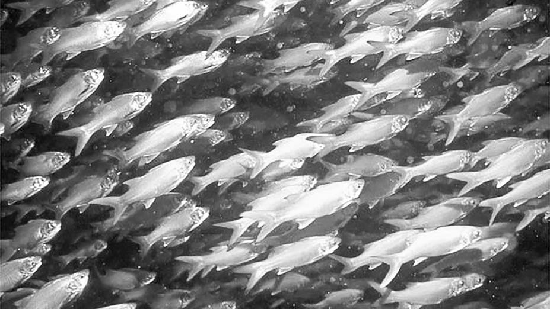

图中, 六指马鲅, /Polydactylus sexfilis/, 正成群游动. 在夏威夷语中, 它们又被称为 "王者之鱼" 或 /mo'i/. 这种鱼曾在夏威夷王室文化中拥有特殊地位, 人们会在专门的鱼塘里饲养它们, 以促进种群增长并避免灭绝. 鱼群的整体运动像一段细腻而协调的舞蹈, 每一条鱼都在轻微影响相邻个体, 同时也受到邻鱼影响.

到目前为止, 本书展示的主要是无生命的对象: 一些坐在画布里的形状, 在环境力作用下翻滚, 弹跳或飘动. 但这本书叫作 /The Nature of Code/. 能否为这些形状注入生命? 它们能否按照自己的规则行动? 一个形状能拥有希望, 梦想和恐惧吗? 本章讨论的正是这类问题, 也是区分无意识对象与更有趣事物的关键: *自主智能体*, autonomous agents.

** 来自内部的力
:PROPERTIES:
:CUSTOM_ID: forces-from-within
:PDF_PAGE_RANGE: 254-255
:END:

*自主智能体*是在没有领导者或全局计划直接控制的情况下, 自主选择如何在环境中行动的实体. 在本书中, "行动" 通常意味着移动. 以前的粒子会被重力等外部力被动吸引或排斥, 现在则要设计一种能够, 甚至 "想要", 决定自身运动的实体. 它可以决定接近或远离目标, 就像飞蛾扑向火焰, 或小鱼躲避捕食者.

从无生命对象转向自主智能体, 在概念上是一大步, 但代码基础几乎不需要改变. 智能体想要移动的愿望仍然可以表示为一个力, 与重力和风力没有本质区别. 唯一的变化是, 这个力现在来自对象 /内部/.

构建本章示例时, 需要记住自主智能体的三个核心组成部分:

1. *自主智能体只能有限地感知环境.* 活着的实体应当了解环境, 但这种感知不仅包含外部世界, 也包含它自己的内部状态, 例如位置, 速度, 其他属性, 甚至模拟出的情绪. 本章会让智能体在决策时考虑自身状态, 也会让对象保存对其他对象的引用, 从而 "感知" 周围环境. 这里的关键词是 "有限". 你可以设计一个了解画布中一切事物的全知圆点, 也可以让它只能观察距自己 15 像素以内的形状. 没有唯一正确答案, 但限制往往能让模拟显得更自然. 一只昆虫通常只能感知附近的景象和气味. 可以严格研究真实生物的感知边界, 也可以先大胆设定规则并观察结果.
2. *自主智能体处理环境信息并计算行动.* 在本书的框架中, 行动就是力. 如果环境告诉它一条巨大的鲨鱼正迎面游来, 那么行动可能是朝反方向施加一个很强的力.
3. *自主智能体没有领导者.* 某些系统当然可以有领导者, 但本章后半部分关注没有中央指挥的群体行为. 智能而有组织的整体结构, 可以由各个元素之间的局部交互自行涌现. 这正是 *复杂系统*, complex systems, 的重要特征.

自主智能体的切入点很多. 蚂蚁和白蚁群落的人工模拟就是典型例子. 对此感兴趣可以阅读 Mitchel Resnick 的 /Turtles, Termites, and Traffic Jams/. 不过, 本章将从前四章已经建立的向量和力模型继续前进. 书中不断变身的主角类, 从 =Walker= 到 =Mover=, 再到 =Particle=, 现在又要获得一个新名字.

** 载具与转向
:PROPERTIES:
:CUSTOM_ID: vehicles-and-steering
:PDF_PAGE_RANGE: 255-257
:END:

20 世纪 80 年代末, 计算机科学家 [[https://www.red3d.com/cwr/][Craig Reynolds]] 为动画角色提出了一组算法化的 *转向行为*, steering behaviors. 这些行为让单个元素能够以类似生命体的方式在数字环境中导航, 包括逃离, 漫游, 到达, 追逐和规避等策略. 在 1999 年的论文 /Steering Behaviors for Autonomous Characters/ 中, Reynolds 用 /vehicle/, 载具, 来称呼自主智能体. 本章也采用这个名称, 将类命名为 =Vehicle=:

#+begin_src javascript :eval never-export
class Vehicle {
  constructor() {
    this.position = createVector(width / 2, height / 2);
    this.velocity = createVector(0, 0);
    this.acceleration = createVector(0, 0);
  }

  /* 还需要添加什么? */
#+end_src

和此前的 =Mover=, =Particle= 一样, =Vehicle= 的运动仍由位置, 速度和加速度向量控制. 单个智能体的转向行为因此相当直接. 然而, 当大量载具按照简单的局部规则各自转向时, 却会涌现出惊人的复杂性. 最著名的例子是 Reynolds 的 boids 鸟群模型, 将在示例 5.11 中实现.

*** 为什么叫载具
:PROPERTIES:
:CUSTOM_ID: why-vehicles
:PDF_PAGE_RANGE: 255-257
:END:

意大利神经科学家和控制论学者 Valentino Braitenberg 在 /Vehicles: Experiments in Synthetic Psychology/ 中描述了一系列内部结构极其简单的假想载具. 他把这称为 "虚构的科学, 或者你更喜欢的话, 科学幻想". Braitenberg 认为, 即使只是非常简单的机械结构, 也可能表现出恐惧, 攻击性, 爱, 预见和乐观等行为. Reynolds 从 Braitenberg 获得灵感, 本章则沿着 Reynolds 的路线继续前进.

Reynolds 讨论的是 *理想化载具*. 他不关心真实工程结构, 而是假定载具已经能够工作并响应给定规则. 这种载具可分为三层:

1. *行动选择.* 载具有一个或多个目标, 并据此选择一个行动或行动组合. 它观察环境, 根据愿望选择行为. 例如, "我看到僵尸正向我走来, 我不想脑子被吃掉, 所以我要逃跑." 目标是保住脑子, 行动是逃离. 其他例子包括寻找目标, 避开障碍和沿路径移动.
2. *转向.* 选定行动之后, 载具必须计算下一步运动. 下一步将表示为一个力, 更准确地说是 *转向力*. Reynolds 给出了一条非常简洁的公式, 本章会反复使用: *转向力 = 期望速度 - 当前速度*.
3. *移动机构.* 本章大多忽略这一层. 逃离僵尸时, 移动机构可能是 "左脚, 右脚, 左脚, 右脚, 能跑多快就跑多快". 但画布中的圆, 矩形和三角形本来就是视觉幻象, 因而不必模拟真实腿脚. 不过, 设计载具的移动外观依然很有价值. 可以加入旋转的轮子, 往复摆动的桨, 或拖着走的腿.

最值得深入思考的是行动选择. 系统中有哪些元素, 它们有什么目标? 本章会实现寻找, 逃离, 沿路径移动, 跟随流场和结群等转向行为. 重点不是要求所有项目都套用这些行为, 而是学习如何把 /任意/ 行为转写成期望速度与转向力. 即使下面的例子非常具体, 也可以像 Braitenberg 那样抽象地思考: 如果载具的目标是 "爱", 或驱动力是 "恐惧", 代码中应该如何表现? 最终, 有趣的系统通常不是单一行动, 而是多个行为的混合.

*** 转向力
:PROPERTIES:
:CUSTOM_ID: the-steering-force
:PDF_PAGE_RANGE: 257-264
:END:

什么是转向力? 假设一个具有当前速度的载具正在寻找目标. 为了让场景更可爱一点, 可以把载具想成一只想吃草莓的虫子.

#+CAPTION: 图 5.1, 具有当前速度和目标的载具. PDF 第 257 页精确提取.
#+ATTR_ORG: :width 700
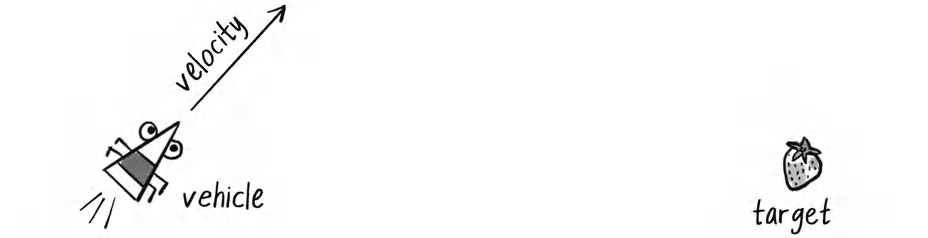

载具的目标和行动都是寻找目标. 可以把目标设置成吸引子, 使用万有引力把载具拉过去, 但那仍是被动运动. 这里要让载具根据对自身状态, 当前速度和方向, 以及环境状态, 目标位置, 的感知, 做出转向决策. 它应计算自己 /想要怎样移动/, 将该期望与 /当前怎样移动/ 进行比较, 然后施加相应的力. Reynolds 的公式正是:

\[
\text{转向力}=\text{期望速度}-\text{当前速度}
\]

在 p5.js 中:

#+begin_src javascript :eval never-export
let steer = p5.Vector.sub(desired, velocity);
#+end_src

当前速度已经保存在 =Vehicle.velocity= 中. 期望速度则需要计算. 若行为目标是 "寻找目标", 期望速度就应从当前位置指向目标位置.

#+CAPTION: 图 5.2, 期望速度从载具当前位置指向目标. PDF 第 258 页精确提取.
#+ATTR_ORG: :width 700
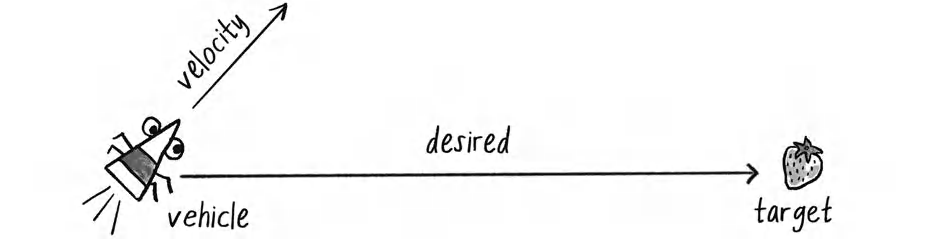

#+begin_src javascript :eval never-export
let desired = p5.Vector.sub(target, position);
#+end_src

不过, 如果目标在数千像素之外, 直接使用这个向量的大小会让载具想以荒谬的速度瞬移过去. 更合理的愿望是: *载具以允许的最高速度朝目标移动*. 因此, =desired= 的方向指向目标, 大小则设为载具的最高速度.

#+CAPTION: 图 5.3, 期望速度的大小等于最高速度. PDF 第 259 页精确提取.
#+ATTR_ORG: :width 700
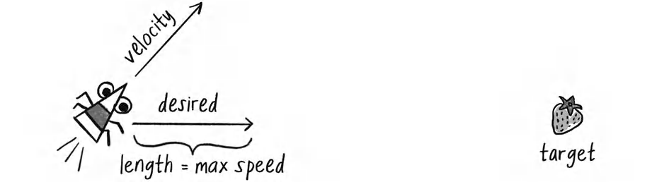

最高速度在第 1 章已经出现过. 本章将它作为控制智能体行为的重要参数, 并在 =Vehicle= 中保存 =maxspeed=:

#+begin_src javascript :eval never-export
class Vehicle {
  constructor() {
    this.position = createVector(width / 2, height / 2);
    this.velocity = createVector(0, 0);
    this.acceleration = createVector(0, 0);
    // 最高速度
    this.maxspeed = ????;
  }
#+end_src

随后将期望速度缩放为 =maxspeed=:

#+begin_src javascript :eval never-export
let desired = p5.Vector.sub(target, this.position);
desired.setMag(this.maxspeed);
#+end_src

完整的 =seek()= 方法如下. 它接收目标向量, 计算期望速度, 再根据 Reynolds 公式得到转向力:

#+begin_src javascript :eval never-export
  seek(target) {
    // 计算以最高速度指向目标的期望速度.
    let desired = p5.Vector.sub(target,this.position);
    desired.setMag(this.maxspeed);

    // Reynolds 转向力公式
    let steer = p5.Vector.sub(desired, this.velocity);
    // 使用物理模型, 把力施加到
    // 对象的加速度.
    this.applyForce(steer);
  }
#+end_src

方法末尾调用 =applyForce()=, 继续沿用第 2 章建立的物理模型.

#+CAPTION: 图 5.4, 转向力等于期望速度减去当前速度. PDF 第 260 页精确提取.
#+ATTR_ORG: :width 700
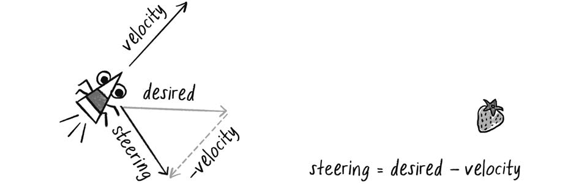

这与万有引力不同. 引力不会考虑对象当前如何运动, 而转向公式把载具自身速度明确纳入决策. 载具感知自己的状态, 并用转向力纠正当前运动与期望运动之间的差异, 因此产生更有生命感的轨迹.

还需要考虑载具的转向能力. 赛车能迅速转弯, 城市公交则需要提前很久开始改变方向. 为此加入 *最大转向力*, =maxforce=:

#+begin_src javascript :eval never-export
class Vehicle {
  constructor() {
    this.position = createVector(width / 2, height / 2);
    this.velocity = createVector(0, 0);
    this.acceleration = createVector(0, 0);
    // 最高速度
    this.maxspeed = ????;
    // 现在再加入最大转向力.
    this.maxforce = ????;
  }
#+end_src

在施加转向力之前限制其大小:

#+begin_src javascript :eval never-export
  seek(target) {
    let desired = p5.Vector.sub(target, this.position);
    desired.setMag(this.maxspeed);
    let steer = p5.Vector.sub(desired, this.velocity);
    // 限制转向力的大小.
    steer.limit(this.maxforce);
    this.applyForce(steer);
  }
#+end_src

目标并不是让载具尽快到达. 若只追求最快, 直接把位置设为目标即可. 真正目的在于让运动显得 "有生命且具有即兴感". 较大的最大转向力会产生更急促的路线, 较小的值则形成更平缓的弧线. 参数没有绝对优劣, 要根据所需行为选择, 甚至可以让它随能量, 情绪或环境动态变化.

#+CAPTION: 图 5.5, 较强最大转向力, 左, 与较弱最大转向力, 右, 产生的路径. PDF 第 261 页精确提取.
#+ATTR_ORG: :width 700
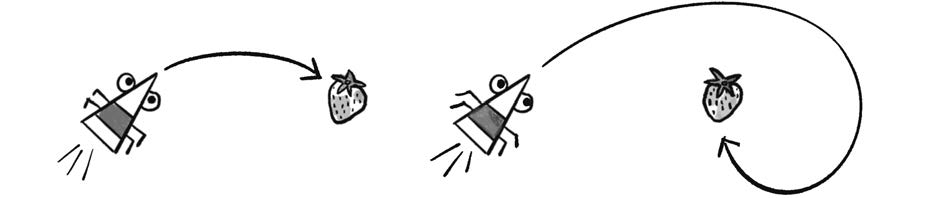

*** 示例 5.1: 寻找目标
:PROPERTIES:
:CUSTOM_ID: example-5-1-seeking-a-target
:PDF_PAGE_RANGE: 262-263
:END:

#+CAPTION: 示例 5.1, 寻找目标. PDF 第 262 页精确提取.
#+ATTR_ORG: :width 700

#+begin_src javascript :eval never-export
class Vehicle {
  constructor(x, y) {
    this.position = createVector(x, y);
    this.velocity = createVector(0, 0);
    this.acceleration = createVector(0, 0);
    // 额外的尺寸变量
    this.r = 6.0;
    // 最高速度和最大力使用任意初值, 可以尝试调整
    this.maxspeed = 8;
    this.maxforce = 0.2;
  }

  // 标准更新函数
  update() {
    this.velocity.add(this.acceleration);
    this.velocity.limit(this.maxspeed);
    this.position.add(this.velocity);
    this.acceleration.mult(0);
  }

  // 牛顿第二定律, 省略质量计算
  applyForce(force) {
    this.acceleration.add(force);
  }

  // 寻找行为的转向力算法
  seek(target) {
    let desired = p5.Vector.sub(target, this.position);
    desired.setMag(this.maxspeed);
    let steer = p5.Vector.sub(desired, this.velocity);
    steer.limit(this.maxforce);
    this.applyForce(steer);
  }

  show() {
    // 载具绘制成朝向速度方向的三角形.
    let angle = this.velocity.heading();
    fill(127);
    stroke(0);
    push();
    translate(this.position.x, this.position.y);
    rotate(angle);
    beginShape();
    vertex(this.r * 2, 0);
    vertex(-this.r * 2, -this.r);
    vertex(-this.r * 2, this.r);
    endShape(CLOSE);
    pop();
  }
}
#+end_src

与前几章用圆表示 mover 和 particle 不同, 这里使用 =beginShape()=, =vertex()= 和 =endShape()= 绘制三角形, 再用速度向量的 =heading()= 确定朝向. 这样可以直观看到载具正面指向哪里.

*** 练习 5.1

实现 *逃离*, flee, 行为. 它的期望速度和 =seek()= 类似, 但方向相反.

*** 练习 5.2

让载具的 =maxforce= 和 =maxspeed= 不再固定, 而是根据环境因素动态变化.

*** 练习 5.3

实现针对移动目标的寻找行为, 通常称为 *追逐*, pursuit. 期望向量不应指向目标的当前位置, 而应根据目标当前速度外推其未来位置. 后面的例子还会多次使用这种 "预测未来" 的能力.

#+CAPTION: 练习 5.3, 追逐移动目标. PDF 第 264 页精确提取.
#+ATTR_ORG: :width 700
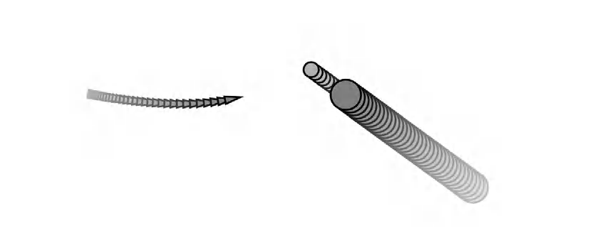

*** 到达行为
:PROPERTIES:
:CUSTOM_ID: the-arrive-behavior
:PDF_PAGE_RANGE: 264-269
:END:

=seek()= 会始终以最高期望速度冲向目标, 因而载具往往穿过目标, 再调头返回, 不断来回摆动. *到达*, arrive, 行为则让载具在靠近目标时减速, 最终平稳停下.

#+CAPTION: 图 5.6, 上方载具始终使用最高期望速度并会越过目标; 下方载具根据距离缩放期望速度. PDF 第 265 页精确提取.
#+ATTR_ORG: :width 700
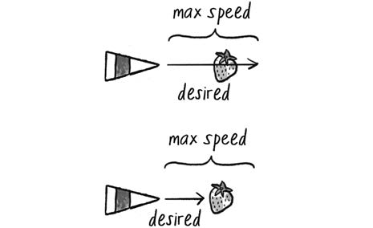

寻找行为中的两行代码是:

#+begin_src javascript :eval never-export
   let desired = p5.Vector.sub(target, this.position);
   desired.setMag(this.maxspeed);
#+end_src

一种最直接的减速方法是按距离缩放期望向量. 例如乘以 =0.5=:

#+begin_src javascript :eval never-export
   let desired = p5.Vector.sub(target, this.position);
   desired.mult(0.5);
#+end_src

#+CAPTION: 图 5.7, 无论距离多远, 载具的期望速度都被设为最高速度. PDF 第 266 页精确提取.
#+ATTR_ORG: :width 700
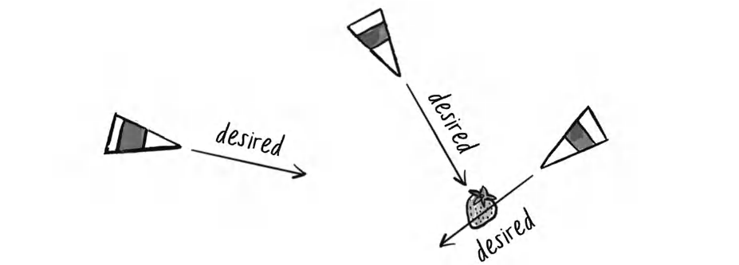

#+CAPTION: 图 5.8, 期望速度大小等于到目标距离的一半, 并受最高速度限制. PDF 第 266 页精确提取.
#+ATTR_ORG: :width 700
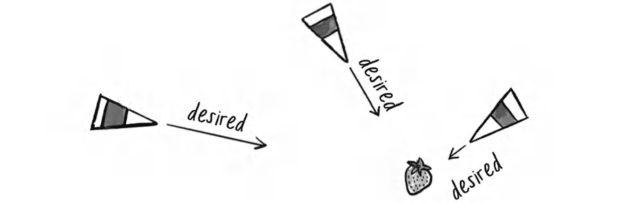

固定比例仍不够理想. 距离 10 像素时, 期望速度 5 仍可能过大. 可以改为距离的 5%:

#+begin_src javascript :eval never-export
  let desired = p5.Vector.sub(target, this.position);
  desired.mult(0.05);
#+end_src

Reynolds 的方案更细致. 在目标周围设定半径为 \(r\) 的圆. 圆外保持最高期望速度; 进入圆后, 期望速度从边界处的最高值逐渐映射到目标点处的 0.

#+CAPTION: 图 5.9, 圆外使用最高速度, 进入减速区域后随距离逐渐降低期望速度. PDF 第 267 页精确提取.
#+ATTR_ORG: :width 700
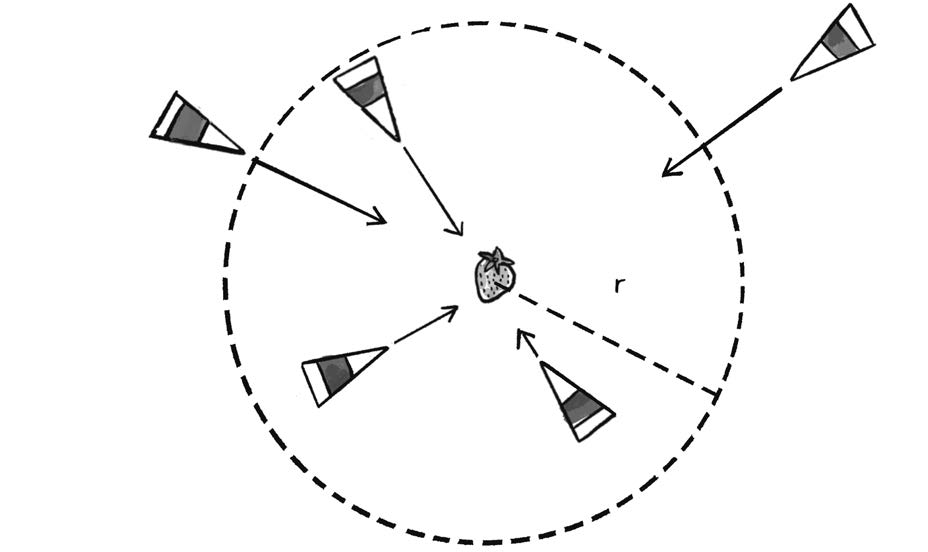

*** 示例 5.2: 到达目标
:PROPERTIES:
:CUSTOM_ID: example-5-2-arriving-at-a-target
:PDF_PAGE_RANGE: 267-269
:END:

#+CAPTION: 示例 5.2, 到达目标. PDF 第 267 页精确提取.
#+ATTR_ORG: :width 700
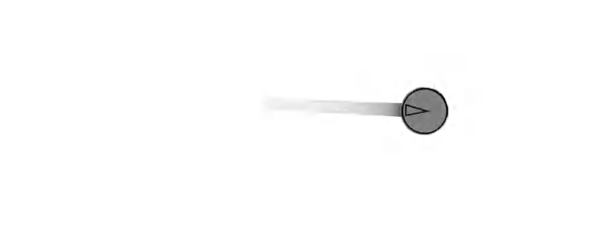

#+begin_src javascript :eval never-export
  arrive(target) {
    let desired = p5.Vector.sub(target, this.position);
    // 距离等于这个向量的大小:
    //它从当前位置指向
    //目标位置.
    let d = desired.mag();
    // 如果距离小于 100 像素...
    if (d < 100) {
      // ...根据距离设置期望速度大小.
      let m = map(d, 0, 100, 0, this.maxspeed);
      desired.setMag(m);
    } else {
      // 否则以最高速度前进.
      desired.setMag(this.maxspeed);
    }

    // 常规转向力 = 期望速度 - 当前速度
    let steer = p5.Vector.sub(desired, this.velocity);
    steer.limit(this.maxforce);
    this.applyForce(steer);
  }
#+end_src

到达行为很好地体现了自主智能体如何感知环境, 包括感知自身状态. 天体受引力吸引时并不知道自己正在受力, 但追逐猎物的猎豹知道自己在追逐. 载具既根据到目标的距离调整期望速度, 又把期望速度与当前速度比较. 转向力实际上就是当前运动的 *误差*: "我应该以这个速度朝这个方向运动, 但现在实际速度是另一个值. 两者之差就是需要纠正的量."

这种误差有时会让转向力指向看似意外的方向. 如果载具正以高于期望速度的速度接近目标, 为了减速, 转向力会反向指离目标.

#+CAPTION: 图 5.10, 当前速度超过期望速度时, 转向力会背离目标以实现减速. PDF 第 269 页精确提取.
#+ATTR_ORG: :width 700
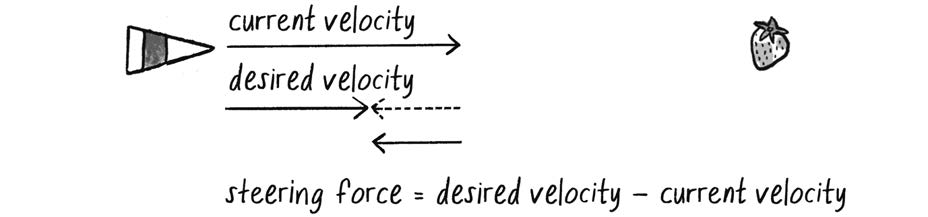

*** 设计自己的行为
:PROPERTIES:
:CUSTOM_ID: your-own-behaviors
:PDF_PAGE_RANGE: 269-273
:END:

寻找和到达最终都归结为计算一个向量: *期望速度*. Reynolds 的其他行为也遵循同一模式. 只要能提出一个描述载具期望运动的向量, 就能创造新的转向行为.

以 *漫游*, wandering, 为例. Reynolds 希望得到的不是每帧完全独立的随机方向, 而是具有长期连续性的随机转向: 当前帧的方向与下一帧有关, 载具会朝某个方向走一会儿, 然后逐渐转向另一个方向.

#+CAPTION: 图 5.11, 在载具前方投影一个圆, 让目标沿圆周随机移动, 从而实现连续的漫游. PDF 第 270 页精确提取.
#+ATTR_ORG: :width 700
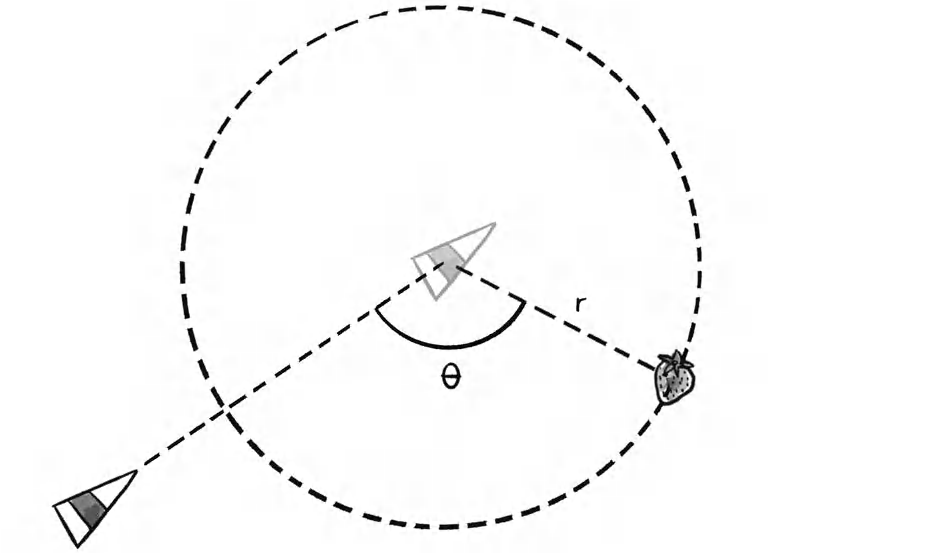

先根据当前速度预测前方固定距离的位置, 以该点为圆心画半径 \(r\) 的圆, 再从圆周选一个随机点作为目标. 每帧只让目标沿圆周随机变化, 载具就会平滑地改变方向, 而不是像白噪声那样抖动. 这个方案看似任意, 实际上是在有约束的几何空间里使用随机性, 是设计自定义行为的良好范例.

*** 练习 5.4

实现 Reynolds 的漫游行为. 使用极坐标计算圆周上的目标.

#+CAPTION: 练习 5.4, 漫游行为. PDF 第 271 页精确提取.
#+ATTR_ORG: :width 700
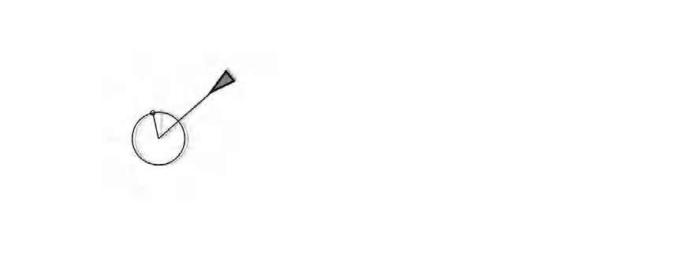

另一个例子是 "保持在墙内". 规则是: 如果载具距离某面墙不足 \(d\), 它就希望以最高速度朝远离该墙的方向移动.

#+CAPTION: 图 5.12, 载具过于接近墙壁时, 期望速度指向远离墙壁的方向. PDF 第 271 页精确提取.
#+ATTR_ORG: :width 700
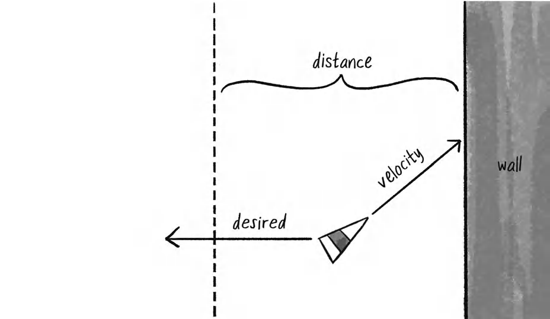

*** 示例 5.3: "保持在墙内" 转向行为
:PROPERTIES:
:CUSTOM_ID: example-5-3-stay-within-walls
:PDF_PAGE_RANGE: 272-273
:END:

#+CAPTION: 示例 5.3, 保持在墙内. PDF 第 272 页精确提取.
#+ATTR_ORG: :width 700
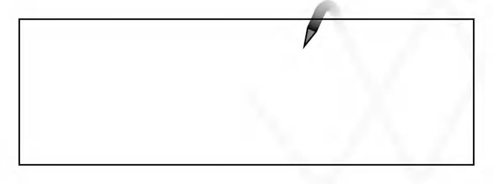

#+begin_src javascript :eval never-export
  // 方法接收距边缘的偏移量.
  boundaries(offset) {
    // 期望速度初始为 null.
    let desired = null;
    // 构造期望速度, 保留载具的 y 方向,
    //同时让 x 方向直接远离
    //画布边缘.
    if (this.position.x < offset) {
      desired = createVector(this.maxspeed, this.velocity.y);
    } else if (this.position.x > width - offset) {
      desired = createVector(-this.maxspeed, this.velocity.y);
    }
    if (this.position.y < offset) {
      desired = createVector(this.velocity.x, this.maxspeed);
    } else if (this.position.y > height - offset) {
      desired = createVector(this.velocity.x, -this.maxspeed);
    }
    // 若期望速度非 null, 则应用转向力.
    if (desired !== null) {
      desired.normalize();
      desired.mult(this.maxspeed);
      let steer = p5.Vector.sub(desired, this.velocity);
      steer.limit(this.maxforce);
      this.applyForce(steer);
    }
  }
#+end_src

方法开始时把 =desired= 设为 =null=, 而不是零向量. 原因是转向力等于期望速度减去当前速度. 若期望速度为 0, 就会产生减速到静止的力. 使用 =null= 并只在载具接近边界时计算转向, 可以让远离墙壁的载具完全不受影响.

*** 练习 5.5

提出一种任意但明确的规则来计算期望速度, 并把它实现为新的转向行为.

** 流场
:PROPERTIES:
:CUSTOM_ID: flow-fields
:PDF_PAGE_RANGE: 273-283
:END:

Reynolds 的另一种转向行为是 *跟随流场*, flow-field following. 可以把画布划分成网格, 每个单元格中放置一个指向特定方向的箭头, 也就是一个向量. 载具移动时只需询问: "我脚下的箭头指向哪里? 那就是我的期望速度."

#+CAPTION: 图 5.13, 由随机方向单位向量组成的二维网格. PDF 第 273 页精确提取.
#+ATTR_ORG: :width 700
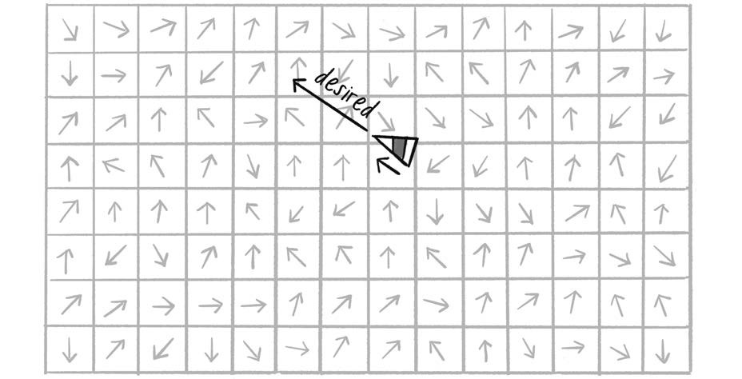

Reynolds 的原始方案会让载具先预测未来位置, 再查询该位置的流场向量. 为了简化, 本例直接查询当前位置.

流场本质上是一个向量网格, 因而适合用二维数组表示. 两个索引分别对应单元格的列和行:

#+begin_src javascript :eval never-export
class FlowField {
  constructor() {
    // 网格分辨率, 单位为相对于画布的像素
    this.resolution = ????;
    // 网格有多少列和多少行?
    this.cols = ????;
    this.rows = ????;
    // 流场是一个向量二维数组.
    this.field = new Array(this.cols);
    for (let i = 0; i < this.cols; i++) {
      this.field[i] = new Array(this.rows);
    }
  }
#+end_src

若画布为 200 x 200, 每个像素一个向量需要 40,000 个向量, 对当前目的来说过密. 设每 10 像素一个向量, 只需 20 x 20 = 400 个. =resolution= 表示网格单元的像素尺寸, 列数和行数由画布尺寸除以分辨率得到:

#+begin_src javascript :eval never-export
  constructor() {
    this.resolution = 10;
    // 总列数等于宽度除以分辨率.
    this.cols = floor(width / this.resolution);
    // 总行数等于高度除以分辨率.
    this.rows = floor(height / this.resolution);
    // 流场是一个向量二维数组.
    this.field = new Array(this.cols);
    for (let i = 0; i < this.cols; i++) {
      this.field[i] = new Array(this.rows);
    }
  }
#+end_src

数据结构准备好后, 可以用任意规则计算流场. 例如, 让所有向量都指向右侧:

#+CAPTION: 图 5.14, 所有向量都指向右侧的流场. PDF 第 275 页精确提取.
#+ATTR_ORG: :width 700
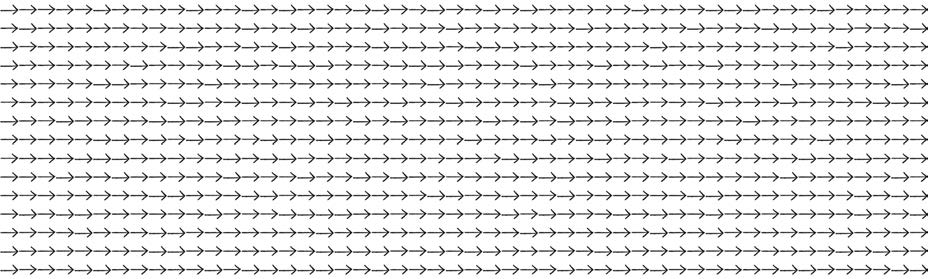

#+begin_src javascript :eval never-export
// 用嵌套循环访问每一列
// 以及流场的每一行.
for (let i = 0; i < this.cols; i++) {
  for (let j = 0; j < this.rows; j++) {
    // 任意设定每个向量都指向右侧
    this.field[i][j] = createVector(1, 0);
  }
}
#+end_src

也可以让每个单元具有随机方向:

#+CAPTION: 图 5.15, 向量方向随机的流场. PDF 第 275 页精确提取.
#+ATTR_ORG: :width 700
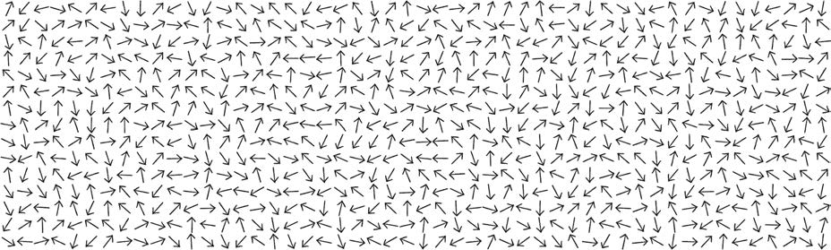

#+begin_src javascript :eval never-export
for (let i = 0; i < this.cols; i++) {
  for (let j = 0; j < this.rows; j++) {
    // 随机向量
    this.field[i][j] = p5.Vector.random2D();
  }
}
#+end_src

二维 Perlin 噪声会生成更平滑, 更有机的方向变化. 将噪声值映射到 \(0\) 至 \(2\pi\) 的角度, 再用 =p5.Vector.fromAngle()= 创建向量:

#+CAPTION: 图 5.16, 用 Perlin 噪声计算的流场. PDF 第 276 页精确提取.
#+ATTR_ORG: :width 700
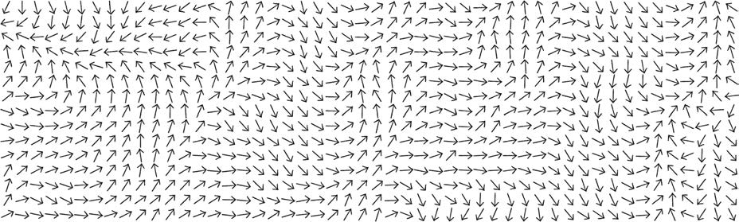

#+begin_src javascript :eval never-export
let xoff = 0;
for (let i = 0; i < this.cols; i++) {
  let yoff = 0;
  for (let j = 0; j < this.rows; j++) {
    // 二维噪声
    let angle = map(noise(xoff, yoff), 0, 1, 0, TWO_PI);
    this.field[i][j] = p5.Vector.fromAngle(angle);
    yoff += 0.1;
  }
  xoff += 0.1;
}
#+end_src

这种方法可以模拟不规则阵风, 蜿蜒河流等自然效果. 需要注意, Perlin 噪声的分布会让接近 \(\pi\) 的角度更常见, 从而使流场偏向左侧. 原书图 5.16 使用 \(0\) 至 \(4\pi\) 的映射范围来抵消这种倾向. 不存在唯一正确的流场计算方法, 应根据希望模拟的现象来设计.

*** 练习 5.6

编写一个流场, 让向量围绕画布中心旋转成同心环流.

#+CAPTION: 练习 5.6, 围绕画布中心旋转的流场. PDF 第 277 页精确提取.
#+ATTR_ORG: :width 700
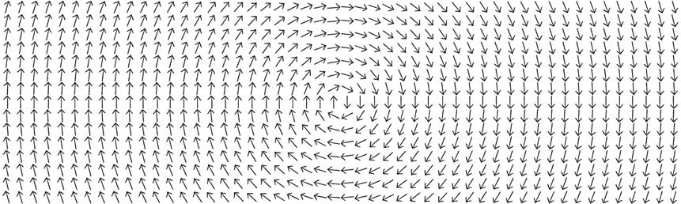

#+begin_src javascript :eval never-export
let x = i * width / cols;
let y = j * height / rows;
flowfield[i][j] = createVector(width / 2 - x, height / 2 - y);
flowfield[i][j].rotate(PI / 2);
#+end_src

有了二维向量数组之后, 载具需要根据位置查询期望速度. 将位置的 x, y 分量除以网格分辨率, 即可得到列索引和行索引. 例如分辨率为 10, 载具位于 (100, 50), 对应列 10, 行 5:

#+begin_src javascript :eval never-export
let column = floor(this.position.x / this.resolution);
let row = floor(this.position.y / this.resolution);
#+end_src

载具可能跑出画布, 因此用 =constrain()= 保证索引不越界. =lookup()= 接收位置并返回该单元格向量的副本:

#+begin_src javascript :eval never-export
  lookup(position) {
    // 使用 constrain().
    let column = constrain(floor(position.x / this.resolution), 0, this.cols - 1);
    let row = constrain(floor(position.y / this.resolution), 0, this.rows - 1);
    // 使用 copy() 确保返回向量副本.
    return this.field[column][row].copy();
  }
#+end_src

完整的 =FlowField= 类如下, 其中方向由 Perlin 噪声生成:

#+begin_src javascript :eval never-export
class FlowField {
  constructor(r) {
    this.resolution = r;
    // 计算列数和行数.
    this.cols = width / this.resolution;
    this.rows = height / this.resolution;
    // 流场是向量二维数组, 示例用独立代码创建该数组.
    this.field = new Array(this.cols);
    for (let i = 0; i < this.cols; i++) {
      this.field[i] = new Array(this.rows);
    }
    this.init();
  }

  // init() 用向量填充二维数组.
  init() {
    // 每次为新流场重新设置噪声种子.
    noiseSeed(random(10000));
    let xoff = 0;
    for (let i = 0; i < this.cols; i++) {
      let yoff = 0;
      for (let j = 0; j < this.rows; j++) {
        // 本例使用 Perlin 噪声创建向量.
        let angle = map(noise(xoff, yoff), 0, 1, 0, TWO_PI);
        this.field[i][j] = p5.Vector.fromAngle(angle);
        yoff += 0.1;
      }
      xoff += 0.1;
    }
  }

  // 根据位置返回向量的函数
  lookup(position) {
    let column = constrain(floor(position.x / this.resolution), 0, this.cols - 1);
    let row = constrain(floor(position.y / this.resolution), 0, this.rows - 1);
    return this.field[column][row].copy();
  }
}
#+end_src

=Vehicle.follow()= 通过 =lookup()= 取得期望方向, 将其大小设为最高速度, 再应用 "期望速度减当前速度" 的转向公式.

*** 示例 5.4: 跟随流场
:PROPERTIES:
:CUSTOM_ID: example-5-4-flow-field-following
:PDF_PAGE_RANGE: 279-280
:END:

#+CAPTION: 示例 5.4, 跟随流场. PDF 第 279 页精确提取.
#+ATTR_ORG: :width 700
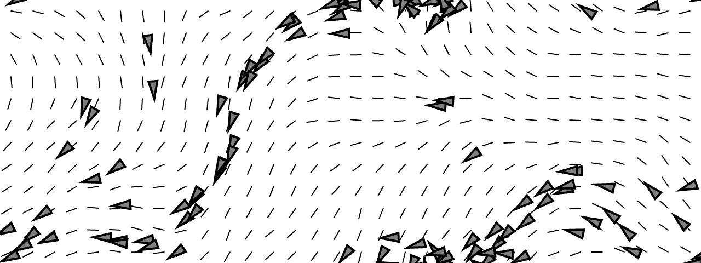

#+begin_src javascript :eval never-export
  follow(flow) {
    // 该位置的流场向量是什么?
    let desired = flow.lookup(this.position);
    desired.setMag(this.maxspeed);
    // 转向力等于期望速度减去当前速度.
    let steer = p5.Vector.sub(desired, this.velocity);
    steer.limit(this.maxforce);
    this.applyForce(steer);
  }
#+end_src

=lookup()= 放在 =FlowField= 中而不是 =Vehicle= 中, 是因为查询动作天然依赖流场自身的数据结构, 这符合封装原则. 本例还使用载具数组. 虽然每个载具独立行动, 但这已经为后面的群体行为搭好了舞台.

*** 练习 5.7

让流场随时间变化. 可以把时间作为 Perlin 噪声的第三个维度.

*** 练习 5.8

尝试从图像构造流场. 例如让向量从暗色指向亮色, 或反过来.

** 路径跟随
:PROPERTIES:
:CUSTOM_ID: path-following
:PDF_PAGE_RANGE: 280-298
:END:

接下来讨论 Reynolds 的 *路径跟随*, path following. 这里是 "跟随" 而不是 "寻路". 寻路算法通常在迷宫或图中寻找两点间的最短路线; 路径跟随则假定路线已经存在, 载具只需要尽量沿着它运动.

在实现算法前, 先补充第 1 章略过的一个向量运算: *点积*, dot product.

*** 点积
:PROPERTIES:
:CUSTOM_ID: the-dot-product
:PDF_PAGE_RANGE: 280-284
:END:

第 1 章介绍了向量加减和向量乘除标量. 向量乘标量会改变向量大小而不改变方向.

#+CAPTION: 图 5.17, 向量加法与向量乘标量. PDF 第 280 页精确提取.
#+ATTR_ORG: :width 700
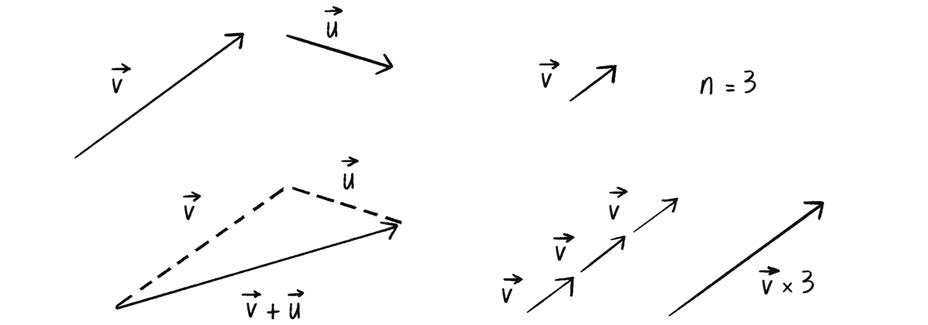

若
\[
\vec A=(a_x,a_y), \qquad \vec B=(b_x,b_y)
\]
则点积定义为
\[
\vec A\cdot\vec B=(a_xb_x)+(a_yb_y)
\]
点积的输入是两个向量, 输出却是标量. 例如
\[
(-3,5)\cdot(10,1)=(-3\times10)+(5\times1)=-25
\]

#+begin_src javascript :eval never-export
let a = createVector(-3, 5);
let b = createVector(10, 1);
// p5.Vector 提供计算点积的方法.
let n = a.dot(b);
#+end_src

=p5.Vector.dot()= 的核心实现也非常直接:

#+begin_src javascript :eval never-export
dot(v) {
  // 对于二维向量, z 为 0.
  return this.x * v.x + this.y * v.y + this.z * v.z;
}
#+end_src

点积的重要用途之一是计算两向量夹角. 它还可以写成:
\[
\vec A\cdot\vec B=\lVert\vec A\rVert\lVert\vec B\rVert\cos\theta
\]
其中 \(\theta\) 是两向量夹角. 因而
\[
\theta=\arccos\left(
\frac{\vec A\cdot\vec B}
{\lVert\vec A\rVert\lVert\vec B\rVert}
\right)
\]

#+CAPTION: 图 5.18, 向量 A 和 B 之间的夹角. PDF 第 282 页精确提取.
#+ATTR_ORG: :width 700
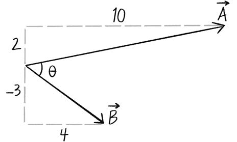

当 \(\vec A=(10,2)\), \(\vec B=(4,-3)\) 时, \(\lVert\vec A\rVert\approx10.2\), \(\lVert\vec B\rVert=5\), 计算得到 \(\theta\approx48^\circ\).

#+begin_src javascript :eval never-export
let a = createVector(10, 2);
let b = createVector(4, -3);
let angle = acos(a.dot(b) / (a.mag() * b.mag()));
#+end_src

p5.js 已经把这段算法封装为 =angleBetween()=:

#+begin_src javascript :eval never-export
  angleBetween(v) {
    let dot = this.dot(v);
    let angle = Math.acos(dot / (this.mag() * v.mag()));
    return angle;
  }
#+end_src

*** 练习 5.9

创建一个草图, 动态显示两个向量之间的夹角.

#+CAPTION: 练习 5.9, 显示两个向量夹角. PDF 第 283 页精确提取.
#+ATTR_ORG: :width 700
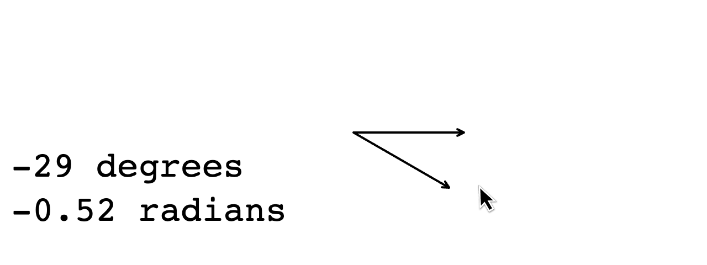

点积还有两条值得记住的性质:

- 若两向量正交, 即互相垂直, 点积为 0.
- 若两向量都是单位向量, 点积就等于夹角的余弦, 即 \(\vec A\cdot\vec B=\cos\theta\).

*** 简单路径跟随
:PROPERTIES:
:CUSTOM_ID: simple-path-following
:PDF_PAGE_RANGE: 284-293
:END:

路径跟随需要多个元素: 路径, 载具, 对未来位置的预测, 到路径的法线, 以及载具最终要寻找的目标.

#+CAPTION: 图 5.19, 路径跟随所需的路径, 载具, 未来位置, 法线和目标. PDF 第 284 页精确提取.
#+ATTR_ORG: :width 700
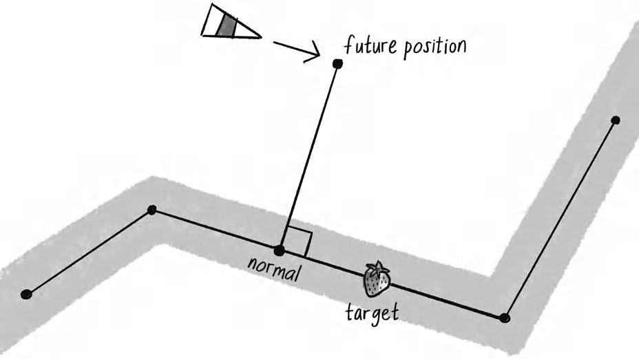

路径可以定义为一系列相连的点.

#+CAPTION: 图 5.20, 路径由连续点构成. PDF 第 284 页精确提取.
#+ATTR_ORG: :width 700
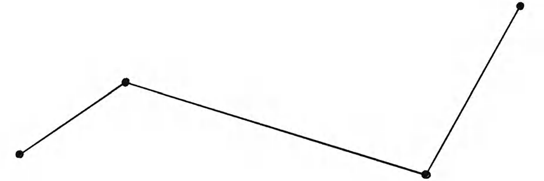

最简单的路径只有起点和终点, 并带有半径. 如果把路径看作道路, 半径就表示道路宽度. 半径越小, 载具越需要贴近中心线; 半径越大, 允许偏离的范围越宽.

#+CAPTION: 图 5.21, 具有起点, 终点和半径的路径. PDF 第 285 页精确提取.
#+ATTR_ORG: :width 700
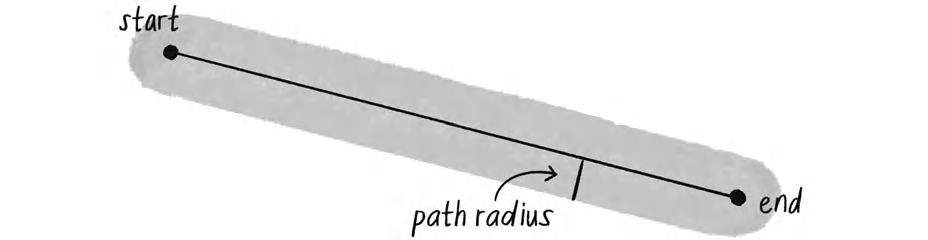

*** 示例 5.5: 创建路径对象
:PROPERTIES:
:CUSTOM_ID: example-5-5-creating-a-path-object
:PDF_PAGE_RANGE: 285-286
:END:

#+CAPTION: 示例 5.5, 创建路径对象. PDF 第 285 页精确提取.
#+ATTR_ORG: :width 700
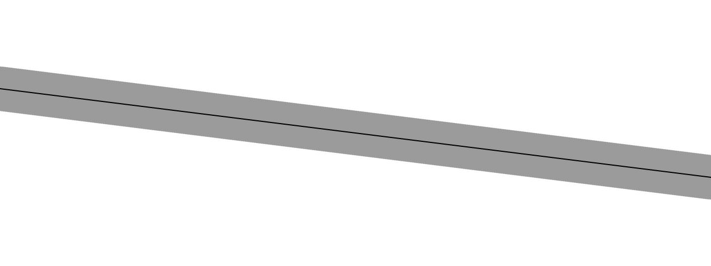

#+begin_src javascript :eval never-export
class Path {
  constructor() {
    // 路径具有表示宽度的半径.
    this.radius = 20;
    // 路径只有起点和终点两个点.
    this.start = createVector(0, height / 3);
    this.end = createVector(width, (2 * height) / 3);
  }

  // 绘制路径.
  show() {
    strokeWeight(this.radius * 2);
    stroke(0, 100);
    line(this.start.x, this.start.y, this.end.x, this.end.y);
    strokeWeight(1);
    stroke(0);
    line(this.start.x, this.start.y, this.end.x, this.end.y);
  }
}
#+end_src

现在假设载具位于路径半径之外, 并正继续远离路径.

#+CAPTION: 图 5.22, 一辆正偏离路径的载具. PDF 第 286 页精确提取.
#+ATTR_ORG: :width 700
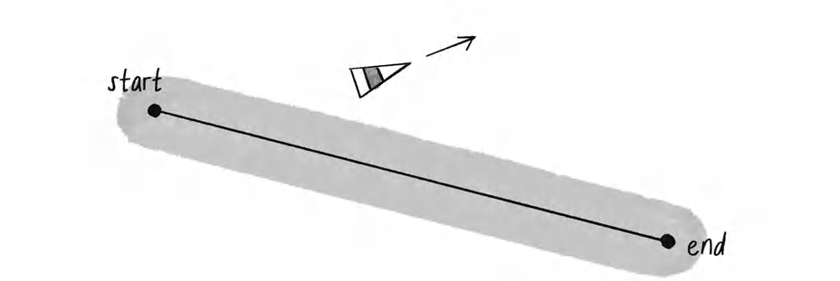

第一步是假设速度保持不变, 预测载具未来的位置:

#+begin_src javascript :eval never-export
// 先复制速度向量.
let future = vel.copy();
// 把大小设为 25, 向前预测 25 像素.
future.setMag(25);
// 与当前位置相加得到未来位置.
future.add(this.position);
#+end_src

接下来计算预测点到路径的距离. 点到直线的最短距离是 *法线*, normal, 的长度. 法线从该点延伸到直线并与直线垂直.

#+CAPTION: 图 5.23, 从未来位置垂直到路径的法线. PDF 第 287 页精确提取.
#+ATTR_ORG: :width 700
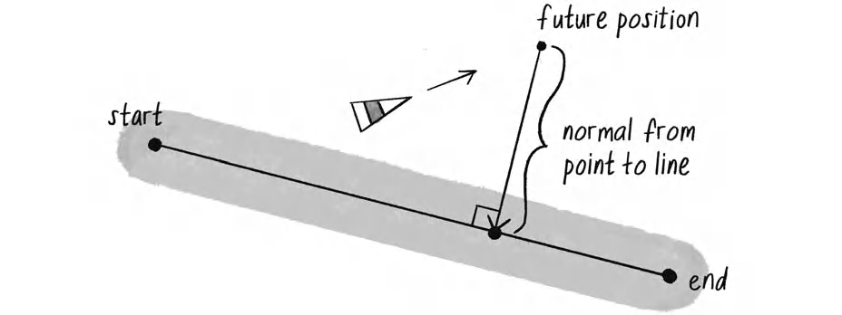

定义 \(\vec A\) 为路径起点到未来位置的向量:

#+begin_src javascript :eval never-export
let a = p5.Vector.sub(future, path.start);
#+end_src

定义 \(\vec B\) 为路径起点到终点的向量:

#+begin_src javascript :eval never-export
let b = p5.Vector.sub(path.end, path.start);
#+end_src

根据三角函数, 从路径起点到法足的距离为
\[
\lVert\vec A\rVert\cos\theta
\]

#+CAPTION: 图 5.24, 起点到法足的距离为 |A| cos(theta). PDF 第 287 页精确提取.
#+ATTR_ORG: :width 700
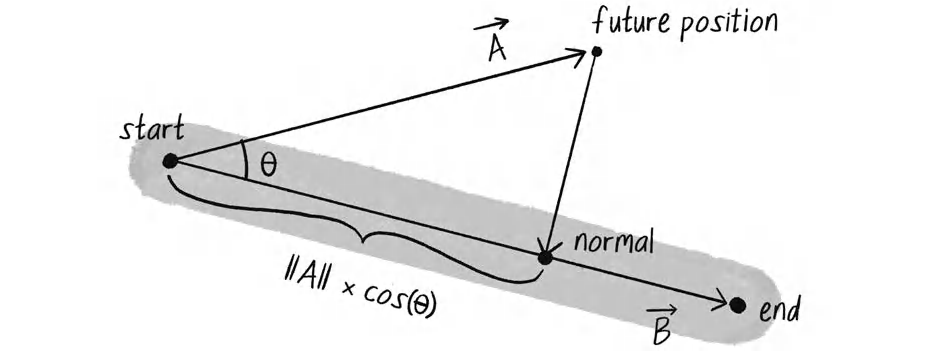

#+begin_src javascript :eval never-export
// 取得起点到法足的距离.
let d = a.mag() * cos(theta);
// 把向量 b 缩放到该距离.
b.setMag(d);
// 将缩放后的 b 与路径起点相加得到法足.
let normalPoint = p5.Vector.add(path.start, b);
#+end_src

夹角可以用 =p5.Vector.angleBetween()= 求得:

#+begin_src javascript :eval never-export
// theta 是 A 与 B 的夹角.
let theta = p5.Vector.angleBetween(a, b);
let d = a.mag() * cos(theta);
b.setMag(d);
let normalPoint = p5.Vector.add(path.start, b);
#+end_src

还可以进一步简化. 若先把 \(\vec B\) 归一化, 则
\[
\vec A\cdot\vec B=\lVert\vec A\rVert\cos\theta
\]
也就是说, 点积直接给出 \(\vec A\) 在单位向量 \(\vec B\) 上的标量投影. 这就是 *标量投影*, scalar projection.

#+begin_src javascript :eval never-export
let theta = p5.Vector.angleBetween(a, b);
let d = a.mag() * cos(theta);
b.setMag(d);
// 归一化 b, 并用点积设置 b 的长度.
b.normalize();
b.setMag(a.dot(b));
let normalPoint = p5.Vector.add(path.start, b);
#+end_src

#+CAPTION: 图 5.25, A 在 B 上的标量投影等于 |A| cos(theta). PDF 第 289 页精确提取.
#+ATTR_ORG: :width 700
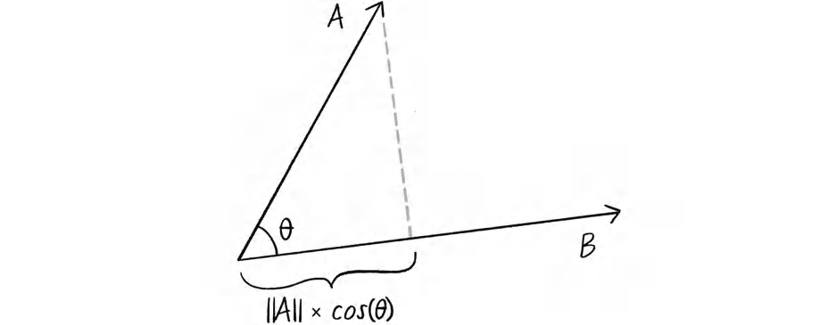

得到法足后, 计算它与预测未来位置之间的距离. 若距离大于路径半径, 载具就有偏离路径的危险, 需要转向; 若仍在半径内, 则继续原来的运动.

#+CAPTION: 图 5.26, 未来位置位于路径内, 上, 和路径外, 下, 的两种情况. PDF 第 289 页精确提取.
#+ATTR_ORG: :width 700
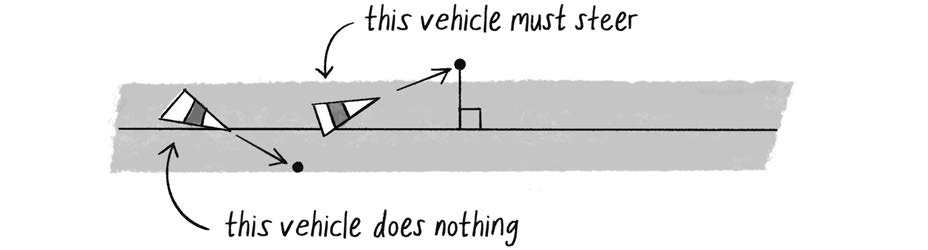

#+begin_src javascript :eval never-export
let distance = p5.Vector.dist(future, normalPoint);
// 若载具位于路径外, 则寻找目标.
if (distance > path.radius) {
  // 期望速度和转向力可复用示例 5.1 的 seek().
  this.seek(target);
}
#+end_src

但载具不应直接寻找法足, 否则会左右摇摆并落后于路径方向. Reynolds 的方法是在路径上选择一个位于法足前方的点作为目标. 将沿路径方向的向量 \(\vec B\) 设为 25 像素, 再与法足相加即可.

#+CAPTION: 图 5.27, 目标位于法足沿路径方向前方 25 像素处. PDF 第 290 页精确提取.
#+ATTR_ORG: :width 700
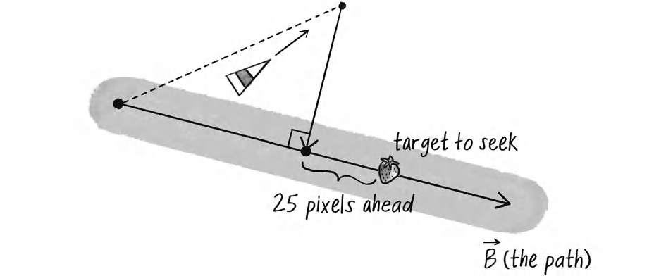

#+begin_src javascript :eval never-export
let distance = p5.Vector.dist(future, normalPoint);
if (distance > path.radius) {
  // 把大小任意设为 25 像素.
  b.setMag(25);
  // 把 b 加到 normalPoint, 得到路径前方 25 像素的目标.
  let target = p5.Vector.add(normalPoint, b);
  // 寻找目标.
  this.seek(target);
}
#+end_src

*** 示例 5.6: 简单路径跟随
:PROPERTIES:
:CUSTOM_ID: example-5-6-simple-path-following
:PDF_PAGE_RANGE: 291-293
:END:

#+CAPTION: 示例 5.6, 简单路径跟随. PDF 第 291 页精确提取.
#+ATTR_ORG: :width 700
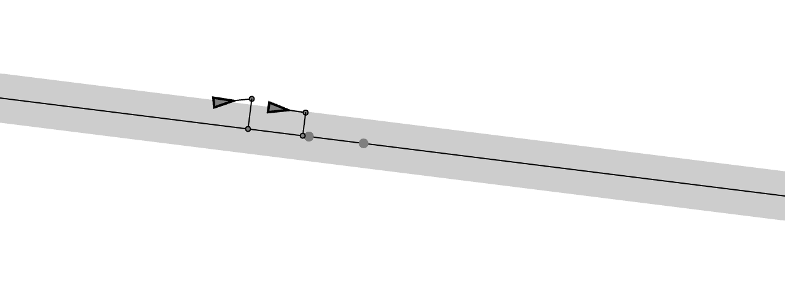

#+begin_src javascript :eval never-export
  follow(path) {
    // 步骤 1: 预测载具未来位置.
    let future = this.velocity.copy();
    future.setMag(25);
    future.add(this.position);
    // 步骤 2: 求路径上的法足.
    let normalPoint = getNormalPoint(future, path.start, path.end);
    // 步骤 3: 沿路径向前观察并设置目标.
    // 为优化, 可仅在偏离路径时计算目标.
    let b = p5.Vector.sub(path.end, path.start);
    b.setMag(25);
    let target = p5.Vector.add(normalPoint, b);
    // 步骤 4: 若偏离路径,
    // 寻找该目标以返回路径.
    let distance = p5.Vector.dist(normalPoint, future);
    if (distance > path.radius) {
      this.seek(target);
    }
  }
#+end_src

#+CAPTION: 图 5.28, getNormalPoint() 的 position, a 和 b 参数. PDF 第 292 页精确提取.
#+ATTR_ORG: :width 700
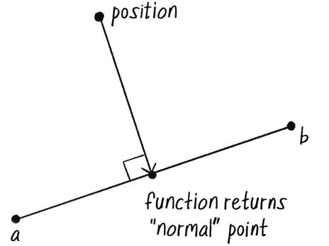

为了让主算法更清晰, 把求法足的代码封装进 =getNormalPoint()=. 它接收一个笛卡尔点 =position= 和线段端点 =a=, =b=:

#+begin_src javascript :eval never-export
  getNormalPoint(position, a, b) {
    // 从 a 指向 position 的向量
    let vectorA = p5.Vector.sub(position, a);
    // 从 a 指向 b 的向量
    let vectorB = p5.Vector.sub(b, a);
    // 使用点积计算标量投影.
    vectorB.normalize();
    vectorB.mult(vectorA.dot(vectorB));
    // 求线段上的法足.
    let normalPoint = p5.Vector.add(a, vectorB);
    return normalPoint;
  }
#+end_src

到这里, =Path= 用一条线段描述路径, =Vehicle.follow()= 预测未来位置, 找到法足和前方目标, 必要时通过 =seek()= 返回路径. 但真实路线往往不止一条直线.

*** 跟随多线段路径
:PROPERTIES:
:CUSTOM_ID: path-following-with-multiple-segments
:PDF_PAGE_RANGE: 293-298
:END:

复杂路径可以是曲线, 但直接对任意曲线做几何计算会迅速变得棘手. 实用做法是在后台用相连的直线段近似曲线, 同时仍可把它绘制成平滑外观.

#+CAPTION: 图 5.29, 更复杂的弯曲路径. PDF 第 293 页精确提取.
#+ATTR_ORG: :width 700
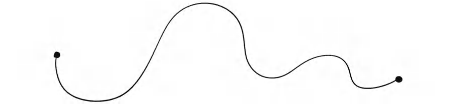

#+CAPTION: 图 5.30, 用相连线段近似同一条曲线. PDF 第 293 页精确提取.
#+ATTR_ORG: :width 700
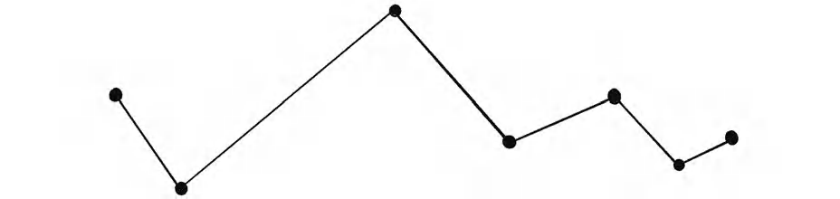

对每一条线段都可以计算一个法足. 载具应选择同时满足两个条件的法足: 它位于有限线段上, 并且在所有候选法足中距离最近.

#+CAPTION: 图 5.31, 在多条相连线段中寻找最近的有效法足. PDF 第 294 页精确提取.
#+ATTR_ORG: :width 700
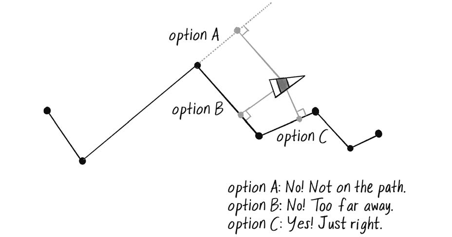

*** 示例 5.7: 多线段路径对象
:PROPERTIES:
:CUSTOM_ID: example-5-7-multiple-segments
:PDF_PAGE_RANGE: 294-296
:END:

#+CAPTION: 示例 5.7, 由多条线段构成的路径. PDF 第 294 页精确提取.
#+ATTR_ORG: :width 700
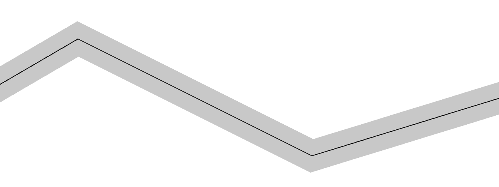

#+begin_src javascript :eval never-export
class Path {
  constructor() {
    this.radius = 20;
    // 路径现在是点, 即 p5.Vector, 的数组.
    this.points = [];
  }

  // 此方法用于向路径添加点.
  addPoint(x, y) {
    let pathPoint = createVector(x, y);
    this.points.push(pathPoint);
  }

  show() {
    // 用较粗灰线绘制路径半径.
    stroke(200);
    strokeWeight(this.radius * 2);
    noFill();
    beginShape();
    for (let pathPoint of this.points) {
      vertex(pathPoint.x, pathPoint.y);
    }
    endShape();
    // 用细线绘制路径中心.
    stroke(0);
    strokeWeight(1);
    beginShape();
    for (let pathPoint of this.points) {
      vertex(pathPoint.x, pathPoint.y);
    }
    endShape();
  }
}
#+end_src

对 =points= 数组中每对相邻点循环, 计算每一段的法足:

#+begin_src javascript :eval never-export
for (let i = 0; i < path.points.length - 1; i++) {
  let a = path.points[i];
  let b = path.points[i + 1];
  // 计算每条线段的法足.
  let normalPoint = getNormalPoint(future, a, b);
#+end_src

在本例中路径从左向右, 因而可检查 =normalPoint.x= 是否位于 =a.x= 和 =b.x= 之间. 如果不在有限线段上, 暂时把线段终点当作法足:

#+begin_src javascript :eval never-export
   if (normalPoint.x < a.x || normalPoint.x > b.x) {
     // 如果无法得到在线段内的法足,
     // 使用线段终点作为法足.
     normalPoint = b.copy();
   }
#+end_src

*** 练习 5.10

实现更通用的线段有效性检查: 计算法足到 =a=, =b= 的距离之和. 如果该和大于线段 =ab= 的长度, 法足就在段外.

最后需要从所有候选点中找出最近者. 先把 "世界纪录" 距离设成无穷大, 遍历候选点. 每当遇到更短距离, 就更新纪录并保存该法足作为目标.

*** 示例 5.8: 路径跟随
:PROPERTIES:
:CUSTOM_ID: example-5-8-path-following
:PDF_PAGE_RANGE: 296-298
:END:

#+CAPTION: 示例 5.8, 跟随多线段路径. PDF 第 296 页精确提取.
#+ATTR_ORG: :width 700
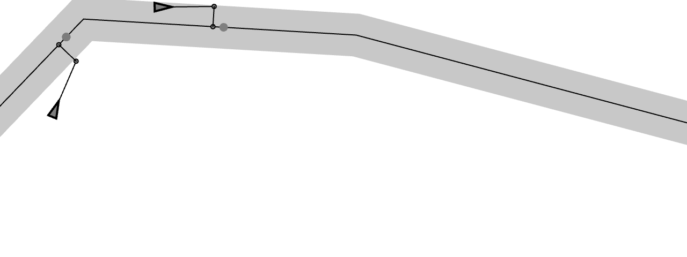

#+begin_src javascript :eval never-export
let target = null;
// 从易于被打破的极大纪录开始, 例如 Infinity.
let worldRecord = Infinity;
for (let i = 0; i < path.points.length - 1; i++) {
  let a = path.points[i];
  let b = path.points[i + 1];
  let normalPoint = getNormalPoint(future, a, b);
  if (normalPoint.x < a.x || normalPoint.x > b.x) {
    normalPoint = b.copy();
  }

  let distance = p5.Vector.dist(future, normalPoint);
  // 若刷新纪录, 该点成为目标.
  if (distance < worldRecord) {
    worldRecord = distance;
    target = normalPoint.copy();
  }
  // 沿线段方向在法足前方寻找目标.
  let dir = p5.Vector.sub(b, a);
  dir.setMag(25);
  target.add(dir);
}
#+end_src

JavaScript 的 =Infinity= 是特殊数值, 可以确保第一个真实距离必然刷新纪录. 代码中硬编码的 25 表示目标位于法足前方的距离. Reynolds 建议让它随载具速度和偏离路径的程度动态变化, 这样可以提高响应性和跟随精度.

*** 练习 5.11

创建一条随时间变化的路径. 定义路径的各个点是否也能拥有自己的转向行为?

** 复杂系统
:PROPERTIES:
:CUSTOM_ID: complex-systems
:PDF_PAGE_RANGE: 298-315
:END:

本章的目标是为画布中的运动对象注入生命. 到目前为止, 载具已经能够独立寻找, 到达, 跟随流场和路径. 但生命并不只发生在孤立个体中. 下一步是让许多自主智能体并行运行, 感知同伴的行为并据此行动, 从而构造复杂系统.

*复杂系统*通常被定义为 "整体大于部分之和" 的系统. 单个元素可能极其简单, 但整体行为却可能复杂, 智能而难以预测. 一只蚂蚁只能感知附近的化学信号并做出局部决策, 无法独自建巢, 收集食物或保卫蚁后. 蚁群却能成为协同完成复杂目标的 "超级有机体".

本章以三个原则指导复杂系统模拟:

1. *简单单元具有短程关系.* 智能体的环境感知范围有限.
2. *简单单元并行运行.* 每次 =draw()= 循环中, 每个单元都计算自己的转向力, 视觉上就像所有个体同时行动.
3. *整体表现出涌现现象.* 复杂行为, 模式和智能并非由中央控制器编写, 而是从简单单元间的互动中产生. 蚁群, 迁徙, 地震和雪花都体现了这种现象.

复杂系统还经常具备以下特征:

- *非线性.* 初始条件的微小变化可能产生巨大的结果差异, 常被称为 "蝴蝶效应". Edward Lorenz 在天气模拟中把 0.506127 简写为 0.506, 最终轨迹却完全不同. 输入变化与输出变化之间不存在简单线性比例.
- *竞争与合作.* 群集中的对齐和凝聚要求个体合作, 分离则要求个体竞争空间. 如果只保留合作或只保留竞争, 整体复杂性都会下降.
- *反馈.* 系统输出会重新成为输入, 进一步改变系统. 公共交通的可靠性和成本会影响乘客选择, 乘客数量又会改变拥挤度, 班次, 票价和道路交通, 再反过来影响下一轮选择. 潮流, 选举, 人群和交通流也具有类似反馈回路.

接下来要让 =Vehicle= 感知邻近载具, 并最终通过简单个体规则涌现出鸟群行为.

*** 实现群体行为: 别撞到邻居
:PROPERTIES:
:CUSTOM_ID: implementing-group-behaviors
:PDF_PAGE_RANGE: 298-305
:END:

管理对象集合并不陌生. 与第 4 章粒子系统相同, 先用数组保存 =Vehicle=:

#+begin_src javascript :eval never-export
// 声明 Vehicle 对象数组.
let vehicles;

function setup() {
  // 初始化数组并填入
  // 一组载具.
  vehicles = [];
  for (let i = 0; i < 100; i++) {
    vehicles.push(new Vehicle(random(width), random(height)));
  }
}
#+end_src

在 =draw()= 中遍历并更新, 绘制:

#+begin_src javascript :eval never-export
function draw() {
  for (let vehicle of vehicles) {
    vehicle.update();
    vehicle.show();
  }
}
#+end_src

对所有载具应用寻找鼠标的行为仍然只是个体行为:

#+begin_src javascript :eval never-export
    vehicle.seek(mouseX, mouseY);
#+end_src

第一个群体行为是 *分离*, separation, 即避免与邻居碰撞:

#+begin_src javascript :eval never-export
    vehicle.separate();
#+end_src

但 =separate()= 必须知道 "所有其他载具" 是谁, 因而要把整个数组传入:

#+begin_src javascript :eval never-export
    vehicle.separate(vehicles);
#+end_src

完整的主循环如下. 每个载具在计算自身分离力时都会检查整个载具数组:

#+begin_src javascript :eval never-export
let vehicles;

function setup() {
  createCanvas(640, 240);
  vehicles = [];
  for (let i = 0; i < 100; i++) {
    vehicles.push(new Vehicle(random(width), random(height)));
  }
}

function draw() {
  background(255);

  for (let vehicle of vehicles) {
    // 这是本节真正的新内容: 让
    // Vehicle 在计算分离力时检查
    // 其他所有载具.
    vehicle.separate(vehicles);
    vehicle.update();
    vehicle.show();
  }
}
#+end_src

分离可看作逃离行为. 若某个邻居太近, 期望速度就指向远离邻居的位置.

#+CAPTION: 图 5.32, 分离行为的期望速度与逃离相同, 指向远离目标的方向. PDF 第 301 页精确提取.
#+ATTR_ORG: :width 700

若同时有多个邻居过近, 就求所有逃离向量的平均值.

#+CAPTION: 图 5.33, 分离的期望速度是多个逃离向量的平均值. PDF 第 302 页精确提取.
#+ATTR_ORG: :width 700
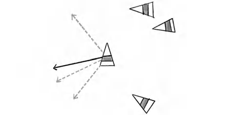

方法接收载具数组:

#+begin_src javascript :eval never-export
separate(vehicles) {

}
#+end_src

遍历数组, 计算当前载具与每个邻居的距离, 并排除 =this === other= 的情况, 否则载具会试图逃离自己:

#+begin_src javascript :eval never-export
  // 此变量规定多近算作过近.
  let desiredSeparation = 20;
  for (let other of vehicles) {
    // 当前载具与其他载具的距离是多少?
    let d = p5.Vector.dist(this.position, other.position);
    if (this !== other && d < desiredSeparation) {
      // 若载具在 20 像素内, 执行此处代码.

    }
  }
#+end_src

若距离小于阈值, 构造从邻居指向自身的位置差向量:

#+begin_src javascript :eval never-export
    if (this !== other && d < desiredseparation) {
      // 指离其他载具位置的向量
      let diff = p5.Vector.sub(this.position, other.position);
      diff.normalize();
    }
#+end_src

把所有逃离向量相加并记录数量. 只有 =count > 0= 时才求平均, 既避免无意义计算, 也避免除以 0:

#+begin_src javascript :eval never-export
  // 从空向量开始.
  let sum = createVector();
  // 记录有多少载具过近.
  let count = 0;

  for (let other of vehicles) {
    let d = p5.Vector.dist(this.position, other.position);
    if (this !== other && d < desiredseparation) {
      let diff = p5.Vector.sub(this.position, other.position);
      diff.normalize();
      // 累加向量并增加计数.
      sum.add(diff);
      count++;
    }
  }

  // 确保至少存在一个过近
  // 载具. 若没有过近对象则无需操作,
  // 而且不能
  // 除以 0.
  if (count > 0) {
    // sum.div(count);
  }
#+end_src

平均向量缩放到最高速度后成为期望速度, 再减去当前速度得到转向力:

#+begin_src javascript :eval never-export
  if (count > 0) {
    // 把平均向量缩放到最高速度
    // 它将成为期望速度.
    sum.setMag(this.maxspeed);
    // Reynolds 转向公式
    let steer = p5.Vector.sub(sum, vel);
    steer.limit(this.maxforce);
    // 把力施加到载具.
    this.applyForce(steer);
  }
#+end_src

*** 示例 5.9: 分离
:PROPERTIES:
:CUSTOM_ID: example-5-9-separation
:PDF_PAGE_RANGE: 304-305
:END:

#+CAPTION: 示例 5.9, 分离行为. PDF 第 304 页精确提取.
#+ATTR_ORG: :width 700
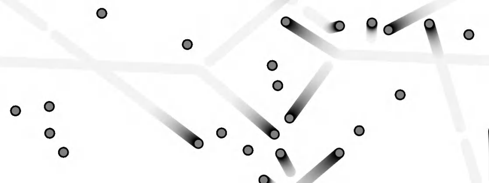

#+begin_src javascript :eval never-export
  separate(vehicles) {
    // 期望分离距离基于
    // 载具尺寸.
    let desiredSeparation = this.r * 2;
    let sum = createVector(0, 0);
    let count = 0;
    for (let other of vehicles) {
      let d = p5.Vector.dist(this.position, other.position);
      if (this !== other && d < desiredSeparation) {
        let diff = p5.Vector.sub(this.position, other.position);
        // 远离邻居的 p5.Vector
        // 应具有多大大小?
        // 越近越应强烈逃离.
        // 越远影响越小, 因此大小设为
        // 与距离成反比.
        diff.setMag(1 / d);
        sum.add(diff);
        count++;
      }
    }
    if (count > 0) {
      sum.setMag(this.maxspeed);
      let steer = p5.Vector.sub(sum, this.velocity);
      steer.limit(this.maxforce);
      this.applyForce(steer);
    }
  }
#+end_src

这个版本包含两项改进. 第一, 期望分离距离与载具尺寸相关, 不再是固定常量. 第二, 逃离向量的大小设为距离的倒数. 邻居越近, 逃离愿望越强; 越远, 影响越弱.

*** 练习 5.12

实现与 =separate()= 逻辑相反的 =cohere()=. 当另一载具距离过远时向它转向, 以维持群体聚合.

*** 练习 5.13

把分离力加入路径跟随, 构造 Reynolds 的群体路径跟随模拟.

#+CAPTION: 练习 5.13, 同时具有路径跟随和分离的群体. PDF 第 305 页精确提取.
#+ATTR_ORG: :width 700
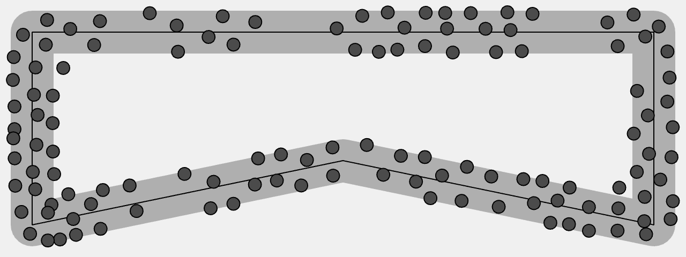

*** 组合行为
:PROPERTIES:
:CUSTOM_ID: combining-behaviors
:PDF_PAGE_RANGE: 305-308
:END:

真正有趣的群体行为通常来自多个转向力的混合. 第 2 章已经用力累加同时处理风和重力:

#+begin_src javascript :eval never-export
  let wind = createVector(0.001, 0);
  let gravity = createVector(0, 0.1);
  mover.applyForce(wind);
  mover.applyForce(gravity);
#+end_src

这里的力来自载具内部愿望, 还需要为不同愿望设置权重. 例如一群鱼既想寻找鼠标处的食物, 又想避免互相碰撞. 可以增加 =applyBehaviors()= 统一管理行为:

#+begin_src javascript :eval never-export
applyBehaviors(vehicles) {
  this.separate(vehicles);
  this.seek(createVector(mouseX, mouseY));
}
#+end_src

为了集中调整权重, 让 =seek()= 和 =separate()= 只计算并返回力, 而不立即调用 =applyForce()=:

#+begin_src javascript :eval never-export
  applyBehaviors(vehicles) {
    let separate = this.separate(vehicles);
    let seek = this.seek(createVector(mouseX, mouseY));
    // 在这里施力, 因为 seek() 和 separate() 不再直接施力.
    this.applyForce(separate);
    this.applyForce(seek);
  }
#+end_src

修改后的 =seek()= 返回转向向量:

#+begin_src javascript :eval never-export
  seek(target) {
    let desired = p5.Vector.sub(target, this.position);
    desired.setMag(this.maxspeed);

    let steer = p5.Vector.sub(desired, this.velocity);
    steer.limit(this.maxforce);

    this.applyForce(steer);
    // 不直接施力, 而是返回向量.
    return steer;
  }
#+end_src

*** 示例 5.10: 组合寻找与分离
:PROPERTIES:
:CUSTOM_ID: example-5-10-combining-steering
:PDF_PAGE_RANGE: 307-308
:END:

#+CAPTION: 示例 5.10, 组合寻找和分离行为. PDF 第 307 页精确提取.
#+ATTR_ORG: :width 700
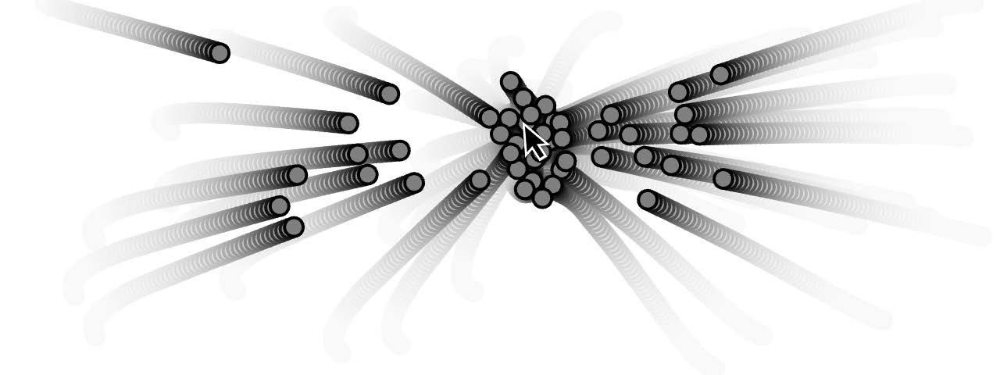

#+begin_src javascript :eval never-export
applyBehaviors(vehicles) {
  let separate = this.separate(vehicles);
  let seek = this.seek(createVector(mouseX, mouseY));
  // 这些权重可以按需要设定.
  // 它们可以按每个载具定制,
  // 也可以随时间变化.
  separate.mult(1.5);
  seek.mult(0.5);
  this.applyForce(separate);
  this.applyForce(seek);
}
#+end_src

=mult()= 缩放各个力的大小, 1.5 和 0.5 就是行为权重. 权重可以随环境和个体属性变化. 例如食物靠近或 =hunger= 增大时提高寻找权重, 进入拥挤区域时提高分离权重. 这种动态权重能够形成更细腻的行为层次.

*** 练习 5.14

让行为权重随时间变化, 例如使用正弦波或 Perlin 噪声. 也可以让不同载具具有不同偏好, 并加入更多转向行为.

*** 鸟群行为
:PROPERTIES:
:CUSTOM_ID: flocking
:PDF_PAGE_RANGE: 308-315
:END:

*结群*, flocking, 广泛存在于鸟, 鱼和昆虫中. 1986 年, Reynolds 在论文 /Flocks, Herds, and Schools: A Distributed Behavioral Model/ 中提出计算机鸟群模型. 这个示例汇集了本章的全部概念:

1. 用 "转向力 = 期望速度 - 当前速度" 实现规则.
2. 每个个体感知其他个体, 形成群体行为.
3. 组合并加权多个转向力.
4. 不依赖中央领导者, 由简单规则涌现出智能的整体运动.

Reynolds 把群集中的鸟状对象称为 *boid*. 这里把 =Vehicle= 再次改名为 =Boid=. 鸟群由三条规则控制:

- *分离*, separation, 或 avoidance: 避免撞上邻居.
- *对齐*, alignment, 或 copy: 朝邻居的平均运动方向转向.
- *凝聚*, cohesion, 或 center: 朝邻居的中心位置转向, 留在群体中.

#+CAPTION: 图 5.34, 鸟群的三条规则: 分离, 对齐和凝聚. PDF 第 309 页精确提取.
#+ATTR_ORG: :width 700
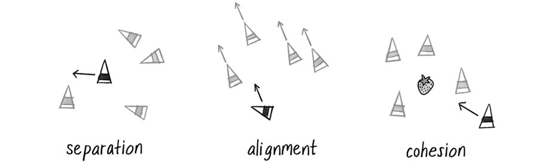

=flock()= 计算三种力, 加权后全部施加:

#+begin_src javascript :eval never-export
  flock(boids) {
    // 三条鸟群规则
    let separation = this.separate(boids);
    let alignment = this.align(boids);
    let cohesion = this.cohere(boids);
    // 这些力的任意权重, 可以尝试不同值
    separation.mult(1.5);
    alignment.mult(1.0);
    cohesion.mult(1.0);
    // 施加全部力.
    this.applyForce(separation);
    this.applyForce(alignment);
    this.applyForce(cohesion);
  }
#+end_src

分离已经实现. 对齐行为的期望速度是邻居速度的平均值. 最简单的写法对所有 boid 求平均:

#+begin_src javascript :eval never-export
  align(boids) {
    // 累加全部速度并除以总数,
    //得到平均速度.
    let sum = createVector(0, 0);
    for (let other of boids) {
      sum.add(other.velocity);
    }
    sum.div(boids.length);
    // 载具希望以最高速度朝该方向运动.
    sum.setMag(this.maxspeed);
    // Reynolds’s steering force formula
    let steer = p5.Vector.sub(sum, this.velocity);
    steer.limit(this.maxforce);
    return steer;
  }
#+end_src

但复杂系统依赖短程关系. boid 不应知道画布另一端个体的速度, 只应观察给定邻域中的邻居.

#+CAPTION: 图 5.35, 当前 boid 只与圆形邻域内的个体交互. PDF 第 310 页精确提取.
#+ATTR_ORG: :width 700
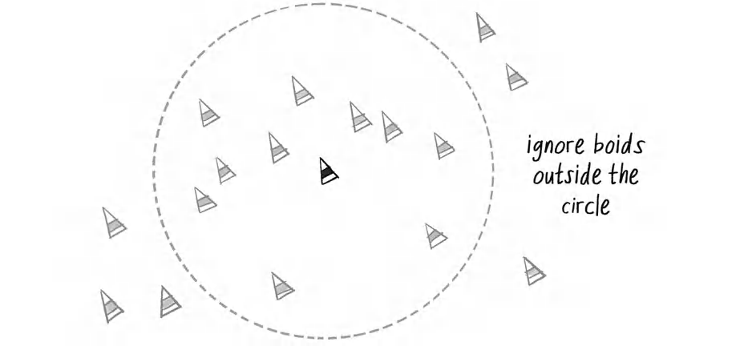

加入邻域距离和计数后:

#+begin_src javascript :eval never-export
  align(boids) {
    // 这是可因 boid 而异的任意值.
    let neighborDistance = 50;
    let sum = createVector(0, 0);
    let count = 0;
    for (let other of boids) {
      let d = p5.Vector.dist(this.position, other.position);
      if ((this !== other) && (d < neighborDistance)) {
        sum.add(other.velocity);
        // 为了求平均, 记录
        // 范围内 boid 数量.
        count++;
      }
    }
    if (count > 0) {
      sum.setMag(this.maxspeed);
      let steer = p5.Vector.sub(sum, this.velocity);
      steer.limit(this.maxforce);
      return steer;
    // 若没有近邻, 转向力为零.
    } else {
      return createVector(0, 0);
    }
  }
#+end_src

条件 =this !== other= 防止 boid 把自己的速度计入邻居平均值, 避免不必要的自反馈.

*** 练习 5.15

改写 =align()=, 让 boid 只能看到位于直接视野中的邻居, 而不是整个圆形邻域.

#+CAPTION: 练习 5.15, 具有方向性视野的邻域. PDF 第 311 页精确提取.
#+ATTR_ORG: :width 700

凝聚与对齐非常相似, 只是求邻居的平均 *位置* 而不是平均速度, 然后把平均位置作为 =seek()= 的目标:

#+begin_src javascript :eval never-export
  cohesion(boids) {
    let neighborDistance = 50;
    let sum = createVector(0, 0);
    let count = 0;
    for (let other of boids) {
      let d = p5.Vector.dist(this.position, other.position);
      if ((this !== other) && (d < neighborDistance)) {
        // 累加其他个体的位置.
        sum.add(other.position);
        count++;
      }
    }
    if (count > 0) {
      sum.div(count);
      // 使用 seek() 函数 
      // 来自示例 5.10. 目标
      // 是邻居的
      // 平均位置.
      return this.seek(sum);
    } else {
      return createVector(0, 0);
    }
  }
#+end_src

可以再编写 =Flock= 类管理整个 boid 数组. 它与第 4 章的 =ParticleSystem= 类几乎相同, 但在运行每个 boid 时把整个数组传进去:

#+begin_src javascript :eval never-export
class Flock {
  constructor() {
    this.boids = [];
  }

  run() {
    for (let boid of this.boids) {
      // 每个 Boid 必须知道
      // 所有其他 boid.
      boid.run(this.boids);
    }
  }

  addBoid(boid) {
    this.boids.push(boid);
  }
}
#+end_src

*** 示例 5.11: 鸟群
:PROPERTIES:
:CUSTOM_ID: example-5-11-flocking
:PDF_PAGE_RANGE: 313-315
:END:

#+CAPTION: 示例 5.11, 鸟群行为. PDF 第 313 页精确提取.
#+ATTR_ORG: :width 700

#+begin_src javascript :eval never-export
// Flock 对象管理
// 整个群体.
let flock;

function setup() {
  createCanvas(640, 240);
  flock = new Flock();
  for (let i = 0; i < 120; i++) {
    let boid = new Boid(width / 2, height / 2);
    // 鸟群初始包含 120 个 boid.
    flock.addBoid(boid);
  }
}

function draw() {
  background(255);
  flock.run();
}
#+end_src

与粒子系统一样, OOP 让 =setup()= 和 =draw()= 保持非常简洁, 复杂行为被封装在 =Flock= 与 =Boid= 内部.

*** 练习 5.16

把鸟群行为与其他转向行为组合起来.

*** 练习 5.17

Gary Flake 在 /The Computational Beauty of Nature/ 中提出第四条规则, *视野*, view: 横向远离任何挡住视线的 boid. 实现这条规则.

#+CAPTION: 练习 5.17, 避让遮挡视线的 boid. PDF 第 314 页精确提取.
#+ATTR_ORG: :width 700

*** 练习 5.18

让分离权重, 凝聚权重, 对齐权重, 最大力和最高速度全部随时间或交互变化. 可以使用 Perlin 噪声, 也可以用 =createSlider()= 绑定实时滑块.

*** 练习 5.19

以完全不同的视觉形式呈现鸟群.

** 算法效率: 为什么草图这么慢
:PROPERTIES:
:CUSTOM_ID: algorithmic-efficiency
:PDF_PAGE_RANGE: 315-325
:END:

群体行为很迷人, 但群体越大, 草图往往越慢. 有时瓶颈来自画布绘制, 可以通过 WebGL 等渲染器缓解. 鸟群模拟的主要问题则来自算法本身. 计算机科学用 *大 O 记号*, big O notation, 描述算法所需的计算量如何随输入规模增长.

在 100 颗巧克力中寻找唯一一颗黑巧克力, 最坏情况下要检查 100 次. 在 \(N\) 个元素中线性寻找一个目标需要 \(O(N)\) 次操作. 普通粒子系统也类似, \(N\) 个粒子需要更新和绘制 \(N\) 次.

鸟群行为不同. 每个 boid 都要检查其他所有 boid. 100 个 boid 需要大约 \(100\times100=10,000\) 次检查; 1,000 个需要 1,000,000 次; 10,000 个则需要 100,000,000 次. 元素数量扩大 \(N\) 倍, 计算量扩大 \(N^2\) 倍, 因而复杂度为 \(O(N^2)\).

即使每个 boid 最终只关心最近的几个邻居, 若仍要遍历全体才能找出这些邻居, 也没有真正减少复杂度. 需要一种在检查之前就缩小候选范围的方法.

*** 空间细分
:PROPERTIES:
:CUSTOM_ID: spatial-subdivisions
:PDF_PAGE_RANGE: 315-320
:END:

Reynolds 在 2000 年论文 /Interaction with Groups of Autonomous Characters/ 中提出 *箱格空间细分*, bin-lattice spatial subdivision, 通常简称 binning. 它把模拟空间划分为较小网格单元.

假设画布分成 10 x 10, 共 100 个单元, 其中有 2,000 个 boid. 若分布均匀, 每格平均约 20 个. 每格只需进行 \(20\times20=400\) 次邻域检查, 100 格共 40,000 次, 远低于原来的 4,000,000 次.

#+CAPTION: 图 5.36, 将包含大量载具的方形画布划分为空间网格. PDF 第 316 页精确提取.
#+ATTR_ORG: :width 700

第一个数组仍保存所有 boid:

#+begin_src javascript :eval never-export
let boids = [];
#+end_src

第二个二维数组表示网格:

#+begin_src javascript :eval never-export
// 每个单元为 40x40 像素.
let resolution = 40;
// 根据宽高计算网格列数和行数.
let cols = floor(width / resolution);
let rows = floor(height / resolution);
// 创建二维数组.
let grid = new Array(cols);
for (let i = 0; i < grid.length; i++) {
  grid[i] = new Array(rows);
}
#+end_src

每个网格单元本身又是一个数组, 保存当前位于该单元中的 =Boid= 引用. 这是 "数组中的数组中的数组":

#+begin_src javascript :eval never-export
  for (let i = 0; i < cols; i++) {
    for (let j = 0; j < rows; j++) {
      // 每个网格单元一个数组
      grid[i][j] = [];
    }
  }
#+end_src

每帧开始先清空各单元, 再根据 boid 位置把它注册到对应格子:

#+begin_src javascript :eval never-export
function draw() {
  // 每帧把各网格单元重置为空数组.
  for (let i = 0; i < cols; i++) {
    for (let j = 0; j < rows; j++) {
      grid[i][j] = [];
    }
  }

  // 把每个 boid 放入对应网格单元.
  for (let boid of flock.boids) {
    // 求正确的列和行.
    let column = floor(boid.position.x / resolution);
    let row = floor(boid.position.y / resolution);
    // 限制在数组边界内.
    column = constrain(column, 0, cols - 1);
    row = constrain(row, 0, rows - 1);
    // 添加 boid.
    grid[column][row].push(boid);
  }
#+end_src

运行 boid 时只检查当前单元及必要的相邻单元, 不再扫描全体.

*** 示例 5.12: 箱格空间细分
:PROPERTIES:
:CUSTOM_ID: example-5-12-bin-lattice
:PDF_PAGE_RANGE: 318-319
:END:

#+CAPTION: 示例 5.12, 使用箱格空间细分优化鸟群. PDF 第 318 页精确提取.
#+ATTR_ORG: :width 700

#+begin_src javascript :eval never-export
  run(boids) {
    let column = floor(this.position.x / resolution);
    let row = floor(this.position.y / resolution);
    column = constrain(column, 0, cols - 1);
    row = constrain(row, 0, rows - 1);
    // 只检查这些 boid. 邻接单元的处理参见完整代码.
    let neighbors = grid[column][row]; 
    this.flock(neighbors);
    this.update();
    this.borders();
    this.render();
  }
#+end_src

完整实现还应检查上, 下, 左, 右和四个对角相邻单元. 即便如此, 仍远少于检查所有 boid.

固定网格在元素均匀分布时最有效. 如果所有 boid 聚集到一个角落并落在同一格, 最坏情况又会退化为全体互查. *四叉树*, quadtree, 能根据元素分布动态细分空间. 它从覆盖全部区域的一个大单元开始, 当某个单元容纳过多对象时分裂为四个子单元, 子单元过密时继续递归分裂, 因而只在需要的位置提供更高分辨率.

*** 示例 5.13: 四叉树
:PROPERTIES:
:CUSTOM_ID: example-5-13-quadtree
:PDF_PAGE_RANGE: 319-320
:END:

#+CAPTION: 示例 5.13, 四叉树空间划分. PDF 第 319 页精确提取.
#+ATTR_ORG: :width 700

四叉树也是 Barnes-Hut 算法的关键数据结构. 在 n 体模拟中, 它可以把远处的一组天体近似为一个整体来计算引力, 大幅减少所需计算次数.

*** 练习 5.20

把示例 5.12 的固定箱格鸟群扩展为使用四叉树查询邻居.

*** 其他优化技巧
:PROPERTIES:
:CUSTOM_ID: more-optimization-tricks
:PDF_PAGE_RANGE: 320-325
:END:

还有三类常见优化:

- 在只需比较相对大小时使用大小平方或距离平方.
- 预先建立正弦和余弦查找表.
- 避免创建海量不必要的 =p5.Vector= 临时对象.

**** 使用大小平方

向量大小需要平方根:

#+begin_src javascript :eval never-export
function mag() {
  return sqrt(x * x + y * y);
}
#+end_src

若只想判断大小是否大于 10:

#+begin_src javascript :eval never-export
if (v.mag() > 10) {
  /* 执行操作 */
}
#+end_src

等价地, 可以判断大小平方是否大于 100:

#+begin_src javascript :eval never-export
if (v.magSq() > 100) {
  /* 执行操作 */
}
#+end_src

#+begin_src javascript :eval never-export
function magSq() {
  return x * x + y * y;
}
#+end_src

单次调用几乎看不出差异, 但每帧对数千向量计算时, 避免平方根能够节省时间.

**** 正弦与余弦查找表

三角函数也比普通数组访问昂贵. 如果同一个角度被重复计算成千上万次:

#+begin_src javascript :eval never-export
function draw() {
  for (let i = 0; i < 10000; i++) {
    print(sin(PI));
  }
}
#+end_src

可以预先计算角度 0 至 359 度的结果:

#+begin_src javascript :eval never-export
angleMode(DEGREES);
let sinvalues = [];
let cosvalues = [];
for (let i = 0; i < 360; i++) {
  sinvalues[i] = sin(i);
  cosvalues[i] = cos(i);
}
#+end_src

之后直接查表:

#+begin_src javascript :eval never-export
let angle = 180;
for (let i = 0; i < 10000; i++) {
  print(sinvalues[angle]);
}
#+end_src

数组查找比重复执行三角函数快得多. 实际实现还可通过精度参数, 以小于 1 度的步长保存值.

*** 示例 5.14: Sin/Cos 查找表
:PROPERTIES:
:CUSTOM_ID: example-5-14-sincos-lookup
:PDF_PAGE_RANGE: 322-323
:END:

#+CAPTION: 示例 5.14, 正弦和余弦查找表. PDF 第 322 页精确提取.
#+ATTR_ORG: :width 700

**** 不要创建无数不必要的 p5.Vector

每个对象都占用内存. 少量临时对象通常没有问题, 但在循环和长期动画中不断创建大量对象, 会增加分配和垃圾回收成本. 例如:

#+begin_src javascript :eval never-export
function draw() {
  for (let v of vehicles) {
    let mouse = createVector(mouseX, mouseY);
    v.seek(mouse);
  }
}
#+end_src

若有 1,000 个载具, 每帧会为同一个鼠标位置创建 1,000 个向量. 把向量移到循环外, 每帧只创建一次:

#+begin_src javascript :eval never-export
function draw() {
  let mouse = createVector(mouseX, mouseY);
  for (let v of vehicles) {
    v.seek(mouse);
  }
}
#+end_src

还可以在 =setup()= 前创建全局向量, 每帧只用 =set()= 更新其分量, 从而启动后不再创建新对象:

#+begin_src javascript :eval never-export
let mouse;

function setup() {
  mouse = createVector(0, 0);
}

function draw() {
  mouse.set(mouseX, mouseY);
  for (let v of vehicles) {
    v.seek(mouse);
  }
}
#+end_src

同样, =seek()= 原本创建 =desired= 和 =steer= 两个向量:

#+begin_src javascript :eval never-export
    let desired = p5.Vector.sub(target, this.position);
    desired.normalize();
    desired.mult(this.maxspeed);
    // 创建新向量保存转向力.
    let steer = p5.Vector.sub(desired,this.velocity);
    steer.limit(this.maxforce);
    return steer;
#+end_src

可以直接复用 =desired=, 在其中减去当前速度并把它转化为转向力:

#+begin_src javascript :eval never-export
    let desired = p5.Vector.sub(target, this.position);
    desired.normalize();
    desired.mult(this.maxspeed);
    // 直接在 desired 向量中计算转向力.
    desired.sub(this.velocity);
    desired.limit(this.maxforce);
    return desired;
#+end_src

后一种写法更省对象, 但语义稍不直观. 优化应针对实际瓶颈, 不必为了微小收益牺牲所有可读性.

*** 练习 5.21

尽量减少鸟群示例中的临时 =p5.Vector= 对象, 并在可以比较平方值的地方使用 =magSq()=.

*** 生态系统项目
:PROPERTIES:
:CUSTOM_ID: ecosystem-project-chapter05
:PDF_PAGE_RANGE: 325-325
:END:

使用转向力驱动生态系统生物的行为. 可以尝试:

- 创建鱼群, 鸟群或昆虫群.
- 使用寻找行为搜寻食物; 若猎物会移动, 使用追逐行为预测其未来位置.
- 把生态环境设计成流场, 例如模拟生活在流水中的生物.
- 为一种生物加入尽可能多的转向行为, 动态调节各行为权重, 随时混合和切换. 思考初始权重如何设定, 又由哪些规则推动它们随时间变化.
- 复杂系统可以嵌套. 能否用一群 boid 组成一个生物, 再让多个这样的生物形成更高层次的群体?
- 复杂系统可以拥有记忆并适应环境. 生态系统的历史能否影响当前行为? 记忆可以用来驱动物种调整转向力权重.

#+CAPTION: 第 5 章生态系统项目, 加入转向行为和群体智能后的数字生态. PDF 第 325 页精确提取.
#+ATTR_ORG: :width 700

* 第 6 章: 物理库
:PROPERTIES:
:CUSTOM_ID: chapter-06-physics-libraries
:PDF_PAGE_RANGE: 327-398
:END:

#+begin_quote
一座图书馆意味着一种信念,
仍隐藏于黑暗中的后代,
会在他们的夜里签下名字, 为黎明作证.

-- Victor Hugo
#+end_quote

#+CAPTION: 印度梅加拉亚邦的活树根桥. 摄影 Arshiya Urveeja Bose. PDF 第 327 页精确提取.
#+ATTR_ORG: :width 700

印度梅加拉亚邦的卡西人和贾因蒂亚人生活在世界降雨量最高的地区之一. 季风季节的洪水经常切断村庄之间的道路. 为了解决这个问题, 当地形成了培育活树根桥的古老传统. 人们引导树根穿过竹子, 棕榈树干或钢制支架, 让它们在环境中持续生长, 交织并变得更强. 这种桥既是结构, 也是生命过程, 它像弹簧一样适应载荷和环境变化.

到目前为止, 你已经完成了三件重要的事:

1. 学习物理世界中的概念, 例如向量, 力和波.
2. 理解这些概念背后的数学与算法.
3. 使用面向对象方法在 p5.js 中实现它们, 最终构建出自主转向智能体.

这些工作让你能够亲手定义数字世界的物理规律, 无论它们接近现实还是纯属幻想. 不过, 计算机图形学中早已有大量专门负责物理模拟的代码库. 搜索 "open source physics engine" 就会发现一片代码森林.

既然物理库可以替你完成模拟, 为什么还要从头学习算法? 原因有三点. 第一, 如果不理解向量, 力和三角学, 连库的文档都会变成一团雾. 第二, 库替你隐藏数学, 却不一定减少代码复杂度, 你仍需理解它的对象模型, 生命周期和约束条件. 第三, 物理引擎只能提供有限的功能集合. 创意编程经常要求你决定何时接受这些边界, 何时越过边界自行构造规则.

本章考察两个 JavaScript 开源物理库: Matter.js 和 Toxiclibs.js. 目标不是背诵某个库的全部 API, 而是建立使用任意物理库的通用能力, 包括阅读文档, 理解世界与物体的关系, 将库中的状态映射到 p5.js 视觉表现, 以及在必要时加入自定义力和交互.

** 为什么使用物理库
:PROPERTIES:
:CUSTOM_ID: why-use-a-physics-library
:PDF_PAGE_RANGE: 329-331
:END:

如果只是让一个圆受重力下落, 自己写几行代码通常更简单. 但若场景变成 100 个不规则多边形, 并要求它们彼此碰撞, 弹开和旋转, 问题就会迅速膨胀.

碰撞至少包含两个不同问题:

1. *碰撞检测*, 判断两个形状是否相交.
2. *碰撞响应或碰撞解析*, 计算碰撞之后各物体的新速度和角速度.

对于两个圆, 检测相对简单. 若圆心距离小于两个半径之和, 两圆便发生重叠:

\[
  d < r_1 + r_2
\]

#+CAPTION: 图 6.1, 当两圆圆心距离小于半径之和时, 两圆发生碰撞. PDF 第 329 页精确提取.
#+ATTR_ORG: :width 620

真正困难的是碰撞后的速度, 尤其当形状从圆扩展到矩形, 任意多边形, 曲面, 摆和弹簧时. 这正是物理引擎的价值. 多年的工程工作已把碰撞检测, 响应, 约束求解和数值积分封装成可复用库. 当一个 p5.js 构想中频繁出现 "碰撞" 这个词时, 往往就是引入物理引擎的时机.

*** 其他物理库

Box2D 是最著名的二维物理引擎之一. 它起源于 Erin Catto 在 2006 年游戏开发者大会上的 C++ 教程, 后来被大量项目采用, 包括 /Crayon Physics/ 和 /Angry Birds/. Box2D 以米, 千克和秒等现实单位工作, 与像素画布之间需要额外转换. 这种设计非常严谨, 但也增加了创意编码中的接入成本.

p5play 则专为 p5.js 和游戏开发设计. 它使用 sprite 表示视觉对象, 简化碰撞与重叠管理, 底层使用 Box2D. 本章选择 Matter.js, 是因为它原生使用 JavaScript, 并以像素作为常用单位, 与 p5.js 的衔接更加直接.

** 导入 Matter.js
:PROPERTIES:
:CUSTOM_ID: importing-matterjs
:PDF_PAGE_RANGE: 331-332
:END:

在 p5.js Web Editor 中, 展开左侧文件栏并打开 =index.html=. JavaScript 库通过 =
#+end_src

#+CAPTION: 图 6.2, 在 p5.js Web Editor 中访问 index.html. PDF 第 332 页精确提取.
#+ATTR_ORG: :width 700

在它下面加入 Matter.js 的 CDN 地址:

#+begin_src html :eval never-export

#+end_src

固定具体版本可以避免未来升级导致已有示例突然失效. 若主动升级, 应重新测试碰撞, 约束和渲染行为.

** Matter.js 概览
:PROPERTIES:
:CUSTOM_ID: matterjs-overview
:PDF_PAGE_RANGE: 333-342
:END:

此前章节中的模拟通常遵循以下结构:

- =setup()=: 创建世界中的对象.
- =draw()=: 计算力, 应用力, 根据加速度更新位置, 再绘制对象.

使用 Matter.js 后, 概念上的流程变为:

- =setup()=: 创建物理引擎与世界中的对象.
- =draw()=: 查询对象当前状态并绘制它们.

引擎替你执行速度, 加速度, 碰撞和约束计算. 这像一个物理黑箱, 但创建和配置放入黑箱的对象仍需明确步骤.

Matter.js 的核心概念包括:

- *Engine*: 管理模拟与时间推进, 并持有世界.
- *Body*: 世界中的物理实体, 拥有位置, 速度, 角度, 形状和材料属性.
- *Composite*: 物体与约束的容器. 世界本身就是一个 Composite.
- *Constraint*: 连接物体或空间点的约束.
- *Vector*: 使用 x 和 y 分量表示位置, 速度与力.

*** Matter.Vector 与 p5.Vector

物理库通常提供自己的向量类型. Matter.js 不直接使用 =p5.Vector=, 而使用 =Matter.Vector=. 概念相同, 语法不同.

创建向量:

#+begin_src javascript :eval never-export
// p5.js
let v1 = createVector(1, -1);

// Matter.js
let v2 = Matter.Vector.create(1, -1);
#+end_src

把 =b= 加入 =a= 并覆盖 =a=:

#+begin_src javascript :eval never-export
// p5.js
let a = createVector(1, -1);
let b = createVector(3, 4);
a.add(b);

// Matter.js
let ma = Matter.Vector.create(1, -1);
let mb = Matter.Vector.create(3, 4);
Matter.Vector.add(ma, mb, ma);
#+end_src

把结果放入新向量:

#+begin_src javascript :eval never-export
let c1 = p5.Vector.add(a, b);
let c2 = Matter.Vector.add(ma, mb);
#+end_src

缩放向量:

#+begin_src javascript :eval never-export
v1.mult(4);
v2 = Matter.Vector.mult(v2, 4);
#+end_src

大小和归一化:

#+begin_src javascript :eval never-export
let pv = createVector(3, 4);
let pm = pv.mag();
pv.normalize();

let mv = Matter.Vector.create(3, 4);
let mm = Matter.Vector.magnitude(mv);
mv = Matter.Vector.normalise(mv);
#+end_src

Matter.js 的函数带有 =Matter= 命名空间, 能减少与用户变量或其他库的命名冲突. 其向量方法都是静态方法, 常返回新对象. 某些函数允许把目标向量作为额外参数传入, 从而复用已有对象.

*** Engine
:PROPERTIES:
:CUSTOM_ID: matterjs-engine
:PDF_PAGE_RANGE: 336-337
:END:

Engine 是模拟的主控制器:

#+begin_src javascript :eval never-export
// 为 Matter.Engine 创建较短的别名.
let Engine = Matter.Engine;
let engine;

function setup() {
  createCanvas(640, 360);
  engine = Engine.create();
}
#+end_src

默认重力向量为向下的 =(0, 1)=. 可以改变方向或关闭重力:

#+begin_src javascript :eval never-export
engine.gravity.x = 1;
engine.gravity.y = 0;

// 关闭重力.
engine.gravity.x = 0;
engine.gravity.y = 0;
#+end_src

**** JavaScript 对象解构

对象解构可以从 =Matter= 对象一次取出多个属性并创建别名:

#+begin_src javascript :eval never-export
const { Engine, Vector, Bodies, Body, Composite } = Matter;
#+end_src

这里使用 =const= 是因为这些别名不应在运行过程中重新赋值. 对象解构让后续代码从 =Matter.Engine.create()= 缩短为 =Engine.create()=, 同时保持来源清晰.

*** Bodies
:PROPERTIES:
:CUSTOM_ID: matterjs-bodies
:PDF_PAGE_RANGE: 337-339
:END:

Body 是 Matter.js 世界中的基本物理实体. 物体通过 =Matter.Bodies= 的工厂方法创建. 例如, 创建矩形:

#+begin_src javascript :eval never-export
let box = Bodies.rectangle(x, y, w, h);
#+end_src

此调用不会直接绘制矩形, 而是创建具有矩形几何形状的物理对象. 可用对象字面量设置摩擦, 弹性和密度:

#+begin_src javascript :eval never-export
let options = {
  friction: 0.5,
  restitution: 0.8,
  density: 0.002
};
let box = Bodies.rectangle(x, y, w, h, options);
#+end_src

线速度和角速度可通过 =Matter.Body= 的静态方法设置:

#+begin_src javascript :eval never-export
const v = Vector.create(2, 0);
Body.setVelocity(box, v);
Body.setAngularVelocity(box, 0.1);
#+end_src

创建对象后必须显式加入世界, 否则引擎不会更新它:

#+begin_src javascript :eval never-export
Composite.add(engine.world, box);
#+end_src

*** 练习 6.1

使用已知语法补全圆形刚体:

#+begin_src javascript :eval never-export
let options = {
  friction: 0.5,
  restitution: 0.8
};
let ball = Bodies.circle(x, y, radius, options);
#+end_src

*** Render
:PROPERTIES:
:CUSTOM_ID: matterjs-render
:PDF_PAGE_RANGE: 339-342
:END:

Matter.js 可以通过 =Render= 类快速显示调试世界. 先保存 p5.js 画布对象, 再把其底层 HTML5 Canvas 元素 =canvas.elt= 交给 Matter.js:

#+begin_src javascript :eval never-export
let canvas = createCanvas(640, 360);
let params = {
  canvas: canvas.elt,
  engine: engine,
  options: { width: width, height: height }
};
let render = Render.create(params);
Render.run(render);
#+end_src

物理引擎还需要随时间推进. 内置 Runner 默认按约 60 FPS 更新:

#+begin_src javascript :eval never-export
let runner = Matter.Runner.create();
Matter.Runner.run(runner, engine);
#+end_src

*** 示例 6.1: Matter.js 默认 Render 与 Runner
:PROPERTIES:
:CUSTOM_ID: example-6-1-default-render-runner
:PDF_PAGE_RANGE: 341-342
:END:

#+CAPTION: 示例 6.1, Matter.js 默认调试渲染器与运行器. PDF 第 341 页精确提取.
#+ATTR_ORG: :width 700

#+begin_src javascript :eval never-export
const { Engine, Bodies, Composite, Body, Vector, Render } = Matter;

function setup() {
  let canvas = createCanvas(640, 360);
  let engine = Engine.create();

  let render = Render.create({
    canvas: canvas.elt,
    engine,
    options: { width: width, height: height }
  });
  Render.run(render);

  let options = { friction: 0.01, restitution: 0.75 };
  let box = Bodies.rectangle(100, 100, 50, 50, options);
  Body.setVelocity(box, Vector.create(5, 0));
  Body.setAngularVelocity(box, 0.1);
  Composite.add(engine.world, box);

  let ground = Bodies.rectangle(
    width / 2,
    height - 5,
    width,
    10,
    { isStatic: true }
  );
  Composite.add(engine.world, ground);

  let runner = Matter.Runner.create();
  Matter.Runner.run(runner, engine);
}
#+end_src

在这个例子中, p5.js 的 =draw()= 没有参与渲染. Matter.js 的 Render 与 Runner 完成更新和绘制. 下一节会把视觉控制权交还给 p5.js.

** 在 p5.js 中使用 Matter.js
:PROPERTIES:
:CUSTOM_ID: matterjs-with-p5js
:PDF_PAGE_RANGE: 342-347
:END:

Matter.js 会在 =engine.world.bodies= 中保存所有物体. 也可以在应用层维护自己的对象数组, 用包装类把一个 Matter.js Body 与 p5.js 的绘制方法绑定在一起. 这会增加少量冗余, 却换来更清晰的设计和更灵活的视觉表现.

#+CAPTION: 从普通 p5.js Box 过渡到由 Matter.js 驱动的 Box. PDF 第 342 页精确提取.
#+ATTR_ORG: :width 700

先从只负责绘图的 =Box= 类开始:

#+begin_src javascript :eval never-export
class Box {
  constructor(x, y) {
    this.x = x;
    this.y = y;
    this.w = 16;
  }

  show() {
    rectMode(CENTER);
    fill(127);
    stroke(0);
    strokeWeight(2);
    square(this.x, this.y, this.w);
  }
}
#+end_src

点击鼠标时创建方块:

#+begin_src javascript :eval never-export
let boxes = [];

function mousePressed() {
  boxes.push(new Box(mouseX, mouseY));
}

function draw() {
  background(255);
  for (let box of boxes) {
    box.show();
  }
}
#+end_src

要让这些方块进入 Matter.js 世界, 需要三个步骤.

*** 第 1 步: 在 p5.js 草图中加入 Matter.js

在 =index.html= 中引入库, 并在草图中创建 Engine:

#+begin_src javascript :eval never-export
const { Engine, Bodies, Composite } = Matter;
let engine;
let boxes = [];

function setup() {
  createCanvas(640, 240);
  engine = Engine.create();
}
#+end_src

不使用内置 Runner 时, 可在 =draw()= 中让引擎前进一个时间步:

#+begin_src javascript :eval never-export
function draw() {
  background(255);
  Engine.update(engine);
}
#+end_src

*** 第 2 步: 让每个 Box 关联一个 Matter.js Body

包装类不再单独维护 =x= 和 =y=, 而是创建并保存 =this.body=:

#+begin_src javascript :eval never-export
class Box {
  constructor(x, y) {
    this.w = 16;
    this.body = Bodies.rectangle(x, y, this.w, this.w);
    Composite.add(engine.world, this.body);
  }
}
#+end_src

*** 第 3 步: 根据 Body 绘制

Matter.js Body 的位置位于 =body.position=, 旋转角位于 =body.angle=. 使用 =translate()= 与 =rotate()= 绘制:

#+begin_src javascript :eval never-export
show() {
  let pos = this.body.position;
  let angle = this.body.angle;

  push();
  translate(pos.x, pos.y);
  rotate(angle);
  rectMode(CENTER);
  fill(127);
  stroke(0);
  strokeWeight(2);
  square(0, 0, this.w);
  pop();
}
#+end_src

*** 示例 6.2: 一个舒服的 p5.js 草图, 加上一点 Matter.js
:PROPERTIES:
:CUSTOM_ID: example-6-2-p5js-matterjs
:PDF_PAGE_RANGE: 343-347
:END:

#+CAPTION: 示例 6.2, p5.js 绘制由 Matter.js 驱动的方块. PDF 第 343 页精确提取.
#+ATTR_ORG: :width 700

#+begin_src javascript :eval never-export
const { Engine, Bodies, Composite } = Matter;

let engine;
let boxes = [];

function setup() {
  createCanvas(640, 240);
  engine = Engine.create();
}

function mousePressed() {
  boxes.push(new Box(mouseX, mouseY));
}

function draw() {
  background(255);
  Engine.update(engine);

  for (let i = boxes.length - 1; i >= 0; i--) {
    boxes[i].show();
    if (boxes[i].isOffScreen()) {
      boxes[i].removeBody();
      boxes.splice(i, 1);
    }
  }
}

class Box {
  constructor(x, y) {
    this.w = 16;
    this.body = Bodies.rectangle(x, y, this.w, this.w);
    Composite.add(engine.world, this.body);
  }

  show() {
    let pos = this.body.position;
    let angle = this.body.angle;
    push();
    translate(pos.x, pos.y);
    rotate(angle);
    rectMode(CENTER);
    fill(127);
    stroke(0);
    strokeWeight(2);
    square(0, 0, this.w);
    pop();
  }

  isOffScreen() {
    let pos = this.body.position;
    return pos.y > height + 100;
  }

  removeBody() {
    Composite.remove(engine.world, this.body);
  }
}
#+end_src

当删除应用层数组元素时, 还必须从 Matter.js 世界中移除对应 Body. 否则不可见的物体仍会参与碰撞计算并持续消耗资源.

*** 练习 6.2

创建独立的 =Boundary= 类, 把 p5.js 矩形与静态 Matter.js Body 关联起来. 使用多个边界构造容器, 让方块在其中堆积.

#+CAPTION: 练习 6.2, 由静态边界构成的容器. PDF 第 347 页精确提取.
#+ATTR_ORG: :width 700

** 静态 Matter.js 物体
:PROPERTIES:
:CUSTOM_ID: static-matterjs-bodies
:PDF_PAGE_RANGE: 347-349
:END:

静态物体不受重力和其他力推动, 但动态物体可以与它发生碰撞. 创建时设置 =isStatic: true=:

#+begin_src javascript :eval never-export
let options = { isStatic: true };
let ground = Bodies.rectangle(x, y, w, h, options);
Composite.add(engine.world, ground);
#+end_src

*** 示例 6.3: 下落方块撞击边界
:PROPERTIES:
:CUSTOM_ID: example-6-3-falling-boxes
:PDF_PAGE_RANGE: 348-349
:END:

#+CAPTION: 示例 6.3, 下落方块撞击静态边界. PDF 第 348 页精确提取.
#+ATTR_ORG: :width 700

#+begin_src javascript :eval never-export
class Boundary {
  constructor(x, y, w, h, angle = 0) {
    this.w = w;
    this.h = h;
    this.body = Bodies.rectangle(x, y, w, h, {
      isStatic: true,
      angle
    });
    Composite.add(engine.world, this.body);
  }

  show() {
    let pos = this.body.position;
    let angle = this.body.angle;
    push();
    translate(pos.x, pos.y);
    rotate(angle);
    rectMode(CENTER);
    fill(127);
    stroke(0);
    rect(0, 0, this.w, this.h);
    pop();
  }
}
#+end_src

静态物体也可以拥有旋转角, 因而能构造斜坡, 漏斗和复杂地形.

** 多边形与形状组合
:PROPERTIES:
:CUSTOM_ID: polygons-and-groups
:PDF_PAGE_RANGE: 349-355
:END:

Matter.js 不仅能创建矩形和圆. =Bodies.polygon()= 可以生成规则多边形, =Bodies.trapezoid()= 可以生成梯形, =Bodies.fromVertices()= 则可以根据顶点数组创建自定义凸多边形:

#+begin_src javascript :eval never-export
let hexagon = Bodies.polygon(x, y, 6, radius);
let trapezoid = Bodies.trapezoid(x, y, width, height, slope);
let custom = Bodies.fromVertices(x, y, vertices);
#+end_src

#+CAPTION: 图 6.4, 由多个基本形状组成的抽象复合外形. PDF 第 349 页精确提取.
#+ATTR_ORG: :width 620

*** 示例 6.4: 多边形形状
:PROPERTIES:
:CUSTOM_ID: example-6-4-polygon-shapes
:PDF_PAGE_RANGE: 349-352
:END:

#+CAPTION: 示例 6.4, 不同边数的 Matter.js 多边形. PDF 第 349 页精确提取.
#+ATTR_ORG: :width 700

绘制任意 Body 时, 可以读取 =body.vertices= 并用 =beginShape()= 与 =vertex()= 逐点绘制:

#+begin_src javascript :eval never-export
show() {
  let vertices = this.body.vertices;
  fill(127);
  stroke(0);
  strokeWeight(2);
  beginShape();
  for (let v of vertices) {
    vertex(v.x, v.y);
  }
  endShape(CLOSE);
}
#+end_src

#+CAPTION: 图 6.5, Body 的 vertices 数组保存世界坐标中的顶点. PDF 第 350 页精确提取.
#+ATTR_ORG: :width 700

Matter.js 会把凹多边形分解为多个凸部分. 若顶点来自 SVG 路径, 可以先将路径转换为点集, 再用 =Bodies.fromVertices()= 创建 Body.

#+CAPTION: 图 6.6, 将凹多边形分解为凸多边形. PDF 第 351 页精确提取.
#+ATTR_ORG: :width 650

*** 练习 6.3

使用多边形, 顶点数组或 SVG 路径构造非规则物体, 并让它们与边界碰撞.

#+CAPTION: 练习 6.3, 使用复杂多边形形状. PDF 第 352 页精确提取.
#+ATTR_ORG: :width 650

多个形状还可以组合到同一个刚体中. 这不是用约束连接多个独立 Body, 而是让它们共享同一组位置, 角度和速度.

#+CAPTION: 图 6.7, 多个部件构成一个复合 Body. PDF 第 352 页精确提取.
#+ATTR_ORG: :width 650

可以创建各个零件, 再把它们放入 =parts= 数组:

#+begin_src javascript :eval never-export
let partA = Bodies.rectangle(x - 20, y, 40, 10);
let partB = Bodies.rectangle(x + 20, y, 40, 10);
let body = Body.create({ parts: [partA, partB] });
Composite.add(engine.world, body);
#+end_src

#+CAPTION: 图 6.8, 复合刚体的局部部件与整体边界. PDF 第 353 页精确提取.
#+ATTR_ORG: :width 650

*** 示例 6.5: 一个 Body 上的多个形状
:PROPERTIES:
:CUSTOM_ID: example-6-5-multiple-shapes-one-body
:PDF_PAGE_RANGE: 353-355
:END:

#+CAPTION: 示例 6.5, 由多个形状组成的单一刚体. PDF 第 353 页精确提取.
#+ATTR_ORG: :width 700

#+begin_src javascript :eval never-export
class Lollipop {
  constructor(x, y) {
    let circlePart = Bodies.circle(x, y - 20, 16);
    let stemPart = Bodies.rectangle(x, y + 10, 8, 60);
    this.body = Body.create({
      parts: [circlePart, stemPart],
      restitution: 0.6
    });
    Composite.add(engine.world, this.body);
  }

  show() {
    let pos = this.body.position;
    let angle = this.body.angle;
    push();
    translate(pos.x, pos.y);
    rotate(angle);
    stroke(0);
    fill(127);
    rectMode(CENTER);
    rect(0, 10, 8, 60);
    circle(0, -20, 32);
    pop();
  }
}
#+end_src

#+CAPTION: 图 6.9, 当绘制外形与 Matter.js 物理几何不一致时, 碰撞位置会发生错位. PDF 第 355 页精确提取.
#+ATTR_ORG: :width 620

*** 练习 6.4

创建一个由多个基本形状组成的角色或机械结构. 注意每个部件相对于整体质心的位置, 并比较复合刚体与多个约束刚体的运动差异.

** Matter.js 约束
:PROPERTIES:
:CUSTOM_ID: matterjs-constraints
:PDF_PAGE_RANGE: 355-364
:END:

约束连接两个物体, 或把一个物体连接到空间中的固定点. 它们可以构造摆, 弹性桥梁, 柔软角色, 轮轴和机械关节. 本章讨论三类连接:

- 距离约束, 由 =Matter.Constraint= 管理.
- 转动约束, 也使用 =Matter.Constraint=, 但长度设为 0.
- 鼠标约束, 由 =Matter.MouseConstraint= 管理.

*** 距离约束
:PROPERTIES:
:CUSTOM_ID: distance-constraints
:PDF_PAGE_RANGE: 356-359
:END:

距离约束在两个 Body 的锚点之间维持目标长度. 锚点坐标相对于各自物体中心定义. =stiffness= 决定连接有多刚硬, =1= 接近完全刚性, 较小值则更像弹簧.

#+CAPTION: 图 6.10, 距离约束连接两个物体上的锚点. PDF 第 356 页精确提取.
#+ATTR_ORG: :width 650

假设已有两个包装对象 =particleA= 和 =particleB=, 且各自保存 =body=:

#+begin_src javascript :eval never-export
let options = {
  bodyA: particleA.body,
  bodyB: particleB.body,
  pointA: Vector.create(0, 0),
  pointB: Vector.create(0, 0),
  length: 100,
  stiffness: 0.5
};

let constraint = Constraint.create(options);
Composite.add(engine.world, constraint);
#+end_src

关键属性如下:

- =bodyA= 与 =bodyB=: 连接的两个物体.
- =pointA= 与 =pointB=: 相对各自物体中心的锚点.
- =length=: 约束试图保持的静止长度.
- =stiffness=: 刚度, 通常在 0 到 1 之间.
- =damping=: 阻尼, 越大越快损失振荡能量.
- =angularStiffness=: 角度刚度, 越高越不容易发生相对转动.

若只指定两个 Body, Matter.js 会把锚点设在中心, 以当前距离作为长度, 并使用默认刚度.

*** 示例 6.6: Matter.js 摆
:PROPERTIES:
:CUSTOM_ID: example-6-6-matterjs-pendulum
:PDF_PAGE_RANGE: 357-359
:END:

#+CAPTION: 示例 6.6, 使用距离约束构造摆. PDF 第 357 页精确提取.
#+ATTR_ORG: :width 700

#+begin_src javascript :eval never-export
class Pendulum {
  constructor(x, y, len) {
    this.r = 12;
    this.len = len;

    this.anchor = Bodies.circle(x, y, this.r, {
      isStatic: true
    });
    this.bob = Bodies.circle(x + len, y, this.r, {
      restitution: 0.6
    });

    this.arm = Constraint.create({
      bodyA: this.anchor,
      bodyB: this.bob,
      length: this.len
    });

    Composite.add(engine.world, this.anchor);
    Composite.add(engine.world, this.bob);
    Composite.add(engine.world, this.arm);
  }

  show() {
    fill(127);
    stroke(0);
    line(
      this.anchor.position.x,
      this.anchor.position.y,
      this.bob.position.x,
      this.bob.position.y
    );

    push();
    translate(this.anchor.position.x, this.anchor.position.y);
    rotate(this.anchor.angle);
    circle(0, 0, this.r * 2);
    line(0, 0, this.r, 0);
    pop();

    push();
    translate(this.bob.position.x, this.bob.position.y);
    rotate(this.bob.angle);
    circle(0, 0, this.r * 2);
    line(0, 0, this.r, 0);
    pop();
  }
}
#+end_src

默认刚度约为 =0.7=. 降低刚度后, 摆臂会表现得更像柔软弹簧. 约束本身没有必须显示的几何形状, 绘制的线只是视觉解释. 可以隐藏它, 画成点链, 绳索或其他图形.

*** 练习 6.5

用一系列圆或矩形加距离约束构造桥梁. 把两端设为静态, 调节长度, 刚度和节点间距. 关节没有物理宽度, 因此若节点间距过大, 物体可能从桥面缝隙掉落.

#+CAPTION: 练习 6.5, 使用约束连接节点形成桥梁. PDF 第 359 页精确提取.
#+ATTR_ORG: :width 700

*** 转动约束
:PROPERTIES:
:CUSTOM_ID: revolute-constraints
:PDF_PAGE_RANGE: 359-362
:END:

转动关节把两个物体连接到同一铰点, 允许它们绕该点旋转. Matter.js 没有单独的 RevoluteConstraint 类, 可用长度为 0, 刚度为 1 的普通 Constraint 实现.

#+CAPTION: 图 6.11, 转动约束把两个物体连接到共同铰点. PDF 第 359 页精确提取.
#+ATTR_ORG: :width 650

若只把一个 Body 固定到世界坐标点:

#+begin_src javascript :eval never-export
let body = Bodies.rectangle(x, y, w, h);
Composite.add(engine.world, body);

let joint = Constraint.create({
  bodyA: body,
  pointB: Vector.create(x, y),
  length: 0,
  stiffness: 1
});
Composite.add(engine.world, joint);
#+end_src

其中 =pointB= 是世界坐标中的固定点. 如果同时指定 =bodyB=, 则 =pointB= 改为相对于第二个物体中心的锚点.

*** 示例 6.7: 旋转风车
:PROPERTIES:
:CUSTOM_ID: example-6-7-spinning-windmill
:PDF_PAGE_RANGE: 360-362
:END:

#+CAPTION: 示例 6.7, 通过零长度约束构造旋转风车. PDF 第 360 页精确提取.
#+ATTR_ORG: :width 700

#+begin_src javascript :eval never-export
class Windmill {
  constructor(x, y) {
    this.w = 120;
    this.h = 10;
    this.body = Bodies.rectangle(x, y, this.w, this.h);
    this.joint = Constraint.create({
      bodyA: this.body,
      pointB: Vector.create(x, y),
      length: 0,
      stiffness: 1
    });

    Composite.add(engine.world, this.body);
    Composite.add(engine.world, this.joint);
  }

  show() {
    let pos = this.body.position;
    push();
    translate(pos.x, pos.y);
    rotate(this.body.angle);
    rectMode(CENTER);
    fill(127);
    stroke(0);
    rect(0, 0, this.w, this.h);
    pop();
  }
}
#+end_src

*** 练习 6.6

把多个转动关节组合成车辆, 链条, 机械臂或有肢体的角色. 尝试为关节加入不同的长度和锚点偏移.

#+CAPTION: 练习 6.6, 由转动关节构成的机械结构. PDF 第 362 页精确提取.
#+ATTR_ORG: :width 700

*** 鼠标约束
:PROPERTIES:
:CUSTOM_ID: mouse-constraints
:PDF_PAGE_RANGE: 362-364
:END:

MouseConstraint 把鼠标位置与鼠标抓住的 Body 连接起来. 它依赖 Matter.js 的 Mouse 对象, 而后者需要知道底层 HTML5 Canvas:

#+begin_src javascript :eval never-export
const { Mouse, MouseConstraint } = Matter;

let canvas = createCanvas(640, 240);
let mouse = Mouse.create(canvas.elt);
let mouseConstraint = MouseConstraint.create(engine, {
  mouse,
  constraint: {
    stiffness: 0.2
  }
});
Composite.add(engine.world, mouseConstraint);
#+end_src

若画布因 CSS 缩放, 还需要更新鼠标像素比或 scale, 保证指针坐标与物理世界一致.

*** 示例 6.8: MouseConstraint 演示
:PROPERTIES:
:CUSTOM_ID: example-6-8-mouse-constraint
:PDF_PAGE_RANGE: 364-364
:END:

#+CAPTION: 示例 6.8, 使用鼠标约束拖动物体. PDF 第 364 页精确提取.
#+ATTR_ORG: :width 700

#+begin_src javascript :eval never-export
let mouseConstraint;

function setup() {
  let canvas = createCanvas(640, 240);
  engine = Engine.create();

  let mouse = Mouse.create(canvas.elt);
  mouseConstraint = MouseConstraint.create(engine, {
    mouse,
    constraint: { stiffness: 0.2 }
  });
  Composite.add(engine.world, mouseConstraint);
}

function draw() {
  background(255);
  Engine.update(engine);

  // 可选, 绘制抓取时的连接线.
  if (mouseConstraint.body) {
    let pos = mouseConstraint.body.position;
    let m = mouseConstraint.mouse.position;
    line(pos.x, pos.y, m.x, m.y);
  }
}
#+end_src

** 添加更多力
:PROPERTIES:
:CUSTOM_ID: adding-more-forces
:PDF_PAGE_RANGE: 364-367
:END:

默认重力只是 Engine 的一个全局参数. 若要施加风, 引力或用户自定义力, 使用 =Matter.Body.applyForce()=. 它需要三个参数: 目标 Body, 施力点和力向量.

#+begin_src javascript :eval never-export
let force = Vector.create(0.01, 0);
Body.applyForce(body, body.position, force);
#+end_src

施力点若不在质心, 会同时产生线性加速度和转矩. 若在质心施力, 主要改变线速度.

*** 示例 6.9: 使用 Matter.js 实现吸引
:PROPERTIES:
:CUSTOM_ID: example-6-9-attraction-matterjs
:PDF_PAGE_RANGE: 365-367
:END:

#+CAPTION: 示例 6.9, Matter.js 中的引力吸引. PDF 第 365 页精确提取.
#+ATTR_ORG: :width 700

万有引力公式仍然是:

\[
  F_g = \frac{G m_1 m_2}{d^2}
\]

#+begin_src javascript :eval never-export
function attract(bodyA, bodyB) {
  let force = Vector.sub(bodyA.position, bodyB.position);
  let distance = Vector.magnitude(force);
  distance = constrain(distance, 5, 25);

  let strength =
    (G * bodyA.mass * bodyB.mass) /
    (distance * distance);

  force = Vector.normalise(force);
  force = Vector.mult(force, strength);
  Body.applyForce(bodyB, bodyB.position, force);
}
#+end_src

Matter.js 的 Body 质量由密度与几何形状共同决定. 这意味着同样大小但密度不同的对象会产生不同的引力响应.

*** 练习 6.7

构造一个受鼠标吸引的多物体系统. 尝试在质心之外施力, 观察引力如何同时造成旋转.

#+CAPTION: 练习 6.7, 对物体施加自定义吸引力. PDF 第 367 页精确提取.
#+ATTR_ORG: :width 700

** 碰撞事件
:PROPERTIES:
:CUSTOM_ID: collision-events
:PDF_PAGE_RANGE: 367-371
:END:

物理引擎不仅能解决碰撞, 还可以在碰撞开始, 持续和结束时触发事件. Matter.js 使用 =Events.on()= 注册回调:

#+begin_src javascript :eval never-export
const { Events } = Matter;

Events.on(engine, "collisionStart", handleCollisions);
#+end_src

事件对象包含 =pairs= 数组, 每个 pair 都记录发生碰撞的 =bodyA= 和 =bodyB=:

#+begin_src javascript :eval never-export
function handleCollisions(event) {
  for (let pair of event.pairs) {
    let bodyA = pair.bodyA;
    let bodyB = pair.bodyB;
    // 根据碰撞双方执行逻辑.
  }
}
#+end_src

实际项目通常有包装类, 而事件只返回底层 Body. 可以利用 Body 的 =plugin= 对象保存回指包装对象的引用:

#+begin_src javascript :eval never-export
class Particle {
  constructor(x, y, radius) {
    this.radius = radius;
    this.body = Bodies.circle(x, y, this.radius);
    this.body.plugin.particle = this;
    Composite.add(engine.world, this.body);
  }
}
#+end_src

不要用 =body.plugin = this= 覆盖整个 plugin 对象, 因为其他插件或功能可能也需要它. 应在 plugin 下增加命名属性.

*** 示例 6.10: 碰撞事件
:PROPERTIES:
:CUSTOM_ID: example-6-10-collision-events
:PDF_PAGE_RANGE: 370-371
:END:

#+CAPTION: 示例 6.10, 碰撞发生时改变粒子状态. PDF 第 370 页精确提取.
#+ATTR_ORG: :width 700

#+begin_src javascript :eval never-export
function handleCollisions(event) {
  for (let pair of event.pairs) {
    let bodyA = pair.bodyA;
    let bodyB = pair.bodyB;

    let particleA = bodyA.plugin.particle;
    let particleB = bodyB.plugin.particle;

    if (
      particleA instanceof Particle &&
      particleB instanceof Particle
    ) {
      particleA.change();
      particleB.change();
    }
  }
}
#+end_src

不能假定每个碰撞对象都是 Particle. 它也可能是 Boundary 或其他类型. 使用 =instanceof= 或自定义标签检查类型后再执行行为.

*** 练习 6.8

尝试使用 =collisionActive= 和 =collisionEnd=, 分别在接触持续和接触结束时改变视觉状态.

*** 练习 6.9

让 Particle 在彼此碰撞后消失或碎裂为更小的粒子. 删除应在回调之外的安全阶段完成, 例如先加入待删除集合, 再在主循环中从数组与世界同时移除.

** 插曲: 数值积分方法
:PROPERTIES:
:CUSTOM_ID: integration-methods
:PDF_PAGE_RANGE: 371-373
:END:

速度是位置对时间的导数, 加速度是速度对时间的导数. 积分则是逆过程. 对速度在一段时间内积分得到位置变化, 对加速度积分得到速度变化.

本书此前一直使用的两行代码:

#+begin_src javascript :eval never-export
velocity.add(acceleration);
position.add(velocity);
#+end_src

就是最简单的 *Euler 积分*. 它把连续曲线近似成离散时间步之间的一系列线段.

#+CAPTION: 图 6.12, Euler 方法用离散线段近似连续曲线. PDF 第 372 页精确提取.
#+ATTR_ORG: :width 700

Euler 方法易懂且计算便宜, 对许多创意项目已经足够. 但较大的时间步会带来误差和不稳定. 缩小时间步能提高精度, 却增加计算量. Box2D 使用半隐式 Euler, 一些系统使用 Runge-Kutta, 而 Matter.js 和 Toxiclibs.js 都采用与 Verlet 思想相关的方法.

Verlet 积分不必显式保存速度. 如果知道物体上一个位置与当前位置, 就能从差值推断速度并计算下一位置. 它特别适合由弹簧或距离约束连接的粒子系统, 因为位置约束可以直接反复修正.

** 使用 Toxiclibs.js 的 Verlet 物理
:PROPERTIES:
:CUSTOM_ID: verlet-physics-toxiclibs
:PDF_PAGE_RANGE: 373-382
:END:

Karsten Schmidt 大约在 2005 年开始开发 Toxiclibs. 这个面向 Java 和 Processing 的开源计算设计库包含向量, 几何, 颜色, 数学和物理等模块. 虽然原始项目已多年没有活跃维护, 它所展示的思想仍广泛存在于创意编码作品中. Toxiclibs.js 是 Kyle Phillips 创建的 JavaScript 适配版本.

本章从 Matter.js 转向 Toxiclibs.js, 一方面是为了展示不同物理库的共同结构, 另一方面是因为两者各有优势:

| 特性 | Matter.js | Toxiclibs.js |
|------+-----------+--------------|
| 刚体碰撞 | 支持 | 不直接支持 |
| 3D 物理 | 不支持 | 支持 |
| 粒子吸引与排斥 | 需自行计算 | 内置 Behavior |
| 弹簧连接 | 支持 | 支持 |
| 通用约束 | 支持 | 不以同样方式提供 |

若项目以刚体碰撞为核心, Matter.js 更适合. 若项目包含大量粒子, 弹簧, 吸引和排斥, Toxiclibs.js 通常更轻量. 因为它不计算复杂碰撞几何, 大型粒子系统也可能更快.

在 =index.html= 中加入:

#+begin_src html :eval never-export

#+end_src

Matter.js 与 Toxiclibs.js 的主要概念可以对应为:

| Matter.js | Toxiclibs.js |
|-----------+--------------|
| Engine / World | VerletPhysics2D |
| Vector | Vec2D |
| Body | VerletParticle2D |
| Constraint | VerletSpring2D |

*** 向量
:PROPERTIES:
:CUSTOM_ID: toxiclibs-vectors
:PDF_PAGE_RANGE: 375-376
:END:

Toxiclibs.js 提供二维 =Vec2D= 和三维 =Vec3D=, 位于 =toxi.geom=:

#+begin_src javascript :eval never-export
let { Vec2D, Vec3D } = toxi.geom;
#+end_src

与 =p5.Vector= 的常用操作比较:

#+begin_src javascript :eval never-export
// p5.Vector
let a1 = createVector(1, -1);
let b1 = createVector(3, 4);
a1.add(b1);

// Vec2D, 原地修改使用 addSelf().
let a2 = new Vec2D(1, -1);
let b2 = new Vec2D(3, 4);
a2.addSelf(b2);

// 创建新向量.
let c1 = p5.Vector.add(a1, b1);
let c2 = a2.add(b2);

let m1 = a1.mag();
let m2 = a2.magnitude();
a1.normalize();
a2.normalize();
#+end_src

=Vec2D= 通过 =new= 调用构造器, 而不是像 =createVector()= 或 =Matter.Vector.create()= 那样使用工厂函数.

*** 物理世界
:PROPERTIES:
:CUSTOM_ID: toxiclibs-physics-world
:PDF_PAGE_RANGE: 376-377
:END:

需要的类来自 =toxi.geom=, =toxi.physics2d= 和 =toxi.physics2d.behaviors=:

#+begin_src javascript :eval never-export
let { Vec2D, Rect } = toxi.geom;
let {
  VerletPhysics2D,
  VerletParticle2D,
  VerletSpring2D
} = toxi.physics2d;
let { GravityBehavior } = toxi.physics2d.behaviors;
#+end_src

创建世界, 设置边界和重力:

#+begin_src javascript :eval never-export
let physics;

function setup() {
  createCanvas(640, 240);
  physics = new VerletPhysics2D();
  physics.setWorldBounds(new Rect(0, 0, width, height));
  physics.addBehavior(
    new GravityBehavior(new Vec2D(0, 0.5))
  );
}

function draw() {
  physics.update();
}
#+end_src

=physics.update()= 与 Matter.js 的 =Engine.update(engine)= 承担相似职责, 让物理世界前进一个时间步.

*** 粒子
:PROPERTIES:
:CUSTOM_ID: toxiclibs-particles
:PDF_PAGE_RANGE: 377-379
:END:

Toxiclibs.js 的基本实体是 =VerletParticle2D=. 它只是空间中的点, 不自带圆形或多边形几何. 可使用继承扩展它, 加入半径和绘制方法:

#+begin_src javascript :eval never-export
class Particle extends VerletParticle2D {
  constructor(x, y, r) {
    super(x, y);
    this.r = r;
  }

  show() {
    fill(127);
    stroke(0);
    circle(this.x, this.y, this.r * 2);
  }
}
#+end_src

=VerletParticle2D= 本身又继承自 =Vec2D=, 因此 Particle 同时拥有粒子方法和向量方法. 创建后必须加入世界:

#+begin_src javascript :eval never-export
let particle = new Particle(width / 2, height / 2, 8);
physics.addParticle(particle);
#+end_src

这里体现了多态. =addParticle()= 期待 =VerletParticle2D=, 但 Particle 是它的子类, 因而可以直接传入.

*** 弹簧
:PROPERTIES:
:CUSTOM_ID: toxiclibs-springs
:PDF_PAGE_RANGE: 379-382
:END:

Toxiclibs.js 提供多种弹簧:

- =VerletSpring2D=: 普通弹簧连接, 可从柔软到接近刚性.
- =VerletConstrainedSpring2D=: 限制最大移动距离, 有助于提高系统稳定性.
- =VerletMinDistanceSpring2D=: 仅在当前距离小于静止长度时起作用, 用于维持最小间距.

创建并加入弹簧:

#+begin_src javascript :eval never-export
let length = 80;
let strength = 0.01;
let spring = new VerletSpring2D(
  particle1,
  particle2,
  length,
  strength
);
physics.addSpring(spring);
#+end_src

粒子可以用 =lock()= 固定, 用 =unlock()= 恢复. 在鼠标交互中, 先锁定, 修改位置, 再解锁, 能避免与当前物理更新发生冲突:

#+begin_src javascript :eval never-export
if (mouseIsPressed) {
  particle1.lock();
  particle1.x = mouseX;
  particle1.y = mouseY;
  particle1.unlock();
}
#+end_src

*** 示例 6.11: Toxiclibs.js 简单弹簧
:PROPERTIES:
:CUSTOM_ID: example-6-11-simple-spring-toxiclibs
:PDF_PAGE_RANGE: 380-382
:END:

#+CAPTION: 示例 6.11, 两个粒子通过 Toxiclibs.js 弹簧连接. PDF 第 380 页精确提取.
#+ATTR_ORG: :width 700

#+begin_src javascript :eval never-export
let { Vec2D, Rect } = toxi.geom;
let {
  VerletPhysics2D,
  VerletParticle2D,
  VerletSpring2D
} = toxi.physics2d;
let { GravityBehavior } = toxi.physics2d.behaviors;

let physics;
let particle1;
let particle2;

function setup() {
  createCanvas(640, 240);

  physics = new VerletPhysics2D();
  physics.setWorldBounds(new Rect(0, 0, width, height));
  physics.addBehavior(
    new GravityBehavior(new Vec2D(0, 0.5))
  );

  let length = 120;
  particle1 = new Particle(width / 2, 0, 8);
  particle2 = new Particle(width / 2 + length, 0, 8);
  particle1.lock();

  let spring = new VerletSpring2D(
    particle1,
    particle2,
    length,
    0.01
  );

  physics.addParticle(particle1);
  physics.addParticle(particle2);
  physics.addSpring(spring);
}

function draw() {
  physics.update();
  background(255);

  stroke(0);
  line(particle1.x, particle1.y, particle2.x, particle2.y);
  particle1.show();
  particle2.show();

  if (mouseIsPressed) {
    particle2.lock();
    particle2.x = mouseX;
    particle2.y = mouseY;
    particle2.unlock();
  }
}

class Particle extends VerletParticle2D {
  constructor(x, y, r) {
    super(x, y);
    this.r = r;
  }

  show() {
    fill(127);
    stroke(0);
    circle(this.x, this.y, this.r * 2);
  }
}
#+end_src

物理弹簧是否可见与其是否存在无关. 可以用线显示, 也可以隐藏连接, 只把粒子位置用于控制更复杂的图形.

** 软体模拟
:PROPERTIES:
:CUSTOM_ID: soft-body-simulations
:PDF_PAGE_RANGE: 382-390
:END:

Verlet 物理非常适合软体模拟. 一条粒子链可以形成绳索, 二维粒子网格可以形成布料, 自定义粒子骨架则可以形成柔软角色.

#+CAPTION: 图 6.13, 粒子与弹簧可组成绳索, 布料和软体角色. PDF 第 382 页精确提取.
#+ATTR_ORG: :width 700

*** 一根绳子
:PROPERTIES:
:CUSTOM_ID: a-string
:PDF_PAGE_RANGE: 383-386
:END:

假设创建 20 个粒子, 相邻间距为 10 像素:

#+CAPTION: 图 6.14, 20 个等距排列的粒子. PDF 第 383 页精确提取.
#+ATTR_ORG: :width 650

#+begin_src javascript :eval never-export
let particles = [];
let total = 20;
let spacing = 10;

for (let i = 0; i < total; i++) {
  let particle = new Particle(i * spacing, 10, 4);
  physics.addParticle(particle);
  particles.push(particle);
}
#+end_src

把粒子 =i= 与 =i + 1= 连接. 最后一个粒子没有后继, 因而循环到 =total - 1= 之前停止:

#+CAPTION: 图 6.15, 每个粒子连接到数组中的下一个粒子. PDF 第 384 页精确提取.
#+ATTR_ORG: :width 650

#+begin_src javascript :eval never-export
for (let i = 0; i < total - 1; i++) {
  let spring = new VerletSpring2D(
    particles[i],
    particles[i + 1],
    spacing,
    0.01
  );
  physics.addSpring(spring);
}

particles[0].lock();
#+end_src

*** 示例 6.12: 柔软摆
:PROPERTIES:
:CUSTOM_ID: example-6-12-soft-swinging-pendulum
:PDF_PAGE_RANGE: 385-386
:END:

#+CAPTION: 示例 6.12, 由粒子链构成的柔软摆. PDF 第 385 页精确提取.
#+ATTR_ORG: :width 700

#+begin_src javascript :eval never-export
function draw() {
  physics.update();
  background(255);

  stroke(0);
  noFill();
  beginShape();
  for (let particle of particles) {
    vertex(particle.x, particle.y);
  }
  endShape();

  particles[particles.length - 1].show();
}
#+end_src

最后一个粒子作为摆锤绘制为圆, 中间粒子只作为折线顶点. 这说明视觉层不必显示每个物理元素.

*** 练习 6.10

建立二维粒子网格, 将每个粒子连接到水平和垂直邻居, 从而模拟悬挂布料. 可额外加入对角弹簧以增加抗剪稳定性.

#+CAPTION: 练习 6.10, 粒子网格与弹簧构成的布料. PDF 第 386 页精确提取.
#+ATTR_ORG: :width 700

*** 软体角色
:PROPERTIES:
:CUSTOM_ID: soft-body-character
:PDF_PAGE_RANGE: 386-390
:END:

先设计一个由 6 个顶点组成的骨架. 顶点是 Particle, 连接线是 Spring.

#+CAPTION: 图 6.16, 六顶点软体角色骨架. PDF 第 386 页精确提取.
#+ATTR_ORG: :width 650

让对象在构造时自动加入全局物理世界:

#+begin_src javascript :eval never-export
class Particle extends VerletParticle2D {
  constructor(x, y, r = 4) {
    super(x, y);
    this.r = r;
    physics.addParticle(this);
  }

  show() {
    fill(127);
    stroke(0);
    circle(this.x, this.y, this.r * 2);
  }
}

class Spring extends VerletSpring2D {
  constructor(a, b) {
    let length = dist(a.x, a.y, b.x, b.y);
    super(a, b, length, 0.01);
    physics.addSpring(this);
  }
}
#+end_src

外轮廓弹簧不足以维持形状, 受重力后会向内塌陷. 需要加入穿过内部的支撑弹簧.

#+CAPTION: 图 6.17, 内部弹簧防止软体结构塌陷. PDF 第 388 页精确提取.
#+ATTR_ORG: :width 700

*** 示例 6.13: 软体角色
:PROPERTIES:
:CUSTOM_ID: example-6-13-soft-body-character
:PDF_PAGE_RANGE: 389-390
:END:

#+CAPTION: 示例 6.13, 带内部支撑的软体角色. PDF 第 389 页精确提取.
#+ATTR_ORG: :width 700

#+begin_src javascript :eval never-export
let physics;
let particles = [];
let springs = [];

function setup() {
  createCanvas(640, 240);
  physics = new VerletPhysics2D();
  physics.setWorldBounds(new Rect(0, 0, width, height));
  physics.addBehavior(
    new GravityBehavior(new Vec2D(0, 0.5))
  );

  particles.push(new Particle(200, 25));
  particles.push(new Particle(400, 25));
  particles.push(new Particle(350, 125));
  particles.push(new Particle(400, 225));
  particles.push(new Particle(200, 225));
  particles.push(new Particle(250, 125));

  springs.push(new Spring(particles[0], particles[1]));
  springs.push(new Spring(particles[1], particles[2]));
  springs.push(new Spring(particles[2], particles[3]));
  springs.push(new Spring(particles[3], particles[4]));
  springs.push(new Spring(particles[4], particles[5]));
  springs.push(new Spring(particles[5], particles[0]));

  // 内部支撑.
  springs.push(new Spring(particles[5], particles[2]));
  springs.push(new Spring(particles[0], particles[3]));
  springs.push(new Spring(particles[1], particles[4]));
}

function draw() {
  background(255);
  physics.update();

  fill(127);
  stroke(0);
  beginShape();
  for (let particle of particles) {
    vertex(particle.x, particle.y);
  }
  endShape(CLOSE);

  if (mouseIsPressed) {
    particles[0].lock();
    particles[0].x = mouseX;
    particles[0].y = mouseY;
    particles[0].unlock();
  }
}
#+end_src

这个示例没有绘制粒子圆点和内部弹簧. 它只读取外轮廓粒子的位置并绘制一个整体形状. 物理骨架与视觉设计可以分离, 因此眼睛, 天线, 纹理等元素不必全部参与物理计算.

*** 练习 6.11

设计自己的软体角色, 增加顶点, 内部支撑和视觉细节. 尝试加入风力, 鼠标拖动, 局部锁定或动态断裂连接.

#+CAPTION: 练习 6.11, 扩展软体角色设计. PDF 第 390 页精确提取.
#+ATTR_ORG: :width 700

** 力导向图
:PROPERTIES:
:CUSTOM_ID: force-directed-graph
:PDF_PAGE_RANGE: 391-395
:END:

力导向图不直接指定节点位置, 而是让节点在力作用下自行排列. 一种经典方法是让每个节点与其他所有节点通过弹簧连接. 当系统接近平衡时, 节点会形成相对均匀的布局.

#+CAPTION: 图 6.18, 由弹簧力排列的粒子簇. PDF 第 391 页精确提取.
#+ATTR_ORG: :width 700

创建 Cluster 时, 在画布中心附近生成 N 个粒子. 不要把所有粒子放在完全相同的坐标, 否则零距离会让物理计算失去有效方向:

#+begin_src javascript :eval never-export
class Cluster {
  constructor(n, length) {
    this.particles = [];

    for (let i = 0; i < n; i++) {
      let x = width / 2 + random(-1, 1);
      let y = height / 2 + random(-1, 1);
      this.particles.push(new Particle(x, y, 4));
    }
  }
}
#+end_src

若有 5 个节点, 每对节点只需连接一次. 不连接自身, 也不重复反向连接.

#+CAPTION: 图 6.19, 五个节点之间的完整无向连接. PDF 第 392 页精确提取.
#+ATTR_ORG: :width 700

双重循环让 =j= 从 =i + 1= 开始:

#+begin_src javascript :eval never-export
for (let i = 0; i < this.particles.length - 1; i++) {
  let particle_i = this.particles[i];

  for (let j = i + 1; j < this.particles.length; j++) {
    let particle_j = this.particles[j];
    physics.addSpring(
      new VerletSpring2D(
        particle_i,
        particle_j,
        length,
        0.01
      )
    );
  }
}
#+end_src

*** 示例 6.14: Cluster
:PROPERTIES:
:CUSTOM_ID: example-6-14-cluster
:PDF_PAGE_RANGE: 393-394
:END:

#+CAPTION: 示例 6.14, 完全连接的粒子簇. PDF 第 393 页精确提取.
#+ATTR_ORG: :width 700

#+begin_src javascript :eval never-export
let { VerletPhysics2D, VerletParticle2D, VerletSpring2D } =
  toxi.physics2d;

let physics;
let cluster;

function setup() {
  createCanvas(640, 240);
  physics = new VerletPhysics2D();
  cluster = new Cluster(
    floor(random(2, 20)),
    random(10, height / 2)
  );
}

function draw() {
  physics.update();
  background(255);
  cluster.show();
}
#+end_src

示例中的节点数, 平衡长度和弹簧强度是随机或固定参数. 在真实数据可视化中, 它们可映射到实体数量, 相似度, 关系强度或网络权重.

*** 练习 6.12

把 Cluster 结构改造成柔软生物的骨架, 加入重力和鼠标交互.

*** 练习 6.13

创建多个 Cluster, 再用 =VerletMinDistanceSpring2D= 连接不同簇. 思考哪些数据关系适合使用这种布局.

#+CAPTION: 练习 6.13, 多粒子簇的力导向布局. PDF 第 394 页精确提取.
#+ATTR_ORG: :width 700

** 吸引与排斥 Behavior
:PROPERTIES:
:CUSTOM_ID: attraction-repulsion-behaviors
:PDF_PAGE_RANGE: 395-397
:END:

=VerletParticle2D.addForce()= 可以接收自行计算的力. Toxiclibs.js 还提供内置 Behavior, 例如 =AttractionBehavior=. 创建时传入中心粒子, 作用距离和强度:

#+begin_src javascript :eval never-export
let particle = new Particle(320, 120);
let distance = 20;
let strength = 0.1;
let behavior = new AttractionBehavior(
  particle,
  distance,
  strength
);
physics.addBehavior(behavior);
#+end_src

只有处于距离阈值内的粒子会受到该力. 正强度产生吸引, 负强度产生排斥. 为每个粒子加入短距离强排斥, 可以近似防止粒子彼此重叠, 虽然它不等同于完整刚体碰撞.

#+begin_src javascript :eval never-export
class Particle extends VerletParticle2D {
  constructor(x, y, r) {
    super(x, y);
    this.r = r;

    physics.addBehavior(
      new AttractionBehavior(this, r * 4, -1)
    );
  }

  show() {
    fill(127);
    stroke(0);
    circle(this.x, this.y, this.r * 2);
  }
}
#+end_src

*** 示例 6.15: 吸引与排斥 Behavior
:PROPERTIES:
:CUSTOM_ID: example-6-15-attraction-repulsion
:PDF_PAGE_RANGE: 397-397
:END:

#+CAPTION: 示例 6.15, 同一 Attractor 同时产生远距离吸引和近距离排斥. PDF 第 397 页精确提取.
#+ATTR_ORG: :width 700

#+begin_src javascript :eval never-export
class Attractor extends VerletParticle2D {
  constructor(x, y, r) {
    super(x, y);
    this.r = r;

    // 在较大范围内吸引.
    physics.addBehavior(
      new AttractionBehavior(this, width, 0.1)
    );

    // 在自身半径内强烈排斥.
    physics.addBehavior(
      new AttractionBehavior(this, this.r, -10)
    );

    physics.addParticle(this);
  }

  show() {
    fill(0);
    circle(this.x, this.y, this.r * 2);
  }
}
#+end_src

当每个粒子都与每个粒子交互时, 复杂度接近 \(N^2\). 粒子数量增大后, 可以改用空间分箱, 四叉树或其他邻域查询算法, 只对附近粒子计算自定义力. 这时需要放弃全局 AttractionBehavior, 改为手动调用 =addForce()=.

*** 练习 6.14

把 AttractionBehavior 与弹簧力结合. 尝试让连接结构在靠近吸引子时收缩, 在接近其他粒子时排斥并重新展开.

*** 生态系统项目
:PROPERTIES:
:CUSTOM_ID: ecosystem-project-chapter06
:PDF_PAGE_RANGE: 398-398
:END:

把第 5 章的生物系统接入物理引擎. 可尝试以下方向:

- 使用 Matter.js 让生物发生碰撞, 并在 =collisionStart= 中触发变色, 分裂, 进食或受伤等事件.
- 使用距离约束为生物建立骨架, 使用转动约束制作关节和附肢.
- 使用 Toxiclibs.js 粒子链制作触手, 使用弹簧网格制作柔软身体.
- 为生物加入吸引和排斥 Behavior, 让食物, 捕食者或同类改变运动.
- 动态创建与删除弹簧或约束, 用可见或不可见的连接表达社会关系, 黏附, 群体协作或生命周期变化.

#+CAPTION: 第 6 章生态系统项目, 使用物理引擎增强生物骨架, 碰撞与交互. PDF 第 398 页精确提取.
#+ATTR_ORG: :width 700

* 第 7 章: 元胞自动机
:PROPERTIES:
:CUSTOM_ID: chapter-07-cellular-automata
:PDF_PAGE_RANGE: 399-436
:END:

#+begin_quote
单独看, 我们是一滴水. 汇聚起来, 我们就是海洋.

-- Ryunosuke Satoro
#+end_quote

#+CAPTION: 加纳阿肯人传统肯特布. 狭窄织带组合后形成复杂而涌现的图案. 摄影 ZSM. PDF 第 399 页精确提取.
#+ATTR_ORG: :width 700

肯特布以鲜艳颜色和复杂纹样闻名. 每条窄织带都有独特设计, 多条织带拼接后形成更大的图案系统, 用来讲述故事或传递信息. 单条织带的局部规则相对简单, 组合后的整体却呈现出远超局部元素的复杂性, 这正是本章主题的视觉隐喻.

第 5 章把复杂系统定义为一组具有短程关系, 并行运行并产生涌现行为的元素. 鸟群模拟表明, 整体行为并不是各个个体行为的简单相加. 本章将转向另一类复杂系统, 即元胞自动机.

这个转向表面上像是在后退. 系统中的元素不再是受向量和力驱动, 在画布中移动的物体, 而是最简单的数字元素, 一个比特. 这个比特称为 *元胞*, 它的值 0 或 1 称为 *状态*. 正是这些极简元素, 能让复杂系统的运行机制显得更加清楚. 从本章开始, 重点也会逐渐从运动学转向系统, 状态和算法, 但这些算法仍可以应用到会移动的生物和对象上.

** 什么是元胞自动机
:PROPERTIES:
:CUSTOM_ID: what-is-a-cellular-automaton
:PDF_PAGE_RANGE: 400-401
:END:

元胞自动机, 英文为 cellular automaton, 复数为 cellular automata, 常缩写为 CA. 它是由大量元胞组成的系统模型, 通常具备以下特征:

- 元胞生活在一个 *网格* 中. 本章会讨论一维和二维网格, 但理论上 CA 可以存在于任意有限维度.
- 每个元胞都有一个 *状态*, 状态可随时间变化. 状态数量通常有限. 最简单的情况只有 0 和 1, 也可称为关闭和开启, 或死亡和存活.
- 每个元胞都有一个 *邻域*. 邻域可以有不同定义, 最常见的是与该元胞相邻的所有元胞.

这里的元胞并不等同于生物学细胞, 虽然 CA 能模拟许多类生命行为, 也广泛用于生物学研究. 它只是网格中的离散单元, 类似电子表格中的单元格.

#+CAPTION: 图 7.1, 二维元胞网格. 每个元胞处于 on 或 off 状态, 圈出的局部区域是一个元胞的邻域. PDF 第 401 页精确提取.
#+ATTR_ORG: :width 700

状态随时间变化是一个关键进展. 此前的 mover, particle, vehicle, boid 和 body 虽然运动复杂, 但通常始终是同一种对象. 在 CA 中, 对象会依据一套规则改变自己的状态, 于是系统不只是在移动, 而是在演化.

元胞自动机的发展通常归功于 1940 年代洛斯阿拉莫斯国家实验室的 Stanislaw Ulam 和 John von Neumann. Ulam 研究晶体生长, von Neumann 则思考能够自我复制的机器人. von Neumann 的原始模型拥有 29 种状态, 对入门来说过于复杂. 更简单的类比是一排多米诺骨牌, 每块牌只有竖立和倒下两种状态, 并会受到邻近骨牌影响.

2002 年, Stephen Wolfram 出版了 1280 页的 /A New Kind of Science/. 这部著作强调 CA 不只是漂亮的数学玩具, 它们还与生物学, 化学, 物理学和其他科学领域有关. 本章只触及其中很小一部分, 重点仍是如何把这些思想写成 p5.js 程序.

** 初等元胞自动机
:PROPERTIES:
:CUSTOM_ID: elementary-cellular-automata
:PDF_PAGE_RANGE: 402-407
:END:

Wolfram 所说的初等元胞自动机包含三个最基本元素:

1. 网格.
2. 状态.
3. 邻域.

最简单的网格是一维元胞序列.

#+CAPTION: 图 7.2, 一维元胞网格. PDF 第 402 页精确提取.
#+ATTR_ORG: :width 700

最简单而非退化的状态集合是 0 和 1. 初始状态可以随机生成.

#+CAPTION: 图 7.3, 状态由 0 和 1 表示的一维元胞序列. 这种序列可以直接存入 JavaScript 数组. PDF 第 402 页精确提取.
#+ATTR_ORG: :width 700

一维系统中最简单的邻域由三个元胞构成, 即当前元胞, 左邻居和右邻居. 两端元胞缺少一侧邻居, 需要单独定义边界策略.

#+CAPTION: 图 7.4, 一维初等 CA 的三元胞邻域. PDF 第 402 页精确提取.
#+ATTR_ORG: :width 700

CA 的时间不是连续物理时间, 而是一系列离散步骤, 这些步骤也称为 *世代*. 在 p5.js 中, 每一帧可以对应一个世代. 已知第 0 代的全部状态, 系统使用规则计算第 1 代, 再由第 1 代计算第 2 代, 如此继续.

#+CAPTION: 图 7.5, 第 1 代由第 0 代的元胞状态计算得到. PDF 第 403 页精确提取.
#+ATTR_ORG: :width 700

若一个元胞记作 \(\text{cell}\), 则时间 \(t\) 的状态可以表示为:

\[
\text{cell}_t = f\!\left(\text{cell neighborhood}_{t-1}\right)
\]

也就是说, 新状态是上一世代邻域状态的函数.

#+CAPTION: 图 7.6, 第 1 代中间元胞的状态由第 0 代的左, 中, 右三个状态决定. PDF 第 403 页精确提取.
#+ATTR_ORG: :width 700

这个函数可以采用许多形式. 图像模糊会把邻域像素颜色取平均, 其他模型可能把邻居状态求和. Wolfram 初等 CA 使用的不是算术公式, 而是一张预定义映射表, 它为邻域的每一种可能配置指定下一状态. 这些映射统称为 *规则集*.

三个元胞各有 0 和 1 两种状态, 因而共有 \(2^3=8\) 种邻域配置. 每个配置可看作一个 3 位二进制数, 从 =000= 到 =111=.

#+CAPTION: 图 7.7, 三位二进制数的八种组合, 对应三元胞邻域的全部配置. PDF 第 404 页精确提取.
#+ATTR_ORG: :width 700

规则集为每种配置指定一个输出 0 或 1. Wolfram 的惯例是按 =111= 到 =000= 的降序排列输入.

#+CAPTION: 图 7.8, 一个完整规则集, 为八种邻域配置分别指定下一状态. PDF 第 404 页精确提取.
#+ATTR_ORG: :width 700

标准初始条件通常是所有元胞为 0, 只有中央元胞为 1.

#+CAPTION: 图 7.9, 第 0 代只有中央元胞处于状态 1. PDF 第 404 页精确提取.
#+ATTR_ORG: :width 700

把每个元胞的三元邻域与规则表对照, 就能得到下一世代. 例如中央元胞的邻域是 =010=, 按图中的规则, 它下一代变为 0.

#+CAPTION: 图 7.10, 使用规则集从第 0 代计算第 1 代中的一个元胞. PDF 第 405 页精确提取.
#+ATTR_ORG: :width 700

为了看见图案, 可以把数值状态转换为视觉状态, 0 使用白色, 1 使用黑色.

#+CAPTION: 图 7.11, 白色表示状态 0, 黑色表示状态 1. PDF 第 405 页精确提取.
#+ATTR_ORG: :width 700

把连续世代逐行堆叠后, 系统的时间历史变成二维图案.

#+CAPTION: 图 7.12, 将连续世代的 0 和 1 转换为白色和黑色方块. PDF 第 406 页精确提取.
#+ATTR_ORG: :width 700

图案逐渐形成 Sierpinski 三角形. 这是一个分形, 同样的结构会在不同尺度反复出现. 第 8 章将专门讨论分形.

#+CAPTION: 图 7.13, 在更宽网格和更多世代上运行的 Wolfram 初等 CA. PDF 第 406 页精确提取.
#+ATTR_ORG: :width 700

#+CAPTION: 图 7.14, 把每个元胞缩小到一个像素后得到的高分辨率图案. PDF 第 407 页精确提取.
#+ATTR_ORG: :width 700

只使用 0, 1, 三元邻域和一张八项规则表, 系统就生成了高度结构化的 Sierpinski 三角形. 这正是复杂系统的魅力. 当然, 不是任意规则都能产生有趣结果. 两状态初等 CA 共有 256 个规则集, 其中只有一部分会形成丰富结构.

** 定义规则集
:PROPERTIES:
:CUSTOM_ID: defining-rulesets
:PDF_PAGE_RANGE: 407-409
:END:

八种输入配置始终不变, 变化的只是对应输出. 因而规则集可简写为八位二进制数. 图 7.15 中的规则集可写为 =01011010=.

#+CAPTION: 图 7.15, 用黑白方块表示规则集的八个输出位. PDF 第 407 页精确提取.
#+ATTR_ORG: :width 700

Wolfram 网站把输入配置和八个输出位组合在一起显示.

#+CAPTION: 图 7.16, Wolfram 网站中的规则集表示法. PDF 第 408 页精确提取.
#+ATTR_ORG: :width 700

八位二进制数共有 \(2^8=256\) 种组合. 这与 RGB 通道的 8 位取值范围相同, 从二进制 =00000000= 到 =11111111=, 即十进制 0 到 255.

为了让名称更短, Wolfram 把八位二进制数转换为十进制. =01011010= 等于十进制 90, 因而称为 *规则 90*. 另一个例子是 =11011110=, 即规则 222.

#+CAPTION: 图 7.17, Wolfram 初等 CA 的规则 222. PDF 第 408 页精确提取.
#+ATTR_ORG: :width 700

多数规则不会产生特别迷人的结果, 但少数简单规则能生成与自然纹样相似的结构. 图 7.18 中织锦芋螺的壳纹就近似 Wolfram 规则 30.

#+CAPTION: 图 7.18, 织锦芋螺 Conus textile 的壳纹. 摄影 Richard Ling. PDF 第 409 页精确提取.
#+ATTR_ORG: :width 440

** 编写初等 CA
:PROPERTIES:
:CUSTOM_ID: programming-an-elementary-ca
:PDF_PAGE_RANGE: 409-415
:END:

虽然可以为每个元胞创建对象, 但初等 CA 的一个世代本质上只是 0 和 1 的有序列表, 因而数组是更直接的数据结构:

#+begin_src javascript :eval never-export
let cells = [1, 0, 1, 0, 0, 0, 0, 1, 0, 1, 1, 1, 0, 0, 0, 1, 1, 1, 0, 0];
#+end_src

#+CAPTION: 图 7.19, 上述数组对应的一代一维元胞状态. PDF 第 409 页精确提取.
#+ATTR_ORG: :width 700

绘制当前世代时, 遍历数组并根据状态选择填充色:

#+begin_src javascript :eval never-export
for (let i = 0; i < cells.length; i++) {
  if (cells[i] === 0) {
    fill(255);
  } else {
    fill(0);
  }
  stroke(0);
  rect(i * 50, 0, 50, 50);
}
#+end_src

计算下一世代的基本过程是:

1. 取得左, 中, 右三个状态.
2. 用规则集查找新的中间状态.
3. 把新状态写入下一世代.

最初可以写成:

#+begin_src javascript :eval never-export
for (let i = 0; i < cells.length; i++) {
  let left = cells[i - 1];
  let middle = cells[i];
  let right = cells[i + 1];
  let newstate = rules(left, middle, right);
  cells[i] = newstate;
}
#+end_src

这段代码有两个问题. 第一个是边界. 当 =i= 等于 0 时, 左邻居索引为 -1, 数组中不存在该元素. 常见边界策略有三种:

1. 边界保持常量, 不计算第一个和最后一个元胞.
2. 首尾环绕, 让左端和右端彼此成为邻居.
3. 为边界定义不同邻域和规则.

为了保持示例清晰, 先采用第一种策略:

#+begin_src javascript :eval never-export
for (let i = 1; i < cells.length - 1; i++) {
  let left = cells[i - 1];
  let middle = cells[i];
  let right = cells[i + 1];
  let newstate = rules(left, middle, right);
  cells[i] = newstate;
}
#+end_src

第二个问题更隐蔽也更重要. 如果在遍历当前数组时直接覆盖 =cells[i]=, 后面的元胞就会读取到本世代已经更新过的值, 而不是上一世代的值. CA 中所有元胞必须像在同一个时刻并行更新. 因而需要两个缓冲区, 一个保存当前世代, 另一个保存下一世代:

#+begin_src javascript :eval never-export
let nextgen = cells.slice();

for (let i = 1; i < cells.length - 1; i++) {
  let left = cells[i - 1];
  let middle = cells[i];
  let right = cells[i + 1];
  nextgen[i] = rules(left, middle, right);
}

cells = nextgen;
#+end_src

规则函数可以逐项写出八种情况:

#+begin_src javascript :eval never-export
function rules(a, b, c) {
  if      (a === 1 && b === 1 && c === 1) return ruleset[0];
  else if (a === 1 && b === 1 && c === 0) return ruleset[1];
  else if (a === 1 && b === 0 && c === 1) return ruleset[2];
  else if (a === 1 && b === 0 && c === 0) return ruleset[3];
  else if (a === 0 && b === 1 && c === 1) return ruleset[4];
  else if (a === 0 && b === 1 && c === 0) return ruleset[5];
  else if (a === 0 && b === 0 && c === 1) return ruleset[6];
  else if (a === 0 && b === 0 && c === 0) return ruleset[7];
}
#+end_src

这种写法清楚, 但状态数量增加后会迅速膨胀. 更通用的方法是把三个状态连接成二进制字符串, 使用 =parseInt(s, 2)= 转成十进制索引. 因为规则数组按 =111= 到 =000= 排列, 索引要反转:

#+CAPTION: 图 7.20, 规则 90 的图形表示和数值编码. PDF 第 413 页精确提取.
#+ATTR_ORG: :width 700

#+begin_src javascript :eval never-export
function rules(a, b, c) {
  let s = "" + a + b + c;
  let index = parseInt(s, 2);
  return ruleset[7 - index];
}
#+end_src

完整的世代更新核心如下:

#+begin_src javascript :eval never-export
let cells = [];
let ruleset = [0, 1, 0, 1, 1, 0, 1, 0];

function setup() {
  for (let i = 0; i < width; i++) {
    cells[i] = 0;
  }
  cells[floor(cells.length / 2)] = 1;
}

function draw() {
  let nextgen = cells.slice();
  for (let i = 1; i < cells.length - 1; i++) {
    let left = cells[i - 1];
    let me = cells[i];
    let right = cells[i + 1];
    nextgen[i] = rules(left, me, right);
  }
  cells = nextgen;
}

function rules(a, b, c) {
  let s = "" + a + b + c;
  let index = parseInt(s, 2);
  return ruleset[7 - index];
}
#+end_src

** 绘制初等 CA
:PROPERTIES:
:CUSTOM_ID: drawing-an-elementary-ca
:PDF_PAGE_RANGE: 415-419
:END:

初等 CA 通常把各世代逐行堆叠, 状态 1 绘制为黑色方块, 状态 0 绘制为白色方块.

#+CAPTION: 图 7.21, 规则 90 的连续世代堆叠图. PDF 第 416 页精确提取.
#+ATTR_ORG: :width 700
[[file:images/pdf-page-416-image-01.png]]

这种二维图像只是对一维 CA 历史的可视化, 系统本身仍是一维. 真正的二维 CA 会在后面的生命游戏中出现.

设单元宽度为 =w=, 数组长度可根据画布宽度动态计算:

#+begin_src javascript :eval never-export
let w = 10;
let cells = new Array(floor(width / w));
#+end_src

第 =i= 个元胞的 x 坐标为 =i * w=, 第 =generation= 代的 y 坐标为 =generation * w=. 下面是完整示例.

*** 示例 7.1: Wolfram 初等元胞自动机
:PROPERTIES:
:CUSTOM_ID: example-7-1-wolfram-elementary-ca
:PDF_PAGE_RANGE: 417-418
:END:

#+CAPTION: 示例 7.1, 规则 90 在 p5.js 中生成的图案. PDF 第 417 页精确提取.
#+ATTR_ORG: :width 700

#+begin_src javascript :eval never-export
let cells;
let generation = 0;
let w = 10;
let ruleset = [0, 1, 0, 1, 1, 0, 1, 0];

function setup() {
  createCanvas(640, 240);
  background(255);

  cells = new Array(floor(width / w));
  for (let i = 0; i < cells.length; i++) {
    cells[i] = 0;
  }
  cells[floor(cells.length / 2)] = 1;
}

function draw() {
  for (let i = 1; i < cells.length - 1; i++) {
    if (cells[i] === 1) {
      fill(0);
      square(i * w, generation * w, w);
    }
  }

  let nextgen = cells.slice();
  for (let i = 1; i < cells.length - 1; i++) {
    let left = cells[i - 1];
    let me = cells[i];
    let right = cells[i + 1];
    nextgen[i] = rules(left, me, right);
  }

  cells = nextgen;
  generation++;
}

function rules(a, b, c) {
  let s = "" + a + b + c;
  let index = parseInt(s, 2);
  return ruleset[7 - index];
}
#+end_src

示例只绘制状态 1 的黑色方块, 白色背景天然代表状态 0. 这减少了绘图次数. 但代码仍会在图案越过画布底部后继续计算, 实际项目应停止, 重置或滚动历史.

*** 练习 7.1

当 CA 到达画布底部时, 使用新的随机规则集重新开始.

*** 练习 7.2

把第 0 代初始化为随机状态, 比较不同规则下的图案.

*** 练习 7.3

使用非传统方式可视化 CA. 不必使用规则网格, 黑白色和方块.

*** 练习 7.4

让历史图案向上滚动, 不断加入新世代并删除最旧世代, 从而观察近似无限长的演化过程.

** Wolfram 分类
:PROPERTIES:
:CUSTOM_ID: wolfram-classification
:PDF_PAGE_RANGE: 419-421
:END:

Wolfram 把初等 CA 的典型结果分为四类.

*** 第 1 类: 均匀

经过若干世代后, 所有元胞进入恒定状态. 规则 222 最终会变成全黑.

#+CAPTION: 图 7.22, 第 1 类元胞自动机规则 222. PDF 第 419 页精确提取.
#+ATTR_ORG: :width 700

*** 第 2 类: 重复

系统稳定在周期性振荡中, 元胞状态按固定模式重复. 规则 190 是典型例子.

#+CAPTION: 图 7.23, 第 2 类元胞自动机规则 190. PDF 第 420 页精确提取.
#+ATTR_ORG: :width 700

*** 第 3 类: 随机

图案看似随机, 很难找到稳定结构. 规则 30 甚至被 Mathematica 用作随机数生成器的一部分.

#+CAPTION: 图 7.24, 第 3 类元胞自动机规则 30. PDF 第 420 页精确提取.
#+ATTR_ORG: :width 700

*** 第 4 类: 复杂

第 4 类混合了周期结构和不可预测变化. 局部可见重复模式, 但它们出现的地点和时间并不固定. 规则 110 是著名例子.

#+CAPTION: 图 7.25, 第 4 类元胞自动机规则 110. PDF 第 421 页精确提取.
#+ATTR_ORG: :width 700

第 4 类最能体现复杂系统. 简单局部规则产生涌现行为, 可用于研究森林火灾, 交通流, 疾病传播和其他自然过程. 它位于完全秩序与完全混沌之间.

** 生命游戏
:PROPERTIES:
:CUSTOM_ID: the-game-of-life
:PDF_PAGE_RANGE: 421-430
:END:

下一步是从一维 CA 进入二维 CA, 即 John Conway 的生命游戏. 1970 年, Martin Gardner 在 /Scientific American/ 中介绍了这套规则. 它后来成为最著名的计算模型之一.

Conway 设计系统时希望满足几项性质:

1. 不应存在一个很容易证明会无限增长的简单初始图案.
2. 应存在一些看起来能够持续增长的初始图案.
3. 应有简单图案在相当长时间内变化, 最后消失, 稳定或进入周期振荡.

用 Wolfram 的语言说, 这接近第 4 类系统, 既有结构又不可完全预测.

*** 游戏规则

生命游戏使用二维矩阵. 每个元胞仍只有两个状态, 0 表示死亡, 1 表示存活. 一个元胞的邻域是以它为中心的 3x3 区域, 总共九个位置, 计算邻居时不包含中心本身.

#+CAPTION: 图 7.26, 二维 CA 中以中心元胞为核心的九格邻域. PDF 第 422 页精确提取.
#+ATTR_ORG: :width 700

生命游戏不为 512 种九位邻域逐项列规则, 而是根据存活邻居数量定义通用规则:

1. *死亡*.
   - 过度拥挤: 存活元胞有四个或更多存活邻居时死亡.
   - 孤独: 存活元胞只有一个或更少存活邻居时死亡.
2. *出生*.
   - 死亡元胞恰好有三个存活邻居时变为存活.
3. *保持*.
   - 存活元胞有两个或三个存活邻居时保持存活.
   - 死亡元胞在其他情况下保持死亡.

#+CAPTION: 图 7.27, 生命游戏中的死亡和出生示例, 观察每组中心元胞的变化. PDF 第 423 页精确提取.
#+ATTR_ORG: :width 700

二维 CA 的每一代本身就是一幅二维图像, 因而通常逐帧显示, 而不是把历史堆叠到第三维. 动画看起来像培养皿中的细菌快速生长.

某些初始配置会保持静止.

#+CAPTION: 图 7.28, block, beehive, loaf 和 boat 等不会变化的稳定图案. PDF 第 424 页精确提取.
#+ATTR_ORG: :width 700

某些配置会在两个或多个状态之间周期振荡.

#+CAPTION: 图 7.29, blinker, toad 和 beacon 等周期振荡图案. PDF 第 424 页精确提取.
#+ATTR_ORG: :width 700

还有一些配置会在网格中产生移动错觉. 元胞本身没有移动, 只是相邻元胞依次开启和关闭.

#+CAPTION: 图 7.30, glider 和 lightweight spaceship 等看似移动的生命游戏图案. PDF 第 425 页精确提取.
#+ATTR_ORG: :width 700

*** 二维数组实现
:PROPERTIES:
:CUSTOM_ID: game-of-life-implementation
:PDF_PAGE_RANGE: 425-429
:END:

设每个元胞边长为 =w=, 根据画布尺寸计算列数和行数, 再创建二维数组:

#+begin_src javascript :eval never-export
let w = 8;
let columns = width / w;
let rows = height / w;
let board = new Array(columns);

for (let i = 0; i < columns; i++) {
  board[i] = new Array(rows);
}
#+end_src

每个元胞随机初始化为 0 或 1:

#+begin_src javascript :eval never-export
for (let i = 0; i < columns; i++) {
  for (let j = 0; j < rows; j++) {
    board[i][j] = floor(random(2));
  }
}
#+end_src

和一维 CA 一样, 不能在计算过程中覆盖当前世代. 可以编写辅助函数创建初始化为 0 的二维数组:

#+begin_src javascript :eval never-export
function create2DArray(columns, rows) {
  let arr = new Array(columns);
  for (let i = 0; i < columns; i++) {
    arr[i] = new Array(rows);
    for (let j = 0; j < rows; j++) {
      arr[i][j] = 0;
    }
  }
  return arr;
}
#+end_src

二维坐标为 =(i, j)= 的元胞有八个邻居.

#+CAPTION: 图 7.31, 二维数组中中心元胞及八个邻居的索引关系. PDF 第 427 页精确提取.
#+ATTR_ORG: :width 700

邻居状态都是 0 或 1, 因而直接求和就能得到存活邻居数量. 两层循环覆盖 3x3 区域, 再减去中心元胞自身:

#+begin_src javascript :eval never-export
let neighborSum = 0;
for (let k = -1; k <= 1; k++) {
  for (let l = -1; l <= 1; l++) {
    neighborSum += board[i + k][j + l];
  }
}
neighborSum -= board[i][j];
#+end_src

根据邻居数量应用规则:

#+begin_src javascript :eval never-export
if (board[i][j] === 1 && neighborSum < 2) {
  next[i][j] = 0;
} else if (board[i][j] === 1 && neighborSum > 3) {
  next[i][j] = 0;
} else if (board[i][j] === 0 && neighborSum === 3) {
  next[i][j] = 1;
} else {
  next[i][j] = board[i][j];
}
#+end_src

边缘元胞会访问越界索引. 本例先跳过边缘, 只遍历从 1 到 =columns - 2=, 从 1 到 =rows - 2= 的区域. 更完整的方案可使用环绕边界.

*** 示例 7.2: 生命游戏
:PROPERTIES:
:CUSTOM_ID: example-7-2-game-of-life
:PDF_PAGE_RANGE: 429-430
:END:

#+CAPTION: 示例 7.2, 随机初始化的生命游戏. PDF 第 429 页精确提取.
#+ATTR_ORG: :width 700

#+begin_src javascript :eval never-export
let board;
let columns;
let rows;
let w = 8;

function setup() {
  createCanvas(640, 240);
  columns = floor(width / w);
  rows = floor(height / w);
  board = create2DArray(columns, rows);

  for (let i = 0; i < columns; i++) {
    for (let j = 0; j < rows; j++) {
      board[i][j] = floor(random(2));
    }
  }
}

function draw() {
  background(255);

  for (let i = 0; i < columns; i++) {
    for (let j = 0; j < rows; j++) {
      fill(255 - board[i][j] * 255);
      stroke(0);
      square(i * w, j * w, w);
    }
  }

  generate();
}

function generate() {
  let next = create2DArray(columns, rows);

  for (let i = 1; i < columns - 1; i++) {
    for (let j = 1; j < rows - 1; j++) {
      let neighborSum = 0;
      for (let k = -1; k <= 1; k++) {
        for (let l = -1; l <= 1; l++) {
          neighborSum += board[i + k][j + l];
        }
      }
      neighborSum -= board[i][j];

      if (board[i][j] === 1 && neighborSum < 2) {
        next[i][j] = 0;
      } else if (board[i][j] === 1 && neighborSum > 3) {
        next[i][j] = 0;
      } else if (board[i][j] === 0 && neighborSum === 3) {
        next[i][j] = 1;
      } else {
        next[i][j] = board[i][j];
      }
    }
  }

  board = next;
}

function create2DArray(columns, rows) {
  let arr = new Array(columns);
  for (let i = 0; i < columns; i++) {
    arr[i] = new Array(rows);
    for (let j = 0; j < rows; j++) {
      arr[i][j] = 0;
    }
  }
  return arr;
}
#+end_src

绘制颜色使用 =255 - board[i][j] * 255=. 状态 0 得到 255, 即白色, 状态 1 得到 0, 即黑色.

*** 练习 7.5

允许用户手工配置初始网格, 可通过硬编码状态或在画布上点击绘制, 再观察稳定图案, 振荡器和滑翔机.

*** 练习 7.6

实现环绕边界, 让画布左边的邻居来自右边, 上边的邻居来自下边.

*** 练习 7.7

示例每帧创建一个新二维数组, 内存效率不高. 改为只维护两个数组并交换引用, 始终把下一代写入非当前数组.

** 面向对象的元胞
:PROPERTIES:
:CUSTOM_ID: object-oriented-cells
:PDF_PAGE_RANGE: 430-432
:END:

单个 0 或 1 足以描述最简单的元胞, 但复杂模型可能需要记录位置, 尺寸, 历史, 寿命, 地形类型或其他属性. 这时可以把元胞变成对象:

#+begin_src javascript :eval never-export
board[i][j] = new Cell(floor(random(2)), i * w, j * w, w);
#+end_src

一个 Cell 可同时保存当前状态和上一状态:

#+begin_src javascript :eval never-export
class Cell {
  constructor(state, x, y, w) {
    this.state = state;
    this.previous = state;
    this.x = x;
    this.y = y;
    this.w = w;
  }

  savePrevious() {
    this.previous = this.state;
  }
}
#+end_src

这样便能按状态变化而不只是当前状态决定颜色.

*** 示例 7.3: 面向对象的生命游戏
:PROPERTIES:
:CUSTOM_ID: example-7-3-object-oriented-game-of-life
:PDF_PAGE_RANGE: 431-432
:END:

#+CAPTION: 示例 7.3, 出生元胞显示为蓝色, 刚死亡元胞显示为红色, 其他存活和死亡元胞显示为黑白. PDF 第 431 页精确提取.
#+ATTR_ORG: :width 700

#+begin_src javascript :eval never-export
show() {
  stroke(0);

  if (this.previous === 0 && this.state === 1) {
    fill(0, 0, 255);
  } else if (this.state === 1) {
    fill(0);
  } else if (this.previous === 1 && this.state === 0) {
    fill(255, 0, 0);
  } else {
    fill(255);
  }

  square(this.x, this.y, this.w);
}
#+end_src

计算规则时应读取邻居的 =previous=, 然后写入当前 =state=:

#+begin_src javascript :eval never-export
for (let x = 1; x < columns - 1; x++) {
  for (let y = 1; y < rows - 1; y++) {
    let neighborSum = 0;

    for (let i = -1; i <= 1; i++) {
      for (let j = -1; j <= 1; j++) {
        neighborSum += board[x + i][y + j].previous;
      }
    }

    neighborSum -= board[x][y].previous;

    if (board[x][y].state === 1 && neighborSum < 2) {
      board[x][y].state = 0;
    } else if (board[x][y].state === 1 && neighborSum > 3) {
      board[x][y].state = 0;
    } else if (board[x][y].state === 0 && neighborSum === 3) {
      board[x][y].state = 1;
    }
  }
}
#+end_src

对象化之后, 元胞可以拥有 =lifespan=, =terrain= 或移动速度等属性. 例如地形元胞可取 =land=, =water=, =mountain= 或 =forest=, 从而把二维 CA 融入策略游戏和生态模拟.

** 传统 CA 的变化形式
:PROPERTIES:
:CUSTOM_ID: variations-on-traditional-ca
:PDF_PAGE_RANGE: 432-435
:END:

基础算法不是终点. 网格形状, 状态空间, 规则确定性, 历史长度和元胞运动方式都可以改变.

*** 非矩形网格

元胞不必排列在矩形网格中. 六边形元胞有六个直接邻居, 适合地图, 晶格和蜂巢结构.

*** 练习 7.8

使用六边形网格创建 CA. 六边形顶点可通过极坐标到笛卡尔坐标转换得到:

#+begin_src javascript :eval never-export
function drawHexagon(x, y, r) {
  push();
  translate(x, y);
  stroke(0);
  beginShape();

  for (let angle = 0; angle < TWO_PI; angle += TWO_PI / 6) {
    let xoff = r * cos(angle);
    let yoff = r * sin(angle);
    vertex(xoff, yoff);
  }

  endShape(CLOSE);
  pop();
}
#+end_src

#+CAPTION: 练习 7.8, 使用六边形元胞构造的非矩形 CA 网格. PDF 第 433 页精确提取.
#+ATTR_ORG: :width 700

*** 概率规则

规则不一定给出确定结果. 状态转移可以带概率, 让同一邻域在不同时间产生不同输出.

*** 练习 7.9

把生命游戏改成概率版本:

- 过度拥挤: 有四个或更多存活邻居时, 元胞有 80% 概率死亡.
- 孤独: 有一个或更少存活邻居时, 元胞有 60% 概率死亡.

也可以自行设计概率规则.

*** 连续状态

本章示例使用有限离散状态 0 和 1. 状态也可以是 0 到 1 的任意浮点数.

*** 练习 7.10

把 Wolfram 初等 CA 改为浮点状态, 规则可写成 "状态大于 0.5" 或 "状态小于 0.2" 等条件.

*** 图像处理

很多图像处理算法具有 CA 风格. 图像模糊通过邻域像素平均值生成新像素, 墨水扩散和水面波纹也可用局部邻域规则模拟.

*** 练习 7.11

让每个像素成为一个元胞, 像素颜色就是状态.

*** 历史状态

面向对象示例只保存当前和上一状态. 使用数组可以保存更长历史, 并让元胞依据历史调整规则. 这接近 *复杂自适应系统*, 系统能够从历史中学习并改变自己.

*** 练习 7.12

按元胞连续存活或死亡的时间进行着色, 并尝试让状态历史影响规则.

*** 移动元胞

基础 CA 的元胞位置固定, 但元胞也可以移动, 邻域随空间距离动态改变.

*** 练习 7.13

把 CA 规则加入鸟群系统. 每个 boid 拥有一个影响转向行为的状态, 随着个体移动, 邻域每帧变化.

*** 嵌套系统

复杂系统可以嵌套. 城市由人构成, 人由器官构成, 器官由细胞构成. CA 也可以在多个尺度嵌套.

*** 练习 7.14

设计一个 CA, 其中每个元胞本身又是一个更小的 CA.

** 生态系统项目
:PROPERTIES:
:CUSTOM_ID: ecosystem-project-chapter07
:PDF_PAGE_RANGE: 436-436
:END:

把 CA 引入持续构建的数字生态系统, 可以考虑以下方向:

- 给每个生物一个离散状态. 状态如何影响行为? 它能否依据邻居状态随时间变化?
- 把生态世界本身看成 CA. 生物在格子之间移动, 每个格子拥有地形状态, 例如陆地, 水域或食物.
- 使用 CA 生成生物表皮, 斑纹, 鳞片或其他视觉设计.
- 把生命游戏规则与移动智能体结合, 让局部密度触发出生, 死亡, 分裂, 休眠或迁徙.
- 使用多个嵌套 CA 表示环境, 群体和个体内部状态, 观察不同尺度规则如何相互影响.

#+CAPTION: 第 7 章生态系统项目, CA 生成的纹样被用于水生环境和生物外观. PDF 第 436 页精确提取.
#+ATTR_ORG: :width 700

* 第 8 章: 分形
:PROPERTIES:
:CUSTOM_ID: chapter-08-fractals
:PDF_PAGE_RANGE: 437-475
:END:

本章题辞引自 Jonathan Coulton 的歌曲 /Mandelbrot Set/. 歌词把早期数学家眼中的 Peano 空间, Koch 曲线, Cantor 集和 Sierpinski 图形描绘为令人不安的 "病态怪物", 随后转向 Mandelbrot 的诞生以及蝴蝶振翅所象征的复杂性. 为避免大段复现歌词, 此处保留其含义概述与出处.

#+CAPTION: 曼谷大皇宫中的 Chakri Maha Prasat Hall. 多层屋顶在不同尺度上重复相似结构, 并象征佛教宇宙观中的须弥山层级. 摄影 Saad Akhtar. PDF 第 437 页精确提取.
#+ATTR_ORG: :width 700
[[file:images/pdf-page-437-image-01.jpeg]]

高中几何课通常从圆的周长, 矩形面积, 点到直线的距离以及一维, 二维和三维的理想形状开始. 这类体系通常称为 *欧几里得几何*, 名称来自古希腊数学家 Euclid. 本书此前在笛卡尔空间中用向量描述物体运动时, 实际上一直在使用欧几里得几何.

然而, 自然世界是否真的能够由圆, 正方形和直线完整描述? 显示器近似矩形, 李子近似球形, 但街边树木, 叶片, 闪电, 花椰菜, 血管, 山脉和海岸线都不太像理想几何体. 自然形态经常具有分叉, 粗糙, 不规则, 多尺度和局部重复等特征.

#+CAPTION: 图 8.1, 理想化的欧几里得形状与自然界中的树, 闪电和山体轮廓对比. PDF 第 438 页精确提取.
#+ATTR_ORG: :width 700
[[file:images/pdf-page-438-image-01.jpeg]]

当计算设计需要超越 =circle()=, =square()= 和 =line()= 等基础图元时, 就需要另一类几何语言, 即自然的几何学: *分形*. 本章讨论分形背后的思想, 以及用程序模拟分形几何的主要技术.

** 什么是分形
:PROPERTIES:
:CUSTOM_ID: what-is-a-fractal
:PDF_PAGE_RANGE: 438-441
:END:

*分形* 一词源于拉丁语 /fractus/, 含义接近破碎或断裂. Benoit Mandelbrot 在 1975 年推广了这一术语. 可以把分形理解为一种粗糙或碎片化的几何形状, 它能够被分成若干部分, 而每一部分都至少近似于整体的缩小副本.

树的分枝结构是最直观的例子. 一根主干末端分成若干枝条, 每条枝条末端继续分枝, 新枝条再次分枝, 层层展开.

#+CAPTION: 图 8.2, 具有递归分枝结构的分形树. PDF 第 439 页精确提取.
#+ATTR_ORG: :width 700
[[file:images/pdf-page-439-image-01.png]]

从树上取下一根枝条单独观察, 它仍然近似一棵更小的树. 这种整体和局部之间的相似关系称为 *自相似性*.

#+CAPTION: 图 8.3, 放大一根树枝后, 局部仍重复整体的分枝结构. PDF 第 439 页精确提取.
#+ATTR_ORG: :width 700
[[file:images/pdf-page-439-image-02.png]]

并非所有分形都像理想分形树那样严格自相似. 海岸线是另一类典型案例. 在没有比例尺时, 很难仅凭轮廓判断图中展示的是整个岛屿, 还是海岸线的一小段.

#+CAPTION: 图 8.4, 两段未标比例尺的 Greenland 海岸线. B 是 A 中某一小段的放大图. PDF 第 440 页精确提取.
#+ATTR_ORG: :width 700
[[file:images/pdf-page-440-image-01.jpeg]]

#+CAPTION: 图 8.5, 加入比例尺后的两段海岸线. B 约为 A 局部区域的 3 倍放大. PDF 第 440 页精确提取.
#+ATTR_ORG: :width 700
[[file:images/pdf-page-440-image-02.jpeg]]

海岸线属于 *随机分形*, 它由概率和随机性塑造. 与完全可预测的确定性分形树不同, 随机分形通常只在统计意义上自相似. 不同尺度的细节并不完全一致, 但粗糙程度, 轮廓品质和整体观感保持相似. 本章将同时讨论确定性分形和随机分形.

仅有自相似还不足以构成分形. 一条直线在任意尺度上都像直线, 也可以看成许多小线段的组合, 但直线通常不被称为分形. 分形在不断缩小的尺度上仍具有精细结构, 并且无法仅用简单的欧几里得形状描述. 海岸线越放大, 越会出现新的弯折和扰动.

*** Mandelbrot 集

最著名的分形图案之一以 Mandelbrot 命名. Mandelbrot 集把复数反复送入一个迭代函数, 然后判断数值是否逃向无穷, 或者始终保持有界. 这种方法称为 *逃逸时间算法*.

#+CAPTION: Mandelbrot 集局部结构. 黑色区域表示迭代过程中保持有界的点, 周围灰度表现逃逸速度. PDF 第 441 页精确提取.
#+ATTR_ORG: :width 650
[[file:images/pdf-page-441-image-01.jpeg]]

Mandelbrot 集的数学极其丰富, 但对于本章的编程主线而言, 递归生成技术更加直接和实用. 分形思想也远早于现代数学命名. 许多传统村落布局, 建筑和织物中都能看到多尺度重复与分形特征, 说明人类长期以来一直在使用这种结构组织视觉世界.

** 递归
:PROPERTIES:
:CUSTOM_ID: recursion
:PDF_PAGE_RANGE: 441-450
:END:

除自相似外, 分形几何的另一个核心是 *递归*. 递归表示重复应用一条规则, 并把一次迭代的结果作为下一次迭代的起点. 这条规则常称为 *生成规则* 或 production rule.

Georg Cantor 在 1883 年提出的一组规则能够生成无限集合. 从一条线段开始, 去掉中间三分之一, 留下左右两段. 然后对剩余的每条线段再次应用同一规则, 继续去掉各自的中间三分之一.

#+CAPTION: 图 8.6, 生成 Cantor 集的递归规则. 每一代都把现有线段分成三份并移除中间部分. PDF 第 442 页精确提取.
#+ATTR_ORG: :width 700
[[file:images/pdf-page-442-image-01.jpeg]]

规则形成反馈回路. 一条线变成两条, 两条变成四条, 四条变成八条, 如此继续. Cantor 集是确定性分形, 每个局部都是整体的精确缩小副本.

数学研究会讨论无限递归的极限, 但 p5.js 画布只有有限像素, 浏览器也只有有限的调用栈和内存. 因此程序必须设置终止条件, 在结构小到某个阈值时停止递归.

*** 实现递归函数
:PROPERTIES:
:CUSTOM_ID: implementing-recursive-functions
:PDF_PAGE_RANGE: 442-447
:END:

递归在代码中的本质是函数调用自身. 普通函数经常调用其他函数:

#+begin_src javascript :eval never-export
function someFunction() {
  background(0);
}
#+end_src

递归函数则在定义内部再次调用自己:

#+begin_src javascript :eval never-export
function someFunction() {
  someFunction();
}
#+end_src

这段代码缺少终止条件, 会无限调用并最终触发 =Maximum call stack size exceeded= 错误. 正确的递归函数通常包含两个部分:

1. *基本情况* 或退出条件, 直接返回结果并停止继续递归.
2. *递归情况*, 把规模更小的问题再次交给同一个函数.

阶乘是经典例子. 对正整数\(n\):

\[
n! = n \times (n-1) \times \cdots \times 3 \times 2 \times 1
\]

并规定:

\[
0! = 1
\]

使用普通循环可写成:

#+begin_src javascript :eval never-export
function factorial(n) {
  let value = 1;
  for (let i = 0; i < n; i++) {
    value = value * (i + 1);
  }
  return value;
}
#+end_src

阶乘同时具有自引用形式:

\[
n! = n \times (n-1)!, \qquad 0! = 1
\]

因此可写成递归函数:

#+begin_src javascript :eval never-export
function factorial(n) {
  if (n <= 1) {
    return 1;
  } else {
    return n * factorial(n - 1);
  }
}
#+end_src

调用 =factorial(4)= 时, 函数依次进入 =factorial(3)=, =factorial(2)= 和 =factorial(1)=. 到达退出条件后, 返回值再从最深层逐级展开, 得到 \(1\), \(2\), \(6\), 最终得到 \(24\).

#+CAPTION: 图 8.7, =factorial(4)= 的递归调用和返回过程. PDF 第 444 页精确提取.
#+ATTR_ORG: :width 700
[[file:images/pdf-page-444-image-01.jpeg]]

图形递归采用同样思路, 只是递归步骤不一定返回数值, 而是绘制形状.

*** 示例 8.1: 一次递归的同心圆
:PROPERTIES:
:CUSTOM_ID: example-8-1-recursive-circles-once
:PDF_PAGE_RANGE: 445-445
:END:

#+CAPTION: 示例 8.1, 半径逐次缩小的同心圆. PDF 第 445 页精确提取.
#+ATTR_ORG: :width 700
[[file:images/pdf-page-445-image-01.png]]

#+begin_src javascript :eval never-export
function drawCircles(x, y, r) {
  circle(x, y, r * 2);
  if (r > 4) {
    r *= 0.75;
    drawCircles(x, y, r);
  }
}
#+end_src

函数先绘制当前圆, 然后在半径仍大于 4 时缩小半径并调用自己. 结果是一组逐渐向中心收缩的圆. 这个例子也可以用循环实现, 但它建立了图形递归的基本形态.

*** 示例 8.2: 每个圆递归两次
:PROPERTIES:
:CUSTOM_ID: example-8-2-recursive-circles-twice
:PDF_PAGE_RANGE: 446-446
:END:

#+CAPTION: 示例 8.2, 每个圆在左右两侧生成两个更小的圆. PDF 第 446 页精确提取.
#+ATTR_ORG: :width 700
[[file:images/pdf-page-446-image-01.png]]

#+begin_src javascript :eval never-export
function setup() {
  createCanvas(640, 240);
}

function draw() {
  background(255);
  drawCircles(width / 2, height / 2, 320);
}

function drawCircles(x, y, radius) {
  stroke(0);
  noFill();
  circle(x, y, radius * 2);
  if (radius > 4) {
    drawCircles(x + radius / 2, y, radius / 2);
    drawCircles(x - radius / 2, y, radius / 2);
  }
}
#+end_src

一个函数在每层调用自身两次后, 递归树开始分叉. 每个圆产生左右两个子圆, 子圆再继续生成更小的子圆.

*** 示例 8.3: 每个圆递归四次
:PROPERTIES:
:CUSTOM_ID: example-8-3-recursive-circles-four-times
:PDF_PAGE_RANGE: 447-447
:END:

#+CAPTION: 示例 8.3, 每个圆分别在左, 右, 上, 下生成四个子圆. PDF 第 447 页精确提取.
#+ATTR_ORG: :width 700
[[file:images/pdf-page-447-image-01.png]]

#+begin_src javascript :eval never-export
function drawCircles(x, y, radius) {
  stroke(0);
  noFill();
  circle(x, y, radius * 2);
  if (radius > 16) {
    drawCircles(x + radius / 2, y, radius / 2);
    drawCircles(x - radius / 2, y, radius / 2);
    drawCircles(x, y + radius / 2, radius / 2);
    drawCircles(x, y - radius / 2, radius / 2);
  }
}
#+end_src

仅增加两次递归调用, 图案复杂度就迅速上升. 若每层调用 \(b\) 次并递归 \(d\) 层, 节点数量大致按 \(b^d\) 增长. 因此退出阈值不仅决定视觉细节, 也直接决定性能.

*** 使用递归绘制 Cantor 集
:PROPERTIES:
:CUSTOM_ID: drawing-the-cantor-set-with-recursion
:PDF_PAGE_RANGE: 448-450
:END:

首先定义一个绘制水平线段的函数:

#+begin_src javascript :eval never-export
function cantor(x, y, length) {
  line(x, y, x + length, y);
}
#+end_src

调用:

#+begin_src javascript :eval never-export
cantor(10, 20, width - 20);
#+end_src

会得到一条从 \((x,y)\) 开始, 长度为 =length= 的线段.

#+CAPTION: 图 8.8, 一次 =cantor()= 调用绘制出的单条线段. PDF 第 448 页精确提取.
#+ATTR_ORG: :width 700
[[file:images/pdf-page-448-image-02.png]]

Cantor 规则保留原线段的左三分之一和右三分之一, 去掉中间三分之一.

#+CAPTION: 图 8.9, 一条长度为 1 的线段生成两条长度为 1/3 的线段. PDF 第 448 页精确提取.
#+ATTR_ORG: :width 430
[[file:images/pdf-page-448-image-01.jpeg]]

若手工绘制两代, 可以写成:

#+begin_src javascript :eval never-export
function cantor(x, y, length) {
  line(x, y, x + length, y);
  line(x, y + 20, x + length / 3, y + 20);
  line(x + (2 * length) / 3, y + 20, x + length, y + 20);
}
#+end_src

#+CAPTION: 图 8.10, 手工应用一次 Cantor 规则后得到的两代线段. PDF 第 448 页精确提取.
#+ATTR_ORG: :width 700
[[file:images/pdf-page-448-image-03.png]]

继续手写会很快失控. 下一代需要 4 条线, 再下一代需要 8 条, 然后是 16 条. 关键观察是: =cantor()= 本身已经表示 "在指定位置画一条指定长度的线". 因此不应直接调用 =line()= 绘制下一代, 而应让 =cantor()= 调用自身:

#+begin_src javascript :eval never-export
function cantor(x, y, length) {
  line(x, y, x + length, y);
  cantor(x, y + 20, length / 3);
  cantor(x + (2 * length) / 3, y + 20, length / 3);
}
#+end_src

还必须加入退出条件. 当线段长度小于等于 1 像素时停止.

*** 示例 8.4: Cantor 集
:PROPERTIES:
:CUSTOM_ID: example-8-4-the-cantor-set
:PDF_PAGE_RANGE: 450-450
:END:

#+CAPTION: 示例 8.4, 使用两个递归调用生成的 Cantor 集. PDF 第 450 页精确提取.
#+ATTR_ORG: :width 700
[[file:images/pdf-page-450-image-01.png]]

#+begin_src javascript :eval never-export
function cantor(x, y, length) {
  if (length > 1) {
    line(x, y, x + length, y);
    cantor(x, y + 20, length / 3);
    cantor(x + (2 * length) / 3, y + 20, length / 3);
  }
}
#+end_src

这个函数非常简洁, 但它只负责立即绘制图形. 若希望每条线段成为能够独立运动, 受力或改变样式的对象, 就需要把递归生成过程与对象数组结合. Koch 曲线将采用这种结构.

*** 练习 8.1

参考示例 8.2 和 8.3, 设计自己的递归图案. 可以让每条线产生多条旋转, 缩短或偏移的新线.

#+CAPTION: 练习 8.1 的一种线段递归图案. PDF 第 450 页精确提取.
#+ATTR_ORG: :width 700
[[file:images/pdf-page-450-image-02.png]]

** Koch 曲线
:PROPERTIES:
:CUSTOM_ID: the-koch-curve
:PDF_PAGE_RANGE: 451-459
:END:

Koch 曲线由 Helge von Koch 在 1904 年提出. 它也从一条线开始, 但每次迭代执行以下规则:

1. 从一条线段开始.
2. 把线段分成三等份.
3. 以中间三分之一为底边构造等边三角形.
4. 删除原来的中间三分之一.
5. 对剩余四条线段重复同一规则.

#+CAPTION: 图 8.11, Koch 曲线的五步生成规则. PDF 第 451 页精确提取.
#+ATTR_ORG: :width 700
[[file:images/pdf-page-451-image-01.jpeg]]

#+CAPTION: 图 8.12, Koch 曲线在多次迭代中的演化. PDF 第 451 页精确提取.
#+ATTR_ORG: :width 700
[[file:images/pdf-page-451-image-02.png]]

Koch 曲线和其他分形有时被称为数学怪物. 若初始线长为 1, 第一次迭代后总长度为 \(4/3\), 第二次为 \(16/9\), 第 \(n\) 次为:

\[
L_n = \left(\frac{4}{3}\right)^n
\]

当 \(n\to\infty\) 时, 总长度趋向无穷, 但曲线仍被限制在有限区域内. 在像素画布中只需限制迭代次数, 不会真正到达无限过程.

本章不直接写一个绘制后即消失的递归函数, 而是把每个线段建模为独立对象. 这样可以让线段单独移动, 参与物理模拟, 或拥有不同颜色和粗细.

*** =KochLine= 类

每条线段保存起点和终点, 两者都是 =p5.Vector=:

#+begin_src javascript :eval never-export
class KochLine {
  constructor(a, b) {
    this.start = a.copy();
    this.end = b.copy();
  }

  show() {
    stroke(0);
    line(this.start.x, this.start.y, this.end.x, this.end.y);
  }
}
#+end_src

主程序使用数组保存当前世代的全部线段:

#+begin_src javascript :eval never-export
let segments = [];

function setup() {
  createCanvas(640, 240);
  let start = createVector(0, 200);
  let end = createVector(width, 200);
  segments.push(new KochLine(start, end));
}

function draw() {
  background(255);
  for (let segment of segments) {
    segment.show();
  }
}
#+end_src

生成下一代时, 使用 =next= 数组暂存新线段. 当前世代的每条线段会生成四条新线段, 完成后令 =segments = next=.

#+CAPTION: 图 8.13, 从 current 计算 next, 然后让 next 成为新的 current. PDF 第 454 页精确提取.
#+ATTR_ORG: :width 700
[[file:images/pdf-page-454-image-01.jpeg]]

#+begin_src javascript :eval never-export
function generate() {
  let next = [];

  for (let segment of segments) {
    let [a, b, c, d, e] = segment.kochPoints();
    next.push(new KochLine(a, b));
    next.push(new KochLine(b, c));
    next.push(new KochLine(c, d));
    next.push(new KochLine(d, e));
  }

  segments = next;
}
#+end_src

这里使用了数组解构. =kochPoints()= 返回包含五个向量的数组, 语句 =let [a, b, c, d, e] = ...= 将其依次拆分到五个变量中.

#+CAPTION: 图 8.14, 原来两个端点被转换为五个点, 从而形成四条新线段. PDF 第 455 页精确提取.
#+ATTR_ORG: :width 700
[[file:images/pdf-page-455-image-01.jpeg]]

=a= 和 =e= 只是原始起点和终点的副本. 为求 =b= 和 =d=, 先构造从起点指向终点的向量 \(\vec v\), 再把其长度缩短为三分之一. =b= 位于起点加 \(\vec v/3\) 的位置, =d= 再向前移动一个 \(\vec v/3\).

#+CAPTION: 图 8.15, 通过把起点到终点的向量除以 3, 计算下一代的三等分点. PDF 第 456 页精确提取.
#+ATTR_ORG: :width 700
[[file:images/pdf-page-456-image-02.jpeg]]

=c= 是等边三角形顶点. 把三分之一长度的向量旋转 \(-\pi/3\), 再加到 =b= 上即可得到.

#+CAPTION: 图 8.16, 把三分之一向量旋转 60 度并加到 =b= 上, 得到顶点 =c=. PDF 第 456 页精确提取.
#+ATTR_ORG: :width 430
[[file:images/pdf-page-456-image-01.jpeg]]

#+begin_src javascript :eval never-export
kochPoints() {
  let a = this.start.copy();
  let e = this.end.copy();

  let v = p5.Vector.sub(this.end, this.start);
  v.div(3);

  let b = p5.Vector.add(a, v);
  let d = p5.Vector.add(b, v);

  v.rotate(-PI / 3);
  let c = p5.Vector.add(b, v);

  return [a, b, c, d, e];
}
#+end_src

*** 示例 8.5: Koch 曲线
:PROPERTIES:
:CUSTOM_ID: example-8-5-the-koch-curve
:PDF_PAGE_RANGE: 457-457
:END:

#+CAPTION: 示例 8.5, 迭代五次后的 Koch 曲线. PDF 第 457 页精确提取.
#+ATTR_ORG: :width 700
[[file:images/pdf-page-457-image-01.png]]

#+begin_src javascript :eval never-export
let segments = [];

function setup() {
  createCanvas(640, 240);

  let start = createVector(0, 200);
  let end = createVector(width, 200);
  segments.push(new KochLine(start, end));

  for (let i = 0; i < 5; i++) {
    generate();
  }
}

function draw() {
  background(255);
  for (let segment of segments) {
    segment.show();
  }
}
#+end_src

每次迭代都把一条线变成四条. 五次迭代后共有 \(4^5=1024\) 条线段. 也可以使用最小线长作为停止条件, 或提供按钮让用户逐代生成.

*** 练习 8.2

绘制 Koch 雪花, 即把三条 Koch 曲线首尾相连构成三角形. 也可以探索其他闭合变体.

#+CAPTION: 练习 8.2, 三条 Koch 曲线组成的 Koch 雪花. PDF 第 458 页精确提取.
#+ATTR_ORG: :width 620
[[file:images/pdf-page-458-image-01.png]]

*** 练习 8.3

为 Koch 曲线添加动画. 可以从左到右逐步绘制, 改变每条线段的样式, 让线段独立移动, 或把每条线段转换为 Toxiclibs.js 弹簧或 Matter.js 约束.

*** 练习 8.4

使用对象和数组重写 Cantor 集, 让每条线段成为独立对象.

*** 练习 8.5

使用递归绘制 Sierpinski 三角形.

#+CAPTION: 练习 8.5, Sierpinski 三角形从初始三角形到多代递归结构. PDF 第 459 页精确提取.
#+ATTR_ORG: :width 700
[[file:images/pdf-page-459-image-01.png]]

** 树
:PROPERTIES:
:CUSTOM_ID: trees
:PDF_PAGE_RANGE: 459-467
:END:

前面的 Cantor 集和 Koch 曲线都是确定性的, 每次运行都会产生相同结果. 它们适合展示递归和经典分形, 但过于精确, 不太像真实自然对象. 树的分枝结构可以先用确定性规则生成, 再加入随机性变成随机分形.

*** 确定性版本
:PROPERTIES:
:CUSTOM_ID: deterministic-tree
:PDF_PAGE_RANGE: 460-465
:END:

确定性分形树使用三条规则:

1. 画一条线段.
2. 在线段末端分别向左和向右旋转一定角度, 绘制更短的两条枝条.
3. 对每条新枝条重复相同过程.

#+CAPTION: 图 8.17, 分形树的确定性生成规则和连续世代. PDF 第 460 页精确提取.
#+ATTR_ORG: :width 700
[[file:images/pdf-page-460-image-01.jpeg]]

与 Cantor 集相比, 树的难点在于每一条新枝相对于父枝旋转. p5.js 的 =translate()=, =rotate()=, =push()= 和 =pop()= 可以管理坐标系变换.

树干从画布底部中央开始, 先移动原点:

#+begin_src javascript :eval never-export
translate(width / 2, height);
#+end_src

向上画一条长度 100 的线:

#+begin_src javascript :eval never-export
line(0, 0, 0, -100);
#+end_src

随后把原点移动到线段末端, 旋转 30 度并画下一枝:

#+begin_src javascript :eval never-export
translate(0, -100);
rotate(PI / 6);
line(0, 0, 0, -100);
#+end_src

#+CAPTION: 图 8.18, 绘制一条线, 把原点移动到末端, 然后旋转坐标系绘制下一枝. PDF 第 461 页精确提取.
#+ATTR_ORG: :width 700
[[file:images/pdf-page-461-image-01.jpeg]]

为了从同一个分叉点绘制左右两枝, 需要在右枝之前 =push()= 保存状态, 绘制后 =pop()= 恢复状态, 再旋转到左侧.

#+CAPTION: 图 8.19, =pop()= 恢复分叉点状态后绘制左枝. PDF 第 461 页精确提取.
#+ATTR_ORG: :width 700
[[file:images/pdf-page-461-image-02.jpeg]]

#+begin_src javascript :eval never-export
translate(width / 2, height);
line(0, 0, 0, -100);
translate(0, -100);

push();
rotate(PI / 6);
line(0, 0, 0, -100);
pop();

push();
rotate(-PI / 6);
line(0, 0, 0, -100);
pop();
#+end_src

把后续线段替换为递归调用, 就得到分枝函数:

#+begin_src javascript :eval never-export
function branch() {
  line(0, 0, 0, -100);
  translate(0, -100);

  push();
  rotate(PI / 6);
  branch();
  pop();

  push();
  rotate(-PI / 6);
  branch();
  pop();
}
#+end_src

这段函数缺少退出条件, 而且所有枝条长度相同. 让长度作为参数传入, 每代缩短为原来的 0.67, 并在长度小于等于 2 时停止:

#+begin_src javascript :eval never-export
function branch(len) {
  line(0, 0, 0, -len);
  translate(0, -len);
  len *= 0.67;

  if (len > 2) {
    push();
    rotate(angle);
    branch(len);
    pop();

    push();
    rotate(-angle);
    branch(len);
    pop();
  }
}
#+end_src

*** 练习 8.6

按照递归的真实执行顺序, 给图中的每条枝条编号. JavaScript 会先沿一个方向深入到最小枝条, 再通过调用栈和 =pop()= 返回父节点, 然后绘制另一侧.

#+CAPTION: 练习 8.6, 用于分析递归绘制顺序的分枝图. PDF 第 463 页精确提取.
#+ATTR_ORG: :width 430
[[file:images/pdf-page-463-image-01.png]]

*** 示例 8.6: 递归树
:PROPERTIES:
:CUSTOM_ID: example-8-6-a-recursive-tree
:PDF_PAGE_RANGE: 464-464
:END:

#+CAPTION: 示例 8.6, 鼠标横坐标控制分枝角度的确定性递归树. PDF 第 464 页精确提取.
#+ATTR_ORG: :width 700
[[file:images/pdf-page-464-image-01.png]]

#+begin_src javascript :eval never-export
let angle;

function setup() {
  createCanvas(640, 240);
}

function draw() {
  background(255);
  angle = map(mouseX, 0, width, 0, HALF_PI);

  translate(width / 2, height);
  stroke(0);
  strokeWeight(2);
  branch(80);
}
#+end_src

递归函数用很少代码生成完整树形, 但立即绘制的方式限制了动画能力. 若改用 =Branch= 对象数组保存每条枝条, 就能逐步生长, 改变颜色, 施加力或连接弹簧.

*** 练习 8.7

让 =strokeWeight()= 随递归深度或枝长变化. 树干最粗, 后续枝条逐代变细.

#+CAPTION: 练习 8.7, 根据枝条层级改变线宽的分形树. PDF 第 465 页精确提取.
#+ATTR_ORG: :width 700
[[file:images/pdf-page-465-image-01.png]]

*** 练习 8.8

使用 =Branch= 类和数组重建树. 用向量保存枝条方向和长度, 不再依赖画布变换. 尝试动画展示生长过程, 并在末端绘制叶片.

#+CAPTION: 练习 8.8, 使用对象数组生成并在末端添加叶片的树形变体. PDF 第 465 页精确提取.
#+ATTR_ORG: :width 700
[[file:images/pdf-page-465-image-02.png]]

*** 随机版本
:PROPERTIES:
:CUSTOM_ID: stochastic-tree
:PDF_PAGE_RANGE: 465-467
:END:

真实树的枝长, 角度和分叉数量并不完全一致. 在确定性规则中加入少量随机性, 会把分形转换为随机分形. 每次运行的细节不同, 但整体仍保持树状统计特征.

每个枝条可以选择随机角度:

#+begin_src javascript :eval never-export
let angle = random(0, PI / 3);
#+end_src

还可以让每个节点生成 1 到 3 条枝:

*** 示例 8.7: 随机树
:PROPERTIES:
:CUSTOM_ID: example-8-7-a-stochastic-tree
:PDF_PAGE_RANGE: 466-466
:END:

#+CAPTION: 示例 8.7, 分枝数量和角度均随机的随机分形树. PDF 第 466 页精确提取.
#+ATTR_ORG: :width 700
[[file:images/pdf-page-466-image-01.png]]

#+begin_src javascript :eval never-export
function branch(length) {
  line(0, 0, 0, -length);
  translate(0, -length);

  length *= 0.67;

  if (length > 2) {
    let n = Math.floor(random(1, 4));

    for (let i = 0; i < n; i++) {
      let angle = random(-PI / 2, PI / 2);
      push();
      rotate(angle);
      branch(length);
      pop();
    }
  }
}
#+end_src

完全均匀的宽角度随机仍可能显得杂乱. 更自然的结果往往需要缩小角度范围, 让左右方向具有偏好, 或用 Perlin noise 让相邻枝条的变化更加平滑.

*** 练习 8.9

使用 Perlin noise 决定枝条角度, 并随时间调整噪声偏移量, 让树看起来在风中摆动.

*** 练习 8.10

使用 Toxiclibs.js 模拟树的物理结构. 每条枝可由两个粒子和一根弹簧组成. 需要设计固定点, 弹性和阻尼, 使树能站立而不是整体倒下.

** L-system
:PROPERTIES:
:CUSTOM_ID: l-systems
:PDF_PAGE_RANGE: 467-475
:END:

1968 年, 匈牙利植物学家 Aristid Lindenmayer 提出一种基于文法的系统来描述植物生长. 这种系统使用字符和生成规则构造模式, 就像自然语言文法使用规则把词组织成句子. 它被称为 *L-system*, 即 Lindenmayer system.

L-system 能用简短字符串编码复杂递归结构, 特别适合描述植物和分枝. 实现 L-system 需要字符串, 递归或迭代, 以及绘图变换.

*** JavaScript 字符串基础

#+begin_src javascript :eval never-export
let message1 = "Hello!";
let message2 = message1 + " Goodbye!";

for (let i = 0; i < message2.length; i++) {
  let character = message2.charAt(i);
}
#+end_src

字符串由引号包围, 可以用 =+= 拼接. =length= 保存字符数量, =charAt(i)= 按索引取得单个字符.

*** L-system 的三个组成部分

1. *Alphabet*, 字母表. 定义系统允许使用的全部字符.
2. *Axiom*, 公理. 使用字母表字符构造的初始句子, 也就是第 0 代.
3. *Rules*, 生成规则. 把当前句子中的 predecessor 替换为 successor, 得到下一代.

例如规则 \(A \rightarrow AB\) 表示: 当前句子中每个 =A= 在下一代都替换为 =AB=.

Lindenmayer 最初用一个简单系统描述藻类生长:

- Alphabet: =A, B=.
- Axiom: =A=.
- Rules: \(A\rightarrow AB\), \(B\rightarrow A\).

连续世代为:

#+begin_example
第 0 代: A
第 1 代: AB
第 2 代: ABA
第 3 代: ABAAB
第 4 代: ABAABABA
#+end_example

#+CAPTION: 图 8.20, L-system 从公理开始逐代应用规则, 形成不断增长的字符串. PDF 第 468 页精确提取.
#+ATTR_ORG: :width 430
[[file:images/pdf-page-468-image-01.jpeg]]

程序使用 =current= 保存当前代, =next= 保存下一代:

#+begin_src javascript :eval never-export
let current = "A";
let next = "";

for (let i = 0; i < current.length; i++) {
  let c = current.charAt(i);

  if (c === "A") {
    next += "AB";
  } else if (c === "B") {
    next += "A";
  }
}

current = next;
#+end_src

*** 示例 8.8: 简单 L-system 句子生成
:PROPERTIES:
:CUSTOM_ID: example-8-8-simple-lsystem-sentence-generation
:PDF_PAGE_RANGE: 469-470
:END:

#+CAPTION: 示例 8.8, 在画布中显示 L-system 的九个世代. PDF 第 469 页精确提取.
#+ATTR_ORG: :width 700
[[file:images/pdf-page-469-image-01.png]]

#+begin_src javascript :eval never-export
let current = "A";

function setup() {
  createCanvas(640, 160);
  background(255);
  noLoop();

  for (let i = 0; i < 9; i++) {
    generate();
    textSize(16);
    textFont("courier");
    text(i + ": " + current, 4, 20 + i * 16);
  }
}

function generate() {
  let next = "";

  for (let i = 0; i < current.length; i++) {
    let c = current.charAt(i);

    if (c === "A") {
      next += "AB";
    } else if (c === "B") {
      next += "A";
    }
  }

  current = next;
}
#+end_src

字符串本身还不是植物. 要把文法变成图形, 需要把字符解释为绘图命令. 例如使用另一个系统:

- Alphabet: =A, B=.
- Axiom: =A=.
- Rules: \(A\rightarrow ABA\), \(B\rightarrow BBB\).
- =A=: 向前画线.
- =B=: 向前移动但不画线.

把句子逐字符执行后, 会得到 Cantor 集.

#+CAPTION: 图 8.21, 使用 L-system 字母表和绘图解释生成 Cantor 集. PDF 第 471 页精确提取.
#+ATTR_ORG: :width 700
[[file:images/pdf-page-471-image-01.jpeg]]

*** Turtle graphics

许多 L-system 使用以下字符:

| 字符 | 绘图含义 |
|------+----------|
| =F=  | 画一条线并向前移动 |
| =G=  | 只向前移动, 不画线 |
| =+=  | 向右旋转 |
| =-=  | 向左旋转 |
| =[=  | 保存当前变换状态 |
| =]=  | 恢复此前保存的状态 |

这种绘图方式称为 *turtle graphics*. 可以想象一只海龟在画布中执行 "前进", "转向", "抬笔", "落笔" 和 "保存位置" 等命令. 在 p5.js 中可以用 =line()=, =translate()=, =rotate()=, =push()= 和 =pop()= 实现.

字符和 p5.js 操作的直接映射如下:

#+begin_src javascript :eval never-export
// F
line(0, 0, 0, length);
translate(0, length);

// G
translate(0, length);

// +
rotate(angle);

// -
rotate(-angle);

// [
push();

// ]
pop();
#+end_src

遍历句子并执行命令:

#+begin_src javascript :eval never-export
for (let i = 0; i < sentence.length; i++) {
  let c = sentence.charAt(i);

  if (c === "F") {
    line(0, 0, length, 0);
    translate(length, 0);
  } else if (c === "G") {
    translate(length, 0);
  } else if (c === "+") {
    rotate(angle);
  } else if (c === "-") {
    rotate(-angle);
  } else if (c === "[") {
    push();
  } else if (c === "]") {
    pop();
  }
}
#+end_src

方括号尤其重要. =[= 保存分叉点的位置和方向, =]= 返回该分叉点, 因而一句字符串可以描述树状分支.

本章最后使用以下系统:

- Alphabet: =F, G, +, -, [, ]=.
- Axiom: =F=.
- Rule: \(F \rightarrow FF+[+F-F-F]-[-F+F+F]\).

程序可组织为三个部分:

- =rules=: JavaScript 对象字面量, 保存 predecessor 和 successor.
- =LSystem=: 负责生成下一代句子.
- =Turtle=: 负责解释句子并绘图.

*** 示例 8.9: 一个 L-system
:PROPERTIES:
:CUSTOM_ID: example-8-9-an-lsystem
:PDF_PAGE_RANGE: 473-474
:END:

#+CAPTION: 示例 8.9, 使用四代 L-system 字符串和 turtle graphics 绘制的植物结构. PDF 第 473 页精确提取.
#+ATTR_ORG: :width 700
[[file:images/pdf-page-473-image-01.png]]

#+begin_src javascript :eval never-export
let lsystem;
let turtle;

function setup() {
  createCanvas(640, 240);

  let rules = {
    "F": "FF+[+F-F-F]-[-F+F+F]",
  };

  lsystem = new LSystem("F", rules);

  for (let i = 0; i < 4; i++) {
    lsystem.generate();
  }

  turtle = new Turtle(4, radians(25));
}

function draw() {
  background(255);
  translate(width / 2, height);
  turtle.render(lsystem.sentence);
}
#+end_src

=rules= 使用对象字面量而不是单独的 =Rule= 类. 键 ="F"= 表示需要替换的字符, 值 ="FF+[+F-F-F]-[-F+F+F]"= 是替换结果. 若有多个 predecessor, 可以继续添加键值对.

为使示例结构完整, =LSystem= 的核心逻辑可写成:

#+begin_src javascript :eval never-export
class LSystem {
  constructor(axiom, rules) {
    this.sentence = axiom;
    this.rules = rules;
  }

  generate() {
    let next = "";

    for (let i = 0; i < this.sentence.length; i++) {
      let c = this.sentence.charAt(i);
      next += this.rules[c] ?? c;
    }

    this.sentence = next;
  }
}
#+end_src

=Turtle= 的核心解释器可写成:

#+begin_src javascript :eval never-export
class Turtle {
  constructor(length, angle) {
    this.length = length;
    this.angle = angle;
  }

  render(sentence) {
    stroke(0);

    for (let i = 0; i < sentence.length; i++) {
      let c = sentence.charAt(i);

      if (c === "F") {
        line(0, 0, 0, -this.length);
        translate(0, -this.length);
      } else if (c === "G") {
        translate(0, -this.length);
      } else if (c === "+") {
        rotate(this.angle);
      } else if (c === "-") {
        rotate(-this.angle);
      } else if (c === "[") {
        push();
      } else if (c === "]") {
        pop();
      }
    }
  }
}
#+end_src

*** 练习 8.11

把 L-system 句子解释为创建对象的指令, 将对象保存到数组中. 不使用画布变换, 而像 Koch 曲线一样使用三角函数和向量计算旋转后的端点.

*** 练习 8.12

参考 Przemyslaw Prusinkiewicz 和 Aristid Lindenmayer 的 /The Algorithmic Beauty of Plants/, 为示例 8.9 增加更多字符, 绘图命令, 参数化规则或随机生成规则.

*** 练习 8.13

分形不仅存在于图像中. 音乐结构, 文本结构和叙事结构也可包含递归和自相似关系. 尝试使用本章算法生成声音, 节奏, 乐句或文本.

** 生态系统项目
:PROPERTIES:
:CUSTOM_ID: ecosystem-project-chapter08
:PDF_PAGE_RANGE: 475-475
:END:

把分形加入持续构建的数字生态系统, 可以从以下方向开始:

- 在环境中加入植物型生物.
- 让分形树末端生长叶片或花朵.
- 让风力作用于叶片, 使其脱落并成为粒子.
- 在枝条末端生成能够被其他生物采食的果实.
- 使用分形图案设计生物外形, 皮肤纹理, 触手或血管结构.
- 使用 L-system 生成生物移动或行为指令, 而不只是生成静态形状.
- 把确定性规则与随机扰动结合, 让生态系统保持可识别结构, 同时具有个体差异.

#+CAPTION: 第 8 章生态系统项目, 分形珊瑚, 植物和鱼群结构被组合到水下生态环境中. PDF 第 475 页精确提取.
#+ATTR_ORG: :width 700
[[file:images/pdf-page-475-image-01.jpeg]]

* 第 9 章: 进化计算
:PROPERTIES:
:CUSTOM_ID: chapter-09-evolutionary-computing
:PDF_PAGE_RANGE: 477-535
:END:

#+begin_quote
时间像箭一样飞逝, 果蝇却喜欢香蕉.

- 佚名
#+end_quote

#+CAPTION: 美国西南部 Chaco 祖先 Pueblo 文化陶碗. 制作技法和图案在代际传承中被保存并细微改变, 因而形成持续演化的家族与文化表达. 图片由 National Park Service 提供. PDF 第 477 页精确提取.
#+ATTR_ORG: :width 700

在最早的 p5.js 练习中, 变量用于保存数据并在程序运行期间反复使用. 随着程序逐渐复杂, 单个变量演变为包含数据与功能的对象, 对象又组成 mover, particle, vehicle, cell 和 tree 等小型世界. 然而, 这些对象的属性通常仍由程序员通过常量, 随机数或手工规则初始化.

本章提出另一种方法: 不再由程序员直接指定所有属性, 而是让 *进化* 在多代迭代中搜索这些值. 可以把 JavaScript 对象的属性看成 DNA, 允许对象产生后代并传递这些数据, 再通过选择和变异逐渐形成更适合目标或环境的行为.

** 遗传算法: 受真实事件启发
:PROPERTIES:
:CUSTOM_ID: genetic-algorithms-inspired-by-actual-events
:PDF_PAGE_RANGE: 478-479
:END:

*遗传算法* 或 GA 是受 Darwin 进化理论启发的计算方法. 一组候选解构成种群, 种群在一代又一代的选择, 交叉和变异中改变. 现代 GA 研究通常追溯到 John Holland 及其 1975 年出版的 /Adaptation in Natural and Artificial Systems/. GA 属于更广泛的 *进化计算* 领域.

这里的算法只借用遗传和进化的核心思想, 并不试图精确复制生物学中的核苷酸, RNA, 蛋白质合成或种群遗传模型. 目标是把进化策略转化为可编程的搜索和生成机制.

本章分为三个方向:

1. *传统遗传算法*: 用适应度引导巨大解空间中的搜索.
2. *交互式选择*: 由用户偏好而不是固定公式赋予适应度.
3. *生态系统模拟*: 生物在连续时间中出生, 取食, 繁殖和死亡, 使进化嵌入一个动态世界.

** 为什么使用遗传算法
:PROPERTIES:
:CUSTOM_ID: why-use-genetic-algorithms
:PDF_PAGE_RANGE: 480-481
:END:

#+CAPTION: 图 9.1, 一群猫在键盘上随机输入字符. 这是 "无限猴子定理" 的猫咪版本. PDF 第 480 页精确提取.
#+ATTR_ORG: :width 700

假设猫 Clawdius 使用只有 26 个英文字母和空格键的键盘. 每次击中指定按键的概率为 \(1/27\). 目标短语 "to be or not to be that is the question" 长 39 个字符, 因此一次随机输入完整命中的概率是:

\[
P = \left(\frac{1}{27}\right)^{39}
\]

这约等于 1 比 66,555,937,033,867,822,607,895,549,241,096,482,953,017,615,834,735,226,163. 即使计算机每秒生成一百万个随机短语, 暴力枚举仍然不可行.

遗传算法的关键不是盲目生成完整答案, 而是判断候选解究竟有多接近目标. 如果系统能够区分 "冷", "温", "热" 和 "非常接近", 就可以保留较好的局部结构, 并让后代逐代改进.

#+begin_src javascript :eval never-export
let target = "to be or not to be that is the question";
console.log(target);
#+end_src

上面的代码当然能直接打印答案. 选择一个已知目标短语只是为了验证 GA 是否正确工作. 在真实项目中, 目标通常不能直接写出来, 只能通过适应度函数评价候选方案.

*** 练习 9.1

编写一个生成随机字符串的 sketch. 测量随机生成字符串 =cat= 所需的时间. 再思考如何把字符替换为 p5.js 图形参数, 生成随机视觉设计.

** 遗传算法如何工作
:PROPERTIES:
:CUSTOM_ID: how-genetic-algorithms-work
:PDF_PAGE_RANGE: 482-490
:END:

Darwin 式选择要在代码中发生, 至少需要三个要素:

- *遗传*: 父代能够把性状传给子代.
- *变异*: 种群中必须存在差异, 并且算法应能够持续引入新差异.
- *选择*: 某些个体比另一些个体更有机会繁殖. "适者" 并不必然意味着最大, 最快或最强, 更准确的含义是更适合当前环境, 因而更有机会留下后代.

这些术语只用于人工环境和可量化目标. 现实历史中, 遗传学语言曾被滥用于压迫和排斥. 设计进化系统时应谨慎定义目标, 说明假设, 避免把算法中的 "适应度" 偷换成人群价值判断.

*** 第 1 步: 创建种群
:PROPERTIES:
:CUSTOM_ID: ga-step-1-population-creation
:PDF_PAGE_RANGE: 483-484
:END:

首先创建 \(N\) 个元素, 每个元素带有随机 DNA. 在打字猫示例中, 元素是字符数组. 如果目标是 =cat=, 只有 =rid=, =won= 和 =hug= 三个短语显然不足以组合出目标. 种群越大, 初始基因库越可能包含有用字符.

遗传学区分两个概念:

- *基因型 genotype*: 可遗传的数据表示.
- *表现型 phenotype*: 基因型在视觉, 行为或结构上的表达.

一个灰度值 0, 127 或 255 可以表达成颜色, 也可以映射成线段长度, 力的权重或速度. 基因型只是数据, 表现型由程序员设计.

*** 第 2 步: 选择
:PROPERTIES:
:CUSTOM_ID: ga-step-2-selection
:PDF_PAGE_RANGE: 484-487
:END:

选择过程分为两部分:

1. 计算每个个体的适应度.
2. 构建交配池, 按相对适应度抽取父母.

对于目标 =cat=, 候选 =car= 有两个位置正确, =hut= 有一个位置正确, =box= 没有正确字符. 最简单的适应度可以是正确位置字符的数量, 或者正确字符占总长度的比例.

只让排名最高的两个个体繁殖会快速丢失多样性. 让前 50% 个体拥有完全相同的繁殖机会, 又没有充分奖励最佳候选. 更常见的方法是 *适应度比例选择*, 即适应度越高, 被选择为父母的概率越大, 但低适应度个体仍保留少量机会.

#+CAPTION: 图 9.2, 轮盘赌选择. 每个扇区面积对应一个候选个体的相对适应度. PDF 第 486 页精确提取.
#+ATTR_ORG: :width 560

假设 A, B, C, D, E 的概率分别为 30%, 40%, 5%, 10%, 15%. 转动轮盘即可按照这些权重抽取父母.

*** 第 3 步: 繁殖
:PROPERTIES:
:CUSTOM_ID: ga-step-3-reproduction
:PDF_PAGE_RANGE: 487-489
:END:

标准 GA 通常选择两个父代, 再执行:

1. *交叉 crossover*: 组合两个父代的基因.
2. *变异 mutation*: 以较低概率随机修改某些基因.

#+CAPTION: 图 9.3, 50/50 交叉. 子代前半部分来自 parent A, 后半部分来自 parent B. PDF 第 488 页精确提取.
#+ATTR_ORG: :width 700

固定中点会限制组合形式. 可以随机选择中点, 例如从一个父代取 1 个字符并从另一个父代取 5 个, 或取 2 个和 4 个.

#+CAPTION: 图 9.4, 两种随机中点交叉结果. PDF 第 488 页精确提取.
#+ATTR_ORG: :width 700

另一种方法是对每个基因抛硬币, 以 50% 概率从 A 或 B 取值.

#+CAPTION: 图 9.5, 逐基因抛硬币的交叉方式. PDF 第 489 页精确提取.
#+ATTR_ORG: :width 700

交叉后, 每个基因按变异率独立决定是否替换为随机值. 例如 1% 变异率表示每个字符有 1% 的机会变化.

#+CAPTION: 图 9.6, 子代 =catire= 中一个字符发生变异. PDF 第 489 页精确提取.
#+ATTR_ORG: :width 520

变异率太高会破坏遗传积累, 使算法退回随机搜索. 变异率为 0 又可能导致初始种群缺少某个关键基因时永远无法命中目标.

*** 第 4 步: 重复

新生成的 \(N\) 个子代替换旧种群. 系统重新计算适应度, 再选择和繁殖, 直到满足终止条件.

** 编写遗传算法
:PROPERTIES:
:CUSTOM_ID: coding-the-genetic-algorithm
:PDF_PAGE_RANGE: 490-502
:END:

在 p5.js 结构中:

- =setup()=: 创建初始种群.
- =draw()=: 计算适应度, 选择父母, 交叉, 变异, 生成下一代.

*** 初始化 DNA

使用数组保存基因, 可让同一算法扩展到字符, 数值, 颜色或向量.

#+begin_src javascript :eval never-export
function randomCharacter() {
  let code = floor(random(32, 127));
  return String.fromCharCode(code);
}

class DNA {
  constructor(length, genes = null) {
    if (genes) {
      this.genes = genes.slice();
    } else {
      this.genes = [];
      for (let i = 0; i < length; i++) {
        this.genes[i] = randomCharacter();
      }
    }
    this.fitness = 0;
  }
}
#+end_src

ASCII 范围 32-126 包含空格, 英文字母, 数字和常见标点. 也可以使用 Unicode 设计多语言或 emoji 基因型.

*** 计算适应度

对于目标字符串, 逐个比较相同索引上的字符:

\[
fitness = \frac{\text{正确位置上的字符数}}{\text{目标字符总数}}
\]

#+begin_src javascript :eval never-export
calculateFitness(target) {
  let score = 0;
  for (let i = 0; i < this.genes.length; i++) {
    if (this.genes[i] === target.charAt(i)) {
      score++;
    }
  }
  this.fitness = score / target.length;
}
#+end_src

*** 构建交配池

一种直观实现是把个体按适应度重复加入数组. 若适应度为 0.40, 可以加入 40 次.

#+CAPTION: 图 9.7, 交配池可以想象成装满字母的桶. 适应度越高, 桶中对应字母的副本越多. PDF 第 494 页精确提取.
#+ATTR_ORG: :width 520

#+begin_src javascript :eval never-export
let matingPool = [];
for (let phrase of population) {
  let copies = floor(phrase.fitness * 100);
  for (let i = 0; i < copies; i++) {
    matingPool.push(phrase);
  }
}

let parentA = random(matingPool);
let parentB = random(matingPool);
#+end_src

这种方法易于理解, 但可能占用大量内存. 更节省内存的轮盘赌实现先把适应度归一化为总和 1, 然后从 \([0,1)\) 中选择起点并依次减去个体权重:

#+begin_src javascript :eval never-export
function weightedSelection(population) {
  let value = random(1);
  let index = 0;
  while (value > 0 && index < population.length) {
    value -= population[index].fitness;
    index++;
  }
  return population[max(0, index - 1)];
}
#+end_src

*** 交叉与变异

#+begin_src javascript :eval never-export
crossover(partner) {
  let childGenes = new Array(this.genes.length);
  let midpoint = floor(random(this.genes.length));

  for (let i = 0; i < this.genes.length; i++) {
    childGenes[i] = i < midpoint ? this.genes[i] : partner.genes[i];
  }
  return new DNA(this.genes.length, childGenes);
}

mutate(mutationRate) {
  for (let i = 0; i < this.genes.length; i++) {
    if (random(1) < mutationRate) {
      this.genes[i] = randomCharacter();
    }
  }
}
#+end_src

*** 示例 9.1: 进化 Shakespeare 短语
:PROPERTIES:
:CUSTOM_ID: example-9-1-evolving-shakespeare
:PDF_PAGE_RANGE: 499-502
:END:

#+CAPTION: 示例 9.1 的早期种群. 各候选短语已出现局部正确字符, 但整体仍很混乱. PDF 第 499 页精确提取.
#+ATTR_ORG: :width 700

下面给出可直接运行的完整 p5.js 版本. 它使用临时数组保存下一代, 同时报告最佳短语, 代数和平均适应度.

#+begin_src javascript :eval never-export
const target = "to be or not to be";
const mutationRate = 0.01;
const populationSize = 200;

let population = [];
let generation = 0;
let solved = false;

function setup() {
  createCanvas(640, 360);
  textFont("monospace");
  for (let i = 0; i < populationSize; i++) {
    population.push(new DNA(target.length));
  }
}

function draw() {
  background(255);

  let totalFitness = 0;
  let best = population[0];
  for (let phrase of population) {
    phrase.calculateFitness(target);
    totalFitness += phrase.fitness;
    if (phrase.fitness > best.fitness) best = phrase;
  }

  fill(0);
  textSize(24);
  text("Best phrase:", 20, 40);
  text(best.getPhrase(), 20, 75);
  textSize(14);
  text(`generation: ${generation}`, 20, 110);
  text(`average fitness: ${(totalFitness / population.length).toFixed(4)}`, 20, 130);

  let y = 165;
  for (let i = 0; i < min(18, population.length); i++) {
    text(population[i].getPhrase(), 20 + floor(i / 9) * 260, y + (i % 9) * 18);
  }

  if (best.getPhrase() === target) {
    solved = true;
    noLoop();
    return;
  }

  let matingPool = [];
  for (let phrase of population) {
    let copies = floor(phrase.fitness * 100);
    for (let i = 0; i < copies; i++) matingPool.push(phrase);
  }

  // 极少数情况下全部适应度为 0, 使用原种群作为回退交配池.
  if (matingPool.length === 0) matingPool = population.slice();

  let nextPopulation = [];
  for (let i = 0; i < populationSize; i++) {
    let parentA = random(matingPool);
    let parentB = random(matingPool);
    let child = parentA.crossover(parentB);
    child.mutate(mutationRate);
    nextPopulation.push(child);
  }

  population = nextPopulation;
  generation++;
}

class DNA {
  constructor(length, genes = null) {
    this.genes = genes ? genes.slice() : [];
    if (!genes) {
      for (let i = 0; i < length; i++) this.genes[i] = randomCharacter();
    }
    this.fitness = 0;
  }

  getPhrase() {
    return this.genes.join("");
  }

  calculateFitness(targetText) {
    let score = 0;
    for (let i = 0; i < this.genes.length; i++) {
      if (this.genes[i] === targetText.charAt(i)) score++;
    }
    this.fitness = score / targetText.length;
  }

  crossover(partner) {
    let childGenes = new Array(this.genes.length);
    let midpoint = floor(random(this.genes.length));
    for (let i = 0; i < this.genes.length; i++) {
      childGenes[i] = i < midpoint ? this.genes[i] : partner.genes[i];
    }
    return new DNA(this.genes.length, childGenes);
  }

  mutate(rate) {
    for (let i = 0; i < this.genes.length; i++) {
      if (random(1) < rate) this.genes[i] = randomCharacter();
    }
  }
}

function randomCharacter() {
  return String.fromCharCode(floor(random(32, 127)));
}
#+end_src

#+CAPTION: 经过若干代后, 最佳短语逐渐接近目标, 同时显示总世代数, 平均适应度, 种群规模和变异率. PDF 第 502 页精确提取.
#+ATTR_ORG: :width 700

*** 练习 9.2-9.7

- 9.2: 用第 0 章的 accept-reject 方法重写 =weightedSelection()=.
- 9.3: 先按适应度排序, 再使用排名而不是原始适应度计算选择概率, 避免极端个体完全垄断交配池.
- 9.4: 修改加权选择, 保证两个父代不是同一个对象.
- 9.5: 把随机中点交叉改为逐基因抛硬币.
- 9.6: 增加最佳短语, 世代数, 平均适应度等统计, 在找到目标后停止. 可创建 =Population= 类管理算法.
- 9.7: 让变异率与平均适应度负相关. 种群越接近目标, 变异越少.

** 定制遗传算法
:PROPERTIES:
:CUSTOM_ID: customizing-genetic-algorithms
:PDF_PAGE_RANGE: 503-509
:END:

GA 的选择和繁殖机制可以复用, 但每个项目必须重新设计三个关键部分.

*** 关键 1: 全局变量

最重要的两个参数通常是种群规模和变异率:

#+begin_src javascript :eval never-export
let mutationRate = 0.01;
let populationSize = 150;
#+end_src

增大种群通常能减少所需世代数, 但每一代的计算量会增加. 原书示例中, 种群从 150 增至 1,000 时, 求解代数显著下降. 当种群达到 50,000 时, 世代数虽少, 单代处理成本却使总时间反而增加.

变异率为 0 时, 只有初始种群已经包含全部正确基因, 算法才可能找到精确答案. 变异率过高, 例如 10%, 会持续破坏已积累的优良结构, 使搜索接近随机输入.

*** 关键 2: 适应度函数

适应度函数是 GA 中最需要设计判断的部分. 如果目标无法量化, 或评分不能反映真实目标, 进化方向就会错误.

线性适应度对高分候选的差异奖励可能太弱. 可以使用二次或指数增长:

\[
fitness = (\text{correct characters})^2
\]

\[
fitness = 2^{\text{correct characters}}
\]

#+CAPTION: 图 9.8, 左侧为线性适应度 \(y=x\), 右侧为二次适应度 \(y=x^2\). 高分区域的差异被显著放大. PDF 第 505 页精确提取.
#+ATTR_ORG: :width 700

在不同项目中, 适应度可以是:

- 赛车完成赛道所需时间的倒数.
- 老鼠到奶酪的距离的倒数.
- 足球运动员进球数.
- 智能体避开障碍, 找到食物或逃脱捕食者的综合得分.

适应度函数不是通用模板. 它必须与当前环境和目标保持一致.

*** 练习 9.8

把字符示例的适应度改为二次或指数函数. 对适应度进行归一化, 或改用不依赖重复交配池的加权选择.

*** 关键 3: 基因型与表现型

可以把对象原本分散的属性收集进基因数组:

#+begin_src javascript :eval never-export
class DNA {
  constructor(length) {
    this.genes = [];
    for (let i = 0; i < length; i++) {
      this.genes[i] = random(1);
    }
  }
}

class Vehicle {
  constructor(dna) {
    this.dna = dna;
    this.maxSpeed = map(dna.genes[0], 0, 1, 1, 8);
    this.maxForce = map(dna.genes[1], 0, 1, 0.01, 0.5);
    this.size = map(dna.genes[2], 0, 1, 10, 72);
    this.separationWeight = map(dna.genes[3], 0, 1, 0, 3);
  }
}
#+end_src

将基因限制在 0-1 范围, 再在表现型中用 =map()= 转换到所需区间, 能使 DNA 类保持通用. 基因也可以是对象, 例如由方向和大小组成的 =p5.Vector= 数组.

** 进化力: 智能火箭
:PROPERTIES:
:CUSTOM_ID: evolving-forces-smart-rockets
:PDF_PAGE_RANGE: 509-522
:END:

Jer Thorp 的 "Smart Rockets" 演示把 GA 用于火箭推力序列. 一群火箭从画布底部发射, 目标是到达顶部目标, 同时绕过障碍.

#+CAPTION: 图 9.9, 一群智能火箭试图到达顶部的草莓行星, 途中受到障碍物阻挡. PDF 第 510 页精确提取.
#+ATTR_ORG: :width 700

#+CAPTION: 图 9.10, 带有多个推进器的火箭, 猫 Clawdius 作为宇航员. 本章实现会把推进器简化为每帧一个力向量. PDF 第 510 页精确提取.
#+ATTR_ORG: :width 470

*** 开发火箭

火箭表现型沿用第 2 章的运动模型:

#+begin_src javascript :eval never-export
class Rocket {
  constructor(x, y, dna) {
    this.position = createVector(x, y);
    this.velocity = createVector();
    this.acceleration = createVector();
    this.dna = dna;
    this.fitness = 0;
  }

  applyForce(force) {
    this.acceleration.add(force);
  }

  update() {
    this.velocity.add(this.acceleration);
    this.position.add(this.velocity);
    this.acceleration.mult(0);
  }
}
#+end_src

适应度与目标距离成反比:

\[
fitness = \frac{1}{d^2}
\]

DNA 是长度等于 =lifeSpan= 的向量数组. 第 \(i\) 个基因就是火箭生命第 \(i\) 帧施加的推力.

直接随机生成 x, y 分量会在正方形中形成分布, 对角方向可能出现较长向量. =p5.Vector.random2D()= 先均匀选择角度, 形成圆形方向分布.

#+CAPTION: 图 9.11, 左侧使用随机 x/y 分量生成向量, 结果填满正方形; 右侧使用 =p5.Vector.random2D()=, 方向均匀分布在圆周. PDF 第 513 页精确提取.
#+ATTR_ORG: :width 700

#+CAPTION: 图 9.11 右侧放大图, 随机单位向量形成圆形分布. PDF 第 513 页精确提取.
#+ATTR_ORG: :width 520

*** 示例 9.2: 智能火箭
:PROPERTIES:
:CUSTOM_ID: example-9-2-smart-rockets
:PDF_PAGE_RANGE: 511-519
:END:

下面是一个完整的单障碍版本. 每代持续 =lifeSpan= 帧, 然后按目标距离, 是否完成和完成时间计算适应度.

#+begin_src javascript :eval never-export
const populationSize = 100;
const lifeSpan = 250;
const mutationRate = 0.01;
const maxForce = 0.2;

let population;
let target;
let obstacle;
let count = 0;

function setup() {
  createCanvas(640, 360);
  target = createVector(width / 2, 35);
  obstacle = { x: width * 0.25, y: height * 0.48, w: width * 0.5, h: 18 };
  population = new Population(populationSize);
}

function draw() {
  background(255);
  fill(120);
  noStroke();
  rect(obstacle.x, obstacle.y, obstacle.w, obstacle.h);
  fill(80);
  circle(target.x, target.y, 24);

  population.run(count);
  count++;

  fill(0);
  text(`generation: ${population.generation}`, 10, 20);
  text(`cycles left: ${lifeSpan - count}`, 10, 40);

  if (count === lifeSpan) {
    population.evaluate();
    population.reproduce();
    count = 0;
  }
}

class DNA {
  constructor(genes = null) {
    this.genes = genes ? genes.map(v => v.copy()) : [];
    if (!genes) {
      for (let i = 0; i < lifeSpan; i++) {
        let force = p5.Vector.random2D();
        force.setMag(random(maxForce));
        this.genes.push(force);
      }
    }
  }

  crossover(partner) {
    let midpoint = floor(random(this.genes.length));
    let childGenes = [];
    for (let i = 0; i < this.genes.length; i++) {
      childGenes[i] = (i < midpoint ? this.genes[i] : partner.genes[i]).copy();
    }
    return new DNA(childGenes);
  }

  mutate(rate) {
    for (let i = 0; i < this.genes.length; i++) {
      if (random(1) < rate) {
        let force = p5.Vector.random2D();
        force.setMag(random(maxForce));
        this.genes[i] = force;
      }
    }
  }
}

class Rocket {
  constructor(dna = new DNA()) {
    this.dna = dna;
    this.position = createVector(width / 2, height - 20);
    this.velocity = createVector();
    this.acceleration = createVector();
    this.fitness = 0;
    this.completed = false;
    this.crashed = false;
    this.finishTime = lifeSpan;
    this.recordDistance = Infinity;
  }

  applyForce(force) {
    this.acceleration.add(force);
  }

  run(geneIndex) {
    let distance = p5.Vector.dist(this.position, target);
    this.recordDistance = min(this.recordDistance, distance);

    if (distance < 12) {
      this.completed = true;
      this.finishTime = min(this.finishTime, geneIndex);
      this.position = target.copy();
    }

    let insideObstacle =
      this.position.x > obstacle.x &&
      this.position.x < obstacle.x + obstacle.w &&
      this.position.y > obstacle.y &&
      this.position.y < obstacle.y + obstacle.h;

    let outside = this.position.x < 0 || this.position.x > width ||
                  this.position.y < 0 || this.position.y > height;
    if (insideObstacle || outside) this.crashed = true;

    if (!this.completed && !this.crashed) {
      this.applyForce(this.dna.genes[geneIndex]);
      this.velocity.add(this.acceleration);
      this.velocity.limit(6);
      this.position.add(this.velocity);
      this.acceleration.mult(0);
    }

    this.show();
  }

  calculateFitness() {
    let d = max(1, this.recordDistance);
    this.fitness = 1 / (d * d);
    if (this.completed) {
      this.fitness *= 10 + (lifeSpan - this.finishTime) / lifeSpan * 10;
    }
    if (this.crashed) this.fitness *= 0.1;
  }

  show() {
    push();
    translate(this.position.x, this.position.y);
    rotate(this.velocity.heading() + HALF_PI);
    stroke(0, 80);
    fill(180, 120);
    triangle(-5, 8, 5, 8, 0, -12);
    pop();
  }
}

class Population {
  constructor(size) {
    this.rockets = [];
    this.generation = 0;
    for (let i = 0; i < size; i++) this.rockets.push(new Rocket());
  }

  run(geneIndex) {
    for (let rocket of this.rockets) rocket.run(geneIndex);
  }

  evaluate() {
    let sum = 0;
    for (let rocket of this.rockets) {
      rocket.calculateFitness();
      sum += rocket.fitness;
    }
    if (sum === 0) {
      let equal = 1 / this.rockets.length;
      for (let rocket of this.rockets) rocket.fitness = equal;
    } else {
      for (let rocket of this.rockets) rocket.fitness /= sum;
    }
  }

  selectParent() {
    let r = random(1);
    let index = 0;
    while (r > 0 && index < this.rockets.length) {
      r -= this.rockets[index].fitness;
      index++;
    }
    return this.rockets[max(0, index - 1)];
  }

  reproduce() {
    let next = [];
    for (let i = 0; i < this.rockets.length; i++) {
      let parentA = this.selectParent();
      let parentB = this.selectParent();
      let childDNA = parentA.dna.crossover(parentB.dna);
      childDNA.mutate(mutationRate);
      next.push(new Rocket(childDNA));
    }
    this.rockets = next;
    this.generation++;
  }
}
#+end_src

#+CAPTION: 示例 9.2, 一代火箭按照各自 DNA 的推力序列飞行, 逐渐向目标聚集. PDF 第 517 页精确提取.
#+ATTR_ORG: :width 700

*** 改进智能火箭

可以加入以下选择压力:

- 到达目标时记录完成帧数, 越早完成奖励越高.
- 碰撞障碍或离开画布时降低适应度.
- 把距离适应度改为二次或指数形式.
- 保存每代最佳个体, 实现 elitism.
- 增加多个障碍, 移动目标或动态环境.
- 让基因控制多个推进器, 或让整个 flow field 成为基因型.

#+CAPTION: 示例 9.3, 加入障碍和完成时间奖励后, 火箭种群逐代找到绕过障碍的路径. PDF 第 522 页精确提取.
#+ATTR_ORG: :width 700

*** 练习 9.9-9.12

- 9.9: 研究不同适应度函数对收敛速度和路径多样性的影响.
- 9.10: 加入多个障碍, 记录碰撞和完成时间, 并设计更合理的奖励与惩罚.
- 9.11: 改进火箭视觉, 增加多个推进器, 推进火焰或烟雾粒子.
- 9.12: 把火箭 DNA 改为向量流场, 让种群进化整个导航场.

** 交互式选择
:PROPERTIES:
:CUSTOM_ID: interactive-selection
:PDF_PAGE_RANGE: 522-527
:END:

Karl Sims 的 /Galapagos/ 装置把 12 个计算生成图像显示在屏幕上. 地面传感器记录观众在每幅作品前停留的时间, 停留越久, 图像适应度越高. 这种由人类偏好赋值的方式称为 *交互式选择*.

在数字平台中, 评分, 点赞和停留时间都可以成为选择信号. 本章使用数字花朵演示, DNA 包含花瓣颜色, 大小, 数量, 花心颜色和大小, 茎长度和颜色等 14 个数值基因.

#+CAPTION: 图 9.12, 由多组基因控制的数字花朵设计. PDF 第 523 页精确提取.
#+ATTR_ORG: :width 700

*** 示例 9.4: 交互式花朵选择
:PROPERTIES:
:CUSTOM_ID: example-9-4-interactive-selection
:PDF_PAGE_RANGE: 523-526
:END:

以下代码展示核心机制. 鼠标停留在某朵花上时, 其适应度持续增加. 按按钮后生成下一代.

#+begin_src javascript :eval never-export
const flowerCount = 8;
const flowerMutationRate = 0.05;
let flowerPopulation;
let evolveButton;

function setup() {
  createCanvas(640, 240);
  colorMode(RGB, 1);
  flowerPopulation = new FlowerPopulation(flowerCount);
  evolveButton = createButton("evolve new generation");
  evolveButton.position(10, 210);
  evolveButton.mousePressed(() => flowerPopulation.nextGeneration());
}

function draw() {
  background(1);
  flowerPopulation.show();
  flowerPopulation.rollover(mouseX, mouseY);
  fill(0);
  text(`Generation ${flowerPopulation.generation}`, 12, height - 40);
}

class FlowerDNA {
  constructor(genes = null) {
    this.genes = genes ? genes.slice() : Array.from({ length: 14 }, () => random(1));
  }

  crossover(partner) {
    let child = [];
    for (let i = 0; i < this.genes.length; i++) {
      child[i] = random(1) < 0.5 ? this.genes[i] : partner.genes[i];
    }
    return new FlowerDNA(child);
  }

  mutate(rate) {
    for (let i = 0; i < this.genes.length; i++) {
      if (random(1) < rate) this.genes[i] = random(1);
    }
  }
}

class Flower {
  constructor(x, dna = new FlowerDNA()) {
    this.x = x;
    this.y = 170;
    this.dna = dna;
    this.fitness = 1;
    this.w = 64;
  }

  contains(mx, my) {
    return mx > this.x - this.w / 2 && mx < this.x + this.w / 2 &&
           my > 40 && my < 190;
  }

  show() {
    let g = this.dna.genes;
    let petalColor = color(g[0], g[1], g[2], g[3]);
    let petalSize = map(g[4], 0, 1, 4, 24);
    let petalCount = floor(map(g[5], 0, 1, 2, 16));
    let centerColor = color(g[6], g[7], g[8]);
    let centerSize = map(g[9], 0, 1, 24, 48);
    let stemColor = color(g[10], g[11], g[12]);
    let stemLength = map(g[13], 0, 1, 50, 100);

    push();
    translate(this.x, this.y);
    stroke(stemColor);
    strokeWeight(4);
    line(0, 0, 0, -stemLength);
    translate(0, -stemLength);
    noStroke();
    fill(petalColor);
    for (let i = 0; i < petalCount; i++) {
      let angle = TWO_PI * i / petalCount;
      circle(cos(angle) * centerSize * 0.55,
             sin(angle) * centerSize * 0.55,
             petalSize);
    }
    fill(centerColor);
    circle(0, 0, centerSize);
    pop();
  }
}

class FlowerPopulation {
  constructor(size) {
    this.generation = 0;
    this.flowers = [];
    for (let i = 0; i < size; i++) {
      this.flowers.push(new Flower(45 + i * 78));
    }
  }

  show() {
    for (let flower of this.flowers) flower.show();
  }

  rollover(mx, my) {
    for (let flower of this.flowers) {
      if (flower.contains(mx, my)) flower.fitness += 0.25;
    }
  }

  chooseParent() {
    let total = this.flowers.reduce((sum, f) => sum + f.fitness, 0);
    let r = random(total);
    for (let flower of this.flowers) {
      r -= flower.fitness;
      if (r <= 0) return flower;
    }
    return this.flowers[this.flowers.length - 1];
  }

  nextGeneration() {
    let next = [];
    for (let i = 0; i < this.flowers.length; i++) {
      let a = this.chooseParent();
      let b = this.chooseParent();
      let dna = a.dna.crossover(b.dna);
      dna.mutate(flowerMutationRate);
      next.push(new Flower(45 + i * 78, dna));
    }
    this.flowers = next;
    this.generation++;
  }
}
#+end_src

#+CAPTION: 示例 9.4, 八朵候选花和各自累积的交互评分. 点击按钮后按评分生成下一代. PDF 第 525 页精确提取.
#+ATTR_ORG: :width 700

交互式选择的主要瓶颈是时间. 程序可以每秒产生许多代, 但人类无法快速评价大种群. 可通过隐式行为信号, 多用户协作, 分布式 Web 应用或传感器减少评价负担.

*** 练习 9.13-9.14

- 9.13: 设计自己的交互式选择系统. 除视觉图案外, 还可进化短旋律, 音色或节奏. 设计收集多人评分的方法.
- 9.14: 参考 Karl Sims 的 "Evolved Virtual Creatures", 把 DNA 设计为部件和连接构成的网络, 而不是线性数组. 让身体在物理环境中因游泳, 奔跑, 跳跃或追逐目标的能力获得适应度.

#+CAPTION: 节点式基因型可生成树状结构, 软体结构或由关节连接的生物身体. PDF 第 527 页精确提取.
#+ATTR_ORG: :width 620

** 生态系统模拟
:PROPERTIES:
:CUSTOM_ID: ecosystem-simulation
:PDF_PAGE_RANGE: 527-535
:END:

传统 GA 常让整代个体同时出生, 同时评价, 同时繁殖并同时被下一代替换. 现实生态系统并非如此. 生物在不同时间出生, 取食, 繁殖和死亡. 更自然的模型把适应度隐藏在生命过程之中: 活得更久的个体拥有更多繁殖机会.

本节使用名为 Bloop 的生物. 每个 Bloop 有健康值, 健康持续下降. 找到食物会增加健康, 健康低于 0 时死亡.

#+begin_src javascript :eval never-export
update() {
  this.health -= 0.2;
}

dead() {
  return this.health < 0;
}

eat(foodPositions) {
  for (let i = foodPositions.length - 1; i >= 0; i--) {
    let distance = p5.Vector.dist(this.position, foodPositions[i]);
    if (distance < this.radius) {
      this.health += 100;
      foodPositions.splice(i, 1);
    }
  }
}
#+end_src

*** 基因型与表现型

Bloop 的一个基因同时控制体型与最大速度. 大 Bloop 更容易碰到食物, 但移动慢. 小 Bloop 移动快, 但碰撞截面小.

#+CAPTION: 图 9.13, 小型 Bloop 速度快但不容易接触食物, 大型 Bloop 接触范围大但速度慢. PDF 第 530 页精确提取.
#+ATTR_ORG: :width 520

#+begin_src javascript :eval never-export
class BloopDNA {
  constructor(genes = null) {
    this.genes = genes ? genes.slice() : [random(1)];
  }

  copy() {
    return new BloopDNA(this.genes);
  }

  mutate(rate) {
    if (random(1) < rate) {
      this.genes[0] = constrain(this.genes[0] + randomGaussian(0, 0.1), 0, 1);
    }
  }
}
#+end_src

表现型映射:

#+begin_src javascript :eval never-export
this.maxSpeed = map(this.dna.genes[0], 0, 1, 15, 0);
this.radius = map(this.dna.genes[0], 0, 1, 2, 25);
#+end_src

*** 选择与繁殖

这里不建立同步世代. 每个活着的 Bloop 每帧都有很小概率克隆自身. 活得越久, 参与抽签的次数越多, 因而繁殖概率自然更高.

#+begin_src javascript :eval never-export
reproduce() {
  if (random(1) < 0.0005) {
    let childDNA = this.dna.copy();
    childDNA.mutate(0.01);
    return new Bloop(this.position.copy(), childDNA);
  }
  return null;
}
#+end_src

繁殖概率必须谨慎调整. 太高会迅速过度繁殖, 太低则可能让整个种群灭绝.

*** 示例 9.5: 进化生态系统
:PROPERTIES:
:CUSTOM_ID: example-9-5-evolving-ecosystem
:PDF_PAGE_RANGE: 528-534
:END:

以下代码给出核心可运行实现. Bloop 使用随机转向探索环境, 食物被吃掉或由死亡个体的位置补充.

#+begin_src javascript :eval never-export
let world;

function setup() {
  createCanvas(640, 240);
  world = new World(20);
}

function draw() {
  background(255);
  world.run();
}

class Bloop {
  constructor(position, dna = new BloopDNA()) {
    this.position = position.copy();
    this.velocity = p5.Vector.random2D();
    this.acceleration = createVector();
    this.dna = dna;
    this.maxSpeed = map(dna.genes[0], 0, 1, 8, 0.3);
    this.radius = map(dna.genes[0], 0, 1, 3, 24);
    this.health = 100;
  }

  run() {
    let wander = p5.Vector.random2D().mult(0.25);
    this.acceleration.add(wander);
    this.velocity.add(this.acceleration);
    this.velocity.limit(this.maxSpeed);
    this.position.add(this.velocity);
    this.acceleration.mult(0);

    this.position.x = (this.position.x + width) % width;
    this.position.y = (this.position.y + height) % height;
    this.health -= 0.2;

    noStroke();
    fill(0, constrain(this.health * 2, 20, 220));
    circle(this.position.x, this.position.y, this.radius * 2);
  }

  eat(foodPositions) {
    for (let i = foodPositions.length - 1; i >= 0; i--) {
      if (p5.Vector.dist(this.position, foodPositions[i]) < this.radius) {
        this.health += 80;
        foodPositions.splice(i, 1);
      }
    }
  }

  reproduce() {
    if (random(1) < 0.0005) {
      let childDNA = this.dna.copy();
      childDNA.mutate(0.01);
      return new Bloop(this.position, childDNA);
    }
    return null;
  }

  dead() {
    return this.health < 0;
  }
}

class Food {
  constructor(count) {
    this.positions = [];
    for (let i = 0; i < count; i++) this.add();
  }

  add(position = null) {
    this.positions.push(position ? position.copy() : createVector(random(width), random(height)));
  }

  run() {
    if (random(1) < 0.02) this.add();
    fill(100);
    noStroke();
    for (let p of this.positions) square(p.x - 2, p.y - 2, 4);
  }
}

class World {
  constructor(populationSize) {
    this.bloops = [];
    for (let i = 0; i < populationSize; i++) {
      this.bloops.push(new Bloop(createVector(random(width), random(height))));
    }
    this.food = new Food(populationSize);
  }

  run() {
    this.food.run();

    for (let i = this.bloops.length - 1; i >= 0; i--) {
      let bloop = this.bloops[i];
      bloop.run();
      bloop.eat(this.food.positions);

      if (bloop.dead()) {
        this.food.add(bloop.position);
        this.bloops.splice(i, 1);
      } else {
        let child = bloop.reproduce();
        if (child) this.bloops.push(child);
      }
    }
  }
}

class BloopDNA {
  constructor(genes = null) {
    this.genes = genes ? genes.slice() : [random(1)];
  }

  copy() {
    return new BloopDNA(this.genes);
  }

  mutate(rate) {
    if (random(1) < rate) {
      this.genes[0] = constrain(this.genes[0] + randomGaussian(0, 0.1), 0, 1);
    }
  }
}
#+end_src

#+CAPTION: 示例 9.5, 不同尺寸和速度的 Bloop 在连续出生, 取食, 繁殖和死亡中形成动态种群. PDF 第 533 页精确提取.
#+ATTR_ORG: :width 700

该环境通常会逐渐偏向中等体型和中等速度. 大个体太慢, 小个体虽然快速却不容易碰到食物. 中间值在接触范围和移动效率之间取得折中. 随机聚集和食物分布也可能产生短暂异常, 因此进化结果不是一条光滑的确定性曲线.

** 生态系统项目
:PROPERTIES:
:CUSTOM_ID: ecosystem-project-chapter-09
:PDF_PAGE_RANGE: 535-535
:END:

#+CAPTION: 第 9 章生态系统项目, 捕食者与猎物, 食物和不同性状共同构成持续适应的水下世界. PDF 第 535 页精确提取.
#+ATTR_ORG: :width 700

在自己的生态系统中加入进化:

- 增加捕食者种群. 捕食者与猎物可以形成持续适应和反适应的 "军备竞赛".
- 让两个邻近生物交配, 实现双亲交叉和变异, 而不是单亲克隆.
- 把多种转向行为的权重编码成 DNA, 观察合作, 聚集, 逃避或竞争是否会演化出来.
- 研究系统平衡. 许多参数会导致先过度繁殖再集体灭绝, 或直接灭绝. 可以用 GA 反过来搜索出生率, 食物补充率, 捕食强度和能量消耗等生态参数.

本章的核心并非复制一套固定 GA 模板, 而是学会明确三个问题: 如何表示可遗传数据, 如何把数据表达成行为或形态, 以及环境究竟奖励什么. 这三个问题共同决定了进化会把系统带向哪里.

* 第 10 章: 神经网络
:PROPERTIES:
:CUSTOM_ID: chapter-10-neural-networks
:PDF_PAGE_RANGE: 537-582
:END:

#+begin_quote
人脑拥有约 1000 亿个神经元, 每个神经元又与约 1 万个其他神经元相连. 坐在你肩膀上的, 是已知宇宙中最复杂的对象.

- Michio Kaku
#+end_quote

#+CAPTION: 秘鲁 Cusco 的 Machu Picchu Museum 展出的 khipu, 又称 quipu. 古代 Inca 人以不同颜色的绳索, 结型和排列编码人口, 历法和其他记录. PDF 第 537 页精确提取.
#+ATTR_ORG: :width 700
[[file:images/pdf-page-537-image-01.jpeg]]

本书从受力世界中的无生命物体出发, 随后赋予它们欲望, 自主性和依照规则行动的能力. 接着, 这些对象成为群体中的生物, 能够跨世代进化. 现在的问题是: 每个生物究竟如何作出决定? 它能否通过经验调整选择? 一个计算实体能否处理环境信息并生成行动?

本章再次从自然界汲取灵感, 这一次关注人脑. 生物神经网络由大量相互连接的神经元构成. 树突接收输入信号, 神经元依据这些输入决定是否通过轴突发送输出信号. 真实大脑的工作机制极其复杂, 本章不会试图精确复刻神经生物学, 而是使用这一思想构建可理解, 可编程的人工系统.

#+CAPTION: 图 10.1, 一个发送神经元通过轴突和突触连接到接收神经元的树突. PDF 第 538 页精确提取.
#+ATTR_ORG: :width 680
[[file:images/pdf-page-538-image-01.jpeg]]

本章首先概览神经网络的核心属性, 然后从零实现最简单的网络, 即只有一个神经元的感知机. 随后使用 ml5.js 构建多层网络. 这些内容将为第 11 章做好准备, 届时遗传算法, 神经网络和物理模拟会合并为一个完整系统.

** 人工神经网络简介
:PROPERTIES:
:CUSTOM_ID: introducing-artificial-neural-networks
:PDF_PAGE_RANGE: 539-540
:END:

1943 年, 神经科学家 Warren S. McCulloch 和逻辑学家 Walter Pitts 提出了早期人工神经元模型. 他们把神经元描述为网络中的计算单元: 接收输入, 处理输入, 再产生输出. 这种模型并不是大脑的精确复制品, 而是受大脑启发, 用于解决传统程序较难处理的问题.

计算机能够瞬间算出大型整数的平方根, 但识别照片中的猫和狗, 从嘈杂咖啡馆中分离一个人的声音, 或理解手势, 对机器而言反而更困难. 神经网络尤其适合以下场景:

- *模式识别*: 从数据中检测, 解释和分类特征, 包括图像物体识别, OCR 和手势识别.
- *时间序列预测和异常检测*: 预测市场, 天气或传感器趋势, 检测网络攻击, 欺诈和设备异常.
- *控制和自适应决策*: 自动驾驶, 无人机, 游戏策略, 动态定价和推荐系统.
- *信号处理和软传感器*: 降噪, 语音增强, 助听设备, 以及融合多个数据源推断环境状态.
- *自然语言处理*: 机器翻译, 情感分析, 文本摘要, 数字助理和聊天机器人.
- *生成模型*: 合成图像, 音频和视频, 提升分辨率, 转换风格并生成新内容.

这一领域变化极快, 单独介绍全部应用足以写成一整套书. 本章的目标不是穷尽应用, 而是建立能够继续学习的基础模型.

** 神经网络如何工作
:PROPERTIES:
:CUSTOM_ID: how-neural-networks-work
:PDF_PAGE_RANGE: 540-542
:END:

传统程序通常按线性顺序执行指令. 神经网络则是 *连接主义系统*, 信息通过大量节点和连接并行传播. 单个神经元的行为很简单: 读取数值输入, 进行计算, 输出另一个数值. 但大量简单节点组合后, 可以产生复杂行为, 这与鸟群, 元胞自动机等复杂系统非常相似.

#+CAPTION: 图 10.2, 神经网络由神经元节点和带权连接组成. PDF 第 540 页精确提取.
#+ATTR_ORG: :width 500
[[file:images/pdf-page-540-image-01.jpeg]]

神经网络还是一种 *复杂自适应系统*. 它可以根据流经网络的信息改变内部结构. 每条连接都有一个权重, 权重控制信号强弱. 如果网络输出良好, 权重可以保持不变. 如果输出产生误差, 学习算法便调整权重, 期望下一次输出更接近目标.

常见学习方式包括:

- *监督学习*: 提供输入及其已知正确答案. 网络先预测, 再把预测与答案比较, 根据误差修正权重. 本章主要使用这种方法.
- *无监督学习*: 数据没有已知标签, 网络自行寻找结构, 例如聚类和降维.
- *强化学习*: 智能体采取行动后从环境得到奖励或惩罚, 逐渐学习更优策略. 第 11 章会再次讨论它.

机器学习的关键在于, 系统能够在没有为每一种情况显式编写规则的前提下, 从样本中调整自身. 传统编程通常是:

#+begin_example
输入 + 人工编写的规则 -> 输出
#+end_example

监督机器学习则更接近:

#+begin_example
输入 + 期望输出 -> 学习得到的规则, 即模型参数
#+end_example

机器学习属于人工智能的一个分支, 但二者并不完全等同. 某些 AI 系统依靠搜索, 规划或人工规则, 并不具备自学习过程.

** 机器学习库
:PROPERTIES:
:CUSTOM_ID: machine-learning-libraries
:PDF_PAGE_RANGE: 542
:END:

今天的创意编程可以借助第三方库处理神经网络训练和推理. 绝大多数研究工作使用 Python, 但浏览器环境也拥有成熟的 JavaScript 工具.

- *TensorFlow.js*: Google 维护的开源库, 可以直接在浏览器中定义, 训练和运行模型. 功能强大, 但底层 API 对初学者较陡峭.
- *ml5.js*: 构建在 TensorFlow.js 之上, 特别面向 p5.js, 艺术家, 学生和创意编码者. 它把常见任务封装为更友好的 API.

这些库不仅可以训练新模型, 还可以运行预训练模型, 例如图像分类, 姿态识别, 面部关键点, 手部关键点和文本情感分析. 预训练模型也能作为迁移学习的起点.

在进入 ml5.js 之前, 先用纯 p5.js 从零实现一个最简单的神经网络, 以看清输入, 权重, 激活和学习的基本机制.

** 感知机
:PROPERTIES:
:CUSTOM_ID: the-perceptron
:PDF_PAGE_RANGE: 542-548
:END:

*感知机 perceptron* 是最简单的神经网络, 可以看作单个计算神经元. Frank Rosenblatt 于 1957 年在 Cornell Aeronautical Laboratory 提出这一模型. 一个感知机包含一个或多个输入, 一个处理单元和一个输出.

#+CAPTION: 图 10.3, 具有两个输入和一个输出的简单感知机. PDF 第 543 页精确提取.
#+ATTR_ORG: :width 620
[[file:images/pdf-page-543-image-01.jpeg]]

感知机采用 *前馈 feed-forward* 模型. 数据只沿一个方向流动: 输入进入神经元, 经处理后形成输出.

*** 感知机的步骤
:PROPERTIES:
:CUSTOM_ID: perceptron-steps
:PDF_PAGE_RANGE: 543-545
:END:

假设输入为:

| 输入 | 值 |
|------+----|
| \(x_0\) | 12 |
| \(x_1\) | 4 |

**** 第 1 步: 对输入加权

每个输入乘以对应权重. 权重一般初始化为 -1 到 +1 之间的随机值. 假设:

| 权重 | 值 |
|------+-----|
| \(w_0\) | 0.5 |
| \(w_1\) | -1 |

于是:

| 输入 | 权重 | 输入乘权重 |
|------+------+------------|
| 12 | 0.5 | 6 |
| 4 | -1 | -4 |

**** 第 2 步: 求和

\[
\mathrm{sum}=\sum_i x_iw_i=6+(-4)=2
\]

**** 第 3 步: 生成输出

把加权和送入激活函数. 为了展示原理, 使用符号函数作为激活函数:

\[
\operatorname{sign}(z)=
\begin{cases}
+1,& z>0\\
-1,& z\le 0
\end{cases}
\]

因此:

\[
\operatorname{sign}(2)=+1
\]

完整算法是:

1. 每个输入乘以对应权重.
2. 求所有加权输入的和.
3. 把总和送入激活函数, 得到 -1 或 +1.

#+begin_src javascript :eval never-export
let inputs = [12, 4];
let weights = [0.5, -1];

let sum = 0;
for (let i = 0; i < inputs.length; i++) {
  sum += inputs[i] * weights[i];
}

let output = activate(sum);

function activate(sum) {
  if (sum > 0) {
    return 1;
  }
  return -1;
}
#+end_src

当总和恰好为 0 时, 输出 -1 还是 +1 需要人为选择. 这里把 0 归入 -1. 在实际任务中, 这一边界约定可能影响结果.

*** 使用感知机进行简单模式识别
:PROPERTIES:
:CUSTOM_ID: simple-pattern-recognition-perceptron
:PDF_PAGE_RANGE: 545-548
:END:

考虑一个二分类任务: 根据植物每天接收的日照量和水量, 把它们分为 xerophyte, 即适应干旱环境的旱生植物, 和 hydrophyte, 即适应水生环境的水生植物. 把日照量作为 x 轴, 水量作为 y 轴, 理想化数据可以被一条直线分开.

#+CAPTION: 图 10.4, 以水量和日照量为二维特征, 一条直线把植物分成两类. PDF 第 546 页精确提取.
#+ATTR_ORG: :width 680
[[file:images/pdf-page-546-image-01.png]]

感知机接收两个输入, \(x_0=x\) 和 \(x_1=y\). 如果加权和为正, 输出 +1, 表示点在直线一侧. 如果为负, 输出 -1, 表示点在另一侧.

#+CAPTION: 图 10.5, 两个输入各自乘以权重后进入感知机. PDF 第 547 页精确提取.
#+ATTR_ORG: :width 610
[[file:images/pdf-page-547-image-01.png]]

这里存在一个问题. 当输入点为 \((0,0)\) 时, 无论权重是多少, 两个加权输入都为 0. 但 \((0,0)\) 完全可能位于分类线的任意一侧. 因此需要加入始终等于 1 的 *偏置输入 bias* 及其权重.

#+CAPTION: 图 10.6, 感知机增加一个恒为 1 的 bias 输入和对应权重. PDF 第 547 页精确提取.
#+ATTR_ORG: :width 610
[[file:images/pdf-page-547-image-02.jpeg]]

对点 \((0,0)\), 总和变为:

\[
0\cdot w_0+0\cdot w_1+1\cdot w_{bias}=w_{bias}
\]

偏置权重决定决策边界相对于原点的位置. 从几何角度看, 没有偏置的边界必须经过原点, 加入偏置后, 边界可以平移.

*** 感知机代码
:PROPERTIES:
:CUSTOM_ID: perceptron-code
:PDF_PAGE_RANGE: 548-552
:END:

感知机需要保存输入权重和学习常数. =feedforward()= 接收输入数组, 计算加权和并返回激活结果.

#+begin_src javascript :eval never-export
class Perceptron {
  constructor(totalInputs, learningConstant = 0.01) {
    this.weights = [];
    this.learningConstant = learningConstant;

    for (let i = 0; i < totalInputs; i++) {
      this.weights[i] = random(-1, 1);
    }
  }

  feedforward(inputs) {
    let sum = 0;
    for (let i = 0; i < this.weights.length; i++) {
      sum += inputs[i] * this.weights[i];
    }
    return this.activate(sum);
  }

  activate(sum) {
    return sum > 0 ? 1 : -1;
  }
}
#+end_src

#+CAPTION: 图 10.7, 二维点 \((x,y)\) 连同 bias 作为感知机输入, 感知机输出分类猜测. PDF 第 549 页精确提取.
#+ATTR_ORG: :width 700
[[file:images/pdf-page-549-image-01.jpeg]]

#+begin_src javascript :eval never-export
let perceptron = new Perceptron(3);
let inputs = [50, -12, 1];
let guess = perceptron.feedforward(inputs);
#+end_src

随机初始化权重时, 猜测成功率大约只有 50%. 要让网络学习, 使用监督学习循环:

1. 提供输入和已知答案.
2. 让感知机猜测.
3. 计算误差.
4. 根据误差调整全部权重.
5. 重复以上过程.

误差定义为:

\[
error=desired-guess
\]

因为输出只有 -1 和 +1, 所以误差只有 0, -2 和 +2 三种可能. 权重改变量为:

\[
\Delta w_i=error\times x_i
\]

加入学习常数 \(c\) 后:

\[
w_i^{new}=w_i^{old}+error\times x_i\times c
\]

学习常数较大, 权重调整快, 但可能越过最佳位置. 学习常数较小, 收敛更慢, 但调整更细致.

#+begin_src javascript :eval never-export
train(inputs, desired) {
  let guess = this.feedforward(inputs);
  let error = desired - guess;

  for (let i = 0; i < this.weights.length; i++) {
    this.weights[i] +=
      error * inputs[i] * this.learningConstant;
  }
}
#+end_src

完整类如下:

#+begin_src javascript :eval never-export
class Perceptron {
  constructor(totalInputs, learningConstant = 0.01) {
    this.weights = [];
    this.learningConstant = learningConstant;

    for (let i = 0; i < totalInputs; i++) {
      this.weights[i] = random(-1, 1);
    }
  }

  feedforward(inputs) {
    let sum = 0;
    for (let i = 0; i < this.weights.length; i++) {
      sum += inputs[i] * this.weights[i];
    }
    return this.activate(sum);
  }

  activate(sum) {
    return sum > 0 ? 1 : -1;
  }

  train(inputs, desired) {
    let guess = this.feedforward(inputs);
    let error = desired - guess;

    for (let i = 0; i < this.weights.length; i++) {
      this.weights[i] +=
        error * inputs[i] * this.learningConstant;
    }
  }
}
#+end_src

*** 合成训练数据
:PROPERTIES:
:CUSTOM_ID: synthetic-training-data
:PDF_PAGE_RANGE: 552-555
:END:

为了演示, 不必真的收集植物数据. 可以人工生成 *合成数据 synthetic data*. 定义一条直线:

\[
y=f(x)=mx+b
\]

例如:

\[
y=0.5x-1
\]

#+CAPTION: 图 10.8, 直线 \(y=0.5x-1\). PDF 第 553 页精确提取.
#+ATTR_ORG: :width 620
[[file:images/pdf-page-553-image-01.png]]

#+begin_src javascript :eval never-export
function f(x) {
  return 0.5 * x - 1;
}
#+end_src

p5.js 默认原点位于左上角, y 轴向下. 为了使用传统笛卡尔坐标系, 可以在绘制前移动原点并翻转 y 轴:

#+begin_src javascript :eval never-export
translate(width / 2, height / 2);
scale(1, -1);
#+end_src

随机生成一个点:

#+begin_src javascript :eval never-export
let x = random(-100, 100);
let y = random(-100, 100);
let yline = f(x);
let desired = y > yline ? 1 : -1;
let trainingInputs = [x, y, 1];
perceptron.train(trainingInputs, desired);
#+end_src

#+CAPTION: 图 10.9, 当 \(y>f(x)\) 时, 点位于直线上方, 期望标签为 +1. PDF 第 554 页精确提取.
#+ATTR_ORG: :width 620
[[file:images/pdf-page-554-image-01.png]]

*** 示例 10.1: 感知机
:PROPERTIES:
:CUSTOM_ID: example-10-1-perceptron
:PDF_PAGE_RANGE: 555-557
:END:

#+CAPTION: 示例 10.1, 感知机在训练过程中逐渐学会区分直线两侧的点. PDF 第 555 页精确提取.
#+ATTR_ORG: :width 700
[[file:images/pdf-page-555-image-01.png]]

#+begin_src javascript :eval never-export
let perceptron;
let training = [];
let count = 0;

function f(x) {
  return 0.5 * x + 1;
}

function setup() {
  createCanvas(640, 240);
  perceptron = new Perceptron(3, 0.0001);

  for (let i = 0; i < 2000; i++) {
    let x = random(-width / 2, width / 2);
    let y = random(-height / 2, height / 2);
    training[i] = [x, y, 1];
  }
}

function draw() {
  background(255);
  translate(width / 2, height / 2);
  scale(1, -1);

  stroke(0);
  strokeWeight(2);
  line(
    -width / 2,
    f(-width / 2),
    width / 2,
    f(width / 2)
  );

  let x = training[count][0];
  let y = training[count][1];
  let desired = y > f(x) ? 1 : -1;

  perceptron.train(training[count], desired);
  count = (count + 1) % training.length;

  for (let dataPoint of training) {
    let guess = perceptron.feedforward(dataPoint);
    fill(guess > 0 ? 127 : 255);
    stroke(0);
    strokeWeight(1);
    circle(dataPoint[0], dataPoint[1], 8);
  }
}

class Perceptron {
  constructor(totalInputs, learningConstant = 0.01) {
    this.weights = [];
    this.learningConstant = learningConstant;
    for (let i = 0; i < totalInputs; i++) {
      this.weights[i] = random(-1, 1);
    }
  }

  feedforward(inputs) {
    let sum = 0;
    for (let i = 0; i < this.weights.length; i++) {
      sum += inputs[i] * this.weights[i];
    }
    return sum > 0 ? 1 : -1;
  }

  train(inputs, desired) {
    let guess = this.feedforward(inputs);
    let error = desired - guess;
    for (let i = 0; i < this.weights.length; i++) {
      this.weights[i] +=
        error * inputs[i] * this.learningConstant;
    }
  }
}
#+end_src

示例中每一帧训练一个数据点. 灰色表示感知机预测 +1, 白色表示 -1. 权重并非神秘数字, 它们与决策边界的斜率和截距直接相关. 在更高维数据中, 权重定义的是高维空间里的超平面或更复杂决策边界.

*** 练习 10.1

在示例 10.1 中绘制感知机当前猜测的决策边界. 提示: 根据当前权重推导直线方程.

真实数据的各个特征可能量纲差异很大. *数据归一化* 会把输入和输出映射到一致范围, 通常是 0 到 1 或 -1 到 1. 这可以避免某个数值范围特别大的特征支配训练过程.

*** 练习 10.2

不用监督学习, 改用遗传算法寻找感知机权重.

*** 练习 10.3

为示例加入数据归一化, 比较训练效率和稳定性.

** 把 "网络" 放回神经网络
:PROPERTIES:
:CUSTOM_ID: putting-network-in-neural-network
:PDF_PAGE_RANGE: 557-560
:END:

单个感知机只能解决 *线性可分* 问题, 即可以用一条直线把两类数据分开. 若类别边界需要曲线, 单个感知机便无能为力.

#+CAPTION: 图 10.10, 左侧数据线性可分, 右侧数据需要曲线才能分开. PDF 第 558 页精确提取.
#+ATTR_ORG: :width 700
[[file:images/pdf-page-558-image-01.jpeg]]

AND 和 OR 逻辑问题都是线性可分的. XOR, 即 exclusive OR, 只有在两个输入中恰好一个为真时输出真. XOR 的真值分布无法用一条直线分隔.

#+CAPTION: 图 10.11, AND 和 OR 的真值表均可由一条直线分割. PDF 第 558 页精确提取.
#+ATTR_ORG: :width 700
[[file:images/pdf-page-558-image-02.jpeg]]

#+CAPTION: 图 10.12, 菠萝和蘑菇披萨的类比以及 XOR 真值表. 真值点无法用单一直线分开. PDF 第 559 页精确提取.
#+ATTR_ORG: :width 700
[[file:images/pdf-page-559-image-01.jpeg]]

如果一个感知机可以表示 OR, 另一个表示 NOT AND, 把它们组合起来便能表示 XOR. 多个感知机形成 *多层感知机 multilayer perceptron*. 网络通常包含:

- 输入层.
- 一个或多个隐藏层.
- 输出层.

#+CAPTION: 图 10.13, 多层感知机在输入和输出之间加入隐藏层. PDF 第 560 页精确提取.
#+ATTR_ORG: :width 650
[[file:images/pdf-page-560-image-01.jpeg]]

多层网络仍然通过加权求和和激活函数前馈计算输出, 但训练更复杂. 最终误差必须沿网络反向传播, 才能判断每条连接对误差贡献了多少, 并按比例调整权重. 这一算法称为 *反向传播 backpropagation*.

反向传播通常涉及 sigmoid 等可微激活函数和微积分. 本章不从零实现完整反向传播, 而是把这项工作交给 ml5.js.

** 使用 ml5.js 进行机器学习
:PROPERTIES:
:CUSTOM_ID: machine-learning-with-ml5js
:PDF_PAGE_RANGE: 561-582
:END:

ml5.js 在 TensorFlow.js 之上提供更适合创意编码的接口. 在 =index.html= 中加入:

#+begin_src html :eval never-export

#+end_src

接下来构建一个鼠标手势分类器, 识别 up, down, left 和 right 四个方向.

*** 机器学习生命周期
:PROPERTIES:
:CUSTOM_ID: machine-learning-life-cycle
:PDF_PAGE_RANGE: 561-562
:END:

一个监督学习项目通常经历以下步骤:

0. *识别问题*: 明确要预测什么, 输入是什么, 输出是类别, 连续数值还是序列.
1. *收集数据*: 实验采集, 人工录入, 使用公开数据或生成合成数据.
2. *准备数据*: 清理缺失值, 重复值和异常值, 归一化, 并划分训练集, 验证集和测试集.
3. *选择模型*: 确定网络结构及适合任务的数据流.
4. *训练模型*: 用训练数据反复更新网络权重, 最小化误差.
5. *评估模型*: 使用未参与训练的数据检验泛化能力.
6. *调节参数*: 调整学习率, epoch 数量和网络结构等超参数, 必要时返回前面的步骤.
7. *部署模型*: 把模型用于新的现实输入.

第 0 步决定后续所有步骤. 在开始收集数据之前, 必须先明确任务是分类还是回归.

*** 分类与回归
:PROPERTIES:
:CUSTOM_ID: classification-and-regression
:PDF_PAGE_RANGE: 562-564
:END:

*分类 classification* 预测离散标签. 例如图像分类器可以输出 =cat= 或 =dog=.

#+CAPTION: 图 10.14, 把图像标记为 cats 或 dogs 的分类任务. PDF 第 563 页精确提取.
#+ATTR_ORG: :width 650
[[file:images/pdf-page-563-image-01.jpeg]]

经典 MNIST 数据集包含 70,000 张 28x28 灰度手写数字图像, 标签为 0 到 9. 模型先用带标签样本训练, 再为新图像选择 10 个类别之一.

#+CAPTION: 图 10.15, MNIST 数据集中的手写数字样本. PDF 第 563 页精确提取.
#+ATTR_ORG: :width 700
[[file:images/pdf-page-563-image-02.jpeg]]

*回归 regression* 预测连续数值. 例如根据住户数, 房屋面积和室外温度预测每日用电量. 输出不再从固定标签中选择, 而可能是 30.5 kWh, 48.7 kWh 或任意连续值.

#+CAPTION: 图 10.16, 住户数, 房屋面积和天气影响每日用电量. PDF 第 564 页精确提取.
#+ATTR_ORG: :width 700
[[file:images/pdf-page-564-image-01.jpeg]]

*** 网络设计
:PROPERTIES:
:CUSTOM_ID: network-design
:PDF_PAGE_RANGE: 564-568
:END:

网络输入和输出节点数量取决于数据形状和任务. 经典 iris 数据集为每朵花记录四个数值特征:

- sepal length.
- sepal width.
- petal length.
- petal width.

输出标签是三种鸢尾花之一: Iris setosa, Iris versicolor, Iris virginica.

#+CAPTION: 图 10.17, 三种鸢尾花及其 sepal 和 petal 结构. PDF 第 565 页精确提取.
#+ATTR_ORG: :width 700
[[file:images/pdf-page-565-image-01.jpeg]]

示例数据:

| Sepal length | Sepal width | Petal length | Petal width | Classification |
|--------------+-------------+--------------+-------------+----------------|
| 5.1 | 3.5 | 1.4 | 0.2 | Iris setosa |
| 4.9 | 3.0 | 1.4 | 0.2 | Iris setosa |
| 7.0 | 3.2 | 4.7 | 1.4 | Iris versicolor |
| 6.4 | 3.2 | 4.5 | 1.5 | Iris versicolor |
| 6.3 | 3.3 | 6.0 | 2.5 | Iris virginica |
| 5.8 | 2.7 | 5.1 | 1.9 | Iris virginica |

因此分类网络需要 4 个输入和 3 个输出. 隐藏层节点数量没有唯一答案, 通常依靠经验, 试验和启发式方法选择.

#+CAPTION: 图 10.18, 一个可能的 iris 分类网络: 4 个输入, 5 个隐藏节点和 3 个分类输出. PDF 第 566 页精确提取.
#+ATTR_ORG: :width 700
[[file:images/pdf-page-566-image-01.jpeg]]

回归示例中, 输入为 occupants, size 和 temperature, 输出为 electricity usage. 因而网络有 3 个输入和 1 个输出.

| Occupants | Size m² | Temperature °C | Electricity usage kWh |
|-----------+---------+----------------+-----------------------|
| 4 | 150 | 24.0 | 25.3 |
| 2 | 100 | 25.5 | 16.2 |
| 1 | 70 | 26.5 | 12.1 |
| 4 | 120 | 23.0 | 22.1 |
| 2 | 90 | 21.5 | 15.2 |
| 5 | 180 | 20.0 | 24.4 |
| 1 | 60 | 18.5 | 11.7 |

#+CAPTION: 图 10.19, 具有 3 个输入和 1 个连续回归输出的网络. PDF 第 567 页精确提取.
#+ATTR_ORG: :width 700
[[file:images/pdf-page-567-image-01.jpeg]]

回归也可以有多个连续输出. 关键是, 输入层大小等于每条记录的输入特征数, 输出层大小等于要预测的标签数或连续变量数.

*** ml5.js 语法
:PROPERTIES:
:CUSTOM_ID: ml5js-syntax
:PDF_PAGE_RANGE: 568-569
:END:

=ml5.neuralNetwork()= 创建一个可训练的空网络. 通过 options 对象指定任务, 输入和输出.

分类:

#+begin_src javascript :eval never-export
let options = {
  inputs: 4,
  outputs: [
    "iris-setosa",
    "iris-virginica",
    "iris-versicolor"
  ],
  task: "classification"
};

let irisClassifier = ml5.neuralNetwork(options);
#+end_src

回归:

#+begin_src javascript :eval never-export
let options = {
  inputs: 3,
  outputs: 1,
  task: "regression"
};

let energyPredictor = ml5.neuralNetwork(options);
#+end_src

还可以指定隐藏层数量, 每层神经元数和激活函数, 但多数入门任务可以先让 ml5.js 自动配置.

*** 构建手势分类器
:PROPERTIES:
:CUSTOM_ID: building-gesture-classifier
:PDF_PAGE_RANGE: 569-580
:END:

目标是把一次鼠标拖动表示为从起点到终点的向量, 以方向向量的 x 和 y 分量作为输入, 输出 =up=, =down=, =left= 或 =right=.

#+CAPTION: 图 10.20, 单次鼠标手势可表示为起点到终点的方向向量. PDF 第 569 页精确提取.
#+ATTR_ORG: :width 660
[[file:images/pdf-page-569-image-01.png]]

这个问题当然可以直接用 =heading()= 和条件判断解决. 选择一个已知答案的问题, 是为了清楚展示机器学习生命周期并验证代码是否正确.

**** 收集和准备数据
:PROPERTIES:
:CUSTOM_ID: collecting-preparing-data
:PDF_PAGE_RANGE: 570-571
:END:

先手工构造少量归一化数据. 每条数据包含方向向量分量和标签:

#+begin_src javascript :eval never-export
let data = [
  { x: 0.99, y: 0.02, label: "right" },
  { x: 0.76, y: -0.10, label: "right" },
  { x: -1.00, y: 0.12, label: "left" },
  { x: -0.90, y: -0.10, label: "left" },
  { x: 0.02, y: 0.98, label: "down" },
  { x: -0.20, y: 0.75, label: "down" },
  { x: 0.01, y: -0.90, label: "up" },
  { x: -0.10, y: -0.80, label: "up" }
];
#+end_src

#+CAPTION: 图 10.21, 训练数据可视化为 8 个方向向量. PDF 第 571 页精确提取.
#+ATTR_ORG: :width 700
[[file:images/pdf-page-571-image-01.png]]

实际项目通常会从 JSON, CSV 或数据库加载更多记录. 数据应覆盖用户动作的自然变化, 而不是只包含少量理想样本.

*** 练习 10.4

创建 p5.js 数据采集 sketch. 使用 =mousePressed()= 和 =mouseReleased()= 记录手势起止点, 并用 =saveJSON()= 保存数据.

**** 选择模型
:PROPERTIES:
:CUSTOM_ID: choosing-model
:PDF_PAGE_RANGE: 571-572
:END:

#+begin_src javascript :eval never-export
let options = {
  task: "classification",
  inputs: 2,
  outputs: ["up", "down", "left", "right"],
  debug: true
};

let classifier = ml5.neuralNetwork(options);
#+end_src

=debug: true= 会启用训练可视化界面. 对于更复杂任务, 可以进一步定制网络结构.

**** 训练模型
:PROPERTIES:
:CUSTOM_ID: training-model
:PDF_PAGE_RANGE: 572-574
:END:

ml5.js 需要把输入和输出分别传入 =addData()=. 这也明确了数据的 *shape*, 即维度和结构.

#+begin_src javascript :eval never-export
for (let item of data) {
  let inputs = [item.x, item.y];
  let outputs = [item.label];
  classifier.addData(inputs, outputs);
}

classifier.normalizeData();
#+end_src

输入形状是一维数组, 含两个数值. 输出形状是一维数组, 含一个字符串标签. 模型部署时收到的数据必须保持同样形状.

启动训练:

#+begin_src javascript :eval never-export
let trainingOptions = {
  epochs: 200
};

classifier.train(trainingOptions, finishedTraining);

function finishedTraining() {
  console.log("Training complete!");
}
#+end_src

一个 *epoch* 表示完整遍历一次训练集并更新权重. epoch 太少可能学习不足, 太多则可能收益递减甚至过拟合. epoch 数, 学习率和网络大小都属于 *超参数 hyperparameters*.

***** 回调函数

回调函数作为参数传给另一个函数, 由系统在未来某个事件发生时自动调用. 训练是异步过程, 浏览器可在等待训练完成时继续渲染界面. ml5.js 也支持 Promise 和 =async/await=, 但本章继续使用 p5.js 常见的回调风格.

**** 评估模型
:PROPERTIES:
:CUSTOM_ID: evaluating-model
:PDF_PAGE_RANGE: 574-577
:END:

=debug: true= 会显示 TensorFlow.js 的 Visor. 其中最重要的图表是 loss 随 epoch 的变化.

#+CAPTION: 图 10.22, TensorFlow.js Visor 显示 loss 曲线和模型结构摘要. PDF 第 575 页精确提取.
#+ATTR_ORG: :width 480
[[file:images/pdf-page-575-image-01.png]]

*loss* 衡量预测与正确输出之间的总体误差. 开始训练时 loss 通常较高. 若训练有效, loss 应随 epoch 增加而下降.

Model Summary 表还会显示每一层的节点数量和参数数量. 在本例中, ml5.js 自动生成一个包含 16 个神经元的隐藏层和 4 个输出神经元. 参数数量主要是各连接的权重和偏置.

完整机器学习流程通常把数据划分为:

- *训练集*: 用于更新权重.
- *验证集*: 在训练期间检查泛化能力, 帮助发现过拟合.
- *测试集*: 训练结束后才使用, 给出最终独立评价.

本例只有 8 条数据, 无法合理三分, 因而全部用于训练. 这会增加 *过拟合 overfitting* 风险, 即模型记住训练样本细节, 却不能正确处理新样本. 在大数据集上, 应保留验证集和测试集.

**** 调节参数
:PROPERTIES:
:CUSTOM_ID: tuning-parameters
:PDF_PAGE_RANGE: 577
:END:

评估后, 可以调整 epoch, 学习率, 隐藏层数量和每层神经元数, 然后重新训练. ml5.js 更强调易用性. 若需要细粒度控制, 可以直接使用 TensorFlow.js.

本例 loss 已足够低, 因而继续部署.

**** 部署模型
:PROPERTIES:
:CUSTOM_ID: deploying-model
:PDF_PAGE_RANGE: 577-580
:END:

实际项目常使用 =save()= 将训练好的模型保存到文件, 再在另一个应用中用 =load()= 加载. 为简化示例, 当前 sketch 直接使用内存中的 =classifier=.

#+begin_src javascript :eval never-export
let direction = createVector(1, 0);
let inputs = [direction.x, direction.y];
classifier.classify(inputs, gotResults);

function gotResults(results) {
  console.log(results);
}
#+end_src

某些 ml5.js 版本的回调签名是 =gotResults(error, results)=. 结果数组按 confidence 从高到低排列:

#+begin_src javascript :eval never-export
[
  {
    label: "right",
    confidence: 0.9669702649116516
  },
  {
    label: "up",
    confidence: 0.01878807507455349
  },
  {
    label: "down",
    confidence: 0.013948931358754635
  },
  {
    label: "left",
    confidence: 0.00029277068097144365
  }
]
#+end_src

confidence 接近 1 表示模型更确信. 各分类置信度经归一化后总和约为 1.

使用状态变量显示训练和预测结果:

#+begin_src javascript :eval never-export
let status = "training";

function draw() {
  background(255);
  textAlign(CENTER, CENTER);
  textSize(64);
  text(status, width / 2, height / 2);
}

function finishedTraining() {
  status = "ready";
}
#+end_src

*** 示例 10.2: 手势分类器
:PROPERTIES:
:CUSTOM_ID: example-10-2-gesture-classifier
:PDF_PAGE_RANGE: 579-580
:END:

#+CAPTION: 示例 10.2, 拖动鼠标产生方向向量, 模型输出预测标签. 图中结果为 right. PDF 第 579 页精确提取.
#+ATTR_ORG: :width 700
[[file:images/pdf-page-579-image-01.png]]

下面给出完整可运行结构. 训练数据, 模型创建, 数据加入, 训练和部署均放在同一 sketch 中.

#+begin_src javascript :eval never-export
let classifier;
let start;
let end;
let status = "training";

let data = [
  { x: 0.99, y: 0.02, label: "right" },
  { x: 0.76, y: -0.10, label: "right" },
  { x: -1.00, y: 0.12, label: "left" },
  { x: -0.90, y: -0.10, label: "left" },
  { x: 0.02, y: 0.98, label: "down" },
  { x: -0.20, y: 0.75, label: "down" },
  { x: 0.01, y: -0.90, label: "up" },
  { x: -0.10, y: -0.80, label: "up" }
];

function setup() {
  createCanvas(640, 240);

  let options = {
    task: "classification",
    inputs: 2,
    outputs: ["up", "down", "left", "right"],
    debug: true
  };

  classifier = ml5.neuralNetwork(options);

  for (let item of data) {
    classifier.addData(
      [item.x, item.y],
      [item.label]
    );
  }

  classifier.normalizeData();
  classifier.train({ epochs: 200 }, finishedTraining);
}

function draw() {
  background(255);

  if (start && end) {
    stroke(0);
    strokeWeight(3);
    line(start.x, start.y, end.x, end.y);
  }

  noStroke();
  fill(0);
  textAlign(CENTER, CENTER);
  textSize(48);
  text(status, width / 2, height / 2);
}

function finishedTraining() {
  status = "ready";
}

function mousePressed() {
  start = createVector(mouseX, mouseY);
  end = start.copy();
}

function mouseDragged() {
  end = createVector(mouseX, mouseY);
}

function mouseReleased() {
  if (!start || !end) {
    return;
  }

  let dir = p5.Vector.sub(end, start);
  if (dir.magSq() === 0) {
    status = "draw a gesture";
    return;
  }

  dir.normalize();
  classifier.classify([dir.x, dir.y], gotResults);
}

function gotResults(error, results) {
  if (error) {
    console.error(error);
    status = "error";
    return;
  }
  status = results[0].label;
}
#+end_src

若所用 ml5.js 版本只向回调传递 =results=, 可把函数改为:

#+begin_src javascript :eval never-export
function gotResults(results) {
  status = results[0].label;
}
#+end_src

*** 练习 10.5

把示例 10.2 拆为三个 sketch: 数据采集, 模型训练和模型部署. 使用 =save()= 和 =load()= 保存及加载模型.

*** 练习 10.6

让分类器识别由多个向量组成的长手势. 每条训练数据必须具有一致 shape, 因而要固定每个手势保存的向量数量. 也可以研究专门处理序列数据的循环神经网络.

*** 练习 10.7

ml5.js 提供手部关键点模型. 模型从图像中预测 21 个手部 landmarks. 把这些坐标作为 =ml5.neuralNetwork()= 的输入, 训练一个 thumbs-up, thumbs-down 或其他手势分类器.

#+CAPTION: 练习 10.7, 21 个手部关键点可作为另一个神经网络的输入特征. PDF 第 581 页精确提取.
#+ATTR_ORG: :width 620
[[file:images/pdf-page-581-image-01.jpeg]]

** 生态系统项目
:PROPERTIES:
:CUSTOM_ID: ecosystem-project-ch10
:PDF_PAGE_RANGE: 582
:END:

把机器学习加入生态系统, 增强生物行为:

- 使用分类模型把生物划分为多个类别. 可以把初始种群作为训练集, 新生生物出现后根据外形, 速度, 行为或传感器特征自动分类. 明确输入和输出分别是什么.
- 使用回归模型根据生物属性预测寿命. 第 9 章中, bloop 的大小和速度影响寿命. 比较预测寿命与真实结果的差异.
- 让模型预测环境状态, 食物位置, 危险程度或能量消耗, 再把预测结果转换为转向力和行为选择.

#+CAPTION: 第 10 章生态系统项目, 神经网络和机器学习为生物的感知, 分类和决策提供新工具. PDF 第 582 页精确提取.
#+ATTR_ORG: :width 700
[[file:images/pdf-page-582-image-01.jpeg]]

* 第 11 章: 神经进化
:PROPERTIES:
:CUSTOM_ID: chapter-11-neuroevolution
:PDF_PAGE_RANGE: 583-623
:END:

#+begin_quote
阅读自然当然很好, 但如果一个人走进树林并仔细倾听, 他能学到比书本中更多的东西.

- George Washington Carver
#+end_quote

#+CAPTION: 星鼻鼹, 约 1826-1828 年, New York Public Library 馆藏. 星鼻鼹的鼻部有 22 条触手和超过 25,000 个微小感受器, 能在黑暗地下环境中快速构建空间地图. PDF 第 583 页精确提取.
#+ATTR_ORG: :width 700
[[file:images/pdf-page-583-image-01.png]]

恭喜! 你已经来到本书的终幕. 请停下来, 为一路学到的内容庆祝一下.

#+CAPTION: 本书旅程即将抵达终点. 图中汇集了随机游走, 力, 粒子, 车辆, 遗传算法和机器学习等一路相遇的概念. PDF 第 584 页精确提取.
#+ATTR_ORG: :width 700
[[file:images/pdf-page-584-image-01.jpeg]]

在此前的章节中, 你研究了 p5.js 交互式物理模拟的基本原理, 深入了智能体和其他基于规则的行为, 也踏入了机器学习的广阔领域. 你已经逐渐成为一名真正的 nature coder.

不过, 第 10 章对于数据和神经网络机器学习的讨论只是轻轻划过表面. 这是一个庞大到足以写出许多续集的领域. 本书并不打算全面讲授神经网络, 而是先建立核心概念, 为最后一次大汇合做准备: 把机器学习放入动态, 交互式的 p5.js sketch, 让前面结识的对象, 力, 智能体, 遗传算法和生态系统在同一个舞台上相遇.

前方的道路通向 *神经进化 neuroevolution*. 这是一类把第 9 章的遗传算法和第 10 章的神经网络结合起来的机器学习方法. 神经进化系统利用达尔文式原理, 通过一代又一代的试错来进化神经网络的权重, 有时甚至连网络结构也一并进化. 本章先用一个熟悉的游戏展示这种方法, 再把第 5 章 Craig Reynolds 的转向行为改造为通过神经进化学习得到的行为.

** 强化学习
:PROPERTIES:
:CUSTOM_ID: reinforcement-learning
:PDF_PAGE_RANGE: 584-589
:END:

神经进化与第 10 章简要提到的 *强化学习 reinforcement learning* 有许多相似之处. 强化学习把机器学习智能体放进一个模拟环境. 智能体与环境交互, 并根据决策得到奖励或惩罚. 这是一种围绕观察和反馈组织的学习策略.

想象一只小老鼠在迷宫里奔跑. 左转能得到奶酪, 右转会遭到轻微电击. 当然, 这只老鼠只是虚构的. 随着时间推移, 它应当逐渐学会左转. 它的生物神经网络作出行动决策, 然后观察结果. 当结果不好时, 网络可以调整内部连接, 让下一次决策发生变化.

现实中的强化学习更常用于机器人而不是折腾啮齿动物. 在时刻 \(t\), 机器人执行任务并观察结果: 是否撞墙, 是否从桌边跌落, 是否安全完成动作. 经过不断交互, 它逐步学会以更有利于完成任务并避免损伤的方式解释环境信号.

现在, 把老鼠或机器人替换为本书前面出现的 walker, mover, particle 或 vehicle. 可以把神经网络嵌入对象, 让它根据环境输入计算一个力或动作. 输入可以是到障碍物的距离, 当前位置或速度. 输出可以是离散选项, 例如向左或向右, 也可以是连续值, 例如转向力的方向和大小.

这与第 10 章训练后的神经网络没有本质区别: 网络接收输入, 然后预测分类或回归输出. 差别在于训练方式. 监督学习从带有正确答案的数据集中学习, 强化学习则通过与环境互动和接收反馈来发现更优决策.

*** Flappy Bird 作为学习环境

/Flappy Bird/ 的规则看似简单. 小鸟持续向右移动, 每次点击都会拍动翅膀并向上跃起. 一系列带有开口的垂直管道从右侧进入. 玩家需要让小鸟穿过开口, 撞到管道就结束. 通过的管道越多, 分数越高.

#+CAPTION: 图 11.1, Flappy Bird 游戏的基本场景. PDF 第 586 页精确提取.
#+ATTR_ORG: :width 700
[[file:images/pdf-page-586-image-01.jpeg]]

假设不再由人点击, 而是让神经网络决定是否拍动翅膀. 首先需要选择模型的输入和输出. 输入没有唯一答案. 一种极端做法是把游戏画面的全部像素交给模型, 让模型自行判断哪些信息重要. 另一种做法是利用对游戏规则的理解, 提取少量最关键的 *特征 features*.

对于 Flappy Bird, 最重要的特征可以是:

1. 小鸟的 y 坐标.
2. 小鸟的 y 方向速度.
3. 下一根上方管道开口的 y 坐标.
4. 下一根下方管道开口的 y 坐标.
5. 小鸟到下一根管道的 x 方向距离.

#+CAPTION: 图 11.2, Flappy Bird 神经网络可以使用的五个输入特征. PDF 第 587 页精确提取.
#+ATTR_ORG: :width 700
[[file:images/pdf-page-587-image-01.jpeg]]

网络有五个输入. 输出是分类还是回归, 取决于控制方式. 点击, 按键和离散方向选择属于分类, 因为玩家只能从有限选项中选择. 摇杆的倾斜角度和幅度是连续值, 更接近回归. Flappy Bird 只有两个离散动作:

- flap.
- no flap.

因此网络可以配置为五个输入和两个分类输出.

#+CAPTION: 图 11.3, ml5.js 可能为 Flappy Bird 构建的神经网络结构. PDF 第 588 页精确提取.
#+ATTR_ORG: :width 610
[[file:images/pdf-page-588-image-01.jpeg]]

#+begin_src javascript :eval never-export
let options = {
  inputs: 5,
  outputs: ["flap", "no flap"],
  task: "classification"
};
let birdBrain = ml5.neuralNetwork(options);
#+end_src

按照第 10 章的监督学习流程, 接下来似乎应当收集一位顶尖玩家的大量游戏数据, 记录每个时刻的输入特征和是否 flap. 但这样训练出的自动玩家只是在模仿人类. 如果示范者遗漏了某种策略, 模型也不可能自行发现它. 采集数据还会非常繁琐.

强化学习的不同之处在于, 正确答案不由训练数据直接提供. 智能体通过试错和环境反馈发现更优动作. 在 Flappy Bird 中, 穿过管道可以得到正奖励, 撞到管道或地面得到负奖励. 智能体尝试最大化长期累计奖励. 起初它会频繁坠毁, 但经过许多局游戏, 有机会逐步发现更好的拍翼时机.

传统强化学习通常显式定义 *策略 policy* 和 *奖励函数 reward function*, 再用反馈调整策略. 本章采取另一条路, 即神经进化.

** 进化神经网络很 NEAT
:PROPERTIES:
:CUSTOM_ID: evolving-neural-networks-is-neat
:PDF_PAGE_RANGE: 589-590
:END:

神经进化不依赖传统反向传播, 策略更新和逐步奖励. 它把许多随机初始化的神经网络同时投放到问题中. 一段时间后, 表现较好的网络被选择, 它们的基因, 也就是连接权重, 经过交叉和变异, 产生下一代网络. 当学习规则难以明确描述, 或问题存在大量可能解时, 这种方法尤其有吸引力.

1994 年, Edmund Ronald 和 Marc Schoenauer 的论文 /Genetic Lander: An Experiment in Accurate Neuro-genetic Control/ 描述了一个通过遗传算法进化神经网络, 学习安全降落的模拟飞行器. 它不依赖人工编写的控制规则或带标签数据.

2002 年, Kenneth O. Stanley 和 Risto Miikkulainen 在论文 /Evolving Neural Networks Through Augmenting Topologies/ 中提出 NEAT, 即 NeuroEvolution of Augmenting Topologies. 早期方法主要进化权重, NEAT 还允许网络拓扑本身进化. 它从简单网络开始, 再通过进化逐步增加和调整结构, 从而发现更适合任务的网络架构.

完整实现 NEAT 需要更深入地处理网络结构和 TensorFlow.js. 本章选择更直接的方案: 使用 ml5.js 进化固定结构网络的权重, 并把它用于 Flappy Bird.

** 编写 Flappy Bird
:PROPERTIES:
:CUSTOM_ID: coding-flappy-bird
:PDF_PAGE_RANGE: 590-594
:END:

Flappy Bird 由越南游戏开发者 Dong Nguyen 于 2013 年制作. 它在 2014 年迅速成为热门应用, 随后因开发者担忧其成瘾性而下架, 又因此成为历史上被复刻次数最多的游戏之一. 它体现了 Nolan's law: 优秀游戏容易上手, 却很难精通. 对初学者而言, 它也非常适合作为编程练习.

*** Bird 类

由于小鸟在代码中只沿 y 轴运动, x 坐标保持不变, 因而这里不必使用 =p5.Vector=. 速度, 重力和拍翼力都可以是标量. 为了进一步简化, 力直接累加到速度, 不再单独维护 acceleration.

#+begin_src javascript :eval never-export
class Bird {
  constructor() {
    // 小鸟的位置, x 保持不变.
    this.x = 50;
    this.y = 120;

    // 小鸟只沿 y 轴运动, 因而速度和力都是标量.
    this.velocity = 0;
    this.gravity = 0.5;
    this.flapForce = -10;
  }

  flap() {
    this.velocity += this.flapForce;
  }

  update() {
    // 重力改变速度, 速度改变位置.
    this.velocity += this.gravity;
    this.y += this.velocity;

    // 阻尼让运动稍微稳定.
    this.velocity *= 0.95;

    // 处理地面.
    if (this.y > height) {
      this.y = height;
      this.velocity = 0;
    }
  }

  show() {
    stroke(0);
    fill(175);
    circle(this.x, this.y, 16);
  }
}
#+end_src

*** Pipe 类

每个 Pipe 对象由上下两个矩形组成, 中间留出开口. 管道只沿 x 轴以恒定速度移动. 从视觉叙事看, 小鸟在向前飞, 但让小鸟的 x 坐标固定并移动管道, 代码会更简单.

#+begin_src javascript :eval never-export
class Pipe {
  constructor() {
    // 上下管道之间的开口大小.
    this.spacing = 100;
    // 上方管道底边的随机高度.
    this.top = random(height - this.spacing);
    // 下方管道顶边由 top 和 spacing 得到.
    this.bottom = this.top + this.spacing;
    // 管道从画布右边缘出现.
    this.x = width;
    this.w = 20;
    this.velocity = 2;
  }

  show() {
    fill(0);
    noStroke();
    rect(this.x, 0, this.w, this.top);
    rect(this.x, this.bottom, this.w, height - this.bottom);
  }

  update() {
    this.x -= this.velocity;
  }

  offscreen() {
    return this.x + this.w < 0;
  }
}
#+end_src

*** 碰撞检测

碰撞成立需要同时满足两个条件. 小鸟在垂直方向进入上方或下方管道的范围, 并且它在水平方向落入管道宽度. 这里暂时把小鸟当成一个点, 没有把圆的半径计算进去.

#+begin_src javascript :eval never-export
collides(bird) {
  let verticalCollision = bird.y < this.top || bird.y > this.bottom;
  let horizontalCollision = bird.x > this.x && bird.x < this.x + this.w;
  return verticalCollision && horizontalCollision;
}
#+end_src

*** 示例 11.1: Flappy Bird 克隆
:PROPERTIES:
:CUSTOM_ID: example-11-1-flappy-bird-clone
:PDF_PAGE_RANGE: 592-594
:END:

#+CAPTION: 示例 11.1, 由鼠标点击控制的小鸟穿越管道. 碰撞位置显示 OOPS!. PDF 第 593 页精确提取.
#+ATTR_ORG: :width 700
[[file:images/pdf-page-593-image-01.png]]

#+begin_src javascript :eval never-export
let bird;
let pipes = [];

function setup() {
  createCanvas(640, 240);
  bird = new Bird();
  pipes.push(new Pipe());
}

function mousePressed() {
  bird.flap();
}

function draw() {
  background(255);

  for (let i = pipes.length - 1; i >= 0; i--) {
    pipes[i].show();
    pipes[i].update();

    if (pipes[i].collides(bird)) {
      text("OOPS!", pipes[i].x, pipes[i].top + 20);
    }

    if (pipes[i].offscreen()) {
      pipes.splice(i, 1);
    }
  }

  bird.update();
  bird.show();

  // 每 100 帧加入一根新管道.
  if (frameCount % 100 === 0) {
    pipes.push(new Pipe());
  }
}
#+end_src

=p5.js= 的 =frameCount= 记录从 sketch 启动以来渲染的帧数. 取模运算符 =%= 返回除法余数. 表达式 =frameCount % 100 === 0= 每隔 100 帧为真, 因而可用于定期生成管道.

*** 练习 11.1

实现计分系统. 每成功穿过一组管道便增加分数. 还可以为小鸟, 管道和环境加入自己的视觉设计.

** 神经进化版 Flappy Bird
:PROPERTIES:
:CUSTOM_ID: neuroevolutionary-flappy-bird
:PDF_PAGE_RANGE: 594-604
:END:

当前游戏由鼠标点击控制. 接下来把控制权交给计算机, 使用神经进化教会小鸟游戏. ml5.js 已经提供神经进化所需的一些基础功能. 第一步是给 Bird 添加 brain, 让它自行决定 flap 或 no flap.

*** 小鸟的大脑

由于管道开口大小恒定, 不必同时输入上下开口的位置. 四个输入足够:

1. 小鸟的 y 坐标.
2. 小鸟的 y 方向速度.
3. 下一根管道上方开口的 y 坐标.
4. 到下一根管道的 x 方向距离.

输出仍然是 =flap= 和 =no flap=. 构造神经网络时把 =neuroEvolution= 设为 =true=, 以启用后续交叉, 复制和变异功能.

#+begin_src javascript :eval never-export
constructor() {
  this.brain = ml5.neuralNetwork({
    inputs: 4,
    outputs: ["flap", "no flap"],
    task: "classification",
    neuroEvolution: true
  });
}
#+end_src

=think()= 首先要找到尚未越过小鸟的下一根管道. 数组中的第一根管道不一定仍然位于小鸟前方, 因为管道穿过小鸟后, 还需要一些时间才会完全离开画布并被删除.

#+begin_src javascript :eval never-export
think(pipes) {
  let nextPipe = null;

  for (let pipe of pipes) {
    if (pipe.x + pipe.w > this.x) {
      nextPipe = pipe;
      break;
    }
  }

  if (!nextPipe) {
    return;
  }

  let inputs = [
    this.y / height,
    this.velocity / height,
    nextPipe.top / height,
    (nextPipe.x - this.x) / width
  ];

  let results = this.brain.classifySync(inputs);
  if (results[0].label === "flap") {
    this.flap();
  }
}
#+end_src

神经网络通常要求输入落在统一范围内, 例如 0 到 1. 因此垂直量除以 =height=, 水平距离除以 =width=. =classify()= 是异步接口, 更适合大模型和较重计算. 这个网络只有四个浮点输入和两个输出, 足够小, 因而示例使用同步的 =classifySync()=. 同步接口会阻塞当前代码, 在更复杂模型中应谨慎使用.

*** 变化: 一群 Flappy Birds

一只随机网络几乎必然表现糟糕. 它可能不停拍翼飞出屏幕, 也可能沉在底部. 遗传算法的第一项关键原则是 *变化 variation*. 只有同时尝试许多不同的网络配置, 才更可能出现少数略优个体.

#+CAPTION: 图 11.4, 一群拥有不同随机神经网络的小鸟同时尝试穿越管道. PDF 第 598 页精确提取.
#+ATTR_ORG: :width 700
[[file:images/pdf-page-598-image-01.jpeg]]

#+begin_src javascript :eval never-export
let populationSize = 200;
let birds = [];

function setup() {
  createCanvas(640, 240);

  for (let i = 0; i < populationSize; i++) {
    birds[i] = new Bird();
  }

  // 对这些极小网络而言, CPU 反而更高效.
  ml5.setBackend("cpu");
}

function draw() {
  for (let bird of birds) {
    bird.think(pipes);
    bird.update();
    bird.show();
  }
}
#+end_src

**** GPU 与 CPU

GPU 擅长同时执行大量并行运算, 因而通常适合深度学习. CPU 更通用, 但并行度较低. 把数据传入 GPU 再取回会产生开销. 对于大型模型, 并行收益通常远大于传输开销. 对本例这种很小的 bird brain, 传输反而可能拖慢速度, 因而调用 =ml5.setBackend("cpu")= 更合适.

*** 选择: Flappy Bird 适应度

遗传算法的下一步是 *选择 selection*. 在这个游戏中, 能存活得更久, 避开更多管道的小鸟具有更高适应度. 在 Bird 中加入 =fitness= 和 =alive=:

#+begin_src javascript :eval never-export
constructor() {
  this.fitness = 0;
  this.alive = true;
}

update() {
  this.fitness++;
  // 其余位置和速度更新代码.
}
#+end_src

只处理仍然活着的小鸟. 当管道与小鸟碰撞时, 把 =alive= 设为 =false=.

#+begin_src javascript :eval never-export
for (let bird of birds) {
  if (bird.alive) {
    bird.think(pipes);
    bird.update();
    bird.show();

    for (let pipe of pipes) {
      if (pipe.collides(bird)) {
        bird.alive = false;
      }
    }
  }
}
#+end_src

一代持续到所有小鸟都死亡. 下面的函数检查是否仍有活鸟:

#+begin_src javascript :eval never-export
function allBirdsDead() {
  for (let bird of birds) {
    if (bird.alive) {
      return false;
    }
  }
  return true;
}
#+end_src

选择使用第 9 章的加权轮盘算法. 这里返回的是 bird 的 brain, 而不是整个 Bird 对象.

#+begin_src javascript :eval never-export
function weightedSelection() {
  let index = 0;
  let start = random(1);

  while (start > 0) {
    start -= birds[index].fitness;
    index++;
  }

  index--;
  return birds[index].brain;
}
#+end_src

在调用加权选择之前, 要把全部适应度归一化, 使总和为 1. 归一化后, 每只鸟的适应度数值也就是被选中的概率.

#+begin_src javascript :eval never-export
function normalizeFitness() {
  let sum = 0;

  for (let bird of birds) {
    sum += bird.fitness;
  }

  for (let bird of birds) {
    bird.fitness /= sum;
  }
}
#+end_src

*** 遗传: 新生小鸟

最后一步是繁殖. 神经网络的基因可以理解为各连接权重. 两个父网络的交叉, 可以把每个子代权重从父亲或母亲中随机选择. ml5.js 已提供 =crossover()=:

#+begin_src javascript :eval never-export
let parentA = weightedSelection();
let parentB = weightedSelection();
let child = parentA.crossover(parentB);
#+end_src

随后使用 =mutate()=. 变异率 0.01 表示每个权重有 1% 的概率发生小幅变化. ml5.js 默认给权重加上一个较小随机量, 而不是把它完全换成无关的新值.

#+begin_src javascript :eval never-export
child.mutate(0.01);
#+end_src

重复选择, 交叉和变异, 直到生成与原种群规模相同的新一代:

#+begin_src javascript :eval never-export
function reproduction() {
  let nextBirds = [];

  for (let i = 0; i < populationSize; i++) {
    let parentA = weightedSelection();
    let parentB = weightedSelection();
    let child = parentA.crossover(parentB);
    child.mutate(0.01);
    nextBirds[i] = new Bird(child);
  }

  birds = nextBirds;
}
#+end_src

Bird 构造函数需要接受可选 brain. 如果传入网络, 新生小鸟继承该网络. 如果没有传入, 则创建全新的随机网络.

#+begin_src javascript :eval never-export
constructor(brain) {
  if (brain) {
    this.brain = brain;
  } else {
    this.brain = ml5.neuralNetwork({
      inputs: 4,
      outputs: ["flap", "no flap"],
      task: "classification",
      neuroEvolution: true
    });
  }
}
#+end_src

*** 示例 11.2: 使用神经进化的 Flappy Bird
:PROPERTIES:
:CUSTOM_ID: example-11-2-flappy-bird-neuroevolution
:PDF_PAGE_RANGE: 603-604
:END:

#+CAPTION: 示例 11.2, 神经进化种群逐代学习控制拍翼时机. PDF 第 604 页精确提取.
#+ATTR_ORG: :width 700
[[file:images/pdf-page-604-image-01.png]]

每当全部小鸟死亡, 归一化适应度, 生成下一代并重置管道:

#+begin_src javascript :eval never-export
function draw() {
  // 其余游戏更新和绘制代码.

  if (allBirdsDead()) {
    normalizeFitness();
    reproduction();
    resetPipes();
  }
}

function resetPipes() {
  // 只保留最新的一根管道, 防止新一代出生时立即碰撞.
  pipes.splice(0, pipes.length - 1);
}
#+end_src

在线完整版本还会在小鸟落地或飞出顶部时判定死亡. 如果不在换代时清理旧管道, 新生小鸟可能刚出现就与管道重叠, 再优秀的网络也没有机会展示能力.

*** 练习 11.2

示例 11.2 需要很长时间才会产生明显结果. 尝试跳过每一帧的绘制, 在一个 =draw()= 周期内执行多次模拟更新, 加快寻找优秀小鸟的速度. 同时添加信息面板, 显示存活数量, 当前世代和最佳存活时长.

*** 练习 11.3

使用 ml5.js 神经网络的 =save()= 和 =load()= 保存最佳小鸟模型, 并允许在下次运行时载入, 避免每次都从随机网络重新开始.

** 用神经进化学习转向
:PROPERTIES:
:CUSTOM_ID: steering-neuroevolutionary-way
:PDF_PAGE_RANGE: 605-612
:END:

在 Flappy Bird 之后, 回到第 5 章的转向智能体. 过去由程序员明确编写寻路和转向规则. 现在可以让模拟生物进化出自己的策略. 目标不一定是工程上最完美的控制器, 而是一个充满个性, 偏差和意外的模拟生命世界.

*** 从智能火箭到神经网络

第 9 章的智能火箭把 DNA 表示为一个向量数组. 每个时间步依次应用一个基因向量:

#+begin_src javascript :eval never-export
this.genes = [];
for (let i = 0; i < lifeSpan; i++) {
  this.genes[i] = p5.Vector.random2D();
  this.genes[i].mult(random(0, this.maxforce));
}
#+end_src

现在把 genes 替换为 brain. 转向力的方向和大小是连续值, 所以使用回归网络:

#+begin_src javascript :eval never-export
this.brain = ml5.neuralNetwork({
  inputs: 2,
  outputs: 2,
  task: "regression",
  neuroEvolution: true
});
#+end_src

网络每一帧预测一个转向向量. 两个输出分别映射为角度和大小. ml5.js 默认输出大致位于 0 到 1, 所以第一个输出乘以 =TWO_PI= 可覆盖完整方向, 第二个输出乘以 =maxforce= 可得到适当力幅度.

#+begin_src javascript :eval never-export
run() {
  let outputs = this.brain.predictSync(inputs);

  let angle = outputs[0].value * TWO_PI;
  let magnitude = outputs[1].value * this.maxforce;

  let force = p5.Vector.fromAngle(angle);
  force.setMag(magnitude);
  this.applyForce(force);
}
#+end_src

输入特征由系统设计者决定. 对静态障碍和静态目标的智能火箭, 可以把当前位置作为输入, 让网络近似一个流场. 坐标应按画布尺寸归一化:

#+begin_src javascript :eval never-export
let inputs = [
  this.position.x / width,
  this.position.y / height
];
#+end_src

种群, 适应度函数和加权选择可以保持不变. 由于交叉和变异已经由 ml5.js 网络实现, 不再需要单独的 DNA 类.

*** 示例 11.3: 使用神经进化的智能火箭
:PROPERTIES:
:CUSTOM_ID: example-11-3-smart-rockets-neuroevolution
:PDF_PAGE_RANGE: 606-607
:END:

#+CAPTION: 示例 11.3, 以神经网络替代向量 DNA 的智能火箭. PDF 第 607 页精确提取.
#+ATTR_ORG: :width 700
[[file:images/pdf-page-607-image-01.png]]

#+begin_src javascript :eval never-export
reproduction() {
  let nextPopulation = [];

  for (let i = 0; i < this.population.length; i++) {
    let parentA = this.weightedSelection();
    let parentB = this.weightedSelection();
    let child = parentA.crossover(parentB);
    child.mutate(this.mutationRate);
    nextPopulation[i] = new Rocket(320, 220, child);
  }

  this.population = nextPopulation;
  this.generations++;
}
#+end_src

*** 练习 11.4

Reynolds 把转向力定义为期望速度与当前速度之差. 尝试把火箭当前速度也加入网络输入. 可以使用速度的 x, y 分量, 也可以使用方向和大小. 所有输入都应归一化.

*** 响应变化

静态环境中, 仅凭位置就可能学会到达固定目标. 如果目标和障碍都在移动, 网络还需要感知环境变化. 这里移除障碍, 把固定目标替换为由 Perlin noise 控制的随机漫步光球 =Glow=. Rocket 也改名为 =Creature=. 生物的目标是追逐光球并尽可能长时间与它相交.

#+begin_src javascript :eval never-export
class Glow {
  constructor() {
    this.xoff = 0;
    this.yoff = 1000;
    this.position = createVector(0, 0);
    this.r = 24;
  }

  update() {
    this.position.x = noise(this.xoff) * width;
    this.position.y = noise(this.yoff) * height;
    this.xoff += 0.01;
    this.yoff += 0.01;
  }

  show() {
    stroke(0);
    strokeWeight(2);
    fill(200);
    circle(this.position.x, this.position.y, this.r * 2);
  }
}
#+end_src

光球的绝对位置不如它相对于生物的位置重要. 先计算从生物指向光球的向量, 在归一化之前保存距离. 方向向量提供两个输入, 距离提供第三个输入. 当前速度的两个归一化分量提供另外两个输入, 总计五个.

#+begin_src javascript :eval never-export
seek(target) {
  let v = p5.Vector.sub(target.position, this.position);
  let distance = v.mag() / width;
  v.normalize();

  let inputs = [
    v.x,
    v.y,
    distance,
    this.velocity.x / this.maxspeed,
    this.velocity.y / this.maxspeed
  ];

  let outputs = this.brain.predictSync(inputs);
  let angle = outputs[0].value * TWO_PI;
  let magnitude = outputs[1].value;

  let force = p5.Vector.fromAngle(angle);
  force.setMag(magnitude);
  this.applyForce(force);
}
#+end_src

因为目标持续移动, 只在世代结束时测量到目标的最终距离并不合理. 更合适的适应度是生物与光球相交的累计时间:

#+begin_src javascript :eval never-export
update(target) {
  // 常规的位置, 速度和加速度更新.

  let d = p5.Vector.dist(this.position, target.position);
  if (d < this.r + target.r) {
    this.fitness++;
  }
}
#+end_src

*** 加速时间

观看进化缓慢展开有其魅力, 但调试参数时可能令人抓狂. 进化本身并不要求每一次状态更新都绘制到屏幕. 可以在一个 =draw()= 周期中执行多次物理和决策更新, 但只绘制一次. 使用 p5.js 的 slider 控制每帧执行多少次模拟:

#+begin_src javascript :eval never-export
let timeSlider;

function setup() {
  timeSlider = createSlider(1, 20, 1);
}

function draw() {
  // 绘制只执行一次.
  background(255);
  glow.show();
  for (let creature of creatures) {
    creature.show();
  }

  // 模拟根据 slider 的值执行多次.
  for (let i = 0; i < timeSlider.value(); i++) {
    for (let creature of creatures) {
      creature.seek(glow);
      creature.update(glow);
    }
    glow.update();
    lifeCounter++;
  }
}
#+end_src

=createSlider(1, 20, 1)= 的三个参数分别是最小值, 最大值和初始值. 这样可以先以 20 倍速度推进许多世代, 再降回 1 倍速度观察已经进化出的行为.

*** 示例 11.4: 动态神经进化转向
:PROPERTIES:
:CUSTOM_ID: example-11-4-dynamic-neuroevolutionary-steering
:PDF_PAGE_RANGE: 611-612
:END:

#+CAPTION: 示例 11.4, 生物通过五个输入感知动态光球, 并用回归网络预测转向力. PDF 第 612 页精确提取.
#+ATTR_ORG: :width 700
[[file:images/pdf-page-612-image-01.jpeg]]

#+begin_src javascript :eval never-export
class Creature {
  constructor(x, y, brain) {
    this.position = createVector(x, y);
    this.velocity = createVector(0, 0);
    this.acceleration = createVector(0, 0);
    this.r = 4;
    this.maxspeed = 4;
    this.fitness = 0;

    if (brain) {
      this.brain = brain;
    } else {
      this.brain = ml5.neuralNetwork({
        inputs: 5,
        outputs: 2,
        task: "regression",
        neuroEvolution: true
      });
    }
  }

  // seek() 使用前述五个输入预测转向力.
  // update() 在接触 glow 时增加适应度.
}
#+end_src

本书的写作和教学旅程跨越了十多年. 现在, 像一个曲折的随机游走终于使用 arrive 行为抵达目标, 最后一块拼图是把此前所有探索汇入自己的生态系统项目.

** 神经进化生态系统
:PROPERTIES:
:CUSTOM_ID: neuroevolutionary-ecosystem
:PDF_PAGE_RANGE: 613-623
:END:

前面的例子仍有两个不够自然的地方. 第一, 全部生物同时出生, 同时死亡, 再整体开始下一代, 这与连续运行的真实生态系统并不相同. 第二, 示例 11.4 的生物近乎全知. 它们可以知道光球精确位置, 不管光球多远, 中间是否存在遮挡. 这违背了第 5 章自主智能体的重要原则: 智能体对环境的感知应当有限.

*** 感知环境

真实动物和机器人常使用局部传感器. 黑暗迷宫中的老鼠用胡须探测附近墙面, 蝙蝠使用回声定位, 驾驶员只能看见车灯照亮的道路. 猫, 老鼠等哺乳动物的触须称为 vibrissae, 可以检测近距离物体.

#+CAPTION: 图 11.5, 猫 Clawdius 使用触须感知附近物体. PDF 第 614 页精确提取.
#+ATTR_ORG: :width 700
[[file:images/pdf-page-614-image-01.jpeg]]

为 Creature 添加从中心向多个方向伸出的传感器. 每个传感器先用一个向量描述方向和长度:

#+begin_src javascript :eval never-export
class Creature {
  constructor(x, y) {
    this.position = createVector(x, y);
    this.r = 16;
    this.sensors = [];

    let totalSensors = 8;
    for (let i = 0; i < totalSensors; i++) {
      let angle = map(i, 0, totalSensors, 0, TWO_PI);
      this.sensors[i] = p5.Vector.fromAngle(angle);
      this.sensors[i].setMag(this.r * 1.5);
    }
  }
}
#+end_src

仅有向量还不够. 传感器还应保存一个数值, 表示感知强度或接近程度. 在设计 Sensor 类之前, 先给生物加入可以感知的对象. Food 是一个有位置和半径的圆:

#+begin_src javascript :eval never-export
class Food {
  constructor() {
    this.position = createVector(random(width), random(height));
    this.r = 50;
  }

  show() {
    noStroke();
    fill(0, 100);
    circle(this.position.x, this.position.y, this.r * 2);
  }
}
#+end_src

严格的射线投射 raycasting 可以检查传感器射线与物体相交的位置, 但需要更多几何计算. 本例使用更简单的近似: 只检查传感器端点是否落在食物圆内.

#+CAPTION: 图 11.6, 根据传感器端点到食物中心的距离判断端点位于圆内还是圆外. PDF 第 615 页精确提取.
#+ATTR_ORG: :width 700
[[file:images/pdf-page-615-image-01.jpeg]]

#+begin_src javascript :eval never-export
class Sensor {
  constructor(v) {
    this.v = v.copy();
    this.value = 0;
  }

  sense(position, food) {
    // 传感器端点等于生物位置加上传感器向量.
    let end = p5.Vector.add(position, this.v);
    let d = end.dist(food.position);

    if (d < food.r) {
      // 越接近食物中心, 传感器值越接近 1.
      this.value = map(d, 0, food.r, 1, 0);
    } else {
      this.value = 0;
    }
  }
}
#+end_src

当端点刚好触到食物外缘, =value= 接近 0. 越深入圆心, =value= 越接近 1. 未触及食物时, =value= 为 0. 这种连续反馈类似真实世界中的触觉强度.

*** 示例 11.5: 带传感器的 Bloop
:PROPERTIES:
:CUSTOM_ID: example-11-5-bloop-sensors
:PDF_PAGE_RANGE: 616-618
:END:

#+CAPTION: 示例 11.5, 鼠标控制的 bloop 用一圈传感器探测食物. 传感器越接近食物中心, 端点显示越明显. PDF 第 617 页精确提取.
#+ATTR_ORG: :width 700
[[file:images/pdf-page-617-image-01.png]]

#+begin_src javascript :eval never-export
let bloop, food;

function setup() {
  createCanvas(640, 240);
  bloop = new Creature(width / 2, height / 2);
  food = new Food();
}

function draw() {
  background(255);

  // 暂时用鼠标控制 bloop.
  bloop.position.x = mouseX;
  bloop.position.y = mouseY;

  food.show();
  bloop.show();
  bloop.sense(food);
}

class Creature {
  constructor(x, y) {
    this.position = createVector(x, y);
    this.r = 16;
    this.sensors = [];

    let totalSensors = 15;
    for (let i = 0; i < totalSensors; i++) {
      let a = map(i, 0, totalSensors, 0, TWO_PI);
      let v = p5.Vector.fromAngle(a);
      v.mult(this.r * 2);
      this.sensors[i] = new Sensor(v);
    }
  }

  sense(food) {
    for (let sensor of this.sensors) {
      sensor.sense(this.position, food);
    }
  }

  show() {
    push();
    translate(this.position.x, this.position.y);

    for (let sensor of this.sensors) {
      stroke(0);
      line(0, 0, sensor.v.x, sensor.v.y);

      if (sensor.value > 0) {
        fill(255, sensor.value * 255);
        stroke(0, 100);
        circle(sensor.v.x, sensor.v.y, 8);
      }
    }

    noStroke();
    fill(0);
    circle(0, 0, this.r * 2);
    pop();
  }
}
#+end_src

*** 从传感器学习

现在可以把全部 sensor.value 作为神经网络输入. 生物重新获得运动控制权, 网络输出角度和大小, 合成转向力:

#+begin_src javascript :eval never-export
think() {
  let inputs = [];
  for (let i = 0; i < this.sensors.length; i++) {
    inputs[i] = this.sensors[i].value;
  }

  let outputs = this.brain.predictSync(inputs);
  let angle = outputs[0].value * TWO_PI;
  let magnitude = outputs[1].value;

  let force = p5.Vector.fromAngle(angle);
  force.setMag(magnitude);
  this.applyForce(force);
}
#+end_src

可以再次使用固定世代, 适应度和统一选择, 但这里选择构建连续生态系统. 每个生物有 health. 每一帧健康值都会下降:

#+begin_src javascript :eval never-export
class Creature {
  constructor() {
    // 其余属性.
    this.health = 100;
  }

  update() {
    // 常规位置, 速度和加速度更新.
    this.health -= 0.25;
  }
}
#+end_src

当 health 低于 0 时, 从数组中删除该生物. 仍然活着的生物每帧有 0.1% 的概率繁殖:

#+begin_src javascript :eval never-export
for (let i = bloops.length - 1; i >= 0; i--) {
  if (bloops[i].health < 0) {
    bloops.splice(i, 1);
  } else if (random(1) < 0.001) {
    let child = bloops[i].reproduce();
    bloops.push(child);
  }
}
#+end_src

繁殖不使用两性 crossover, 而是复制自己的网络并以较高变异率产生子代. 这类似克隆. 也可以把交叉重新引入系统.

#+begin_src javascript :eval never-export
reproduce() {
  let brain = this.brain.copy();
  brain.mutate(0.1);
  return new Creature(this.position.x, this.position.y, brain);
}
#+end_src

为了让一些生物比其他生物活得更久, 进食应当恢复健康:

#+begin_src javascript :eval never-export
eat(food) {
  let d = p5.Vector.dist(this.position, food.position);
  if (d < this.r + food.r) {
    this.health += 0.5;
  }
}
#+end_src

这些规则是否足以让系统进化并形成平衡, 需要通过运行和实验来判断. 参数, 食物再生速度, 健康损耗, 繁殖率和突变率都会改变生态动力学.

*** 示例 11.6: 神经进化生态系统
:PROPERTIES:
:CUSTOM_ID: example-11-6-neuroevolutionary-ecosystem
:PDF_PAGE_RANGE: 620-621
:END:

#+CAPTION: 示例 11.6, 具备局部传感器和神经网络大脑的 bloop 在连续生态系统中寻找食物, 消耗健康并繁殖. PDF 第 621 页精确提取.
#+ATTR_ORG: :width 700
[[file:images/pdf-page-621-image-01.jpeg]]

#+begin_src javascript :eval never-export
let bloops = [];
let food = [];

function setup() {
  createCanvas(640, 240);

  for (let i = 0; i < 20; i++) {
    bloops[i] = new Creature(random(width), random(height));
  }

  for (let i = 0; i < 8; i++) {
    food[i] = new Food();
  }
}

function draw() {
  background(255);

  for (let i = bloops.length - 1; i >= 0; i--) {
    bloops[i].think();
    bloops[i].eat(food);
    bloops[i].update();
    bloops[i].borders();

    if (bloops[i].health < 0) {
      bloops.splice(i, 1);
    } else if (random(1) < 0.001) {
      let child = bloops[i].reproduce();
      bloops.push(child);
    }
  }

  for (let treat of food) {
    treat.show();
  }

  for (let bloop of bloops) {
    bloop.show();
  }
}
#+end_src

在线完整示例还让食物在被吃时逐渐缩小, 耗尽后重新生成. Bloop 也会随健康下降而变小. 这些视觉变化帮助读者观察系统内部状态.

** 生态系统项目
:PROPERTIES:
:CUSTOM_ID: ecosystem-project-ch11
:PDF_PAGE_RANGE: 622
:END:

把 brain 引入自己的生态系统:

- 不同生物能否拥有不同目标和激励? 有的寻找食物, 有的寻找其他资源, 有的躲避捕食者或毒物.
- 每类生物的输入和输出是什么?
- 生物如何感知? 它们是全知的, 还是只能依靠有限传感器?
- 通过哪些策略可以建立并维持生态平衡?

#+CAPTION: 第 11 章生态系统项目, 生物通过局部传感器, 神经网络和进化适应一个更加丰富的环境. PDF 第 622 页精确提取.
#+ATTR_ORG: :width 700
[[file:images/pdf-page-622-image-01.jpeg]]

** 结束
:PROPERTIES:
:CUSTOM_ID: the-end
:PDF_PAGE_RANGE: 623
:END:

如果你仍在阅读, 谢谢你! 你已经来到本书结尾. 尽管全书包含了许多内容, 它对于我们所处的物理世界以及模拟它的技术仍然只是开端. 作者希望本书继续作为一个不断生长的项目, 在网站上加入新的教程和示例, 并继续扩充和更新 Coding Train 的配套视频.

欢迎通过 =daniel@shiffman.net= 或 GitHub 仓库 =https://github.com/nature-of-code= 提交反馈和作品. 分享你的创作, 保持联系, 继续与自然共舞.

#+CAPTION: 全书结束插图. 随机游走, 火箭, 粒子, 生物和生态系统继续驶向新的创作旅程. PDF 第 623 页精确提取.
#+ATTR_ORG: :width 700
[[file:images/pdf-page-623-image-01.jpeg]]

* 附录: 生物设计
:PROPERTIES:
:CUSTOM_ID: appendix-creature-design
:PDF_PAGE_RANGE: 625-628
:END:

本指南由 Zannah Marsh 撰写. 本书中看到的全部插图都由她创作.

假如你还不知道该如何开始 "生态系统项目" 中的生物设计任务, 或者一想到要让一个由多种生物组成的生态系统热闹起来就感到无从下手, 不必担心. 你可以先使用少量视觉积木, 例如基本形状和线条, 再反复组合和复用它们, 得到许多不同结果. 这种设计过程与编程很相似, 都是在重复利用并重新解释已有元素.

尽管 p5.js 可以很方便地绘制形状和线条, 我仍然建议先用纸和铅笔画草图. 直接在纸上工作, 可以让你把注意力集中在设计本身, 快速评估并比较不同版本, 不必在视觉思考和输入代码之间来回切换. 先在纸上创造生物, 再用代码复现它.

漫画家 Greg Stump 和 David Lasky 提出, 几乎所有东西都可以用九种材料画出来. 前六种是基础材料, 最后三种是附加材料:

- 正方形, 圆形和三角形.
- 长方形, 拉长的椭圆和瘦高的三角形.
- 曲线, 直线和圆点.

先在纸上画出这九种材料, 如图 A.1 所示. 很容易, 对吧?

#+CAPTION: 图 A.1, 从九种绘图材料开始: 正方形, 圆形, 三角形, 长方形, 拉长椭圆, 瘦高三角形, 曲线, 直线和圆点. PDF 第 625 页精确提取.
#+ATTR_ORG: :width 860
[[file:images/pdf-page-625-image-01.jpeg]]

现在, 你可以开始把这些视觉元素组合起来, 创造一种生物. 它将生活在 p5.js 画布构成的想象空间中, 因此不必画出现实世界中已经存在的物种. 完全可以发明一种全新的生命.

下面是一套地球居民很熟悉的设计结构:

- 一个身体.
- 成对的鳍, 翅膀, 手臂或腿.

六种基础形状中的任何一种都可以成为角色的身体. 图 A.2 中这个极其简洁的组合, 已经足以被称为一个生物.

#+CAPTION: 图 A.2, 绘制一个简单生物. 左侧展示基本部件, 右侧展示组合后的角色. PDF 第 626 页精确提取.
#+ATTR_ORG: :width 850
[[file:images/pdf-page-626-image-01.jpeg]]

你也许愿意让设计保持简单, 到这里就停下. 不过, 在开始用代码重建草图之前, 还需要考虑观察生态系统的 *视角 perspective*. 你是从上方俯视, 像低头观察池塘, 还是从侧面望向草地或森林? 可以把它理解为俯视角游戏与横向卷轴游戏之间的差别.

生物的朝向也很重要, 尤其是当它需要在场景中移动时. 图 A.2 的两条曲线究竟是腿还是触角? 大多数生物会让头部朝向前进方向, 但这个例子中的头在哪里? 可以继续复用基本形状和附加材料, 增加嘴, 眼睛, 鼻子, 耳朵, 尾巴, 触角或角, 让朝向更加明确, 如图 A.3 所示.

#+CAPTION: 图 A.3, 添加细节以表明角色的朝向. PDF 第 626 页精确提取.
#+ATTR_ORG: :width 850
[[file:images/pdf-page-626-image-02.jpeg]]

我们是否一定会喜欢这些草图? 它们是否完美? 也许不是. 即使不喜欢, 也不要急着擦掉. 迭代角色时, 所有草图都是可以回看的数据点. 可以把生物设计理解为这样一个过程: 安排视觉元素, 观察它们带来的感觉, 留意自己如何回应, 以及这些形状会让你联想到什么.

开始时, 你的生物大概非常简单. 随着生态系统逐渐扩展, 你会为它们实现行为和互动. 修改生物的外观可以帮助你在视觉上组织并强调这些行为和互动, 有时外观本身还会反过来启发新的行为.

可以尝试改变下列元素, 如图 A.4 所示:

- 身体的大小, 圆润程度或狭长程度.
- 腿或翅膀的长度, 形状和数量, 以及它们之间的角度与距离.

#+CAPTION: 图 A.4, 通过改变形状的大小, 比例, 数量, 角度和间距来修改生物. PDF 第 627 页精确提取.
#+ATTR_ORG: :width 850
[[file:images/pdf-page-627-image-01.jpeg]]

设想一个熟悉的环境也很有帮助, 例如草地, 湖底或热带树林中阴凉的树冠. 哪些特征会在这种环境里派上用场? 大眼睛, 大翅膀, 细长身体, 圆滚滚且上下浮动的形状, 还是用于伪装的纹样?

在绘制草图的过程中, 你可能会发现生物的形态自然暗示了某种行为或情绪, 而这些都可以在代码中实现. 它会突然窜动, 小心爬行, 还是缓慢漂浮? 它有一张可以吞下大餐的巨口, 还是一张只适合细细啃食的小嘴? 它是否拥有巨大的眼睛, 用来寻找美味点心, 如图 A.5 所示, 或者用来发现正在寻找点心的捕食者? 让绘图启发代码, 也让代码反过来启发绘图.

#+CAPTION: 图 A.5, 让生物的形态与环境和功能相匹配. PDF 第 627 页精确提取.
#+ATTR_ORG: :width 850
[[file:images/pdf-page-627-image-02.jpeg]]

准备在代码中构建生物时, =translate()=, =rotate()=, =push()= 和 =pop()= 会成为你的好朋友, 因为角色的所有部件都需要相对于其他部件进行排列. 面向对象编程 OOP 当然也能节省大量时间和麻烦, 让你快速复用和修改图案.

从简单的东西开始, 慢慢搭建. 假如你已经很久没有画过画, 下面是最后几条建议:

- 许多人小时候喜欢画画, 但在技巧追不上想象时便放弃了. 把这些草图看成实验. 探索没有唯一的对与错. 使用废纸可以进一步降低心理负担.
- 假如还没落笔就觉得紧张, 可以先随手画一些涂鸦或螺旋线来放松. 这就像运动前的拉伸, 艺术家同样需要热身.
- 数字绘图工具非常强大, 但要警惕过于方便的擦除和无穷无尽的 "撤销". 假如把所有不满意的东西全部消灭, 也就失去了比较和学习的机会.

拿起一支笔和几张废纸, 开始画吧. 准备好与新的生物见面!

* 图片来源
:PROPERTIES:
:CUSTOM_ID: image-credits
:PDF_PAGE_RANGE: 629-630
:END:

本书中的全部 emoji 均来自开源 emoji 与图标项目 OpenMoji, 并按照 CC BY-SA 4.0 许可使用.

- 第 0 章: RAND Corporation, /A Million Random Digits with 100,000 Normal Deviates/, MR-1418-RC, 2001, 第 314-315 页. 截至 2023-10-17: https://www.rand.org/pubs/monograph_reports/MR1418.html.
- 第 1 章: Jim Heaphy 提供, 按照 CC BY-SA 3.0 使用. https://commons.wikimedia.org/wiki/File:Micronesian_navigational_chart.jpg.
- 第 2 章: © Ezra Stoller/Esto, 经许可使用.
- 第 3 章: © Bridget Riley 2023, 保留所有权利.
- 第 4 章: Carl D. Anderson 提供, 公有领域. https://commons.wikimedia.org/wiki/File:PositronDiscovery.png.
- 第 5 章: US National Oceanic and Atmospheric Administration 图片库提供, 公有领域. https://en.m.wikipedia.org/wiki/File:Sixfinger_threadfin_school.jpg.
- 第 6 章: Arshiya Urveeja Bose 提供, 按照 CC BY 2.0 使用. https://en.wikipedia.org/wiki/Living_root_bridge#/media/File:Living_root_bridges,_Nongriat_village,_Meghalaya2.jpg.
- 第 7 章: ZSM 提供, 按照 CC BY-SA 3.0 使用. https://commons.wikimedia.org/wiki/File:Ewe_kente_stripes,_Ghana.jpg.
- 第 7 章, 图 7.18: Richard Ling 提供, 按照 CC BY-SA 3.0 使用. https://commons.wikimedia.org/wiki/File:Textile_cone.JPG.
- 第 8 章: Saad Akhtar 提供, 按照 CC BY 2.0 使用. https://commons.wikimedia.org/wiki/File:Bangkok-SA5.jpg.
- 第 9 章: National Park Service 提供, 公有领域. https://commons.wikimedia.org/wiki/File:Bowl_Chaco_Culture_NM_USA.jpg.
- 第 10 章: Pi3.124 提供, 按照 CC BY-SA 4.0 使用. https://commons.wikimedia.org/wiki/File:Quipo_in_the_Museo_Machu_Picchu,_Casa_Concha,_Cusco.jpg.
- 第 10 章, 图 10.15: Suvanjanprasai 提供, 按照 CC BY-SA 4.0 使用. https://commons.wikimedia.org/wiki/File:MnistExamplesModified.png.
- 第 11 章: New York Public Library 提供, 公有领域. https://nypl.getarchive.net/media/the-star-nose-mole-end-of-the-nose-magnified-05cbe6.

Creative Commons 许可文本可以通过下列网站查看, 也可以致信 Creative Commons, PO Box 1866, Mountain View, CA 94042, USA 索取:

- CC BY 2.0: https://creativecommons.org/licenses/by/2.0/deed.en
- CC BY-SA 3.0: https://creativecommons.org/licenses/by-sa/3.0/deed.en
- CC BY-SA 4.0: https://creativecommons.org/licenses/by-sa/4.0/deed.en

* 索引
:PROPERTIES:
:CUSTOM_ID: index
:PDF_PAGE_RANGE: 631-642
:END:

索引按原书英文字母顺序排列. 技术标识符, API, 类名, 函数名, 人名与作品名保留英文, 主要概念在括号中提供简体中文对照. 页码为原书印刷页码, 罗马数字表示前置页面.

** PDF 第 631 页

#+begin_example
Symbols (符号)
+ (addition) operator (运算符), 40
/ (division sign (除号)), 50
% (modulo) operator (运算符), 554
* (multiplication sign (乘号)), 50
=== (strict equality (严格相等)) operator (运算符), 5
!== (strict inequality (严格不等)) operator (运算符), 5
A
acceleration (加速度), xxxi, 36, 59–69
accumulation of forces (力的累加), 77–78
angular, 120–121, 123–124, 155, 157–158
fluid resistance (流体阻力), 100
gravitational attraction (引力吸引), 87
Newton’s second law of motion (牛顿第二运动定律), 75–77
vector (向量), 59–69
accept-reject algorithm (接受-拒绝算法), 18–19, 455
activation functions (激活函数), 504–505, 508, 520
Adaptation in Natural and Artificial Systems
(Holland), 438
adaptive decision-making systems (自适应决策系统), 499
addForce() method (方法), 355, 357
addition (+) operator (运算符), 40
additive blending (加法混合), 209–210
add() method (方法), 42, 45, 65, 298–299
addParticle() method (方法), 338
air resistance (空气阻力), 94. See also (另见) fluid resistance (流体阻力)
alignment in flocking (群集中的对齐), 259, 268–269, 271
align() method (方法), 270
alive property (存活属性), 559–560
amplitude (振幅)
defined (定义), 135
oscillation (振荡), 135–137
with angular velocity (角速度), 140–142
waves (波), 143
anchors (锚点)
distance constraints (距离约束), 316–317
revolute constraints (转动约束), 319
spring forces (弹簧力), 147–150
Anderson, Carl D., 167
Anderson, Edgar, 524–525
angleBetween() method (方法)
dot products (点积), 242–243
path following (路径跟随), 248
vectors (向量), 45
angleMode() function (函数), 119, 281
angles (角度), 118–120
angular acceleration (角加速度), 120–121, 123–124,
155, 157–158
angular motion (角运动) (rotation (旋转)), 119–130
angular velocity (角速度), 120–122, 124, 138–142,
155, 157, 161
degrees (角度制), 118–119
radians (弧度), 119
angle variable (变量), 122, 139–140, 144, 160
Animal class and objects (类与对象), 188–192
anomaly detection (异常检测), 499
applyBehaviors() method (方法), 266
applyForce() method (方法)
creating forces (创建力), 83, 85
factoring in mass (计入质量), 81
fluid resistance (流体阻力), 95
force accumulation (力的累加), 78
genetic algorithms (遗传算法), 471
gravitational attraction (引力吸引), 101, 103, 105
Newton’s second law (牛顿第二定律), 77
particle systems (粒子系统), 170, 172, 197–198
physics engines (物理引擎), 324–325
spring forces (弹簧力), 149, 151
steering forces (转向力), 220
applyRepeller() method (方法), 202
arccosine (反余弦), 128, 242
arcsine (反正弦), 128
arctangent (反正切), 128–129
Aristotle, 73
Array class and objects (类与对象), 174–175
array destructuring (数组解构), 415
arrive behavior (到达行为), 224–229
arrow notation (箭头记法), 40, 178
artificial intelligence (人工智能) (AI), 501.
See also (另见) machine learning (机器学习);
neural networks (神经网络)
ASCII (American Standard Code for
Information Interchange), 451
Ashley, Quinton, 291
associative rule (结合律), 42, 50
asynchronous operations (异步操作), 534
async keyword, 534
atan() function (函数), 128–129
atan2() function (函数), 129–130
AttractionBehavior class and objects (类与对象), 355–357
attract() method (方法), 106, 111, 326
Attractor class and objects (类与对象), 103–111, 151–152,
325, 356
autonomous agents (自主智能体), xxxii, 213–285
algorithmic efficiency (算法效率), 274–284
complex systems (复杂系统), 215, 257–274
defined (定义), 214
flow-field following (流场跟随), 233–239
key components of (关键组成), 214–215, 220
path following (路径跟随), 240–257
steering behaviors (转向行为), 215–240, 260–265,
268–274
await keyword, 534
B
background() method (方法), 368
backpropagation (反向传播), 520
Barnes-Hut algorithm, 115, 279
beginShape() function (函数)
polygons, 311
soft-body simulations (软体模拟), 344
vehicles and steering, 223
bell curves (钟形曲线), 13–14
#+end_example

** PDF 第 632 页

#+begin_example
bias input (偏置输入), 507–508, 519–520, 526
big O notation (大 O 记法), 274–275
bin-lattice spatial subdivision (网格箱空间细分) (binning),
275–278, 357
Bird class and objects (类与对象), 550, 552, 555–556,
559, 563
blendMode() function (函数), 209
blend modes (混合模式), 208–209
Bloop class and objects (类与对象), 488–489, 491–492
Bob class and objects (类与对象), 150, 153
Body/Bodies class and objects (类与对象), 294, 297–299
collision events (碰撞事件), 330
linking Box objects (对象) with, 305
n-body problem (n 体问题), 110–111
polygons, 309
static, 307
Boid class and objects (类与对象), 268–269, 272, 275, 277
boids model (Boids 模型), 216, 268–278, 500
bounceEdges() method (方法), 93–94
boundaries (边界)() method (方法), 232
Boundary class and objects (类与对象), 307–308, 331
Box2D, 290–291, 332
Box class and objects (类与对象), 302–303, 305–307,
323–325
box variable (变量), 298
brain property (大脑属性), 555
Braitenberg, Valentino, 216
branch() function (函数), 422–424, 426
Brummitt, Liam, 291
brute-force algorithms (暴力算法), 439–441
Burges, Christopher J.C., 523
Bushnell, Nolan, 550
butterfly effect (蝴蝶效应) (nonlinearity (非线性)), 258
C
calculateDrag() method (方法), 98
calculateState() method (方法), 392
Calder, Alexander, 71
callback functions (回调函数), 328–330, 534, 538, 556–557
Cantor, Georg, 401–402
cantor() function (函数), 408–409
Cantor set (Cantor 集), 402, 407–410, 431
canvas variable (变量), 300
Cartesian coordinates (笛卡尔坐标), 130–134
converting to polar (转换为极坐标), 131–133
defined (定义), 130
evolutionary computing (进化计算), 473
path following (路径跟随), 252
pendulums, 160
Carver, George Washington, 543
Cat class and objects (类与对象), 188–190
categories (类别). See (见) labels
Catto, Erin, 290
CDNs (content delivery networks (内容分发网络)), 291–292
Cell class and objects (类与对象), 390
cellular automata (元胞自动机) (CA), xxxii, 359–396
cells (元胞), 360, 390–392
classifications (分类), 379–381
defined (定义), 360
elementary (初等) (1D CAs), 362–379
Game of Life (生命游戏) (2D CAs), 381–390
grids (网格), 360–362
neighborhoods (邻域), 360–364
states (状态), 360–363
variations on (变体), 392–395
central processing units (中央处理器) (CPUs), 559
Chakri Maha Prasat Hall, 397
checkTarget() method (方法), 480
choice variable (变量), 5
circle() function (函数), 44, 295, 337
classes, defined (定义), 3. See also (另见) labels
classification (分类), Wolfram, 379–381
complexity, 380–381
randomness (随机性), 380
repetition, 380
uniformity, 379
classification in machine learning (机器学习中的分类), 522–529, 547
classifier variable (变量), 532–533, 537
classify() method (方法), 537–539, 556–557
classifySync() method (方法), 557
cloning (克隆), 447, 491, 580
Cluster class and objects (类与对象), 351–353
Coding Train, xxix–xxx, xxxviii
coefficient of friction (摩擦系数) (µ), 91, 94, 96
cohesion in flocking (群集中的聚合), 259, 268–269, 271–272
collides() method (方法), 552
collisions (碰撞)
attraction and repulsion behaviors (吸引与排斥行为), 356
callbacks, 328–330, 534
collision detection (碰撞检测), 289–290, 329
collision events (碰撞事件), 327–331
collision resolution (碰撞响应), 289
event listeners (事件监听器), 328
idealized elastic collisions (理想弹性碰撞), 92
inelastic collisions (非弹性碰撞), 92–93
neuroevolution (神经进化), 552–553, 564
physics libraries (物理库), 334
colorMode() method (方法), 484
comma-separated values (逗号分隔值) (CSV), 531
commutative rule (交换律), 42
complex adaptive systems (复杂适应系统), 395, 500
complex systems (复杂系统), 215, 257–274
Class 4 cellular automata (第 4 类元胞自动机), 380–381
combining behaviors (组合行为), 265–268
competition and cooperation (竞争与合作), 258–259
defined (定义), 258
feedback (反馈), 259
flocking (群集), 268–274
Game of Life (生命游戏), 382
implementing group behaviors (实现群体行为), 259–265
key principles and characteristics (关键原则与特征), 258
nesting (嵌套), 395
nonlinearity (非线性), 258
separation (分离), 260–265
Composite container, 294, 298
compound bodies (复合刚体), 309, 312–314
Computational Beauty of Nature,
The (Flake), xxx
concave shapes (凹形), 310
Confetti subclass and objects (子类与对象), 194–195, 197
connectionist systems (联结主义系统), 500
constant acceleration (恒定加速度), 60–62
const declaration, 5, 297
constrain() function (函数)
angular motion (角运动), 125
steering behaviors (转向行为), 237
Constraint class and objects (类与对象), 315, 317, 319
constraints, 294, 315–324
distance constraints (距离约束), 315–319
#+end_example

** PDF 第 633 页

#+begin_example
mouse constraints (鼠标约束), 315, 322–324
revolute constraints (转动约束), 315, 319–322
constructor() method (方法)
particle systems (粒子系统), 197
random walkers, 4
constructors (构造函数), defined (定义), 4
contactEdge() function (函数), 92
contains() method (方法), 98, 479–480
content delivery networks (内容分发网络) (CDNs),
291–292
convex shapes (凸形), 310
Conway, John, 381
copy() method (方法)
forces (力) and mass (质量), 81
neuroevolutionary ecosystem
simulation, 580
reproduction (繁殖), 492
Cortes, Corinna, 523
cos() function (函数)
coordinate conversion, 131
path following (路径跟随), 248
pendulums, 160
cosine
coordinate conversion, 131, 160
defined (定义), 126
dot products (点积), 242–243
lookup tables (查找表), 280–282
oscillation (振荡), 137
path following (路径跟随), 247
pendulums, 156
Coulton, Jonathan, 397
Courville, Raphaël de, xxx
Coveyou, Robert R., 1
CPUs (central processing units (中央处理器)), 559
createButton() method (方法), 571
createCanvas() method (方法), 210
create() function (函数), 296, 299, 312, 323
createVector() function (函数), 39–40, 140, 297
Creature class and objects (类与对象), 568, 570, 572,
574, 580
creature design, 585–588
matching form to environment, 587
perspective, 586
varying elements, 586–587
visual elements, 585
cross() method (方法), 45
crossover (交叉), 447–450, 457–459, 561–563
crossover (交叉)() method (方法), 458, 492, 562
custom distributions (自定义分布), 16–19
accept-reject algorithm (接受-拒绝算法), 18–19
avoiding oversampling (过采样), 17
Lévy flight, 17
qualifying random values, 17–18
CustomShape class and objects (类与对象), 309, 311
D
debug property (属性), 532, 534
degrees (角度制), 118–119
delta angle, 143
deltaAngle variable (变量), 143–145
delta time, 79, 121
delta weight (权重), 510
dense (fully connected) layer, 526
derivatives, 331
deterministic structure (确定性结构), 24, 399–400, 402,
419–424, 426
differentiation (微分), 331
dissipative forces (耗散力), 90
distance constraints (距离约束), 316–319
dist() method (方法), 45
distributive rule (分配律), 50
division sign (除号) (/), 50
div() method (方法), 45, 50, 65
DNA class and objects (类与对象), 451–454, 458, 460–461,
467–469, 472–475, 484,
491–492
Dog class and objects (类与对象), 187–192
dot() method (方法), 45, 241
drag force (阻力), 94–95. See also (另见) fluid resistance (流体阻力)
drag() method (方法), 98
drawCircles() function (函数), 405–406
E
eat() method (方法), 187, 192–193, 580
Ecosystem Project, xxxvii–xxxviii
autonomous agents (自主智能体), 285
cellular automata (元胞自动机), 396
forces (力), 116
fractals (分形), 435
genetic algorithms (遗传算法), 495
neural networks (神经网络), 542
neuroevolution (神经进化), 582
oscillation (振荡), 165
particle systems (粒子系统), 211
physics engines (物理引擎), 358
randomness (随机性), 31
vectors (向量), 69
ecosystem simulation (生态系统模拟), 439, 487–493
genotype (基因型)/phenotype (表型) distinction,
444, 490
neuroevolution (神经进化), 573–582
reproduction (繁殖), 491–493
selection (选择), 491–493
elastic collisions (弹性碰撞), 92
elitist approach to parent selection (选择), 445
elt property (属性), 300
Emerson, Ralph Waldo, 213
Emitter class and objects (类与对象), 179–184, 186–187,
195–198
emitters, 170, 179–181, 182–185
emitters variable (变量), 184–185
endShape() function (函数), 223, 311, 344
Engine class and objects (类与对象), 294, 296–297,
304, 326
epochs (训练轮次), 533–534, 536
equilibrium, 73
Euclid, 34, 398
Euclidean geometry (欧几里得几何), 398, 401
Euclidean vectors (欧几里得向量), 34. See also (另见) vectors (向量)
Euler, Leonhard, 332
Euler integration (Euler 积分), 332
event listeners (事件监听器), 328
evolutionary computing (进化计算), 438.
See also (另见) genetic algorithms (遗传算法)
exclusive or (XOR), 518–520
exponential increase, 465
extends keyword, 190
#+end_example

** PDF 第 634 页

#+begin_example
F
factorial() function (函数), 404–405
factorials, 403–404
factory methods (方法), 297–298
feedForward() method (方法), 508
feed-forward model, 503
filter() function (函数), 178
finishedTraining() callback function (函数), 534, 538
fitness (适应度) functions
customizing GAs, 464–467
defined (定义), 445
ecosystem simulation (生态系统模拟), 489, 579
interactive selection (交互式选择), 483
reproduction (繁殖), 448
selection (选择), 452–453
smart rockets, 471–472, 481, 570
Flake, Gary William, xxx
flap() method (方法), 550, 553, 557
Flappy Bird game, 545–565
classification (分类), 547
coding, 550–554
collision events (碰撞事件), 552, 564
decision-making (决策) process, 555
features, 546–547, 555–556
heredity, 561–565
neural network, 546–548
neuroevolution (神经进化), 554–565
Nolan’s law, 550
normalizing (归一化) scores, 561, 563
reinforcement learning (强化学习), 545
reproduction (繁殖), 561–565
selection (选择), 559–561
variation, 557
fleeing behavior, 223, 261–265
Flock class and objects (类与对象), 272
flocking (群集), 268–274
rules governing, 268–269
short-range relationships, 270
flock() method (方法), 269
floor() method (方法), 5, 7
Flower class and objects (类与对象), 484
FlowField class and objects (类与对象), 237–239
flow-field following (流场跟随), 233–239
fluid resistance (流体阻力), 94–100
formula for, 94–96
Mover and Liquid objects (对象), 96–100
objects (对象) of variable (变量) mass (质量), 98–100
simplified formula for, 96
Food class and objects (类与对象), 492, 575
forces (力), xxxi, 71–116
accumulation of, 77–79
action/reaction pairs, 74
creating, 82–88
defined (定义), 72
equilibrium, 73
mass (质量) and, 79–82
modeling, 82, 88–110
n-body problem (n 体问题), 110–115
Newton’s laws of motion (运动), 72–77
particle systems (粒子系统) with, 197–200
physics engines (物理引擎), 72, 324
time step (时间步长), 79
force variable (变量), 149
forEach() loops, 175
for...in loops, 175
for loops
arrays (数组) of particles, 174, 176
cellular automata (元胞自动机), 370–371
defined (定义), 175
L-systems (L-system), 429
neuroevolutionary steering behaviors (转向行为), 571
recursive functions (递归函数), 403, 405–406, 408
soft-body simulations (软体模拟), 343
waves (波), 142, 144
for...of loops
arrays (数组) of particles, 175–176
collision events (碰撞事件), 329
defined (定义), 175
Koch curve (Koch 曲线), 413
particle emitters, 185
particle systems (粒子系统) with forces (力), 199
polygons and shapes, 311
Fractal Geometry (分形几何) of Nature, The
(Mandelbrot), 398, 401
fractals (分形), 397–435
Cantor set (Cantor 集), 402, 407–410, 431
defined (定义), 398
deterministic structure (确定性结构), 399–400
Euclidean geometry (欧几里得几何) vs., 398, 401
examples of, 398–400
Koch curve (Koch 曲线), 411–419
L-systems (L-system), 427–435
Mandelbrot set (Mandelbrot 集), 401
mathematical monsters, 412
production rules (生成规则), 401–402
recursion (递归), 401–410
self-similarity, 400
Sierpiński triangles, 366, 373
stochastic (随机性) structure, 400
tree structure, 399, 419–427
frameCount variable (变量), 136–137, 179, 554
frames
arrays (数组) of particles, 179
number elapsed, 136
oscillation (振荡), 136–138, 140
pendulums, 157, 161
waves (波), 145
frequency (频率), defined (定义), 138
friction (摩擦力), 90–94
calculating, 92
coefficient of, 91, 94, 96
dissipative force, 90
elastic vs. inelastic collisions (非弹性碰撞), 92–93
formula for, 89–91
velocity (速度) vector (向量), 90–91
fromAngle() method (方法), 133
fromCharCode() method (方法), 451
fromVertices() function (函数), 309
fully connected (dense) layer, 526
function (函数) keyword, 4
G
G (universal gravitational constant (万有引力常数)), 101–103, 107
Gala (Riley), 117
Galapagos (Sims), 483–484
Galileo, 87
Game of Life (生命游戏), 381–392
implementation, 385–390
#+end_example

** PDF 第 635 页

#+begin_example
object-oriented cells (元胞), 390–392
rules of, 382–385
Gardner, Martin, 381
GAs. See (见) genetic algorithms (遗传算法)
Gauss, Carl Friedrich, 13
Gaussian distributions (高斯分布).
See (见) normal distributions (正态分布)
geneCounter variable (变量), 474
generate() function (函数), 414, 417–418, 429
generations (世代). See also (另见)
reproduction (繁殖); selection (选择)
cellular automata (元胞自动机), 362–363
defined (定义), 362
L-systems (L-system), 428
speeding up, 570
generation variable (变量), 377
generative models (生成模型), 500
genetic algorithms (遗传算法) (GAs), xxxii, 437–495
coding, 450–462
customizing, 463–469
defined (定义), 438–439
ecosystem simulation (生态系统模拟), 439, 487–493
evolution (进化) vs. intelligent design, 438
genotype (基因型)/phenotype (表型), 443–444,
467–469, 472, 490
heredity, 442, 447, 561–565
interactive selection (交互式选择), 439, 482–487
population (种群) creation, 443–444, 450–452
reproduction (繁殖), 447–450, 457–459,
463–464, 491–493, 561–565
selection (选择), 442, 444–447, 450, 452–457,
491–493, 559–561
smart rockets, 469–482
utility of, 440–441
variation, 442–443, 445–447, 449, 557–559
genotype (基因型)
customizing GAs, 467–469
defined (定义), 443
ecosystem simulation (生态系统模拟), 490
genotype (基因型)/phenotype (表型) distinction, 444
interactive selection (交互式选择), 483, 486
smart rockets, 472
geometric vectors (向量), 34. See also (另见) vectors (向量)
gesture classifiers (手势分类器), 529–541
data collection (数据收集), 530–531
data preparation (数据准备), 530–531
model deployment (模型部署), 537–539
model evaluation (模型评估), 534–537
model selection (模型选择), 531–532
model training (模型训练), 532–534
parameter tuning, 537
getNormalPoint() function (函数), 252
GitHub
feedback (反馈) and corrections, xxxviii
Magic Book project, xxix
repository for book, xxviii–xxix, xxxv,
xxxviii, 583
global variables (全局变量)
avoiding unnecessary p5.Vector (向量)
objects (对象), 283
genetic algorithms (遗传算法), 463–464, 471, 474
gesture classifiers (手势分类器), 538
oscillation (振荡), 139
random walks (随机游走), 6
Glow class and objects (类与对象), 568, 570
graphics processing units (图形处理器) (GPUs), 559
gravity (重力) and gravitational attraction (引力吸引),
101–110
acting on two objects (对象), 86
constraining distance, 107
direction of attraction force, 102
formula for, 101
inverse proportion (反比) to distance, 101–102
n-body problem (n 体问题), 110–115
one object attracts another object,
103–107
one object attracts many objects (对象),
109–110
particle systems (粒子系统) with forces (力), 197–199
pendulums, 154–159
repellers (排斥器) vs., 200–201
scaled by mass (质量), 88
weight (权重), 76
GravityBehavior class and objects (类与对象), 336
gravity (重力) variable (变量), 296
G variable (变量), 102–103, 107
H
HALF_PI constant, 119
handleCollisions() function (函数), 328–330
handPose() function (函数), 528
heading() method (方法), 45, 130, 223, 530
health variable (变量), 489, 579
heredity, 442, 447, 561–565
higher-order functions (高阶函数), 175, 178
hinges, 319
Hodgin, Robert, 209
Holland, John, 438
Hooke, Robert, 147
Hooke’s law, 147–148
Hugo, Victor, 287
hyperparameters, 522, 534, 537
I
I (moment of inertia (转动惯量)), 124, 158
if statements, 231, 249, 387, 530
imageClassifier() function (函数), 528
image textures (图像纹理), 205–211
additive blending (加法混合), 209–210
blend modes (混合模式), 208–209
Gaussian distributions (高斯分布), 207–208
PNG format, 206
renderers, 210
resolution (分辨率), 208
img variable (变量), 207
inelastic collisions (非弹性碰撞), 92–93
infinite monkey theorem, 440
Infinity value, 256–257
inheritance (继承), 185–192
defined (定义), 187
extending, 190–191
overriding, 191
particles with, 193–197
springs (弹簧), 339
subclasses (子类), 188, 190
superclasses (超类), 188, 190
tree structure, 189
instanceof operator (instanceof 运算符), 331
integrals, defined (定义), 331
#+end_example

** PDF 第 636 页

#+begin_example
integration (积分), 331–333
defined (定义), 331
Euler integration (Euler 积分), 332
Runge-Kutta integration (Runge-Kutta 积分), 333
Verlet integration (Verlet 积分), 333
interactive motion (交互运动), 66–69
interactive selection (交互式选择), 482–487
defined (定义), 439, 483
population (种群) creation, 483–484
user-assigned fitness (适应度) ratings, 484, 486
inverse proportion (反比), 75, 101–102
iris dataset (Iris 数据集), 524–525
isDead() method (方法), 179, 197
isStatic property (属性), 300, 307
J
Jakobsen, Thomas, 333
JavaScript (JavaScript), xxvii–xxviii. See also (另见) names
of specific libraries and
programming elements
abundance of options, 174
addition operator (加法运算符), 40
arrays (数组), 174, 187, 233
arrow notation (箭头记法), 178
callback functions (回调函数), 534
const vs. let, 5
Infinity value, 257
inheritance (继承), 190
object destructuring (对象解构), 297
object literals (对象字面量), 298, 434
objects (对象), 3
strict equality (严格相等) and inequality operators, 5
JSON (JSON) (JavaScript (JavaScript) Object Notation), 531
K
k (spring constant), 148
Kaku, Michio, 497
kente cloth, 359
khipu devices, 497
Kleinman, Kim, 525
Klise, Steven, xxix, 385
Koch, Helge von, 411
Koch curve (Koch 曲线), 411–419
KochLine class and objects (类与对象), 412–415
kochPoints() method (方法), 415
Kutta, Martin, 333
L
labels, 522–524, 526, 538, 540
Lasky, David, 585
learning constant, 511
Learning Processing (Shiffman), 185
LeCun, Yann, 523
lerp() method (方法), 45
let declaration, 5
Lévy flight, 17
lifeCounter variable (变量), 477–478
lifespan property (属性), 170–171, 392, 474, 477
limit() method (方法), 45, 61
Lindenmayer, Aristid, 427
Lindenmayer systems. See (见) L-systems (L-system)
linearly separable problems, 517–519
line() function (函数), 408–409, 412, 421–422, 432
Liquid class and objects (类与对象), 96–99
liquid variable (变量), 97
living root bridges (活根桥), 287
load() function (函数), 537
loadJSON() function (函数), 534
lock() method (方法), 340
lookup() method (方法), 237–239
lookup tables (查找表), 280–282
Lorenz, Edward Norton, 258
L-systems (L-system) (Lindenmayer systems), 427–435
alphabet (字母表), 428
axiom (公理), 428
generations (世代), 428
production rules (生成规则), 428
simple, 428–430
strings (字符串), 427–428
Lunar Lander game, 549–550
M
machine learning (机器学习). See also (另见) neural networks (神经网络)
classification (分类), 522–529
epochs (训练轮次), 533–534, 536
features, 546–547
life cycle (生命周期), 521–522, 529–541
loss (损失), 536
with ml5.js, 521–529
network design (网络设计), 524–528
regression (回归), 524, 527–528
reinforcement learning (强化学习), 501, 545–549
supervised learning (监督学习), 501, 509,
521–523, 549
transfer learning (迁移学习), 502
unsupervised learning (无监督学习), 501
Madsen, Rune, xxix
mag() function (函数), 45, 51, 95
Magnetosphere, 209
magnitude squared (模长平方), 279–280
magSq() function (函数), 280
Mandelbrot, Benoit, 398, 401
Mandelbrot set (Mandelbrot 集), 397, 401
map() function (函数)
genetic algorithms (遗传算法), 484
genotype (基因型)/phenotype (表型), 468
neuroevolutionary ecosystem
simulation, 576
noise (噪声) ranges, 21–22
oscillation (振荡), 136
particle systems (粒子系统), 195
Marsh, Zannah, 31, 585–588
Marshall Islands stick chart, 33–69
mass (质量)
fluid resistance (流体阻力) and objects (对象) of variable (变量)
mass (质量), 98–100
force accumulation (力的累加), 77–79
gravitational attraction (引力吸引), 101–102, 104, 109
incorporating into simulations, 79–82
Newton’s second law (牛顿第二定律), 75–77
units of measurement, 80
weight (权重) vs., 76
mass (质量) variable (变量), 79, 83, 197
mathematical monsters, 412
mating pools, 445, 453–455
Matter.js library, 288, 291–328
adding forces (力), 324–327
Body objects (对象), 294, 297–299
collision events (碰撞事件), 327–331
#+end_example

** PDF 第 637 页

#+begin_example
compared to Toxiclibs.js, 334–335
Composite container, 294
constraints, 294, 315–324
Engine objects (对象), 294, 296
importing, 291–293
object destructuring (对象解构), 297
overview of, 293–296
p5.js and, 302–305
polygons and groups of shapes, 309–315
Render class, 299–301
static bodies, 307–308
vectors (向量), 294–295
McCulloch, Warren S., 499
mean (均值)
calculating, 14–15
defined (定义), 13
methods (方法)
defined (定义), 4
static vs. nonstatic, 64–66
Miikkulainen, Risto, 550
Million Random Digits with 100,000 Normal
Deviates, A (RAND), 1
millis() function (函数), 136
Mills, Mike, xxvii
ml5.js library, 502
machine learning (机器学习), 521–529
model deployment (模型部署), 537
model selection (模型选择), 531–532
model training (模型训练), 532
neuroevolution (神经进化), 554–557, 559, 562–563,
566–567
parameter tuning, 537
reinforcement learning (强化学习), 548
splitting datasets, 537
syntax, 528–529
MNIST (Modified National Institute of
Standards and Technology)
dataset, 523–524
modulo (%) operator (运算符), 554
mo’i fish, 213
moment of inertia (转动惯量) (I), 124, 158
Mouse class and objects (类与对象), 323
MouseConstraint class and objects (类与对象), 315,
323–324
mouse constraints (鼠标约束), 315, 322–324
mousePressed() function (函数), 328, 485
Mover class and objects (类与对象)
acceleration (加速度), 60–61
angular motion (角运动), 122–123, 126–128
combining steering behaviors (转向行为), 266
creating forces (创建力), 82–83, 85–86
fluid resistance (流体阻力), 96–98
friction (摩擦力), 92
gravitational attraction (引力吸引), 103–110
incorporating mass (质量) into simulations,
79, 81
interactive motion (交互运动), 67
motion (运动) with vectors (向量), 55–57, 59
Newton’s first law, 73
Newton’s second law (牛顿第二定律), 76–77
spring forces (弹簧力), 149
Muhonen, Taru, xxx
multilayered perceptrons, 519–520
multiplication sign (乘号) (*), 50
mult() method (方法)
combining steering behaviors (转向行为), 267
interactive motion (交互运动), 68
vector (向量) multiplication, 45, 48–49, 65
mutate() method (方法), 458–459, 562
mutation (变异), 449–450, 457–459, 463–464, 562
N
N (normal force), 91–92
namespaces, 295
natural language processing (NLP), 500
n-body problem (n 体问题), 110–115
arrays (数组), 113–115
two-body attraction, 111–113
NEAT (NeuroEvolution (神经进化) of Augmenting
Topologies) algorithm, 550
neighborhoods (邻域), 360–364, 367, 371–374,
381–383
neighborSum variable (变量), 387
neuralNetwork() function (函数), 528, 534, 555,
563, 567
neural networks (神经网络), xxxii, 497–542
adaptive nature of, 500
backpropagation (反向传播), 520
classification (分类), 522–529
data normalization (归一化), 517
defined (定义), 498
difficult applications for artificial neural
networks, 499–500
epochs (训练轮次), 533–534, 536
gesture classifiers (手势分类器), 529–541
human brain, 498–499
learning strategies, 501, 502
loss (损失), 536
machine learning (机器学习)
defined (定义), 501
libraries, 502, 521–529
life cycle (生命周期), 521–522, 529–541
network design (网络设计), 524–528
neurons, 498–499
nonlinearly separable problems, 518
perceptrons, 502–520
pretrained models, 502
procedural vs. connectionist systems (联结主义系统), 500
regression (回归), 524, 527–528
synthetic data, 512
weight (权重) adjustment, 500–501
neuroevolution (神经进化), xxxii, 543–582
collision events (碰撞事件), 552, 564
decision-making (决策) process, 555
defined (定义), 544
early examples of, 549
ecosystem simulation (生态系统模拟), 573–582
features, 555–556
heredity, 561–565
NEAT algorithm, 550
normalizing (归一化) scores, 561, 563
reinforcement learning (强化学习) and, 545–549
reproduction (繁殖), 561–565
selection (选择), 559–561
steering behaviors (转向行为), 565–573
variation, 557
neuroEvolution (神经进化) property (属性), 555
New Kind of Science, A (Wolfram), 361
#+end_example

** PDF 第 638 页

#+begin_example
new operator (运算符), 6
Newton, Isaac, xxxi, 72
Newton’s laws of motion (运动), 72–77
first law, 72–73
second law, 75–77, 80, 89, 155, 157–158
third law, 73–75
nextGeneration() function (函数), 485
Nguyen, Dong, 550–554
noiseDetail() function (函数), 27
noise (噪声)() function (函数), 20–21, 27, 139
nonlinearity (非线性) (butterfly effect (蝴蝶效应)), 258
nonlinearly separable problems, 518–519, 526
nonstatic methods (方法), 64–66
nonuniform distributions, 9–13
applying unequal weights to multiple
outcomes, 11–12
asking for random numbers, 11
controlling probability (概率) of events, 13
filling arrays (数组) with numbers, 11
uses for, 9–10
normal distributions (正态分布) (Gaussian distributions (高斯分布)),
13–16, 207
bell curves (钟形曲线), 13–14
defined (定义), 13
standard, 15
normal force (N), 91–92
normalization (归一化)
data, 517, 533
fitness (适应度) scores, 445–446, 561, 563
vectors (向量), 53–55, 67, 102–103, 295
normalizeData() function (函数), 533
normalizeFitness() function (函数), 563
normalize() method (方法)
interactive motion (交互运动), 68
path following (路径跟随), 248
vector (向量) normalization (归一化), 45, 53–54
velocity (速度) unit vector (单位向量), 96
n-squared algorithms, 115
Nucera, Diana, 501
O
object destructuring (对象解构), 297, 415
object literals (对象字面量), 298, 316–317, 434, 555
object-oriented programming (面向对象编程) (OOP), 3–4,
59, 83, 158–159, 239. See also (另见)
inheritance (继承); polymorphism (多态)
objects (对象), defined (定义), 3
Obstacle class and objects (类与对象), 478–480
offscreen() method (方法), 553
one-dimensional Perlin noise (Perlin 噪声), 20–22
Onuoha, Mimi, 501
optimization, 522
oscillation (振荡), xxxi, 117–165
angles (角度), 118–120
angular motion (角运动) (rotation (旋转)), 119, 120–130
with angular velocity (角速度), 138–142
defined (定义), 118, 134
pendulums, 154–164
polar vs. Cartesian coordinates (笛卡尔坐标), 130–134
properties of, 134–138
spring forces (弹簧力), 147–154
trigonometry (三角学) functions, 125–126
waves (波), 142–146
Oscillator class and objects (类与对象), 140–141, 165
overfitting data (数据过拟合), 536
oversampling (过采样), 17
P
p5.Image class and objects (类与对象), 170
p5.js library, xxvii–xxviii
const and let, 5
documentation, xxix
“Get Started” page, xxix
list of sketches, xxxv
Matter.js and, 302–305
noise (噪声), 27
vectors (向量), 37–40
Web Editor, xxxv
p5play library, 291
p5.Vector (向量) class and objects (类与对象), 37, 42
acceleration (加速度), 67–68
angular motion (角运动), 130
avoiding unnecessary, 282–284
coordinate conversion, 133
dot products (点积), 241
genetic algorithms (遗传算法), 473
incorporating mass (质量) into force
simulations, 81–82
Koch curve (Koch 曲线), 414–415
oscillation (振荡), 140, 142
particle systems (粒子系统), 198
steering forces (转向力) and behaviors, 218, 235
vectors (向量), 39–40, 44, 47–48, 50–51, 53, 61,
64–66
parameter tuning, 522, 537
parseInt() function (函数), 374
Particle class and objects (类与对象), 59
attraction and repulsion behaviors (吸引与排斥行为),
355–356
collision events (碰撞事件), 329–331
constraints, 316, 320
force-directed graphs, 351–352
particle systems (粒子系统), 169–170, 172–175, 186,
193–199, 203
soft-body simulations (软体模拟), 343, 346–347
Toxiclibs.js particles, 337–339
ParticleString2D class and objects (类与对象), 343
ParticleSystem class and objects (类与对象), 59, 169, 179
particle systems (粒子系统), 167–211
arrays (数组) of particles, 174–179
defined (定义), 168
emitters, 179–185
with forces (力), 197–200
image textures (图像纹理), 205–211
inheritance (继承), 185–197
polymorphism (多态), 185–187, 192–197
with repellers (排斥器), 200–205
single particles, 169–173
situations involving, 168–169
Path class and objects (类与对象), 245–246, 252, 254–255
path following (路径跟随), 240–257
defined (定义), 240
dot products (点积), 240–243
multiple segments, 252–257
normal, 246–247
path radius, 245
scalar (标量) projection, 249
simple, 243–252
#+end_example

** PDF 第 639 页

#+begin_example
pattern recognition, 499, 505–508
Pedercini, Paolo, 291
Pendulum class and objects (类与对象), 158–159
pendulums, 154–164
angular acceleration (角加速度) and velocity (速度), 155, 157
damping trick, 161
defined (定义), 154
distance constraints (距离约束), 317–318
force of the pendulum, 156–157
gravity (重力) and tension, 154–155
moment of inertia (转动惯量), 158
net force, 155
object-oriented structure, 159–160
soft, 343–345
torque, 158
People’s Guide to AI, A (Onuoha and Nucera), 501
Perceptron (感知机) class and objects (类与对象), 508–511
perceptrons, 502–517
activation functions (激活函数), 504–505
bias input (偏置输入), 507–508
coding, 508–517
computing output, 504–505
defined (定义), 502–503
feed-forward model, 503
learning constant, 511
linearly vs. nonlinearly separable
problems, 517–519
multilayered, 519–520
pattern recognition, 505–508
perceptron (感知机) algorithm, 504–505
summing inputs, 504–505
training, 512–515, 520
weighting inputs, 503–505
period (周期)
defined (定义), 135–136
frame count, 136–138, 179
frequency (频率) and, 138
oscillation (振荡), 135–138, 140
waves (波), 143
Perlin, Ken, 19–20
Perlin noise (Perlin 噪声), 19–30
defined (定义), 19
ecosystem simulation (生态系统模拟), 488
fractals (分形), 427
neuroevolutionary steering behaviors (转向行为), 568
noise (噪声) ranges, 22–25
one-dimensional, 20–22
overusing, 29
steering behaviors (转向行为), 236, 238
two-dimensional, 25–30
uniform distributions vs., 19–20
uses for, 29
phenotype (表型)
customizing GAs, 467–469
defined (定义), 443–444
ecosystem simulation (生态系统模拟), 490–491
genotype (基因型)/phenotype (表型) distinction, 444
interactive selection (交互式选择), 484, 486
smart rockets, 472, 474
Phillips, Kyle, 333
physics engines (物理引擎), 72, 79, 288. See also (另见) forces (力);
physics libraries (物理库)
physics libraries (物理库), xxxii, 287–358
Box2D, 290–291
integration (积分) methods (方法), 331–333
Matter.js library, 291–328
p5play library, 291
reasons for using, 289–290
Toxiclibs.js library, 333–357
pi (π), defined (定义), 120
PI constant, 119–120
Pipe class and objects (类与对象), 551–553
Pitts, Walter, 499
pivots, 154, 158–161
plugin objects (对象), 329–330
polar coordinates (极坐标), 130–134
converting to Cartesian, 131–133
defined (定义), 130
evolutionary computing (进化计算), 473
pendulums, 160
polygon() method (方法), 309
polymorphism (多态), 185–187, 192–193
defined (定义), 187, 193
particles with, 193–197, 338
springs (弹簧), 339
pop() function (函数), 420–422
Population (种群) class and objects (类与对象), 475–476, 485
Positron (Anderson), 167
predict() method (方法), 566
predictSync() method (方法), 566
preload() method (方法), 207
pretrained machine learning (机器学习) models, 502,
528, 559
probabilistic approach to parent selection (选择),
445–446
probability (概率) of the fittest, 10
procedural systems, 500
Processing, xxvii–xxix, xxxviii, 333
production rules (生成规则)
fractal trees, 419–420
Koch curve (Koch 曲线), 411
L-systems (L-system), 427–429
recursion (递归), 401–402
promises, 534
pseudorandom numbers (伪随机数), 1, 9, 19
Pueblo pottery, 437
push() method (方法), 175, 420–422
Pythagorean theorem, 51, 280
Q
quadratic increase, 465, 472
quadtree (四叉树) data structure, 278–279
R
radians (弧度), 119–120
radians (弧度)() function (函数), 119
RAND Corporation, 1
random2D() method (方法), 45, 63–64, 235, 473
random3D() method (方法), 45
random acceleration (随机加速度), 62–64
randomCharacter() function (函数), 451, 459
random() function (函数)
custom distributions (自定义分布), 17
fractal trees, 426
genetic algorithms (遗传算法), 455
nonuniform distributions, 9, 11, 13
normal distributions (正态分布), 13
Perlin noise (Perlin 噪声), 20–21, 27
random walkers, 4–5, 7–9
#+end_example

** PDF 第 640 页

#+begin_example
randomGaussian() function (函数)
normal distributions (正态分布), 14–16
particle systems (粒子系统), 208
randomness (随机性), xxxi, 1–31
cellular automata (元胞自动机), 380
custom distributions (自定义分布), 16–19
nonuniform distributions, 9–13
normal distributions (正态分布), 13–16
Perlin noise (Perlin 噪声), 19–30
pseudorandom numbers (伪随机数), 9
random walks (随机游走), 2–9, 63
single-event probability (概率), 10
steering behaviors (转向行为), 235
random walks (随机游走) and walkers, 2–9
custom distributions (自定义分布), 16–17
defined (定义), 2–3
neuroevolutionary steering behaviors (转向行为), 568
nonuniform distributions, 12–13
Perlin noise (Perlin 噪声), 23
probability (概率), 8
random acceleration (随机加速度), 63
uniform distributions, 8–9
uses for, 3
raycasting (射线投射), 575
recordDistance variable (变量), 480
rectangle() method (方法), 298, 305, 307
Rect class and objects (类与对象), 336
rect() function (函数), 298
recursion (递归), 401–402
Cantor set (Cantor 集) with, 407–410
exit conditions, 404–405
factorials, 403–404
recursive circles, 405–407
recursive functions (递归函数), 402–404
regression (回归), 524, 527–528, 547, 565–566
reinforcement learning (强化学习), 545–549, 555, 559
defined (定义), 501
features, 546–547
policies, 549
reward functions, 549
supervised learning (监督学习) vs., 549
removeBody() method (方法), 306–307
Render class and objects (类与对象), 299–302, 305
renderers, 210
Repeller class and objects (类与对象), 200–205
repellers (排斥器), 200–205
repel() method (方法), 202
reproduce() method (方法), 580
reproduction (繁殖), 447–450, 457–459, 491–493
cloning (克隆), 447
crossover (交叉), 447–449, 450, 457–459,
561–563
mutation (变异), 449–450, 457–459,
463–464, 562
repetition, 450
reproduction (繁殖)() method (方法), 475, 563
resetPipes() function (函数), 564
Resnick, Mitchel, 215, 385
rest length, 147–148, 150, 339
revolute constraints (转动约束), 319–322
Reynolds, Craig, 215–216, 218, 220–221,
227–229, 233, 238, 240, 243,
249–250, 253, 257, 261, 263,
265, 268, 275
rigid-body simulations (刚体模拟), 334, 342.
See also (另见) Matter.js library
Riley, Bridget, 117
Rocket class and objects (类与对象), 469–472, 474–475,
479–480
rollover() method (方法), 485
Ronald, Edmund, 549–550
Rosenblatt, Frank, 502–503
rotate() function (函数), 45, 420–422
angular motion (角运动), 118, 121–122
physics engines (物理引擎), 306
turtle graphics (海龟绘图), 432
rulesets (规则集), 363–365, 367–370, 373–374, 379
arbitrary nature of, 364
defined (定义), 363
storing, 373
rules() function (函数), 370, 372–374
Runge, Carl, 333
Runge-Kutta integration (Runge-Kutta 积分), 333
run() method (方法)
arrays (数组) of particles, 174
flocking (群集), 272
genetic algorithms (遗传算法), 479
neuroevolutionary steering behaviors (转向行为), 566
particle emitters, 184
particle systems (粒子系统), 197
Runner class and objects (类与对象), 300–302, 304
S
Samuel, Arthur Lee, 501
Satoro, Ryunosuke, 359
save() function (函数), 537
scalar (标量) projection, 243, 249, 252
scalars
angular motion (角运动), 121
formulas, 89
mass (质量), 80
vector (向量) multiplication, 48
vectors (向量) vs., 40
scaling, 48
Schmidt, Karsten, 333
Schoenauer, Marc, 549–550
<script> tags, 291–292, 334, 521
seeking behavior, 217–224, 260–261
seek() method (方法), 225, 249–250
combining with separate(), 266–267
neuroevolutionary steering behaviors (转向行为),
568–569
reducing number of temporary
objects (对象), 283
seeking behavior, 219
selection (选择), 442, 444–447, 450, 452–457,
491–493
elitist approach, 445
fitness (适应度) functions, 445
interactive, 439, 482–487
mating pools, 445, 453–455
normalizing (归一化) scores, 445–446
parent selection (选择), 445–446, 454–455
probabilistic approach, 445–446
selection (选择)() method (方法), 475, 477–478
Sensor class and objects (类与对象), 576
sensors (传感器)
creating, 573–578
#+end_example

** PDF 第 641 页

#+begin_example
learning from, 578–581
soft, 499
separate() method (方法)
combining with seek(), 266–267
flocking (群集), 271
separation (分离), 260–262, 264
separation (分离) in flocking (群集), 259–265, 268–269
setBackend() function (函数), 558–559
setMag() method (方法), 45, 68, 103
shapes
compound bodies (复合刚体), 312–314
concave shapes (凹形), 310
convex shapes (凸形), 310
creature design, 585
of data, 533
Matter.js library, 309–315
soft-body simulations (软体模拟), 343
vehicles and steering, 223
shift() function (函数), 179
show() method (方法), 4
angular motion (角运动), 123, 128
fluid resistance (流体阻力), 96
force-directed graphs, 352–353
motion (运动) with vectors (向量), 56
oscillation (振荡), 142
particle systems (粒子系统), 169, 194–195
pendulums, 159
soft-body simulations (软体模拟), 343
Sierpiński, Wacław, 366
Sierpiński triangles, 366–367, 373
signal processing, 499
Silverman, Brian, 385
simple harmonic motion (简谐运动), 135, 137–140
Sims, Karl, 482–484
sine
coordinate conversion, 131, 160
defined (定义), 126
lookup tables (查找表), 280–282
oscillation (振荡), 134–137
pendulums, 156–157, 159
sine waves (波), 117, 134, 139, 142–144
sin() function (函数)
coordinate conversion, 131
oscillation (振荡), 136–139
pendulums, 160
springs (弹簧), 147
single-event probability (概率), 10
slice() method (方法), 372, 492
smart rockets, 469–482, 486
developing, 470–475
evolving obstacle avoidance, 478
fitness (适应度) functions, 471–472
genotype (基因型)/phenotype (表型) distinction, 472
global variables (全局变量), 471
neuroevolutionary steering behaviors (转向行为),
565–573
population (种群) management, 475–478
SodaConstructor game, 342
soft-body simulations (软体模拟), 342–350
defined (定义), 342
particle-spring connections, 342–343
soft-body characters, 346–350
soft pendulums, 343–345
soft sensors (传感器), 499
sohcahtoa mnemonic device, 125–126
sort() function (函数), 178
spatial subdivisions, 115, 275–278
splice() method (方法), 176, 178–179, 307
Spring class and objects (类与对象), 150–153, 346–347, 353
spring constant (k), 148
spring forces (弹簧力), 147–154
current length vs. rest length, 147–148
Hooke’s law, 147–148
object-oriented structure, 149–152
square() function (函数), 305–306
standard deviation (标准差), 13–16
Stanley, Kenneth O., 550
star-nosed moles, 543
states (状态), 360–363
static methods (静态方法), 64–66
staying within walls behavior, 231–233
steering behaviors (转向行为), 215–233
action selection (选择), 216–217
arrive behavior (到达行为), 224–229
fleeing, 223, 261–265
flocking (群集), 268–274
flow-field following (流场跟随), 233–239
locomotion, 216–217
maximum force, 220–221
maximum speed (速率), 219, 225–227
neuroevolution (神经进化), 565–573
path following (路径跟随), 240
seeking, 217–224, 260–261
staying within walls, 231–233
steering forces (转向力), 216–222, 228–229, 232,
258, 265–266, 268, 284,
510–511, 565, 568, 579
vehicles, 215–216
wandering, 229–231
step() method (方法), 4–5
stochastic (随机性) fractals (分形), 400, 425–427
strict equality (严格相等) (===) operator (运算符), 5
strict inequality (严格不等) (!==) operator (运算符), 5
strings (字符串)
L-systems (L-system), 427–428
soft-body simulations (软体模拟), 343–346
Stump, Greg, 585
subclasses (子类), 188–192
sub() method (方法), 45, 47, 66–67
superclasses (超类), 188, 190
super() function (函数), 189–192, 194
supervised learning (监督学习), 501, 509, 521–523, 549
survival of the fittest/reproducers, 10, 442, 487
synthetic data, 512, 527
T
tangent, 126–128
tension, 154–155
TensorFlow.js, 502
model evaluation (模型评估), 534–536
parameter tuning, 537
Visor interface, 534–536
testing datasets, 521, 536–537
That Creative Code Page, xxx
thi.ng umbrella, 333
thi.ng vectors (向量), 333
think() method (方法), 555, 557, 579
this keyword, 4, 56
#+end_example

** PDF 第 642 页

#+begin_example
this.x and this.y variables, 305
Thompson, John Henry, xxvii
Thorp, Jer, 469–470
time-series prediction, 499
torque (τ), 124, 158
Toxiclibs.js library, 288
attraction and repulsion behaviors (吸引与排斥行为),
354–357
compared to Matter.js, 334–335
force-directed graphs, 351–354
soft-body simulations (软体模拟), 342–350
Verlet physics, 333–342
training datasets, 516–517, 521, 524,
532–533, 536
train() method (方法), 533–534
transfer learning (迁移学习), 502
translate() function (函数), 48, 306, 420–421, 432
trapezoid() method (方法), 309
tree structure, 399, 419–427
deterministic structure (确定性结构), 419–425
stochastic (随机性) structure, 425–427
turtle graphics (海龟绘图), 432
Turtles, Termites, and Traffic Jams
(Resnick), 215
two-dimensional Perlin noise (Perlin 噪声), 25–30
TWO_PI constant, 119, 137, 566
U
Ulam, Stanisław, 361
uniform distributions, 8–9, 19–20
units of measurement, 80
unit vectors (向量), 53, 248
gravitational attraction (引力吸引), 101–102
vector (向量) normalization (归一化), 67
velocity (速度) unit vector (单位向量), 89–90, 96
universal gravitational constant (万有引力常数) (G),
101–103, 107
unlock() method (方法), 340
unsupervised learning (无监督学习), 501
Unwin, Antony, 525
update() method (方法)
acceleration (加速度), 60, 62
angular motion (角运动), 123–124
force accumulation (力的累加), 78
motion (运动) with vectors (向量), 56
neuroevolution (神经进化), 550
neuroevolutionary steering behaviors (转向行为), 570
Newton’s first law, 73
Newton’s second law (牛顿第二定律), 77
particle systems (粒子系统), 169, 187
pendulums, 159
physics engines (物理引擎), 304
Verlet physics, 336
V
validation datasets, 536–537
variation, 442–443, 445–447, 449, 557–559
Vec2D class and objects (类与对象), 335–336, 338
Vec3D class and objects (类与对象), 335
Vector (向量) class and objects (类与对象), 39, 42, 325, 335
vectors (向量), xxxi, 33–69
acceleration (加速度), 59–69
bouncing ball sketch, 34–36, 43
components of, 41
creating, 294
defined (定义), 34, 37
drawing, 34
formulas, 89
magnitude, 102–103
motion (运动), 55–59
normalizing (归一化), 102–103
operations with, 40–55, 295
p5.js and, 37–40
position, 38–39, 44
properties and variables, 36
scalars vs., 40
scaling, 48, 102, 295
vector (向量)-based algorithm for motion (运动), 38,
40, 42
velocity (速度), 38–39, 44
Vehicle class and objects (类与对象), 215–216, 218–223, 239,
250–252, 259–262, 266, 468
Vehicles (Braitenberg), 216
VerletConstrainedSpring2D class and
objects (对象), 339
Verlet integration (Verlet 积分) and physics, 333–342
VerletMinDistanceSpring2D class and
objects (对象), 339
VerletParticle2D class and objects (类与对象),
337–339, 355
VerletSpring2D class and objects (类与对象), 339,
347, 353
vertex() function (函数), 311, 344
viscous force, 94. See also (另见) fluid resistance (流体阻力)
Visor interface, 534–536
von Neumann, John, 361
W
wagon wheel effect, 124
Walker class and objects (类与对象), 3–9
custom distributions (自定义分布), 16–17
data for, 3–4
four possible steps, 4–6
nine possible steps, 7
nonuniform distributions, 12–13
Perlin noise (Perlin 噪声), 23–24, 28
wavelength (波长), 143–144
waves (波), 142–146
motion (运动), 144–146
sine waves (波), 117, 134, 139, 142–144
static, 143–144
wavelength (波长), 143–144
WEBGL mode, 210
WebGL (Web Graphics Library) renderer,
210, 274
weight (权重), mass (质量) vs., 76
weightedSelection() function (函数), 462, 475, 561
while loops, 405–406, 455
whileTraining() callback function (函数), 534
Windmill class and objects (类与对象), 320–321
Wolfram, Stephen, 361, 362–363,
367–368, 379
Wolfram Physics Project, 361
World (世界) class and objects (类与对象), 488–489, 492–493
X
XOR (exclusive or), 518–520
#+end_example

* 封底
:PROPERTIES:
:CUSTOM_ID: back-cover
:PDF_PAGE_RANGE: 643-643
:END:

#+CAPTION: 原书封底与封面展开图. 该页由多层矢量文字和装饰元素组成, 因而以 PDF 第 643 页完整渲染图保留版面.
#+ATTR_ORG: :width 1000
[[file:images/back-cover-page-643.png]]
