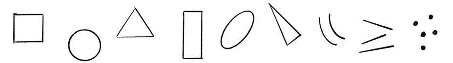
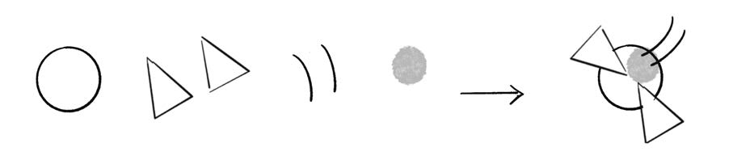
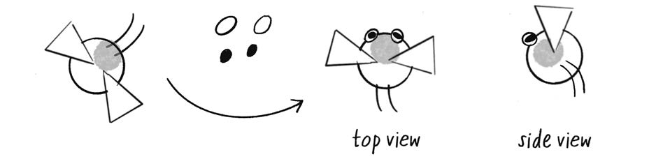
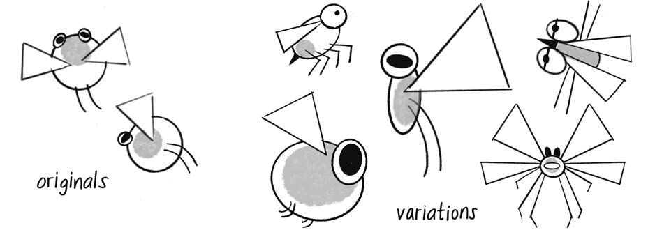
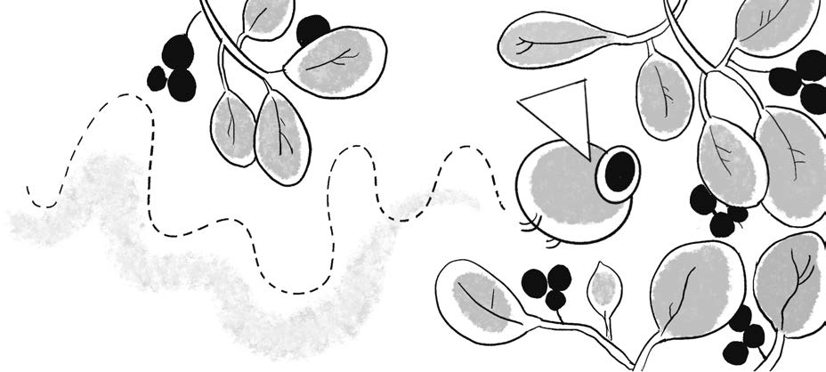

# 附录: 生物设计

本指南由 Zannah Marsh 撰写. 本书中看到的全部插图都由她创作.

假如你还不知道该如何开始 "生态系统项目" 中的生物设计任务, 或者一想到要让一个由多种生物组成的生态系统热闹起来就感到无从下手, 不必担心. 你可以先使用少量视觉积木, 例如基本形状和线条, 再反复组合和复用它们, 得到许多不同结果. 这种设计过程与编程很相似, 都是在重复利用并重新解释已有元素.

尽管 p5.js 可以很方便地绘制形状和线条, 我仍然建议先用纸和铅笔画草图. 直接在纸上工作, 可以让你把注意力集中在设计本身, 快速评估并比较不同版本, 不必在视觉思考和输入代码之间来回切换. 先在纸上创造生物, 再用代码复现它.

漫画家 Greg Stump 和 David Lasky 提出, 几乎所有东西都可以用九种材料画出来. 前六种是基础材料, 最后三种是附加材料:

- 正方形, 圆形和三角形.
- 长方形, 拉长的椭圆和瘦高的三角形.
- 曲线, 直线和圆点.

先在纸上画出这九种材料, 如图 A.1 所示. 很容易, 对吧?

图 A.1, 从九种绘图材料开始: 正方形, 圆形, 三角形, 长方形, 拉长椭圆, 瘦高三角形, 曲线, 直线和圆点. PDF 第 625 页精确提取.

现在, 你可以开始把这些视觉元素组合起来, 创造一种生物. 它将生活在 p5.js 画布构成的想象空间中, 因此不必画出现实世界中已经存在的物种. 完全可以发明一种全新的生命.

下面是一套地球居民很熟悉的设计结构:

- 一个身体.
- 成对的鳍, 翅膀, 手臂或腿.

六种基础形状中的任何一种都可以成为角色的身体. 图 A.2 中这个极其简洁的组合, 已经足以被称为一个生物.

图 A.2, 绘制一个简单生物. 左侧展示基本部件, 右侧展示组合后的角色. PDF 第 626 页精确提取.

你也许愿意让设计保持简单, 到这里就停下. 不过, 在开始用代码重建草图之前, 还需要考虑观察生态系统的 **视角 perspective**. 你是从上方俯视, 像低头观察池塘, 还是从侧面望向草地或森林? 可以把它理解为俯视角游戏与横向卷轴游戏之间的差别.

生物的朝向也很重要, 尤其是当它需要在场景中移动时. 图 A.2 的两条曲线究竟是腿还是触角? 大多数生物会让头部朝向前进方向, 但这个例子中的头在哪里? 可以继续复用基本形状和附加材料, 增加嘴, 眼睛, 鼻子, 耳朵, 尾巴, 触角或角, 让朝向更加明确, 如图 A.3 所示.

图 A.3, 添加细节以表明角色的朝向. PDF 第 626 页精确提取.

我们是否一定会喜欢这些草图? 它们是否完美? 也许不是. 即使不喜欢, 也不要急着擦掉. 迭代角色时, 所有草图都是可以回看的数据点. 可以把生物设计理解为这样一个过程: 安排视觉元素, 观察它们带来的感觉, 留意自己如何回应, 以及这些形状会让你联想到什么.

开始时, 你的生物大概非常简单. 随着生态系统逐渐扩展, 你会为它们实现行为和互动. 修改生物的外观可以帮助你在视觉上组织并强调这些行为和互动, 有时外观本身还会反过来启发新的行为.

可以尝试改变下列元素, 如图 A.4 所示:

- 身体的大小, 圆润程度或狭长程度.
- 腿或翅膀的长度, 形状和数量, 以及它们之间的角度与距离.

图 A.4, 通过改变形状的大小, 比例, 数量, 角度和间距来修改生物. PDF 第 627 页精确提取.

设想一个熟悉的环境也很有帮助, 例如草地, 湖底或热带树林中阴凉的树冠. 哪些特征会在这种环境里派上用场? 大眼睛, 大翅膀, 细长身体, 圆滚滚且上下浮动的形状, 还是用于伪装的纹样?

在绘制草图的过程中, 你可能会发现生物的形态自然暗示了某种行为或情绪, 而这些都可以在代码中实现. 它会突然窜动, 小心爬行, 还是缓慢漂浮? 它有一张可以吞下大餐的巨口, 还是一张只适合细细啃食的小嘴? 它是否拥有巨大的眼睛, 用来寻找美味点心, 如图 A.5 所示, 或者用来发现正在寻找点心的捕食者? 让绘图启发代码, 也让代码反过来启发绘图.

图 A.5, 让生物的形态与环境和功能相匹配. PDF 第 627 页精确提取.

准备在代码中构建生物时, `translate()`, `rotate()`, `push()` 和 `pop()` 会成为你的好朋友, 因为角色的所有部件都需要相对于其他部件进行排列. 面向对象编程 OOP 当然也能节省大量时间和麻烦, 让你快速复用和修改图案.

从简单的东西开始, 慢慢搭建. 假如你已经很久没有画过画, 下面是最后几条建议:

- 许多人小时候喜欢画画, 但在技巧追不上想象时便放弃了. 把这些草图看成实验. 探索没有唯一的对与错. 使用废纸可以进一步降低心理负担.
- 假如还没落笔就觉得紧张, 可以先随手画一些涂鸦或螺旋线来放松. 这就像运动前的拉伸, 艺术家同样需要热身.
- 数字绘图工具非常强大, 但要警惕过于方便的擦除和无穷无尽的 "撤销". 假如把所有不满意的东西全部消灭, 也就失去了比较和学习的机会.

拿起一支笔和几张废纸, 开始画吧. 准备好与新的生物见面!
