# 第 0 章: 随机性

> 随机数的生成太重要了, 不能交给偶然.
>
> – Robert R. Coveyou

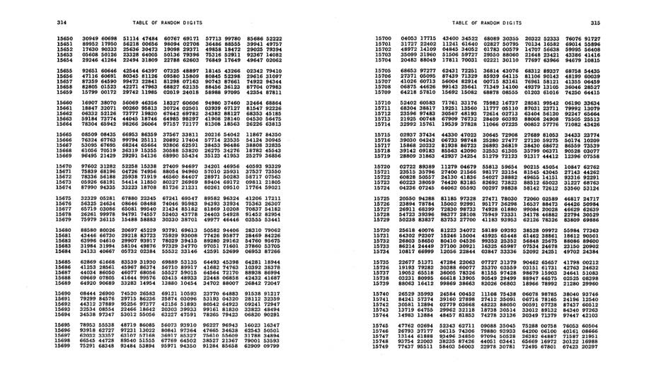

RAND Corporation 的 *A Million Random Digits with 100,000 Normal Deviates* 中的随机数表, PDF 第 41 页精确提取.

1947 年, RAND Corporation 出版了一本颇为奇特的书, 书名是 *A Million Random Digits with 100,000 Normal Deviates*. 这既不是文学作品, 也不是关于随机性的哲学论述. 它是一张庞大的随机数表, 数字来自对轮盘赌装置的电子模拟.

从 20 世纪 20 年代中期到 50 年代, 人们曾出版过一系列随机数表, 这本书是其中最后一批成果之一. 随着高速计算机的发展, 直接生成伪随机数逐渐比查阅印刷表格更快, 纸面随机数表的时代也就此结束.

现在, 故事从这里开始. 如果你已经有一段时间没有编写 JavaScript, 或者很久没有碰数学, 本章会帮助你的思维重新适应计算式思考. 为了开启这趟 "用代码模拟自然" 的旅程, 我会介绍一些构建仿真的基础工具: 随机数、随机分布和噪声. 可以把本章看作组成全书数组的第一个, 更准确地说是第零个, 元素. 它既是一次复习, 也是通向后续可能性的入口.

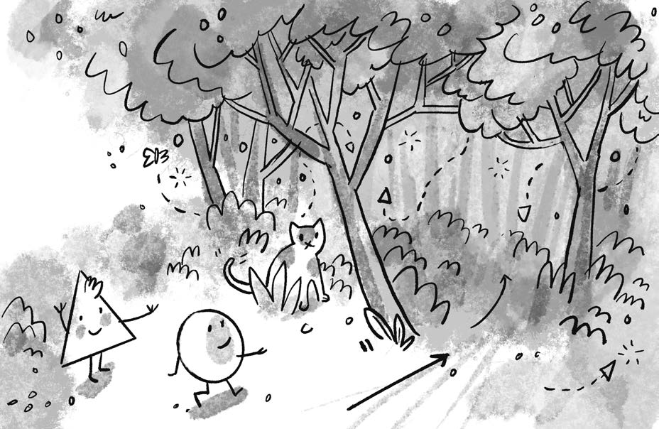

本章开篇插图, PDF 第 42 页精确提取.

第 1 章会讨论向量, 它将成为全书模拟运动的基本构件. 但在迈出那一步之前, 先思考一个更基础的问题: 一个东西在数字画布上四处移动, 究竟意味着什么? 我会从最著名也最简单的运动仿真之一开始: 随机游走.

## 随机游走

想象你正站在平衡木中央. 每隔 10 秒抛一次硬币. 正面, 向前走一步; 反面, 向后走一步. 这就是 **随机游走**, 即由一连串随机步伐定义的路径.

小心地从平衡木走到地面, 就可以把一维随机游走, 只能前后移动, 扩展到二维随机游走, 可以前、后、左、右移动. 现在有四种可能, 因而每次可以连续抛两次同一枚硬币来决定下一步.

| 第一次抛掷 | 第二次抛掷 | 结果     |
|------------|------------|----------|
| 正面       | 正面       | 向前一步 |
| 正面       | 反面       | 向右一步 |
| 反面       | 正面       | 向左一步 |
| 反面       | 反面       | 向后一步 |

这个算法看起来并不高深, 但随机游走可以模拟现实世界中的许多现象, 包括气体分子的运动、动物寻找食物的过程, 以及赌徒在赌场里度过一天时的行为. 对本书而言, 随机游走是理想的起点, 原因有三:

1.  我想复习本书的核心编程概念之一: 面向对象编程, Object-Oriented Programming, OOP. 接下来创建的随机游走者会成为一个模板, 展示如何用面向对象设计构造在计算机图形画布上移动的事物.
2.  随机游走会引出本书反复追问的两个问题: "如何定义支配对象行为的规则?" 以及 "如何用代码实现这些规则?"
3.  本书的项目会经常用到随机性、概率和 Perlin 噪声的基础知识. 随机游走正好可以演示后面会派上用场的关键概念.

我会先通过编写 `Walker` 类来快速复习 OOP, 再用它创建能够随机游走的 `Walker` 对象. 这里只做简要回顾. 如果你从未接触过 OOP, 建议暂停阅读, 先学习 The Coding Train 网站上 "Code! Programming with p5.js" 视频课程的 "Objects" 部分: [thecodingtrain.com/objects](https://thecodingtrain.com/objects).

### 随机游走者类

JavaScript 中的对象是同时拥有数据和功能的实体. 在这里, 一个 `Walker` 对象应保存自己在画布上的位置, 同时具有绘制自身、迈出一步等功能.

类是构造实际对象实例的模板. 可以把类想成饼干模具, 把对象想成模具压出来的饼干. 要创建一个 `Walker` 对象, 首先要定义 `Walker` 类, 也就是明确 "成为一个游走者" 意味着什么.

游走者只需要两项数据: x 坐标和 y 坐标. 我会在类的构造函数 `constructor()` 中把它们初始化为画布中心, 作为对象的起点. 可以把构造函数理解为对象自己的 `setup()` 函数. 它负责定义对象的初始属性, 就像 `setup()` 负责初始化整个草图一样.

    class Walker {
      constructor() {
        // 对象拥有构造函数, 并在这里完成初始化.
        this.x = width / 2;
        this.y = height / 2;
      }
    }

这里使用关键字 `this`, 把属性附着到刚创建的对象本身, 即 `this.x` 和 `this.y`.

除了数据, 类还可以定义功能. 本例中的 `Walker` 对象有两个函数. 在 OOP 语境中, 这些函数称为 **方法**. 方法本质上仍是函数, 区别在于它们定义在类内部, 因而与对象或类相关联; 独立函数则不属于某个类. `function` 关键字是一个线索: 定义独立函数时会看到它, 但定义类方法时不会出现. 本书会尽量一致地区分 "函数" 与 "方法", 不过程序员在日常交流中经常混用这两个词.

第一个方法 `show()` 包含把对象绘制成黑点的代码. 引用对象属性时, 仍然不要忘记 `this.`.

    show() {
      stroke(0);
      point(this.x, this.y);
    }

第二个方法 `step()` 指示 `Walker` 迈出一步. 这里开始变得有趣. 之前是在地面上随机选择方向, 现在用 p5.js 画布来表示那块地面. 共有四种可能的步伐:

- 向右: `x++`
- 向左: `x--`
- 向前, 即画布上方: `y--`
- 向后, 即画布下方: `y++`

但代码如何在四个选项中作出选择?

前面使用了两次抛硬币. 在 p5.js 中, 当你想从一组选项中随机选择时, 可以直接调用 `random()` 生成随机数. 它会在指定范围中选择一个随机浮点数. 这里传入 4, 表示从 0 到 4 的范围:

    let choice = floor(random(4));

变量 `choice` 被赋予一个随机整数. `floor()` 会去掉随机浮点数的小数部分. 严格来说, `random(4)` 的取值范围是 0, 含 0, 到 4, 不含 4. 因而它不可能真正返回 4.0. 最大值只能无限接近 4, 例如 3.999999999, 随后 `floor()` 会把它截断为 3. 因此, `choice` 实际上只可能是 0、1、2 或 3.

1.  编码约定

    JavaScript 可以用 `let` 或 `const` 声明变量. 一种常见做法是先使用 `const`, 只有变量确实需要重新赋值时才改为 `let`. 在当前示例中, `choice` 在每次 `step()` 调用的生命周期内不会重新赋值, 因此使用 `const` 其实更合适.

    不过, 为了遵循 p5.js 示例的一贯风格, 也为了避免初学阶段被额外差异分散注意力, 本书会统一用 `let` 声明变量. `const` 和 `let` 的区别当然很重要, 鼓励你进一步研究, 并为自己的草图选择合适的变量声明方式. 相关讨论可参见 p5.js GitHub 仓库的 issue \#3877: [github.com/processing/p5.js/issues/3877](https://github.com/processing/p5.js/issues/3877).

    本书还会使用 JavaScript 的严格相等运算符 `===`, 以及严格不等运算符 `!==`. 它们同时比较值和类型. 例如, `3 === '3'` 的结果为 `false`, 因为两者类型不同, 一个是数字, 一个是字符串. 相比之下, 宽松相等运算符在 `3 == '3'` 中会先转换类型, 因而得到 `true`. 宽松比较很多时候也能工作, 但有时会产生意外结果, 因此 `===` 通常更安全.

    根据选中的随机数, 游走者向左、右、上或下迈步. 下面是补全 `Walker` 类的完整 `step()` 方法:

        step() {
          let choice = floor(random(4)); // 0、1、2 或 3.

          if (choice === 0) {
            this.x++;
          } else if (choice === 1) {
            this.x--;
          } else if (choice === 2) {
            this.y++;
          } else {
            this.y--;
          }
        }

    类写好后, 需要在草图中创建一个真正的 `Walker` 对象. 假设只模拟一个随机游走, 先声明一个全局变量:

        let walker;

    然后在 `setup()` 中使用 `new` 运算符和类名创建对象:

        function setup() {
          createCanvas(640, 240);
          walker = new Walker();
          background(255);
        }

    最后, 在 `draw()` 的每次循环中让游走者迈步并绘制一个点.

### 示例 0.1: 传统随机游走

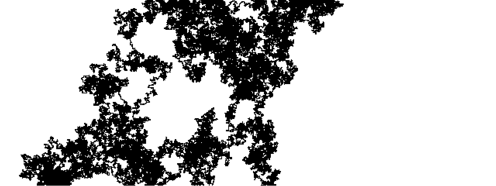

示例 0.1 的运行结果, PDF 第 46 页精确提取.

    let walker;

    function setup() {
      createCanvas(640, 240);
      walker = new Walker();
      background(255);
    }

    function draw() {
      walker.step();
      walker.show();
    }

    class Walker {
      constructor() {
        this.x = width / 2;
        this.y = height / 2;
      }

      show() {
        stroke(0);
        point(this.x, this.y);
      }

      step() {
        let choice = floor(random(4));

        if (choice === 0) {
          this.x++;
        } else if (choice === 1) {
          this.x--;
        } else if (choice === 2) {
          this.y++;
        } else {
          this.y--;
        }
      }
    }

背景只在 `setup()` 中绘制一次, 而不是在每次 `draw()` 循环中清空, 因此画布会保留随机游走的轨迹.

这个随机游走者还可以有若干变化. 当前 `Walker` 的步伐只限于上、下、左、右四种. 但画布中任意像素最多有八个相邻像素, 包括四个对角方向. 如果把停留在原地也算作一种选项, 一共会有九种可能.

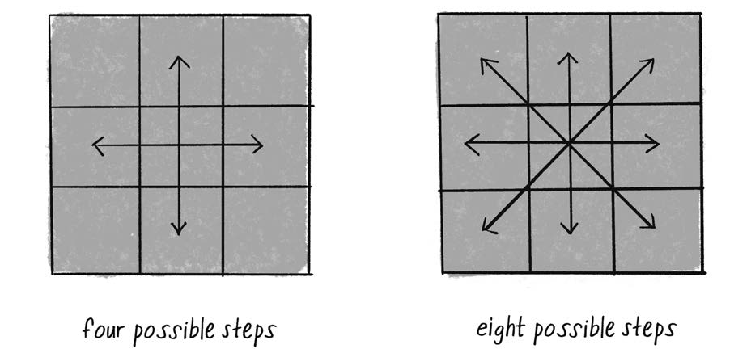

图 0.1, 不包含和包含对角线时, 随机游走者可采用的步伐, PDF 第 47 页精确提取.

要让游走者可以移动到任意相邻像素, 或原地不动, 可以从 0 到 8 中选择一个数字. 另一个写法是在 x 轴和 y 轴上分别从 -1、0、1 三种步长中选择:

    step() {
      let xstep = floor(random(3)) - 1;
      let ystep = floor(random(3)) - 1;

      this.x += xstep;
      this.y += ystep;
    }

还可以进一步去掉 `floor()`, 直接使用 `random()` 产生的浮点数, 让每个轴的步长在 -1 到 1 的连续范围内变化:

    step() {
      let xstep = random(-1, 1);
      let ystep = random(-1, 1);

      this.x += xstep;
      this.y += ystep;
    }

这些传统随机游走变体有一个共同点: 在任意时刻, 朝某个方向迈步的概率与朝其他方向迈步的概率相等. 四种步伐时, 每种的概率为 $1/4$, 即 25%. 九种步伐时, 每种概率为 $1/9$, 约 11.1%.

这正是 `random()` 的默认行为. p5.js 的随机数生成器会产生 **均匀分布**. 可以统计每个随机数被选中的次数, 再把结果画成图形来验证这种分布.

### 示例 0.2: 随机数分布

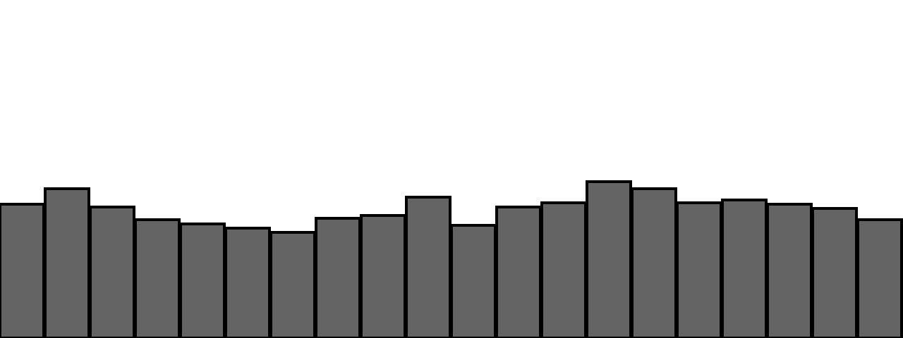

示例 0.2 的随机数频数直方图, PDF 第 48 页精确提取.

    let randomCounts = []; // 记录每个随机数被选中的次数.
    let total = 20;        // 计数槽总数.

    function setup() {
      createCanvas(640, 240);
      for (let i = 0; i < total; i++) {
        randomCounts[i] = 0;
      }
    }

    function draw() {
      background(255);

      let index = floor(random(randomCounts.length));
      randomCounts[index]++;

      stroke(0);
      fill(127);
      let w = width / randomCounts.length;

      for (let x = 0; x < randomCounts.length; x++) {
        rect(x * w, height - randomCounts[x], w - 1, randomCounts[x]);
      }
    }

图中每根柱子的高度略有差异. 当前样本量, 即已经抽取的随机数数量, 仍然较小, 某些数字偶尔会比其他数字更频繁地出现. 随着时间推移, 如果随机数生成器足够好, 这种分布会逐渐趋于均匀.

1.  伪随机数

    `random()` 返回的数字并非真正随机, 而是 **伪随机**. 它们来自一个模拟随机性的数学函数. 如果运行足够长时间, 函数最终会重复某种模式, 因而不再显得随机. 不过这个周期通常极长, 对本书的示例而言, `random()` 已经足够随机.

2.  练习 0.1

    创建一个更倾向于向下和向右移动的随机游走者. 下一节会给出解法.

## 概率与非均匀分布

均匀随机并不总是设计问题中最周到的答案, 尤其当目标是构造有机、自然的仿真时. 只要使用一些技巧, `random()` 也可以产生 **非均匀分布**, 让某些结果比另一些结果更容易出现. 这类分布常常更有趣, 也更接近自然.

回想刚开始学习 p5.js 时, 你也许想在屏幕上画许多圆, 然后决定: "把位置、大小和颜色都设成随机值吧." 在学习计算机图形基础时, 用随机性为系统播种完全合理. 但本书要构造的是受自然启发的系统, 单纯的均匀随机并不总够用. 有时需要在概率天平上轻轻按下一根手指.

自定义非均匀分布会贯穿全书. 例如第 9 章的遗传算法需要完成 "选择": 哪些种群成员可以把 DNA 传给下一代? 这类似达尔文的适者生存. 假设有一群正在进化的猴子, 每只猴子繁殖的机会不应相同. 为模拟自然选择, 不能只随便挑两只猴子当父母. 更 "适应" 的个体应该更容易被选中. 可以把它称为 "适者的概率".

先暂停一下, 回顾概率的基本原则. **单事件概率** 描述某个给定事件发生的可能性. 在概率论中, **结果**, outcome, 指随机过程所有可能的输出; **事件**, event, 指当前关心的某个具体结果或结果组合.

如果所有结果等可能, 某事件的概率等于符合该事件的结果数除以所有可能结果数. 抛硬币只有正面和反面两种结果. 符合 "正面" 的结果只有一个, 因而:

$$
P(\text{正面}) = \frac{1}{2} = 50\%.
$$

一副 52 张的扑克牌中抽到 A 的概率为:

$$
P(\text{A}) = \frac{4}{52} \approx 0.077 \approx 8\%.
$$

抽到方块的概率为:

$$
P(\text{方块}) = \frac{13}{52} = 0.25 = 25\%.
$$

连续多个事件同时发生的概率, 可以通过相乘每个事件的概率来计算. 例如, 连续三次抛出正面的概率为:

$$
\frac{1}{2} \times \frac{1}{2} \times \frac{1}{2}
= \frac{1}{8} = 0.125 = 12.5\%.
$$

这意味着平均每 8 组试验会出现一次连续三个正面. 如果把 "连续抛三次" 重复 500 组, 预计大约有 $500/8 \approx 63$ 组得到三个连续正面.

### 练习 0.2

从一副 52 张的牌中连续抽到两张 A 的概率是多少?

1.  第一次抽牌后把牌放回并重新洗牌.
2.  第一次抽牌后不放回.

`random()` 可以通过两种常见方式把概率概念应用到非均匀分布中.

第一种技巧是用数组保存候选值, 并重复保存需要增加权重的值. 再从数组中随机抽取元素:

    let stuff = [1, 1, 2, 3, 3];
    let value = random(stuff);
    print(value);

这个数组有五个元素, 其中 1 出现两次. 因而打印 1 的概率为 $2/5 = 40\%$. 打印 2 的概率为 20%, 打印 3 的概率为 40%.

第二种技巧是从 0 到 1 中抽取一个随机浮点数, 只有当它落入某个区间时才触发事件. 例如:

    let probability = 0.1; // 10% 的概率.
    let r = random(1);     // 0 到 1 的随机浮点数.

    if (r < probability) {
      print("Sing!");
    }

0 到 1 之间有十分之一的数小于 0.1, 因而这段代码平均只有 10% 的时间会唱歌.

同样的方法可以为多个结果设置不相等的权重. 假设唱歌的概率为 60%, 跳舞为 10%, 睡觉为 30%. 从 0 到 1 选取一个随机数, 再判断它落在哪个区间:

- 0.0 到 0.6, 60%: 唱歌.
- 0.6 到 0.7, 10%: 跳舞.
- 0.7 到 1.0, 30%: 睡觉.

<!-- -->

    let num = random(1);

    if (num < 0.6) {
      print("Sing!");
    } else if (num < 0.7) {
      print("Dance!");
    } else {
      print("Sleep!");
    }

现在把这种方法应用到随机游走者, 使它更倾向于向某个方向移动. 假设概率如下:

- 向上: 20%.
- 向下: 20%.
- 向左: 20%.
- 向右: 40%.

### 示例 0.3: 倾向向右移动的游走者

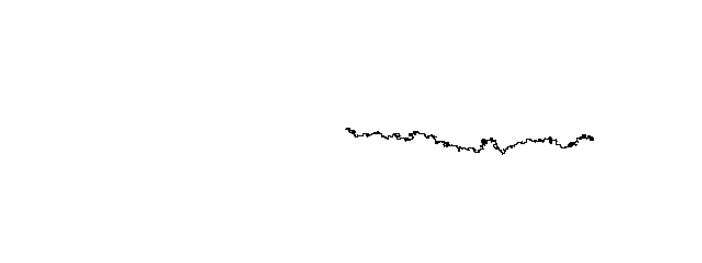

示例 0.3 的运行结果, PDF 第 52 页精确提取.

    step() {
      let r = random(1);

      if (r < 0.4) {
        this.x++;       // 40% 的概率向右.
      } else if (r < 0.6) {
        this.x--;
      } else if (r < 0.8) {
        this.y++;
      } else {
        this.y--;
      }
    }

这种技巧还经常用于控制偶发事件. 假设一个草图原本每隔 100 帧创建一个新的随机游走者. 也可以改为每帧有 1% 的概率创建一个新游走者. 两者的长期平均结果相同, 即每 100 帧出现一次, 但后者加入了偶然性, 看起来更动态、更难预测.

### 练习 0.3

创建一个概率会动态变化的随机游走者. 例如, 能否让它有 50% 的概率朝鼠标方向移动? p5.js 可以通过 `mouseX` 和 `mouseY` 获取当前鼠标位置.

## 随机数的正态分布

产生非均匀随机数的另一种方法是使用 **正态分布**. 正态分布中的数值会聚集在某个平均值附近.

再次考虑那群模拟猴子. 假设草图创建 1000 个 `Monkey` 对象, 每只猴子的高度在 200 到 300 像素之间随机选择:

    let h = random(200, 300);

这是合理的猴子身高算法吗? 想象纽约拥挤的人行道. 随便选一个人, 他的身高看起来似乎是随机的, 但并不是 `random()` 默认产生的那种随机. 人类身高不是均匀分布. 接近平均身高的人远多于极高或极矮的人. 因此, 接近均值的高度应更常见, 极端高度应更稀少.

这正是 **正态分布** 的行为. 正态分布也称 **高斯分布**, 以数学家 Carl Friedrich Gauss 命名. 它的图形通常称作 **钟形曲线**. 曲线由一个数学函数定义, 某个值出现的概率由均值, 常写作希腊字母 $\mu$, 和标准差, 常写作 $\sigma$, 决定.

对于 200 到 300 的高度范围, 均值直观上是 250. 但标准差为 3 和标准差为 15 分别意味着什么? 图 0.2 给出了线索.

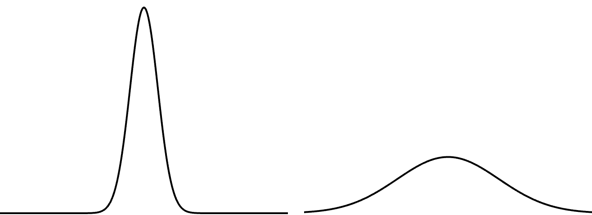

图 0.2, 正态分布的两个钟形曲线. 左侧标准差较小, 右侧标准差较大. PDF 第 54 页精确提取并合并.

左侧分布的标准差很小, 大多数值堆积在均值附近, 它们很少偏离均值. 右侧标准差较大, 数值在均值两侧分布得更开.

对正态分布总体而言:

- 约 68% 的成员位于均值上下 1 个标准差内.
- 约 95% 位于均值上下 2 个标准差内.
- 约 99.7% 位于均值上下 3 个标准差内.

如果猴子身高均值为 250 像素, 标准差为 5 像素, 只有约 0.3% 的猴子低于 235 像素, 或高于 265 像素. 与此同时, 约 68% 的猴子身高会落在 245 到 255 像素之间.

在 p5.js 中使用正态分布不需要手工完成这些计算. `randomGaussian()` 会处理数学过程, 返回正态分布的随机数:

    function draw() {
      let num = randomGaussian();
    }

### 均值和标准差的计算

假设 10 名学生的考试成绩, 满分 100, 为:

    85, 82, 88, 86, 85, 93, 98, 40, 73, 83

均值为 81.3.

标准差是 "围绕均值的偏差平方的平均值" 的平方根. 计算步骤如下:

1.  用每个人的成绩减去均值, 得到偏差.
2.  将偏差平方, 得到平方偏差.
3.  对所有平方偏差求平均, 得到方差.
4.  对方差开平方, 得到标准差.

| 成绩 | 与均值的差 | 平方偏差 |
|----|----|----|
| 85 | $85 - 81.3 = 3.7$ | $(3.7)^{2} = 13.69$ |
| 40 | $40 - 81.3 = -41.3$ | $(-41.3)^{2} = 1705.69$ |
| … | … | … |
|  | 平均方差 | 228.21 |

因此:

$$
\sigma = \sqrt{228.21} \approx 15.13.
$$

接下来考虑一个具体目标: 使用正态分布指定图形的 x 坐标.

`randomGaussian()` 默认返回均值为 0、标准差为 1 的正负随机数, 这称为 **标准正态分布**. 实际项目往往需要不同参数. 假设画布宽 640 像素, 希望图形的 x 坐标服从均值 320, 即画布水平中心, 标准差 60 像素的正态分布. 可以向 `randomGaussian()` 传入两个参数, 先均值, 后标准差.

### 示例 0.4: 高斯分布

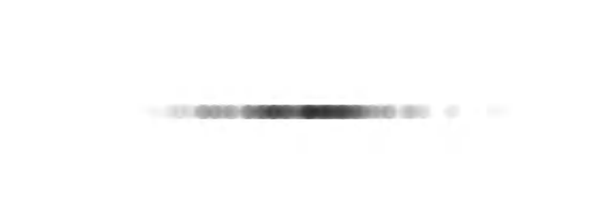

示例 0.4, 均值 320、标准差 60 的高斯分布, PDF 第 55 页精确提取.

    function draw() {
      let x = randomGaussian(320, 60);

      noStroke();
      fill(0, 10);
      circle(x, 120, 16);
    }

这里通过参数定制了 `randomGaussian()`. 实现同样变换的数学过程很简单: 把标准正态分布值乘以标准差, 再加上均值. 因此下面两种写法等价:

    let x = randomGaussian(320, 60);
    let x = 60 * randomGaussian() + 320;

多个半透明圆叠在一起后, 分布会逐渐显现. 中心区域最暗, 因为大多数值聚集在那里. 偶尔也会有圆出现在离中心更远的位置.

### 练习 0.4

模拟油漆飞溅, 用许多彩色小点组成图案. 大部分油漆聚集在中心附近, 但也有一些点飞向边缘. 能否用正态分布生成点的位置? 能否同样用正态分布生成色板? 尝试加入滑块, 动态调节标准差.

### 练习 0.5

**高斯随机游走** 的步长, 即对象每次沿某个方向移动的距离, 服从正态分布. 请实现这种 `Walker` 变体.

## 随机数的自定义分布

总有一天, 均匀分布和高斯分布都不能满足需求. 想象你是一名寻找食物的随机游走者. 由于不知道食物在哪里, 随机搜索似乎合理. 但存在一个问题: 随机游走者会多次回到已经访问的位置, 这种现象称为 **过采样**, oversampling. 它会让觅食效率很低, 甚至一无所获.

一种策略是偶尔迈出非常大的一步. 游走者可以在局部随机搜索, 同时周期性跳到很远的位置, 从而减少过采样. 这种随机游走变体称为 **Lévy flight**, Lévy 飞行. 它需要自定义概率: 步长越大, 被选中的概率越低; 步长越小, 被选中的概率越高.

之前介绍过两种自定义分布方法: 在数组中重复某些值, 或判断 `random()` 的结果. 一个并不严格的 Lévy 飞行实现可以规定 1% 的概率迈出大步:

    let r = random(1);

    if (r < 0.01) {
      xstep = random(-100, 100);
      ystep = random(-100, 100);
    } else {
      xstep = random(-1, 1);
      ystep = random(-1, 1);
    }

但这把分布缩减成两个固定选项: 99% 的时间迈小步, 1% 的时间迈大步. 如果想定义更普遍的规则, 例如数值越大越容易被选中, 应该怎么办? 比如 0.8791 比 0.8532 稍微更容易被选中. 如果 $x$ 是候选随机数, 它被选中的概率可以映射为 $y=x$.

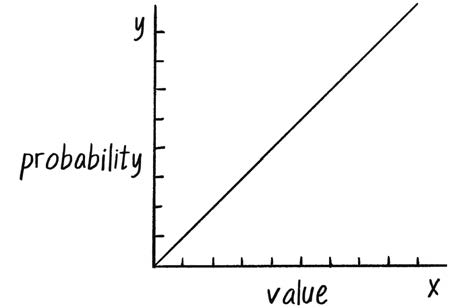

图 0.3, $y=x$ 的概率曲线. y 表示值 x 被选中的概率, PDF 第 57 页精确提取.

既然可以按图 0.3 的曲线生成分布, 理论上也可以按任何能够用公式定义的曲线生成随机分布.

一种实现自定义分布的方法是抽取两个随机数. 第一个是候选值, 第二个是 **资格随机值**. 程序用第二个值决定接受第一个值, 还是丢弃它并重新抽取. 容易通过资格检验的数字会更常出现, 难以通过的数字则很少出现.

只考虑 0 到 1 的随机值, 过程如下:

1.  抽取随机数 `r1`.
2.  计算 `r1` 通过资格检验的概率 `p`. 这里令 `p = r1`.
3.  再抽取随机数 `r2`.
4.  如果 `r2 < p`, 接受 `r1`.
5.  如果条件不成立, 回到第 1 步.

候选值越大, 它通过检验的概率越高. 若 `r1` 为 0.1, 通过概率为 10%; 若 `r1` 为 0.83, 通过概率为 83%.

这个过程称为 **接受-拒绝算法**, accept-reject algorithm, 它属于 Monte Carlo 方法的一种, 名称来自 Monte Carlo Casino.

### 示例 0.5: 接受-拒绝分布

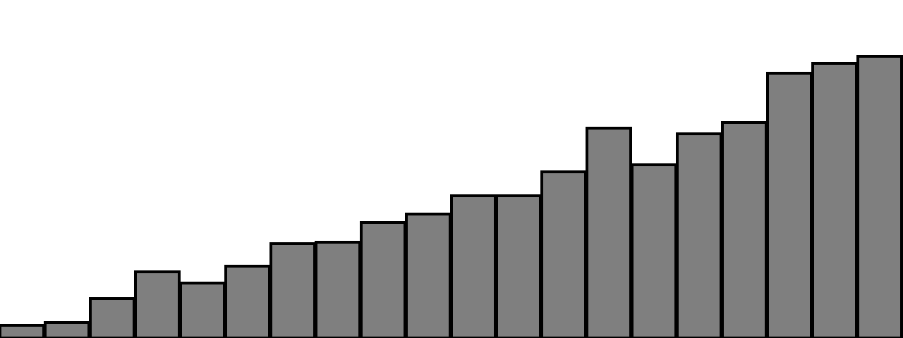

示例 0.5, 接受-拒绝算法产生的非均匀分布, PDF 第 58 页精确提取.

    function acceptreject() {
      while (true) {
        let r1 = random(1);   // 候选随机值.
        let probability = r1;
        let r2 = random(1);   // 资格随机值.

        if (r2 < probability) {
          return r1;
        }
      }
    }

接受-拒绝算法确实能生成自定义随机分布, 但效率不高. 当大量候选值被拒绝, 尤其当资格概率很低时, 会浪费许多计算. 第 9 章讨论遗传算法时, 会采用另一种更优的方法.

### 练习 0.6

使用自定义概率分布改变随机游走者的步长. 可以让资格概率影响步长范围. 能否把概率映射为二次函数, 令一个值被选中的概率等于它的平方?

    let step = 10;
    let stepx = random(-step, step);
    let stepy = random(-step, step);

    this.x += stepx;
    this.y += stepy;

上面的代码仍使用均匀分布的随机步长. 请修改它. 第 1 章会展示如何借助向量更高效地改变步长.

## 使用 Perlin 噪声获得更平滑的结果

优秀的随机数生成器会产生彼此没有关系、看不出模式的数字. 但在模拟有机、逼真的行为时, 少量随机性很有用, 纯粹的均匀随机却不一定自然.

**Perlin 噪声** 由 Ken Perlin 发明. 它生成一串自然有序的伪随机数, 序列中相邻数字的值非常接近. 因而随机值之间会平滑过渡, 外观比纯噪声更有机. Perlin 噪声特别适合生成云、地形、木纹、大理石等具有自然品质的效果.

图 0.4 对比了 Perlin 噪声和均匀随机. 左图是随时间变化的 Perlin 噪声, 曲线平滑; 右图是纯随机数, 曲线非常锯齿化.

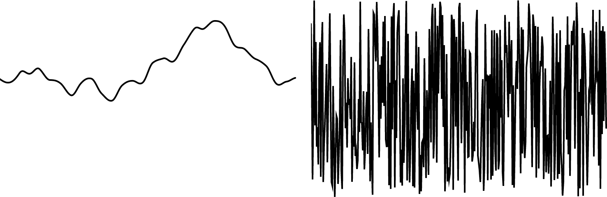

图 0.4, Perlin 噪声随时间的变化, 左, 与均匀随机噪声, 右. PDF 第 60 页精确提取并合并.

Ken Perlin 在 20 世纪 80 年代初参与电影 *Tron* 制作时开发了原始 Perlin 噪声算法, 并因这项技术获得 Academy Award 的技术成就奖. 该算法最初用于为计算机生成特效创建程序化纹理. "程序化" 表示视觉元素由算法生成, 而不是由艺术家逐一手工设计.

此后, 不同作者提出了许多噪声变体, 包括 value noise、Worley noise, 以及 Perlin 在 2001 年开发的 simplex noise. 关于历史, 可参见 Ken Perlin 的网站: [mrl.nyu.edu/~perlin/doc/oscar.html](https://mrl.nyu.edu/~perlin/doc/oscar.html). 关于变体, 可参见 The Coding Train 的 "What Is OpenSimplex Noise?" 视频: [thecodingtrain.com/opensimplexnoise](https://thecodingtrain.com/opensimplexnoise).

p5.js 通过 `noise()` 实现经典的 1983 Perlin 噪声算法. 它可以接受一个、两个或三个参数, 分别在一维、二维或三维噪声空间中计算. 先从一维噪声开始.

假设要在随机 x 位置绘制一个圆, 通常会写:

    let x = random(0, width);
    circle(x, 180, 16);

也许你会想直接把 `random()` 换成 `noise()`:

    // 诱人的写法, 但不正确.
    let x = noise(0, width);
    circle(x, 180, 16);

概念上, 目标确实是用 Perlin 噪声计算一个从 0 到画布宽度的 x 值, 但 `noise()` 的参数含义不同. `random()` 的参数表示输出范围的最小值和最大值; `noise()` 的输出范围固定为 0 到 1. 后面可以用 `map()` 把它映射到所需范围. 在此之前, 先理解 `noise()` 的输入参数.

一维 Perlin 噪声可以想成随 "时间" 排列的线性数值序列:

| 时间 | 噪声值 |
|------|--------|
| 0    | 0.365  |
| 1    | 0.363  |
| 2    | 0.363  |
| 3    | 0.364  |
| 4    | 0.366  |

要取得某个噪声值, 需要选择一个 "时间点" 并传给 `noise()`. 例如:

    let n = noise(3);

按照上表, `noise(3)` 返回 0.364. 下一步是用变量表示时间, 在 `draw()` 中连续读取噪声:

    let t = 3;

    function draw() {
      let n = noise(t);
      print(n);
    }

这还不够. 代码会反复输出同一个值, 因为每次都在同一个时间点 3 查询噪声. 必须让 `t` 递增:

    let t = 0;

    function draw() {
      let n = noise(t);
      print(n);
      t += 0.01;
    }

这里让 `t` 每次增加 0.01. 不同增量会改变噪声的平滑程度. 在噪声空间中跳得越远, 返回值越不平滑, 看起来也越接近普通随机数.

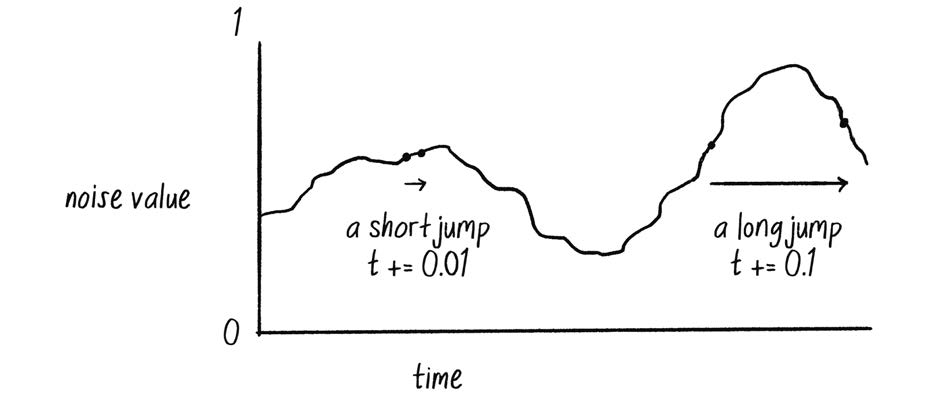

图 0.5, 在 Perlin 噪声空间中进行短跳和长跳, PDF 第 62 页精确提取.

后面的 Perlin 噪声示例中, 可以留意不同的 `t` 增量如何改变动画.

### 噪声范围

`noise()` 返回 0 到 1 的值, 需要把它映射到实际用途的范围. p5.js 的 `map()` 最适合完成这一工作. 它接受五个参数:

1.  要映射的值.
2.  当前范围的最小值.
3.  当前范围的最大值.
4.  目标范围的最小值.
5.  目标范围的最大值.

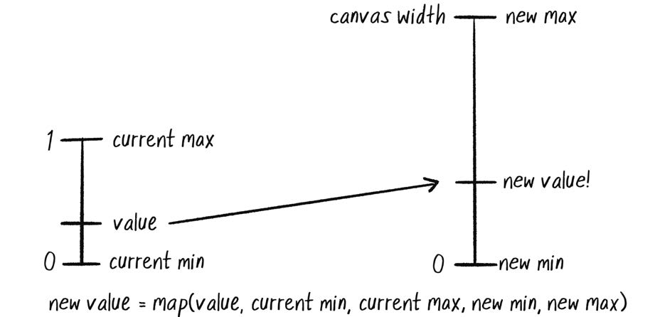

图 0.6, 把一个值从当前范围映射到新范围, PDF 第 63 页精确提取.

假设噪声范围是 0 到 1, 目标是让圆的 x 坐标覆盖 0 到画布宽度:

    let t = 0;

    function draw() {
      let n = noise(t);
      let x = map(n, 0, 1, 0, width);

      ellipse(x, 180, 16, 16);
      t += 0.01;
    }

同样的逻辑可以用于随机游走者. 分别用 Perlin 噪声设置 x 和 y, 会得到更平滑、更有机的游走轨迹.

### 示例 0.6: Perlin 噪声游走者

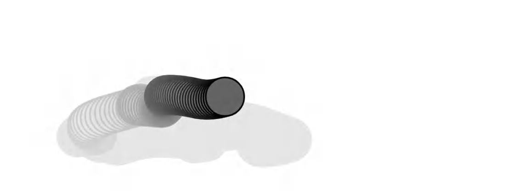

示例 0.6, Perlin 噪声游走者的运动轨迹, PDF 第 64 页精确提取.

    class Walker {
      constructor() {
        this.tx = 0;
        this.ty = 10000;
      }

      step() {
        this.x = map(noise(this.tx), 0, 1, 0, width);
        this.y = map(noise(this.ty), 0, 1, 0, height);

        this.tx += 0.01;
        this.ty += 0.01;
      }
    }

这个示例引入了一对新变量: `tx` 和 `ty`. 需要分别跟踪 x 坐标和 y 坐标的噪声位置. 但为什么 `tx` 从 0 开始, `ty` 却从 10000 开始?

这两个数本身是任意选择的, 但让它们相隔很远是有意的. 噪声函数是确定性的: 对同一个输入位置 `t`, 它总会返回相同结果. 如果 x 和 y 在同一个 `t` 上读取噪声, 那么 x 和 y 会始终相等, 游走者只能沿对角线移动.

因此, x 从噪声空间的 0 位置开始, y 从 10000 位置开始, 两者看起来就像彼此独立.

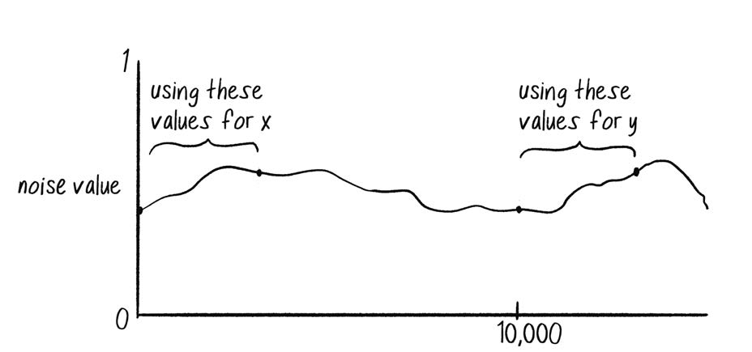

图 0.7, 在一维噪声轴上使用不同偏移量生成 x 和 y, PDF 第 65 页精确提取.

严格来说, 这里并没有真正的时间. "时间" 只是理解噪声函数的一种比喻. 实际上面对的是一维 **空间**: 噪声值沿一条线排列, 程序从特定 x 位置取值. 因此很多示例会把变量命名为 `xoff`, 表示噪声图上的 x 偏移量, 而不是用 `t` 表示时间.

### 练习 0.7

在 Perlin 噪声游走者中, `noise()` 的结果被直接映射为游走者的位置. 创建另一个随机游走者, 不要把噪声映射到位置, 而要把它映射到每次移动的步长.

## 二维噪声

理解一维噪声后, 再考虑噪声值如何存在于二维空间.

一维噪声是一串数值, 每个值都与相邻值相似. 可以想象一张方格纸或电子表格, 把一维噪声从左到右写在一行中. 因为值只生活在一维, 每个值只有两个直接邻居: 左边一个, 右边一个.

二维噪声的概念完全相同, 区别在于数值不只沿一行排列, 而是填满整个网格. 一个值会与上、下、左、右和四个对角方向的邻居都相似.

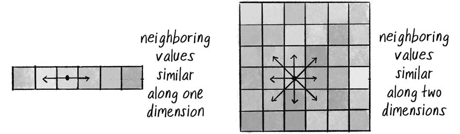

图 0.8, 一维和二维 Perlin 噪声中的相邻值. 网格深浅表示噪声值, PDF 第 66 页精确提取.

如果把方格纸中的每个噪声值映射为颜色亮度, 就会得到类似云层的图案. 白色旁边是浅灰, 再到灰色、深灰、黑色, 然后又逐渐变亮.

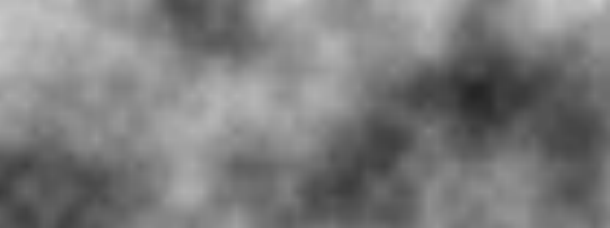

图 0.9, p5.js 草图对二维噪声的可视化. 每个像素用灰度表示一个噪声值, PDF 第 66 页精确提取.

这正是噪声算法最初被发明的用途. 调整参数并加入颜色后, 图像可以像大理石、木材或其他有机纹理.

### 噪声细节

p5.js 的 `noise()` 参考文档说明, 噪声由多个 **octave**, 倍频程, 共同计算. 调用 `noiseDetail()` 可以改变倍频程数量以及它们之间的相对权重, 从而改变噪声的质感.

- `noise()` 文档: [p5js.org/reference/#/p5/noise](https://p5js.org/reference/#/p5/noise)
- `noiseDetail()` 文档: [p5js.org/reference/#/p5/noiseDetail](https://p5js.org/reference/#/p5/noiseDetail)

如果要用 `random()` 随机给画布的每个像素着色, 需要嵌套循环遍历每行和每列, 为每个像素选择随机亮度. p5.js 的 `pixels` 数组为每个像素保存四个槽位: red、green、blue 和 alpha.

    loadPixels();

    for (let x = 0; x < width; x++) {
      for (let y = 0; y < height; y++) {
        let index = (x + y * width) * 4;
        let bright = random(255);

        pixels[index] = bright;
        pixels[index + 1] = bright;
        pixels[index + 2] = bright;
        pixels[index + 3] = 255;
      }
    }

    updatePixels();

要用 `noise()` 平滑地着色, 概念上只需把 `random()` 换成二维噪声:

    let bright = map(noise(x, y), 0, 1, 0, 255);

这段代码会为二维空间中的每个 $(x,y)$ 位置计算噪声值. 但它不会产生理想的平滑云层, 因为相邻像素在噪声空间中每次跨越 1, 跳幅太大. 一维噪声示例中每帧只让时间增加 0.01, 而不是 1.

一种合适的解决方法是把画布像素坐标和噪声输入坐标分开. 当画布 x 每次增加 1 像素时, 让 `xoff` 只增加 0.01; 当 y 每次增加 1 像素时, 让 `yoff` 只增加 0.01.

    let xoff = 0.0;

    for (let x = 0; x < width; x++) {
      let yoff = 0.0;

      for (let y = 0; y < height; y++) {
        let bright = map(noise(xoff, yoff), 0, 1, 0, 255);
        let index = (x + y * width) * 4;

        pixels[index] = bright;
        pixels[index + 1] = bright;
        pixels[index + 2] = bright;
        pixels[index + 3] = 255;

        yoff += 0.01;
      }

      xoff += 0.01;
    }

这里容易产生一种看似矛盾的感觉. 前面用两个独立的一维噪声值设置游走者的二维位置, `this.x` 和 `this.y`. 随后又用二维噪声设置一个标量, 像素亮度 `bright`.

关键区别是:

- 对游走者而言, 需要两个彼此独立的一维噪声序列. `this.tx` 和 `this.ty` 从同一个一维噪声空间的不同区域取值. 恰好这两个标量最终被用于二维位置.
- 对像素而言, 需要二维噪声空间中一个给定点的单一值. `xoff` 和 `yoff` 共同确定一个二维坐标, 返回一个亮度值.

换言之, 游走者同时沿两条独立的一维噪声路径前进; 像素则读取二维空间中的一个值.

### 练习 0.8

尝试改变颜色、=noiseDetail()= 参数, 以及 `xoff` 和 `yoff` 的增量, 生成不同视觉效果.

### 练习 0.9

为 `noise()` 增加第三个参数, 并在每次 `draw()` 循环中递增它, 让二维噪声动起来.

### 练习 0.10

使用噪声值作为地形高度.

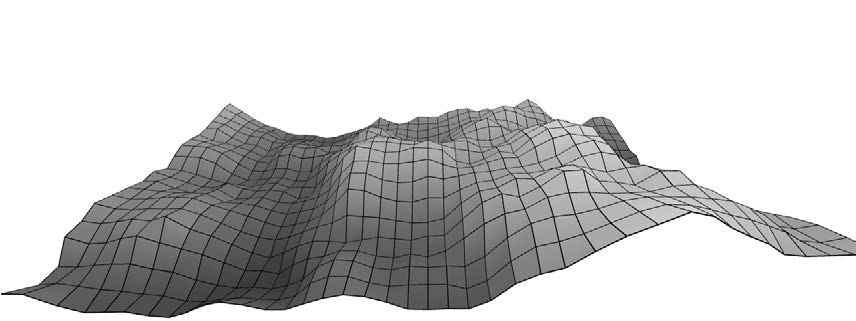

练习 0.10 的噪声地形示例, PDF 第 69 页精确提取.

本节展示了若干传统的 Perlin 噪声用途. 一维噪声的平滑值可以控制对象位置, 产生漫游效果. 二维噪声可以在像素平面上生成云状图案.

但一定要记住, Perlin 噪声值终究只是 **数值**. 它们并不天然绑定到像素位置或颜色. 本书中任何变量都可以受 Perlin 噪声控制. 风力强度可以使用噪声, 分形树的枝条夹角可以使用噪声, 流场中对象的速度和方向也可以使用噪声.

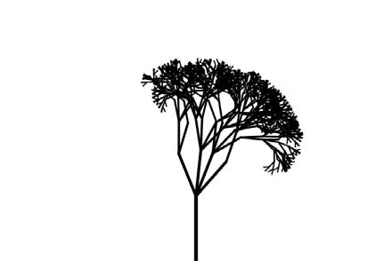

图 0.10a, 使用 Perlin 噪声控制结构的树, PDF 第 69 页精确提取.

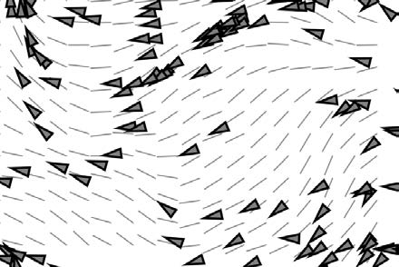

图 0.10b, 使用 Perlin 噪声生成的流场, PDF 第 69 页精确提取.

不过, 正如随机性可能被滥用, Perlin 噪声也很容易变成万能答案:

- 对象应该怎样移动? Perlin 噪声.
- 应该是什么颜色? Perlin 噪声.
- 应该以多快速度生长? Perlin 噪声.

如果你发现自己对每个问题都这样回答, 请继续读下去. 本书的目标是提供更广阔的规则设计工具箱. 规则由你定义, 掌握的可能性越多, 越能做出经过思考和充分知情的选择. 随机性与 Perlin 噪声只是即将探索的创造宇宙中的第一批星辰.

正如引言所说, 阅读本书的一种方式是在各章之间持续发展同一个项目, 每学一个主题就加入新的元素. 一个可行项目是模拟生态系统: 想象一群计算生物生活在数字池塘中及其周围, 按照不同规则相互作用.

每章末尾都会出现同一项目的后续提示, 逐步使用本章概念扩展生态系统. 当然, 你也可以发明自己的项目.

## 生态系统项目

第一步, 为某种生物制定一组模拟现实行为的规则. 可以从随机游走或其他噪声驱动的运动出发.

能否模拟一只紧张而抖动、飞行轨迹难以预测的小虫? 或者模拟一片被时强时弱的风吹动、漂浮在空中的叶子? 先研究仅靠行为能表达多少 "性格", 然后再考虑视觉外观.

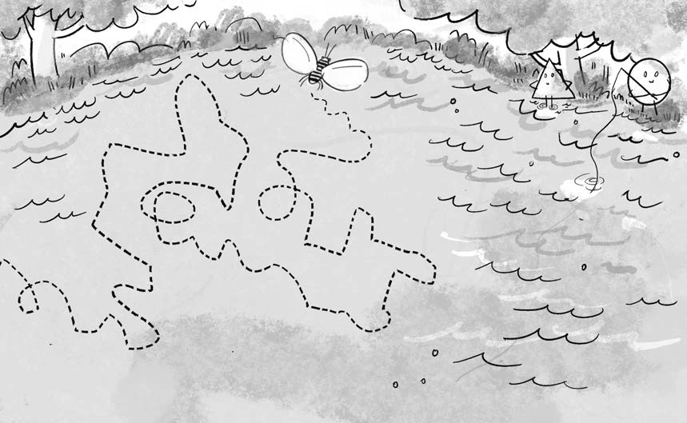

第 0 章生态系统项目插图, PDF 第 71 页精确提取.

这幅插图可以帮助你根据本书主题构思生态系统. 在后续章节中, 随着新概念和技术加入, 插图也会逐步演化.

本书的重点是演示算法和行为, 因而示例通常只使用圆之类的单一基本图形. 但你完全可以把创造力带入画布, 挑战自己设计更丰富的视觉元素. 如果把设计转换成代码对你仍很陌生, 本书插画师 Zannah Marsh 在附录中提供了一份实用的代码绘图指南.
