# 第 1 章: 向量

> 我正在犯下同时具有方向和大小的罪行.
>
> – Vector, *Despicable Me*

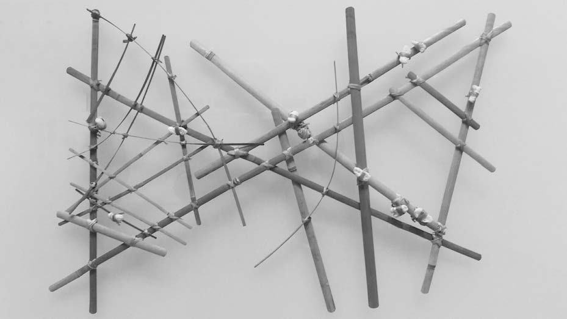

马绍尔群岛棒图, 现藏于 Berkeley Art Museum, 摄影 Jim Heaphy. PDF 第 73 页精确提取.

棒图是马绍尔群岛原住民制作的一种航海工具. 马绍尔群岛位于太平洋中部. 这种古老工具由椰子叶中脉仔细捆扎而成, 贝壳标记代表该地区岛屿的位置. 椰叶骨架与贝壳的布局共同构成一种地理导航图, 以抽象方式表示海浪的传播模式及其方向流动.

本书的核心任务, 是观察周围世界, 并设法用代码模拟它. 在本书第一部分, 我会从基础物理入手: 苹果怎样从树上落下, 单摆怎样在空气中摆动, 地球怎样围绕太阳公转, 等等. 本书前五章中的几乎所有内容, 都离不开编写运动程序时最基本的构件: **向量**. 因而, 故事从这里开始.

"vector" 这个词有许多含义. 它是一支 20 世纪 80 年代初在 California 州 Sacramento 成立的新浪潮摇滚乐队的名字, 也是 Kellogg's Canada 生产的一种早餐麦片的名字. 在流行病学中, vector 是把感染从一个宿主传播给另一个宿主的生物媒介. 在 C++ 中, `std::vector` 是一种可动态调整大小的数组数据结构实现.

这些含义都值得探索, 但不是本章重点. 本章讨论的是 **欧几里得向量**, Euclidean vector, 也称为 **几何向量**. 在本书中看到 "向量" 一词时, 可以默认它指欧几里得向量, 即同时具有 **大小** 和 **方向** 的实体.

向量通常画成箭头. 箭头指向表示方向, 箭头长度表示大小.

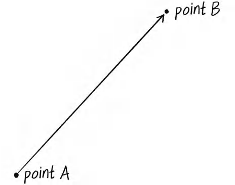

图 1.1, 从点 A 指向点 B 的向量. PDF 第 74 页精确提取.

图 1.1 中的向量从点 A 指向点 B. 它可以理解为一条从 A 前往 B 的移动指令.

## 为什么要使用向量

在深入向量细节之前, 先构造一个 p5.js 示例, 看看为什么值得关心向量. 如果你看过初级 p5.js 教程、读过入门教材, 或上过创意编程课程, 很可能已经写过一个小球碰壁反弹的草图.

### 示例 1.1: 不使用向量的反弹小球

示例 1.1 的运行结果, PDF 第 75 页精确提取.

    let x = 100;
    let y = 100;
    let xspeed = 2.5;
    let yspeed = 2;

    function setup() {
      createCanvas(640, 240);
    }

    function draw() {
      background(255);

      // 根据速度移动小球.
      x = x + xspeed;
      y = y + yspeed;

      // 检查是否碰到边界并反弹.
      if (x > width || x < 0) {
        xspeed = xspeed * -1;
      }
      if (y > height || y < 0) {
        yspeed = yspeed * -1;
      }

      // 在位置 (x, y) 绘制小球.
      stroke(0);
      fill(127);
      circle(x, y, 48);
    }

这个示例建立了一个平坦的二维世界, 也就是空白画布, 其中有一个圆形 "小球" 四处移动. 小球具有位置和速度等属性, 代码使用多个变量表示这些属性:

| 属性 | 变量名               |
|------|----------------------|
| 位置 | `x` 和 `y`           |
| 速度 | `xspeed` 和 `yspeed` |

在更复杂的草图中, 还可能需要更多变量来描述小球及其环境:

| 属性     | 变量名                             |
|----------|------------------------------------|
| 加速度   | `xacceleration` 和 `yacceleration` |
| 目标位置 | `xtarget` 和 `ytarget`             |
| 风       | `xwind` 和 `ywind`                 |
| 摩擦力   | `xfriction` 和 `yfriction`         |

每个概念, 如风、位置、加速度, 都需要两个变量. 这还只是二维世界. 在三维世界中, 每种属性都需要三个变量: 位置使用 `x`、`y`、`z`, 速度使用 `xspeed`、`yspeed`、`zspeed`, 以此类推.

如果代码能够更简洁一些会怎样? 与其这样开始:

    let x;
    let y;
    let xspeed;
    let yspeed;

不如写成:

    let position;
    let speed;

把小球的属性视为向量, 而不是一组松散的独立数值, 就能够实现这种组织方式.

第一次使用向量, 并不会立刻增加新功能, 也不会神奇地把 p5.js 草图变成完整物理仿真. 不过, 向量可以更好地组织代码, 并提供一组用于常见数学运算的方法. 在后续运动编程中, 这些运算会被反复使用.

本章会长时间停留在二维空间. 这些示例通常可以轻松扩展到三维, 而且后面使用的 `p5.Vector` 类也支持三维. 但为了学习基本原理, 现在加入第三个维度只会徒增干扰.

## p5.js 中的向量

可以把向量理解为两个点之间的差, 或者理解为从一个点走到另一个点的指令. 图 1.2 展示了几个向量及其可能的解释.

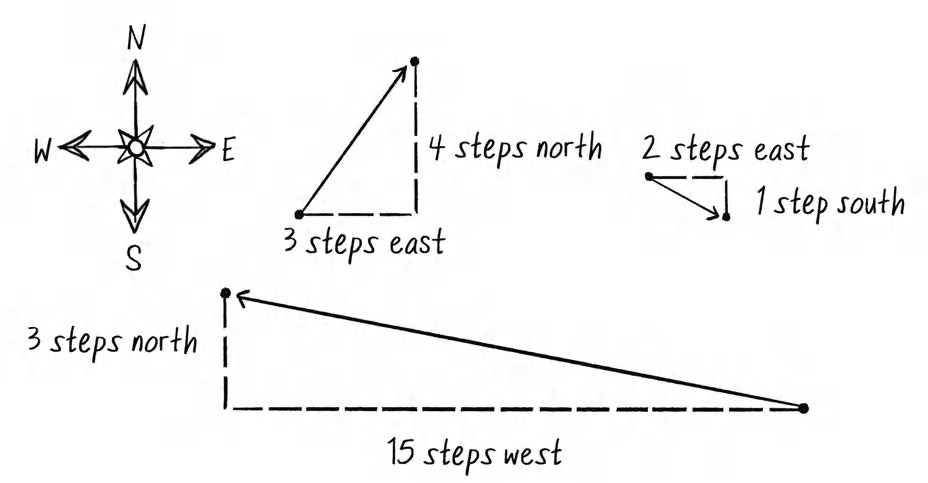

图 1.2, 三个向量以及对应的东、西、南、北移动指令. PDF 第 77 页精确提取.

| 向量                                      | 移动指令                       |
|-------------------------------------------|--------------------------------|
| $(-15, 3)$ | 向西走 15 步, 然后向北走 3 步. |
| $(3, 4)$   | 向东走 3 步, 然后向北走 4 步.  |
| $(2, -1)$  | 向东走 2 步, 然后向南走 1 步.  |

你在编写运动代码时, 很可能已经用过这种思维. 动画的每一帧, 也就是 p5.js 中 `draw()` 循环的一次执行, 都会指示对象在水平方向移动若干像素, 在垂直方向移动若干像素. 这条指令本质上就是向量: 它既有大小, 表示移动多远, 也有方向, 表示向哪里移动.

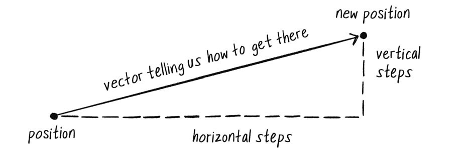

图 1.3, 表示从当前位置到新位置所需水平和垂直步数的向量. PDF 第 78 页精确提取.

这个向量定义了对象的 **速度**, velocity, 即对象位置相对于时间的变化率. 换句话说, 速度向量决定了动画每一帧中对象的新位置. 基本运动算法可以表述为:

> 新位置等于把速度应用到当前位置之后的结果.

如果速度是向量, 那么位置也是向量吗? 严格来说, 位置描述的是空间中的一个点, 而不是从一个点到另一个点的移动, 因而可以争论它不属于向量. 不过, 也可以把位置理解为从原点 $(0,0)$ 到当前位置的路径. 这样看时, 位置也可以作为向量处理.

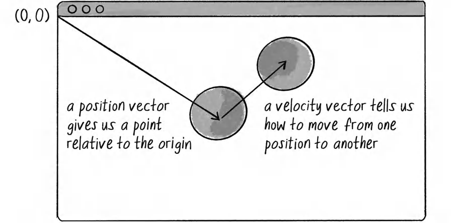

图 1.4, 计算机图形画布中的位置向量与速度向量. PDF 第 78 页精确提取.

图 1.4 中的原点 $(0,0)$ 位于画布左上角. x 轴正方向向右, y 轴正方向向下.

回到反弹小球示例, 原先有以下变量:

| 属性 | 变量名             |
|------|--------------------|
| 位置 | `x`、`y`           |
| 速度 | `xspeed`、`yspeed` |

现在把位置和速度都作为向量, 每个向量都是一个含有 `x` 和 `y` 属性的对象. 如果自己编写 `Vector` 类, 可以从下面的结构开始:

    class Vector {
      constructor(x, y) {
        this.x = x;
        this.y = y;
      }
    }

这个类仍然保存和之前相同的数据, 每个向量保存两个浮点数, 一个 x 值和一个 y 值. 从本质上说, `Vector` 对象只是一种方便的封装方式, 用一个名称保存两个值. 三维示例中还可以保存第三个值.

p5.js 已经内置了 `p5.Vector` 类, 因而无需自己实现. 原来的写法:

    let x = 100;
    let y = 100;
    let xspeed = 1;
    let yspeed = 3.3;

可以改为:

    let position = createVector(100, 100);
    let velocity = createVector(1, 3.3);

这里没有直接调用 `new p5.Vector(x, y)`, 而是使用 p5.js 提供的辅助函数 `createVector(x, y)`. 该函数负责处理创建向量时的一些内部细节. 除少数特殊情况外, 应始终使用 `createVector()` 创建 `p5.Vector` 对象.

还要注意, `createVector()` 等 p5.js 函数不能在 `setup()` 或 `draw()` 之外过早执行, 因为那时库可能尚未加载. 示例 1.2 会展示如何处理这一点.

现在已经有两个向量对象, `position` 和 `velocity`. 接下来要实现基于向量的运动算法:

$$
\text{position} = \text{position} + \text{velocity}
$$

在示例 1.1 中, 没有使用向量时写成:

    x = x + xspeed;
    y = y + yspeed;

理想情况下, 希望把它改写为:

    position = position + velocity;

不过 JavaScript 的加法运算符 `+` 主要用于原始值, 如整数和浮点数. JavaScript 并不知道怎样把两个 `p5.Vector` 对象相加, 就像它不知道怎样把两个 `p5.Font` 或 `p5.Image` 对象相加一样. 幸运的是, `p5.Vector` 类提供了常用数学运算的方法.

## 向量加法

在继续使用 `p5.Vector` 和 `add()` 方法之前, 先用数学和物理教材中常见的记号理解向量加法. 向量通常用粗体或顶部带箭头的字母表示. 为了区分具有大小和方向的向量与只有单个数值的标量, 本书使用箭头记号:

- 向量: $\vec{v}$
- 标量: $x$

假设有图 1.5 中的两个向量.

图 1.5, 向量 $\vec{u}=(5,2)$ 与 $\vec{v}=(3,4)$. PDF 第 81 页精确提取.

每个向量都有 x 分量和 y 分量. 两个向量相加时, 分别把 x 分量和 y 分量相加, 得到一个新向量.

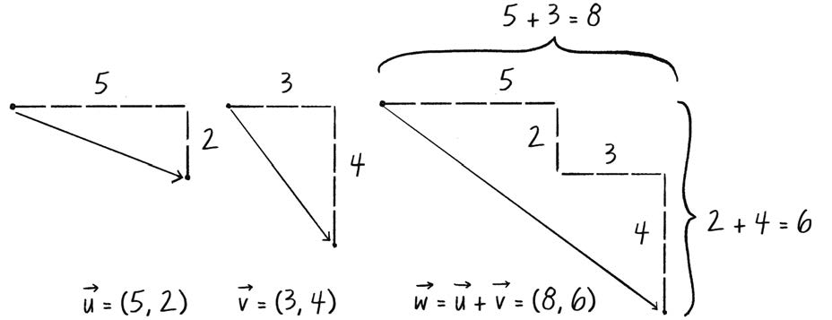

图 1.6, 分别相加 x 分量和 y 分量得到向量和. PDF 第 81 页精确提取.

令 $\vec{w}=\vec{u}+\vec{v}$, 则:

$$
\begin{aligned}
w_x &= u_x + v_x \\
w_y &= u_y + v_y
\end{aligned}
$$

代入图 1.6 中的数值:

$$
\begin{aligned}
w_x &= 5 + 3 = 8 \\
w_y &= 2 + 4 = 6
\end{aligned}
$$

因此:

$$
\vec{w}=(8,6)
$$

### 向量加法的性质

向量加法遵循和实数加法相同的代数规则.

交换律:

$$
\vec{u}+\vec{v}=\vec{v}+\vec{u}
$$

结合律:

$$
\vec{u}+(\vec{v}+\vec{w})=(\vec{u}+\vec{v})+\vec{w}
$$

这些术语和符号背后的含义很简单: 无论按什么顺序相加, 结果相同. 用普通标量替换向量时更容易看出:

$$
3+2=2+3
$$

$$
(3+2)+1=3+(2+1)
$$

如果自己实现 `Vector` 类, 可以加入 `add()` 方法, 接收另一个 `Vector` 对象作为参数:

    class Vector {
      constructor(x, y) {
        this.x = x;
        this.y = y;
      }

      add(v) {
        this.x = this.x + v.x;
        this.y = this.y + v.y;
      }
    }

该方法分别读取两个向量的 x、y 分量并相加. 内置 `p5.Vector` 类的 `add()` 方法本质上也是这样实现的.

因此, "位置 + 速度" 的算法应写成:

    // 这行不能工作.
    position = position + velocity;

    // 把 velocity 向量加到 position 向量上.
    position.add(velocity);

### 示例 1.2: 使用向量的反弹小球

示例 1.2 的运行结果, PDF 第 83 页精确提取.

    let position;
    let velocity;

    function setup() {
      createCanvas(640, 240);

      // createVector() 必须在 setup() 内调用.
      position = createVector(100, 100);
      velocity = createVector(2.5, 2);
    }

    function draw() {
      background(255);

      position.add(velocity);

      if (position.x > width || position.x < 0) {
        velocity.x = velocity.x * -1;
      }
      if (position.y > height || position.y < 0) {
        velocity.y = velocity.y * -1;
      }

      stroke(0);
      fill(127);
      circle(position.x, position.y, 48);
    }

这一阶段可能会令人失望. 改写后的代码看起来甚至比原版更复杂. 这是合理的批评, 因为向量编程的力量还没有真正显现. 只观察一个反弹小球, 而且只使用向量加法, 仅仅是第一步. 当后面进入多个对象与多种力共同作用的复杂世界时, 向量的优势会逐渐清晰.

虽然使用 `p5.Vector` 把位置的 x、y 和速度的 x、y 封装到一个变量中, 仍然经常需要单独访问各分量.

例如, `circle()` 不接受 `p5.Vector` 对象作为位置参数. 它需要两个标量坐标:

    // 不能工作.
    circle(position, 48);

    // 使用点语法读取向量分量.
    circle(position.x, position.y, 48);

检查是否碰到画布边缘时也一样:

    if (position.x > width || position.x < 0) {
      velocity.x = velocity.x * -1;
    }

什么时候直接访问对象属性, 什么时候把对象作为整体使用, 什么时候调用对象方法, 一开始未必显而易见. 本章和后续章节会通过大量示例帮助你区分这些场景.

### 练习 1.1

选择第 0 章中的一个随机游走示例, 把它改写为使用向量的版本.

### 练习 1.2

找到一个你以前用独立 x、y 变量写过的 p5.js 草图, 改用向量实现.

### 练习 1.3

把示例 1.2 扩展到三维. 能否让一个球体在盒子中四处反弹?

## 更多向量数学

加法只是第一步. 向量还有许多常用数学运算. 下表列出 `p5.Vector` 类提供的主要方法. 这些不是独立函数, 而是 `p5.Vector` 类的方法. 表中的 "当前向量" 指调用该方法的具体向量对象.

| 方法             | 任务                                          |
|------------------|-----------------------------------------------|
| `add()`          | 把另一个向量加到当前向量上.                   |
| `sub()`          | 从当前向量减去另一个向量.                     |
| `mult()`         | 通过乘法缩放当前向量.                         |
| `div()`          | 通过除法缩放当前向量.                         |
| `mag()`          | 返回当前向量的大小.                           |
| `setMag()`       | 设置当前向量的大小.                           |
| `normalize()`    | 把当前向量归一化为长度 1 的单位向量.          |
| `limit()`        | 限制当前向量的最大大小.                       |
| `heading()`      | 返回二维向量的朝向角.                         |
| `rotate()`       | 按给定角度旋转二维向量.                       |
| `lerp()`         | 线性插值到另一个向量.                         |
| `dist()`         | 把两个向量视为点, 返回它们之间的欧几里得距离. |
| `angleBetween()` | 计算两个向量之间的夹角.                       |
| `dot()`          | 返回两个向量的点积.                           |
| `cross()`        | 返回两个向量的叉积, 主要用于三维.             |
| `random2D()`     | 返回一个随机二维单位向量.                     |
| `random3D()`     | 返回一个随机三维单位向量.                     |

下面先介绍几个关键方法. 随着后续示例越来越复杂, 还会继续补充细节.

### 向量减法

理解了加法之后, 减法并不困难, 只需要把加号换成减号. 不过, 在正式讨论减法之前, 先考虑一个向量 $\vec{v}$ 变成 $-\vec{v}$ 意味着什么.

标量 3 的相反数是 -3. 向量也类似: 每个分量的符号都反转. 如果 $\vec{v}=(x,y)$, 那么:

$$
-\vec{v}=(-x,-y)
$$

视觉上, 新向量与原向量长度相同, 方向相反.

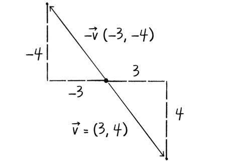

图 1.7, $\vec{v}$ 与 $-\vec{v}$ 的关系. PDF 第 86 页精确提取.

减法可以视为加上第二个向量的相反向量:

$$
\vec{u}-\vec{v}=\vec{u}+(-\vec{v})
$$

向量加法通常采用 "首尾相接" 的几何方式, 把一个向量的尾端放到另一个向量的尖端. 向量减法则先反转第二个向量的方向, 再把它放到第一个向量末端.

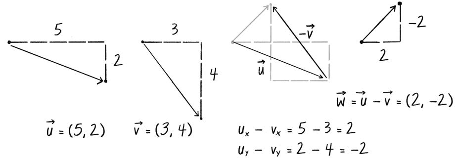

图 1.8, 通过反转第二个向量并首尾相接完成向量减法. PDF 第 86 页精确提取.

令 $\vec{w}=\vec{u}-\vec{v}$, 则:

$$
\begin{aligned}
w_x &= u_x-v_x \\
w_y &= u_y-v_y
\end{aligned}
$$

在 `p5.Vector` 中, 可以把 `sub()` 的核心逻辑理解为:

    sub(v) {
      this.x = this.x - v.x;
      this.y = this.y - v.y;
    }

下面的示例通过计算两个点之间的差演示向量减法. 两个点分别是鼠标位置和画布中心, 它们都被当作向量处理.

1.  示例 1.3: 向量减法

    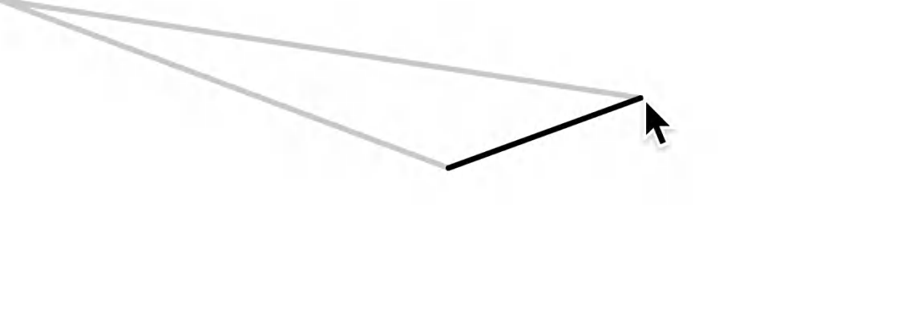

    示例 1.3 的运行结果, PDF 第 87 页精确提取.

        function setup() {
          createCanvas(640, 240);
        }

        function draw() {
          background(255);

          // 一个向量表示鼠标位置, 另一个表示画布中心.
          let mouse = createVector(mouseX, mouseY);
          let center = createVector(width / 2, height / 2);

          // 绘制原始两个位置向量.
          stroke(200);
          strokeWeight(4);
          line(0, 0, mouse.x, mouse.y);
          line(0, 0, center.x, center.y);

          // 向量减法.
          mouse.sub(center);

          // 移动原点, 再绘制减法结果.
          stroke(0);
          translate(width / 2, height / 2);
          line(0, 0, mouse.x, mouse.y);
        }

    注意这里使用 `translate()` 把结果向量绘制为从画布中心指向鼠标的线. 向量减法本身可以理解为一种原点平移. 从鼠标位置向量减去中心位置向量, 等价于把结果向量的起点移到画布中心. 因此绘图时也需要用 `translate()` 移动画布坐标原点. 如果不这样做, 结果线会从左上角开始, 视觉关系就不够清楚.

### 向量乘法与除法

向量乘法需要换一种思路. 通常所说的 "向量乘法" 在这里指 **缩放向量**. 如果希望向量变为原来的 2 倍或 $1/3$, 同时保持方向不变, 可以说 "把向量乘以 2" 或 "把向量乘以 $1/3$". 与加减法不同, 这里是用一个标量, 单个数值, 去乘向量, 而不是让两个向量相乘.

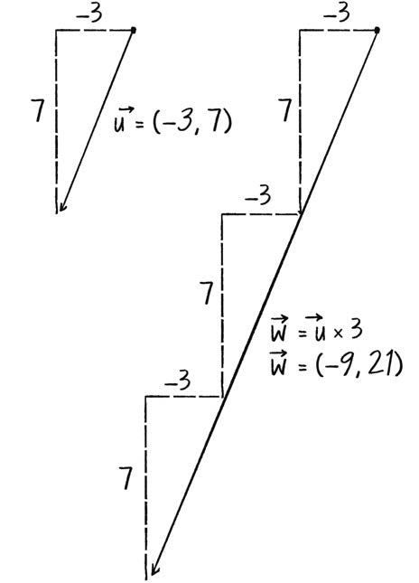

图 1.9, 用乘法把向量放大 3 倍. PDF 第 88 页精确提取.

要缩放向量, 分别把 x、y 分量乘以标量. 令:

$$
\vec{w}=\vec{u}\times n
$$

则:

$$
\begin{aligned}
w_x &= u_x\times n \\
w_y &= u_y\times n
\end{aligned}
$$

例如, $\vec{u}=(-3,7)$, $n=3$:

$$
\begin{aligned}
w_x &= -3\times3=-9 \\
w_y &= 7\times3=21
\end{aligned}
$$

所以:

$$
\vec{w}=(-9,21)
$$

`p5.Vector` 的 `mult()` 方法核心逻辑如下:

    mult(n) {
      this.x = this.x * n;
      this.y = this.y * n;
    }

实际使用:

    let u = createVector(-3, 7);
    u.mult(3);
    // u 现在等于 (-9, 21), 大小是原来的 3 倍.

1.  示例 1.4: 向量乘法

    示例 1.4 先绘制从画布中心指向鼠标的向量, 然后把它乘以 0.5, 绘制缩放后的向量.

    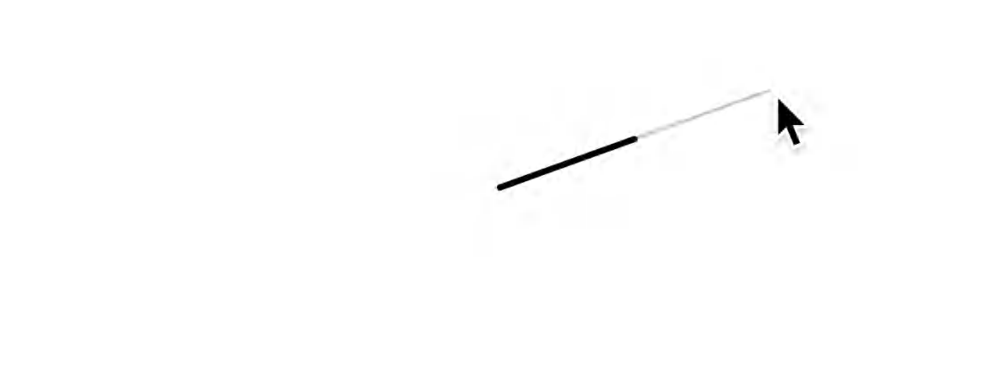

    示例 1.4 的运行结果, PDF 第 89 页精确提取.

        function setup() {
          createCanvas(640, 240);
        }

        function draw() {
          background(255);

          let mouse = createVector(mouseX, mouseY);
          let center = createVector(width / 2, height / 2);
          mouse.sub(center);

          translate(width / 2, height / 2);

          strokeWeight(2);
          stroke(200);
          line(0, 0, mouse.x, mouse.y);

          // 向量缩小为原来的一半.
          mouse.mult(0.5);

          stroke(0);
          strokeWeight(4);
          line(0, 0, mouse.x, mouse.y);
        }

    结果向量长度是原来的二分之一. 除了乘以 0.5, 也可以除以 2 得到相同效果.

    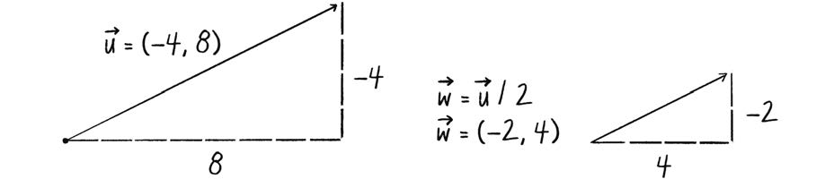

    图 1.10, 用除法缩放向量. PDF 第 90 页精确提取.

    向量除法和乘法类似, 只需把乘号换成除号. `p5.Vector` 的 `div()` 可以理解为:

        div(n) {
          this.x = this.x / n;
          this.y = this.y / n;
        }

    使用方式:

        let u = createVector(8, -4);
        u.div(2);
        // u 现在等于 (4, -2), 长度减半.

2.  向量乘法的代数性质

    和加法一样, 标量乘向量也遵循基本代数规则.

    结合律:

    $$
    (n\times m)\times\vec{v}=n\times(m\times\vec{v})
    $$

    两个标量与一个向量的分配律:

    $$
    (n+m)\times\vec{v}=(n\times\vec{v})+(m\times\vec{v})
    $$

    两个向量与一个标量的分配律:

    $$
    (\vec{u}+\vec{v})\times n=(\vec{u}\times n)+(\vec{v}\times n)
    $$

### 向量的大小

前面的乘法和除法会改变向量长度, 但不会改变方向. 那么, 已知向量的 x、y 分量, 怎样计算箭头本身的长度? 向量的长度又称为 **大小**, magnitude.

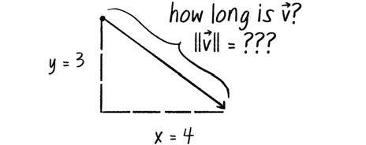

图 1.11, 向量 $\vec{v}$ 的长度或大小通常写作 $\lVert\vec{v}\rVert$. PDF 第 91 页精确提取.

向量箭头和两个分量构成一个直角三角形. x、y 分量是两条直角边, 箭头是斜边. 因而可以使用勾股定理:

$$
a^2+b^2=c^2
$$

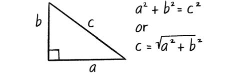

图 1.12, 使用勾股定理根据分量计算向量长度. PDF 第 91 页精确提取.

向量 $\vec{v}$ 的大小为:

$$
\lVert\vec{v}\rVert=\sqrt{v_x^2+v_y^2}
$$

`p5.Vector` 的 `mag()` 方法采用同样公式:

    mag() {
      return sqrt(this.x * this.x + this.y * this.y);
    }

下面的草图计算鼠标与画布中心之间向量的大小, 并把这个大小显示为画布顶部矩形的宽度.

1.  示例 1.5: 向量大小

    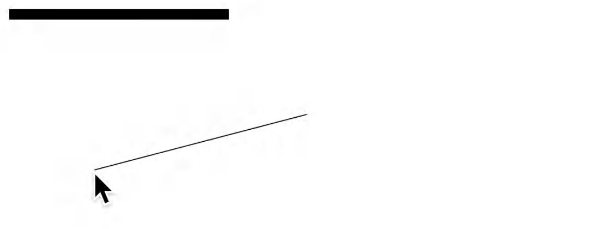

    示例 1.5 的运行结果, PDF 第 92 页精确提取.

        function setup() {
          createCanvas(640, 240);
        }

        function draw() {
          background(255);

          let mouse = createVector(mouseX, mouseY);
          let center = createVector(width / 2, height / 2);
          mouse.sub(center);

          // mag() 返回向量长度.
          let m = mouse.mag();

          fill(0);
          rect(0, 0, m, 10);

          translate(width / 2, height / 2);
          line(0, 0, mouse.x, mouse.y);
        }

    即使向量分量是负数, 向量的大小也始终为非负数.

### 向量归一化

计算向量大小只是开端. 它首先带来的重要操作是 **归一化**, normalization. 对向量而言, 约定的标准长度是 1. 把任意长度的向量改为长度 1, 同时保持方向不变, 就叫归一化. 得到的向量称为 **单位向量**.

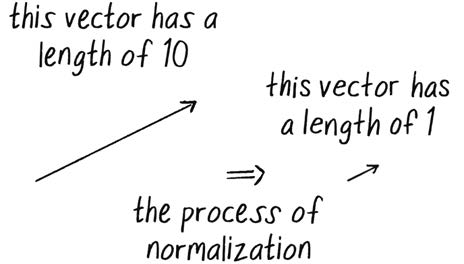

图 1.13, 归一化后方向不变, 长度变为 1. PDF 第 93 页精确提取.

单位向量只描述方向, 不强调原始长度. 从第 2 章开始处理力时, 这一点会非常有用.

对于任意向量 $\vec{u}$, 其单位向量 $\hat{u}$ 为:

$$
\hat{u}=\frac{\vec{u}}{\lVert\vec{u}\rVert}
$$

也就是说, 把每个分量除以向量大小. 例如, 向量 $(4,3)$ 的大小是 5. 归一化后, 斜边从 5 缩小到 1, 两条直角边也分别除以 5, 变为 $4/5$ 和 $3/5$.

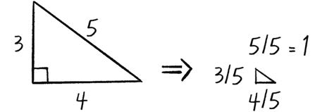

图 1.14, 通过把各分量除以向量大小完成归一化. PDF 第 93 页精确提取.

`p5.Vector` 的 `normalize()` 方法可以理解为:

    normalize() {
      let m = this.mag();
      this.div(m);
    }

不过还要处理大小为 0 的情况, 因为不能除以 0:

    normalize() {
      let m = this.mag();
      if (m > 0) {
        this.div(m);
      }
    }

下面的草图把鼠标与画布中心之间的向量设为固定长度, 无论鼠标实际距离中心多远, 黑色向量都保持 50 像素.

1.  示例 1.6: 向量归一化

    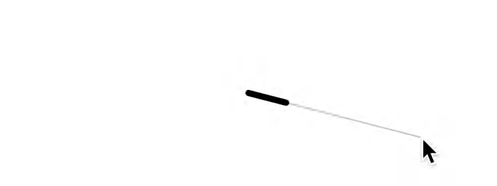

    示例 1.6 的运行结果, PDF 第 94 页精确提取.

        function setup() {
          createCanvas(640, 240);
        }

        function draw() {
          background(255);

          let mouse = createVector(mouseX, mouseY);
          let center = createVector(width / 2, height / 2);
          mouse.sub(center);

          translate(width / 2, height / 2);

          // 绘制原始向量.
          stroke(200);
          line(0, 0, mouse.x, mouse.y);

          // 归一化后再缩放到长度 50.
          mouse.normalize();
          mouse.mult(50);

          stroke(0);
          strokeWeight(8);
          line(0, 0, mouse.x, mouse.y);
        }

    这里先把向量归一化到长度 1, 再乘以 50. 归一化经常只是创建特定长度向量的第一步, 目标长度不一定非要是 1. 后面会反复使用这种模式.

    此时你可能会问: 这些向量数学究竟怎样帮助编程? 还需要一点耐心. 学习新数据结构时经常会有这种感觉. 例如, 刚接触数组时, 用数组保存几个值似乎比定义几个独立变量更麻烦. 但当对象数量变成 100、1,000 或 10,000 时, 独立变量的做法很快就会崩溃.

    向量也是如此. 现在看似额外的工作, 后面会得到丰厚回报. 下一章就会开始显现. 在此之前, 继续集中理解向量本身, 以及向量如何改变思考运动的方式.

## 使用向量描述运动

使用向量编写运动意味着什么? 示例 1.2 的反弹小球已经展示了基本思路. 屏幕上的圆具有位置, 即任意时刻所在的位置, 也具有速度, 即从一个时刻移动到下一个时刻的指令. 每一帧把速度加到位置上:

    position.add(velocity);

然后在新位置绘制对象:

    circle(position.x, position.y, 48);

这两步就是最基本的 "运动 101":

1.  把速度加到位置上.
2.  在位置处绘制对象.

反弹小球示例把代码全部放在 `setup()` 和 `draw()` 中. 接下来要把对象运动的全部逻辑封装到一个类里, 形成能够反复复用的移动对象基础结构.

首先创建通用的 `Mover` 类, 用它描述画布中移动的图形. 需要回答两个问题:

1.  一个移动者拥有哪些数据?
2.  一个移动者拥有哪些功能?

"运动 101" 算法给出了答案. 一个 `Mover` 对象至少需要两个 `p5.Vector` 数据: `position` 和 `velocity`. 在构造函数中, 先任意给它们一个随机位置和随机速度:

    class Mover {
      constructor() {
        this.position = createVector(random(width), random(height));
        this.velocity = createVector(random(-2, 2), random(-2, 2));
      }
    }

功能也与之对应. `Mover` 需要移动, 也需要被看见. 可以实现 `update()` 和 `show()` 两个方法. `update()` 包含运动逻辑, `show()` 负责绘制:

    update() {
      // 移动者根据速度改变位置.
      this.position.add(this.velocity);
    }

    show() {
      stroke(0);
      fill(175);
      circle(this.position.x, this.position.y, 48);
    }

还需要决定对象到达画布边缘时怎么办. 这里选择从另一侧重新出现:

    checkEdges() {
      if (this.position.x > width) {
        this.position.x = 0;
      } else if (this.position.x < 0) {
        this.position.x = width;
      }

      if (this.position.y > height) {
        this.position.y = 0;
      } else if (this.position.y < 0) {
        this.position.y = height;
      }
    }

类只是创建对象的模板, 本身还不是对象. 先声明一个变量:

    let mover;

然后在 `setup()` 中调用类构造函数:

    mover = new Mover();

最后在 `draw()` 中调用相应方法:

    mover.update();
    mover.checkEdges();
    mover.show();

### 示例 1.7: 运动 101, 速度

示例 1.7 的运行结果, PDF 第 97 页精确提取.

    let mover;

    function setup() {
      createCanvas(640, 240);
      mover = new Mover();
    }

    function draw() {
      background(255);

      mover.update();
      mover.checkEdges();
      mover.show();
    }

    class Mover {
      constructor() {
        this.position = createVector(random(width), random(height));
        this.velocity = createVector(random(-2, 2), random(-2, 2));
      }

      update() {
        // 运动 101: 位置随速度改变.
        this.position.add(this.velocity);
      }

      show() {
        stroke(0);
        strokeWeight(2);
        fill(127);
        circle(this.position.x, this.position.y, 48);
      }

      checkEdges() {
        if (this.position.x > width) {
          this.position.x = 0;
        } else if (this.position.x < 0) {
          this.position.x = width;
        }

        if (this.position.y > height) {
          this.position.y = 0;
        } else if (this.position.y < 0) {
          this.position.y = height;
        }
      }
    }

如果 OOP 对你还比较陌生, 这里可能有一点奇怪. 本章前面讨论了 `p5.Vector` 类, 它是创建 `position` 与 `velocity` 对象的模板. 现在这些对象又被放进另一个对象, `Mover`, 中.

这其实非常正常. 对象用于保存数据和功能, 而这些数据既可以是数字, 也可以是其他对象或数组. 本书后面会反复出现这种结构. 第 4 章会创建粒子系统类, 一个 `ParticleSystem` 对象包含许多 `Particle` 对象, 每个 `Particle` 又包含若干 `p5.Vector` 对象.

当前 `Mover` 构造函数没有参数, 初始位置和速度直接在构造函数中随机生成. 这样便于保持示例简单. 第 2 章会讨论给构造函数增加参数的好处.

到这里, 应当已经掌握两个概念:

1.  向量是什么.
2.  怎样在对象内部使用向量保存位置和运动信息.

这是很好的第一步. 不过, 示例 1.7 仍然相当乏味. 圆不会加速、不会减速, 也不会转弯. 为了模拟自然界中更丰富的运动, 还需要给类增加一个向量: **加速度**.

## 加速度

加速度是速度的变化率. 这并不是一个全新概念. 前面把速度定义为位置的变化率, 因此现在形成一条逐级传递的关系:

> 加速度影响速度, 速度影响位置.

代码表示为:

    velocity.add(acceleration);
    position.add(velocity);

在第 2 章中, 这条链会变得更加关键. 摩擦力等力会影响加速度, 加速度影响速度, 速度再影响位置.

从现在开始, 可以给自己设定一个练习规则: 除了初始化之外, 尽量不要直接修改速度和位置. 运动编程的目标变成设计一个算法来计算加速度, 然后让逐级传递关系自动完成其余工作. 实际上, 后面会有很多合理理由打破这条规则, 但它作为理解加速度运动算法的起点非常有效.

下一步就是设计加速度的计算方式. 下面是几种可能算法:

- 恒定加速度.
- 随机加速度.
- 指向鼠标的加速度.

本章剩余部分会逐一实现它们.

### 算法 1: 恒定加速度

恒定加速度并不特别有趣, 但它最简单, 因而适合用来把加速度加入代码. 第一步是在 `Mover` 类中增加变量:

    class Mover {
      constructor() {
        this.position = createVector(width / 2, height / 2);
        this.velocity = createVector(0, 0);
        this.acceleration = createVector(0, 0);
      }
    }

接着在 `update()` 中加入加速度:

    update() {
      this.velocity.add(this.acceleration);
      this.position.add(this.velocity);
    }

现在初始速度是 0, 对象一开始保持静止. 要让它运动, 不直接修改速度, 而是设置一个恒定加速度:

    this.acceleration = createVector(-0.001, 0.01);

这表示动画每一帧中, x 方向速度增加 -0.001 像素, y 方向速度增加 0.01 像素. 数值看起来很小, 这是有意的. 加速度会随时间累积到速度中, 每秒累积大约 30 次或更多, 具体取决于帧率. 如果加速度过大, 速度很快就会失控.

还可以使用 `p5.Vector` 的 `limit()` 方法限制向量大小:

    this.velocity.limit(10);

它的含义是: 如果速度大小小于 10, 保持不变; 如果超过 10, 把大小缩减到 10.

1.  练习 1.4

    为 `p5.Vector` 类编写 `limit()` 方法:

        limit(max) {
          if (/* 当前大小超过 max */) {
            /* 把向量归一化 */
            /* 再把大小设置为 max */
          }
        }

    下面汇总加入 `acceleration` 和 `limit()` 后的 `Mover` 类变化.

2.  示例 1.8: 运动 101, 速度与恒定加速度

    

    示例 1.8 的运行结果, PDF 第 101 页精确提取.

        class Mover {
          constructor() {
            this.position = createVector(width / 2, height / 2);
            this.velocity = createVector(0, 0);

            // 加速度是运动变化的关键.
            this.acceleration = createVector(-0.001, 0.01);

            // 限制速度向量的最大大小.
            this.topSpeed = 10;
          }

          update() {
            // 速度随加速度改变.
            this.velocity.add(this.acceleration);
            this.velocity.limit(this.topSpeed);

            // 位置随速度改变.
            this.position.add(this.velocity);
          }

          show() {
            // 与之前相同.
          }

          checkEdges() {
            // 与之前相同.
          }
        }

    最终效果是对象向左下方落去, 逐渐加速, 直到达到最大速度.

3.  练习 1.5

    模拟一个类似车辆的对象. 按上方向键时加速, 按下方向键时制动.

### 算法 2: 随机加速度

第二种算法使用随机加速度. 不在构造函数中固定初始化加速度, 而是在 `update()` 方法中为每一帧随机设置新值:

    update() {
      // random2D() 返回指向随机方向的单位向量.
      this.acceleration = p5.Vector.random2D();

      this.velocity.add(this.acceleration);
      this.velocity.limit(this.topSpeed);
      this.position.add(this.velocity);
    }

`random2D()` 生成归一化向量, 方向随机, 但大小始终是 1. 可以把随机向量乘以常量来改变强度:

    this.acceleration = p5.Vector.random2D();
    this.acceleration.mult(0.5);

为了获得更丰富的变化, 还可以使用随机大小. 在示例 1.9 中, 加速度方向随机, 大小也在 0 到 2 之间随机变化.

1.  示例 1.9: 运动 101, 速度与随机加速度

    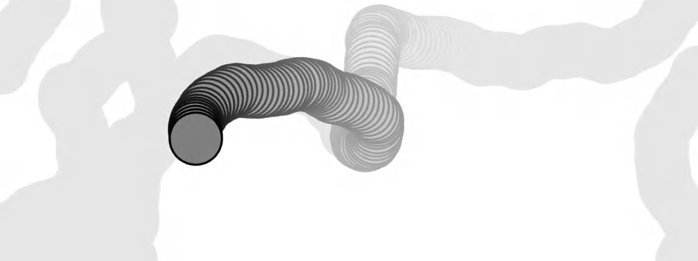

    示例 1.9 的运行结果, PDF 第 103 页精确提取.

        this.acceleration = p5.Vector.random2D();
        this.acceleration.mult(random(2));

    必须理解, 加速度不只是 "变快" 或 "变慢". 它指速度的任何变化, 包括大小变化和方向变化. 加速度可以用来转向. 后续章节构造能够决定如何移动的对象时, 会反复使用这一点.

    这个示例也可以看作另一种随机游走. 不过, 它和第 0 章传统随机游走之间有一个关键区别: 被随机化的量不同.

    传统随机游走直接随机修改速度, 因而每一步与上一步完全独立. 示例 1.9 随机化的是加速度, 即速度的变化率, 而不是速度本身. 对象运动依赖于之前的状态: 速度依据随机加速度逐步改变. 因而运动具有连续性和流动性, 不再像原始随机游走那样生硬. 这个差别看似细微, 却会从根本上改变对象在画布中的运动方式.

2.  练习 1.6

    参考练习 0.6, 使用 Perlin 噪声计算加速度.

### 静态方法与非静态方法

前一个示例中有一个不太熟悉的写法. 创建随机单位向量时, `random2D()` 通过类名调用:

    p5.Vector.random2D();

而不是通过某个具体对象实例调用. 原因是 `random2D()` 是 **静态方法**, static method. 它属于整个类, 而不属于某个单独对象实例.

自己编写 `Walker` 或 `Mover` 之类的类时, 很少必须使用静态方法, 因此你可能此前没有接触过. 不过, 在 `p5.Vector` 等预先实现的类中, 静态方法常常很重要. 第三种加速度算法, 朝鼠标加速, 还需要进一步使用这一概念.

暂时放下向量, 看普通数字的加法:

    let x = 0;
    let y = 5;
    x = x + y;

`x` 初始为 0, 把 `y` 加到它上面后, `x` 变成 5. 向量也可以这样通过实例方法相加:

    let v = createVector(0, 0);
    let u = createVector(4, 5);
    v.add(u);

`v` 原来是 $(0,0)$, 调用 `add()` 后变成 $(4,5)$.

再看另一个数字示例:

    let x = 0;
    let y = 5;
    let z = x + y;

这里把结果保存到新变量 `z` 中, `x` 和 `y` 都没有改变. 如果直接仿照这种写法处理向量, 可能会写成:

    let v = createVector(0, 0);
    let u = createVector(4, 5);
    let w = v.add(u); // 不要被迷惑, 这种写法不符合这里的目标.

为什么不对? 回顾 `add()` 的实例方法实现:

    add(v) {
      this.x = this.x + v.x;
      this.y = this.y + v.y;
    }

它存在两个关键特征:

1.  它直接修改调用该方法的向量.
2.  它不是为创建一个保持输入不变的新结果向量而设计的.

如果希望把两个向量相加并返回新向量, 同时保持原向量不变, 可以使用 `add()` 的静态版本. 如果自己实现, 大致可以写成:

    static add(v1, v2) {
      let v3 = createVector(v1.x + v2.x, v1.y + v2.y);
      return v3;
    }

静态方法通过类名调用, 而不是通过对象实例调用:

    let v = createVector(0, 0);
    let u = createVector(4, 5);
    let w = p5.Vector.add(v, u);

此时 `w` 是新向量, 而 `v` 与 `u` 保持原值.

`p5.Vector` 为 `add()`、`sub()`、`mult()` 和 `div()` 都提供静态版本. 它们允许执行通用向量运算, 而不在过程中修改输入向量.

1.  练习 1.7

    把下面伪代码转换为 JavaScript, 在适当位置使用静态或非静态方法:

    - 向量 $\vec{v}$ 等于 $(1,5)$.
    - 向量 $\vec{u}$ 等于 $\vec{v}$ 乘以 2.
    - 向量 $\vec{w}$ 等于 $\vec{v}$ 减去 $\vec{u}$.
    - 把向量 $\vec{w}$ 除以 3.

    <!-- -->

        let v = /* ... */;
        let u = /* ... */;
        let w = /* ... */;
        /* ... */;

### 算法 3: 交互式运动

最后实现一个更复杂、也更实用的算法: 对象朝鼠标加速.

每当需要根据规则或公式计算向量时, 都必须确定两个属性:

1.  方向.
2.  大小.

先考虑方向. 加速度向量应当从对象当前位置指向鼠标位置.

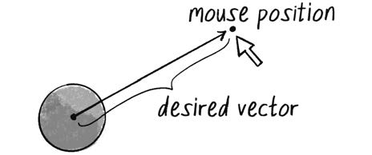

图 1.15, 从对象指向鼠标位置的目标向量. PDF 第 106 页精确提取.

假设对象位置是 $(x,y)$, 鼠标位置是 $(mouseX,mouseY)$. 图 1.16 中的加速度方向向量 $(dx,dy)$ 可以通过坐标差得到:

$$
\begin{aligned}
dx &= mouseX-x \\
dy &= mouseY-y
\end{aligned}
$$

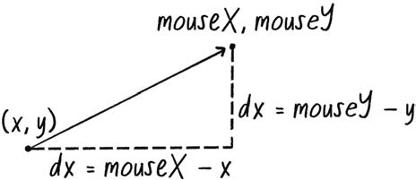

图 1.16, 通过鼠标位置向量减去对象位置向量计算初始加速度向量. PDF 第 107 页精确提取.

如果代码位于 `Mover` 类中, 可以访问 `this.position`, 则写成:

    let mouse = createVector(mouseX, mouseY);
    let direction = p5.Vector.sub(mouse, this.position);

这里使用静态 `sub()`, 因为需要创建新向量 `direction`, 同时不修改 `mouse` 或 `this.position`.

如果直接使用这个向量作为加速度, 对象的运动会过于剧烈. `direction` 的大小等于对象到鼠标的距离. 需要决定对象朝鼠标加速的强度, 也就是调整向量大小.

设置任意目标大小时, 一个常用步骤是先把向量归一化, 再进行缩放:

    let anything = /* 任意目标大小 */;
    direction.normalize();
    direction.mult(anything);

因此, 让对象朝鼠标加速的完整步骤是:

1.  计算从对象位置指向目标位置的向量.
2.  归一化该向量, 把长度缩减到 1.
3.  把向量缩放到合适大小.
4.  把这个向量赋给加速度.

归一化后再缩放是如此常见, 以至于 `p5.Vector` 提供了一个一步完成二者的方法: `setMag()`.

    let anything = /* 任意目标大小 */;
    direction.setMag(anything);

为了强调数学过程, 下一个示例仍然显式使用 `normalize()` 和 `mult()`. 后续示例通常会直接使用 `setMag()`.

1.  示例 1.10: 朝鼠标加速

    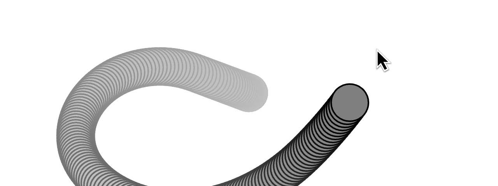

    示例 1.10 的运行结果, PDF 第 108 页精确提取.

        update() {
          let mouse = createVector(mouseX, mouseY);

          // 第 1 步: 计算方向.
          let dir = p5.Vector.sub(mouse, this.position);

          // 第 2 步: 归一化.
          dir.normalize();

          // 第 3 步: 缩放.
          dir.mult(0.2);

          // 第 4 步: 设置加速度.
          this.acceleration = dir;

          this.velocity.add(this.acceleration);
          this.velocity.limit(this.topSpeed);
          this.position.add(this.velocity);
        }

    为什么圆到达目标后不会停下来? 因为移动对象并不知道 "应当在目标处停止". 它只知道目标位置, 并始终以固定强度朝目标加速, 无论距离多远. 因而它必然越过目标, 然后转向再次加速, 再次越过, 周而复始.

    后续章节会介绍怎样让对象在接近目标时减速, 从而平滑地抵达目标.

2.  练习 1.8

    示例 1.10 与引力概念已经非常接近, 对象被鼠标位置吸引. 但示例中的吸引强度保持恒定, 而真实引力的大小与距离有关, 越接近吸引点, 加速度通常越强.

    第 2 章会详细讨论引力. 在此之前, 尝试修改示例 1.10, 让加速度大小随距离变化. 可以设计成越近越强, 也可以反过来设计成越远越强, 观察不同规则产生的运动.

## 生态系统项目

把向量加入生态系统, 进一步发展和改进其中各元素的运动. 尝试只通过操纵对象的加速度向量来控制运动方向.

怎样计算加速度才能模拟某些行为? 例如:

- 紧张苍蝇杂乱无章的嗡嗡飞行.
- 兔子轻柔而有节奏的跳跃.
- 蛇蜿蜒前进的身体轨迹.

思考加速度在自然界中的作用. 鸟起飞时怎样加速? 鱼游动时怎样突然改变方向? 仍然可以追问: 仅靠行为, 能表达多少生物的性格? 在基本图形之外加入更多视觉设计后, 会增加什么, 又会失去什么?

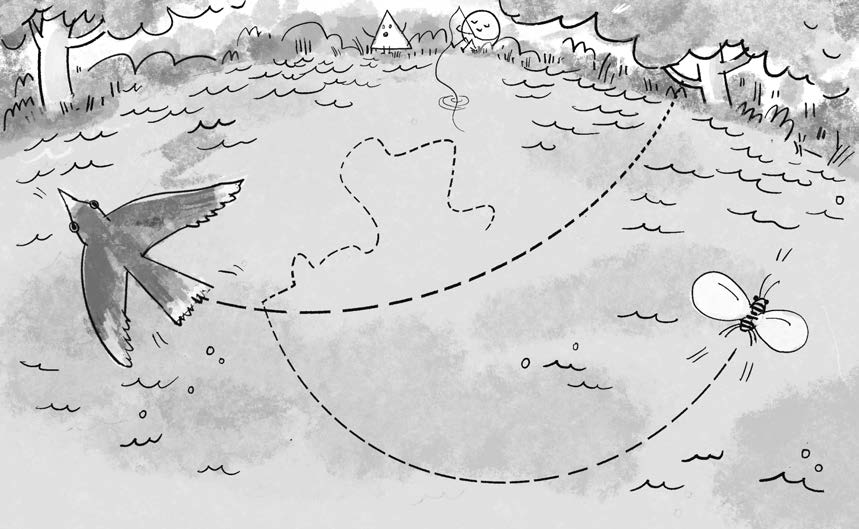

第 1 章生态系统项目插图, PDF 第 109 页精确提取.
