# 第 2 章: 力

> 不要低估原力.
>
> – Darth Vader

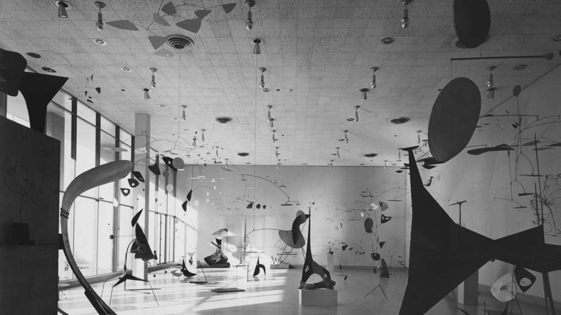

Alexander Calder 在 MIT Charles Hayden Memorial Library 新画廊中的装置作品, 1950 年, 摄影 Ezra Stoller. PDF 第 111 页精确提取.

Alexander Calder 是 20 世纪美国艺术家, 以在形式与运动之间取得平衡的动态雕塑而闻名. 他的 "星座" 系列由相互连接的形状和金属丝组成, 展示了张力、平衡, 以及无处不在的引力牵引.

第 1 章最后一个示例中, 我演示了如何依据一个从画布上的圆指向鼠标位置的向量, 动态计算加速度. 最终的运动看起来像圆与鼠标之间存在磁性吸引, 仿佛有一种力把圆拉向鼠标. 本章将详细讨论 **力** 的概念及其与加速度的关系. 到本章结束时, 目标是构建一个简单的物理引擎, 并理解对象如何在画布中运动, 又如何响应环境中的各种力.

物理引擎是模拟对象在物理环境中行为的计算机程序或代码库. 在 p5.js 草图中, 对象是二维形状, 环境是矩形画布. 物理引擎可以追求高度精确, 这通常需要高性能计算, 也可以追求实时性, 使用简单而快速的算法. 本章重点构建一个基础物理引擎, 强调运行速度和易于理解.

## 力与牛顿运动定律

先从概念上看看现实世界中的 "力" 是什么. 和 "向量" 一样, "力" 也有许多日常含义. 它可以表示强大的物理作用, 例如 "他们用很大的力推动巨石"; 也可以表示强大的影响力, 例如 "他们是一股不可忽视的力量". 本章关心的是更正式的定义, 它来自 Isaac Newton 的三条运动定律:

> 力是一个向量, 它使具有质量的对象产生加速度.

定义的第一部分应该已经很熟悉: 力是向量. 上一章已经介绍了向量以及如何在代码中使用它. 下面从这个基础出发, 说明牛顿三定律如何与向量联系起来, 并逐步展开力定义的其余部分.

### 牛顿第一定律

牛顿第一定律常写成:

> 静止的对象保持静止, 运动的对象保持运动.

这句话漏掉了一个与力有关的重要条件. 更完整的表述是:

> 静止的对象保持静止; 运动的对象以恒定速度和方向继续运动, 除非受到不平衡力的作用.

牛顿提出这一理论时, 当时占主导地位的运动理论由 Aristotle 提出, 已经存在近两千年. 旧理论认为, 一个对象若要持续运动, 必须一直有某种力推动或拉动它. 一旦不再受推或拉, 对象就会减速并停下. 日常观察似乎支持这一观点: 抛出一个球, 它会落地并最终停止, 看上去像是因为抛球的力已经不再作用.

但旧理论并不正确. 牛顿指出, 在没有力的情况下, 维持对象运动并不需要额外的力. 球在地球大气中被抛出后速度发生变化, 是因为空气阻力和重力等不可见的力在起作用. 只有在完全没有外力, 或所有外力彼此抵消, 净力等于零时, 对象的速度才会保持不变. 这种状态通常称为 **平衡**, equilibrium. 下落物体在空气阻力与重力相等时会达到终端速度, 此时速度保持恒定.

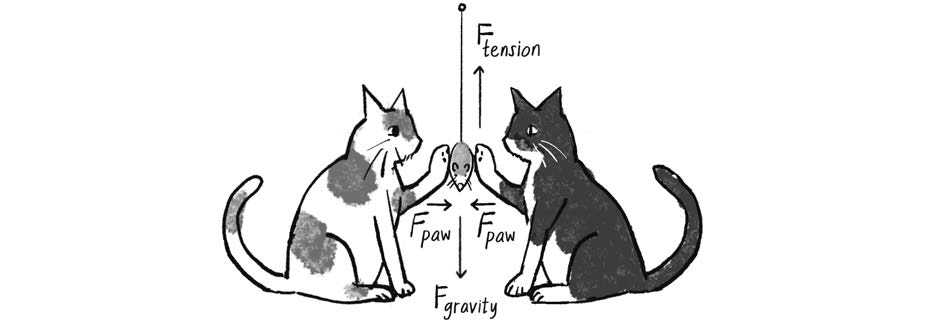

图 2.1, 玩具老鼠没有移动, 因为所有力相互抵消, 净力为零. PDF 第 113 页精确提取.

在 p5.js 画布中, 牛顿第一定律可以重新表述为:

> 如果对象处于平衡状态, 它的速度向量将保持恒定.

换句话说, 在 `Mover` 类中, 除非存在非零净力, 否则 `update()` 不应对速度向量执行任何改变.

### 牛顿第三定律

先暂时跳过牛顿第二定律, 转向第三定律. 它通常写成:

> 每一个作用力, 都有一个大小相等、方向相反的反作用力.

这种表述经常引起误解, 因为它听起来像一个力先发生, 然后导致另一个力. 如果你推某个人, 对方可能决定把你推回来, 但这并不是第三定律所指的作用与反作用.

假设你推一面墙. 墙并不会主动决定反推你, 但它仍会提供大小相等、方向相反的阻力. 这里没有所谓的 "原始力". 一次推动本身就同时包含两个力, 它们组成 **作用力/反作用力对**. 因此, 更清楚的表述是:

> 力总是成对出现. 一对力大小相等, 方向相反.

这仍可能让人误以为两个力总会抵消. 实际上并非如此, 因为它们作用于不同对象. 两个力相等, 并不意味着两个对象的运动相同, 更不意味着对象会停止.

考虑推动一辆静止卡车. 卡车的质量远大于你, 但一辆静止卡车不会像正在运动的卡车那样把你撞飞. 你的手对卡车施加的力, 与卡车对你的手施加的力大小相等、方向相反. 结果还取决于其他因素. 如果卡车较小且停在结冰路面上, 你可能推动它. 如果卡车很大、停在泥土路面上, 你拼命推动, 甚至助跑冲过去, 最可能受伤的是你的手.

如果你穿着轮滑鞋推动卡车, 情况会怎样?

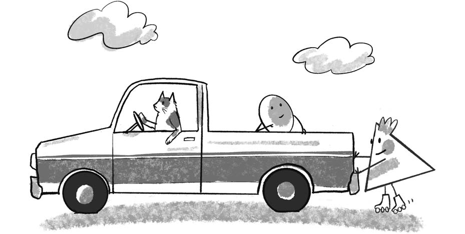

图 2.2, 穿着轮滑鞋推动重型卡车, 演示牛顿第三定律. PDF 第 114 页精确提取.

你会向远离卡车的方向加速并沿路面滑走, 卡车则基本停在原处. 为什么移动的是你而不是卡车? 首先, 卡车质量更大. 此外还有其他力, 特别是卡车轮胎和轮滑鞋与路面之间的摩擦力.

在 p5.js 中, 牛顿第三定律可以这样表达:

> 如果计算出一个名为 `f` 的 `p5.Vector`, 表示对象 A 对对象 B 的力, 还必须向对象 A 施加对象 B 的反向力. 这个反向力可以用 `p5.Vector.mult(f, -1)` 计算.

编写创意模拟时, 并不总需要严格遵守牛顿第三定律. 在物体之间相互吸引的示例中, 例如示例 2.8, 会模拟大小相等、方向相反的力. 但在 "环境里有风" 这样的场景中, 通常不会继续模拟物体对空气的反作用力, 甚至不会显式建模空气. 本书从自然世界的物理学中获取灵感, 目的是创造性与交互性, 并不追求每个细节都达到工程级精度.

### 牛顿第二定律

对 p5.js 程序员而言, 本章最重要的是牛顿第二定律:

> 力等于质量乘以加速度.

用公式表示为:

$$
\vec{F} = M\vec{A}
$$

也可以改写为:

$$
\vec{A} = \frac{\vec{F}}{M}
$$

加速度与力成正比, 与质量成反比. 被推得越用力, 速度变化越快. 另一方面, 质量越大, 同样的力产生的加速度越小.

1.  质量与重量

    **质量**, mass, 表示对象所含物质的多少, 通常以千克为单位. 一个在地球上质量为 1 千克的物体, 到月球上质量仍然是 1 千克.

    **重量**, weight, 虽然日常语言中常与质量混用, 但严格说是重力作用于对象所产生的力. 根据牛顿第二定律:

    $$
    w = m g
    $$

    重量的单位是牛顿. 因为重量取决于当地重力, 一个对象在月球上的重量约为它在地球上的六分之一.

    与质量相关的另一个概念是 **密度**, 即单位体积内的质量, 例如克每立方厘米.

    在 p5.js 的像素世界中, "质量" 究竟是什么? 先做一个最简单的假设: 所有对象的质量都等于 1. 任何数除以 1 都等于自身, 因而:

    $$
    \vec{A} = \vec{F}
    $$

    这样便暂时从方程中移除了质量, 使加速度直接等于力. 第 1 章指出, 位置根据速度变化, 速度根据加速度变化. 现在可以看到, 力才是这条链的真正起点.

    先从一个具有位置、速度和加速度的 `Mover` 类开始:

        class Mover {
          constructor() {
            this.position = createVector();
            this.velocity = createVector();
            this.acceleration = createVector();
          }
        }

    希望能够这样向对象施加力:

        mover.applyForce(wind);
        mover.applyForce(gravity);

    这里的 `wind` 和 `gravity` 都是 `p5.Vector` 对象. 在忽略质量的世界中, 最直观的 `applyForce()` 写法是:

        applyForce(force) {
          this.acceleration = force;
        }

    这看起来是对 $\vec{A}=\vec{F}$ 的直接翻译, 但存在严重问题. 考虑:

        mover.applyForce(wind);
        mover.applyForce(gravity);
        mover.update();

    第一次调用把加速度设为 `wind`. 第二次调用又把加速度覆盖为 `gravity`. 随后 `update()` 执行:

        this.velocity.add(this.acceleration);

    此时加速度中只剩重力, 风力完全丢失. 每次调用 `applyForce()` 都会覆盖前一个力. 要处理多个力, 必须累加它们.

## 力的累加

更准确的牛顿第二定律应表述为:

> 净力等于质量乘以加速度.

也就是说:

$$
\vec{A} = \frac{\sum_i \vec{F_i}}{M}
$$

任意时刻可能有 1 个、2 个、12 个, 甚至数百个力同时作用于一个对象. 只要把它们全部相加, 力的数量并不重要. 总和就是净力. 如果所有力相加为零, 对象处于平衡状态, 没有加速度.

因此, `applyForce()` 应改为累加:

    applyForce(force) {
      this.acceleration.add(force);
    }

不过还缺少一个关键步骤. 加速度表示当前帧中所有力的结果, 每一帧都应重新计算. 假设按住鼠标时产生一阵风:

    if (mouseIsPressed) {
      let wind = createVector(0.5, 0);
      mover.applyForce(wind);
    }

松开鼠标后, 风应该停止. 根据牛顿第一定律, 对象会以已有速度继续运动. 如果不清空加速度, 前一帧的风力仍会保留, 而且下一帧还会继续叠加. 在基于时间步的物理模拟中, 加速度没有记忆; 它只取决于当前时刻存在的力. 位置则不同, 对象必须记住上一帧的位置才能继续移动.

一种做法是在 `update()` 末尾把加速度乘以 0:

    update() {
      this.velocity.add(this.acceleration);
      this.position.add(this.velocity);
      this.acceleration.mult(0);
    }

这已经接近一个可工作的物理引擎. 还需注意 **时间步**, 即模拟更新的时间间隔. 时间步大小会影响精度和行为, 因而许多物理引擎把它作为变量, 常写作 $dt$, 即 delta time. 为了集中讨论核心原理, 本章假定 `draw()` 的每次循环就是一个单位时间步. 第 6 章讨论第三方物理库时, 会重新审视不同时间步带来的影响.

### 练习 2.1

使用力模拟一个充满氦气的气球, 让它向上漂浮并在窗口顶部反弹. 能否加入随时间变化的风力, 例如由 Perlin 噪声控制?

## 将质量纳入计算

牛顿第二定律真正的形式是 $\vec{F}=M\vec{A}$, 而不是 $\vec{F}=\vec{A}$. 要把质量加入模拟, 第一步是在 `Mover` 类中增加 `this.mass`:

    class Mover {
      constructor() {
        this.position = createVector();
        this.velocity = createVector();
        this.acceleration = createVector();
        this.mass = 10;
      }
    }

测量单位

现实世界中的量带有单位: 两个对象相距 3 米, 棒球以每小时 90 英里运动, 保龄球的质量为 6 千克. 有时确实需要采用真实单位. 但本章使用像素和动画帧: "两个圆相距 100 像素", "这个圆每帧移动 2 像素".

p5.js 没有天然的质量单位. 一个像素中有多少质量? 你甚至可以为自己的世界发明单位, 例如 "10 pixeloids" 或 "10 yurkles".

为了演示, 这里把质量和显示尺寸联系起来: 圆越大, 质量越大. 这并不符合真实物理. 一个小金属球可能比大气球质量更大, 因为密度不同. 即使两个圆具有相同密度, 质量也应和圆面积 $\pi r^2$ 成正比, 而不应直接和直径成正比. 练习 2.11 会处理这一点.

质量是标量, 不是向量. 先把对象质量设为 10:

    constructor() {
      this.position = createVector(random(width), random(height));
      this.velocity = createVector(0, 0);
      this.acceleration = createVector(0, 0);
      this.mass = 10;
    }

根据牛顿第二定律, 应先用力除以质量, 再累加到加速度:

    applyForce(force) {
      force.div(this.mass);
      this.acceleration.add(force);
    }

这段代码看似合理, 却会修改传入的原始力向量. 考虑两个 `Mover` 对象都受到同一个风力:

    let moverA = new Mover();
    let moverB = new Mover();

    let wind = createVector(1, 0);

    moverA.applyForce(wind);
    moverB.applyForce(wind);

`moverA` 收到 $(1,0)$, 除以质量 10 后变成 $(0.1,0)$, 并加入自身加速度. 当轮到 `moverB` 时, `wind` 已经不是 $(1,0)$, 而是被前一次调用永久修改成了 $(0.1,0)$.

原因是 JavaScript 向函数传递对象时, 传递的是对象引用, 不是独立副本. 因此, 必须先复制向量, 再除以质量. `p5.Vector.copy()` 正好用于此事:

    applyForce(force) {
      let f = force.copy();
      f.div(this.mass);
      this.acceleration.add(f);
    }

也可以使用静态方法, 在不修改原向量的情况下直接获得结果:

    applyForce(force) {
      let f = p5.Vector.div(force, this.mass);
      this.acceleration.add(f);
    }

至此已经完成两个核心步骤: 定义力是向量, 并通过 "除以质量, 再累加到加速度" 把力施加给对象. 接下来还要回答: 力从哪里来? 如何计算一个力?

### 练习 2.2

使用 `p5.Vector.div()` 的静态版本改写 `applyForce()`, 不调用 `copy()`, 并确保输入向量不被修改.

## 创建力

在 p5.js 世界中, 创建力有两条主要路径:

1.  **虚构一个力**. 你是这个世界的程序员和创造者, 完全可以自行决定一个力的方向和强度.
2.  **建模一个力**. 现实世界中的力通常有物理公式. 可以理解这些公式, 再翻译为 JavaScript 代码.

先从第一种方式开始. 最简单的办法就是选择两个数字. 例如, 一个向右、强度较小的风力:

    let wind = createVector(0.01, 0);
    mover.applyForce(wind);

创建一个 `p5.Vector`, 再把它传给 `Mover.applyForce()`. 下面再加入始终向下的重力, 并让风力只在按下鼠标时出现.

### 示例 2.1: 力

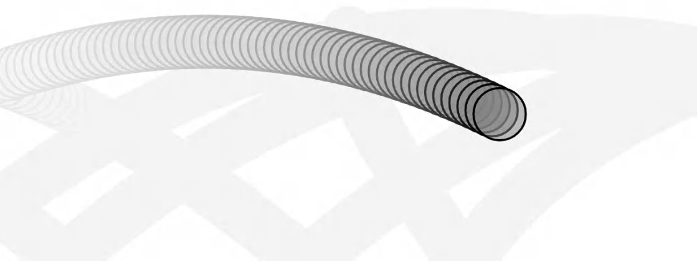

示例 2.1 的运行结果. 按下鼠标时施加风力. PDF 第 123 页精确提取.

    let gravity = createVector(0, 0.1);
    mover.applyForce(gravity);

    if (mouseIsPressed) {
      let wind = createVector(0.1, 0);
      mover.applyForce(wind);
    }

现在有两个方向和大小不同的力同时作用于 `mover`. 一个带有环境力的世界开始成形.

下面加入第二个质量不同的对象. 先回顾 `Mover` 类. 它与第 1 章的版本基本相同, 新增了 `mass` 和 `applyForce()`:

    class Mover {
      constructor() {
        this.mass = 1;
        this.position = createVector(width / 2, 30);
        this.velocity = createVector(0, 0);
        this.acceleration = createVector(0, 0);
      }

      applyForce(force) {
        let f = p5.Vector.div(force, this.mass);
        this.acceleration.add(f);
      }

      update() {
        this.velocity.add(this.acceleration);
        this.position.add(this.velocity);
        this.acceleration.mult(0);
      }

      show() {
        stroke(0);
        fill(175);
        circle(this.position.x, this.position.y, this.mass * 16);
      }

      checkEdges() {
        if (this.position.x > width) {
          this.position.x = width;
          this.velocity.x *= -1;
        } else if (this.position.x < 0) {
          this.velocity.x *= -1;
          this.position.x = 0;
        }

        if (this.position.y > height) {
          this.velocity.y *= -1;
          this.position.y = height;
        }
      }
    }

这个类可以创建多个对象:

    let moverA = new Mover();
    let moverB = new Mover();

但此时所有对象的质量都是 1, 初始位置也完全相同. 使用构造函数参数可以创建不同质量、不同初始位置的对象:

    class Mover {
      constructor(x, y, mass) {
        this.mass = mass;
        this.position = createVector(x, y);
        this.velocity = createVector(0, 0);
        this.acceleration = createVector(0, 0);
      }

      // 其他方法保持不变.
    }

于是可以这样初始化:

    let moverA = new Mover(100, 30, 10);
    let moverB = new Mover(400, 30, 2);

第一个对象质量大, 位于画布左侧; 第二个对象质量小, 位于右侧. 初始值还可以来自随机数、Perlin 噪声、网格布局或其他规则.

### 示例 2.2: 作用于两个对象的力

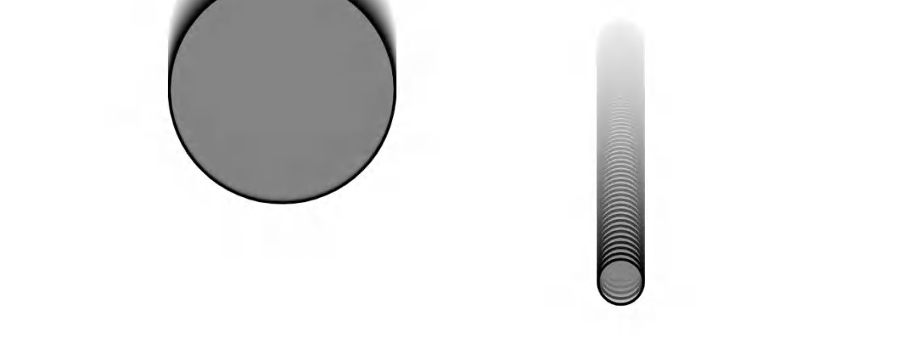

示例 2.2 的运行结果. 两个不同质量的对象受到相同重力和风力. PDF 第 126 页精确提取.

    function draw() {
      background(255);

      // 虚构一个重力并施加给两个对象.
      let gravity = createVector(0, 0.1);
      moverA.applyForce(gravity);
      moverB.applyForce(gravity);

      // 按下鼠标时施加风力.
      if (mouseIsPressed) {
        let wind = createVector(0.1, 0);
        moverA.applyForce(wind);
        moverB.applyForce(wind);
      }

      moverA.checkEdges();
      moverA.update();
      moverA.show();

      moverB.checkEdges();
      moverB.update();
      moverB.show();
    }

当前代码中的每个操作都写了两遍, 一次针对 `moverA`, 一次针对 `moverB`. 对象数量增加时, 更合理的做法是使用数组和循环. 本章后面会展示这种方式, 第 4 章则会系统讨论对象数组和粒子系统.

### 练习 2.3

不要让对象直接撞墙反弹. 创建一个不可见的边界力, 在对象接近窗口边缘时把它推回. 能否让力的大小取决于对象离边缘的距离, 越靠近边缘, 推力越强?

### 练习 2.4

修正碰撞边界的判断, 让圆的外缘碰到画布边缘时改变方向, 而不是等圆心越过边缘后才反弹.

### 练习 2.5

创建一个可变风力, 并使其具有交互性. 例如, 把鼠标位置想象成风扇的位置, 风扇朝向圆形对象吹风.

运行示例 2.2 时会发现, 小圆对相同外力的反应比大圆剧烈. 因为:

$$
\vec{A} = \frac{\vec{F}}{M}
$$

质量在分母中, 质量越大, 加速度越小. 这对风力很合理: 大质量对象更难被风推动. 但地球重力是否也应该让小物体比大物体下落得更快?

传说 Galileo 在 1589 年从 Pisa 斜塔顶端同时释放不同质量的球, 发现它们以相同加速度下落并同时到达地面. 原因是, 重力本身随对象质量增大, 而在根据 $\vec{A}=\vec{F}/M$ 计算加速度时, 这个质量因子又被约掉. 因此, 不同质量对象的重力加速度相同.

要让草图更接近这一点, 可以先把重力向量按对象质量缩放, 再施加给对象.

### 示例 2.3: 按质量缩放重力

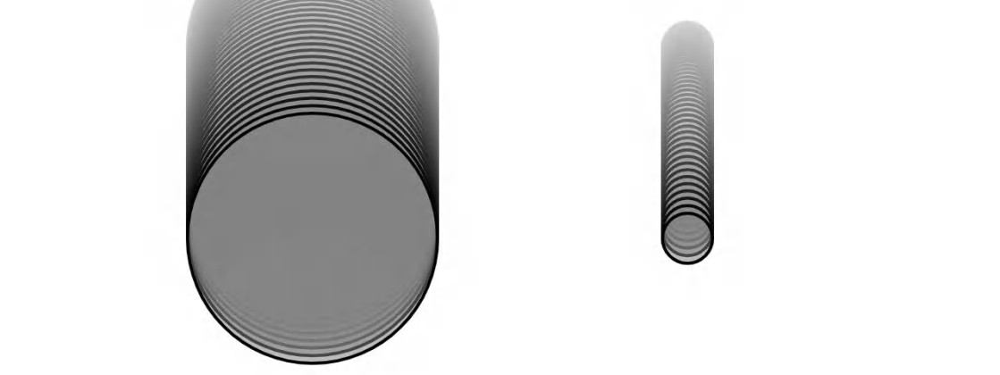

示例 2.3 的运行结果. 重力按对象质量缩放后, 两个对象以相同加速度下落. PDF 第 128 页精确提取.

    let gravity = createVector(0, 0.1);

    let gravityA = p5.Vector.mult(gravity, moverA.mass);
    moverA.applyForce(gravityA);

    let gravityB = p5.Vector.mult(gravity, moverB.mass);
    moverB.applyForce(gravityB);

两个对象现在以相同速率下落. 这里仍然把重力基础值任意设为 0.1, 但按质量缩放使它更接近地球重力的行为. 风力则不随质量缩放, 因而按下鼠标时, 小圆仍会更快向右加速.

## 对力进行建模

虚构力已经能走很远. 刚才甚至用任意数字构造了一个相当像地球重力的效果. p5.js 世界本质上是一支像素乐团, 程序员是指挥, 你认为什么应该成为力, 它就可以成为力. 不过, 当你开始追问 "现实中究竟怎样工作" 时, 就需要从虚构力转向建模力.

如何阅读公式

接下来会用到摩擦力公式. 数学和物理公式常包含许多符号, 也经常使用希腊字母. 例如正态分布的概率密度函数可以写成:

$$
\frac{1}{\sigma\sqrt{2\pi}}
\exp\left(-\frac{(x-\mu)^2}{2\sigma^2}\right)
$$

摩擦力公式则写成:

$$
\vec{f} = -\mu N\hat{v}
$$

阅读公式时可以抓住三个要点:

1.  **计算右侧, 赋给左侧**. 和代码赋值一样, 左侧是想求出的量, 右侧说明计算方法.
2.  **区分向量和标量**. 箭头或帽子符号通常表示向量. 这里 $\vec{f}$ 是摩擦力向量, $\hat{v}$ 是速度方向的单位向量. $\mu$ 和 $N$ 是标量.
3.  **相邻符号通常表示乘法**. 上式可读作 $-1\times\mu\times N\times\hat{v}$.

打开任何高中物理教材, 都能看到重力、电磁力、摩擦力、张力、弹力等公式. 本章选择摩擦力、阻力和万有引力作为案例, 不是说所有模拟都必须包含它们, 而是为了展示一套通用工作流:

1.  理解力背后的概念.
2.  把公式拆成两部分:
    - 怎样计算方向?
    - 怎样计算大小?
3.  把公式翻译成 p5.js 代码, 计算出一个向量并交给 `Mover.applyForce()`.

掌握这套方法后, 即使凌晨 3 点搜索 "原子核弱相互作用" 之类的主题, 也能把找到的公式改造成适合 p5.js 的模型.

### 摩擦力

两个表面接触时会产生摩擦. 摩擦力属于 **耗散力**, 它把对象的动能转换成其他形式, 通常是热能, 因而看起来像能量被损失了.

例如汽车刹车时, 制动系统利用摩擦降低轮胎转速, 把运动能量转化为热量. 完整模型应区分静摩擦和动摩擦, 这里为了简化, 只讨论运动对象与表面之间的动摩擦.

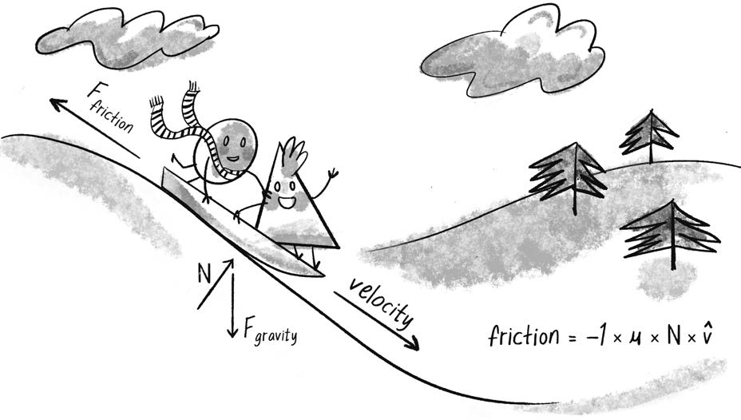

图 2.3, 雪橇沿斜坡滑动时, 摩擦力方向与速度相反. PDF 第 131 页精确提取.

摩擦力公式为:

$$
\vec{f} = -\mu N\hat{v}
$$

先看方向. $-\hat{v}$ 表示速度单位向量的反方向. 在 p5.js 中:

    let friction = this.velocity.copy();
    friction.normalize();
    friction.mult(-1);

这里必须复制速度向量, 否则会直接反转对象本身的速度. 还必须归一化, 因为摩擦力大小并不直接等于速度大小. 先得到长度为 1 的方向向量, 再按公式缩放.

公式中的 $\mu$ 是 **摩擦系数**. 它描述特定表面的摩擦强度. 数值越大, 摩擦越强. 冰面的摩擦系数远小于砂纸. 在虚构的 p5.js 世界中, 可以任意选择一个系数:

    let c = 0.01;

$N$ 是 **法向力**, 即表面沿垂直于接触面的方向施加给对象的力. 汽车因重力向下压路面, 路面根据牛顿第三定律向上推汽车. 重力越大, 法向力通常也越大.

斜坡上的法向力方向并不与重力简单相反, 精确计算需要角度和三角学. 为了得到 "足够好" 的模拟, 暂时假设法向力大小恒为 1:

    let normal = 1;

把方向和大小组合起来:

    let c = 0.1;
    let normal = 1;
    let frictionMag = c * normal;

    let friction = mover.velocity.copy();
    friction.mult(-1);
    friction.normalize();
    friction.mult(frictionMag);

现在已经有摩擦力向量, 还需要决定何时施加. 这里规定圆接触画布底部时才产生摩擦, 并在 `Mover` 中增加:

    contactEdge() {
      return this.position.y > height - this.radius - 1;
    }

这里还涉及碰撞的能量损失. 让速度分量直接乘以 $-1$ 会产生理想弹性碰撞, 每次反弹都不损失动能. 现实中的球会越弹越低. 可在每次反弹时损失一部分速度:

    bounceEdges() {
      let bounce = -0.9;

      if (this.position.y > height - this.radius) {
        this.position.y = height - this.radius;
        this.velocity.y *= bounce;
      }
    }

`-0.9` 同时反转方向并保留原速度的 90%, 因而每次碰撞损失 10% 的 y 方向速度.

### 示例 2.4: 加入摩擦力

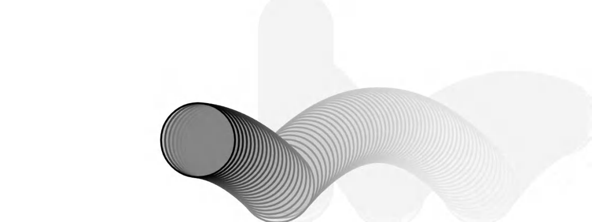

示例 2.4 的运行结果. 圆受到重力、鼠标触发的风力, 以及接触底边时的摩擦力. PDF 第 133 页精确提取.

    function draw() {
      background(255);

      let gravity = createVector(0, 1);
      mover.applyForce(gravity);

      if (mouseIsPressed) {
        let wind = createVector(0.5, 0);
        mover.applyForce(wind);
      }

      if (mover.contactEdge()) {
        let c = 0.1;
        let friction = mover.velocity.copy();
        friction.mult(-1);
        friction.setMag(c);
        mover.applyForce(friction);
      }

      mover.bounceEdges();
      mover.update();
      mover.show();
    }

运行后, 圆最终会停下. 改变摩擦系数, 或改变 `bounceEdges()` 中每次碰撞损失的速度比例, 可以控制它停止得更快还是更慢.

### 练习 2.6

向示例 2.4 加入第二个对象. 两个对象质量不同应如何处理? 如果每个对象与底面的摩擦系数也不同呢? 把摩擦力计算封装为 `Mover` 方法是否更合理?

### 练习 2.7

不要使用风力. 增加鼠标交互, 允许用户像投掷实物一样把圆抛出去.

### 空气阻力与流体阻力

对象穿过液体或气体时也会受到摩擦. 这种力有许多名称: 黏性力、阻力、空气阻力、流体阻力. 它们的共同效果是让对象减速, 但计算方式与接触表面的摩擦有所不同.

完整阻力公式为:

$$
\vec{F_d} = -\frac{1}{2}\rho v^2 A C_d\hat{v}
$$

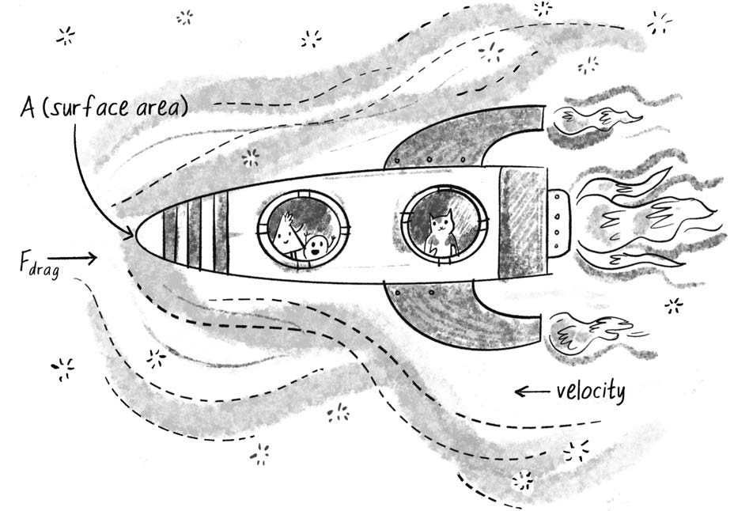

图 2.4, 空气或流体阻力与速度和迎风面积有关, 方向与速度相反. PDF 第 135 页精确提取.

各项含义如下:

- $\vec{F_d}$ 是需要计算并交给 `applyForce()` 的阻力向量.
- $-1/2$ 是常量. 负号说明力与速度方向相反.
- $\rho$ 是流体密度. 本示例暂时把它当作 1.
- $v$ 是对象速度的大小, 即 `velocity.mag()`. $v^2$ 表示速度平方.
- $A$ 是对象迎向流体的正面面积. 平放的纸张比尖端向下的铅笔受到更大空气阻力.
- $C_d$ 是阻力系数, 用于调节介质和形状产生的相对阻力.
- $\hat{v}$ 是速度单位向量. 乘以负号后得到相反方向.

本章忽略流体密度和迎风面积等独立因素, 把所有比例常量合并到一个系数 $c$ 中, 得到简化模型:

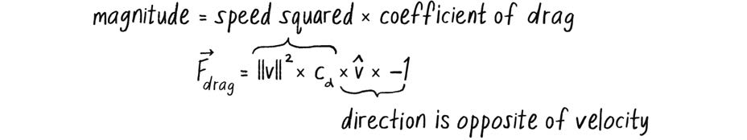

图 2.5, 简化阻力公式: 大小等于速度平方乘以阻力系数, 方向与速度相反. PDF 第 136 页精确提取.

对应代码:

    let c = 0.1;
    let speed = this.velocity.mag();
    let dragMagnitude = c * speed * speed;

    let drag = this.velocity.copy();
    drag.mult(-1);
    drag.setMag(dragMagnitude);

为了决定何时施加阻力, 向环境中加入一个 `Liquid` 对象. 液体显示为矩形, 具有位置、宽、高和阻力系数. 对象进入该区域时才受到阻力:

    class Liquid {
      constructor(x, y, w, h, c) {
        this.x = x;
        this.y = y;
        this.w = w;
        this.h = h;
        this.c = c;
      }

      show() {
        noStroke();
        fill(175);
        rect(this.x, this.y, this.w, this.h);
      }
    }

在画布下半部分创建液体:

    let liquid;

    function setup() {
      createCanvas(640, 240);
      liquid = new Liquid(0, height / 2, width, height / 2, 0.1);
    }

对象间的交互可表述为:

    if (liquid.contains(mover)) {
      let dragForce = liquid.calculateDrag(mover);
      mover.applyForce(dragForce);
    }

`Liquid.contains()` 判断移动对象是否位于矩形区域中:

    contains(mover) {
      let pos = mover.position;
      return (
        pos.x > this.x &&
        pos.x < this.x + this.w &&
        pos.y > this.y &&
        pos.y < this.y + this.h
      );
    }

`calculateDrag()` 依据速度平方计算阻力:

    calculateDrag(mover) {
      let speed = mover.velocity.mag();
      let dragMagnitude = this.c * speed * speed;

      let dragForce = mover.velocity.copy();
      dragForce.mult(-1);
      dragForce.setMag(dragMagnitude);

      return dragForce;
    }

注意, 原书示例 2.5 的主循环中调用的是 `liquid.drag(movers[i])`. 为保持命名一致, 可以把上述方法命名为 `drag()`, 或在主循环中调用 `calculateDrag()`. 下面采用 `calculateDrag()`, 这样方法名与前文一致.

### 示例 2.5: 流体阻力

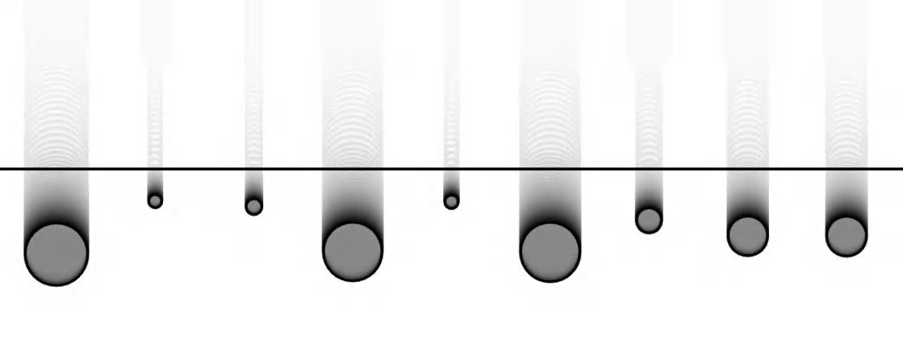

示例 2.5 的运行结果. 多个不同质量的对象落入液体区域并受到阻力. PDF 第 139 页精确提取.

    let movers = [];
    let liquid;

    function setup() {
      createCanvas(640, 240);

      for (let i = 0; i < 9; i++) {
        let mass = random(0.1, 5);
        movers[i] = new Mover(40 + i * 70, 0, mass);
      }

      liquid = new Liquid(0, height / 2, width, height / 2, 0.1);
    }

    function draw() {
      background(255);
      liquid.show();

      for (let i = 0; i < movers.length; i++) {
        if (liquid.contains(movers[i])) {
          let dragForce = liquid.calculateDrag(movers[i]);
          movers[i].applyForce(dragForce);
        }

        let gravity = createVector(0, 0.1 * movers[i].mass);
        movers[i].applyForce(gravity);

        movers[i].update();
        movers[i].show();
        movers[i].checkEdges();
      }
    }

    function mousePressed() {
      // 重新初始化草图中的移动对象.
      for (let i = 0; i < movers.length; i++) {
        let mass = random(0.1, 5);
        movers[i] = new Mover(40 + i * 70, 0, mass);
      }
    }

灰色下半区代表液体. 对象只在进入该区域后明显减速. 小质量对象减速得比大质量对象更显著, 因为同样的阻力除以较小质量会产生更大的负加速度.

### 练习 2.8

如果把阻力系数设得太高, 圆可能会像撞到液面一样反向弹出. 这是大时间步造成的数值误差. 阻力应让对象停下, 而不应让它反向. 怎样使用向量的 `limit()` 方法限制阻力, 避免阻力大小超过当前速度? 还可以让对象从不同高度下落, 观察入水速度如何影响阻力.

### 练习 2.9

原始阻力公式包含迎风面积. 创建若干盒子落入水中的模拟, 让阻力取决于盒子撞击水面的那条边的长度.

### 练习 2.10

阻力不一定完全与速度反向. 升力诱导阻力可以具有垂直于速度的分量, 使带倾角机翼的飞机上升. 尝试模拟升力.

### 万有引力

最著名的力大概就是万有引力. 站在地球上的人通常把重力理解为 "东西向下掉", 例如苹果砸到 Newton 头上. 但那只是我们在地球附近体验到的重力.

地球吸引苹果, 苹果也同样吸引地球, 这正是牛顿第三定律. 只是地球的质量巨大, 它的运动变化小到难以察觉. 实际上, 每个有质量的对象都对其他有质量的对象施加引力.

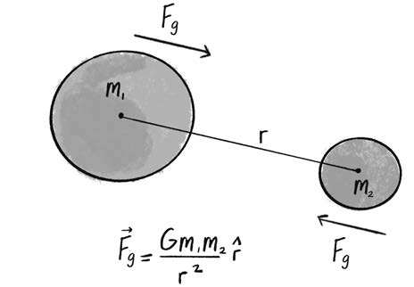

图 2.6, 两个物体之间的引力与两者质量乘积成正比, 与距离平方成反比. PDF 第 141 页精确提取.

万有引力公式为:

$$
\vec{F_g} = G\frac{m_1m_2}{r^2}\hat{r}
$$

其中:

- $\vec{F_g}$ 是要计算并传给 `applyForce()` 的引力向量.
- $G$ 是万有引力常数. 现实世界中约为 $6.67428\times10^{-11}\ \mathrm{m^3\,kg^{-1}\,s^{-2}}$. 对像素世界而言, 通常把它当作控制全局强度的缩放参数, 甚至直接设为 1.
- $m_1$ 和 $m_2$ 是两个对象的质量. 保留质量可以让大对象产生更强吸引.
- $\hat{r}$ 是从一个对象指向另一个对象的单位向量.
- $r^2$ 是对象间距离的平方.

分子中的 $G$、$m_1$、$m_2$ 越大, 力越强. 分母中的距离越大, 力越弱. 引力大小与距离平方成反比.

为了翻译成 p5.js 代码, 假定有两个对象, 它们的位置分别为 `position1`、`position2`, 质量分别为 `mass1`、`mass2`, `G` 表示全局引力常数.

首先求方向. 第 1 章中, 从对象指向鼠标的向量通过位置相减得到:

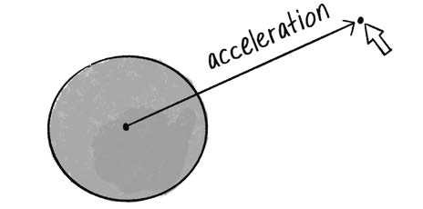

图 2.7, 从对象位置指向鼠标位置的加速度向量. PDF 第 142 页精确提取.

    let direction = p5.Vector.sub(mouse, position);

同样的方法可用于引力方向:

    let direction = p5.Vector.sub(position1, position2);
    direction.normalize();

然后计算力的大小并缩放方向向量:

    let magnitude = (G * mass1 * mass2) / (distance * distance);
    direction.mult(magnitude);

还缺少距离. 位置相减得到的向量本身跨越了两个位置, 因而它的大小就是距离.

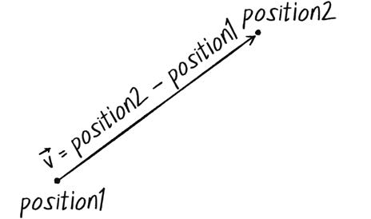

图 2.8, 从一个位置指向另一个位置的向量等于两个位置向量之差. PDF 第 143 页精确提取.

可以在归一化之前读取大小, 并使用 `setMag()` 同时完成归一化和缩放:

    let force = p5.Vector.sub(position2, position1);
    let distance = force.mag();
    let magnitude = (G * mass1 * mass2) / (distance * distance);
    force.setMag(magnitude);

这里把变量从 `direction` 改名为 `force`, 因为计算结束后它已经是最终要施加的力向量.

下面在草图中放置一个 `Mover` 和一个固定位置的 `Attractor`. 移动对象受到吸引对象的引力.

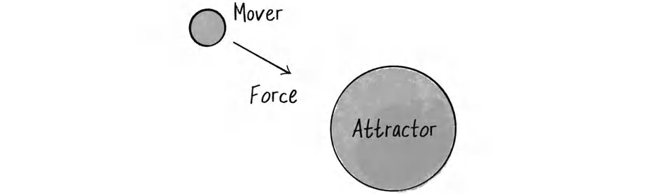

图 2.9, 一个移动对象和一个吸引对象. 移动对象受到指向吸引对象的引力. PDF 第 144 页精确提取.

先定义基础 `Attractor` 类:

    class Attractor {
      constructor() {
        this.position = createVector(width / 2, height / 2);
        this.mass = 20;
      }

      show() {
        stroke(0);
        fill(175, 200);
        circle(this.position.x, this.position.y, this.mass * 2);
      }
    }

在主草图中创建两个对象:

    let mover;
    let attractor;

    function setup() {
      createCanvas(640, 360);
      mover = new Mover(300, 100, 5);
      attractor = new Attractor();
    }

    function draw() {
      background(255);
      attractor.show();
      mover.update();
      mover.show();
    }

接下来需要让两个对象通信. 可以有多种设计:

| 方案 | 调用形式 |
|----|----|
| 独立全局函数接收两个对象 | `attraction(attractor, mover)` |
| `Attractor` 的方法接收 `Mover` | `attractor.attract(mover)` |
| `Mover` 的方法接收 `Attractor` | `mover.attractedTo(attractor)` |
| `Attractor` 返回力向量, 再由 `Mover` 施加 | `let force = attractor.attract(mover); mover.applyForce(force);` |

最后一种方案最适合继续复用 `applyForce()`. 主循环写成:

    function draw() {
      background(255);

      let force = attractor.attract(mover);
      mover.applyForce(force);
      mover.update();

      attractor.show();
      mover.show();
    }

`Attractor.attract()` 接收一个移动对象并返回力向量:

    attract(mover) {
      let force = p5.Vector.sub(this.position, mover.position);
      let distance = force.mag();
      let strength = (this.mass * mover.mass) / (distance * distance);
      force.setMag(strength);
      return force;
    }

公式中存在除法, 因而必须考虑极端距离. 如果距离是 0, 会发生除零. 如果距离很小, 例如 0.0001, 力会大得惊人, 让对象瞬间飞出画布. 如果距离很大, 距离平方会让力弱到几乎不可见.

在创意模拟中, 可以把用于计算力的距离限制在合理范围内:

    distance = constrain(distance, 5, 25);

这不代表对象的真实位置被改变, 只是在引力公式中把距离限制在 5 到 25 之间, 避免吸引力过强或过弱. 具体范围应根据想要的行为选择.

### 示例 2.6: 吸引

示例 2.6 的运行结果. 一个移动对象围绕固定吸引对象运动. PDF 第 147 页精确提取.

    let mover;
    let attractor;
    let G = 1.0;

    function setup() {
      createCanvas(640, 240);
      mover = new Mover(300, 50, 2);
      attractor = new Attractor();
    }

    function draw() {
      background(255);

      let force = attractor.attract(mover);
      mover.applyForce(force);
      mover.update();

      attractor.show();
      mover.show();
    }

    class Attractor {
      constructor() {
        this.position = createVector(width / 2, height / 2);
        this.mass = 20;
      }

      attract(mover) {
        let force = p5.Vector.sub(this.position, mover.position);
        let distance = force.mag();
        distance = constrain(distance, 5, 25);

        let strength =
          (G * this.mass * mover.mass) / (distance * distance);

        force.setMag(strength);
        return force;
      }

      show() {
        stroke(0);
        fill(175, 200);
        circle(this.position.x, this.position.y, this.mass * 2);
      }
    }

示例中圆的直径直接按质量缩放, 这不准确. 圆面积为 $\pi r^2$. 若密度相同, 要让面积与质量成正比, 圆的半径或直径应与质量的平方根成正比.

### 练习 2.11

修改示例 2.6, 让 `Attractor` 和 `Mover` 的质量映射到圆面积. 可以从下面的表达式开始:

    circle(
      this.position.x,
      this.position.y,
      sqrt(this.mass) * 2
    );

一个吸引对象还可以作用于多个移动对象, 只需把移动对象放入数组.

### 示例 2.7: 吸引多个移动对象

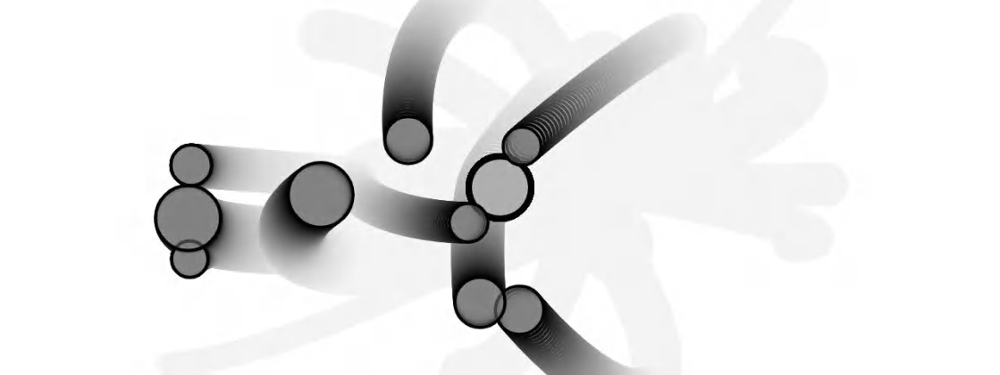

示例 2.7 的运行结果. 一个吸引对象对多个不同质量的移动对象施加引力. PDF 第 149 页精确提取.

    let movers = [];
    let attractor;

    function setup() {
      createCanvas(640, 360);

      for (let i = 0; i < 10; i++) {
        movers[i] = new Mover(
          random(width),
          random(height),
          random(0.5, 3)
        );
      }

      attractor = new Attractor();
    }

    function draw() {
      background(255);
      attractor.show();

      for (let i = 0; i < movers.length; i++) {
        let force = attractor.attract(movers[i]);
        movers[i].applyForce(force);
        movers[i].update();
        movers[i].show();
      }
    }

这只是对象数组能力的一小部分. 第 4 章讨论粒子系统时, 会进一步研究在画布中动态添加和删除对象.

### 练习 2.12

示例 2.7 有一组 `Mover` 和一个 `Attractor`. 创建同时包含多个移动对象和多个吸引对象的系统. 如果吸引对象不可见, 能否利用对象围绕它们运动时留下的轨迹生成图案?

### 练习 2.13

本章并不是说每个优秀的 p5.js 模拟都必须使用万有引力. 更重要的是学习设计自己的运动规则. 例如, 可以让吸引力在对象靠近时变弱、远离时变强. 也可以让吸引对象吸引远处对象, 但排斥过近对象.

### n 体问题

前面的情形依次是: 一个对象吸引一个对象, 一个对象吸引多个对象. 下一步自然是: 多个对象彼此吸引.

把 `Mover` 和 `Attractor` 分成两个类对理解很有帮助, 但从牛顿第三定律看, 这种区分并不完整. 如果吸引对象拉动移动对象, 移动对象也会反过来拉动吸引对象. 因此, 更合适的模型是使用单一的 `Body` 类, 每个物体都能吸引其他物体.

这类问题称为 **n 体问题**, 即求解一组通过引力相互作用的物体怎样运动. 两体问题具有可以精确求解的数学形式. 加入第三个物体后, 系统进入三体问题, 一般情况下不再存在简单的封闭形式解, 运动会迅速变得复杂.

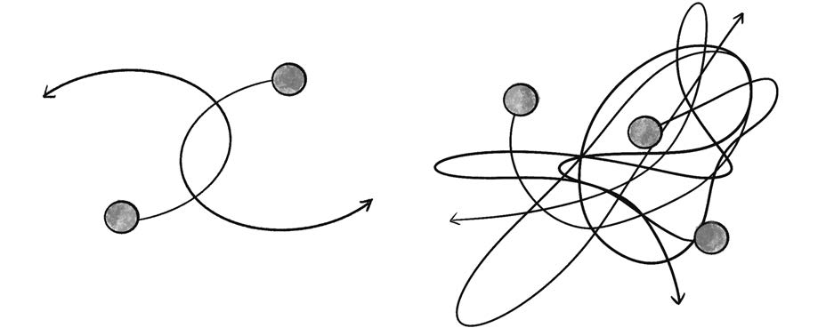

图 2.10, 两体问题的可预测轨迹与三体问题的复杂轨迹示例. PDF 第 151 页精确提取.

虽然本章的逐帧数值模拟不如精确轨道方程严谨, 但可以同时模拟两体和多体系统. 先把 `Attractor.attract()` 移入新的 `Body` 类:

    class Body {
      // 构造函数、applyForce()、update()、show() 等与前面类似.

      attract(body) {
        let force = p5.Vector.sub(this.position, body.position);
        let d = constrain(force.mag(), 5, 25);
        let strength = (G * this.mass * body.mass) / (d * d);
        force.setMag(strength);
        body.applyForce(force);
      }
    }

创建两个物体并让它们互相吸引:

    let bodyA;
    let bodyB;

    function setup() {
      createCanvas(640, 240);
      bodyA = new Body(320, 40);
      bodyB = new Body(320, 200);
    }

    function draw() {
      background(255);

      bodyA.attract(bodyB);
      bodyB.attract(bodyA);

      bodyA.update();
      bodyA.show();
      bodyB.update();
      bodyB.show();
    }

n 体系统的轨迹高度依赖初始条件. 给两个物体设置方向相反的水平初速度, 可以得到圆形或近似圆形轨道.

### 示例 2.8: 两体吸引

示例 2.8 的运行结果. 两个物体具有相反初速度并互相吸引. PDF 第 152 页精确提取.

    function setup() {
      createCanvas(640, 240);

      bodyA = new Body(320, 40);
      bodyB = new Body(320, 200);

      bodyA.velocity = createVector(1, 0);
      bodyB.velocity = createVector(-1, 0);
    }

更好的设计是把初始速度作为构造函数参数, 这里直接赋值只是为了快速试验不同位置和速度组合.

### 练习 2.14

James Montaldi 和 Katrina Steckles 的论文 *Classification of Symmetry Groups for Planar n-Body Choreographies* 研究了 n 体编舞解, 即多个物体以固定时间间隔沿同一周期轨迹运动:

- <https://doi.org/10.1017/fms.2013.5>
- <https://dangries.com/rectangleworld/demos/nBody>

向示例 2.8 加入第三个或更多物体, 尝试不同初始位置和速度. 能构造出怎样的轨道编舞?

接下来用数组保存多个物体:

    let bodies = [];

    function setup() {
      createCanvas(640, 240);

      for (let i = 0; i < 10; i++) {
        bodies[i] = new Body(random(width), random(height));
      }
    }

    function draw() {
      background(255);

      for (let i = 0; i < bodies.length; i++) {
        bodies[i].update();
        bodies[i].show();
      }
    }

要让每个物体吸引其他所有物体, 需要嵌套循环. 对每个 `i`, 遍历每个 `j`:

    for (let i = 0; i < bodies.length; i++) {
      for (let j = 0; j < bodies.length; j++) {
        let force = bodies[j].attract(bodies[i]);
        bodies[i].applyForce(force);
      }

      bodies[i].update();
      bodies[i].show();
    }

但这里会让物体吸引自己. 当 `i === j` 时必须跳过计算.

### 示例 2.9: n 个物体

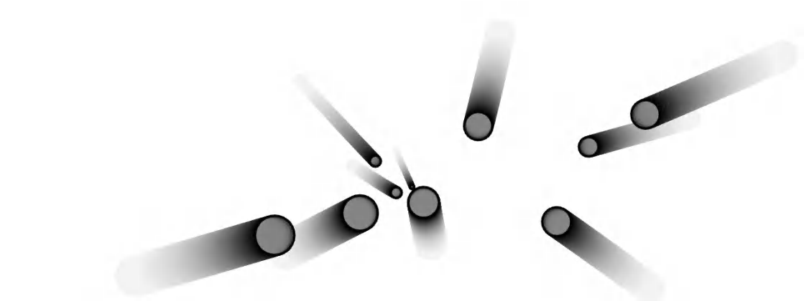

示例 2.9 的运行结果. 多个物体相互施加引力. PDF 第 154 页精确提取.

下面使用一种更清晰的接口: `attract()` 返回力向量, 再由目标物体调用 `applyForce()`.

    let bodies = [];

    function setup() {
      createCanvas(640, 240);

      for (let i = 0; i < 10; i++) {
        bodies[i] = new Body(
          random(width),
          random(height),
          random(0.1, 2)
        );
      }
    }

    function draw() {
      background(255);

      for (let i = 0; i < bodies.length; i++) {
        for (let j = 0; j < bodies.length; j++) {
          if (i !== j) {
            let force = bodies[j].attract(bodies[i]);
            bodies[i].applyForce(force);
          }
        }

        bodies[i].update();
        bodies[i].show();
      }
    }

对应的 `Body.attract()` 返回力, 不直接修改目标对象:

    attract(body) {
      let force = p5.Vector.sub(this.position, body.position);
      let d = constrain(force.mag(), 5, 25);
      let strength = (G * this.mass * body.mass) / (d * d);
      force.setMag(strength);
      return force;
    }

双重循环使计算量与物体数量的平方成正比, 即 $O(n^2)$. 物体数量增大时, 模拟会显著变慢. 第 5 章会讨论空间划分、四叉树和 Barnes-Hut 算法, 它们可以降低多体引力模拟的计算成本.

### 练习 2.15

把示例 2.9 的吸引力改成排斥力. 能否让所有 `Body` 同时被鼠标吸引, 但彼此排斥? 需要平衡不同力的相对强度, 并合理利用距离.

### 练习 2.16

尝试把 n 体系统排列成围绕画布中心旋转的螺旋星系. 可能需要在中心加入一个质量很大的物体维持整体结构. Coding Train 的 "Mutual Attraction" 视频给出了一个方案:

<https://thecodingtrain.com/nbody>

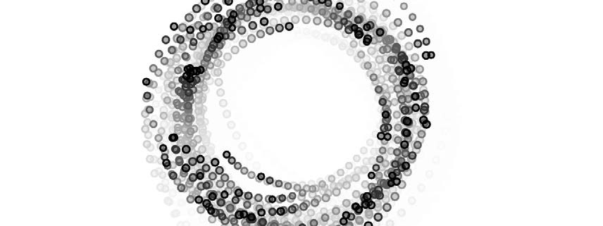

练习 2.16, n 体系统形成螺旋星系状轨迹. PDF 第 155 页精确提取.

## 生态系统项目

把力加入你的生态系统. 水、泥浆、河流的水流等环境条件, 会怎样改变角色在生态系统中的运动方式?

还可以在环境中加入食物、捕食者等元素, 让生物与它们交互. 生物会被某些东西吸引, 又会被另一些东西排斥吗? 能否进一步抽象, 根据生物的欲望、恐惧或目标设计力?

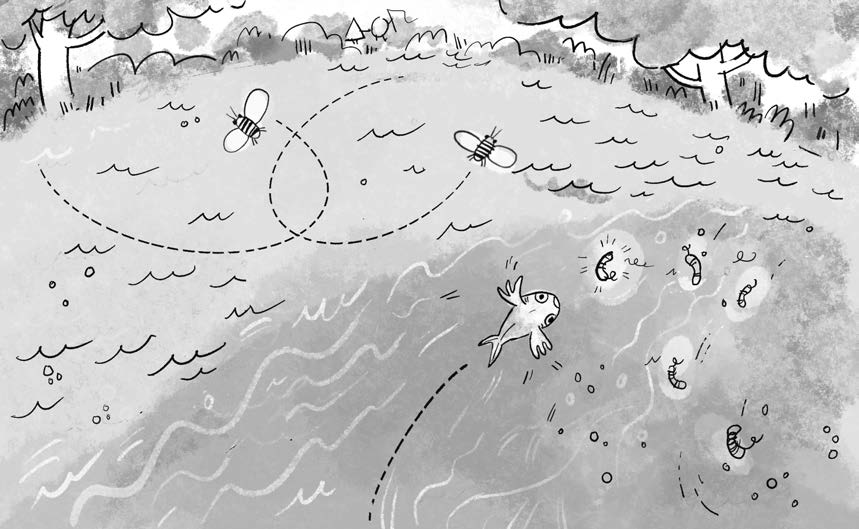

第 2 章生态系统项目插图. 环境介质、食物和其他生物通过力改变角色行为. PDF 第 156 页精确提取.
