# 第 3 章: 振荡

> 三角学正合时代的正弦.
>
> – Anonymous

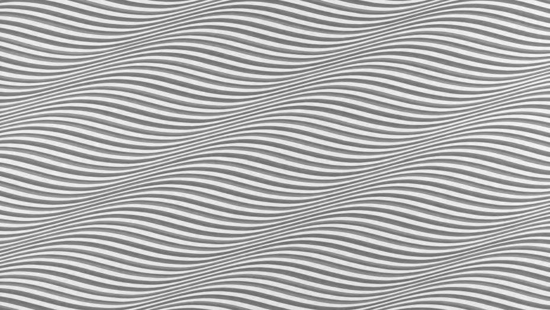

Bridget Riley 的 *Gala*, 1974 年, 丙烯颜料画布, 159.7 × 159.7 cm. PDF 第 157 页精确提取.

Bridget Riley 是一位著名的英国艺术家, 也是 20 世纪 60 年代欧普艺术运动的重要推动者. 她的作品通过几何图案挑战观看者的视觉感知, 并制造运动或振动的感觉. 1974 年的作品 *Gala* 由一系列在画布上起伏的曲线构成, 让人联想到正弦波的自然节律.

在第 1 章和第 2 章中, 我仔细建立了一套面向对象结构, 用于在 p5.js 画布中为形状制作动画. 位置、速度和加速度由向量表示, 加速度又由环境中的力驱动. 接下来原本可以直接进入粒子系统、转向力、群体行为等主题, 但那样会跳过自然运动中的一个基本现象: **振荡**, oscillation, 即对象围绕某个中心点或中心位置进行的往复运动.

为了模拟振荡, 需要理解一点三角学, 也就是研究三角形的数学. 三角学会为 p5.js 草图提供一套生成图案和创造运动行为的新工具. 你将使用角速度和角加速度, 让对象在移动时旋转; 使用正弦和余弦函数, 建立平滑的缓入、缓出波动; 还会计算涉及角度的更复杂作用力, 例如摆的摆动, 或箱子沿斜面滑动.

本章从 p5.js 中角度的基本用法开始, 随后讨论三角学的多个方面, 最后把它们与第 2 章中的力联系起来. 这些内容将为本书后面需要三角学的更复杂示例铺路.

## 角度

在继续之前, 先确认角度如何进入 p5.js 的创意编程. 使用过 p5.js 的读者, 很可能已经在调用 `rotate()` 旋转对象时遇到角度问题. 日常最熟悉的角度单位通常是度, degree.

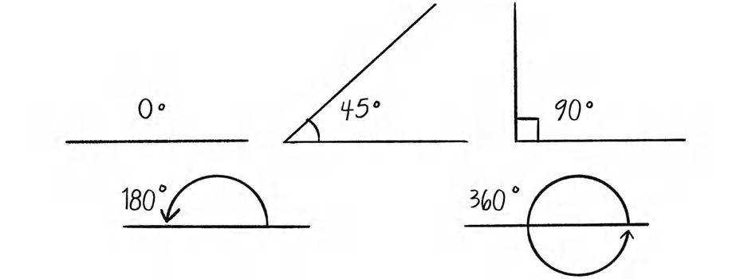

图 3.1, 以度为单位测量的角度. PDF 第 158 页精确提取.

完整一周是 $360^\circ$, $90^\circ$ 是它的四分之一, 也就是由两条垂直线形成的直角.

角度在计算机图形学中经常用于指定形状的旋转. 图 3.2 中的正方形绕中心旋转了 $45^\circ$.

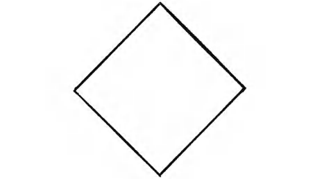

图 3.2, 绕中心旋转 45 度的正方形. PDF 第 159 页精确提取.

问题在于, p5.js 默认不使用度, 而使用 **弧度**, radian. 弧度由圆弧长度与圆半径的比值定义. 当圆弧长度等于半径时, 对应的圆心角就是 1 弧度.

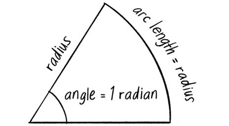

图 3.3, 角度为 1 弧度时, 圆弧长度等于圆半径. PDF 第 159 页精确提取.

完整一周 $360^\circ$ 等于 $2\pi$ 弧度, $180^\circ$ 等于 $\pi$ 弧度, $90^\circ$ 等于 $\pi/2$ 弧度. 从度转换为弧度的公式是:

$$
\mathrm{radians}=\frac{2\pi\times\mathrm{degrees}}{360}
$$

如果更习惯用度思考, 可以调用 `angleMode(DEGREES)`, 也可以使用 `radians()` 把度转换为弧度. p5.js 还提供 `PI`、`TWO_PI` 和 `HALF_PI`, 分别对应 $180^\circ$、$360^\circ$ 和 $90^\circ$. 下面两种写法都会把形状旋转 $60^\circ$:

    let angle = 60;
    rotate(radians(angle));

    angleMode(DEGREES);
    rotate(angle);

### 什么是 $\pi$?

数学常数 pi, 即希腊字母 $\pi$, 定义为圆周长与直径之比. 其近似值为 3.14159, 在 p5.js 中可以通过内置变量 `PI` 使用.

虽然度很直观, 本书仍主要采用弧度, 因为它是许多编程语言和图形环境中的标准角度单位. 如果你尚不熟悉弧度, 这是一个练习它的好机会. 如果还不熟悉 p5.js 的旋转实现, 可以观看 Coding Train 的变换系列: <https://thecodingtrain.com/transformations>.

### 练习 3.1

使用 `translate()` 和 `rotate()`, 让一个类似指挥棒的对象绕自身中心旋转.

练习 3.1 的旋转指挥棒效果. PDF 第 160 页精确提取.

## 角运动

旋转也可以称为 **角运动**, angular motion, 即围绕某个角度发生的运动. 线性运动用速度描述, 速度是位置随时间的变化率. 同样, 角运动可以用 **角速度**, angular velocity, 描述, 它是对象角度随时间的变化率. **角加速度**, angular acceleration, 则表示角速度随时间的变化.

理解角运动所需的数学, 与前两章中的线性运动完全相同:

$$
\vec{v}\leftarrow\vec{v}+\vec{a}
$$

$$
\vec{p}\leftarrow\vec{p}+\vec{v}
$$

把相同逻辑应用到旋转对象:

$$
\omega\leftarrow\omega+\alpha
$$

$$
\theta\leftarrow\theta+\omega
$$

这里 $\theta$ 是角度, $\omega$ 是角速度, $\alpha$ 是角加速度. 与线性运动相比, 这些公式反而更简单, 因为二维空间中的角度是标量, 而不是向量. 二维只有一个旋转轴; 在三维空间中, 旋转会更加复杂. 在严格的物理模拟中, 这些公式还应乘以时间步长 $\Delta t$, 但本书暂时假设每次 `draw()` 循环就是一个单位时间步长.

如果只想让指挥棒以固定速度旋转, 可以写成:

    translate(width / 2, height / 2);
    rotate(angle);
    line(-60, 0, 60, 0);
    circle(60, 0, 16);
    circle(-60, 0, 16);

    angle = angle + 0.1;

加入角速度和角加速度后, 得到下面的示例.

### 示例 3.1: 使用 `rotate()` 实现角运动

示例 3.1, 具有角加速度的旋转指挥棒. PDF 第 161 页精确提取.

    let angle = 0;                 // 角位置
    let angleVelocity = 0;         // 角速度
    let angleAcceleration = 0.0001; // 角加速度

    function setup() {
      createCanvas(640, 240);
    }

    function draw() {
      background(255);
      translate(width / 2, height / 2);
      rotate(angle);

      stroke(0);
      fill(127);
      line(-60, 0, 60, 0);
      circle(60, 0, 16);
      circle(-60, 0, 16);

      angleVelocity += angleAcceleration;
      angle += angleVelocity;
    }

这里没有直接以固定值递增 `angle`. 每一帧先把 `angleAcceleration` 加到 `angleVelocity`, 再把 `angleVelocity` 加到 `angle`. 因此指挥棒从静止开始, 随后越转越快.

### 练习 3.2

为旋转指挥棒增加交互. 如何通过鼠标控制角加速度? 能否加入阻力, 让角速度逐渐减小, 最终停下来?

下一步是把角运动加入 `Mover` 类. 先在构造函数中增加三个属性:

    class Mover {
      constructor() {
        this.position = createVector();
        this.velocity = createVector();
        this.acceleration = createVector();
        this.mass = 1.0;

        this.angle = 0;
        this.angleVelocity = 0;
        this.angleAcceleration = 0;
      }
    }

在 `update()` 中同时更新线性运动和角运动:

    update() {
      this.velocity.add(this.acceleration);
      this.position.add(this.velocity);

      this.angleVelocity += this.angleAcceleration;
      this.angle += this.angleVelocity;

      this.acceleration.mult(0);
    }

绘制时, 使用 `push()` 和 `pop()` 隔离变换状态, 把原点移动到对象位置, 再旋转形状:

    show() {
      stroke(0);
      fill(175, 200);

      push();
      translate(this.position.x, this.position.y);
      rotate(this.angle);
      circle(0, 0, this.radius * 2);
      line(0, 0, this.radius, 0);
      pop();
    }

如果 `angleAcceleration` 始终为 0, 对象不会旋转. 可以在构造函数中硬编码一个值:

    this.angleAcceleration = 0.01;

更有趣的方法是根据环境中的线性加速度动态计算角加速度. 完整计算转矩和转动惯量会把讨论带入很深的物理分支, 因此先使用一个快速而富有表现力的近似:

    this.angleAcceleration = this.acceleration.x;

这样, 对象向右加速时顺时针加速旋转, 向左加速时逆时针旋转. 但线性加速度的数值可能太大, 导致旋转失控, 甚至产生车轮倒转错觉. 可以缩小输入并限制角速度.

### 示例 3.2: 力与近似角运动

示例 3.2, 根据线性加速度的 x 分量驱动角运动. PDF 第 164 页精确提取.

    update() {
      this.velocity.add(this.acceleration);
      this.position.add(this.velocity);

      this.angleAcceleration = this.acceleration.x / 10.0;
      this.angleVelocity += this.angleAcceleration;
      this.angleVelocity = constrain(this.angleVelocity, -0.1, 0.1);
      this.angle += this.angleVelocity;

      this.acceleration.mult(0);
    }

这里采用了两层控制. 首先将 `acceleration.x` 除以 10, 然后把 `angleVelocity` 限制在 $[-0.1,0.1]$ 范围内.

### 练习 3.3

1.  创建一个从大炮中发射对象的模拟. 发射瞬间只施加一次冲击力, 重力则始终存在.
2.  为对象增加旋转, 模拟炮弹出膛后的自旋. 尝试让效果尽可能真实.

## 三角函数

现在可以揭开三角学的一条实用口诀: **SOH-CAH-TOA**. 它帮助记忆正弦、余弦和正切与直角三角形三条边之间的关系.

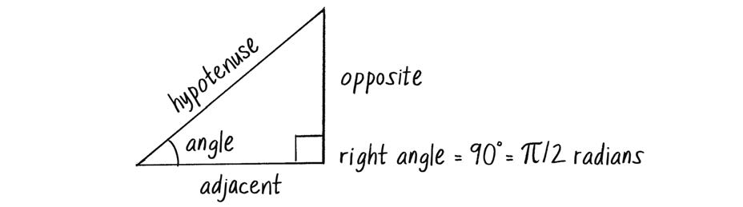

图 3.4, 直角三角形中的邻边、对边和斜边. PDF 第 166 页精确提取.

选择直角三角形中的一个锐角. 与该角相邻且不是斜边的边称为 **邻边**, 不接触该角的直角边称为 **对边**, 与直角相对的最长边称为 **斜边**.

- SOH: $\sin(\theta)=\dfrac{\mathrm{opposite}}{\mathrm{hypotenuse}}$
- CAH: $\cos(\theta)=\dfrac{\mathrm{adjacent}}{\mathrm{hypotenuse}}$
- TOA: $\tan(\theta)=\dfrac{\mathrm{opposite}}{\mathrm{adjacent}}$

不必死记图形, 但应该熟悉这些关系. 尝试自己重画一次. 随后换一种方式观察它: 一个向量天然构成了直角三角形.

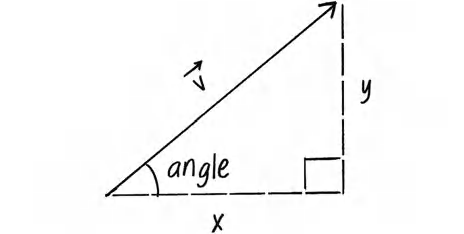

图 3.5, 向量 v 的 x、y 分量与角度. PDF 第 166 页精确提取.

向量箭头是斜边, x 和 y 分量是两条直角边. 角度是描述向量方向的另一种方式. 因而, 三角函数建立了向量分量与 "方向 + 大小" 之间的联系. 下面先用正切函数解决一个具体问题.

## 指向运动方向

回想示例 1.10, 一个 `Mover` 对象朝鼠标加速.

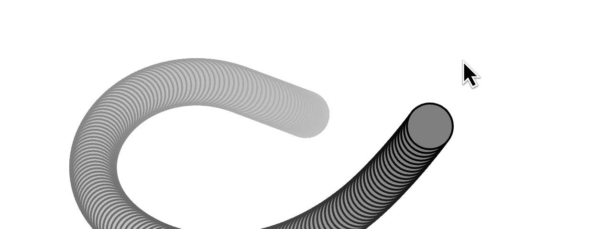

图 3.6, 朝鼠标位置加速的移动对象. PDF 第 167 页精确提取.

此前大多数对象都画成圆. 圆非常方便, 因为旋转之后看起来完全一样, 可以回避方向问题. 但当对象变成蚂蚁、汽车或飞船时, 它就应该朝向自己的运动方向.

"指向运动方向" 实际上就是 "根据速度向量旋转". 速度是带有 x、y 分量的向量, 而 `rotate()` 需要一个角度. 速度向量与角度之间的关系如图 3.7.

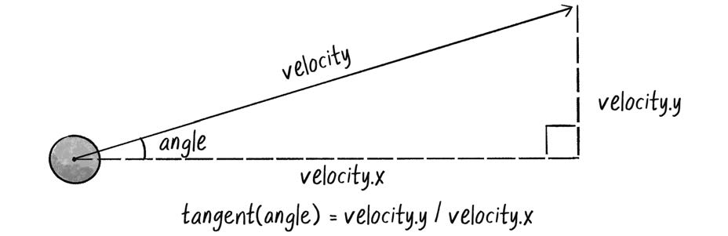

图 3.7, 速度向量角度的正切等于 y 分量除以 x 分量. PDF 第 167 页精确提取.

根据 TOA:

$$
\tan(\theta)=\frac{v_y}{v_x}
$$

已知 $v_x$ 和 $v_y$, 需要反求 $\theta$. 这就要使用正切的反函数, **反正切**, arctangent, 简写为 arctan 或 atan:

$$
\theta=\arctan\left(\frac{v_y}{v_x}\right)
$$

在 p5.js 中对应 `atan()`. 可以在 `show()` 中这样使用:

    show() {
      let angle = atan(this.velocity.y / this.velocity.x);

      stroke(0);
      fill(175);
      push();
      rectMode(CENTER);
      translate(this.position.x, this.position.y);
      rotate(angle);
      rect(0, 0, 30, 10);
      pop();
    }

这段代码几乎正确, 但还存在象限问题. 图 3.8 中的两个向量方向相反, 却拥有相同的比值:

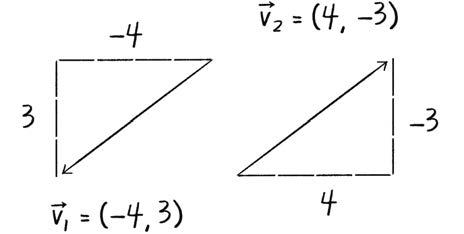

图 3.8, 分量为 (4,-3) 和 (-4,3) 的两个向量方向相反. PDF 第 169 页精确提取.

$$
\arctan(3/-4)=\arctan(-3/4)\approx-0.643501\ \mathrm{rad}
$$

单参数 `atan()` 只看到比值, 无法区分相反象限. 可以手写条件判断, 但 p5.js 提供了 `atan2(y,x)`, 它会同时考虑 x 和 y 的符号.

### 示例 3.3: 指向运动方向

示例 3.3, 让矩形朝向速度向量的方向. PDF 第 169 页精确提取.

    show() {
      let angle = atan2(this.velocity.y, this.velocity.x);

      push();
      rectMode(CENTER);
      translate(this.position.x, this.position.y);
      rotate(angle);
      rect(0, 0, 30, 10);
      pop();
    }

`p5.Vector` 还提供 `heading()`, 内部已经调用 `atan2()`, 直接返回二维向量的方向角:

    let angle = this.velocity.heading();

因此实际代码通常不必亲自调用三角函数, 但理解背后的计算仍然很重要.

### 练习 3.4

创建一个可用方向键驾驶的车辆. 左箭头让车辆向左加速, 右箭头让车辆向右加速. 车辆应始终指向当前运动方向.

## 极坐标与笛卡尔坐标

在 p5.js 中绘制形状时, 通常要提供像素位置 $(x,y)$, 这称为 **笛卡尔坐标**, Cartesian coordinates.

另一种常用系统是 **极坐标**, polar coordinates. 它用到原点的距离 $r$ 和绕原点的旋转角度 $\theta$ 描述位置. 从向量角度看, 笛卡尔坐标给出向量的 x、y 分量, 极坐标给出向量的大小和方向.

旋转或圆周运动常常更适合用极坐标思考, 但 p5.js 的绘图函数最终仍需要笛卡尔坐标. 三角学正好负责两者之间的转换.

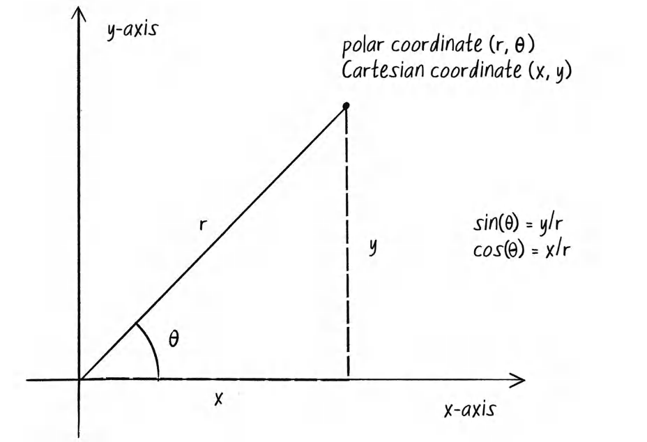

图 3.9, 极坐标 (r,theta) 与笛卡尔坐标 (x,y) 的关系. PDF 第 171 页精确提取.

给定半径 $r$ 和角度 $\theta$:

$$
x=r\cos(\theta)
$$

$$
y=r\sin(\theta)
$$

例如, 半径为 75 像素、角度为 $\pi/4$:

    let r = 75;
    let theta = PI / 4;
    let x = r * cos(theta);
    let y = r * sin(theta);

利用这一转换, 让形状沿圆周运动只需持续递增角度.

### 示例 3.4: 从极坐标转换为笛卡尔坐标

示例 3.4, 通过极坐标控制圆周运动. PDF 第 172 页精确提取.

    let r;
    let theta;

    function setup() {
      createCanvas(640, 240);
      r = height * 0.45;
      theta = 0;
    }

    function draw() {
      background(255);
      translate(width / 2, height / 2);

      let x = r * cos(theta);
      let y = r * sin(theta);

      fill(127);
      stroke(0);
      line(0, 0, x, y);
      circle(x, y, 48);

      theta += 0.02;
    }

`p5.Vector` 的静态方法 `fromAngle()` 可以直接创建指向给定角度的单位向量:

    let position = p5.Vector.fromAngle(theta);
    position.mult(r);
    circle(position.x, position.y, 48);

这里 `fromAngle(theta)` 负责方向, `mult(r)` 负责半径, 共同完成极坐标到笛卡尔坐标的转换.

### 练习 3.5

以示例 3.4 为基础绘制螺旋线. 从中心开始逐渐向外移动. 只需修改一行并增加一行代码.

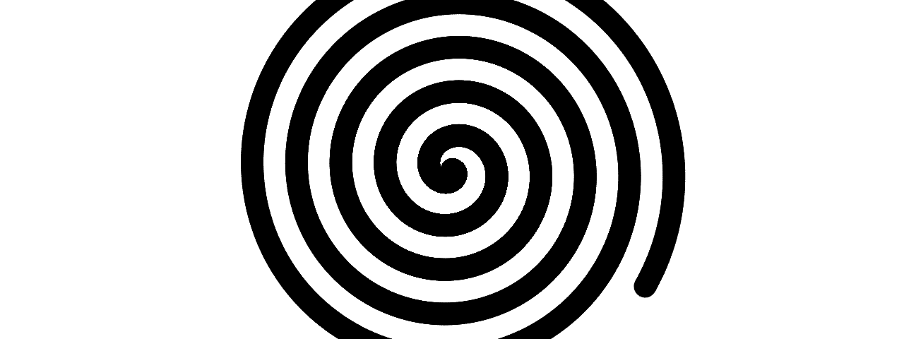

练习 3.5, 从中心向外扩展的螺旋路径. PDF 第 173 页精确提取.

### 练习 3.6

模拟游戏 *Asteroids* 中的飞船. 飞船用三角形表示, 漂浮在二维空间. 左箭头让它逆时针旋转, 右箭头让它顺时针旋转, Z 键沿飞船朝向施加推力.

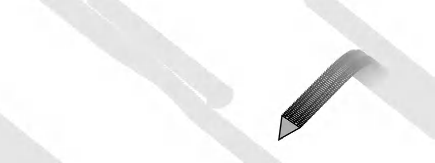

练习 3.6, *Asteroids* 式飞船运动. PDF 第 174 页精确提取.

## 振荡的属性

观察正弦函数 $y=\sin(x)$ 的图像.

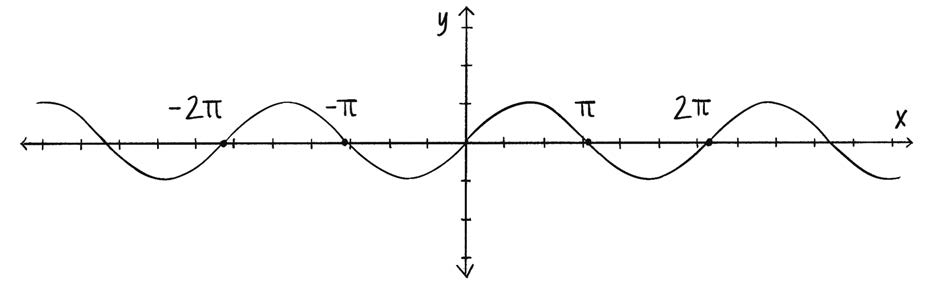

图 3.10, y=sin(x) 的图像. PDF 第 174 页精确提取.

正弦函数的输出在 $-1$ 与 $1$ 之间平滑变化, 形成 **正弦波**. 这种在两个极值之间周期性往复的行为就是振荡. 拨动吉他弦、摆动钟摆、踩弹簧高跷, 都可以用正弦函数描述.

在 p5.js 中, 可以把正弦函数的输出赋给对象位置, 例如让圆在画布左右两侧之间往复移动.

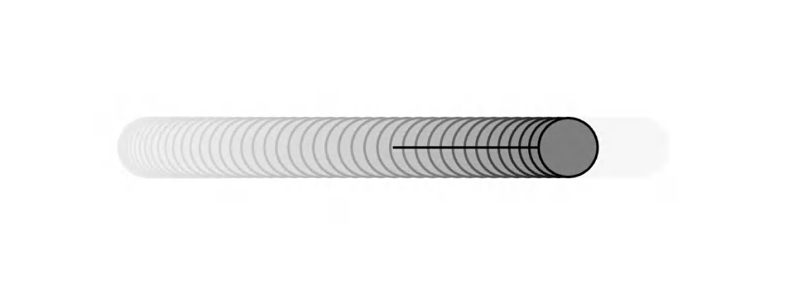

图 3.11, 水平方向振荡的圆. PDF 第 175 页精确提取.

围绕中心点作规则往复运动称为 **简谐运动**, simple harmonic motion. 描述它需要两个主要参数:

- **振幅**, amplitude: 从运动中心到任一极端位置的距离.
- **周期**, period: 完成一次完整循环所需的时间.

标准正弦函数在 y 轴上的范围是 $[-1,1]$, 所以振幅为 1. 它每经过 $2\pi$ 重复一次, 所以周期为 $2\pi$.

在 p5.js 中, 振幅通常以像素表示. 例如画布中心左右各 100 像素, 振幅就是 100:

    let amplitude = 100;

周期可以用帧数表示. 例如每 120 帧完成一次振荡:

    let period = 120;

于是位置可以写成:

    let x = amplitude * sin(TWO_PI * frameCount / period);

`sin()` 的输出在 $[-1,1]$ 之间, 乘以 `amplitude` 后落入 $[-a,a]$. 而

    TWO_PI * frameCount / period

把帧计数映射到正弦函数的相位. 当 `frameCount` 分别为 0、60、120、240 时, 输入角度依次是 $0$、$\pi$、$2\pi$、$4\pi$.

### 示例 3.5: 简谐运动 I

示例 3.5, 使用明确的振幅与周期实现简谐运动. 图像与图 3.11 相同, PDF 第 177 页引用同一原图.

    function setup() {
      createCanvas(640, 240);
    }

    function draw() {
      background(255);

      let period = 120;
      let amplitude = 200;
      let x = amplitude * sin(TWO_PI * frameCount / period);

      stroke(0);
      fill(127);
      translate(width / 2, height / 2);
      line(0, 0, x, 0);
      circle(x, 0, 48);
    }

另一个相关概念是 **频率**, frequency, 即单位时间内完成的周期数. 频率是周期的倒数. 周期为 120 帧时, 每一帧完成 $1/120$ 个周期, 因而频率为 $1/120$ 周期/帧.

### 练习 3.7

使用正弦函数模拟一个悬挂在窗口顶部弹簧上的重物, 并用 `map()` 计算重物的垂直位置. 本章后面的 "弹簧力" 将使用胡克定律从物理力的角度重新实现同一效果.

## 使用角速度实现振荡

如果并不需要精确规定周期, 简谐运动还可以写得更简单. 原公式是:

    let x = amplitude * sin(TWO_PI * frameCount / period);

真正关键的只是让 `sin()` 接收一个缓慢递增的数值:

    let x = amplitude * sin(someValueThatIncrementsSlowly);

这与第 0 章使用 Perlin 噪声的方式相似. 当时不断递增 `t` 或 `xoff`, 从 `noise()` 中取出平滑变化的值. 现在则递增一个传给 `sin()` 的角度. 区别在于, `sin()` 产生的是平滑且严格重复的波形.

    let angle = 0;
    let angleVelocity = 0.05;

    function draw() {
      angle += angleVelocity;
      let x = amplitude * sin(angle);
    }

这里 `angle` 是持续缓慢变化的相位, `angleVelocity` 决定其每帧递增量.

### 示例 3.6: 简谐运动 II

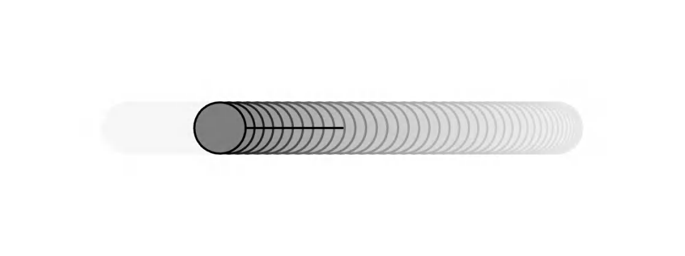

示例 3.6, 通过角速度递增相位实现简谐运动. PDF 第 179 页精确提取.

    let angle = 0;
    let angleVelocity = 0.05;

    function setup() {
      createCanvas(640, 240);
    }

    function draw() {
      background(255);

      let amplitude = 200;
      let x = amplitude * sin(angle);
      angle += angleVelocity;

      translate(width / 2, height / 2);
      stroke(0);
      fill(127);
      line(0, 0, x, 0);
      circle(x, 0, 48);
    }

虽然代码不再显式使用 `period`, 周期仍然存在. 角速度越大, 振荡越快, 周期越短. 相位增长 $2\pi$ 所需的帧数就是周期:

$$
\mathrm{period}=\frac{2\pi}{\mathrm{angular\ velocity}}
$$

接下来创建 `Oscillator` 类, 让对象在 x 轴和 y 轴上独立振荡. 每个方向都需要角度、角速度和振幅. `p5.Vector` 可以方便地把每一对数值放在一起. 这里向量的 x、y 属性不再表示空间坐标, 只是两个独立振荡器的参数容器.

### 示例 3.7: 振荡器对象

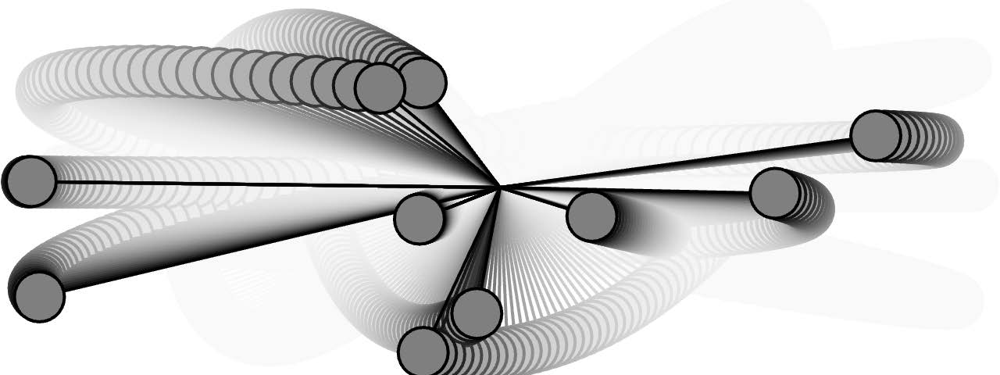

示例 3.7, 在 x、y 两个方向独立振荡的一组对象. PDF 第 181 页精确提取.

    class Oscillator {
      constructor() {
        this.angle = createVector();
        this.angleVelocity = createVector(
          random(-0.05, 0.05),
          random(-0.05, 0.05)
        );
        this.amplitude = createVector(
          random(20, width / 2),
          random(20, height / 2)
        );
      }

      update() {
        this.angle.add(this.angleVelocity);
      }

      show() {
        let x = sin(this.angle.x) * this.amplitude.x;
        let y = sin(this.angle.y) * this.amplitude.y;

        push();
        translate(width / 2, height / 2);
        stroke(0);
        fill(127);
        line(0, 0, x, y);
        circle(x, y, 32);
        pop();
      }
    }

单独观察任意一个振荡器, 它会在水平方向规则往返, 同时在垂直方向以另一种节奏上下运动. 随机初始化的角速度和振幅使每个对象拥有不同的轨迹.

这里 `this.angle`、`this.angleVelocity` 和 `this.amplitude` 的 x、y 属性只是存放两个振荡过程的对应参数. 真正的空间位置在 `show()` 中才由正弦计算出来.

### 练习 3.8

不要使用随机速度和随机振幅, 尝试初始化一组有规律的参数, 生成规则图案. 能否让这些振荡器看起来像昆虫的腿?

### 练习 3.9

在 `Oscillator` 中加入角加速度.

## 波

想象一个圆按照正弦函数上下振荡. 它相当于正弦波 x 轴上的一个采样点. 使用一点循环技巧, 可以把许多相邻的振荡圆排在一起, 显示整条波.

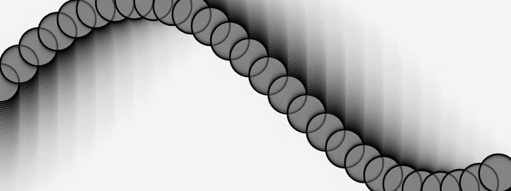

图 3.12, 使用一系列上下振荡的圆显示正弦波. PDF 第 182 页精确提取.

这种波状结构可以用来设计生物的身体或肢体, 也可以模拟水面等柔软表面.

绘制完整波形时, 振幅仍表示波的高度. 但周期的空间含义通常称为 **波长**, wavelength, 即波完成一个完整循环所跨越的距离. 可以精确计算波长, 也可以像前面处理角速度那样, 每移动一个采样点就让角度增加一个固定量.

先定义相位、相位增量和振幅:

    let angle = 0;
    let deltaAngle = 0.2;
    let amplitude = 100;

随后沿 x 轴遍历采样点. 对每个 x:

1.  用正弦和振幅计算 y.
2.  在 $(x,y)$ 位置画圆.
3.  将角度增加 `deltaAngle`.

### 示例 3.8: 静态波

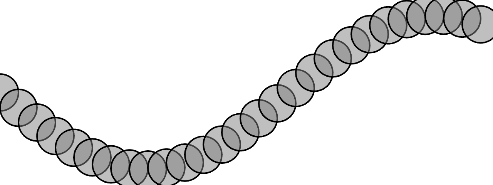

示例 3.8, 由一系列圆组成的静态正弦波. PDF 第 183 页精确提取.

    let angle = 0;
    let deltaAngle = 0.2;
    let amplitude = 100;

    function setup() {
      createCanvas(640, 240);
      background(255);
      stroke(0);
      fill(127, 127);

      for (let x = 0; x <= width; x += 24) {
        let y = amplitude * sin(angle);
        circle(x, y + height / 2, 48);
        angle += deltaAngle;
      }
    }

`deltaAngle` 越大, 相邻采样点之间的相位变化越大, 波长越短. 当波长很短而采样点又较稀疏时, 离散的圆会让波形变得难以辨认.

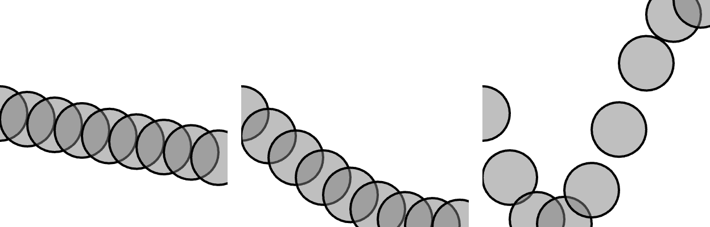

图 3.13, deltaAngle 分别为 0.05、0.2 和 0.6 时的三条波. PDF 第 184 页中的三个内嵌图像精确提取并按原顺序合并.

示例 3.8 全部放在 `setup()` 中, 因而结果是静态的. 直接把循环移到 `draw()` 并让 `angle` 持续累加会产生跳变, 因为上一帧波形右端的相位通常不等于下一帧左端应有的起始相位.

解决方法是增加一个专门表示每帧起始相位的变量 `startAngle`. 每次 `draw()` 开始时, 局部 `angle` 从 `startAngle` 出发; 完成整条波的绘制后, 再缓慢递增 `startAngle`.

### 示例 3.9: 波动的波

示例 3.9, 通过移动起始相位让整条波连续传播. 图像与图 3.12 使用同一原图, PDF 第 185 页引用.

    let startAngle = 0;
    let deltaAngle = 0.2;

    function setup() {
      createCanvas(640, 240);
    }

    function draw() {
      background(255);

      let angle = startAngle;

      for (let x = 0; x <= width; x += 24) {
        let y = map(sin(angle), -1, 1, 0, height);
        stroke(0);
        fill(127, 127);
        circle(x, y, 48);
        angle += deltaAngle;
      }

      startAngle += 0.02;
    }

这里将起始相位的增量写死为 0.02. 也可以复用 `deltaAngle`, 让空间变化与时间变化绑定; 或另建 `startAngleVelocity`, 独立控制波的传播速度. 由于起始角随时间变化, 使用 velocity 一词是合理的.

### 练习 3.10

在示例 3.9 中, 使用 Perlin 噪声代替正弦或余弦来设置 y 值.

### 练习 3.11

把生成波的代码封装到 `Wave` 类中, 创建两条具有不同振幅和周期的波. 不要局限于圆和线, 可以尝试 `beginShape()`、`vertex()`、`endShape()` 连接采样点.

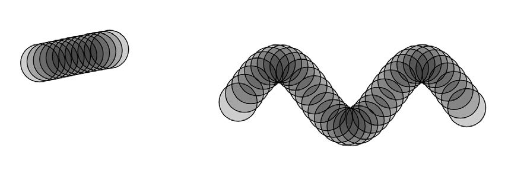

练习 3.11, 两条具有不同参数的波. PDF 第 186 页精确提取.

### 练习 3.12

把多条波叠加起来生成更复杂的波形. 分别计算各条波在同一 x 位置的高度, 再把这些 y 值相加, 得到同时包含各个分量特征的新波.

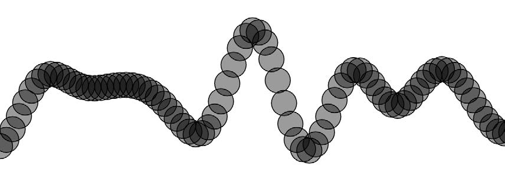

练习 3.12, 多条波叠加形成的复合波. PDF 第 186 页精确提取.

## 弹簧力

三角形和波的数学很优美, 但也许你已经开始想念牛顿运动定律和向量. 本书的核心毕竟是模拟运动物体的物理行为.

前面用正弦波快速模拟了挂在弹簧上的重物. 这种一行代码的近似无法让重物同时响应风、重力等其他环境力. 为此, 必须把弹簧本身的作用力建模为向量.

这里把弹簧视为一个可移动的 **重物**, bob, 与一个固定 **锚点**, anchor, 之间的连接.

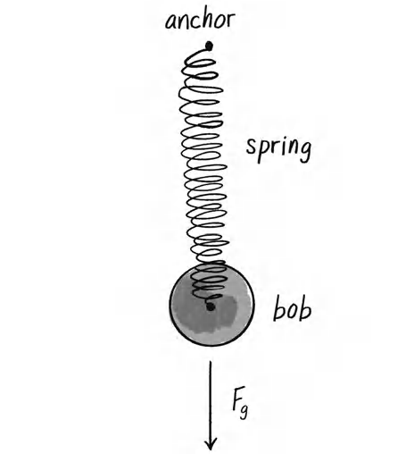

图 3.14, 带有锚点和重物的弹簧. PDF 第 187 页精确提取.

弹簧力可以根据 **胡克定律**, Hooke's law, 计算. 英国物理学家 Robert Hooke 在 1660 年提出它. 原始拉丁文是 "Ut tensio, sic vis", 即 "伸长多少, 力就有多大". 更现代的表达是:

> 弹簧力与弹簧的伸长量成正比.

伸长量表示弹簧相对平衡长度被拉长或压缩了多少, 即当前长度与静止长度之差.

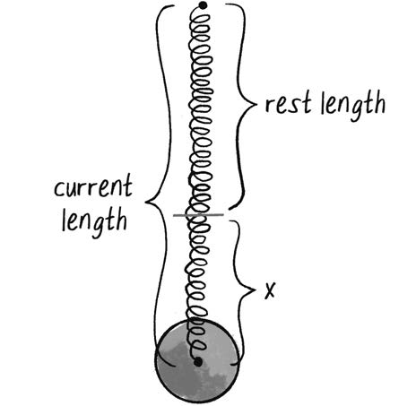

图 3.15, 弹簧伸长量 x 是当前长度与静止长度之差. PDF 第 187 页精确提取.

胡克定律写成:

$$
\vec{F}_{spring}=-kx
$$

其中 $k$ 是 **弹簧常数**, 用于缩放力的大小, 决定弹簧柔软还是刚硬. $x$ 是伸长量:

$$
x=\mathrm{currentLength}-\mathrm{restLength}
$$

力是向量, 所以要同时计算方向和大小. 假设已有锚点、重物位置和静止长度:

    let anchor = createVector(0, 0);
    let bob = createVector(0, 120);
    let restLength = 100;

选择一个弹簧常数:

    let k = 0.1;

从锚点指向重物的向量长度, 就是弹簧当前长度:

    let dir = p5.Vector.sub(bob, anchor);
    let currentLength = dir.mag();
    let x = currentLength - restLength;

这个向量同时给出了弹簧位移的方向. 当弹簧被拉长时, 弹簧力应把重物拉回锚点; 当弹簧被压缩时, 弹簧力应把重物推离锚点. 胡克定律中的负号负责翻转方向.

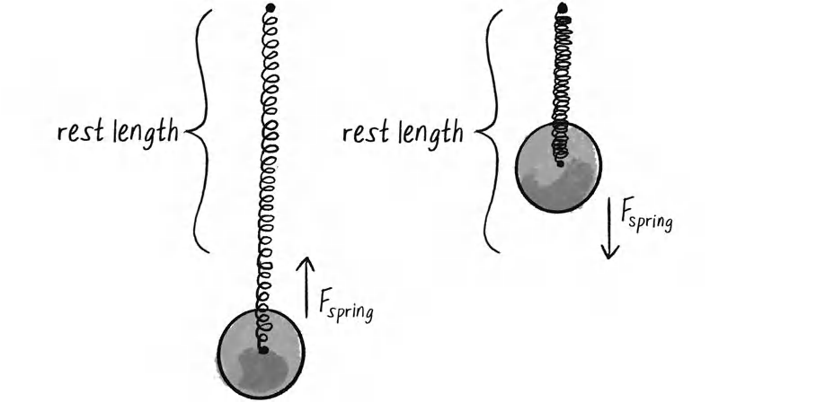

图 3.16, 弹簧力与位移方向相反. PDF 第 189 页精确提取.

把方向与大小合在一起:

    let k = 0.1;
    let force = p5.Vector.sub(bob, anchor);
    let currentLength = force.mag();
    let x = currentLength - restLength;
    force.setMag(-1 * k * x);

现在已经有了计算弹簧力的算法, 还需要决定面向对象结构. 没有唯一正确答案, 选择取决于目标与代码风格.

可以沿用 `Mover` 框架, 把 `Bob` 看作可移动对象. 它拥有位置、速度和加速度, 也可以通过 `applyForce()` 接收重力. 还需要把弹簧力施加到它上面:

    let bob;

    function setup() {
      bob = new Bob();
    }

    function draw() {
      let gravity = createVector(0, 1);
      bob.applyForce(gravity);

      let springForce = /* 计算弹簧力 */;
      bob.applyForce(springForce);

      bob.update();
      bob.show();
    }

如果将来有多个重物和多条弹簧, 把所有弹簧计算都塞在 `draw()` 中会变得混乱. 因此再创建 `Spring` 类. `Bob` 负责重物运动, `Spring` 保存锚点、静止长度, 并计算作用于重物的弹簧力.

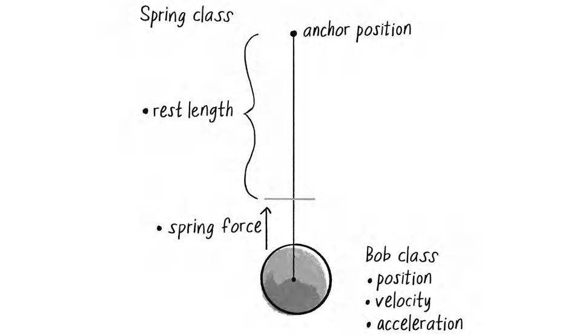

图 3.17, Spring 类保存锚点与静止长度, Bob 类保存位置、速度和加速度. PDF 第 190 页精确提取.

主程序可以写成:

    let bob;
    let spring;

    function setup() {
      bob = new Bob();
      spring = new Spring();
    }

    function draw() {
      let gravity = createVector(0, 1);
      bob.applyForce(gravity);

      spring.connect(bob);

      bob.update();
      bob.show();
      spring.show();
    }

第 2 章的引力示例曾写成:

    let force = attractor.attract(mover);
    mover.applyForce(force);

弹簧也可以采用相同形式:

    let force = spring.connect(bob);
    bob.applyForce(force);

但这里让 `spring.connect(bob)` 在内部直接调用 `bob.applyForce(force)`:

    connect(bob) {
      let force = /* 计算 */;
      bob.applyForce(force);
    }

这样 `connect()` 不必返回向量. 两种设计都合理. 前面为了讲清力的累加, 把所有力显式放在 `draw()` 中更直观; 现在熟悉之后, 可以把细节封装进对象.

### 示例 3.10: 简单弹簧连接

示例 3.10, 重物通过弹簧与固定锚点连接. PDF 第 192 页精确提取.

    class Spring {
      constructor(x, y, length) {
        this.anchor = createVector(x, y);
        this.restLength = length;
        this.k = 0.2;
      }

      connect(bob) {
        let force = p5.Vector.sub(bob.position, this.anchor);
        let currentLength = force.mag();
        let stretch = currentLength - this.restLength;

        force.setMag(-1 * this.k * stretch);
        bob.applyForce(force);
      }

      show() {
        fill(127);
        circle(this.anchor.x, this.anchor.y, 10);
      }

      showLine(bob) {
        stroke(0);
        line(
          bob.position.x,
          bob.position.y,
          this.anchor.x,
          this.anchor.y
        );
      }
    }

书籍网站上的完整版本还包含两项功能: `Bob` 支持鼠标拖动; `Spring` 可以把连接长度限制在最小值和最大值之间.

### 练习 3.13

在查看在线答案之前, 补全下面的 `constrainLength()` 方法. 它应在连接过短或过长时, 把重物位置拉回允许范围, 并清零速度.

    constrainLength(bob, minlen, maxlen) {
      let direction = p5.Vector.sub(/* bob.position */, /* this.anchor */);
      let length = direction.mag();

      if (length < minlen) {
        direction.setMag(/* minlen */);
        bob.position = p5.Vector.add(/* this.anchor */, /* direction */);
        bob.velocity.mult(0);
      } else if (length > maxlen) {
        direction.setMag(/* maxlen */);
        bob.position = p5.Vector.add(/* this.anchor */, /* direction */);
        bob.velocity.mult(0);
      }
    }

### 练习 3.14

创建由多个重物和多条弹簧组成的系统. 能否让一个重物直接连接另一个重物, 而不是连接固定锚点?

## 摆

示例 3.10 的弹簧代码没有使用正弦或余弦. 但三角学并没有跑题. 把弹簧替换为完全刚性的连接, 它既不能压缩也不能伸长, 就得到一个理想化的 **摆**, pendulum.

摆由一根摆臂把重物悬挂在固定支点上. 静止时, 摆臂竖直向下. 将重物抬起一个角度后释放, 它会沿圆弧来回摆动.

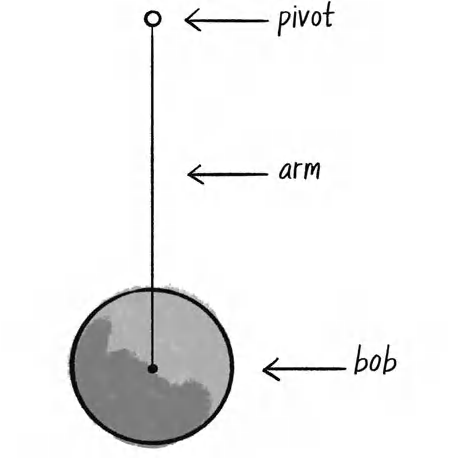

图 3.18, 由支点、摆臂和重物组成的摆. PDF 第 194 页精确提取.

现实摆存在于三维空间, 这里仅研究二维 p5.js 画布. 摆动过程中主要涉及重力和张力. 如果没有摆臂, 重物会直接在重力作用下下落. 固定长度的摆臂产生张力, 阻止它离开圆弧轨道.

与弹簧示例不同, 这里不直接使用线性加速度和线性速度, 而用角加速度和角速度描述摆臂相对静止方向的角度 $\theta$. 为保持示例清晰, 暂时忽略能量守恒、动量、向心力等重要因素. 目标不是建立完整的摆物理模型, 而是练习三角学、力与角度之间的关系.

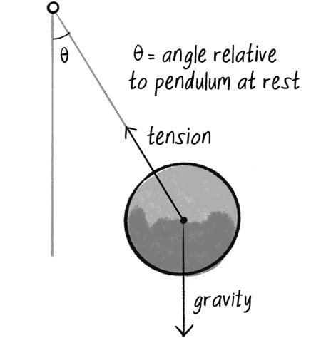

图 3.19, 摆臂相对静止位置的角度 theta, 以及重力与张力. PDF 第 195 页精确提取.

为了求角加速度, 仍从牛顿第二定律出发, 但要加入三角分解. 想象把头倾斜, 让摆臂成为新的 y 轴. 重力方向相对于这个坐标系倾斜. 将重力向量分解为沿摆臂方向和垂直摆臂方向的两个分量.

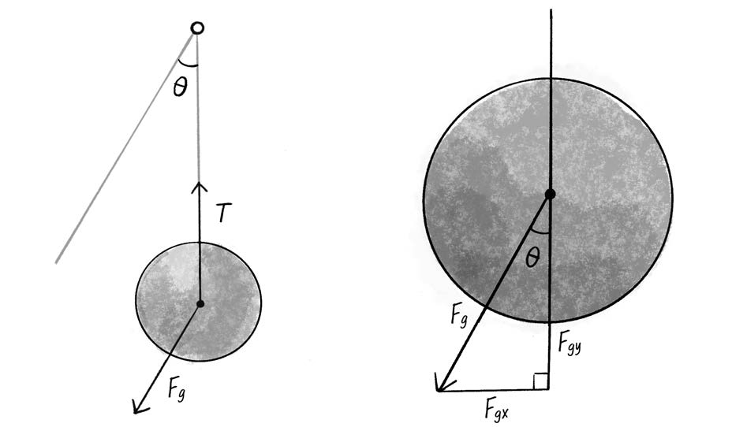

图 3.20, 左侧把摆臂视为 y 轴; 右侧把重力 Fg 分解为 Fgx 与 Fgy. PDF 第 196 页精确提取.

$F_{gy}$ 与张力 $T$ 方向相反, 张力负责保持重物不从摆臂末端脱落. $F_{gx}$ 垂直于摆臂, 正是推动摆旋转的净力. 由于它属于一个直角三角形, 可以用正弦计算.

直角三角形顶部角度与摆臂偏离静止位置的角度 $\theta$ 相同:

$$
\sin(\theta)=\frac{F_{gx}}{F_g}
$$

因此:

$$
F_{gx}=F_g\sin(\theta)
$$

把它重新命名为摆的切向力 $F_p$:

$$
F_p=F_g\sin(\theta)
$$

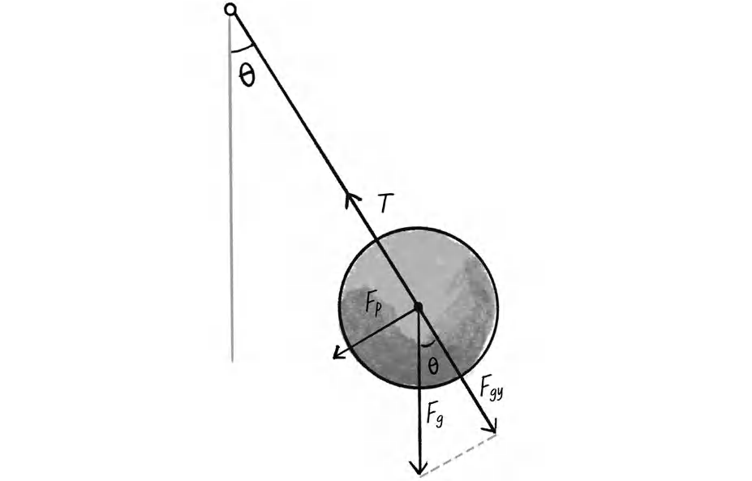

图 3.21, Fgx 重命名为 Fp, 即沿运动方向的净力. PDF 第 197 页精确提取.

目标是求角加速度, 然后更新角速度和角度:

$$
\omega\leftarrow\omega+\alpha
$$

$$
\theta\leftarrow\theta+\omega
$$

牛顿第二定律 $F=MA$ 告诉我们加速度等于力除以质量. 因而在暂时忽略摆臂长度时:

$$
\alpha=\mathrm{gravity}\times\sin(\theta)
$$

这里 `gravity` 是适用于像素世界的任意缩放常数, 而不是现实中的 $9.8\ \mathrm{m/s^2}$.

还缺少摆臂长度的影响. 摆臂可以被理想化为不弯曲、质量忽略不计的刚性杆, 重物质量集中在末端一个点上. 旋转系统对应的牛顿第二定律是:

$$
\tau=I\alpha
$$

其中 $\tau$ 是转矩, $I$ 是转动惯量. 对这个理想摆, 转矩与 $Mr$ 成正比, 转动惯量与 $Mr^2$ 成正比. 因此:

$$
\alpha=\frac{\tau}{I}\propto\frac{Mr}{Mr^2}=\frac{1}{r}
$$

质量约掉了. 与伽利略自由落体实验类似, 摆的角加速度不依赖重物质量, 只受摆臂长度影响. 最终公式是:

$$
\alpha=-\frac{g\sin(\theta)}{r}
$$

负号表示恢复方向始终指向静止位置.

这个推导的意义不只是记住摆公式. 本书真正关心的是如何把自然现象拆解为可编程的运动规则. 摆只是一个案例. 掌握这种方法后, 可以设计完全不同的 p5.js 世界.

`Pendulum` 类需要至少保存:

- 摆臂长度.
- 角度.
- 角速度.
- 角加速度.

<!-- -->

    class Pendulum {
      constructor() {
        this.r = /* 摆臂长度 */;
        this.angle = /* 当前角度 */;
        this.angleVelocity = /* 角速度 */;
        this.angleAcceleration = /* 角加速度 */;
      }
    }

更新公式:

    update() {
      let gravity = 0.4;
      this.angleAcceleration = -1 * gravity * sin(this.angle) / this.r;
      this.angleVelocity += this.angleAcceleration;
      this.angle += this.angleVelocity;
    }

当摆在静止位置右侧时, 角度和正弦值为正, 但重力应把它拉回左侧, 所以角加速度必须为负. 当摆在左侧时, 角度与正弦为负, 恢复力应为正. 两种情况都由负号统一处理.

接下来要把摆画出来. 需要支点 `pivot` 和重物位置 `bob` 的笛卡尔坐标. 这又回到极坐标转换.

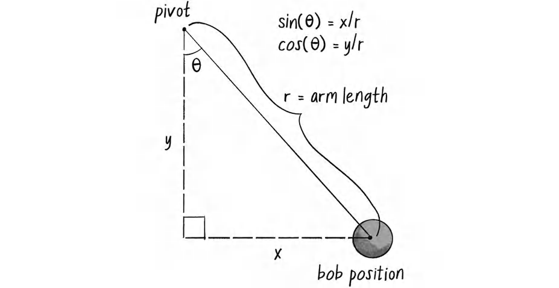

图 3.22, 重物相对支点的极坐标与笛卡尔坐标. PDF 第 200 页精确提取.

在构造函数中设置支点和摆臂长度:

    this.pivot = createVector(100, 10);
    this.r = 125;

$r$ 和 $\theta$ 构成重物相对支点的极坐标. 由于这里的角度是从竖直向下的 y 轴量起, x、y 的正弦余弦与前面的标准图形对调:

    this.bob = createVector(
      this.r * sin(this.angle),
      this.r * cos(this.angle)
    );

该向量假设支点位于 $(0,0)$. 加上真实支点位置即可得到画布坐标:

    this.bob.add(this.pivot);

绘制摆臂和重物:

    stroke(0);
    fill(127);
    line(this.pivot.x, this.pivot.y, this.bob.x, this.bob.y);
    circle(this.bob.x, this.bob.y, 16);

真实摆还会受到支点摩擦和空气阻力. 如果不处理, 代码中的摆会永远摆动. 可以用一个简化的阻尼技巧, 每帧把角速度减少 1%:

    this.angleVelocity *= 0.99;

这不是严格建模阻力, 但能得到相似的衰减效果.

### 示例 3.11: 摆动的摆

示例 3.11, 从 45 度初始角释放的摆. PDF 第 201 页精确提取.

    let pendulum;

    function setup() {
      createCanvas(640, 240);
      pendulum = new Pendulum(width / 2, 0, 175);
    }

    function draw() {
      background(255);
      pendulum.update();
      pendulum.show();
    }

    class Pendulum {
      constructor(x, y, r) {
        this.pivot = createVector(x, y); // 支点位置
        this.bob = createVector();       // 重物位置
        this.r = r;                      // 摆臂长度
        this.angle = PI / 4;             // 摆臂角度
        this.angleVelocity = 0;          // 角速度
        this.angleAcceleration = 0;      // 角加速度
        this.damping = 0.99;             // 阻尼
        this.ballr = 24;                 // 重物半径
      }

      update() {
        let gravity = 0.4;

        this.angleAcceleration =
          (-1 * gravity / this.r) * sin(this.angle);

        this.angleVelocity += this.angleAcceleration;
        this.angle += this.angleVelocity;
        this.angleVelocity *= this.damping;
      }

      show() {
        this.bob.set(
          this.r * sin(this.angle),
          this.r * cos(this.angle)
        );
        this.bob.add(this.pivot);

        stroke(0);
        line(this.pivot.x, this.pivot.y, this.bob.x, this.bob.y);

        fill(127);
        circle(this.bob.x, this.bob.y, this.ballr * 2);
      }
    }

书籍网站上的版本还允许用户用鼠标抓住摆并甩动它.

### 练习 3.15

把多个摆串联起来, 让一个摆的重物成为下一个摆的支点. 这种简单串联可能产生有趣结果, 但在物理上并不准确. 真正的双摆需要更复杂的方程. 可参考 Wolfram Research 的双摆文章 <https://scienceworld.wolfram.com/physics/DoublePendulum.html>, 或 Coding Train 视频 <https://thecodingtrain.com/doublependulum>.

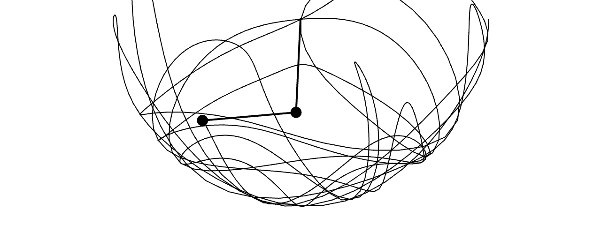

练习 3.15, 多摆连接产生的复杂轨迹. PDF 第 203 页精确提取.

### 练习 3.16

利用三角学计算图中法向力的大小. 法向力垂直于雪橇所在斜面. 可以把重力大小视为已知常量, 并寻找由重力分量构成的直角三角形. 法向力与重力在垂直斜面方向的分量大小相等、方向相反.

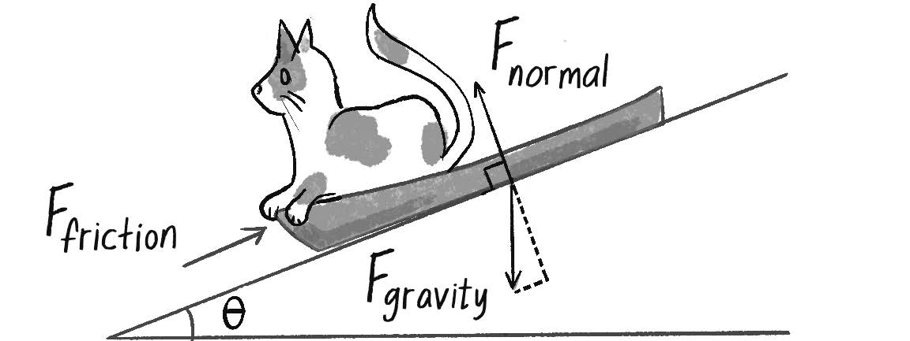

练习 3.16, 斜面上的重力、摩擦力与法向力. PDF 第 204 页精确提取.

### 练习 3.17

创建一个带摩擦力的箱子沿斜面下滑模拟. 注意, 摩擦力大小与法向力成正比, 可结合前一练习的结果.

## 生态系统项目

选择生态系统中的一种生物, 把振荡加入它的运动. 可以参考示例 3.7 的 `Oscillator` 类, 但那个对象只围绕窗口中心这个固定点振荡. 尝试让它围绕一个正在移动的点振荡.

换句话说, 先让生物根据位置、速度和加速度在画布中移动, 再让生物本身不是静态形状, 而是一个振荡体. 可以把振荡速度与移动速度关联起来. 想象蝴蝶扇动翅膀, 或昆虫腿的周期运动. 能否让内部机械运动, 也就是振荡, 看起来真正驱动了生物的位移?

书籍网站还提供了一个把第 2 章引力与本章振荡结合起来的附加示例.

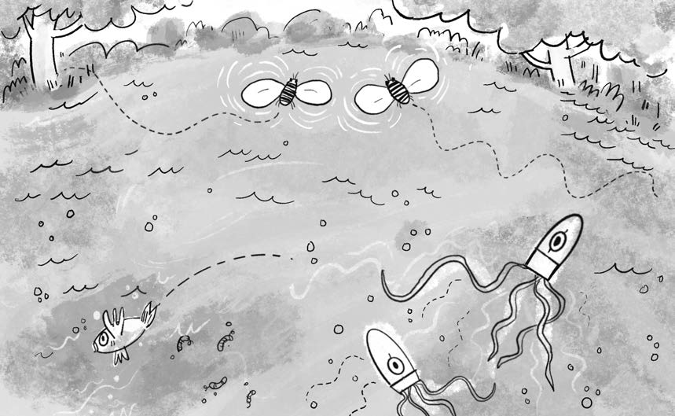

第 3 章生态系统项目, 把振荡加入生物的内部结构与移动方式. PDF 第 205 页精确提取.
