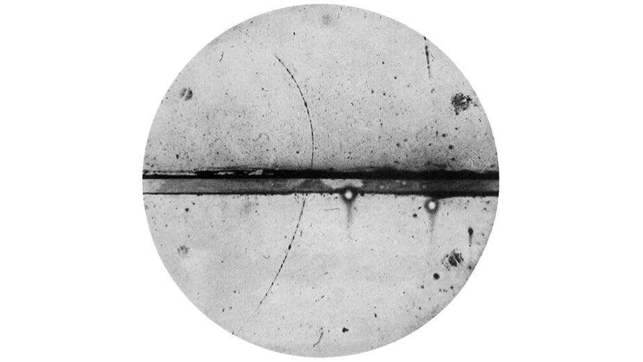
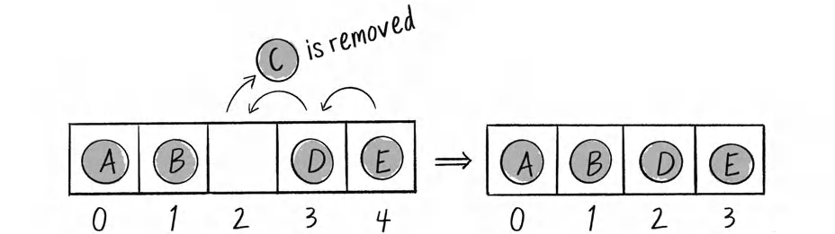
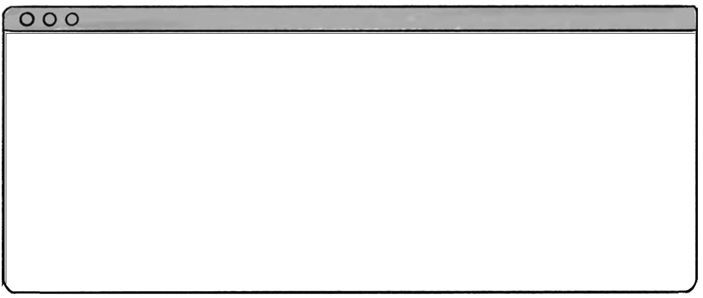
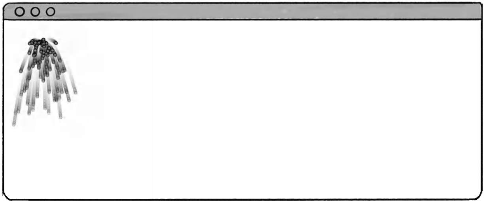
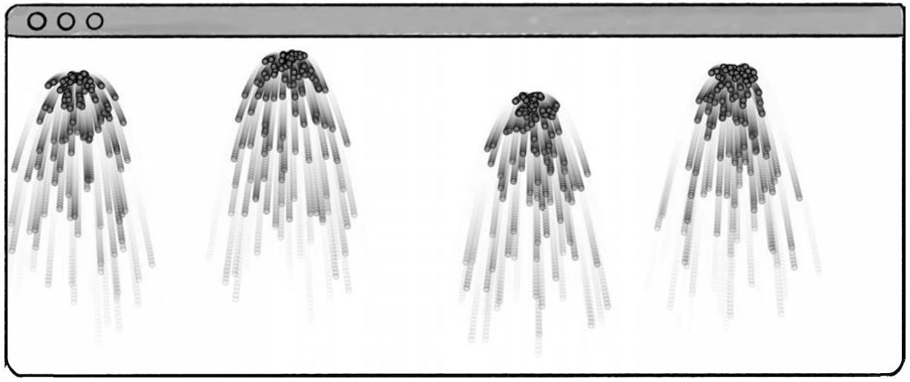
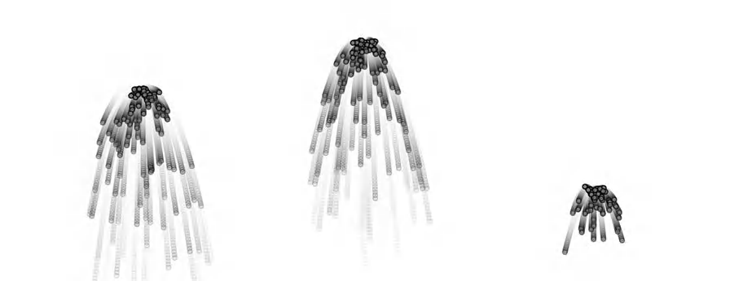
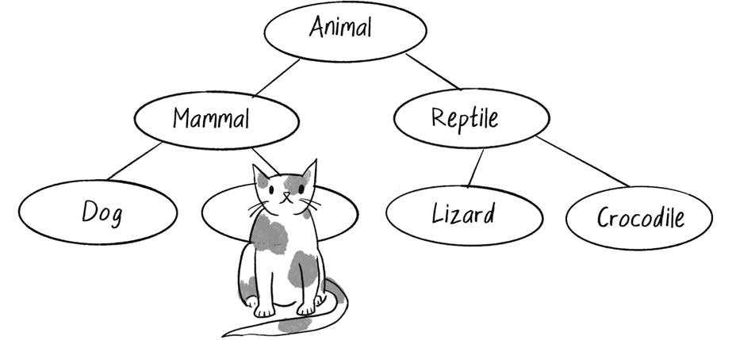
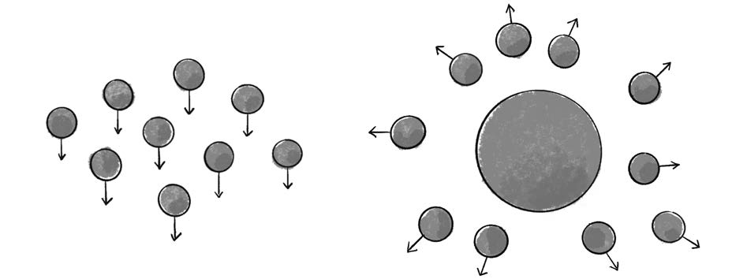
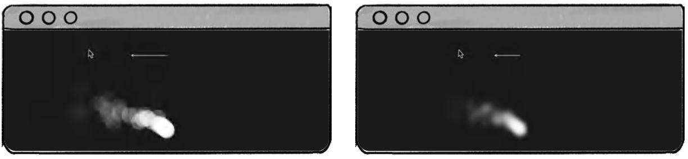
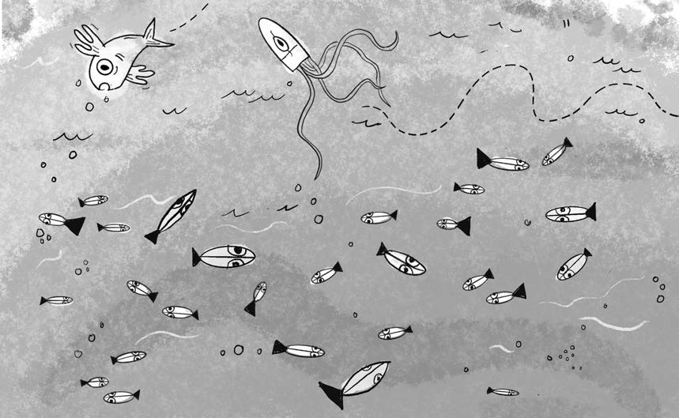

# 第 4 章: 粒子系统

> 这很明智. 不过, 如果我要诉诸逻辑, 那么逻辑显然表明, 多数人的需要高于少数人的需要.
>
> – Spock

正电子, Carl D. Anderson 摄. PDF 第 207 页精确提取.

这张 20 世纪早期的云室照片, 让人得以窥见亚原子粒子的世界, 并记录了人类第一次观察到的正电子. 云室是一种装置, 它能让带电粒子穿过过饱和蒸气时留下的轨迹显现出来.

1982 年, Lucasfilm 研究员 William T. Reeves 正在参与电影 *Star Trek II: The Wrath of Khan* 的制作. 影片的大部分情节都围绕 Genesis Device 展开. 这是一种鱼雷, 发射到贫瘠, 毫无生命的行星后, 能够重新组织物质, 创造适合殖民的宜居世界. 在相关镜头中, 当行星被 "地球化" 时, 一道火墙在其表面翻涌扩散. **粒子系统**, particle system, 这个在计算机图形学中极其常见且实用的术语, 正是在制作这一特效时被创造出来的. Reeves 的描述如下:

> 粒子系统是由大量极小粒子组成的集合, 这些粒子共同表示一个边界模糊的对象. 随着时间推移, 粒子被生成到系统中, 在系统中运动和变化, 最后从系统中消亡.

自 20 世纪 80 年代初以来, 粒子系统已经被广泛用于电子游戏, 动画, 数字艺术作品和装置中, 以模拟各种不规则的自然现象, 例如火焰, 烟雾, 瀑布, 雾, 草, 气泡等.

本章将研究粒子系统的编码策略, 以及如何管理与之相关的数据. 应当如何组织代码? 与单个粒子有关的信息应该存放在哪里, 与整个系统有关的信息又应该存放在哪里? 本章示例将以简单的点表示粒子, 并只应用最基本的行为. 但这些特征不应该限制你的想象力. 粒子系统经常闪闪发光, 向前喷射或在重力作用下坠落, 并不意味着你的系统也必须如此. 以本章框架为基础, 再加入更有创意的绘制方式和行为计算方法, 就可以产生多种多样的效果.

换句话说, 本章的重点是如何跟踪一个由大量元素组成的系统. 至于这些元素做什么, 长什么样, 完全由你决定.

## 为什么粒子系统很重要

粒子系统是由相互独立的对象构成的集合, 这些对象通常表现为点或其他简单形状. 但这为什么重要? 模拟前面列出的某些现象, 例如瀑布, 当然既有吸引力也可能非常实用. 更广泛地说, 当你开始开发更复杂的模拟时, 很可能会不断遇到由许多事物组成的系统, 例如弹跳的球, 成群飞行的鸟, 不断进化的生态系统, 以及各种需要使用复数形式描述的东西. 本章讨论的粒子系统策略会在所有这些场景中派上用场.

事实上, 从本章开始, 后面的几乎每一章都会包含由对象列表构成的草图. 从本质上说, 这就是粒子系统. 在前面几章的示例中, 我已经初步使用过数组, 但现在到了让数组驶向此前从未到达之处的时候了, 至少在本书中如此.

首先, 我希望系统能够容纳数量灵活的元素. 有些示例可能没有任何元素, 有时只有一个, 有时有十个, 有时则有一万个. 其次, 我希望采用一种更成熟的面向对象方法. 除了编写描述单个粒子的类, 还要编写描述整个粒子集合的类, 也就是粒子系统本身. 最终目标是让主草图可以写成这样:

    let system; // 这个主程序是不是既简单又漂亮?

    function setup() {
      createCanvas(640, 360);
      system = new ParticleSystem();
    }

    function draw() {
      background(255);
      system.run();
    }

这段代码没有直接引用任何单个粒子, 但结果却会充满在画布上四处飞行的粒子. 原因在于, 所有细节都隐藏在 `ParticleSystem` 类内部, 该类保存了许多 `Particle` 类实例的引用. 习惯这种使用多个类编写草图的方式, 尤其是让某些类保存其他类实例的列表, 会在后面的章节中持续发挥作用.

粒子系统还提供了学习另外两种 OOP 技术的机会: **继承**, inheritance, 和 **多态**, polymorphism. 在此前的示例中, 一个数组总是只保存同一种对象, 例如 mover 数组或 oscillator 数组. 借助继承和多态, 可以方便地在同一个列表中保存不同类型的对象. 因此, 一个粒子系统不必只包含一种粒子.

## 单个粒子

在开始编写粒子系统之前, 需要先写一个类来描述单个粒子. 好消息是, 这项工作其实已经做过了. 第 2 章中的 `Mover` 类就是完美模板. 粒子是在画布中独立运动的物体, 因此和 mover 一样, 它拥有 `position`, `velocity` 和 `acceleration` 变量, 通过构造函数初始化这些变量, 并通过 `show()` 绘制自身, 通过 `update()` 更新位置.

    class Particle {
      constructor(x, y) {
        // Particle 对象只是 mover 的另一个名字.
        // 它具有位置, 速度和加速度.
        this.position = createVector(x, y);
        this.acceleration = createVector();
        this.velocity = createVector();
      }

      update() {
        this.velocity.add(this.acceleration);
        this.position.add(this.velocity);
        this.acceleration.mult(0);
      }

      show() {
        stroke(0);
        fill(175);
        circle(this.position.x, this.position.y, 8);
      }
    }

这已经是粒子能够达到的最简形式之一. 从这里出发, 可以把它扩展到很多方向. 可以加入 `applyForce()` 方法来影响粒子的行为, 后面的示例会这样做. 还可以增加描述颜色和形状的变量, 或者加载 `p5.Image`, 以更有趣的方式绘制粒子. 不过现在只增加一个细节: **生命周期**, life span.

某些粒子系统包含一个作为粒子来源的 **发射器**, emitter. 发射器控制粒子的初始设置, 包括位置, 速度等. 它可能一次发射一批粒子, 也可能连续发射粒子流, 或采用其他变化形式. 这里的新问题是, 从发射器诞生的粒子不能永远存活. 否则, 随着粒子数量不断累积, p5.js 草图最终会因为数量过于庞大而停滞. 在新粒子诞生的同时, 老粒子必须被移除. 这样既能制造无限粒子流的错觉, 又不会损害草图性能.

判断粒子何时应该被移除有很多方法. 例如, 粒子可以在接触另一个对象时 "死亡", 或者在离开画布边界时死亡. 这里为粒子增加一个 `lifespan` 变量, 让它像计时器一样工作. 它从 255 开始, 随着草图运行逐渐倒数到 0. 到达 0 后, 粒子就被视为死亡.

    class Particle {
      constructor(x, y) {
        this.position = createVector(x, y);
        this.acceleration = createVector();
        this.velocity = createVector();
        // 记录粒子已经 "存活" 多久.
        // 从 255 开始并逐渐倒数到 0.
        this.lifespan = 255;
      }

      update() {
        this.velocity.add(this.acceleration);
        this.position.add(this.velocity);
        this.lifespan -= 2.0; // 生命周期递减.
      }

      show() {
        // 生命周期范围也是 255 到 0, 因而可直接用作 alpha.
        stroke(0, this.lifespan);
        fill(175, this.lifespan);
        circle(this.position.x, this.position.y, 8);
      }
    }

由于 `lifespan` 的取值范围为 255 到 0, 它可以方便地同时作为表示粒子的圆的 alpha 透明度. 这样, 当粒子死亡时, 它在视觉上也会真正淡出消失.

加入 `lifespan` 属性后, 还需要一个可供查询的方法, 以 true 或 false 回答粒子是生是死. 当后面编写单独的类管理粒子列表时, 这个方法会非常有用. 实现很简单, 只要检查 `lifespan` 是否小于 0. 若小于 0, 返回 `true`, 否则返回 `false`:

    isDead() {
      if (this.lifespan < 0.0) {
        return true;
      } else {
        return false;
      }
    }

还可以更简洁地直接返回布尔表达式的结果:

    isDead() {
      return (this.lifespan < 0.0);
    }

在进入同时创建大量粒子的下一步之前, 值得先确认单个粒子是否正常工作. 为此, 先创建一个每次只包含一个 `Particle` 对象的草图. 完整代码还加入了几个小改动, 包括为粒子提供随机初速度, 以及加入 `applyForce()` 以模拟重力.

### 示例 4.1: 单个粒子

示例 4.1, 单个粒子. PDF 第 212 页精确提取.

    let particle;

    function setup() {
      createCanvas(640, 360);
      particle = new Particle(width / 2, 20);
    }

    function draw() {
      background(255);
      particle.update();
      particle.show();

      let gravity = createVector(0, 0.1);
      particle.applyForce(gravity);

      if (particle.isDead()) {
        particle = new Particle(width / 2, 20);
        console.log("Particle dead!");
      }
    }

    class Particle {
      constructor(x, y) {
        this.position = createVector(x, y);
        // 为了演示, 粒子具有随机初速度.
        this.velocity = createVector(random(-1, 1), random(-2, 0));
        this.acceleration = createVector(0, 0);
        this.lifespan = 255.0;
      }

      update() {
        this.velocity.add(this.acceleration);
        this.position.add(this.velocity);
        this.lifespan -= 2.0;
        this.acceleration.mult(0);
      }

      show() {
        stroke(0, this.lifespan);
        fill(0, this.lifespan);
        circle(this.position.x, this.position.y, 8);
      }

      applyForce(force) {
        // 沿用前面章节中的物理模型.
        this.acceleration.add(force);
      }

      isDead() {
        return (this.lifespan < 0.0);
      }
    }

为了保持简单并便于测试, 这个示例每次只创建一个粒子. 每当粒子的生命周期结束, `particle` 变量就会被新的 `Particle` 实例覆盖. 这等效于替换之前的 `Particle` 对象. 需要理解的是, 旧的 `Particle` 对象并不是被显式删除了, 而是不再能从代码中访问或使用. 草图实际上忘记了旧粒子, 然后用新创建的粒子重新开始.

### 练习 4.1

在 `Particle` 类中创建一个 `run()` 方法, 由它统一处理 `update()`, `show()` 和 `applyForce()`. 这种方式有哪些优点和缺点?

### 练习 4.2

为粒子加入角速度, 也就是旋转. 再设计一种非圆形粒子, 让旋转能够被看见.

## 粒子数组

现在已经有一个描述单个粒子的类, 下一步的大问题是: 在无法预先知道任意时刻会有多少粒子的情况下, 如何跟踪大量粒子? 答案是 JavaScript 数组, 一种能够保存任意长度值列表的数据结构. 在 JavaScript 中, 数组实际上是由 `Array` 类创建的对象, 因而自带许多内置方法. 这些方法提供了维护 `Particle` 对象列表所需的全部功能, 包括添加粒子, 移除粒子以及以其他方式操作粒子. 如果需要复习数组, 可以参阅 MDN Web Docs 的 JavaScript 数组文档: <https://developer.mozilla.org/en-US/docs/Web/JavaScript/Reference/Global_Objects/Array>.

在引入数组时, 先采用练习 4.1 的一种解法, 假设 `Particle.run()` 负责管理单个粒子的全部功能. 这种组织方式也有缺点, 但能让后面的代码示例更加简洁. 首先在 `setup()` 中用 `for` 循环填充粒子数组, 然后在 `draw()` 中用另一个 `for` 循环运行每个粒子:

    let total = 10;
    let particles = []; // 从空数组开始.

    function setup() {
      for (let i = 0; i < total; i++) {
        // 使用索引和方括号访问数组元素.
        particles[i] = new Particle(width / 2, height / 2);
      }
    }

    function draw() {
      for (let i = 0; i < particles.length; i++) {
        let particle = particles[i];
        particle.run();
      }
    }

`draw()` 中的 `for` 循环展示了如何通过索引访问数组中的每个元素并调用方法. 变量 `i` 从 0 开始, 每次增加 1, 直到达到 `particles.length`, 也就是数组末尾. 实际上, 还可以用其他几种方式完成同一件事. 这是我既喜欢又不喜欢 JavaScript 的地方. 它提供了大量风格和选择. 一方面, 这使 JavaScript 高度灵活且适应性很强. 另一方面, 丰富的选择也可能让学习者不知所措, 甚至产生很多困惑.

下面快速浏览遍历数组时可选的循环方式:

- 传统 `for` 循环, 也就是刚才展示的写法. 这可能是你最熟悉的形式, 其语法与 Java, C 等语言相似.
- `for...in` 循环. 它用于遍历对象的全部属性, 对数组并不是特别适合, 因此这里不展开.
- `forEach()` 循环. 这是非常实用的方式, 建议进一步探索. 它属于高阶函数, 本章后面会解释.
- `for...of` 循环. 下面将重点使用这种方式. 对象数组使用它时, 语法比传统 `for` 循环更加干净, 简洁.

`for...of` 循环如下:

    function draw() {
      for (let particle of particles) {
        particle.run();
      }
    }

可以把这段代码读成: "对于 `particles` 中的每个 `particle`, 运行该粒子." 简单, 优雅, 简洁, 很讨人喜欢. 但先不要过于兴奋, 因为坏消息是, `for...of` 并不适用于所有情况. 我很喜欢它, 后面的某些示例也会用它遍历数组, 但现在还不能用.

最终目标是创建连续粒子流. 每次执行 `draw()` 时向数组中加入一个新粒子, 并在旧粒子死亡时将其移除. 很快就会看到, 这种情况正是 `for...of` 无法满足需求的地方.

每一帧创建一个新粒子很容易. 只需在 `draw()` 中调用 `Array` 类的 `push()` 方法, 把新的 `Particle` 对象加入数组末尾. 这样就不需要在 `setup()` 中创建任何粒子:

    let particles = [];

    function setup() {
      createCanvas(640, 360);
    }

    function draw() {
      background(255);
      // 每次执行 draw() 都向数组加入一个新 Particle 对象.
      particles.push(new Particle(width / 2, 20));

      for (let i = 0; i < particles.length; i++) {
        particles[i].run();
      }
    }

运行几分钟后, 帧率会越来越低, 最终程序停滞. 我的测试在大约 15 分钟后出现了非常糟糕的性能. 原因当然是粒子不断增加, 却从未移除.

可以使用 `splice()` 方法在粒子死亡时将其删除. 该方法从指定索引开始移除一个或多个数组元素. 这也是这里不能使用 `for...of` 的原因. `splice()` 需要知道待删除粒子的索引, 而 `for...of` 不提供索引引用. 因此必须回到普通 `for` 循环:

    for (let i = 0; i < particles.length; i++) {
      // 把数组元素赋给变量, 提高可读性.
      let particle = particles[i];
      particle.run();

      if (particle.isDead()) {
        // 移除索引 i 处的粒子.
        particles.splice(i, 1);
      }
    }

这段代码能够正常运行, 不会因为粒子数量无限增长而停滞. 但它打开了一个中等大小的麻烦罐头: 在遍历数组的同时修改数组内容. 这很容易出问题. 例如:

    for (let i = 0; i < particles.length; i++) {
      let particle = particles[i];
      particle.run();
      // 在遍历期间向列表加入新粒子.
      particles.push(new Particle(width / 2, 20));
    }

这当然是一个逻辑有缺陷的极端示例, 但它清楚地说明了问题. 对列表中的每一个粒子, 代码都会再加入一个新粒子, 因而数组长度持续增加. `i` 永远不可能超过数组长度, 最终形成无限循环.

在循环过程中删除元素不会像添加元素那样直接让草图崩溃, 但问题反而更加隐蔽, 因为几乎不留下痕迹. 要发现缺陷, 先要明确一个重要事实: 使用 `splice()` 删除数组元素后, 后续所有元素都会向左移动. 图 4.1 展示了删除粒子 C, 索引 2, 时的情况. 粒子 A 和 B 的索引保持不变, 粒子 D 和 E 则分别从索引 3, 4 移动到 2, 3.

图 4.1, 从数组中移除元素后, 后续元素会向左移动以填补空位. PDF 第 217 页精确提取.

考虑计数器 `i` 遍历这个数组时发生的过程:

| i   | 粒子   | 操作                                       |
|-----|--------|--------------------------------------------|
| 0   | 粒子 A | 不删除.                                    |
| 1   | 粒子 B | 不删除.                                    |
| 2   | 粒子 C | 删除. 粒子 D 和 E 从位置 3, 4 移动到 2, 3. |
| 3   | 粒子 E | 不删除.                                    |

发现问题了吗? 粒子 D 从未被检查. 当 C 从位置 2 删除后, D 移动到位置 2, 但 `i` 已经继续前进到位置 3. 在实际运行中, 这可能不会造成灾难, 因为下一次执行 `draw()` 时 D 仍会被检查. 但代码的预期行为是每次遍历数组中的每一个元素. 跳过元素显然不能接受.

这个问题有两种解决方案. 第一种是 **反向** 遍历数组. 因为删除元素时, 其他元素只会从右向左移动, 反向循环就不会跳过元素:

    for (let i = particles.length - 1; i >= 0; i--) {
      let particle = particles[i];
      particle.run();

      if (particle.isDead()) {
        particles.splice(i, 1);
      }
    }

第二种方案是使用 **高阶函数**, higher-order function. 高阶函数接收另一个函数作为参数, 或把函数作为返回值. JavaScript 数组提供了许多高阶函数. 例如常见的 `sort()` 接收一个函数, 用它定义如何比较数组中的两个元素, 再据此对数组排序.

对于粒子数组, 可以使用 `filter()`. 该高阶函数接收一个描述条件的函数, 检查数组中的每个项目是否满足条件, 并只返回结果为 true 的项目, 排除返回 false 的项目:

    particles = particles.filter(function(particle) {
      // 保留尚未死亡的粒子.
      return !particle.isDead();
    });

使用 JavaScript 箭头函数写法时, 通常会写得更简洁:

    particles = particles.filter(particle => !particle.isDead());

可以通过 Coding Train 的高阶函数与箭头语法教程进一步了解: <https://thecodingtrain.com/hof>. 本书接下来仍采用 `splice()` 方法, 但建议你也尝试用高阶函数和箭头语法编写自己的代码.

### 示例 4.2: 粒子数组

示例 4.2, 粒子数组. PDF 第 218 页精确提取.

    let particles = [];

    function setup() {
      createCanvas(640, 240);
    }

    function draw() {
      background(255);
      particles.push(new Particle(width / 2, 20));

      // 为了安全删除元素, 反向遍历数组.
      for (let i = particles.length - 1; i >= 0; i--) {
        let particle = particles[i];
        particle.run();

        if (particle.isDead()) {
          particles.splice(i, 1);
        }
      }
    }

你可能会问, 为什么不在经过固定时间后直接删除最老的粒子, 而要逐个检查每个粒子? 固定时间可以通过 `frameCount` 或数组长度判断. 在本示例中, 粒子死亡的顺序与出生顺序相同, 因此这种方法确实可行. 甚至可以使用另一个数组方法 `shift()`, 它会自动删除数组的第一个元素.

然而, 在许多粒子系统中, 其他条件或交互可能会导致 "年轻" 粒子比 "年老" 粒子更早死亡. 将 `isDead()` 与 `splice()` 结合使用是一种完整而灵活的方案, 能够适应多种粒子管理场景.

## 粒子发射器

现在已经掌握数组, 并用它管理 `Particle` 对象列表, 可以随意添加和删除粒子. 到这里其实已经能够停下来庆祝, 但还应该再进一步: 编写一个描述 `Particle` 对象列表本身的类. 本章开头曾用暂定名称 `ParticleSystem` 表示整个粒子集合. 不过, 对于发射粒子的功能来说, `Emitter` 是更合适的术语, 后面都使用这个名称.

`Emitter` 类可以清理 `draw()` 函数, 把遍历全部粒子的笨重逻辑移出主程序. 额外的好处是, 它还为使用多个粒子发射器打开了大门.

本章开头设定的目标之一, 是在 `setup()` 和 `draw()` 中不直接引用任何单个粒子. 当时曾展示一个简洁漂亮的主草图. 现在使用 `Emitter` 命名重新写一次:

    let emitter; // 只有一个粒子发射器.

    function setup() {
      createCanvas(640, 360);
      emitter = new Emitter();
    }

    function draw() {
      background(255);
      emitter.run();
    }

为了达到这个目标, 可以逐项查看示例 4.2 中的 `setup()` 和 `draw()`, 思考如何把它们移入 `Emitter` 类. 代码行为不需要改变, 变化的只是组织方式:

    class Emitter {
      constructor() {
        this.particles = [];
      }

      addParticle() {
        this.particles.push(new Particle());
      }

      run() {
        let length = this.particles.length - 1;
        for (let i = length; i >= 0; i--) {
          let particle = this.particles[i];
          particle.run();

          if (particle.isDead()) {
            this.particles.splice(i, 1);
          }
        }
      }
    }

还可以为粒子系统本身增加新特性. 例如, `Emitter` 类保存粒子的出生原点会很有用. 这个原点可以在构造函数中初始化.

### 示例 4.3: 单个粒子发射器

示例 4.3, 单个粒子发射器. PDF 第 221 页精确提取.

    class Emitter {
      constructor(x, y) {
        // 此实现包含一个所有粒子开始运动的原点.
        this.origin = createVector(x, y);
        this.particles = [];
      }

      addParticle() {
        // 原点在粒子加入数组时传递给粒子.
        this.particles.push(new Particle(origin.x, origin.y));
      }
    }

示例中的发射器是静止的粒子源, 这是开始学习粒子系统的好方式, 但发射器并不必须静止. 它可以拥有自己的行为, 例如受到物理作用, 振荡, 响应用户输入, 或表现出前面章节介绍的任何运动. 粒子可以随时间从不同位置发出, 从而形成轨迹或其他更复杂, 更引人入胜的图案.

### 练习 4.3

如果发射器本身会移动呢? 能否从鼠标位置发射粒子, 或者使用速度和加速度让系统自主移动?

### 练习 4.4

在第 3 章的 *Asteroids* 示例基础上, 使用粒子系统, 在飞船施加推力时从推进器发射粒子. 粒子的初始速度应当与飞船当前朝向有关.

## 发射器系统

到目前为止, 已经描述了单个粒子, 并把代码组织进 `Particle` 类. 也描述了粒子系统, 并把代码组织进 `Emitter` 类. 这个粒子系统不过是一组相互独立的 `Particle` 对象. 但 `Emitter` 类的实例本身不也是一个对象吗? 既然如此, 就没有理由不能再建立一个由许多粒子发射器组成的集合, 也就是 **系统的系统**.

这种思路还可以无限继续下去. 你完全可以把自己锁在地下室里好几天, 画出由系统的系统的系统不断嵌套而成的图, 直到终于把这个 "系统" 从自己的系统里赶出去. 世界也可以用类似方式描述: 器官是细胞的系统, 人体是器官的系统, 街区是人体的系统, 城市是街区的系统, 依此类推. 这里还不准备走得那么远, 但研究如何编写一个同时跟踪多个粒子系统的草图仍然很有价值. 每个粒子系统又分别跟踪许多粒子.

考虑下面的场景. 一开始是空白画布, 如图 4.2.

图 4.2, 从空白画布开始. PDF 第 222 页按页面坐标精确裁切.

点击鼠标后, 在鼠标位置生成一个粒子系统, 如图 4.3.

图 4.3, 添加一个粒子系统. PDF 第 223 页按页面坐标精确裁切.

继续点击鼠标. 每点击一次, 就在点击位置产生另一个粒子系统, 如图 4.4.

图 4.4, 添加更多粒子系统. PDF 第 223 页按页面坐标精确裁切.

如何实现? 在示例 4.3 中, 变量 `emitter` 保存对单个 `Emitter` 对象的引用:

    let emitter;

    function setup() {
      createCanvas(640, 240);
      emitter = new Emitter(width / 2, 20);
    }

    function draw() {
      background(255);
      emitter.addParticle();
      emitter.run();
    }

现在把变量改成复数形式 `emitters`, 并让它成为数组, 以跟踪多个 `Emitter` 对象. 草图开始时数组为空.

### 示例 4.4: 系统的系统

点击鼠标会添加一个新的发射器.

示例 4.4, 由多个粒子发射器组成的系统. PDF 第 224 页精确提取.

    // 这次数组中保存的对象本身就是粒子发射器.
    let emitters = [];

    function setup() {
      createCanvas(640, 240);
    }

    function mousePressed() {
      // 每次点击鼠标, 创建新的 Emitter 并加入数组.
      emitters.push(new Emitter(mouseX, mouseY));
    }

    function draw() {
      background(255);

      // emitters 中没有元素被删除, 因此可以使用 for...of.
      for (let emitter of emitters) {
        emitter.run();
        emitter.addParticle();
      }
    }

这里重新使用了 `for...of` 循环, 因为 `emitters` 数组中没有元素会在遍历期间被移除.

### 练习 4.5

重写示例 4.4, 使每个粒子系统不会永远存活. 限制单个系统能够生成的粒子数量. 当某个粒子系统变为空, 也就是没有剩余粒子时, 将它从 `emitters` 数组中移除.

### 练习 4.6

创建一个物体碎裂成许多小块的模拟. 如何把一个大形状变成许多小粒子? 能否在屏幕上放置多个大形状, 并让每个形状在被点击时碎裂?

## 继承与多态

到目前为止, 系统中的所有粒子都完全相同, 具有相同的基本外观和行为. 但谁规定它们必须如此? 借助面向对象编程中的两个基础原则, **继承**, inheritance, 和 **多态**, polymorphism, 可以创建种类更丰富, 更有趣的粒子系统.

你可能在学习编程时已经遇到过这两个术语. 例如, 我的入门教材 *Learning Processing* 几乎用整整一章, 第 22 章, 讨论它们. 也可能你只抽象地学习过继承和多态, 从未真正有机会使用. 如果是这样, 这里正合适. 没有这些技术, 能够编写的多样化粒子和粒子系统会受到很大限制. 第 6 章还会说明, 理解这些概念如何帮助你使用物理库.

想象一个星期六早晨. 你刚愉快地慢跑回来, 吃了一碗美味麦片, 正端着一杯温暖的洋甘菊茶安静地坐在电脑前. 今天是某位老朋友的生日, 你决定用 p5.js 制作一张贺卡. 模拟彩纸如何? 紫色彩纸, 粉色彩纸, 星形彩纸, 方形彩纸, 快速彩纸, 飘动彩纸, 各种外观, 各种行为的彩纸同时爆发到屏幕上.

显然, 这就是粒子系统: 由许多独立彩纸片, 也就是粒子, 构成的集合. 可以巧妙地重新设计 `Particle` 类, 增加保存颜色, 形状, 行为等信息的变量. 为了创建多样化粒子, 可以用随机值初始化这些变量. 但如果某些粒子彼此差异极大呢? 把所有不同粒子行为的代码都塞进同一个类, 很快就会变得混乱. 另一个方案是分别定义多个类:

    class HappyConfetti {
    }

    class FunConfetti {
    }

    class WackyConfetti {
    }

这是一个不错的思路. 创建三个类, 分别描述粒子系统中三种不同彩纸. 然后在 `Emitter` 构造函数中随机选择这些类来填充数组. 这里采用的概率方法与第 0 章随机游走示例相同:

    class Emitter {
      constructor(num) {
        this.particles = [];

        for (let i = 0; i < num; i++) {
          let r = random(1);

          // 随机选择一种粒子.
          if (r < 0.33) {
            this.particles.push(new HappyConfetti());
          } else if (r < 0.67) {
            this.particles.push(new FunConfetti());
          } else {
            this.particles.push(new WackyConfetti());
          }
        }
      }
    }

先暂停一下. 你并没有做错任何事. 你只是想祝朋友生日快乐, 顺便享受写代码的过程. 这种方案背后的推理完全合理. 但问题在于, 三个彩纸类之间是不是会复制粘贴大量代码?

答案很可能是肯定的. 虽然不同粒子差异足够大, 值得拆成独立类, 但它们仍会共享大量代码. 例如, 所有粒子都要用向量跟踪位置, 速度和加速度, 都需要实现运动算法的 `update()` 函数, 还会共享其他功能.

继承正是为了解决这个问题. 继承允许一个类获得, 也就是继承, 另一个类的变量和方法, 同时实现自己的定制功能. 你可能还会怀疑, 把所有彩纸类型放进同一个 `particles` 数组是否真的可行. 毕竟通常不会在一个数组里混合不同类型的对象, 因为这可能令人困惑. `Emitter` 类中的代码如何知道每个粒子究竟属于哪一种彩纸? 使用多个独立数组是不是更容易管理?

    constructor() {
      this.happyParticles = [];
      this.funParticles = [];
      this.wackyParticles = [];
    }

实际上, 把粒子拆进不同数组很不方便. 为系统中的所有粒子使用一个数组更加实用. 幸运的是, 在同一数组中混合不同类型的对象是 JavaScript 的固有能力, 而多态则允许把这些混合对象当作同一类型进行操作. 可以向数组中加入不同种类的粒子, 每个粒子仍会保留其所属类定义的独特行为和特征.

下面更详细地解释继承和多态, 随后构建一个使用这些概念的粒子系统.

### 继承基础

为了说明继承如何工作, 先从动物世界举例: 狗, 猫, 猴子, 熊猫, 袋熊, 海荨麻, 什么都可以. 先编写 `Dog` 类. `Dog` 对象拥有一个整数 `age` 变量, 以及 `eat()`, `sleep()` 和 `bark()` 方法:

    class Dog {
      constructor() {
        this.age = 0;
      }

      eat() {
        print("Yum!");
      }

      sleep() {
        print("Zzzzzz");
      }

      bark() {
        print("WOOF");
      }
    }

再创建猫:

    class Cat {
      constructor() {
        // 狗和猫共享许多相同变量, 例如 age.
        this.age = 0;
      }

      eat() {
        print("Yum!");
      }

      sleep() {
        print("Zzzzzz");
      }

      meow() {
        // 猫没有 bark(), 而有独特的 meow().
        print("MEOW!");
      }
    }

如果继续为鱼, 马, 考拉和狐猴重写同样的代码, 过程很快会变得乏味. 更好的方案是创建通用 `Animal` 类, 描述任何动物. 毕竟所有动物都会吃和睡. 于是可以这样表达:

- 狗是一种动物, 具有动物的全部属性, 能做动物能做的全部事情. 此外, 狗会吠叫.
- 猫是一种动物, 具有动物的全部属性, 能做动物能做的全部事情. 此外, 猫会喵叫.

继承让这种关系成为可能. 可以把 `Dog` 和 `Cat` 指定为 `Animal` 类的子类. 子类会自动继承父类中的全部变量和方法, 同时也能拥有父类中不存在的方法和变量. 如同生命系统发生树一样, 继承关系遵循树状结构, 如图 4.5. 狗继承自哺乳动物, 哺乳动物又继承自动物, 依此向上.

图 4.5, 继承树. PDF 第 229 页精确提取.

继承的语法如下:

    // Animal 是父类, 也称超类.
    class Animal {
      constructor() {
        // Dog 和 Cat 会继承 age.
        this.age = 0;
      }

      eat() {
        // Dog 和 Cat 会继承 eat() 和 sleep().
        print("Yum!");
      }

      sleep() {
        print("Zzzzzz");
      }
    }

    // Dog 是子类, extends Animal 表示继承 Animal.
    class Dog extends Animal {
      constructor() {
        // super() 执行父类构造函数中的代码.
        super();
      }

      // bark() 只定义在子类中, 因为它不属于通用 Animal.
      bark() {
        print("WOOF!");
      }
    }

    class Cat extends Animal {
      constructor() {
        super();
      }

      meow() {
        print("MEOW!");
      }
    }

这段代码使用了两个新的 JavaScript 特性. 第一是 `extends` 关键字, 它指定正在定义的类的父类. 一个子类只能直接扩展一个父类. 但类可以扩展另一个已经扩展了其他类的类. 例如, `Dog extends Animal`, `Terrier extends Dog`. 从 `Animal` 到 `Terrier` 的整条继承链都会向下传递.

第二是在 `Dog` 和 `Cat` 构造函数中调用 `super()`. 它会调用父类的构造函数. 换句话说, 父类构造函数做的事情, 子类构造函数也要执行. 在这个简单示例中, 显式构造函数其实不是必需的, 但如果父类构造函数接收参数, `super()` 也可以接收相应参数.

子类可以增加父类不存在的方法. 上面为 `Dog` 增加了 `bark()`, 为 `Cat` 增加了 `meow()`. 子类构造函数除了调用 `super()`, 还可以包含额外代码, 为子类增加独有变量. 例如, 除了 `age` 以外, `Dog` 对象还可以有 `haircolor`:

    class Dog extends Animal {
      constructor() {
        super();
        // 子类可以引入父类中不存在的新变量.
        this.haircolor = color(210, 105, 30);
      }

      bark() {
        print("WOOF!");
      }
    }

注意, 首先通过 `super()` 调用父类构造函数, 把 `age` 设置为 0, 然后才在 `Dog` 构造函数中设置 `haircolor`.

如果狗进食的方式不同于通用动物, 可以在子类中重新定义同名方法, 覆盖父类实现:

    class Dog extends Animal {
      constructor() {
        super();
        this.haircolor = color(210, 105, 30);
      }

      // 子类可以在需要时覆盖父类方法.
      eat() {
        print("Woof! Woof! Slurp.");
      }

      bark() {
        print("WOOF!");
      }
    }

但如果狗的进食方式大体与普通动物相同, 只是多出一点额外行为呢? 子类可以先运行父类方法中的代码, 再执行定制代码:

    class Dog extends Animal {
      constructor() {
        super();
        this.haircolor = color(210, 105, 30);
      }

      eat() {
        // 调用 Animal 中的 eat().
        super.eat();
        // Dog 特有的额外行为.
        print("Woof!!!");
      }

      bark() {
        print("WOOF!");
      }
    }

与构造函数中调用 `super()` 类似, 在 `Dog.eat()` 中调用 `super.eat()`, 会执行 `Animal` 类的 `eat()` 方法. 随后, 子类方法还可以继续执行任意额外的定制代码.

### 多态基础

现在已经使用继承创建了一批动物子类. 想象一下, 代码需要管理这个多样化的动物王国, 狗, 猫, 乌龟和几维鸟都在四处活动:

    // 每种动物使用独立数组.
    let dogs = [];
    let cats = [];
    let turtles = [];
    let kiwis = [];

    for (let i = 0; i < 10; i++) {
      dogs.push(new Dog());
    }
    for (let i = 0; i < 15; i++) {
      cats.push(new Cat());
    }
    for (let i = 0; i < 6; i++) {
      turtles.push(new Turtle());
    }
    for (let i = 0; i < 98; i++) {
      kiwis.push(new Kiwi());
    }

一天开始时, 所有动物都很饿, 正在寻找食物. 于是进入增强版循环时间:

    // 每种动物分别循环.
    for (let dog of dogs) {
      dog.eat();
    }
    for (let cat of cats) {
      cat.eat();
    }
    for (let turtle of turtles) {
      turtle.eat();
    }
    for (let kiwi of kiwis) {
      kiwi.eat();
    }

这可以工作, 但随着世界继续扩展, 动物物种越来越多, 你会不断编写新的独立循环. 这真的有必要吗? 这些生物都是动物, 也都需要进食. 为什么不只使用一个数组, 并把各种动物都放进去?

    // 一个数组保存所有动物.
    let kingdom = [];

    for (let i = 0; i < 10; i++) {
      kingdom.push(new Dog());
    }
    for (let i = 0; i < 15; i++) {
      kingdom.push(new Cat());
    }
    for (let i = 0; i < 6; i++) {
      kingdom.push(new Turtle());
    }
    for (let i = 0; i < 98; i++) {
      kingdom.push(new Kiwi());
    }

    // 一个循环处理全部动物.
    for (let animal of kingdom) {
      animal.eat();
    }

这就是多态在发挥作用. polymorphism 一词来自希腊语 polymorphos, 意为 "多种形态". 虽然所有动物被放在同一个数组中, 并由同一个 `for` 循环处理, JavaScript 仍能识别每个对象的真实类型, 并调用该类型对应的 `eat()` 方法. 就这么简单.

### 使用继承和多态的粒子

现在已经介绍继承和多态的理论与语法, 可以基于 `Particle` 类编写一个实际运行的 p5.js 示例. 先重新查看从示例 4.1 改写而来的基础 `Particle` 实现:

    class Particle {
      constructor(x, y) {
        this.acceleration = createVector(0, 0);
        this.velocity = createVector(random(-1, 1), random(-2, 0));
        this.position = createVector(x, y);
        this.lifespan = 255.0;
      }

      run() {
        this.update();
        this.show();
      }

      update() {
        this.velocity.add(this.acceleration);
        this.position.add(this.velocity);
        this.lifespan -= 2.0;
        this.acceleration.mult(0);
      }

      applyForce(force) {
        this.acceleration.add(force);
      }

      isDead() {
        return (this.lifespan < 0);
      }

      show() {
        fill(0, this.lifespan);
        circle(this.position.x, this.position.y, 8);
      }
    }

这个类包含任何粒子系统参与者都应该具有的变量和方法. 接下来创建扩展 `Particle` 的 `Confetti` 子类. 它通过 `super()` 执行父类构造函数中的代码, 并继承 `Particle` 类的大多数方法. 不过, `Confetti` 会拥有自己的 `show()` 方法, 覆盖父类实现, 因此 `Confetti` 对象会绘制为方形而不是圆形:

    class Confetti extends Particle {
      constructor(x, y) {
        super(x, y);
        // 这里可以加入只属于 Confetti 的变量.
      }

      // update() 等其他方法从父类继承.

      show() {
        // 覆盖 show() 方法.
        rectMode(CENTER);
        fill(0);
        square(this.position.x, this.position.y, 12);
      }
    }

再让它稍微复杂一点. 假设希望每片彩纸在空中飞行时旋转. 一种做法是按照第 3 章的方法模拟角速度和角加速度. 为了简化, 这里采用不那么正式的实现.

粒子的 x 位置位于 0 到画布宽度之间. 可以规定: 当 x 位置为 0 时, 旋转角为 0; 当 x 位置等于画布宽度时, 旋转角为 $4\pi$. 这应该很熟悉. 第 0 章已经讨论过, 当一个值所在的范围需要映射到另一个范围时, 可以使用 `map()`:

    let angle = map(this.position.x, 0, width, 0, TWO_PI * 2);

它可以这样放入 `show()` 方法:

    show() {
      let angle = map(this.position.x, 0, width, 0, TWO_PI * 2);

      rectMode(CENTER);
      fill(0, this.lifespan);
      stroke(0, this.lifespan);

      // 在 p5.js 中旋转形状需要变换.
      // 参见 https://thecodingtrain.com/transformations.
      push();
      translate(this.position.x, this.position.y);
      rotate(angle);
      rectMode(CENTER);
      square(0, 0, 12);
      pop();
    }

$4\pi$ 看似任意, 但这个选择是有意的. 两次完整旋转比一次旋转带来更明显的旋转效果.

1.  练习 4.7

    不要使用 `map()` 计算 `angle`, 改为真正模拟角速度和角加速度.

    现在已经有一个扩展基础 `Particle` 类的 `Confetti` 子类, 下一步是在 `Emitter` 类定义的粒子数组中同时加入 `Confetti` 对象.

2.  示例 4.5: 使用继承和多态的粒子系统

    

    示例 4.5, 同一粒子数组中混合 Particle 和 Confetti. PDF 第 236 页精确提取.

        class Emitter {
          constructor(x, y) {
            this.origin = createVector(x, y);
            // 一个列表可以保存 Particle 或任何扩展 Particle 的对象.
            this.particles = [];
          }

          addParticle() {
            let r = random(1);

            // 两种粒子各有 50% 概率被加入.
            if (r < 0.5) {
              this.particles.push(new Particle(this.origin.x, this.origin.y));
            } else {
              this.particles.push(new Confetti(this.origin.x, this.origin.y));
            }
          }

          run() {
            for (let i = this.particles.length - 1; i >= 0; i--) {
              let particle = this.particles[i];
              particle.run();

              if (particle.isDead()) {
                this.particles.splice(i, 1);
              }
            }
          }
        }

    这个示例还在哪里利用了多态? 多态允许 `Particle` 和 `Confetti` 对象混合存放在 `Emitter` 类的同一个 `particles` 数组中. 由于存在继承关系, 两者都可以被视为 `Particle` 类型, 因此可以安全地遍历数组, 并对每个对象调用 `run()`, `isDead()` 等方法. 继承与多态结合后, 不同原始类的多种粒子类型都可以在同一个数组中统一管理.

3.  练习 4.8

    创建包含两种以上粒子的粒子系统. 除了改变粒子外观, 也尝试改变它们的行为.

## 带力的粒子系统

本章此前一直关注如何以面向对象方式组织代码, 管理由大量粒子组成的集合. 虽然 `Particle` 类中保留了 `applyForce()`, 但为了保持示例简洁, 对物理实现做了几处简化. 现在把 `mass` 属性加回来, 并相应修改 `constructor()` 和 `applyForce()`, 其余部分保持不变:

    class Particle {
      constructor(x, y) {
        this.position = createVector(x, y);
        this.velocity = createVector(random(-1, 1), random(-2, 0));
        this.acceleration = createVector(0, 0);
        this.lifespan = 255.0;

        // 加入质量属性. 可以为不同粒子使用不同质量.
        this.mass = 1;
      }

      applyForce(force) {
        // 按质量缩放作用力.
        let f = force.copy();
        f.div(this.mass);
        this.acceleration.add(f);
      }
    }

`Particle` 类已经完整, 现在要问一个重要问题: 应该在哪里调用 `applyForce()`? 在代码的哪个位置向粒子施加力才合适? 这个问题没有唯一正确答案, 它取决于具体 p5.js 草图的功能和目标. 前面示例中的快速方案, 是在每个粒子的 `run()` 方法中创建并施加重力:

    run() {
      // 创建硬编码向量并作为力施加.
      let gravity = createVector(0, 0.05);
      this.applyForce(gravity);
      this.update();
      this.show();
    }

现在考虑一种更广泛, 更通用的方案, 允许向系统中的各个粒子施加不同的力. 例如, 如果希望每次执行 `draw()` 时都向所有粒子施加一个全局力呢?

    function draw() {
      background(255);

      // 向所有粒子施加一个力?

      emitter.addParticle();
      emitter.run();
    }

这里出现了一个小问题. `applyForce()` 定义在 `Particle` 类中, 但主草图并没有任何单个粒子的引用, 只有 `Emitter` 对象 `emitter`. 既然希望所有粒子都受到该力, 可以把力传递给发射器, 再让发射器管理所有单个粒子:

    function draw() {
      background(255);

      let gravity = createVector(0, 0.1);
      // 向发射器施加力.
      emitter.applyForce(gravity);

      emitter.addParticle();
      emitter.run();
    }

既然在 `draw()` 中调用 `Emitter` 对象的 `applyForce()`, 就必须在 `Emitter` 类中定义该方法. 用自然语言描述, 它需要接收一个 `p5.Vector` 形式的力, 并把这个力施加给所有粒子. 转换为代码:

    applyForce(force) {
      for (let particle of this.particles) {
        particle.applyForce(force);
      }
    }

这个方法乍看有点绕. 它相当于说: "向粒子系统施加一个力, 让系统再把这个力施加给所有单个粒子." 但这种设计很合理. 发射器负责管理粒子, 如果想与粒子交互, 就应该通过它们的管理者. 此处还可以使用 `for...of`, 因为循环过程中没有删除粒子.

下面给出加入这一变化后的完整示例. 代码假设前面定义的 `Particle` 类已经存在, 因为它没有变化, 所以不再重复列出.

### 示例 4.6: 带力的粒子系统

示例 4.6, 向发射器传递重力, 再由发射器施加给全部粒子. PDF 第 239 页精确提取.

    let emitter;

    function setup() {
      createCanvas(640, 240);
      emitter = new Emitter(createVector(width / 2, 20));
    }

    function draw() {
      background(255);

      let gravity = createVector(0, 0.1);
      emitter.applyForce(gravity);
      emitter.addParticle();
      emitter.run();
    }

    class Emitter {
      constructor(x, y) {
        this.origin = createVector(x, y);
        this.particles = [];
      }

      addParticle() {
        this.particles.push(new Particle(this.origin.x, this.origin.y));
      }

      applyForce(force) {
        // 对所有粒子施加同一个力.
        for (let particle of this.particles) {
          particle.applyForce(force);
        }
      }

      run() {
        // 因为需要检查并删除粒子, 不能使用 for...of.
        for (let i = this.particles.length - 1; i >= 0; i--) {
          let particle = this.particles[i];
          particle.run();

          if (particle.isDead()) {
            this.particles.splice(i, 1);
          }
        }
      }
    }

这个示例使用硬编码重力, 但值得思考前面章节中的其他力如何参与, 例如风和阻力. 还可以改变力的作用时间与作用条件. 力不必每一帧都持续作用于粒子, 它可以只在特定条件满足或特定时刻出现. 如何设计粒子系统中的力, 仍然有很大的创意和交互空间.

## 带排斥器的粒子系统

如果想把代码再推进一步, 加入一个 `Repeller` 对象呢? 它与第 2 章的 `Attractor` 对象相反, 会把过于靠近的粒子推开. 这比统一施加重力更复杂, 因为排斥器对每个粒子施加的力都不同, 必须分别计算, 如图 4.6.

图 4.6, 重力向量全部相同, 左; 排斥器对不同粒子产生不同方向的力, 右. PDF 第 241 页精确提取.

要把 `Repeller` 对象加入粒子系统草图, 需要两项主要改动:

- 声明, 初始化并绘制一个 `Repeller` 对象.
- 编写一个方法, 把 `Repeller` 对象传入粒子发射器, 由排斥器向每个粒子对象施加力.

<!-- -->

    let emitter;
    let repeller; // 新增: 声明 Repeller 对象.

    function setup() {
      createCanvas(640, 240);
      emitter = new Emitter(width / 2, 50);
      // 新增: 初始化 Repeller 对象.
      repeller = new Repeller(width / 2 - 20, height / 2);
    }

    function draw() {
      background(255);
      emitter.addParticle();

      let gravity = createVector(0, 0.1);
      emitter.applyForce(gravity);
      // 新增: 应用排斥器产生的力.
      emitter.applyRepeller(repeller);

      emitter.run();
      // 新增: 绘制 Repeller 对象.
      repeller.show();
    }

创建 `Repeller` 对象很容易. 它基本上是示例 2.6 中 `Attractor` 类的复制品. 本章不再使用 `mass` 概念, 因此为 `Repeller` 增加一个名为 `power` 的属性, 用于调节排斥力强度:

    class Repeller {
      constructor(x, y) {
        // Repeller 不移动, 只需要位置.
        this.position = createVector(x, y);
        // 用 power 而不是 mass 缩放排斥力.
        this.power = 150;
      }

      show() {
        stroke(0);
        fill(127);
        circle(this.position.x, this.position.y, 32);
      }
    }

更困难的是编写 `applyRepeller()`. 与 `applyForce()` 接收 `p5.Vector` 不同, `applyRepeller()` 接收 `Repeller` 对象, 并让它负责计算排斥器与每个粒子之间的作用力. 对比这两个方法:

    applyForce(force) {
      for (let particle of this.particles) {
        particle.applyForce(force);
      }
    }

    applyRepeller(repeller) {
      for (let particle of this.particles) {
        let force = repeller.repel(particle);
        particle.applyForce(force);
      }
    }

这两个方法几乎相同, 只有两点区别. 第一, `applyRepeller()` 的参数是 `Repeller` 对象, 不是 `p5.Vector`. 第二点更重要: 必须为每一个粒子单独计算一个 `p5.Vector` 力, 再施加给它. 这个力由 `Repeller` 类中的 `repel()` 方法计算, 算法正好是 `Attractor` 类 `attract()` 方法的反向版本:

    repel(particle) {
      // 步骤 1: 计算力的方向.
      let force = p5.Vector.sub(this.position, particle.position);

      // 步骤 2: 获取并约束距离.
      let distance = force.mag();
      distance = constrain(distance, 5, 50);

      // 步骤 3: 使用 power 计算力的大小.
      let strength = -1 * this.power / (distance * distance);

      // 步骤 4: 把方向与大小组合为向量.
      force.setMag(strength);
      return force;
    }

值得注意的是, 在向环境中加入排斥器的整个过程中, 一次也没有修改 `Particle` 类. 粒子不需要知道环境的具体细节. 它只需要管理自己的位置, 速度和加速度, 并具有接收外力并作出响应的能力.

下面可以给出完整示例. 与前面一样, 没有列出未发生变化的 `Particle` 类.

### 示例 4.7: 带排斥器的粒子系统

示例 4.7, 粒子系统中的排斥器. PDF 第 243 页精确提取.

    let emitter;  // 一个粒子发射器
    let repeller; // 一个排斥器

    function setup() {
      createCanvas(640, 240);
      emitter = new Emitter(width / 2, 20);
      repeller = new Repeller(width / 2, 200);
    }

    function draw() {
      background(255);
      emitter.addParticle();

      let gravity = createVector(0, 0.1);
      emitter.applyForce(gravity);
      emitter.applyRepeller(repeller);

      emitter.run();
      repeller.show();
    }

    class Emitter {
      constructor(x, y) {
        this.origin = createVector(x, y);
        this.particles = [];
      }

      addParticle() {
        this.particles.push(new Particle(this.origin.x, this.origin.y));
      }

      applyForce(force) {
        // 直接施加一个 p5.Vector 力.
        for (let particle of this.particles) {
          particle.applyForce(force);
        }
      }

      applyRepeller(repeller) {
        // 根据排斥器为每个粒子分别计算力.
        for (let particle of this.particles) {
          let force = repeller.repel(particle);
          particle.applyForce(force);
        }
      }

      run() {
        for (let i = this.particles.length - 1; i >= 0; i--) {
          let particle = this.particles[i];
          particle.run();

          if (particle.isDead()) {
            this.particles.splice(i, 1);
          }
        }
      }
    }

    class Repeller {
      constructor(x, y) {
        this.position = createVector(x, y);
        this.power = 150;
      }

      show() {
        stroke(0);
        fill(127);
        circle(this.position.x, this.position.y, 32);
      }

      repel(particle) {
        let force = p5.Vector.sub(this.position, particle.position);
        let distance = force.mag();
        distance = constrain(distance, 5, 50);

        let strength = -1 * this.power / (distance * distance);
        force.setMag(strength);
        return force;
      }
    }

`Repeller` 类中的 `power` 控制排斥力强度. 当系统中存在多个吸引器和排斥器, 且各自拥有不同 `power` 时, 这个属性会变得特别有趣. 例如, 强吸引器配合弱排斥器, 可能使粒子聚集在吸引器周围. 更强的排斥器则可能制造出类似通道或路径的图案. 这些现象预示着第 5 章将进一步研究的复杂系统.

### 练习 4.9

扩展示例 4.7, 加入多个排斥器和吸引器. 如何利用继承与多态创建独立的 `Repeller` 和 `Attractor` 类, 同时避免重复代码?

### 练习 4.10

创建一个粒子系统, 其中每个粒子都会响应其他所有粒子. 第 5 章会详细解释如何实现.

## 图像纹理与加法混合

虽然本书几乎完全关注行为和算法, 而不是计算机图形与视觉设计, 但如果在结束粒子系统讨论时不展示如何用图像为粒子添加纹理, 我恐怕无法原谅自己. 对于某些视觉效果, 粒子的绘制方式是关键拼图之一. 例如, 比较图 4.7 中的两个烟雾模拟.

图 4.7, 白色圆形粒子, 左; 带透明度的模糊图像粒子, 右. PDF 第 246 页按页面坐标精确裁切.

两个图像使用完全相同的算法生成. 唯一差别是, 左侧的每个粒子绘制为普通白色圆形, 右侧的每个粒子则绘制为模糊光斑. 图 4.8 展示了两种粒子纹理.

图 4.8, 两种粒子图像纹理: 全白圆形, 左; 向边缘逐渐淡出的模糊圆形, 右. PDF 第 246 页精确提取.

使用图像纹理绘制粒子, 往往只需要很少的工作, 就能显著提高视觉效果的真实感. 但在编写代码之前, 必须先制作图像纹理. 推荐使用 PNG 格式, 因为 p5.js 在绘制图像时会保留 alpha 通道, 也就是透明度. 当多个纹理粒子叠加时, 混合效果需要这些透明信息.

纹理可以通过很多方式制作. 可以在 p5.js 中以程序方式生成, 本书网站提供了示例, 也可以使用开源或商业图形编辑工具.

制作 PNG 并放入草图的数据文件夹后, 只需要增加少量代码.

### 示例 4.8: 图像纹理粒子系统

示例 4.8, 使用模糊 PNG 纹理的烟雾粒子系统. PDF 第 247 页精确提取.

首先声明一个变量保存图像:

    let img;

然后在 `preload()` 中加载图像:

    function preload() {
      img = loadImage("texture.png");
    }

绘制粒子时, 使用 `img` 代替圆形或矩形:

    show() {
      imageMode(CENTER);
      // tint() 对图像的作用类似于 fill() 对形状的作用.
      tint(255, this.lifespan);
      image(img, this.position.x, this.position.y);
    }

这个烟雾示例还提供了重新使用第 0 章高斯分布的好机会. 如果粒子从完全随机的方向发射, 效果更像喷泉. 若初始速度向量主要聚集在某个均值附近, 只有较低概率出现离群速度, 结果会更像烟雾.

使用 `randomGaussian()` 初始化速度:

    let vx = randomGaussian(0, 0.3);
    let vy = randomGaussian(-1, 0.3);
    this.velocity = createVector(vx, vy);

最后, 在示例中向烟雾施加风力. 风的方向由鼠标水平位置映射得到:

    function draw() {
      background(0);

      // 风力方向由 mouseX 决定.
      let dx = map(mouseX, 0, width, -0.2, 0.2);
      let wind = createVector(dx, 0);

      emitter.applyForce(wind);
      emitter.run();
      emitter.addParticle();
    }

除了纹理设计, 还应考虑纹理分辨率. 大量高分辨率纹理会明显降低性能, 尤其是在代码需要动态缩放图像时. 为获得最佳速度, 理想情况是让纹理分辨率与它在画布中实际绘制的尺寸完全一致. 如果粒子尺寸不同, 最好按最大粒子尺寸制作纹理.

### 练习 4.11

为其他效果制作不同纹理. 能否让粒子系统看起来像火焰, 而不是烟雾?

### 练习 4.12

使用图像数组, 为每个 `Particle` 对象分配不同图像. 多个粒子会绘制同一张图像, 因此不要不必要地重复调用 `loadImage()`. 每个图像文件只加载一次就足够了.

计算机图形学中有许多用于混合颜色的算法, 通常称为 **混合模式**, blend modes. 默认情况下, 当在 p5.js 中把某个对象绘制到另一个对象之上时, 只能看见最上层. 这相当于默认的不混合行为. 当像素带有 alpha 透明度时, 如烟雾示例, p5.js 会自动使用 alpha 合成算法, 根据 alpha 值把一定比例的背景像素与新的前景像素组合起来.

还可以使用其他混合模式. 粒子系统中非常受欢迎的一种技术是 **加法混合**, additive blending. Robert Hodgin 在经典粒子系统与力的探索项目 *Magnetosphere* 中推广了这种模式: <https://roberthodgin.com/project/magnetosphere>. 该项目后来成为早期 iTunes 版本的可视化器, 用于显示响应声音的动态图形.

加法混合是一种简单算法, 它把一个图层的像素值加到另一个图层, 并把最大值限制为 255. 随着更多图层叠加, 颜色会越来越亮, 形成具有太空感的发光效果.

### 示例 4.9: 加法混合

示例 4.9, 使用 ADD 混合模式叠加发光烟雾粒子. PDF 第 249 页精确提取.

在开始绘制任何内容之前, 使用 `blendMode()` 设置混合模式:

    function draw() {
      // 使用加法混合.
      blendMode(ADD);

      // 加法混合不会像普通背景那样覆盖旧内容, 因此先 clear().
      clear();

      // 白色或过亮背景无法表现加法混合的发光效果.
      background(0);

      let dx = map(mouseX, 0, width, -0.2, 0.2);
      let wind = createVector(dx, 0);
      emitter.applyForce(wind);
      emitter.run();

      // 每帧加入三个粒子, 进一步增强叠加效果.
      for (let i = 0; i < 3; i++) {
        emitter.addParticle();
      }
    }

加法混合与粒子系统也提供了讨论计算机图形渲染器的机会. **渲染器**, renderer, 是代码中负责在屏幕上绘图的部分. p5.js 的默认渲染器建立在现代浏览器提供的标准二维绘图和动画渲染器之上. 此前你一直在使用它, 只是可能没有意识到.

p5.js 还提供名为 `WEBGL` 的渲染选项. WebGL 是 Web Graphics Library 的缩写, 是浏览器中的高性能二维与三维图形渲染器. 它会使用计算机显卡提供的额外能力. 启用方式是在 `createCanvas()` 中增加第三个参数:

    function setup() {
      createCanvas(640, 240, WEBGL);
    }

通常只有绘制三维形状时才需要 WebGL. 但在某些二维草图中, 它也可能很有价值. 具体效果取决于计算机硬件和草图细节, 有时 WebGL 能显著提升绘制性能. 粒子系统, 尤其是启用加法混合的粒子系统, 正是适合使用 WebGL 的场景. 它通常可以在不拖慢草图的情况下绘制更多粒子.

需要注意, `WEBGL` 模式会改变绘图原点, 使 $(0,0)$ 位于画布中心而不是左上角. 它也会改变某些函数的行为, 可能影响渲染质量. 一些较旧设备或浏览器不支持 WebGL, 不过这种情况已经很少见. 可以在 Coding Train 的 WebGL 视频中了解更多: <https://thecodingtrain.com/webgl>.

### 练习 4.13

示例 4.9 每次执行 `draw()` 时都用 `for` 循环加入三个粒子, 以制造更丰富的叠加效果. 更好的方案是让 `addParticle()` 接收参数, 例如 `addParticle(3)`, 由参数决定加入多少粒子. 补全下面的方法定义. 如果没有提供参数, 如何让它默认加入一个粒子?

    addParticle(                  ) {

      this.particles.push(new Particle(this.origin.x, this.origin.y));

    }

### 练习 4.14

把 `tint()` 与加法混合结合, 创建彩虹效果. 如果改用 `SUBTRACT`, `LIGHTEST`, `DARKEST`, `DIFFERENCE`, `EXCLUSION` 或 `MULTIPLY` 等模式, 会发生什么?

## 生态系统项目

把第 3 章中的生物扩展为一整个生物系统. 它们如何彼此交互? 能否使用继承和多态, 从同一套代码基础派生出多种生物? 为它们竞争资源, 例如食物, 设计一套方法. 能否像跟踪粒子生命周期一样跟踪生物健康状态, 并在适当时移除生物? 可以加入哪些规则, 控制新生物如何进入系统?

还可以考虑把粒子系统用于生物的视觉设计. 如果让一个发射器绑定到生物当前位置, 会发生什么?

第 4 章生态系统项目示意图. PDF 第 251 页精确提取.
