# 第 8 章: 分形

本章题辞引自 Jonathan Coulton 的歌曲 *Mandelbrot Set*. 歌词把早期数学家眼中的 Peano 空间, Koch 曲线, Cantor 集和 Sierpinski 图形描绘为令人不安的 "病态怪物", 随后转向 Mandelbrot 的诞生以及蝴蝶振翅所象征的复杂性. 为避免大段复现歌词, 此处保留其含义概述与出处.

曼谷大皇宫中的 Chakri Maha Prasat Hall. 多层屋顶在不同尺度上重复相似结构, 并象征佛教宇宙观中的须弥山层级. 摄影 Saad Akhtar. PDF 第 437 页精确提取.

高中几何课通常从圆的周长, 矩形面积, 点到直线的距离以及一维, 二维和三维的理想形状开始. 这类体系通常称为 **欧几里得几何**, 名称来自古希腊数学家 Euclid. 本书此前在笛卡尔空间中用向量描述物体运动时, 实际上一直在使用欧几里得几何.

然而, 自然世界是否真的能够由圆, 正方形和直线完整描述? 显示器近似矩形, 李子近似球形, 但街边树木, 叶片, 闪电, 花椰菜, 血管, 山脉和海岸线都不太像理想几何体. 自然形态经常具有分叉, 粗糙, 不规则, 多尺度和局部重复等特征.

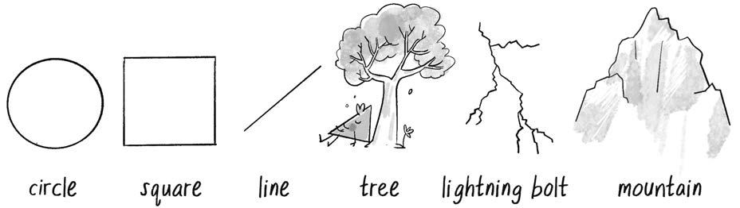

图 8.1, 理想化的欧几里得形状与自然界中的树, 闪电和山体轮廓对比. PDF 第 438 页精确提取.

当计算设计需要超越 `circle()`, `square()` 和 `line()` 等基础图元时, 就需要另一类几何语言, 即自然的几何学: **分形**. 本章讨论分形背后的思想, 以及用程序模拟分形几何的主要技术.

## 什么是分形

**分形** 一词源于拉丁语 *fractus*, 含义接近破碎或断裂. Benoit Mandelbrot 在 1975 年推广了这一术语. 可以把分形理解为一种粗糙或碎片化的几何形状, 它能够被分成若干部分, 而每一部分都至少近似于整体的缩小副本.

树的分枝结构是最直观的例子. 一根主干末端分成若干枝条, 每条枝条末端继续分枝, 新枝条再次分枝, 层层展开.

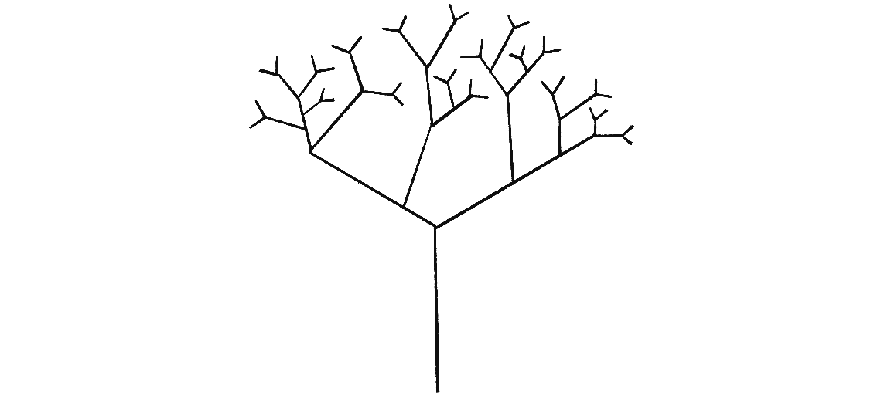

图 8.2, 具有递归分枝结构的分形树. PDF 第 439 页精确提取.

从树上取下一根枝条单独观察, 它仍然近似一棵更小的树. 这种整体和局部之间的相似关系称为 **自相似性**.

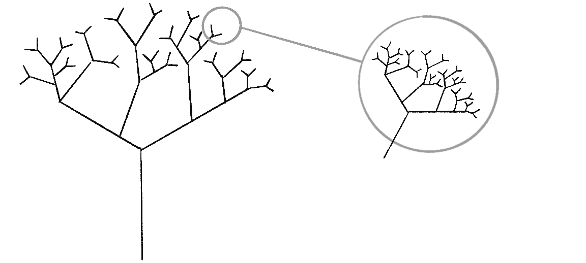

图 8.3, 放大一根树枝后, 局部仍重复整体的分枝结构. PDF 第 439 页精确提取.

并非所有分形都像理想分形树那样严格自相似. 海岸线是另一类典型案例. 在没有比例尺时, 很难仅凭轮廓判断图中展示的是整个岛屿, 还是海岸线的一小段.

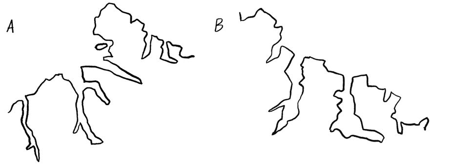

图 8.4, 两段未标比例尺的 Greenland 海岸线. B 是 A 中某一小段的放大图. PDF 第 440 页精确提取.

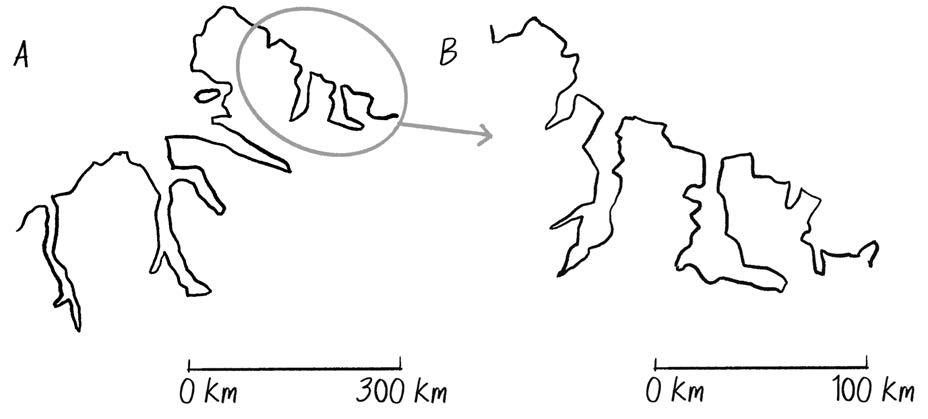

图 8.5, 加入比例尺后的两段海岸线. B 约为 A 局部区域的 3 倍放大. PDF 第 440 页精确提取.

海岸线属于 **随机分形**, 它由概率和随机性塑造. 与完全可预测的确定性分形树不同, 随机分形通常只在统计意义上自相似. 不同尺度的细节并不完全一致, 但粗糙程度, 轮廓品质和整体观感保持相似. 本章将同时讨论确定性分形和随机分形.

仅有自相似还不足以构成分形. 一条直线在任意尺度上都像直线, 也可以看成许多小线段的组合, 但直线通常不被称为分形. 分形在不断缩小的尺度上仍具有精细结构, 并且无法仅用简单的欧几里得形状描述. 海岸线越放大, 越会出现新的弯折和扰动.

### Mandelbrot 集

最著名的分形图案之一以 Mandelbrot 命名. Mandelbrot 集把复数反复送入一个迭代函数, 然后判断数值是否逃向无穷, 或者始终保持有界. 这种方法称为 **逃逸时间算法**.

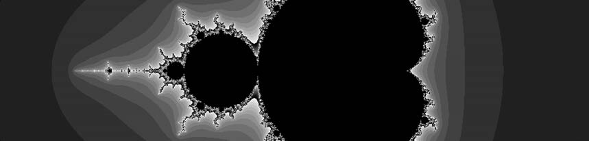

Mandelbrot 集局部结构. 黑色区域表示迭代过程中保持有界的点, 周围灰度表现逃逸速度. PDF 第 441 页精确提取.

Mandelbrot 集的数学极其丰富, 但对于本章的编程主线而言, 递归生成技术更加直接和实用. 分形思想也远早于现代数学命名. 许多传统村落布局, 建筑和织物中都能看到多尺度重复与分形特征, 说明人类长期以来一直在使用这种结构组织视觉世界.

## 递归

除自相似外, 分形几何的另一个核心是 **递归**. 递归表示重复应用一条规则, 并把一次迭代的结果作为下一次迭代的起点. 这条规则常称为 **生成规则** 或 production rule.

Georg Cantor 在 1883 年提出的一组规则能够生成无限集合. 从一条线段开始, 去掉中间三分之一, 留下左右两段. 然后对剩余的每条线段再次应用同一规则, 继续去掉各自的中间三分之一.

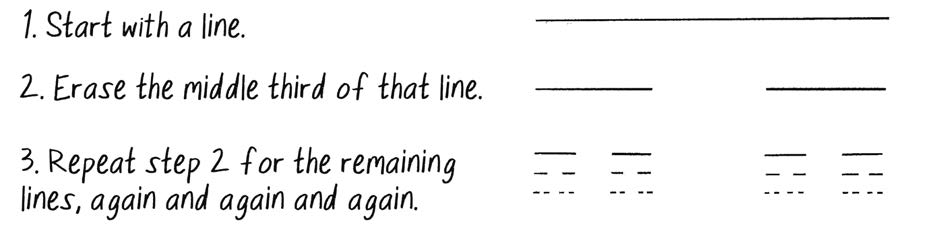

图 8.6, 生成 Cantor 集的递归规则. 每一代都把现有线段分成三份并移除中间部分. PDF 第 442 页精确提取.

规则形成反馈回路. 一条线变成两条, 两条变成四条, 四条变成八条, 如此继续. Cantor 集是确定性分形, 每个局部都是整体的精确缩小副本.

数学研究会讨论无限递归的极限, 但 p5.js 画布只有有限像素, 浏览器也只有有限的调用栈和内存. 因此程序必须设置终止条件, 在结构小到某个阈值时停止递归.

### 实现递归函数

递归在代码中的本质是函数调用自身. 普通函数经常调用其他函数:

    function someFunction() {
      background(0);
    }

递归函数则在定义内部再次调用自己:

    function someFunction() {
      someFunction();
    }

这段代码缺少终止条件, 会无限调用并最终触发 `Maximum call stack size exceeded` 错误. 正确的递归函数通常包含两个部分:

1.  **基本情况** 或退出条件, 直接返回结果并停止继续递归.
2.  **递归情况**, 把规模更小的问题再次交给同一个函数.

阶乘是经典例子. 对正整数$n$:

$$
n! = n \times (n-1) \times \cdots \times 3 \times 2 \times 1
$$

并规定:

$$
0! = 1
$$

使用普通循环可写成:

    function factorial(n) {
      let value = 1;
      for (let i = 0; i < n; i++) {
        value = value * (i + 1);
      }
      return value;
    }

阶乘同时具有自引用形式:

$$
n! = n \times (n-1)!, \qquad 0! = 1
$$

因此可写成递归函数:

    function factorial(n) {
      if (n <= 1) {
        return 1;
      } else {
        return n * factorial(n - 1);
      }
    }

调用 `factorial(4)` 时, 函数依次进入 `factorial(3)`, `factorial(2)` 和 `factorial(1)`. 到达退出条件后, 返回值再从最深层逐级展开, 得到 $1$, $2$, $6$, 最终得到 $24$.

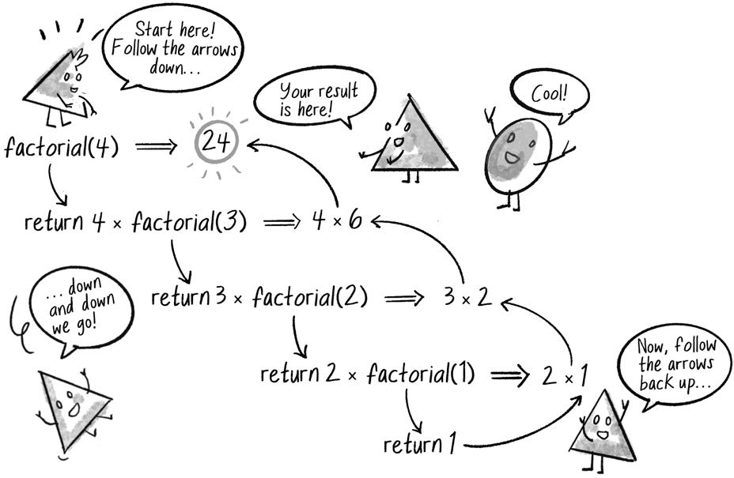

图 8.7, `factorial(4)` 的递归调用和返回过程. PDF 第 444 页精确提取.

图形递归采用同样思路, 只是递归步骤不一定返回数值, 而是绘制形状.

### 示例 8.1: 一次递归的同心圆

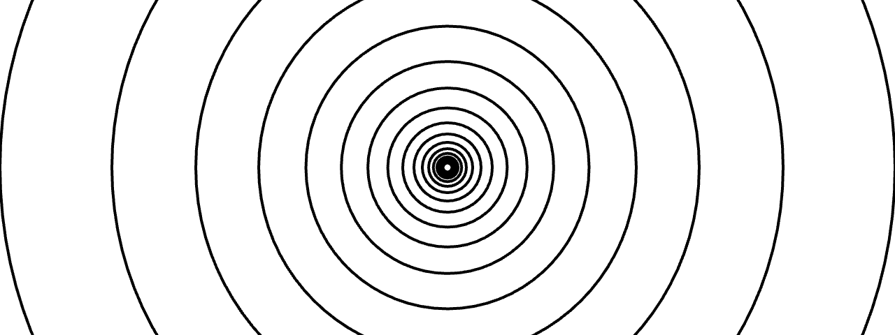

示例 8.1, 半径逐次缩小的同心圆. PDF 第 445 页精确提取.

    function drawCircles(x, y, r) {
      circle(x, y, r * 2);
      if (r > 4) {
        r *= 0.75;
        drawCircles(x, y, r);
      }
    }

函数先绘制当前圆, 然后在半径仍大于 4 时缩小半径并调用自己. 结果是一组逐渐向中心收缩的圆. 这个例子也可以用循环实现, 但它建立了图形递归的基本形态.

### 示例 8.2: 每个圆递归两次

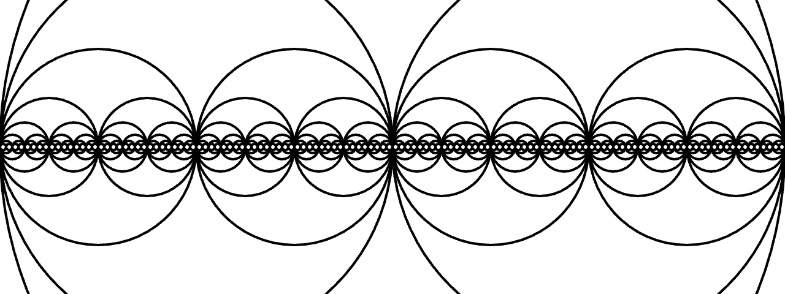

示例 8.2, 每个圆在左右两侧生成两个更小的圆. PDF 第 446 页精确提取.

    function setup() {
      createCanvas(640, 240);
    }

    function draw() {
      background(255);
      drawCircles(width / 2, height / 2, 320);
    }

    function drawCircles(x, y, radius) {
      stroke(0);
      noFill();
      circle(x, y, radius * 2);
      if (radius > 4) {
        drawCircles(x + radius / 2, y, radius / 2);
        drawCircles(x - radius / 2, y, radius / 2);
      }
    }

一个函数在每层调用自身两次后, 递归树开始分叉. 每个圆产生左右两个子圆, 子圆再继续生成更小的子圆.

### 示例 8.3: 每个圆递归四次

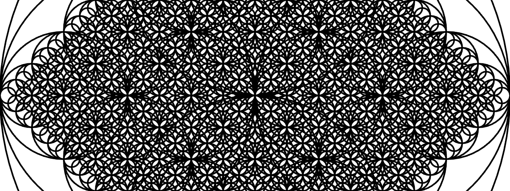

示例 8.3, 每个圆分别在左, 右, 上, 下生成四个子圆. PDF 第 447 页精确提取.

    function drawCircles(x, y, radius) {
      stroke(0);
      noFill();
      circle(x, y, radius * 2);
      if (radius > 16) {
        drawCircles(x + radius / 2, y, radius / 2);
        drawCircles(x - radius / 2, y, radius / 2);
        drawCircles(x, y + radius / 2, radius / 2);
        drawCircles(x, y - radius / 2, radius / 2);
      }
    }

仅增加两次递归调用, 图案复杂度就迅速上升. 若每层调用 $b$ 次并递归 $d$ 层, 节点数量大致按 $b^d$ 增长. 因此退出阈值不仅决定视觉细节, 也直接决定性能.

### 使用递归绘制 Cantor 集

首先定义一个绘制水平线段的函数:

    function cantor(x, y, length) {
      line(x, y, x + length, y);
    }

调用:

    cantor(10, 20, width - 20);

会得到一条从 $(x,y)$ 开始, 长度为 `length` 的线段.

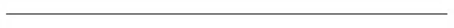

图 8.8, 一次 `cantor()` 调用绘制出的单条线段. PDF 第 448 页精确提取.

Cantor 规则保留原线段的左三分之一和右三分之一, 去掉中间三分之一.

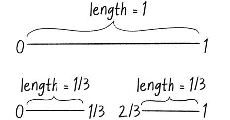

图 8.9, 一条长度为 1 的线段生成两条长度为 1/3 的线段. PDF 第 448 页精确提取.

若手工绘制两代, 可以写成:

    function cantor(x, y, length) {
      line(x, y, x + length, y);
      line(x, y + 20, x + length / 3, y + 20);
      line(x + (2 * length) / 3, y + 20, x + length, y + 20);
    }

图 8.10, 手工应用一次 Cantor 规则后得到的两代线段. PDF 第 448 页精确提取.

继续手写会很快失控. 下一代需要 4 条线, 再下一代需要 8 条, 然后是 16 条. 关键观察是: `cantor()` 本身已经表示 "在指定位置画一条指定长度的线". 因此不应直接调用 `line()` 绘制下一代, 而应让 `cantor()` 调用自身:

    function cantor(x, y, length) {
      line(x, y, x + length, y);
      cantor(x, y + 20, length / 3);
      cantor(x + (2 * length) / 3, y + 20, length / 3);
    }

还必须加入退出条件. 当线段长度小于等于 1 像素时停止.

### 示例 8.4: Cantor 集

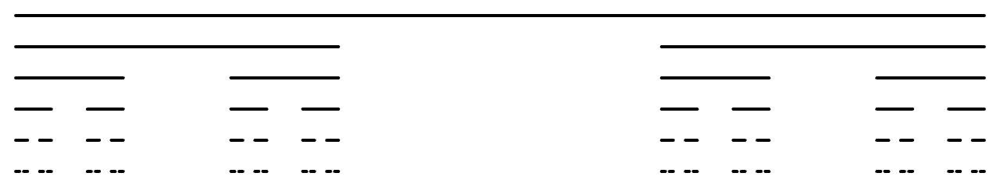

示例 8.4, 使用两个递归调用生成的 Cantor 集. PDF 第 450 页精确提取.

    function cantor(x, y, length) {
      if (length > 1) {
        line(x, y, x + length, y);
        cantor(x, y + 20, length / 3);
        cantor(x + (2 * length) / 3, y + 20, length / 3);
      }
    }

这个函数非常简洁, 但它只负责立即绘制图形. 若希望每条线段成为能够独立运动, 受力或改变样式的对象, 就需要把递归生成过程与对象数组结合. Koch 曲线将采用这种结构.

### 练习 8.1

参考示例 8.2 和 8.3, 设计自己的递归图案. 可以让每条线产生多条旋转, 缩短或偏移的新线.

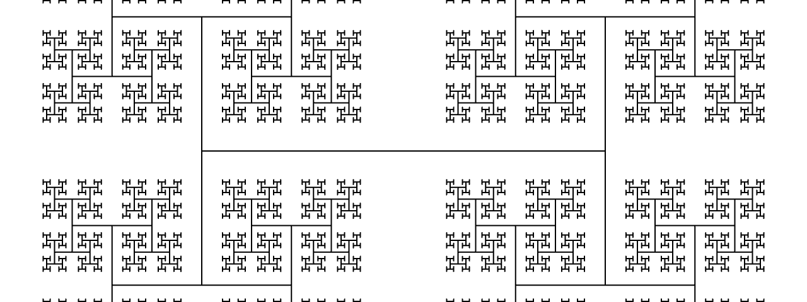

练习 8.1 的一种线段递归图案. PDF 第 450 页精确提取.

## Koch 曲线

Koch 曲线由 Helge von Koch 在 1904 年提出. 它也从一条线开始, 但每次迭代执行以下规则:

1.  从一条线段开始.
2.  把线段分成三等份.
3.  以中间三分之一为底边构造等边三角形.
4.  删除原来的中间三分之一.
5.  对剩余四条线段重复同一规则.

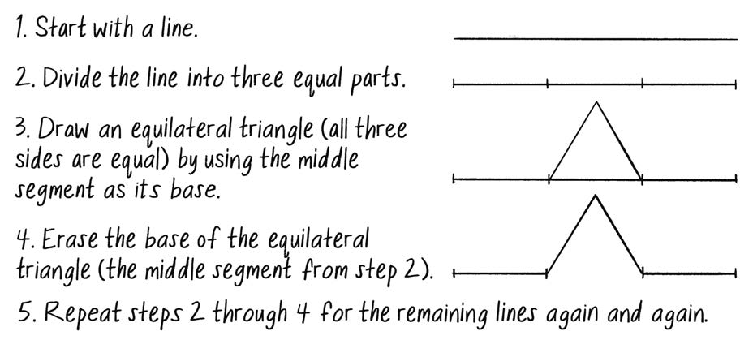

图 8.11, Koch 曲线的五步生成规则. PDF 第 451 页精确提取.

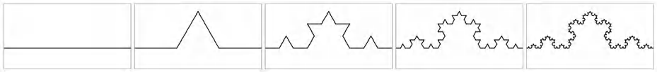

图 8.12, Koch 曲线在多次迭代中的演化. PDF 第 451 页精确提取.

Koch 曲线和其他分形有时被称为数学怪物. 若初始线长为 1, 第一次迭代后总长度为 $4/3$, 第二次为 $16/9$, 第 $n$ 次为:

$$
L_n = \left(\frac{4}{3}\right)^n
$$

当 $n\to\infty$ 时, 总长度趋向无穷, 但曲线仍被限制在有限区域内. 在像素画布中只需限制迭代次数, 不会真正到达无限过程.

本章不直接写一个绘制后即消失的递归函数, 而是把每个线段建模为独立对象. 这样可以让线段单独移动, 参与物理模拟, 或拥有不同颜色和粗细.

### `KochLine` 类

每条线段保存起点和终点, 两者都是 `p5.Vector`:

    class KochLine {
      constructor(a, b) {
        this.start = a.copy();
        this.end = b.copy();
      }

      show() {
        stroke(0);
        line(this.start.x, this.start.y, this.end.x, this.end.y);
      }
    }

主程序使用数组保存当前世代的全部线段:

    let segments = [];

    function setup() {
      createCanvas(640, 240);
      let start = createVector(0, 200);
      let end = createVector(width, 200);
      segments.push(new KochLine(start, end));
    }

    function draw() {
      background(255);
      for (let segment of segments) {
        segment.show();
      }
    }

生成下一代时, 使用 `next` 数组暂存新线段. 当前世代的每条线段会生成四条新线段, 完成后令 `segments = next`.

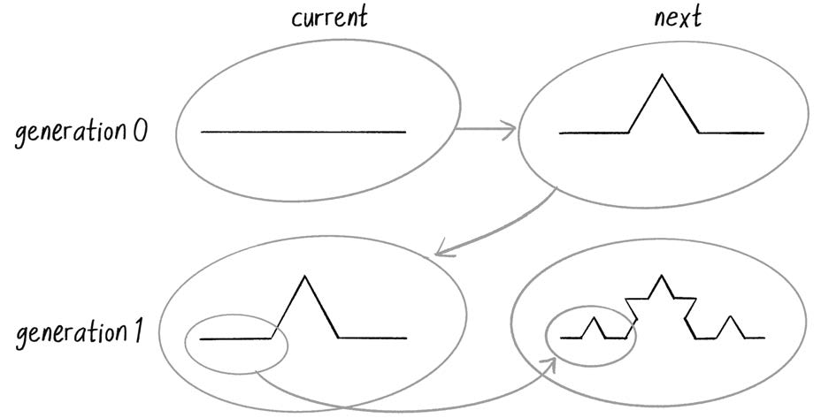

图 8.13, 从 current 计算 next, 然后让 next 成为新的 current. PDF 第 454 页精确提取.

    function generate() {
      let next = [];

      for (let segment of segments) {
        let [a, b, c, d, e] = segment.kochPoints();
        next.push(new KochLine(a, b));
        next.push(new KochLine(b, c));
        next.push(new KochLine(c, d));
        next.push(new KochLine(d, e));
      }

      segments = next;
    }

这里使用了数组解构. `kochPoints()` 返回包含五个向量的数组, 语句 `let [a, b, c, d, e] = ...` 将其依次拆分到五个变量中.

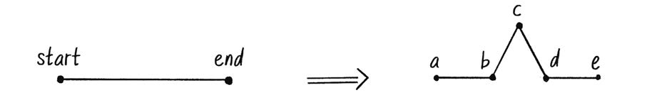

图 8.14, 原来两个端点被转换为五个点, 从而形成四条新线段. PDF 第 455 页精确提取.

`a` 和 `e` 只是原始起点和终点的副本. 为求 `b` 和 `d`, 先构造从起点指向终点的向量 $\vec v$, 再把其长度缩短为三分之一. `b` 位于起点加 $\vec v/3$ 的位置, `d` 再向前移动一个 $\vec v/3$.

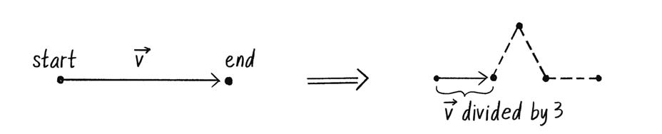

图 8.15, 通过把起点到终点的向量除以 3, 计算下一代的三等分点. PDF 第 456 页精确提取.

`c` 是等边三角形顶点. 把三分之一长度的向量旋转 $-\pi/3$, 再加到 `b` 上即可得到.

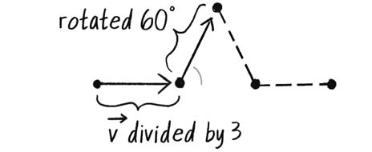

图 8.16, 把三分之一向量旋转 60 度并加到 `b` 上, 得到顶点 `c`. PDF 第 456 页精确提取.

    kochPoints() {
      let a = this.start.copy();
      let e = this.end.copy();

      let v = p5.Vector.sub(this.end, this.start);
      v.div(3);

      let b = p5.Vector.add(a, v);
      let d = p5.Vector.add(b, v);

      v.rotate(-PI / 3);
      let c = p5.Vector.add(b, v);

      return [a, b, c, d, e];
    }

### 示例 8.5: Koch 曲线

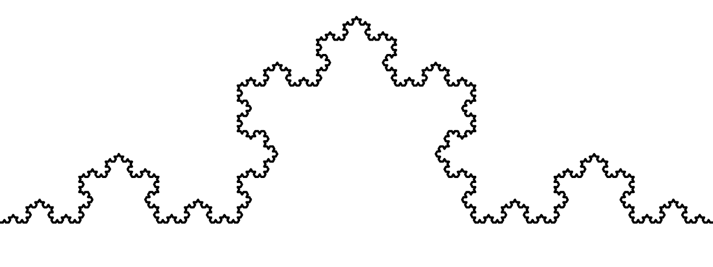

示例 8.5, 迭代五次后的 Koch 曲线. PDF 第 457 页精确提取.

    let segments = [];

    function setup() {
      createCanvas(640, 240);

      let start = createVector(0, 200);
      let end = createVector(width, 200);
      segments.push(new KochLine(start, end));

      for (let i = 0; i < 5; i++) {
        generate();
      }
    }

    function draw() {
      background(255);
      for (let segment of segments) {
        segment.show();
      }
    }

每次迭代都把一条线变成四条. 五次迭代后共有 $4^5=1024$ 条线段. 也可以使用最小线长作为停止条件, 或提供按钮让用户逐代生成.

### 练习 8.2

绘制 Koch 雪花, 即把三条 Koch 曲线首尾相连构成三角形. 也可以探索其他闭合变体.

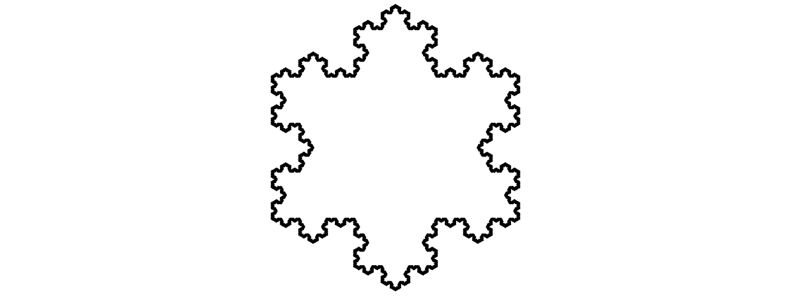

练习 8.2, 三条 Koch 曲线组成的 Koch 雪花. PDF 第 458 页精确提取.

### 练习 8.3

为 Koch 曲线添加动画. 可以从左到右逐步绘制, 改变每条线段的样式, 让线段独立移动, 或把每条线段转换为 Toxiclibs.js 弹簧或 Matter.js 约束.

### 练习 8.4

使用对象和数组重写 Cantor 集, 让每条线段成为独立对象.

### 练习 8.5

使用递归绘制 Sierpinski 三角形.

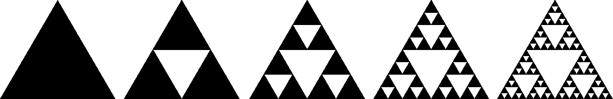

练习 8.5, Sierpinski 三角形从初始三角形到多代递归结构. PDF 第 459 页精确提取.

## 树

前面的 Cantor 集和 Koch 曲线都是确定性的, 每次运行都会产生相同结果. 它们适合展示递归和经典分形, 但过于精确, 不太像真实自然对象. 树的分枝结构可以先用确定性规则生成, 再加入随机性变成随机分形.

### 确定性版本

确定性分形树使用三条规则:

1.  画一条线段.
2.  在线段末端分别向左和向右旋转一定角度, 绘制更短的两条枝条.
3.  对每条新枝条重复相同过程.

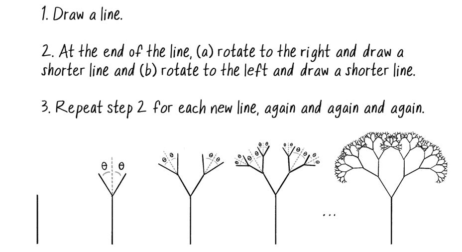

图 8.17, 分形树的确定性生成规则和连续世代. PDF 第 460 页精确提取.

与 Cantor 集相比, 树的难点在于每一条新枝相对于父枝旋转. p5.js 的 `translate()`, `rotate()`, `push()` 和 `pop()` 可以管理坐标系变换.

树干从画布底部中央开始, 先移动原点:

    translate(width / 2, height);

向上画一条长度 100 的线:

    line(0, 0, 0, -100);

随后把原点移动到线段末端, 旋转 30 度并画下一枝:

    translate(0, -100);
    rotate(PI / 6);
    line(0, 0, 0, -100);

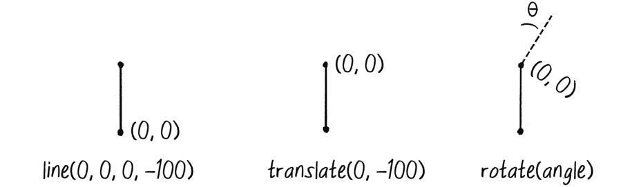

图 8.18, 绘制一条线, 把原点移动到末端, 然后旋转坐标系绘制下一枝. PDF 第 461 页精确提取.

为了从同一个分叉点绘制左右两枝, 需要在右枝之前 `push()` 保存状态, 绘制后 `pop()` 恢复状态, 再旋转到左侧.

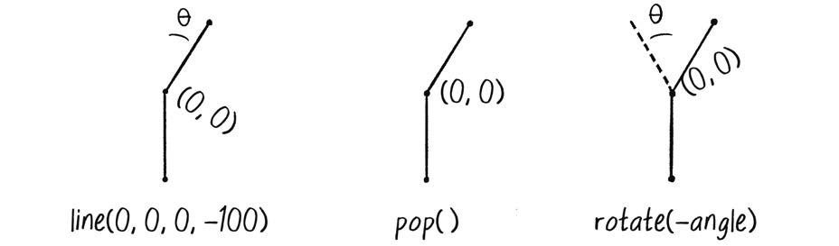

图 8.19, `pop()` 恢复分叉点状态后绘制左枝. PDF 第 461 页精确提取.

    translate(width / 2, height);
    line(0, 0, 0, -100);
    translate(0, -100);

    push();
    rotate(PI / 6);
    line(0, 0, 0, -100);
    pop();

    push();
    rotate(-PI / 6);
    line(0, 0, 0, -100);
    pop();

把后续线段替换为递归调用, 就得到分枝函数:

    function branch() {
      line(0, 0, 0, -100);
      translate(0, -100);

      push();
      rotate(PI / 6);
      branch();
      pop();

      push();
      rotate(-PI / 6);
      branch();
      pop();
    }

这段函数缺少退出条件, 而且所有枝条长度相同. 让长度作为参数传入, 每代缩短为原来的 0.67, 并在长度小于等于 2 时停止:

    function branch(len) {
      line(0, 0, 0, -len);
      translate(0, -len);
      len *= 0.67;

      if (len > 2) {
        push();
        rotate(angle);
        branch(len);
        pop();

        push();
        rotate(-angle);
        branch(len);
        pop();
      }
    }

### 练习 8.6

按照递归的真实执行顺序, 给图中的每条枝条编号. JavaScript 会先沿一个方向深入到最小枝条, 再通过调用栈和 `pop()` 返回父节点, 然后绘制另一侧.

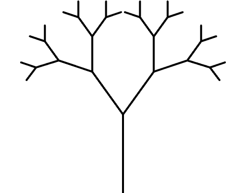

练习 8.6, 用于分析递归绘制顺序的分枝图. PDF 第 463 页精确提取.

### 示例 8.6: 递归树

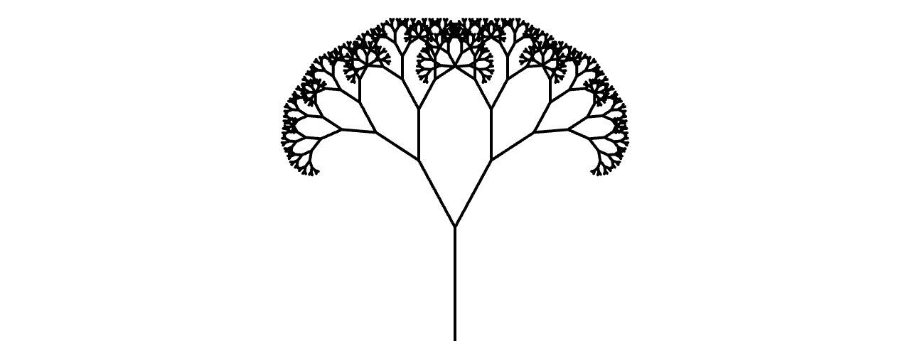

示例 8.6, 鼠标横坐标控制分枝角度的确定性递归树. PDF 第 464 页精确提取.

    let angle;

    function setup() {
      createCanvas(640, 240);
    }

    function draw() {
      background(255);
      angle = map(mouseX, 0, width, 0, HALF_PI);

      translate(width / 2, height);
      stroke(0);
      strokeWeight(2);
      branch(80);
    }

递归函数用很少代码生成完整树形, 但立即绘制的方式限制了动画能力. 若改用 `Branch` 对象数组保存每条枝条, 就能逐步生长, 改变颜色, 施加力或连接弹簧.

### 练习 8.7

让 `strokeWeight()` 随递归深度或枝长变化. 树干最粗, 后续枝条逐代变细.

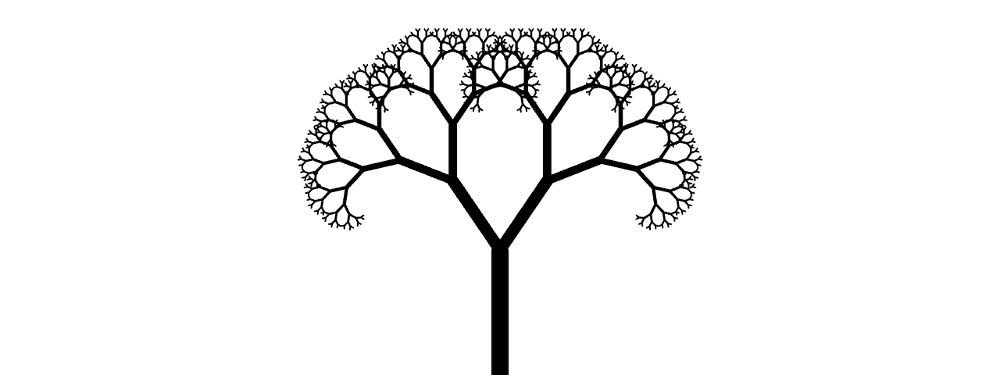

练习 8.7, 根据枝条层级改变线宽的分形树. PDF 第 465 页精确提取.

### 练习 8.8

使用 `Branch` 类和数组重建树. 用向量保存枝条方向和长度, 不再依赖画布变换. 尝试动画展示生长过程, 并在末端绘制叶片.

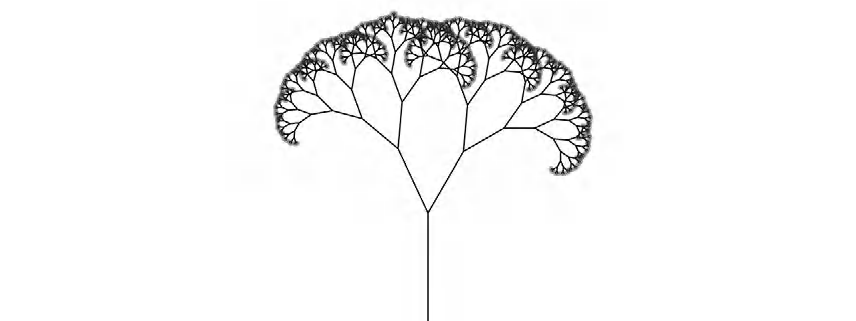

练习 8.8, 使用对象数组生成并在末端添加叶片的树形变体. PDF 第 465 页精确提取.

### 随机版本

真实树的枝长, 角度和分叉数量并不完全一致. 在确定性规则中加入少量随机性, 会把分形转换为随机分形. 每次运行的细节不同, 但整体仍保持树状统计特征.

每个枝条可以选择随机角度:

    let angle = random(0, PI / 3);

还可以让每个节点生成 1 到 3 条枝:

### 示例 8.7: 随机树

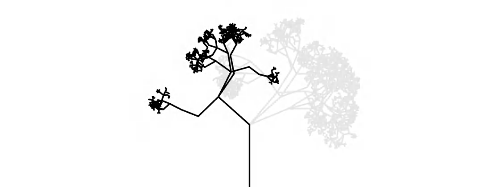

示例 8.7, 分枝数量和角度均随机的随机分形树. PDF 第 466 页精确提取.

    function branch(length) {
      line(0, 0, 0, -length);
      translate(0, -length);

      length *= 0.67;

      if (length > 2) {
        let n = Math.floor(random(1, 4));

        for (let i = 0; i < n; i++) {
          let angle = random(-PI / 2, PI / 2);
          push();
          rotate(angle);
          branch(length);
          pop();
        }
      }
    }

完全均匀的宽角度随机仍可能显得杂乱. 更自然的结果往往需要缩小角度范围, 让左右方向具有偏好, 或用 Perlin noise 让相邻枝条的变化更加平滑.

### 练习 8.9

使用 Perlin noise 决定枝条角度, 并随时间调整噪声偏移量, 让树看起来在风中摆动.

### 练习 8.10

使用 Toxiclibs.js 模拟树的物理结构. 每条枝可由两个粒子和一根弹簧组成. 需要设计固定点, 弹性和阻尼, 使树能站立而不是整体倒下.

## L-system

1968 年, 匈牙利植物学家 Aristid Lindenmayer 提出一种基于文法的系统来描述植物生长. 这种系统使用字符和生成规则构造模式, 就像自然语言文法使用规则把词组织成句子. 它被称为 **L-system**, 即 Lindenmayer system.

L-system 能用简短字符串编码复杂递归结构, 特别适合描述植物和分枝. 实现 L-system 需要字符串, 递归或迭代, 以及绘图变换.

### JavaScript 字符串基础

    let message1 = "Hello!";
    let message2 = message1 + " Goodbye!";

    for (let i = 0; i < message2.length; i++) {
      let character = message2.charAt(i);
    }

字符串由引号包围, 可以用 `+` 拼接. `length` 保存字符数量, `charAt(i)` 按索引取得单个字符.

### L-system 的三个组成部分

1.  **Alphabet**, 字母表. 定义系统允许使用的全部字符.
2.  **Axiom**, 公理. 使用字母表字符构造的初始句子, 也就是第 0 代.
3.  **Rules**, 生成规则. 把当前句子中的 predecessor 替换为 successor, 得到下一代.

例如规则 $A \rightarrow AB$ 表示: 当前句子中每个 `A` 在下一代都替换为 `AB`.

Lindenmayer 最初用一个简单系统描述藻类生长:

- Alphabet: `A, B`.
- Axiom: `A`.
- Rules: $A\rightarrow AB$, $B\rightarrow A$.

连续世代为:

    第 0 代: A
    第 1 代: AB
    第 2 代: ABA
    第 3 代: ABAAB
    第 4 代: ABAABABA

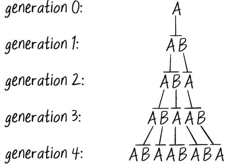

图 8.20, L-system 从公理开始逐代应用规则, 形成不断增长的字符串. PDF 第 468 页精确提取.

程序使用 `current` 保存当前代, `next` 保存下一代:

    let current = "A";
    let next = "";

    for (let i = 0; i < current.length; i++) {
      let c = current.charAt(i);

      if (c === "A") {
        next += "AB";
      } else if (c === "B") {
        next += "A";
      }
    }

    current = next;

### 示例 8.8: 简单 L-system 句子生成

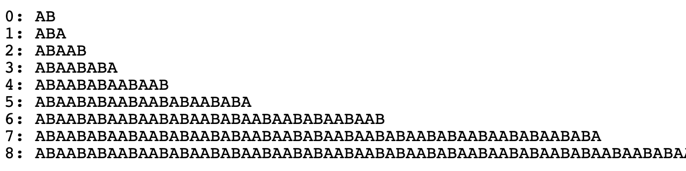

示例 8.8, 在画布中显示 L-system 的九个世代. PDF 第 469 页精确提取.

    let current = "A";

    function setup() {
      createCanvas(640, 160);
      background(255);
      noLoop();

      for (let i = 0; i < 9; i++) {
        generate();
        textSize(16);
        textFont("courier");
        text(i + ": " + current, 4, 20 + i * 16);
      }
    }

    function generate() {
      let next = "";

      for (let i = 0; i < current.length; i++) {
        let c = current.charAt(i);

        if (c === "A") {
          next += "AB";
        } else if (c === "B") {
          next += "A";
        }
      }

      current = next;
    }

字符串本身还不是植物. 要把文法变成图形, 需要把字符解释为绘图命令. 例如使用另一个系统:

- Alphabet: `A, B`.
- Axiom: `A`.
- Rules: $A\rightarrow ABA$, $B\rightarrow BBB$.
- `A`: 向前画线.
- `B`: 向前移动但不画线.

把句子逐字符执行后, 会得到 Cantor 集.

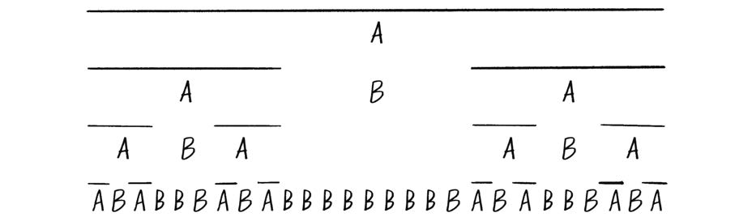

图 8.21, 使用 L-system 字母表和绘图解释生成 Cantor 集. PDF 第 471 页精确提取.

### Turtle graphics

许多 L-system 使用以下字符:

| 字符 | 绘图含义           |
|------|--------------------|
| `F`  | 画一条线并向前移动 |
| `G`  | 只向前移动, 不画线 |
| `+`  | 向右旋转           |
| `-`  | 向左旋转           |
| `[`  | 保存当前变换状态   |
| `]`  | 恢复此前保存的状态 |

这种绘图方式称为 **turtle graphics**. 可以想象一只海龟在画布中执行 "前进", "转向", "抬笔", "落笔" 和 "保存位置" 等命令. 在 p5.js 中可以用 `line()`, `translate()`, `rotate()`, `push()` 和 `pop()` 实现.

字符和 p5.js 操作的直接映射如下:

    // F
    line(0, 0, 0, length);
    translate(0, length);

    // G
    translate(0, length);

    // +
    rotate(angle);

    // -
    rotate(-angle);

    // [
    push();

    // ]
    pop();

遍历句子并执行命令:

    for (let i = 0; i < sentence.length; i++) {
      let c = sentence.charAt(i);

      if (c === "F") {
        line(0, 0, length, 0);
        translate(length, 0);
      } else if (c === "G") {
        translate(length, 0);
      } else if (c === "+") {
        rotate(angle);
      } else if (c === "-") {
        rotate(-angle);
      } else if (c === "[") {
        push();
      } else if (c === "]") {
        pop();
      }
    }

方括号尤其重要. `[` 保存分叉点的位置和方向, `]` 返回该分叉点, 因而一句字符串可以描述树状分支.

本章最后使用以下系统:

- Alphabet: `F, G, +, -, [, ]`.
- Axiom: `F`.
- Rule: $F \rightarrow FF+[+F-F-F]-[-F+F+F]$.

程序可组织为三个部分:

- `rules`: JavaScript 对象字面量, 保存 predecessor 和 successor.
- `LSystem`: 负责生成下一代句子.
- `Turtle`: 负责解释句子并绘图.

### 示例 8.9: 一个 L-system

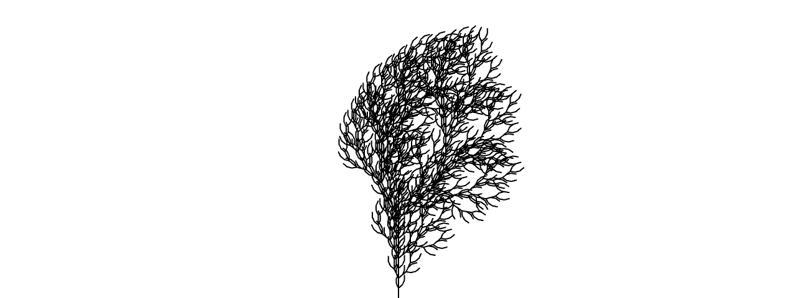

示例 8.9, 使用四代 L-system 字符串和 turtle graphics 绘制的植物结构. PDF 第 473 页精确提取.

    let lsystem;
    let turtle;

    function setup() {
      createCanvas(640, 240);

      let rules = {
        "F": "FF+[+F-F-F]-[-F+F+F]",
      };

      lsystem = new LSystem("F", rules);

      for (let i = 0; i < 4; i++) {
        lsystem.generate();
      }

      turtle = new Turtle(4, radians(25));
    }

    function draw() {
      background(255);
      translate(width / 2, height);
      turtle.render(lsystem.sentence);
    }

`rules` 使用对象字面量而不是单独的 `Rule` 类. 键 `"F"` 表示需要替换的字符, 值 `"FF+[+F-F-F]-[-F+F+F]"` 是替换结果. 若有多个 predecessor, 可以继续添加键值对.

为使示例结构完整, `LSystem` 的核心逻辑可写成:

    class LSystem {
      constructor(axiom, rules) {
        this.sentence = axiom;
        this.rules = rules;
      }

      generate() {
        let next = "";

        for (let i = 0; i < this.sentence.length; i++) {
          let c = this.sentence.charAt(i);
          next += this.rules[c] ?? c;
        }

        this.sentence = next;
      }
    }

`Turtle` 的核心解释器可写成:

    class Turtle {
      constructor(length, angle) {
        this.length = length;
        this.angle = angle;
      }

      render(sentence) {
        stroke(0);

        for (let i = 0; i < sentence.length; i++) {
          let c = sentence.charAt(i);

          if (c === "F") {
            line(0, 0, 0, -this.length);
            translate(0, -this.length);
          } else if (c === "G") {
            translate(0, -this.length);
          } else if (c === "+") {
            rotate(this.angle);
          } else if (c === "-") {
            rotate(-this.angle);
          } else if (c === "[") {
            push();
          } else if (c === "]") {
            pop();
          }
        }
      }
    }

### 练习 8.11

把 L-system 句子解释为创建对象的指令, 将对象保存到数组中. 不使用画布变换, 而像 Koch 曲线一样使用三角函数和向量计算旋转后的端点.

### 练习 8.12

参考 Przemyslaw Prusinkiewicz 和 Aristid Lindenmayer 的 *The Algorithmic Beauty of Plants*, 为示例 8.9 增加更多字符, 绘图命令, 参数化规则或随机生成规则.

### 练习 8.13

分形不仅存在于图像中. 音乐结构, 文本结构和叙事结构也可包含递归和自相似关系. 尝试使用本章算法生成声音, 节奏, 乐句或文本.

## 生态系统项目

把分形加入持续构建的数字生态系统, 可以从以下方向开始:

- 在环境中加入植物型生物.
- 让分形树末端生长叶片或花朵.
- 让风力作用于叶片, 使其脱落并成为粒子.
- 在枝条末端生成能够被其他生物采食的果实.
- 使用分形图案设计生物外形, 皮肤纹理, 触手或血管结构.
- 使用 L-system 生成生物移动或行为指令, 而不只是生成静态形状.
- 把确定性规则与随机扰动结合, 让生态系统保持可识别结构, 同时具有个体差异.

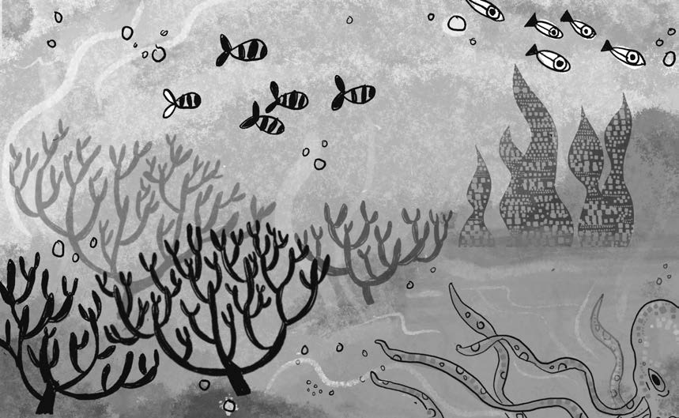

第 8 章生态系统项目, 分形珊瑚, 植物和鱼群结构被组合到水下生态环境中. PDF 第 475 页精确提取.
