# 第 10 章: 神经网络

> 人脑拥有约 1000 亿个神经元, 每个神经元又与约 1 万个其他神经元相连. 坐在你肩膀上的, 是已知宇宙中最复杂的对象.
>
> - Michio Kaku

秘鲁 Cusco 的 Machu Picchu Museum 展出的 khipu, 又称 quipu. 古代 Inca 人以不同颜色的绳索, 结型和排列编码人口, 历法和其他记录. PDF 第 537 页精确提取.

本书从受力世界中的无生命物体出发, 随后赋予它们欲望, 自主性和依照规则行动的能力. 接着, 这些对象成为群体中的生物, 能够跨世代进化. 现在的问题是: 每个生物究竟如何作出决定? 它能否通过经验调整选择? 一个计算实体能否处理环境信息并生成行动?

本章再次从自然界汲取灵感, 这一次关注人脑. 生物神经网络由大量相互连接的神经元构成. 树突接收输入信号, 神经元依据这些输入决定是否通过轴突发送输出信号. 真实大脑的工作机制极其复杂, 本章不会试图精确复刻神经生物学, 而是使用这一思想构建可理解, 可编程的人工系统.

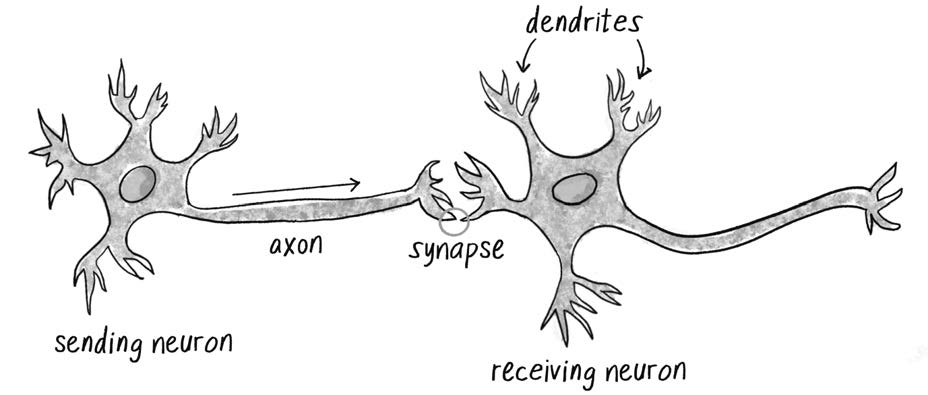

图 10.1, 一个发送神经元通过轴突和突触连接到接收神经元的树突. PDF 第 538 页精确提取.

本章首先概览神经网络的核心属性, 然后从零实现最简单的网络, 即只有一个神经元的感知机. 随后使用 ml5.js 构建多层网络. 这些内容将为第 11 章做好准备, 届时遗传算法, 神经网络和物理模拟会合并为一个完整系统.

## 人工神经网络简介

1943 年, 神经科学家 Warren S. McCulloch 和逻辑学家 Walter Pitts 提出了早期人工神经元模型. 他们把神经元描述为网络中的计算单元: 接收输入, 处理输入, 再产生输出. 这种模型并不是大脑的精确复制品, 而是受大脑启发, 用于解决传统程序较难处理的问题.

计算机能够瞬间算出大型整数的平方根, 但识别照片中的猫和狗, 从嘈杂咖啡馆中分离一个人的声音, 或理解手势, 对机器而言反而更困难. 神经网络尤其适合以下场景:

- **模式识别**: 从数据中检测, 解释和分类特征, 包括图像物体识别, OCR 和手势识别.
- **时间序列预测和异常检测**: 预测市场, 天气或传感器趋势, 检测网络攻击, 欺诈和设备异常.
- **控制和自适应决策**: 自动驾驶, 无人机, 游戏策略, 动态定价和推荐系统.
- **信号处理和软传感器**: 降噪, 语音增强, 助听设备, 以及融合多个数据源推断环境状态.
- **自然语言处理**: 机器翻译, 情感分析, 文本摘要, 数字助理和聊天机器人.
- **生成模型**: 合成图像, 音频和视频, 提升分辨率, 转换风格并生成新内容.

这一领域变化极快, 单独介绍全部应用足以写成一整套书. 本章的目标不是穷尽应用, 而是建立能够继续学习的基础模型.

## 神经网络如何工作

传统程序通常按线性顺序执行指令. 神经网络则是 **连接主义系统**, 信息通过大量节点和连接并行传播. 单个神经元的行为很简单: 读取数值输入, 进行计算, 输出另一个数值. 但大量简单节点组合后, 可以产生复杂行为, 这与鸟群, 元胞自动机等复杂系统非常相似.

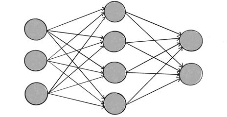

图 10.2, 神经网络由神经元节点和带权连接组成. PDF 第 540 页精确提取.

神经网络还是一种 **复杂自适应系统**. 它可以根据流经网络的信息改变内部结构. 每条连接都有一个权重, 权重控制信号强弱. 如果网络输出良好, 权重可以保持不变. 如果输出产生误差, 学习算法便调整权重, 期望下一次输出更接近目标.

常见学习方式包括:

- **监督学习**: 提供输入及其已知正确答案. 网络先预测, 再把预测与答案比较, 根据误差修正权重. 本章主要使用这种方法.
- **无监督学习**: 数据没有已知标签, 网络自行寻找结构, 例如聚类和降维.
- **强化学习**: 智能体采取行动后从环境得到奖励或惩罚, 逐渐学习更优策略. 第 11 章会再次讨论它.

机器学习的关键在于, 系统能够在没有为每一种情况显式编写规则的前提下, 从样本中调整自身. 传统编程通常是:

    输入 + 人工编写的规则 -> 输出

监督机器学习则更接近:

    输入 + 期望输出 -> 学习得到的规则, 即模型参数

机器学习属于人工智能的一个分支, 但二者并不完全等同. 某些 AI 系统依靠搜索, 规划或人工规则, 并不具备自学习过程.

## 机器学习库

今天的创意编程可以借助第三方库处理神经网络训练和推理. 绝大多数研究工作使用 Python, 但浏览器环境也拥有成熟的 JavaScript 工具.

- **TensorFlow.js**: Google 维护的开源库, 可以直接在浏览器中定义, 训练和运行模型. 功能强大, 但底层 API 对初学者较陡峭.
- **ml5.js**: 构建在 TensorFlow.js 之上, 特别面向 p5.js, 艺术家, 学生和创意编码者. 它把常见任务封装为更友好的 API.

这些库不仅可以训练新模型, 还可以运行预训练模型, 例如图像分类, 姿态识别, 面部关键点, 手部关键点和文本情感分析. 预训练模型也能作为迁移学习的起点.

在进入 ml5.js 之前, 先用纯 p5.js 从零实现一个最简单的神经网络, 以看清输入, 权重, 激活和学习的基本机制.

## 感知机

**感知机 perceptron** 是最简单的神经网络, 可以看作单个计算神经元. Frank Rosenblatt 于 1957 年在 Cornell Aeronautical Laboratory 提出这一模型. 一个感知机包含一个或多个输入, 一个处理单元和一个输出.

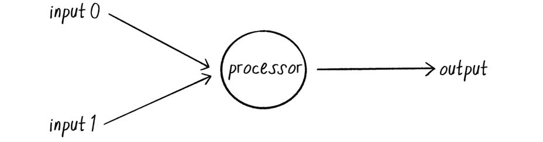

图 10.3, 具有两个输入和一个输出的简单感知机. PDF 第 543 页精确提取.

感知机采用 **前馈 feed-forward** 模型. 数据只沿一个方向流动: 输入进入神经元, 经处理后形成输出.

### 感知机的步骤

假设输入为:

| 输入                                             | 值  |
|--------------------------------------------------|-----|
| $x_{0}$ | 12  |
| $x_{1}$ | 4   |

1.  第 1 步: 对输入加权

    每个输入乘以对应权重. 权重一般初始化为 -1 到 +1 之间的随机值. 假设:

    | 权重                                             | 值  |
    |--------------------------------------------------|-----|
    | $w_{0}$ | 0.5 |
    | $w_{1}$ | -1  |

    于是:

    | 输入 | 权重 | 输入乘权重 |
    |------|------|------------|
    | 12   | 0.5  | 6          |
    | 4    | -1   | -4         |

2.  第 2 步: 求和

    $$
    \mathrm{sum}=\sum_i x_iw_i=6+(-4)=2
    $$

3.  第 3 步: 生成输出

    把加权和送入激活函数. 为了展示原理, 使用符号函数作为激活函数:

    $$
    \operatorname{sign}(z)=
    \begin{cases}
    +1,& z>0\\
    -1,& z\le 0
    \end{cases}
    $$

    因此:

    $$
    \operatorname{sign}(2)=+1
    $$

    完整算法是:

    1.  每个输入乘以对应权重.
    2.  求所有加权输入的和.
    3.  把总和送入激活函数, 得到 -1 或 +1.

    <!-- -->

        let inputs = [12, 4];
        let weights = [0.5, -1];

        let sum = 0;
        for (let i = 0; i < inputs.length; i++) {
          sum += inputs[i] * weights[i];
        }

        let output = activate(sum);

        function activate(sum) {
          if (sum > 0) {
            return 1;
          }
          return -1;
        }

    当总和恰好为 0 时, 输出 -1 还是 +1 需要人为选择. 这里把 0 归入 -1. 在实际任务中, 这一边界约定可能影响结果.

### 使用感知机进行简单模式识别

考虑一个二分类任务: 根据植物每天接收的日照量和水量, 把它们分为 xerophyte, 即适应干旱环境的旱生植物, 和 hydrophyte, 即适应水生环境的水生植物. 把日照量作为 x 轴, 水量作为 y 轴, 理想化数据可以被一条直线分开.

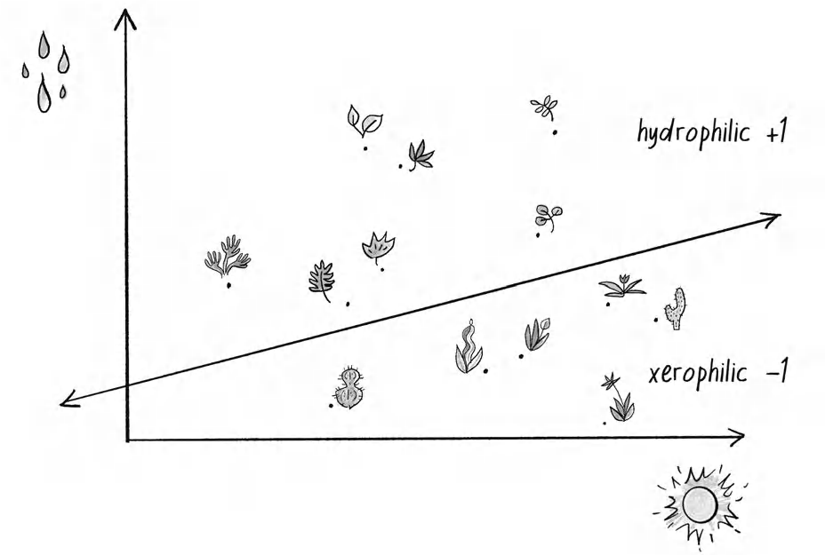

图 10.4, 以水量和日照量为二维特征, 一条直线把植物分成两类. PDF 第 546 页精确提取.

感知机接收两个输入, $x_0=x$ 和 $x_1=y$. 如果加权和为正, 输出 +1, 表示点在直线一侧. 如果为负, 输出 -1, 表示点在另一侧.

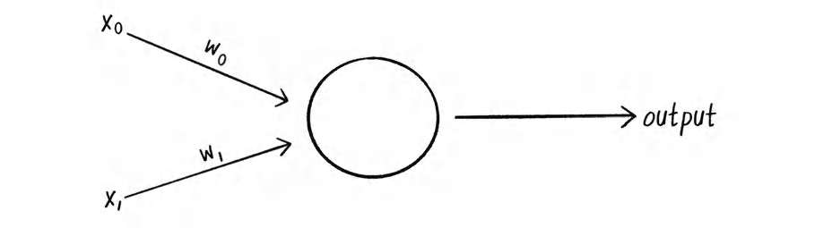

图 10.5, 两个输入各自乘以权重后进入感知机. PDF 第 547 页精确提取.

这里存在一个问题. 当输入点为 $(0,0)$ 时, 无论权重是多少, 两个加权输入都为 0. 但 $(0,0)$ 完全可能位于分类线的任意一侧. 因此需要加入始终等于 1 的 **偏置输入 bias** 及其权重.

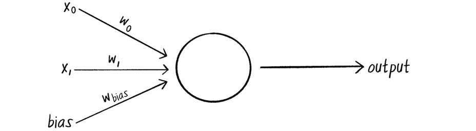

图 10.6, 感知机增加一个恒为 1 的 bias 输入和对应权重. PDF 第 547 页精确提取.

对点 $(0,0)$, 总和变为:

$$
0\cdot w_0+0\cdot w_1+1\cdot w_{bias}=w_{bias}
$$

偏置权重决定决策边界相对于原点的位置. 从几何角度看, 没有偏置的边界必须经过原点, 加入偏置后, 边界可以平移.

### 感知机代码

感知机需要保存输入权重和学习常数. `feedforward()` 接收输入数组, 计算加权和并返回激活结果.

    class Perceptron {
      constructor(totalInputs, learningConstant = 0.01) {
        this.weights = [];
        this.learningConstant = learningConstant;

        for (let i = 0; i < totalInputs; i++) {
          this.weights[i] = random(-1, 1);
        }
      }

      feedforward(inputs) {
        let sum = 0;
        for (let i = 0; i < this.weights.length; i++) {
          sum += inputs[i] * this.weights[i];
        }
        return this.activate(sum);
      }

      activate(sum) {
        return sum > 0 ? 1 : -1;
      }
    }

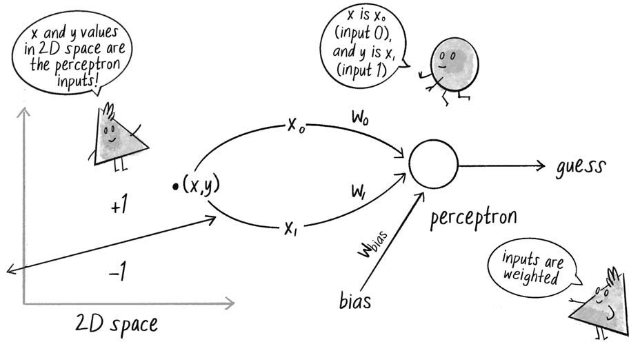

图 10.7, 二维点 $(x,y)$ 连同 bias 作为感知机输入, 感知机输出分类猜测. PDF 第 549 页精确提取.

    let perceptron = new Perceptron(3);
    let inputs = [50, -12, 1];
    let guess = perceptron.feedforward(inputs);

随机初始化权重时, 猜测成功率大约只有 50%. 要让网络学习, 使用监督学习循环:

1.  提供输入和已知答案.
2.  让感知机猜测.
3.  计算误差.
4.  根据误差调整全部权重.
5.  重复以上过程.

误差定义为:

$$
error=desired-guess
$$

因为输出只有 -1 和 +1, 所以误差只有 0, -2 和 +2 三种可能. 权重改变量为:

$$
\Delta w_i=error\times x_i
$$

加入学习常数 $c$ 后:

$$
w_i^{new}=w_i^{old}+error\times x_i\times c
$$

学习常数较大, 权重调整快, 但可能越过最佳位置. 学习常数较小, 收敛更慢, 但调整更细致.

    train(inputs, desired) {
      let guess = this.feedforward(inputs);
      let error = desired - guess;

      for (let i = 0; i < this.weights.length; i++) {
        this.weights[i] +=
          error * inputs[i] * this.learningConstant;
      }
    }

完整类如下:

    class Perceptron {
      constructor(totalInputs, learningConstant = 0.01) {
        this.weights = [];
        this.learningConstant = learningConstant;

        for (let i = 0; i < totalInputs; i++) {
          this.weights[i] = random(-1, 1);
        }
      }

      feedforward(inputs) {
        let sum = 0;
        for (let i = 0; i < this.weights.length; i++) {
          sum += inputs[i] * this.weights[i];
        }
        return this.activate(sum);
      }

      activate(sum) {
        return sum > 0 ? 1 : -1;
      }

      train(inputs, desired) {
        let guess = this.feedforward(inputs);
        let error = desired - guess;

        for (let i = 0; i < this.weights.length; i++) {
          this.weights[i] +=
            error * inputs[i] * this.learningConstant;
        }
      }
    }

### 合成训练数据

为了演示, 不必真的收集植物数据. 可以人工生成 **合成数据 synthetic data**. 定义一条直线:

$$
y=f(x)=mx+b
$$

例如:

$$
y=0.5x-1
$$

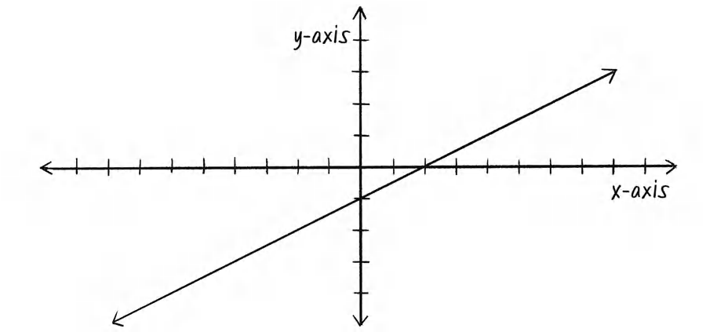

图 10.8, 直线 $y=0.5x-1$. PDF 第 553 页精确提取.

    function f(x) {
      return 0.5 * x - 1;
    }

p5.js 默认原点位于左上角, y 轴向下. 为了使用传统笛卡尔坐标系, 可以在绘制前移动原点并翻转 y 轴:

    translate(width / 2, height / 2);
    scale(1, -1);

随机生成一个点:

    let x = random(-100, 100);
    let y = random(-100, 100);
    let yline = f(x);
    let desired = y > yline ? 1 : -1;
    let trainingInputs = [x, y, 1];
    perceptron.train(trainingInputs, desired);

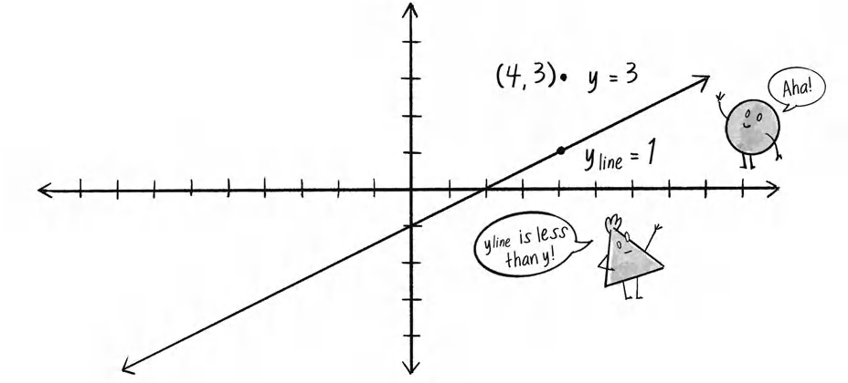

图 10.9, 当 $y>f(x)$ 时, 点位于直线上方, 期望标签为 +1. PDF 第 554 页精确提取.

### 示例 10.1: 感知机

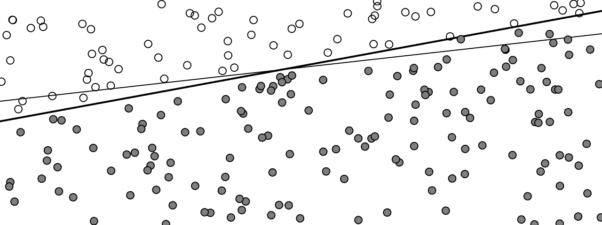

示例 10.1, 感知机在训练过程中逐渐学会区分直线两侧的点. PDF 第 555 页精确提取.

    let perceptron;
    let training = [];
    let count = 0;

    function f(x) {
      return 0.5 * x + 1;
    }

    function setup() {
      createCanvas(640, 240);
      perceptron = new Perceptron(3, 0.0001);

      for (let i = 0; i < 2000; i++) {
        let x = random(-width / 2, width / 2);
        let y = random(-height / 2, height / 2);
        training[i] = [x, y, 1];
      }
    }

    function draw() {
      background(255);
      translate(width / 2, height / 2);
      scale(1, -1);

      stroke(0);
      strokeWeight(2);
      line(
        -width / 2,
        f(-width / 2),
        width / 2,
        f(width / 2)
      );

      let x = training[count][0];
      let y = training[count][1];
      let desired = y > f(x) ? 1 : -1;

      perceptron.train(training[count], desired);
      count = (count + 1) % training.length;

      for (let dataPoint of training) {
        let guess = perceptron.feedforward(dataPoint);
        fill(guess > 0 ? 127 : 255);
        stroke(0);
        strokeWeight(1);
        circle(dataPoint[0], dataPoint[1], 8);
      }
    }

    class Perceptron {
      constructor(totalInputs, learningConstant = 0.01) {
        this.weights = [];
        this.learningConstant = learningConstant;
        for (let i = 0; i < totalInputs; i++) {
          this.weights[i] = random(-1, 1);
        }
      }

      feedforward(inputs) {
        let sum = 0;
        for (let i = 0; i < this.weights.length; i++) {
          sum += inputs[i] * this.weights[i];
        }
        return sum > 0 ? 1 : -1;
      }

      train(inputs, desired) {
        let guess = this.feedforward(inputs);
        let error = desired - guess;
        for (let i = 0; i < this.weights.length; i++) {
          this.weights[i] +=
            error * inputs[i] * this.learningConstant;
        }
      }
    }

示例中每一帧训练一个数据点. 灰色表示感知机预测 +1, 白色表示 -1. 权重并非神秘数字, 它们与决策边界的斜率和截距直接相关. 在更高维数据中, 权重定义的是高维空间里的超平面或更复杂决策边界.

### 练习 10.1

在示例 10.1 中绘制感知机当前猜测的决策边界. 提示: 根据当前权重推导直线方程.

真实数据的各个特征可能量纲差异很大. **数据归一化** 会把输入和输出映射到一致范围, 通常是 0 到 1 或 -1 到 1. 这可以避免某个数值范围特别大的特征支配训练过程.

### 练习 10.2

不用监督学习, 改用遗传算法寻找感知机权重.

### 练习 10.3

为示例加入数据归一化, 比较训练效率和稳定性.

## 把 "网络" 放回神经网络

单个感知机只能解决 **线性可分** 问题, 即可以用一条直线把两类数据分开. 若类别边界需要曲线, 单个感知机便无能为力.

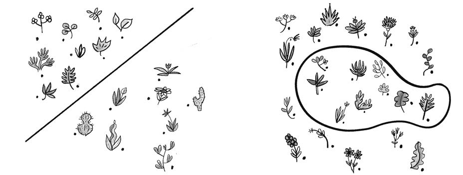

图 10.10, 左侧数据线性可分, 右侧数据需要曲线才能分开. PDF 第 558 页精确提取.

AND 和 OR 逻辑问题都是线性可分的. XOR, 即 exclusive OR, 只有在两个输入中恰好一个为真时输出真. XOR 的真值分布无法用一条直线分隔.

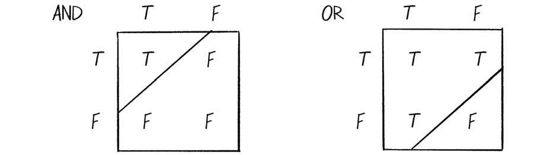

图 10.11, AND 和 OR 的真值表均可由一条直线分割. PDF 第 558 页精确提取.

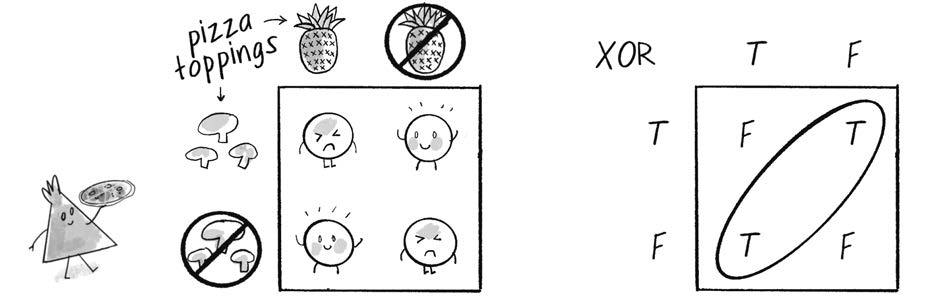

图 10.12, 菠萝和蘑菇披萨的类比以及 XOR 真值表. 真值点无法用单一直线分开. PDF 第 559 页精确提取.

如果一个感知机可以表示 OR, 另一个表示 NOT AND, 把它们组合起来便能表示 XOR. 多个感知机形成 **多层感知机 multilayer perceptron**. 网络通常包含:

- 输入层.
- 一个或多个隐藏层.
- 输出层.

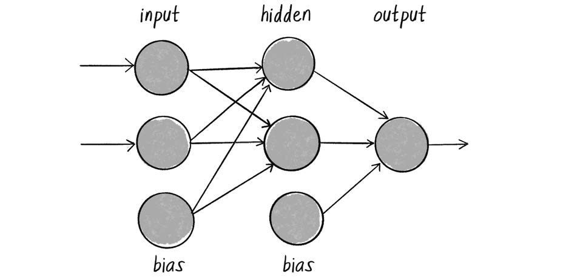

图 10.13, 多层感知机在输入和输出之间加入隐藏层. PDF 第 560 页精确提取.

多层网络仍然通过加权求和和激活函数前馈计算输出, 但训练更复杂. 最终误差必须沿网络反向传播, 才能判断每条连接对误差贡献了多少, 并按比例调整权重. 这一算法称为 **反向传播 backpropagation**.

反向传播通常涉及 sigmoid 等可微激活函数和微积分. 本章不从零实现完整反向传播, 而是把这项工作交给 ml5.js.

## 使用 ml5.js 进行机器学习

ml5.js 在 TensorFlow.js 之上提供更适合创意编码的接口. 在 `index.html` 中加入:

    

接下来构建一个鼠标手势分类器, 识别 up, down, left 和 right 四个方向.

### 机器学习生命周期

一个监督学习项目通常经历以下步骤:

1.  **识别问题**: 明确要预测什么, 输入是什么, 输出是类别, 连续数值还是序列.
2.  **收集数据**: 实验采集, 人工录入, 使用公开数据或生成合成数据.
3.  **准备数据**: 清理缺失值, 重复值和异常值, 归一化, 并划分训练集, 验证集和测试集.
4.  **选择模型**: 确定网络结构及适合任务的数据流.
5.  **训练模型**: 用训练数据反复更新网络权重, 最小化误差.
6.  **评估模型**: 使用未参与训练的数据检验泛化能力.
7.  **调节参数**: 调整学习率, epoch 数量和网络结构等超参数, 必要时返回前面的步骤.
8.  **部署模型**: 把模型用于新的现实输入.

第 0 步决定后续所有步骤. 在开始收集数据之前, 必须先明确任务是分类还是回归.

### 分类与回归

**分类 classification** 预测离散标签. 例如图像分类器可以输出 `cat` 或 `dog`.

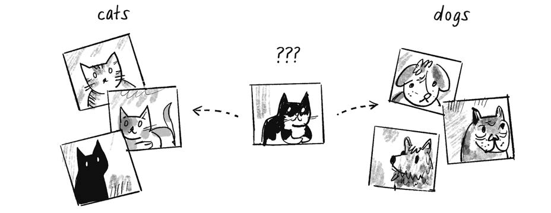

图 10.14, 把图像标记为 cats 或 dogs 的分类任务. PDF 第 563 页精确提取.

经典 MNIST 数据集包含 70,000 张 28x28 灰度手写数字图像, 标签为 0 到 9. 模型先用带标签样本训练, 再为新图像选择 10 个类别之一.

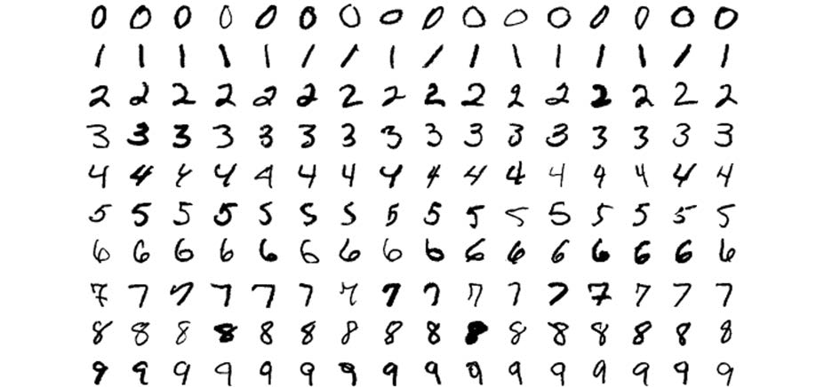

图 10.15, MNIST 数据集中的手写数字样本. PDF 第 563 页精确提取.

**回归 regression** 预测连续数值. 例如根据住户数, 房屋面积和室外温度预测每日用电量. 输出不再从固定标签中选择, 而可能是 30.5 kWh, 48.7 kWh 或任意连续值.

图 10.16, 住户数, 房屋面积和天气影响每日用电量. PDF 第 564 页精确提取.

### 网络设计

网络输入和输出节点数量取决于数据形状和任务. 经典 iris 数据集为每朵花记录四个数值特征:

- sepal length.
- sepal width.
- petal length.
- petal width.

输出标签是三种鸢尾花之一: Iris setosa, Iris versicolor, Iris virginica.

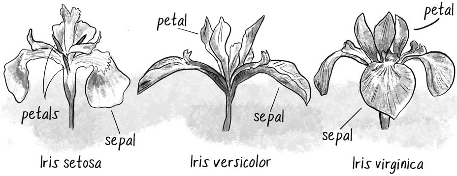

图 10.17, 三种鸢尾花及其 sepal 和 petal 结构. PDF 第 565 页精确提取.

示例数据:

| Sepal length | Sepal width | Petal length | Petal width | Classification  |
|--------------|-------------|--------------|-------------|-----------------|
| 5.1          | 3.5         | 1.4          | 0.2         | Iris setosa     |
| 4.9          | 3.0         | 1.4          | 0.2         | Iris setosa     |
| 7.0          | 3.2         | 4.7          | 1.4         | Iris versicolor |
| 6.4          | 3.2         | 4.5          | 1.5         | Iris versicolor |
| 6.3          | 3.3         | 6.0          | 2.5         | Iris virginica  |
| 5.8          | 2.7         | 5.1          | 1.9         | Iris virginica  |

因此分类网络需要 4 个输入和 3 个输出. 隐藏层节点数量没有唯一答案, 通常依靠经验, 试验和启发式方法选择.

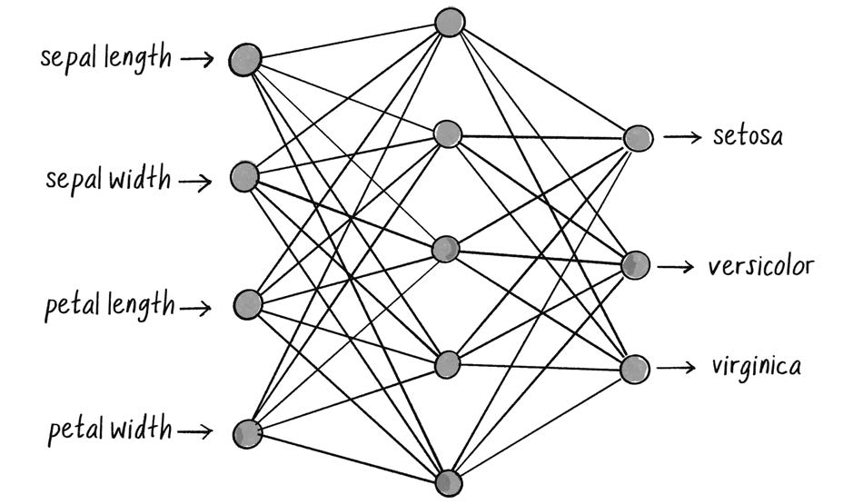

图 10.18, 一个可能的 iris 分类网络: 4 个输入, 5 个隐藏节点和 3 个分类输出. PDF 第 566 页精确提取.

回归示例中, 输入为 occupants, size 和 temperature, 输出为 electricity usage. 因而网络有 3 个输入和 1 个输出.

| Occupants | Size m² | Temperature °C | Electricity usage kWh |
|-----------|---------|----------------|-----------------------|
| 4         | 150     | 24.0           | 25.3                  |
| 2         | 100     | 25.5           | 16.2                  |
| 1         | 70      | 26.5           | 12.1                  |
| 4         | 120     | 23.0           | 22.1                  |
| 2         | 90      | 21.5           | 15.2                  |
| 5         | 180     | 20.0           | 24.4                  |
| 1         | 60      | 18.5           | 11.7                  |

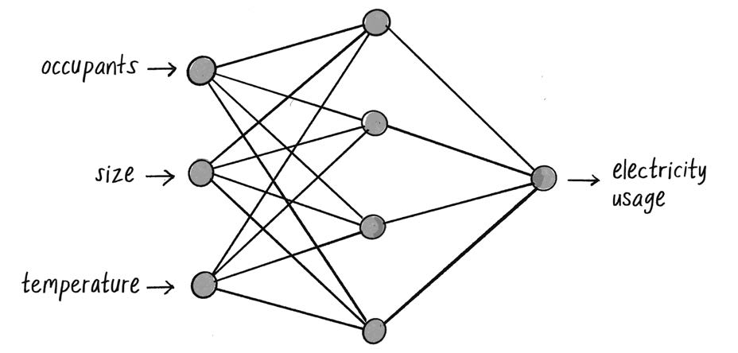

图 10.19, 具有 3 个输入和 1 个连续回归输出的网络. PDF 第 567 页精确提取.

回归也可以有多个连续输出. 关键是, 输入层大小等于每条记录的输入特征数, 输出层大小等于要预测的标签数或连续变量数.

### ml5.js 语法

`ml5.neuralNetwork()` 创建一个可训练的空网络. 通过 options 对象指定任务, 输入和输出.

分类:

    let options = {
      inputs: 4,
      outputs: [
        "iris-setosa",
        "iris-virginica",
        "iris-versicolor"
      ],
      task: "classification"
    };

    let irisClassifier = ml5.neuralNetwork(options);

回归:

    let options = {
      inputs: 3,
      outputs: 1,
      task: "regression"
    };

    let energyPredictor = ml5.neuralNetwork(options);

还可以指定隐藏层数量, 每层神经元数和激活函数, 但多数入门任务可以先让 ml5.js 自动配置.

### 构建手势分类器

目标是把一次鼠标拖动表示为从起点到终点的向量, 以方向向量的 x 和 y 分量作为输入, 输出 `up`, `down`, `left` 或 `right`.

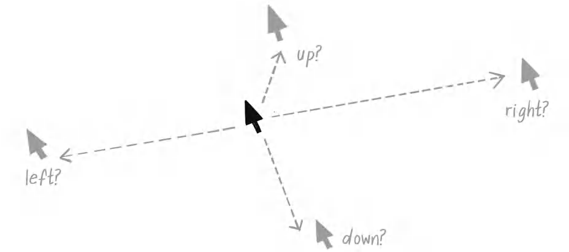

图 10.20, 单次鼠标手势可表示为起点到终点的方向向量. PDF 第 569 页精确提取.

这个问题当然可以直接用 `heading()` 和条件判断解决. 选择一个已知答案的问题, 是为了清楚展示机器学习生命周期并验证代码是否正确.

1.  收集和准备数据

    先手工构造少量归一化数据. 每条数据包含方向向量分量和标签:

        let data = [
          { x: 0.99, y: 0.02, label: "right" },
          { x: 0.76, y: -0.10, label: "right" },
          { x: -1.00, y: 0.12, label: "left" },
          { x: -0.90, y: -0.10, label: "left" },
          { x: 0.02, y: 0.98, label: "down" },
          { x: -0.20, y: 0.75, label: "down" },
          { x: 0.01, y: -0.90, label: "up" },
          { x: -0.10, y: -0.80, label: "up" }
        ];

    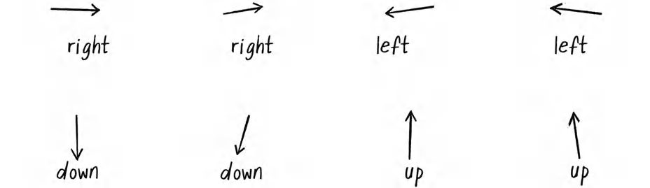

    图 10.21, 训练数据可视化为 8 个方向向量. PDF 第 571 页精确提取.

    实际项目通常会从 JSON, CSV 或数据库加载更多记录. 数据应覆盖用户动作的自然变化, 而不是只包含少量理想样本.

### 练习 10.4

创建 p5.js 数据采集 sketch. 使用 `mousePressed()` 和 `mouseReleased()` 记录手势起止点, 并用 `saveJSON()` 保存数据.

1.  选择模型

        let options = {
          task: "classification",
          inputs: 2,
          outputs: ["up", "down", "left", "right"],
          debug: true
        };

        let classifier = ml5.neuralNetwork(options);

    `debug: true` 会启用训练可视化界面. 对于更复杂任务, 可以进一步定制网络结构.

2.  训练模型

    ml5.js 需要把输入和输出分别传入 `addData()`. 这也明确了数据的 **shape**, 即维度和结构.

        for (let item of data) {
          let inputs = [item.x, item.y];
          let outputs = [item.label];
          classifier.addData(inputs, outputs);
        }

        classifier.normalizeData();

    输入形状是一维数组, 含两个数值. 输出形状是一维数组, 含一个字符串标签. 模型部署时收到的数据必须保持同样形状.

    启动训练:

        let trainingOptions = {
          epochs: 200
        };

        classifier.train(trainingOptions, finishedTraining);

        function finishedTraining() {
          console.log("Training complete!");
        }

    一个 **epoch** 表示完整遍历一次训练集并更新权重. epoch 太少可能学习不足, 太多则可能收益递减甚至过拟合. epoch 数, 学习率和网络大小都属于 **超参数 hyperparameters**.

    1.  回调函数

        回调函数作为参数传给另一个函数, 由系统在未来某个事件发生时自动调用. 训练是异步过程, 浏览器可在等待训练完成时继续渲染界面. ml5.js 也支持 Promise 和 `async/await`, 但本章继续使用 p5.js 常见的回调风格.

3.  评估模型

    `debug: true` 会显示 TensorFlow.js 的 Visor. 其中最重要的图表是 loss 随 epoch 的变化.

    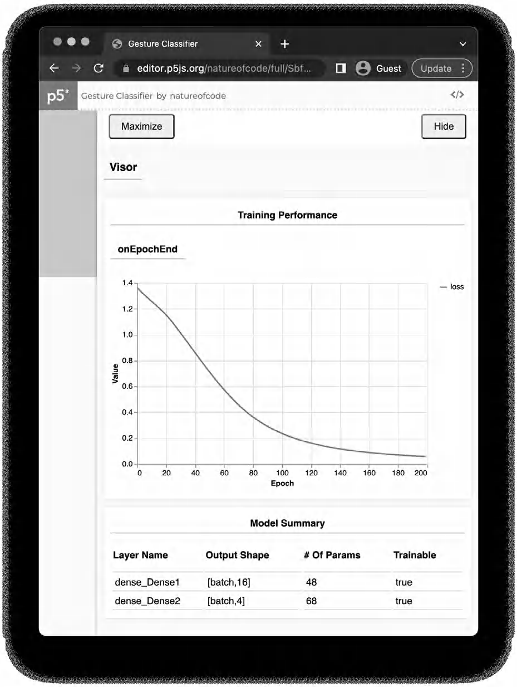

    图 10.22, TensorFlow.js Visor 显示 loss 曲线和模型结构摘要. PDF 第 575 页精确提取.

    **loss** 衡量预测与正确输出之间的总体误差. 开始训练时 loss 通常较高. 若训练有效, loss 应随 epoch 增加而下降.

    Model Summary 表还会显示每一层的节点数量和参数数量. 在本例中, ml5.js 自动生成一个包含 16 个神经元的隐藏层和 4 个输出神经元. 参数数量主要是各连接的权重和偏置.

    完整机器学习流程通常把数据划分为:

    - **训练集**: 用于更新权重.
    - **验证集**: 在训练期间检查泛化能力, 帮助发现过拟合.
    - **测试集**: 训练结束后才使用, 给出最终独立评价.

    本例只有 8 条数据, 无法合理三分, 因而全部用于训练. 这会增加 **过拟合 overfitting** 风险, 即模型记住训练样本细节, 却不能正确处理新样本. 在大数据集上, 应保留验证集和测试集.

4.  调节参数

    评估后, 可以调整 epoch, 学习率, 隐藏层数量和每层神经元数, 然后重新训练. ml5.js 更强调易用性. 若需要细粒度控制, 可以直接使用 TensorFlow.js.

    本例 loss 已足够低, 因而继续部署.

5.  部署模型

    实际项目常使用 `save()` 将训练好的模型保存到文件, 再在另一个应用中用 `load()` 加载. 为简化示例, 当前 sketch 直接使用内存中的 `classifier`.

        let direction = createVector(1, 0);
        let inputs = [direction.x, direction.y];
        classifier.classify(inputs, gotResults);

        function gotResults(results) {
          console.log(results);
        }

    某些 ml5.js 版本的回调签名是 `gotResults(error, results)`. 结果数组按 confidence 从高到低排列:

        [
          {
            label: "right",
            confidence: 0.9669702649116516
          },
          {
            label: "up",
            confidence: 0.01878807507455349
          },
          {
            label: "down",
            confidence: 0.013948931358754635
          },
          {
            label: "left",
            confidence: 0.00029277068097144365
          }
        ]

    confidence 接近 1 表示模型更确信. 各分类置信度经归一化后总和约为 1.

    使用状态变量显示训练和预测结果:

        let status = "training";

        function draw() {
          background(255);
          textAlign(CENTER, CENTER);
          textSize(64);
          text(status, width / 2, height / 2);
        }

        function finishedTraining() {
          status = "ready";
        }

### 示例 10.2: 手势分类器

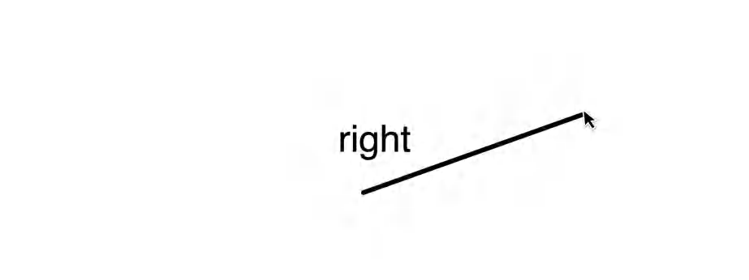

示例 10.2, 拖动鼠标产生方向向量, 模型输出预测标签. 图中结果为 right. PDF 第 579 页精确提取.

下面给出完整可运行结构. 训练数据, 模型创建, 数据加入, 训练和部署均放在同一 sketch 中.

    let classifier;
    let start;
    let end;
    let status = "training";

    let data = [
      { x: 0.99, y: 0.02, label: "right" },
      { x: 0.76, y: -0.10, label: "right" },
      { x: -1.00, y: 0.12, label: "left" },
      { x: -0.90, y: -0.10, label: "left" },
      { x: 0.02, y: 0.98, label: "down" },
      { x: -0.20, y: 0.75, label: "down" },
      { x: 0.01, y: -0.90, label: "up" },
      { x: -0.10, y: -0.80, label: "up" }
    ];

    function setup() {
      createCanvas(640, 240);

      let options = {
        task: "classification",
        inputs: 2,
        outputs: ["up", "down", "left", "right"],
        debug: true
      };

      classifier = ml5.neuralNetwork(options);

      for (let item of data) {
        classifier.addData(
          [item.x, item.y],
          [item.label]
        );
      }

      classifier.normalizeData();
      classifier.train({ epochs: 200 }, finishedTraining);
    }

    function draw() {
      background(255);

      if (start && end) {
        stroke(0);
        strokeWeight(3);
        line(start.x, start.y, end.x, end.y);
      }

      noStroke();
      fill(0);
      textAlign(CENTER, CENTER);
      textSize(48);
      text(status, width / 2, height / 2);
    }

    function finishedTraining() {
      status = "ready";
    }

    function mousePressed() {
      start = createVector(mouseX, mouseY);
      end = start.copy();
    }

    function mouseDragged() {
      end = createVector(mouseX, mouseY);
    }

    function mouseReleased() {
      if (!start || !end) {
        return;
      }

      let dir = p5.Vector.sub(end, start);
      if (dir.magSq() === 0) {
        status = "draw a gesture";
        return;
      }

      dir.normalize();
      classifier.classify([dir.x, dir.y], gotResults);
    }

    function gotResults(error, results) {
      if (error) {
        console.error(error);
        status = "error";
        return;
      }
      status = results[0].label;
    }

若所用 ml5.js 版本只向回调传递 `results`, 可把函数改为:

    function gotResults(results) {
      status = results[0].label;
    }

### 练习 10.5

把示例 10.2 拆为三个 sketch: 数据采集, 模型训练和模型部署. 使用 `save()` 和 `load()` 保存及加载模型.

### 练习 10.6

让分类器识别由多个向量组成的长手势. 每条训练数据必须具有一致 shape, 因而要固定每个手势保存的向量数量. 也可以研究专门处理序列数据的循环神经网络.

### 练习 10.7

ml5.js 提供手部关键点模型. 模型从图像中预测 21 个手部 landmarks. 把这些坐标作为 `ml5.neuralNetwork()` 的输入, 训练一个 thumbs-up, thumbs-down 或其他手势分类器.

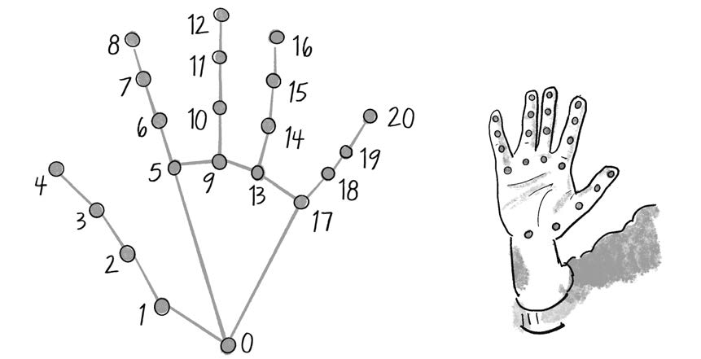

练习 10.7, 21 个手部关键点可作为另一个神经网络的输入特征. PDF 第 581 页精确提取.

## 生态系统项目

把机器学习加入生态系统, 增强生物行为:

- 使用分类模型把生物划分为多个类别. 可以把初始种群作为训练集, 新生生物出现后根据外形, 速度, 行为或传感器特征自动分类. 明确输入和输出分别是什么.
- 使用回归模型根据生物属性预测寿命. 第 9 章中, bloop 的大小和速度影响寿命. 比较预测寿命与真实结果的差异.
- 让模型预测环境状态, 食物位置, 危险程度或能量消耗, 再把预测结果转换为转向力和行为选择.

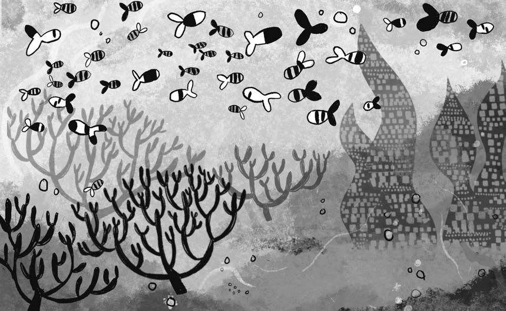

第 10 章生态系统项目, 神经网络和机器学习为生物的感知, 分类和决策提供新工具. PDF 第 582 页精确提取.
