# 第 11 章: 神经进化

> 阅读自然当然很好, 但如果一个人走进树林并仔细倾听, 他能学到比书本中更多的东西.
>
> - George Washington Carver

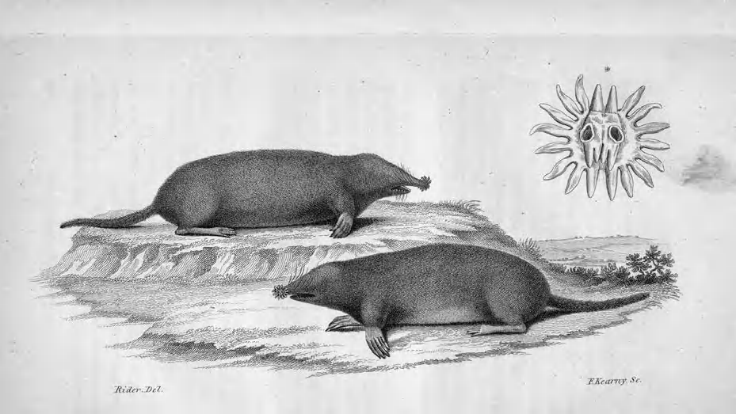

星鼻鼹, 约 1826-1828 年, New York Public Library 馆藏. 星鼻鼹的鼻部有 22 条触手和超过 25,000 个微小感受器, 能在黑暗地下环境中快速构建空间地图. PDF 第 583 页精确提取.

恭喜! 你已经来到本书的终幕. 请停下来, 为一路学到的内容庆祝一下.

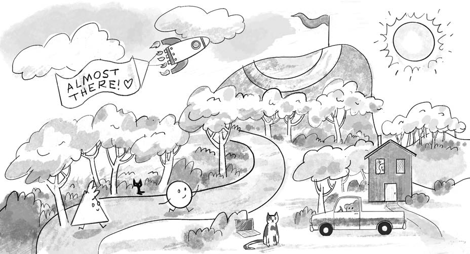

本书旅程即将抵达终点. 图中汇集了随机游走, 力, 粒子, 车辆, 遗传算法和机器学习等一路相遇的概念. PDF 第 584 页精确提取.

在此前的章节中, 你研究了 p5.js 交互式物理模拟的基本原理, 深入了智能体和其他基于规则的行为, 也踏入了机器学习的广阔领域. 你已经逐渐成为一名真正的 nature coder.

不过, 第 10 章对于数据和神经网络机器学习的讨论只是轻轻划过表面. 这是一个庞大到足以写出许多续集的领域. 本书并不打算全面讲授神经网络, 而是先建立核心概念, 为最后一次大汇合做准备: 把机器学习放入动态, 交互式的 p5.js sketch, 让前面结识的对象, 力, 智能体, 遗传算法和生态系统在同一个舞台上相遇.

前方的道路通向 **神经进化 neuroevolution**. 这是一类把第 9 章的遗传算法和第 10 章的神经网络结合起来的机器学习方法. 神经进化系统利用达尔文式原理, 通过一代又一代的试错来进化神经网络的权重, 有时甚至连网络结构也一并进化. 本章先用一个熟悉的游戏展示这种方法, 再把第 5 章 Craig Reynolds 的转向行为改造为通过神经进化学习得到的行为.

## 强化学习

神经进化与第 10 章简要提到的 **强化学习 reinforcement learning** 有许多相似之处. 强化学习把机器学习智能体放进一个模拟环境. 智能体与环境交互, 并根据决策得到奖励或惩罚. 这是一种围绕观察和反馈组织的学习策略.

想象一只小老鼠在迷宫里奔跑. 左转能得到奶酪, 右转会遭到轻微电击. 当然, 这只老鼠只是虚构的. 随着时间推移, 它应当逐渐学会左转. 它的生物神经网络作出行动决策, 然后观察结果. 当结果不好时, 网络可以调整内部连接, 让下一次决策发生变化.

现实中的强化学习更常用于机器人而不是折腾啮齿动物. 在时刻 $t$, 机器人执行任务并观察结果: 是否撞墙, 是否从桌边跌落, 是否安全完成动作. 经过不断交互, 它逐步学会以更有利于完成任务并避免损伤的方式解释环境信号.

现在, 把老鼠或机器人替换为本书前面出现的 walker, mover, particle 或 vehicle. 可以把神经网络嵌入对象, 让它根据环境输入计算一个力或动作. 输入可以是到障碍物的距离, 当前位置或速度. 输出可以是离散选项, 例如向左或向右, 也可以是连续值, 例如转向力的方向和大小.

这与第 10 章训练后的神经网络没有本质区别: 网络接收输入, 然后预测分类或回归输出. 差别在于训练方式. 监督学习从带有正确答案的数据集中学习, 强化学习则通过与环境互动和接收反馈来发现更优决策.

### Flappy Bird 作为学习环境

*Flappy Bird* 的规则看似简单. 小鸟持续向右移动, 每次点击都会拍动翅膀并向上跃起. 一系列带有开口的垂直管道从右侧进入. 玩家需要让小鸟穿过开口, 撞到管道就结束. 通过的管道越多, 分数越高.

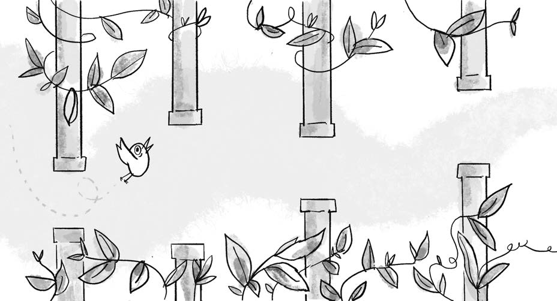

图 11.1, Flappy Bird 游戏的基本场景. PDF 第 586 页精确提取.

假设不再由人点击, 而是让神经网络决定是否拍动翅膀. 首先需要选择模型的输入和输出. 输入没有唯一答案. 一种极端做法是把游戏画面的全部像素交给模型, 让模型自行判断哪些信息重要. 另一种做法是利用对游戏规则的理解, 提取少量最关键的 **特征 features**.

对于 Flappy Bird, 最重要的特征可以是:

1.  小鸟的 y 坐标.
2.  小鸟的 y 方向速度.
3.  下一根上方管道开口的 y 坐标.
4.  下一根下方管道开口的 y 坐标.
5.  小鸟到下一根管道的 x 方向距离.

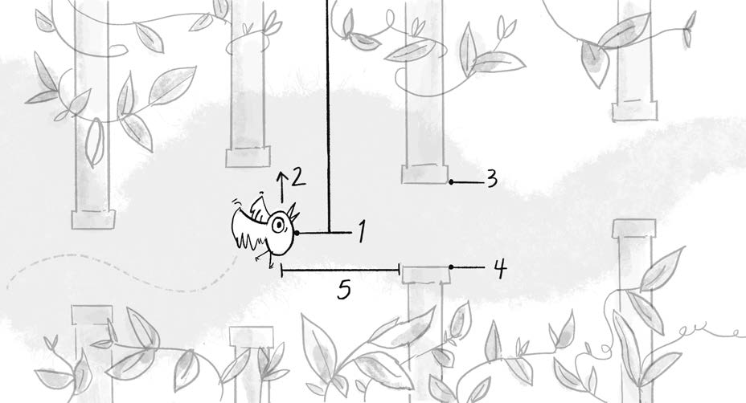

图 11.2, Flappy Bird 神经网络可以使用的五个输入特征. PDF 第 587 页精确提取.

网络有五个输入. 输出是分类还是回归, 取决于控制方式. 点击, 按键和离散方向选择属于分类, 因为玩家只能从有限选项中选择. 摇杆的倾斜角度和幅度是连续值, 更接近回归. Flappy Bird 只有两个离散动作:

- flap.
- no flap.

因此网络可以配置为五个输入和两个分类输出.

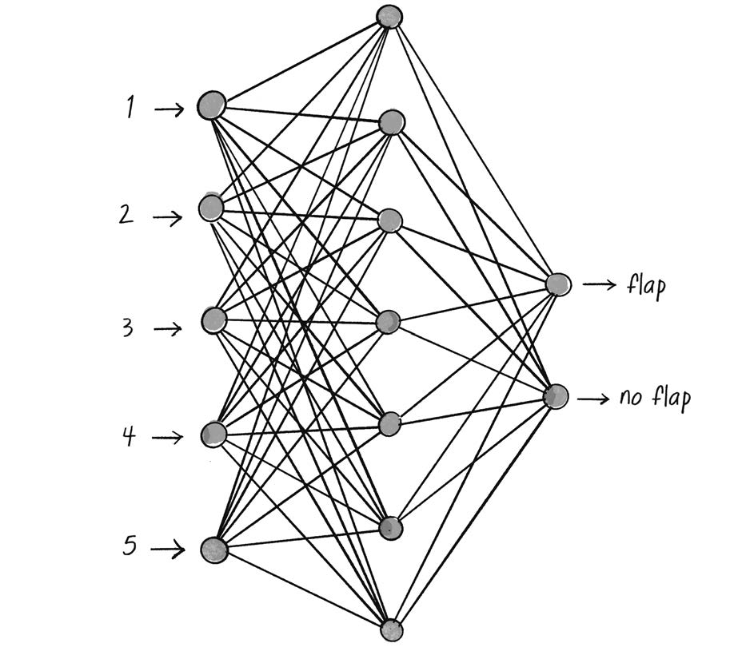

图 11.3, ml5.js 可能为 Flappy Bird 构建的神经网络结构. PDF 第 588 页精确提取.

    let options = {
      inputs: 5,
      outputs: ["flap", "no flap"],
      task: "classification"
    };
    let birdBrain = ml5.neuralNetwork(options);

按照第 10 章的监督学习流程, 接下来似乎应当收集一位顶尖玩家的大量游戏数据, 记录每个时刻的输入特征和是否 flap. 但这样训练出的自动玩家只是在模仿人类. 如果示范者遗漏了某种策略, 模型也不可能自行发现它. 采集数据还会非常繁琐.

强化学习的不同之处在于, 正确答案不由训练数据直接提供. 智能体通过试错和环境反馈发现更优动作. 在 Flappy Bird 中, 穿过管道可以得到正奖励, 撞到管道或地面得到负奖励. 智能体尝试最大化长期累计奖励. 起初它会频繁坠毁, 但经过许多局游戏, 有机会逐步发现更好的拍翼时机.

传统强化学习通常显式定义 **策略 policy** 和 **奖励函数 reward function**, 再用反馈调整策略. 本章采取另一条路, 即神经进化.

## 进化神经网络很 NEAT

神经进化不依赖传统反向传播, 策略更新和逐步奖励. 它把许多随机初始化的神经网络同时投放到问题中. 一段时间后, 表现较好的网络被选择, 它们的基因, 也就是连接权重, 经过交叉和变异, 产生下一代网络. 当学习规则难以明确描述, 或问题存在大量可能解时, 这种方法尤其有吸引力.

1994 年, Edmund Ronald 和 Marc Schoenauer 的论文 *Genetic Lander: An Experiment in Accurate Neuro-genetic Control* 描述了一个通过遗传算法进化神经网络, 学习安全降落的模拟飞行器. 它不依赖人工编写的控制规则或带标签数据.

2002 年, Kenneth O. Stanley 和 Risto Miikkulainen 在论文 *Evolving Neural Networks Through Augmenting Topologies* 中提出 NEAT, 即 NeuroEvolution of Augmenting Topologies. 早期方法主要进化权重, NEAT 还允许网络拓扑本身进化. 它从简单网络开始, 再通过进化逐步增加和调整结构, 从而发现更适合任务的网络架构.

完整实现 NEAT 需要更深入地处理网络结构和 TensorFlow.js. 本章选择更直接的方案: 使用 ml5.js 进化固定结构网络的权重, 并把它用于 Flappy Bird.

## 编写 Flappy Bird

Flappy Bird 由越南游戏开发者 Dong Nguyen 于 2013 年制作. 它在 2014 年迅速成为热门应用, 随后因开发者担忧其成瘾性而下架, 又因此成为历史上被复刻次数最多的游戏之一. 它体现了 Nolan's law: 优秀游戏容易上手, 却很难精通. 对初学者而言, 它也非常适合作为编程练习.

### Bird 类

由于小鸟在代码中只沿 y 轴运动, x 坐标保持不变, 因而这里不必使用 `p5.Vector`. 速度, 重力和拍翼力都可以是标量. 为了进一步简化, 力直接累加到速度, 不再单独维护 acceleration.

    class Bird {
      constructor() {
        // 小鸟的位置, x 保持不变.
        this.x = 50;
        this.y = 120;

        // 小鸟只沿 y 轴运动, 因而速度和力都是标量.
        this.velocity = 0;
        this.gravity = 0.5;
        this.flapForce = -10;
      }

      flap() {
        this.velocity += this.flapForce;
      }

      update() {
        // 重力改变速度, 速度改变位置.
        this.velocity += this.gravity;
        this.y += this.velocity;

        // 阻尼让运动稍微稳定.
        this.velocity *= 0.95;

        // 处理地面.
        if (this.y > height) {
          this.y = height;
          this.velocity = 0;
        }
      }

      show() {
        stroke(0);
        fill(175);
        circle(this.x, this.y, 16);
      }
    }

### Pipe 类

每个 Pipe 对象由上下两个矩形组成, 中间留出开口. 管道只沿 x 轴以恒定速度移动. 从视觉叙事看, 小鸟在向前飞, 但让小鸟的 x 坐标固定并移动管道, 代码会更简单.

    class Pipe {
      constructor() {
        // 上下管道之间的开口大小.
        this.spacing = 100;
        // 上方管道底边的随机高度.
        this.top = random(height - this.spacing);
        // 下方管道顶边由 top 和 spacing 得到.
        this.bottom = this.top + this.spacing;
        // 管道从画布右边缘出现.
        this.x = width;
        this.w = 20;
        this.velocity = 2;
      }

      show() {
        fill(0);
        noStroke();
        rect(this.x, 0, this.w, this.top);
        rect(this.x, this.bottom, this.w, height - this.bottom);
      }

      update() {
        this.x -= this.velocity;
      }

      offscreen() {
        return this.x + this.w < 0;
      }
    }

### 碰撞检测

碰撞成立需要同时满足两个条件. 小鸟在垂直方向进入上方或下方管道的范围, 并且它在水平方向落入管道宽度. 这里暂时把小鸟当成一个点, 没有把圆的半径计算进去.

    collides(bird) {
      let verticalCollision = bird.y < this.top || bird.y > this.bottom;
      let horizontalCollision = bird.x > this.x && bird.x < this.x + this.w;
      return verticalCollision && horizontalCollision;
    }

### 示例 11.1: Flappy Bird 克隆

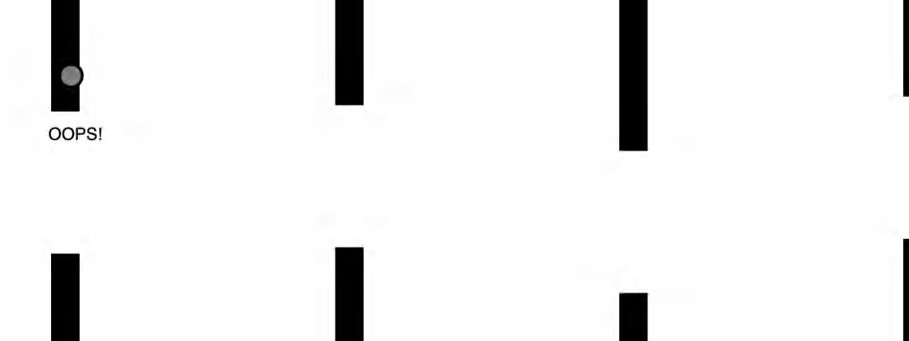

示例 11.1, 由鼠标点击控制的小鸟穿越管道. 碰撞位置显示 OOPS!. PDF 第 593 页精确提取.

    let bird;
    let pipes = [];

    function setup() {
      createCanvas(640, 240);
      bird = new Bird();
      pipes.push(new Pipe());
    }

    function mousePressed() {
      bird.flap();
    }

    function draw() {
      background(255);

      for (let i = pipes.length - 1; i >= 0; i--) {
        pipes[i].show();
        pipes[i].update();

        if (pipes[i].collides(bird)) {
          text("OOPS!", pipes[i].x, pipes[i].top + 20);
        }

        if (pipes[i].offscreen()) {
          pipes.splice(i, 1);
        }
      }

      bird.update();
      bird.show();

      // 每 100 帧加入一根新管道.
      if (frameCount % 100 === 0) {
        pipes.push(new Pipe());
      }
    }

`p5.js` 的 `frameCount` 记录从 sketch 启动以来渲染的帧数. 取模运算符 `%` 返回除法余数. 表达式 `frameCount % 100 === 0` 每隔 100 帧为真, 因而可用于定期生成管道.

### 练习 11.1

实现计分系统. 每成功穿过一组管道便增加分数. 还可以为小鸟, 管道和环境加入自己的视觉设计.

## 神经进化版 Flappy Bird

当前游戏由鼠标点击控制. 接下来把控制权交给计算机, 使用神经进化教会小鸟游戏. ml5.js 已经提供神经进化所需的一些基础功能. 第一步是给 Bird 添加 brain, 让它自行决定 flap 或 no flap.

### 小鸟的大脑

由于管道开口大小恒定, 不必同时输入上下开口的位置. 四个输入足够:

1.  小鸟的 y 坐标.
2.  小鸟的 y 方向速度.
3.  下一根管道上方开口的 y 坐标.
4.  到下一根管道的 x 方向距离.

输出仍然是 `flap` 和 `no flap`. 构造神经网络时把 `neuroEvolution` 设为 `true`, 以启用后续交叉, 复制和变异功能.

    constructor() {
      this.brain = ml5.neuralNetwork({
        inputs: 4,
        outputs: ["flap", "no flap"],
        task: "classification",
        neuroEvolution: true
      });
    }

`think()` 首先要找到尚未越过小鸟的下一根管道. 数组中的第一根管道不一定仍然位于小鸟前方, 因为管道穿过小鸟后, 还需要一些时间才会完全离开画布并被删除.

    think(pipes) {
      let nextPipe = null;

      for (let pipe of pipes) {
        if (pipe.x + pipe.w > this.x) {
          nextPipe = pipe;
          break;
        }
      }

      if (!nextPipe) {
        return;
      }

      let inputs = [
        this.y / height,
        this.velocity / height,
        nextPipe.top / height,
        (nextPipe.x - this.x) / width
      ];

      let results = this.brain.classifySync(inputs);
      if (results[0].label === "flap") {
        this.flap();
      }
    }

神经网络通常要求输入落在统一范围内, 例如 0 到 1. 因此垂直量除以 `height`, 水平距离除以 `width`. `classify()` 是异步接口, 更适合大模型和较重计算. 这个网络只有四个浮点输入和两个输出, 足够小, 因而示例使用同步的 `classifySync()`. 同步接口会阻塞当前代码, 在更复杂模型中应谨慎使用.

### 变化: 一群 Flappy Birds

一只随机网络几乎必然表现糟糕. 它可能不停拍翼飞出屏幕, 也可能沉在底部. 遗传算法的第一项关键原则是 **变化 variation**. 只有同时尝试许多不同的网络配置, 才更可能出现少数略优个体.

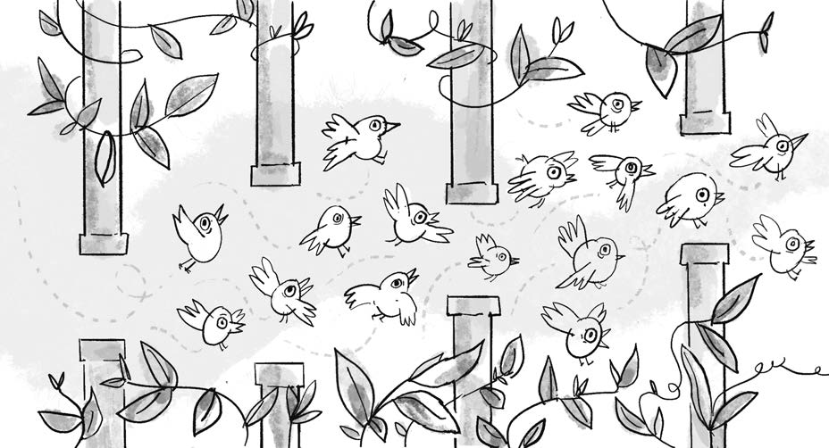

图 11.4, 一群拥有不同随机神经网络的小鸟同时尝试穿越管道. PDF 第 598 页精确提取.

    let populationSize = 200;
    let birds = [];

    function setup() {
      createCanvas(640, 240);

      for (let i = 0; i < populationSize; i++) {
        birds[i] = new Bird();
      }

      // 对这些极小网络而言, CPU 反而更高效.
      ml5.setBackend("cpu");
    }

    function draw() {
      for (let bird of birds) {
        bird.think(pipes);
        bird.update();
        bird.show();
      }
    }

1.  GPU 与 CPU

    GPU 擅长同时执行大量并行运算, 因而通常适合深度学习. CPU 更通用, 但并行度较低. 把数据传入 GPU 再取回会产生开销. 对于大型模型, 并行收益通常远大于传输开销. 对本例这种很小的 bird brain, 传输反而可能拖慢速度, 因而调用 `ml5.setBackend("cpu")` 更合适.

### 选择: Flappy Bird 适应度

遗传算法的下一步是 **选择 selection**. 在这个游戏中, 能存活得更久, 避开更多管道的小鸟具有更高适应度. 在 Bird 中加入 `fitness` 和 `alive`:

    constructor() {
      this.fitness = 0;
      this.alive = true;
    }

    update() {
      this.fitness++;
      // 其余位置和速度更新代码.
    }

只处理仍然活着的小鸟. 当管道与小鸟碰撞时, 把 `alive` 设为 `false`.

    for (let bird of birds) {
      if (bird.alive) {
        bird.think(pipes);
        bird.update();
        bird.show();

        for (let pipe of pipes) {
          if (pipe.collides(bird)) {
            bird.alive = false;
          }
        }
      }
    }

一代持续到所有小鸟都死亡. 下面的函数检查是否仍有活鸟:

    function allBirdsDead() {
      for (let bird of birds) {
        if (bird.alive) {
          return false;
        }
      }
      return true;
    }

选择使用第 9 章的加权轮盘算法. 这里返回的是 bird 的 brain, 而不是整个 Bird 对象.

    function weightedSelection() {
      let index = 0;
      let start = random(1);

      while (start > 0) {
        start -= birds[index].fitness;
        index++;
      }

      index--;
      return birds[index].brain;
    }

在调用加权选择之前, 要把全部适应度归一化, 使总和为 1. 归一化后, 每只鸟的适应度数值也就是被选中的概率.

    function normalizeFitness() {
      let sum = 0;

      for (let bird of birds) {
        sum += bird.fitness;
      }

      for (let bird of birds) {
        bird.fitness /= sum;
      }
    }

### 遗传: 新生小鸟

最后一步是繁殖. 神经网络的基因可以理解为各连接权重. 两个父网络的交叉, 可以把每个子代权重从父亲或母亲中随机选择. ml5.js 已提供 `crossover()`:

    let parentA = weightedSelection();
    let parentB = weightedSelection();
    let child = parentA.crossover(parentB);

随后使用 `mutate()`. 变异率 0.01 表示每个权重有 1% 的概率发生小幅变化. ml5.js 默认给权重加上一个较小随机量, 而不是把它完全换成无关的新值.

    child.mutate(0.01);

重复选择, 交叉和变异, 直到生成与原种群规模相同的新一代:

    function reproduction() {
      let nextBirds = [];

      for (let i = 0; i < populationSize; i++) {
        let parentA = weightedSelection();
        let parentB = weightedSelection();
        let child = parentA.crossover(parentB);
        child.mutate(0.01);
        nextBirds[i] = new Bird(child);
      }

      birds = nextBirds;
    }

Bird 构造函数需要接受可选 brain. 如果传入网络, 新生小鸟继承该网络. 如果没有传入, 则创建全新的随机网络.

    constructor(brain) {
      if (brain) {
        this.brain = brain;
      } else {
        this.brain = ml5.neuralNetwork({
          inputs: 4,
          outputs: ["flap", "no flap"],
          task: "classification",
          neuroEvolution: true
        });
      }
    }

### 示例 11.2: 使用神经进化的 Flappy Bird

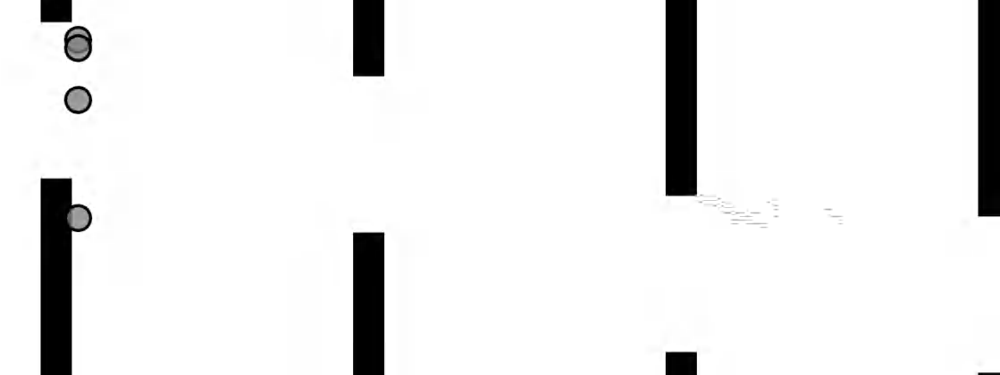

示例 11.2, 神经进化种群逐代学习控制拍翼时机. PDF 第 604 页精确提取.

每当全部小鸟死亡, 归一化适应度, 生成下一代并重置管道:

    function draw() {
      // 其余游戏更新和绘制代码.

      if (allBirdsDead()) {
        normalizeFitness();
        reproduction();
        resetPipes();
      }
    }

    function resetPipes() {
      // 只保留最新的一根管道, 防止新一代出生时立即碰撞.
      pipes.splice(0, pipes.length - 1);
    }

在线完整版本还会在小鸟落地或飞出顶部时判定死亡. 如果不在换代时清理旧管道, 新生小鸟可能刚出现就与管道重叠, 再优秀的网络也没有机会展示能力.

### 练习 11.2

示例 11.2 需要很长时间才会产生明显结果. 尝试跳过每一帧的绘制, 在一个 `draw()` 周期内执行多次模拟更新, 加快寻找优秀小鸟的速度. 同时添加信息面板, 显示存活数量, 当前世代和最佳存活时长.

### 练习 11.3

使用 ml5.js 神经网络的 `save()` 和 `load()` 保存最佳小鸟模型, 并允许在下次运行时载入, 避免每次都从随机网络重新开始.

## 用神经进化学习转向

在 Flappy Bird 之后, 回到第 5 章的转向智能体. 过去由程序员明确编写寻路和转向规则. 现在可以让模拟生物进化出自己的策略. 目标不一定是工程上最完美的控制器, 而是一个充满个性, 偏差和意外的模拟生命世界.

### 从智能火箭到神经网络

第 9 章的智能火箭把 DNA 表示为一个向量数组. 每个时间步依次应用一个基因向量:

    this.genes = [];
    for (let i = 0; i < lifeSpan; i++) {
      this.genes[i] = p5.Vector.random2D();
      this.genes[i].mult(random(0, this.maxforce));
    }

现在把 genes 替换为 brain. 转向力的方向和大小是连续值, 所以使用回归网络:

    this.brain = ml5.neuralNetwork({
      inputs: 2,
      outputs: 2,
      task: "regression",
      neuroEvolution: true
    });

网络每一帧预测一个转向向量. 两个输出分别映射为角度和大小. ml5.js 默认输出大致位于 0 到 1, 所以第一个输出乘以 `TWO_PI` 可覆盖完整方向, 第二个输出乘以 `maxforce` 可得到适当力幅度.

    run() {
      let outputs = this.brain.predictSync(inputs);

      let angle = outputs[0].value * TWO_PI;
      let magnitude = outputs[1].value * this.maxforce;

      let force = p5.Vector.fromAngle(angle);
      force.setMag(magnitude);
      this.applyForce(force);
    }

输入特征由系统设计者决定. 对静态障碍和静态目标的智能火箭, 可以把当前位置作为输入, 让网络近似一个流场. 坐标应按画布尺寸归一化:

    let inputs = [
      this.position.x / width,
      this.position.y / height
    ];

种群, 适应度函数和加权选择可以保持不变. 由于交叉和变异已经由 ml5.js 网络实现, 不再需要单独的 DNA 类.

### 示例 11.3: 使用神经进化的智能火箭

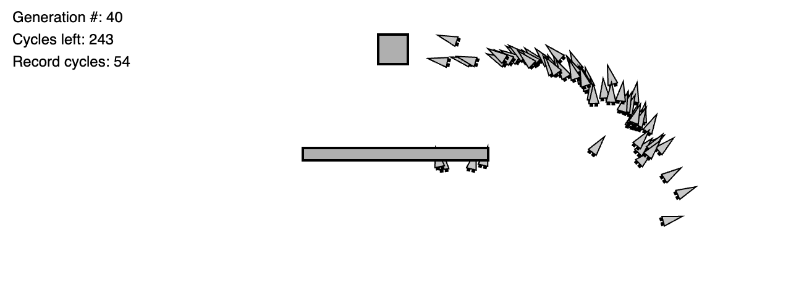

示例 11.3, 以神经网络替代向量 DNA 的智能火箭. PDF 第 607 页精确提取.

    reproduction() {
      let nextPopulation = [];

      for (let i = 0; i < this.population.length; i++) {
        let parentA = this.weightedSelection();
        let parentB = this.weightedSelection();
        let child = parentA.crossover(parentB);
        child.mutate(this.mutationRate);
        nextPopulation[i] = new Rocket(320, 220, child);
      }

      this.population = nextPopulation;
      this.generations++;
    }

### 练习 11.4

Reynolds 把转向力定义为期望速度与当前速度之差. 尝试把火箭当前速度也加入网络输入. 可以使用速度的 x, y 分量, 也可以使用方向和大小. 所有输入都应归一化.

### 响应变化

静态环境中, 仅凭位置就可能学会到达固定目标. 如果目标和障碍都在移动, 网络还需要感知环境变化. 这里移除障碍, 把固定目标替换为由 Perlin noise 控制的随机漫步光球 `Glow`. Rocket 也改名为 `Creature`. 生物的目标是追逐光球并尽可能长时间与它相交.

    class Glow {
      constructor() {
        this.xoff = 0;
        this.yoff = 1000;
        this.position = createVector(0, 0);
        this.r = 24;
      }

      update() {
        this.position.x = noise(this.xoff) * width;
        this.position.y = noise(this.yoff) * height;
        this.xoff += 0.01;
        this.yoff += 0.01;
      }

      show() {
        stroke(0);
        strokeWeight(2);
        fill(200);
        circle(this.position.x, this.position.y, this.r * 2);
      }
    }

光球的绝对位置不如它相对于生物的位置重要. 先计算从生物指向光球的向量, 在归一化之前保存距离. 方向向量提供两个输入, 距离提供第三个输入. 当前速度的两个归一化分量提供另外两个输入, 总计五个.

    seek(target) {
      let v = p5.Vector.sub(target.position, this.position);
      let distance = v.mag() / width;
      v.normalize();

      let inputs = [
        v.x,
        v.y,
        distance,
        this.velocity.x / this.maxspeed,
        this.velocity.y / this.maxspeed
      ];

      let outputs = this.brain.predictSync(inputs);
      let angle = outputs[0].value * TWO_PI;
      let magnitude = outputs[1].value;

      let force = p5.Vector.fromAngle(angle);
      force.setMag(magnitude);
      this.applyForce(force);
    }

因为目标持续移动, 只在世代结束时测量到目标的最终距离并不合理. 更合适的适应度是生物与光球相交的累计时间:

    update(target) {
      // 常规的位置, 速度和加速度更新.

      let d = p5.Vector.dist(this.position, target.position);
      if (d < this.r + target.r) {
        this.fitness++;
      }
    }

### 加速时间

观看进化缓慢展开有其魅力, 但调试参数时可能令人抓狂. 进化本身并不要求每一次状态更新都绘制到屏幕. 可以在一个 `draw()` 周期中执行多次物理和决策更新, 但只绘制一次. 使用 p5.js 的 slider 控制每帧执行多少次模拟:

    let timeSlider;

    function setup() {
      timeSlider = createSlider(1, 20, 1);
    }

    function draw() {
      // 绘制只执行一次.
      background(255);
      glow.show();
      for (let creature of creatures) {
        creature.show();
      }

      // 模拟根据 slider 的值执行多次.
      for (let i = 0; i < timeSlider.value(); i++) {
        for (let creature of creatures) {
          creature.seek(glow);
          creature.update(glow);
        }
        glow.update();
        lifeCounter++;
      }
    }

`createSlider(1, 20, 1)` 的三个参数分别是最小值, 最大值和初始值. 这样可以先以 20 倍速度推进许多世代, 再降回 1 倍速度观察已经进化出的行为.

### 示例 11.4: 动态神经进化转向

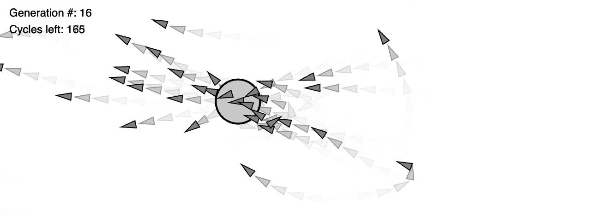

示例 11.4, 生物通过五个输入感知动态光球, 并用回归网络预测转向力. PDF 第 612 页精确提取.

    class Creature {
      constructor(x, y, brain) {
        this.position = createVector(x, y);
        this.velocity = createVector(0, 0);
        this.acceleration = createVector(0, 0);
        this.r = 4;
        this.maxspeed = 4;
        this.fitness = 0;

        if (brain) {
          this.brain = brain;
        } else {
          this.brain = ml5.neuralNetwork({
            inputs: 5,
            outputs: 2,
            task: "regression",
            neuroEvolution: true
          });
        }
      }

      // seek() 使用前述五个输入预测转向力.
      // update() 在接触 glow 时增加适应度.
    }

本书的写作和教学旅程跨越了十多年. 现在, 像一个曲折的随机游走终于使用 arrive 行为抵达目标, 最后一块拼图是把此前所有探索汇入自己的生态系统项目.

## 神经进化生态系统

前面的例子仍有两个不够自然的地方. 第一, 全部生物同时出生, 同时死亡, 再整体开始下一代, 这与连续运行的真实生态系统并不相同. 第二, 示例 11.4 的生物近乎全知. 它们可以知道光球精确位置, 不管光球多远, 中间是否存在遮挡. 这违背了第 5 章自主智能体的重要原则: 智能体对环境的感知应当有限.

### 感知环境

真实动物和机器人常使用局部传感器. 黑暗迷宫中的老鼠用胡须探测附近墙面, 蝙蝠使用回声定位, 驾驶员只能看见车灯照亮的道路. 猫, 老鼠等哺乳动物的触须称为 vibrissae, 可以检测近距离物体.

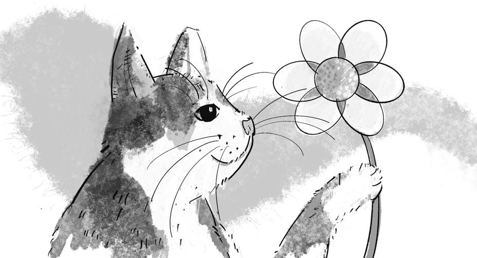

图 11.5, 猫 Clawdius 使用触须感知附近物体. PDF 第 614 页精确提取.

为 Creature 添加从中心向多个方向伸出的传感器. 每个传感器先用一个向量描述方向和长度:

    class Creature {
      constructor(x, y) {
        this.position = createVector(x, y);
        this.r = 16;
        this.sensors = [];

        let totalSensors = 8;
        for (let i = 0; i < totalSensors; i++) {
          let angle = map(i, 0, totalSensors, 0, TWO_PI);
          this.sensors[i] = p5.Vector.fromAngle(angle);
          this.sensors[i].setMag(this.r * 1.5);
        }
      }
    }

仅有向量还不够. 传感器还应保存一个数值, 表示感知强度或接近程度. 在设计 Sensor 类之前, 先给生物加入可以感知的对象. Food 是一个有位置和半径的圆:

    class Food {
      constructor() {
        this.position = createVector(random(width), random(height));
        this.r = 50;
      }

      show() {
        noStroke();
        fill(0, 100);
        circle(this.position.x, this.position.y, this.r * 2);
      }
    }

严格的射线投射 raycasting 可以检查传感器射线与物体相交的位置, 但需要更多几何计算. 本例使用更简单的近似: 只检查传感器端点是否落在食物圆内.

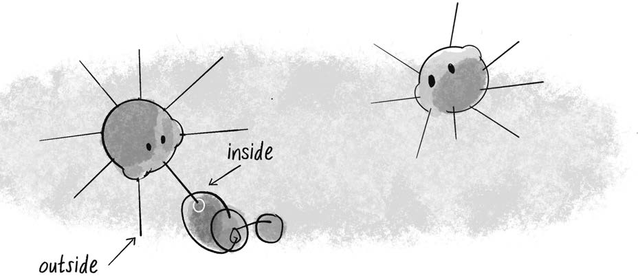

图 11.6, 根据传感器端点到食物中心的距离判断端点位于圆内还是圆外. PDF 第 615 页精确提取.

    class Sensor {
      constructor(v) {
        this.v = v.copy();
        this.value = 0;
      }

      sense(position, food) {
        // 传感器端点等于生物位置加上传感器向量.
        let end = p5.Vector.add(position, this.v);
        let d = end.dist(food.position);

        if (d < food.r) {
          // 越接近食物中心, 传感器值越接近 1.
          this.value = map(d, 0, food.r, 1, 0);
        } else {
          this.value = 0;
        }
      }
    }

当端点刚好触到食物外缘, `value` 接近 0. 越深入圆心, `value` 越接近 1. 未触及食物时, `value` 为 0. 这种连续反馈类似真实世界中的触觉强度.

### 示例 11.5: 带传感器的 Bloop

示例 11.5, 鼠标控制的 bloop 用一圈传感器探测食物. 传感器越接近食物中心, 端点显示越明显. PDF 第 617 页精确提取.

    let bloop, food;

    function setup() {
      createCanvas(640, 240);
      bloop = new Creature(width / 2, height / 2);
      food = new Food();
    }

    function draw() {
      background(255);

      // 暂时用鼠标控制 bloop.
      bloop.position.x = mouseX;
      bloop.position.y = mouseY;

      food.show();
      bloop.show();
      bloop.sense(food);
    }

    class Creature {
      constructor(x, y) {
        this.position = createVector(x, y);
        this.r = 16;
        this.sensors = [];

        let totalSensors = 15;
        for (let i = 0; i < totalSensors; i++) {
          let a = map(i, 0, totalSensors, 0, TWO_PI);
          let v = p5.Vector.fromAngle(a);
          v.mult(this.r * 2);
          this.sensors[i] = new Sensor(v);
        }
      }

      sense(food) {
        for (let sensor of this.sensors) {
          sensor.sense(this.position, food);
        }
      }

      show() {
        push();
        translate(this.position.x, this.position.y);

        for (let sensor of this.sensors) {
          stroke(0);
          line(0, 0, sensor.v.x, sensor.v.y);

          if (sensor.value > 0) {
            fill(255, sensor.value * 255);
            stroke(0, 100);
            circle(sensor.v.x, sensor.v.y, 8);
          }
        }

        noStroke();
        fill(0);
        circle(0, 0, this.r * 2);
        pop();
      }
    }

### 从传感器学习

现在可以把全部 sensor.value 作为神经网络输入. 生物重新获得运动控制权, 网络输出角度和大小, 合成转向力:

    think() {
      let inputs = [];
      for (let i = 0; i < this.sensors.length; i++) {
        inputs[i] = this.sensors[i].value;
      }

      let outputs = this.brain.predictSync(inputs);
      let angle = outputs[0].value * TWO_PI;
      let magnitude = outputs[1].value;

      let force = p5.Vector.fromAngle(angle);
      force.setMag(magnitude);
      this.applyForce(force);
    }

可以再次使用固定世代, 适应度和统一选择, 但这里选择构建连续生态系统. 每个生物有 health. 每一帧健康值都会下降:

    class Creature {
      constructor() {
        // 其余属性.
        this.health = 100;
      }

      update() {
        // 常规位置, 速度和加速度更新.
        this.health -= 0.25;
      }
    }

当 health 低于 0 时, 从数组中删除该生物. 仍然活着的生物每帧有 0.1% 的概率繁殖:

    for (let i = bloops.length - 1; i >= 0; i--) {
      if (bloops[i].health < 0) {
        bloops.splice(i, 1);
      } else if (random(1) < 0.001) {
        let child = bloops[i].reproduce();
        bloops.push(child);
      }
    }

繁殖不使用两性 crossover, 而是复制自己的网络并以较高变异率产生子代. 这类似克隆. 也可以把交叉重新引入系统.

    reproduce() {
      let brain = this.brain.copy();
      brain.mutate(0.1);
      return new Creature(this.position.x, this.position.y, brain);
    }

为了让一些生物比其他生物活得更久, 进食应当恢复健康:

    eat(food) {
      let d = p5.Vector.dist(this.position, food.position);
      if (d < this.r + food.r) {
        this.health += 0.5;
      }
    }

这些规则是否足以让系统进化并形成平衡, 需要通过运行和实验来判断. 参数, 食物再生速度, 健康损耗, 繁殖率和突变率都会改变生态动力学.

### 示例 11.6: 神经进化生态系统

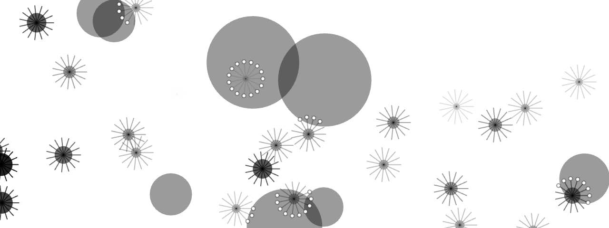

示例 11.6, 具备局部传感器和神经网络大脑的 bloop 在连续生态系统中寻找食物, 消耗健康并繁殖. PDF 第 621 页精确提取.

    let bloops = [];
    let food = [];

    function setup() {
      createCanvas(640, 240);

      for (let i = 0; i < 20; i++) {
        bloops[i] = new Creature(random(width), random(height));
      }

      for (let i = 0; i < 8; i++) {
        food[i] = new Food();
      }
    }

    function draw() {
      background(255);

      for (let i = bloops.length - 1; i >= 0; i--) {
        bloops[i].think();
        bloops[i].eat(food);
        bloops[i].update();
        bloops[i].borders();

        if (bloops[i].health < 0) {
          bloops.splice(i, 1);
        } else if (random(1) < 0.001) {
          let child = bloops[i].reproduce();
          bloops.push(child);
        }
      }

      for (let treat of food) {
        treat.show();
      }

      for (let bloop of bloops) {
        bloop.show();
      }
    }

在线完整示例还让食物在被吃时逐渐缩小, 耗尽后重新生成. Bloop 也会随健康下降而变小. 这些视觉变化帮助读者观察系统内部状态.

## 生态系统项目

把 brain 引入自己的生态系统:

- 不同生物能否拥有不同目标和激励? 有的寻找食物, 有的寻找其他资源, 有的躲避捕食者或毒物.
- 每类生物的输入和输出是什么?
- 生物如何感知? 它们是全知的, 还是只能依靠有限传感器?
- 通过哪些策略可以建立并维持生态平衡?

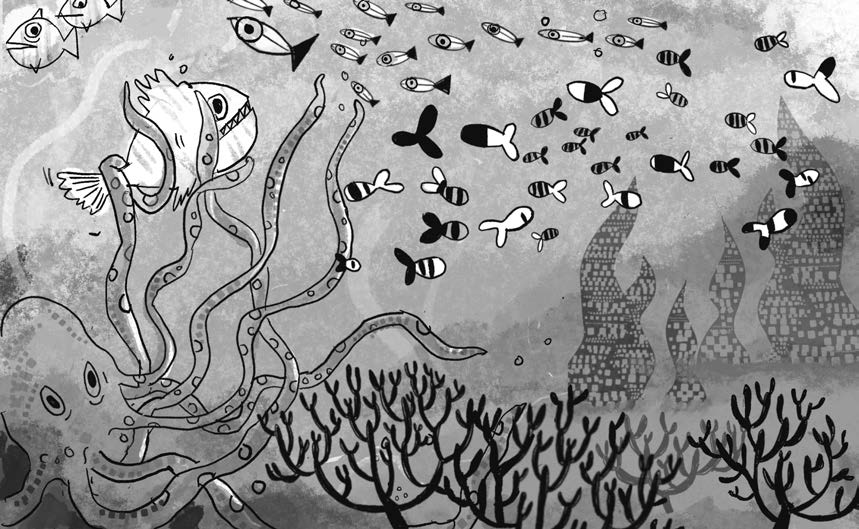

第 11 章生态系统项目, 生物通过局部传感器, 神经网络和进化适应一个更加丰富的环境. PDF 第 622 页精确提取.

## 结束

如果你仍在阅读, 谢谢你! 你已经来到本书结尾. 尽管全书包含了许多内容, 它对于我们所处的物理世界以及模拟它的技术仍然只是开端. 作者希望本书继续作为一个不断生长的项目, 在网站上加入新的教程和示例, 并继续扩充和更新 Coding Train 的配套视频.

欢迎通过 `daniel@shiffman.net` 或 GitHub 仓库 `https://github.com/nature-of-code` 提交反馈和作品. 分享你的创作, 保持联系, 继续与自然共舞.

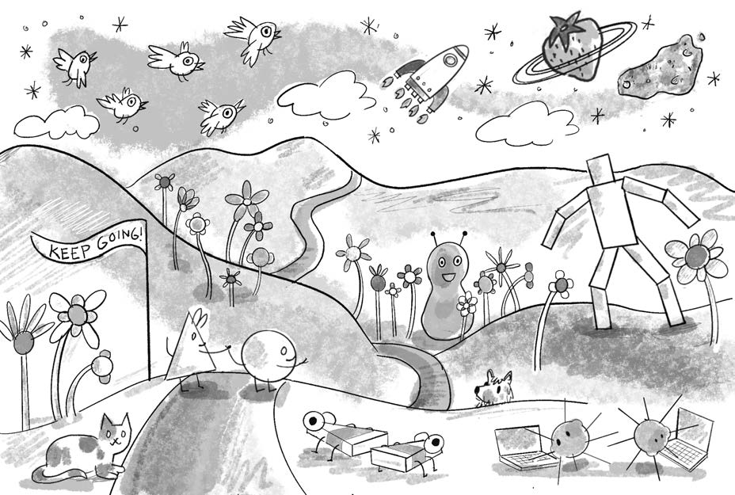

全书结束插图. 随机游走, 火箭, 粒子, 生物和生态系统继续驶向新的创作旅程. PDF 第 623 页精确提取.
