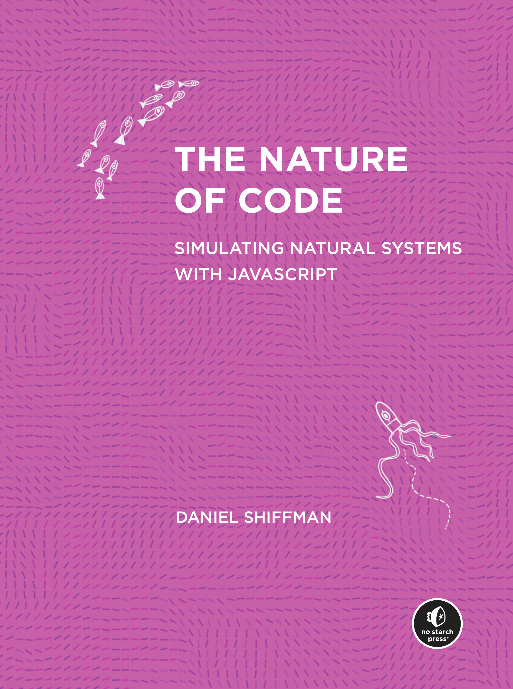

# 版本说明

- 原书: *The Nature of Code: Simulating Natural Systems with JavaScript*
- 作者: Daniel Shiffman
- 出版社: No Starch Press
- 原书年份: 2024
- 合并范围: PDF 第 1-643 页, 包含封面、版权、献词、作者简介、目录、致谢、引言、第 0-11 章、附录、图片来源、索引和封底.
- 文件来源: 由 Batch 01-14 按 PDF 页码顺序合并, 统一使用一个 `images/` 目录.
- 处理规则: 正文翻译为简体中文; JavaScript、p5.js、ml5.js、Matter.js 等标识符、函数名、字符串和 URL 保持原样; 代码使用 Org 源码块; 数学表达式使用 Org/LaTeX 语法; 原书图片按正文位置以相对路径插入.
- 图片总数: 385 张.
- 用途说明: 本文件是对用户提供 PDF 的个人学习用途格式转换与翻译. 原书版权和许可声明保持有效.

# 封面

原书封面, PDF 第 1 页.

> 代码本色
>
> 使用 JavaScript 模拟自然系统
>
> Daniel Shiffman

# 书名页

**代码本色**

**使用 JavaScript 模拟自然系统**

Daniel Shiffman

No Starch Press, San Francisco

# 版权与许可

*代码本色* Copyright © 2024 Daniel Shiffman.

本作品采用 Creative Commons Attribution-NonCommercial-ShareAlike 4.0 International, 即 CC BY-NC-SA 4.0, 许可. 许可文本可在 [Creative Commons 网站](https://creativecommons.org/licenses/by-nc-sa/4.0/)查看, 也可以写信至 Creative Commons, PO Box 1866, Mountain View, CA 94042, USA 索取.

保留部分权利.

引用本作品时, 必须按如下方式标明作者: "Daniel Shiffman, published by No Starch Press® Inc." 同时提供许可链接, 并说明是否进行了修改. 不得将材料用于商业目的. 若对材料进行改编或在其基础上创作, 则必须以与原作相同的许可发布贡献内容.

本许可不涵盖翻译作品. 所有翻译权由出版社保留. 如需获得翻译许可, 请联系 rights@nostarch.com.

作者已主张其精神权利.

初版第一次印刷.

印次序列: 28 27 26 25 24 1 2 3 4 5

- ISBN-13: 978-1-7185-0370-0, 纸质版.
- ISBN-13: 978-1-7185-0371-7, 电子版.

出版方: No Starch Press®, Inc.

- 地址: 245 8th Street, San Francisco, CA 94103
- 电话: +1.415.863.9900
- 网站: [www.nostarch.com](https://www.nostarch.com)
- 邮箱: info@nostarch.com

制作团队:

- 出版人: William Pollock
- 执行编辑: Jill Franklin
- 制作经理: Sabrina Plomitallo-González
- 制作编辑: Jennifer Kepler
- 发展编辑: Nathan Heidelberger
- 插画: Zannah Marsh
- 封面设计: Tuan Huang
- 内页设计: Tuan Huang, Jason Gao
- 技术审校: Jasper Palfree
- 文字编辑: Sharon Wilkey
- 校对: Audrey Doyle
- 索引: BIM Creatives, LLC

美国国会图书馆控制号: 2023053620.

超出本许可范围的授权事项或客户服务问题, 请联系 info@nostarch.com. 有关经销、批量销售或企业销售, 请联系 sales@nostarch.com. 举报盗版或伪造版本, 请联系 counterfeit@nostarch.com.

No Starch Press 及其标志是 No Starch Press, Inc. 的注册商标. 本书提及的其他产品名和公司名可能是其各自所有者的商标. 为避免每次出现名称时都添加商标符号, 本书仅以编辑性方式使用这些名称, 其目的在于说明并维护商标所有者的利益, 不构成侵权意图.

本书信息按 "现状" 提供, 不附带任何保证. 尽管编写过程中已采取合理的审慎措施, 作者和 No Starch Press, Inc. 均不对任何个人或实体因直接或间接使用本书信息而产生或声称产生的损失与损害承担责任.

# 献词

献给我的祖母 Bella Manel Greenfield

1915 年 10 月 13 日 - 2010 年 4 月 3 日

Bella Manel Greenfield, PDF 第 7 页精确提取.

Bella Manel 出生于纽约市. 她是数学领域的先驱女性, 1939 年在 Richard Courant 指导下获得纽约大学博士学位. 她曾在 Ramo-Wooldridge 工作, 也曾在 RAND Corporation 与 Richard Bellman 共事. 此后, 她先后在加利福尼亚州 Belmont 的 College of Notre Dame, 现 Notre Dame de Namur University, 以及 University of California, Los Angeles 教授数学. 1995 年, 纽约大学 Courant Institute 设立 Bella Manel Prize, 用于表彰女性或少数族裔研究生的杰出工作.

# 关于作者

Daniel Shiffman 致力于用有趣、亲切且易于理解的方式, 与全世界分享创意编程. 在他的 YouTube 频道 The Coding Train 中, 他发布大量视频教程, 内容从 JavaScript, 配合 p5.js, 和 Java, 配合 Processing, 等编程语言基础, 一直延伸到物理模拟、机器学习和数据可视化算法.

在其余时间里, 他在 New York University Tisch School of the Arts 的 ITP/IMA 担任艺术副教授, 同时照料他的三只鸡 Poncho、Louise 和 Bilbo. 他还是 *Learning Processing: A Beginner's Guide to Programming Images, Animation, and Interaction* 一书的作者.

# 关于技术审校者

Jasper Palfree 是 MinuteLabs.io 背后那位咖啡因充足的程序员. MinuteLabs.io 汇集了一系列教育型交互式 Web 应用, 为 MinuteEarth 和 MinutePhysics 的 YouTube 频道提供配套内容. 他还会不时为 MinuteEarth 撰稿并担任旁白.

他拥有物理学硕士学位, 并有十余年使用 JavaScript 开发物理库、仿真程序和应用的经验. 目前, 他在 University of Colorado Boulder 担任高级研究助理. 当他没有在二进制世界中实施物理定律时, 他会骑自行车、制作音乐, 或教授摇摆舞.

# 简要目录

- 致谢, xxi
- 引言, xxvii
- 第 0 章: 随机性, 1
- 第 1 章: 向量, 33
- 第 2 章: 力, 71
- 第 3 章: 振荡, 117
- 第 4 章: 粒子系统, 167
- 第 5 章: 自治智能体, 213
- 第 6 章: 物理库, 287
- 第 7 章: 细胞自动机, 359
- 第 8 章: 分形, 397
- 第 9 章: 进化计算, 437
- 第 10 章: 神经网络, 497
- 第 11 章: 神经进化, 543
- 附录: 生物设计, 585
- 图片来源, 589
- 索引, 591

# 详细目录

## 致谢, xxi

## 引言, xxvii

- 本书是什么, xxvii
- 关于 p5.js 的几句话, xxviii
- 你需要掌握哪些知识, xxviii
- 你正在用什么方式阅读本书, xxix
- 与 The Coding Train 的联系, xxx
- 其他资源, xxx
- 本书的 "故事", xxx
  - 第一部分: 无生命物体, xxxi
  - 第二部分: 它活了, xxxii
  - 第三部分: 智能, xxxii
- 将本书用作课程大纲, xxxiii
- 如何阅读代码, xxxiii
  - 完整示例, xxxiv
  - 完整代码片段, xxxv
  - 无上下文代码, xxxv
  - 被截断的代码, xxxvi
- 练习, xxxvii
- 解答, xxxvii
- 生态系统项目, xxxvii
- 获取帮助和提交反馈, xxxviii

## 第 0 章: 随机性, 1

- 随机游走, 2
  - 随机游走者类, 3
  - 示例 0.1: 传统随机游走, 6
  - 示例 0.2: 随机数分布, 8
- 概率与非均匀分布, 9
  - 示例 0.3: 倾向向右移动的游走者, 12
- 随机数的正态分布, 13
  - 示例 0.4: 高斯分布, 15
- 随机数的自定义分布, 16
  - 示例 0.5: 接受-拒绝分布, 18
- 使用 Perlin 噪声获得更平滑的方法, 19
  - 噪声范围, 22
  - 示例 0.6: Perlin 噪声游走者, 24
  - 二维噪声, 25
- 生态系统项目, 31

## 第 1 章: 向量, 33

- 向量的意义, 34
  - 示例 1.1: 不使用向量的弹跳球, 35
- p5.js 中的向量, 37
- 向量加法, 40
  - 示例 1.2: 使用向量的弹跳球, 43
- 更多向量数学, 45
  - 向量减法, 46
  - 示例 1.3: 向量减法, 47
  - 向量乘法和除法, 48
  - 示例 1.4: 向量乘法, 49
  - 向量的模, 51
  - 示例 1.5: 向量的模, 52
  - 向量归一化, 53
  - 示例 1.6: 向量归一化, 54
- 使用向量表示运动, 55
  - 示例 1.7: 运动 101, 速度, 57
- 加速度, 59
  - 算法 1: 恒定加速度, 60
  - 示例 1.8: 运动 101, 速度与恒定加速度, 61
  - 算法 2: 随机加速度, 62
  - 示例 1.9: 运动 101, 速度与随机加速度, 63
  - 静态方法与非静态方法, 64
  - 算法 3: 交互式运动, 66
  - 示例 1.10: 朝鼠标加速, 68
- 生态系统项目, 69

## 第 2 章: 力, 71

- 力与牛顿运动定律, 72
  - 牛顿第一定律, 72
  - 牛顿第三定律, 73
  - 牛顿第二定律, 75
- 力的累积, 77
- 将质量纳入计算, 79
- 创建力, 82
  - 示例 2.1: 力, 83
  - 示例 2.2: 作用于两个物体的力, 86
  - 示例 2.3: 按质量缩放的重力, 88
- 建模一个力, 88
  - 摩擦力, 90
  - 示例 2.4: 加入摩擦力, 93
  - 空气阻力和流体阻力, 94
  - 示例 2.5: 流体阻力, 99
  - 引力, 101
  - 示例 2.6: 吸引, 107
  - 示例 2.7: 吸引多个运动体, 109
- n 体问题, 110
  - 示例 2.8: 二体吸引, 112
  - 示例 2.9: n 个物体, 114
- 生态系统项目, 116

## 第 3 章: 振荡, 117

- 角度, 118
- 角运动, 120
  - 示例 3.1: 使用 rotate() 的角运动, 121
  - 示例 3.2: 带有任意角运动的力, 124
- 三角函数, 125
- 指向运动方向, 126
  - 示例 3.3: 指向运动方向, 129
- 极坐标与笛卡尔坐标, 130
  - 示例 3.4: 极坐标转换为笛卡尔坐标, 132
- 振荡的性质, 134
  - 示例 3.5: 简谐运动 I, 137
- 使用角速度实现振荡, 138
  - 示例 3.6: 简谐运动 II, 139
  - 示例 3.7: 振荡器对象, 141
- 波, 142
  - 示例 3.8: 静态波, 143
  - 示例 3.9: 波, 145
- 弹簧力, 147
  - 示例 3.10: 弹簧连接, 152
- 单摆, 154
  - 示例 3.11: 摆动的单摆, 161
- 生态系统项目, 165

## 第 4 章: 粒子系统, 167

- 粒子系统为何重要, 168
- 单个粒子, 169
  - 示例 4.1: 单个粒子, 172
- 粒子数组, 174
  - 示例 4.2: 粒子数组, 178
- 粒子发射器, 179
  - 示例 4.3: 单个粒子发射器, 181
- 发射器系统, 182
  - 示例 4.4: 系统的系统, 184
- 继承与多态, 185
  - 继承基础, 187
  - 多态基础, 192
  - 使用继承和多态的粒子, 193
  - 示例 4.5: 使用继承和多态的粒子系统, 196
- 带有力的粒子系统, 197
  - 示例 4.6: 带有力的粒子系统, 199
- 带有排斥体的粒子系统, 200
  - 示例 4.7: 带有排斥体的粒子系统, 203
- 图像纹理与加法混合, 205
  - 示例 4.8: 图像纹理粒子系统, 207
  - 示例 4.9: 加法混合, 209
- 生态系统项目, 211

## 第 5 章: 自治智能体, 213

- 来自内部的力, 214
- 载具与转向, 215
  - 转向力, 217
  - 示例 5.1: 寻找目标, 222
  - 到达行为, 224
  - 示例 5.2: 到达目标, 227
  - 自定义行为, 229
  - 示例 5.3: "留在墙内" 转向行为, 232
- 流场, 233
  - 示例 5.4: 跟随流场, 239
- 路径跟随, 240
  - 点积, 240
  - 简单路径跟随, 243
  - 示例 5.5: 创建路径对象, 245
  - 示例 5.6: 简单路径跟随, 251
  - 多线段路径跟随, 252
  - 示例 5.7: 多线段构成的路径, 254
  - 示例 5.8: 路径跟随, 256
- 复杂系统, 257
  - 实现群体行为, 或者说不要彼此相撞, 259
  - 示例 5.9: 分离, 264
  - 组合行为, 265
  - 示例 5.10: 组合转向行为, 寻找与分离, 267
  - 群集, 268
  - 示例 5.11: 群集, 273
- 算法效率, 或者说为什么我的草图运行这么慢, 274
  - 空间细分, 275
  - 示例 5.12: 分箱网格空间细分, 278
  - 示例 5.13: 四叉树, 279
  - 更多优化技巧, 279
  - 示例 5.14: Sin/Cos 查找表, 282
- 生态系统项目, 285

## 第 6 章: 物理库, 287

- 为什么使用物理库, 289
- 导入 Matter.js 库, 291
- Matter.js 概览, 293
  - Engine, 296
  - Bodies, 297
  - Render, 299
  - 示例 6.1: Matter.js 默认 Render 与 Runner, 301
- Matter.js 与 p5.js, 302
  - 示例 6.2: 一个温暖舒适但需要一点 Matter.js 的 p5.js 草图, 303
  - 第 1 步: 将 Matter.js 添加到 p5.js 草图, 304
  - 第 2 步: 将每个 Box 对象与 Matter.js Body 关联, 305
  - 第 3 步: 绘制 Body, 305
- 静态 Matter.js Body, 307
  - 示例 6.3: 下落方块撞击边界, 308
- 多边形和形状组, 309
  - 示例 6.4: 多边形, 309
  - 示例 6.5: 一个 Body 上的多个形状, 313
- Matter.js 约束, 315
  - 距离约束, 316
  - 示例 6.6: Matter.js 单摆, 317
  - 转动约束, 319
  - 示例 6.7: 旋转风车, 320
  - 鼠标约束, 322
  - 示例 6.8: MouseConstraint 演示, 324
- 添加更多力, 324
  - 示例 6.9: 使用 Matter.js 实现吸引, 325
- 碰撞事件, 327
  - 示例 6.10: 碰撞事件, 330
- 简短插曲: 积分方法, 331
- 使用 Toxiclibs.js 的 Verlet 物理, 333
  - 向量, 335
  - 物理世界, 336
  - 粒子, 337
  - 弹簧, 339
  - 示例 6.11: 使用 Toxiclibs.js 的简单弹簧, 340
- 软体模拟, 342
  - 一根绳子, 343
  - 示例 6.12: 柔性摆动单摆, 345
  - 软体角色, 346
  - 示例 6.13: 软体角色, 349
  - 力导向图, 351
  - 示例 6.14: 集群, 353
- 吸引与排斥行为, 355
  - 示例 6.15: 吸引和排斥行为, 357
- 生态系统项目, 358

## 第 7 章: 细胞自动机, 359

- 什么是细胞自动机, 360
- 初等细胞自动机, 362
  - 定义规则集, 367
  - 编写初等细胞自动机, 369
  - 绘制初等细胞自动机, 375
  - 示例 7.1: Wolfram 初等细胞自动机, 377
- Wolfram 分类, 379
  - 第 1 类: 均一, 379
  - 第 2 类: 重复, 380
  - 第 3 类: 随机, 380
  - 第 4 类: 复杂, 380
- 生命游戏, 381
  - 游戏规则, 382
  - 实现, 385
  - 示例 7.2: 生命游戏, 389
- 面向对象的细胞, 390
  - 示例 7.3: 面向对象的生命游戏, 391
- 传统细胞自动机的变体, 392
  - 非矩形网格, 393
  - 概率式, 394
  - 连续式, 394
  - 图像处理, 394
  - 历史型, 395
  - 移动细胞, 395
  - 嵌套, 395
- 生态系统项目, 396

## 第 8 章: 分形, 397

- 什么是分形, 398
- 递归, 401
  - 实现递归函数, 402
  - 示例 8.1: 递归圆一次, 405
  - 示例 8.2: 递归圆两次, 406
  - 示例 8.3: 递归圆四次, 407
  - 使用递归绘制 Cantor 集, 407
  - 示例 8.4: Cantor 集, 410
- Koch 曲线, 411
  - 示例 8.5: Koch 曲线, 417
- 树, 419
  - 确定性版本, 419
  - 示例 8.6: 递归树, 424
  - 随机版本, 425
  - 示例 8.7: 随机树, 426
- L-system, 427
  - 示例 8.8: 简单 L-system 字符串生成, 429
  - 示例 8.9: L-system, 433
- 生态系统项目, 435

## 第 9 章: 进化计算, 437

- 遗传算法: 灵感来自真实事件, 438
- 为什么使用遗传算法, 440
- 遗传算法如何工作, 442
  - 第 1 步: 创建种群, 443
  - 第 2 步: 选择, 444
  - 第 3 步: 繁殖, 447
  - 第 4 步: 重复, 450
- 编写遗传算法, 450
  - 第 1 步: 初始化, 450
  - 第 2 步: 选择, 452
  - 第 3 步: 繁殖, 交叉与变异, 457
  - 组合全部步骤, 459
  - 示例 9.1: 用遗传算法进化 Shakespeare 文本, 459
- 定制遗传算法, 463
  - 关键点 1: 全局变量, 463
  - 关键点 2: 适应度函数, 464
  - 关键点 3: 基因型与表现型, 467
- 进化力: 智能火箭, 469
  - 开发火箭, 470
  - 管理种群, 475
  - 示例 9.2: 智能火箭, 477
  - 继续改进, 478
  - 示例 9.3: 更聪明的火箭, 482
- 交互式选择, 482
  - 示例 9.4: 交互式选择, 485
- 生态系统模拟, 487
  - 基因型与表现型, 490
  - 选择与繁殖, 491
  - 示例 9.5: 进化中的生态系统, 493
- 生态系统项目, 495

## 第 10 章: 神经网络, 497

- 人工神经网络简介, 499
  - 神经网络如何工作, 500
  - 机器学习库, 502
- 感知机, 502
  - 感知机步骤, 503
  - 组合全部步骤, 504
  - 使用感知机进行简单模式识别, 505
  - 感知机代码, 508
  - 示例 10.1: 感知机, 515
- 让神经网络真正成为 "网络", 517
- 使用 ml5.js 进行机器学习, 521
  - 机器学习生命周期, 521
  - 分类与回归, 522
  - 网络设计, 524
  - ml5.js 语法, 528
- 构建手势分类器, 529
  - 收集和准备数据, 530
  - 选择模型, 531
  - 训练模型, 532
  - 评估模型, 534
  - 调整参数, 537
  - 部署模型, 537
  - 示例 10.2: 手势分类器, 539
- 生态系统项目, 542

## 第 11 章: 神经进化, 543

- 强化学习, 545
- 进化神经网络很 NEAT, 549
- 编写 Flappy Bird, 550
  - 示例 11.1: Flappy Bird 克隆, 553
- 神经进化版 Flappy Bird, 554
  - 鸟的大脑, 555
  - 变体: 一群快乐的小鸟, 557
  - 选择: Flappy Bird 适应度, 559
  - 遗传: 幼鸟, 561
  - 示例 11.2: 使用神经进化的 Flappy Bird, 564
- 以神经进化方式转向, 565
  - 示例 11.3: 使用神经进化的智能火箭, 567
  - 响应变化, 567
  - 加速时间, 570
  - 示例 11.4: 动态神经进化转向, 572
- 神经进化生态系统, 573
  - 感知环境, 573
  - 示例 11.5: 带传感器的 Bloop, 577
  - 从传感器学习, 578
  - 示例 11.6: 神经进化生态系统, 581
- 生态系统项目, 582
- 结束, 583

## 附录: 生物设计, 585

## 图片来源, 589

## 索引, 591
